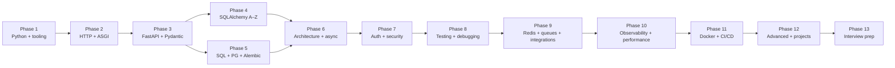

# Complete Learning Roadmap

The course is organized into 13 phases. Each phase lists its prerequisite phase, expected outcomes, recommended pacing, and a readiness check. **Do not skip the readiness check.** Phases build on each other; later phases assume fluency with earlier material.

## Phase 1: Python foundations and professional tooling

**Prerequisite:** None beyond "can read Python".

**Folder:** [[01-Python-Foundations]]

**Lessons:**
- [[01-Python-Foundations/00-Python-MOC]]
- [[01-Python-Foundations/Values-Objects-Mutability]]
- [[01-Python-Foundations/Functions-Scope-Closures-Decorators]]
- [[01-Python-Foundations/Classes-Protocols-Structural-Typing]]
- [[01-Python-Foundations/Iterators-Generators-Context-Managers]]
- [[01-Python-Foundations/Type-Hints-and-Annotations]]
- [[01-Python-Foundations/Exceptions-Done-Right]]
- [[01-Python-Foundations/uv-Tooling-Workflows]]
- [[01-Python-Foundations/Project-Layout-and-Imports]]
- [[01-Python-Foundations/pytest-Fundamentals]]

**Outcomes:**
- Reason confidently about mutability, references, and identity.
- Read and write modern Python type hints, including generics and protocols.
- Use `uv` to manage projects, dependency groups, and reproducible installs.
- Diagnose import errors and circular imports.
- Write parameterized tests with `pytest`.

**Readiness check:** Without looking, explain why `def f(x=[])` is dangerous, why `from __future__ import annotations` changes runtime behavior, and what happens when you `await` a coroutine without scheduling it.

**Pacing:** 2–4 weeks depending on prior Python depth.

## Phase 2: HTTP, web fundamentals, and ASGI

**Prerequisite:** Phase 1.

**Folders:** [[02-Web-and-HTTP]], [[02b-Backend-Foundations]]

**Lessons (Web/HTTP):**
- [[02-Web-and-HTTP/00-Web-MOC]]
- [[02-Web-and-HTTP/HTTP-Request-Lifecycle]]
- [[02-Web-and-HTTP/Methods-Status-Headers-Content-Types]]
- [[02-Web-and-HTTP/REST-and-Pragmatic-API-Design]]
- [[02-Web-and-HTTP/Idempotency-Safe-Retries-Pagination]]
- [[02-Web-and-HTTP/CORS-Caching-Headers-Conditional-Requests]]
- [[02-Web-and-HTTP/ASGI-Starlette-Uvicorn]]

**Lessons (Backend Foundations):**
- [[02b-Backend-Foundations/00-Backend-Foundations-MOC]]
- [[02b-Backend-Foundations/HTTP-Headers-Deep-Dive]]
- [[02b-Backend-Foundations/HTTP-Cookies-Deep-Dive]]
- [[02b-Backend-Foundations/Session-Management]]
- [[02b-Backend-Foundations/CSRF-Protection]]
- [[02b-Backend-Foundations/Content-Negotiation]]
- [[02b-Backend-Foundations/Request-Body-Forms-and-Uploads]]
- [[02b-Backend-Foundations/Authentication-State-Storage]]
- [[02b-Backend-Foundations/HTTP-Caching-Headers-Deep-Dive]]
- [[02b-Backend-Foundations/Health-Checks-and-Probes]]
- [[02b-Backend-Foundations/Pagination-Deep-Dive]]
- [[02b-Backend-Foundations/Problem-Details-RFC-7807]]
- [[02b-Backend-Foundations/JWT-vs-Sessions-vs-Cookies]]
- [[02b-Backend-Foundations/Real-Time-Transports-Compared]]
- [[02b-Backend-Foundations/API-Versioning-Strategies]]
- [[02b-Backend-Foundations/Resumable-and-Chunked-Uploads]]

**Outcomes:**
- Trace an HTTP request from the client through DNS, TCP, TLS, the reverse proxy, the ASGI server, and the framework.
- Choose appropriate status codes for common cases and explain idempotency.
- Configure CORS without cargo-culting `*`.
- Explain every `Set-Cookie` attribute (Secure, HttpOnly, SameSite, Partitioned) and choose correctly.
- Choose between server-side sessions, signed cookies, and JWTs with honest trade-offs.
- Implement CSRF protection that fits your auth model.
- Negotiate content via `Accept` and version APIs via header when appropriate.
- Handle `multipart/form-data` uploads with size and MIME validation.
- Pick the right place to store auth state (Authorization header vs httpOnly cookie vs localStorage) and explain the XSS/CSRF trade-off matrix.
- Choose the right `Cache-Control` directives for browser, CDN, and origin; understand `Vary: Authorization` poisoning and the `Cache-Status` (RFC 9211) header.
- Wire three Kubernetes probes (liveness, readiness, startup) and a SIGTERM-aware graceful shutdown.
- Implement keyset pagination with an opaque cursor and the `Link: rel="next"` (RFC 8288) header.
- Emit RFC 9457 `application/problem+json` error responses for domain, validation, framework, and unhandled exceptions.
- Walk the JWT-vs-sessions-vs-cookies decision tree and pick the right pattern for a browser SPA, a mobile app, or a server-to-server integration.
- Walk the polling-vs-SSE-vs-WebSocket decision tree; pick the right transport for a notification stream, a chat feature, or a legacy client behind a buffering proxy.
- Pick an API-versioning strategy (URL path / header / content-type); ship v1 and v2 side by side with `Sunset` (RFC 8594) and `Deprecation` (RFC 9730) headers announcing the v1 kill-date; kill v1 with `410 Gone` on the announced date.
- Implement a resumable upload via the tus protocol (POST/HEAD/PATCH with `Upload-Offset`/`Upload-Length`); pick between tus (proxy through your app) and S3 multipart (direct-to-S3 via presigned URLs) based on the storage target; handle TTL expiry of abandoned uploads.

**Readiness check:** Explain what `409 Conflict` means versus `422 Unprocessable Entity`, and why a `POST` that creates a resource can still be safe-to-retry if the client sends an idempotency key.

## Phase 3: FastAPI fundamentals and Pydantic

**Prerequisite:** Phase 2.

**Folders:** [[03-FastAPI-Core]], [[04-Pydantic]]

**Read Pydantic Lessons 1–2 *before* FastAPI Lesson 3**

The Roadmap lists all seven 03-FastAPI-Core lessons before all five 04-Pydantic lessons for narrative flow, but **Pydantic Lessons 1 and 2 are formal prerequisites for FastAPI Lesson 3 ([[03-FastAPI-Core/Path-Query-Header-Cookie-Body]])**. That lesson declares `[[04-Pydantic/BaseModel-and-Validation]]` and `[[04-Pydantic/Fields-Annotated-Reusable-Annotations]]` as prerequisites in its frontmatter, and Lesson 3's prose immediately starts using `BaseModel`, `Field`, and the `Annotated[T, Field(...)]` form. Concretely: read 03.1 (Application-and-Lifespan) and 03.2 (Routers-and-Modular-Apps) first, then jump to 04.1 (BaseModel-and-Validation) and 04.2 (Fields-Annotated-Reusable-Annotations), then return to 03.3 onwards. Lessons 03.3–03.7 all build on Pydantic schemas.

**Lessons (FastAPI):**
- [[03-FastAPI-Core/00-FastAPI-MOC]]
- [[03-FastAPI-Core/Application-and-Lifespan]]
- [[03-FastAPI-Core/Routers-and-Modular-Apps]]
- [[03-FastAPI-Core/Path-Query-Header-Cookie-Body]]
- [[03-FastAPI-Core/Dependency-Injection]]
- [[03-FastAPI-Core/Middleware-and-Request-Order]]
- [[03-FastAPI-Core/Exception-Handlers]]
- [[03-FastAPI-Core/Background-Tasks-Streaming-Uploads]]
- [[03-FastAPI-Core/Sync-vs-Async-Path-Operations]]

**Lessons (Pydantic):**
- [[04-Pydantic/00-Pydantic-MOC]]
- [[04-Pydantic/BaseModel-and-Validation]]
- [[04-Pydantic/Fields-Annotated-Reusable-Annotations]]
- [[04-Pydantic/Validators-Strict-vs-Coercive]]
- [[04-Pydantic/Serialization-and-Model-Dump]]
- [[04-Pydantic/Pydantic-Settings]]
- [[04-Pydantic/Pydantic-vs-Dataclasses-vs-TypedDict]]

**Outcomes:**
- Build a modular FastAPI application with routers and dependency injection.
- Distinguish request schemas, response schemas, ORM models, and internal domain objects.
- Use `Annotated` for reusable typed dependencies.
- Configure the application via `pydantic-settings`.

## Phase 4: SQLAlchemy Core and ORM (the A–Z track)

**Prerequisite:** Phase 3.

**Folder:** [[07-SQLAlchemy]]

**Lessons:**
- [[07-SQLAlchemy/00-SQLAlchemy-MOC]] (the index to sub-tracks A–H)
- [[07-SQLAlchemy/01-Foundations-and-Architecture]]
- [[07-SQLAlchemy/02-Engines-Connections-Pools]]
- [[07-SQLAlchemy/03-Declarative-Base-and-Mapped]]
- [[07-SQLAlchemy/04-Relationships-and-Loading-Strategies]]
- [[07-SQLAlchemy/05-Session-and-Transaction-Management]]
- [[07-SQLAlchemy/06-Querying-with-select]]
- [[07-SQLAlchemy/07-Async-SQLAlchemy]]
- [[07-SQLAlchemy/08-Advanced-ORM]]
- [[07-SQLAlchemy/09-Add-vs-AddAll-vs-Bulk-Insert]]

This is the deepest single track in the course. Do not rush it.

## Phase 5: SQL fundamentals, PostgreSQL, Alembic

**Prerequisite:** Phase 4 (especially [[07-SQLAlchemy/01-Foundations-and-Architecture]]).

**Folders:** [[06-SQL-Fundamentals]], [[08-PostgreSQL]], [[09-Alembic-Migrations]]

**Outcomes:**
- Write joins, CTEs, and window functions in SQL before reaching for the ORM.
- Read a PostgreSQL `EXPLAIN ANALYZE` plan and know when an index is missing.
- Manage schema evolution with Alembic safely in production.

## Phase 6: Application architecture and async Python

**Prerequisite:** Phase 5.

**Folders:** [[05-Project-Architecture]], [[10-Async-Python]]

**Outcomes:**
- Refactor a toy FastAPI app into a clean layered structure (routers/services/repositories) and know when that is overkill.
- Explain why `async def` does not magically make blocking I/O non-blocking.
- Choose between sync and async SQLAlchemy honestly.

## Phase 7: Authentication, authorization, and security

**Prerequisite:** Phase 6.

**Folder:** [[11-Authentication-and-Security]]

**Outcomes:**
- Implement OAuth2 password flow with access and refresh tokens.
- Explain JWT trade-offs and the role of the `alg`, `exp`, `iss`, `aud` claims.
- Apply RBAC and object-level authorization.
- Recognize OWASP API Security risks in your own code.

## Phase 8: Testing and quality

**Prerequisite:** Phase 7.

**Folder:** [[12-Testing-and-Quality]]

**Outcomes:**
- Write unit, integration, and API tests with appropriate fixtures.
- Use dependency overrides and isolated test databases.
- Diagnose the most common test failures (import errors, project-root, fixture scope, async event loop).

## Phase 9: Redis, background jobs, and external integrations

**Prerequisite:** Phase 8.

**Folders:** [[14-Caching-and-Background-Processing]], [[15-External-Integrations]]

**Outcomes:**
- Design cache-aside with sane invalidation and stampede protection.
- Distinguish best-effort FastAPI background tasks from durable workers.
- Integrate an external HTTP service with timeouts, retries, and circuit breakers.
- Compose the three resilience patterns (timeout, bulkhead, circuit breaker) into one wrapper that defends against all three failure classes (slow response, resource exhaustion, persistent outage).

## Phase 10: Observability and performance

**Prerequisite:** Phase 9.

**Folder:** [[13-Performance-and-Observability]]

**Outcomes:**
- Add structured logging with request IDs.
- Read OpenTelemetry traces.
- Diagnose N+1 queries and slow endpoints from real measurements, not guesses.

## Phase 11: Docker, CI/CD, and deployment

**Prerequisite:** Phase 10.

**Folder:** [[16-Deployment-and-DevOps]]

**Outcomes:**
- Build a multi-stage Docker image that runs as a non-root user.
- Write a GitHub Actions workflow that lints, tests, builds, and pushes.
- Order migrations before application rollout and after rollback.
- Choose between VM, Kubernetes, serverless, and managed app platform for a given workload, and defend the choice in a senior interview.
- Choose between rolling, blue-green, and canary deploys; between push-based CI/CD and GitOps.

**Lessons:**
- [[16-Deployment-and-DevOps/00-Deployment-MOC]]
- [[16-Deployment-and-DevOps/Docker-Multi-Stage-Non-Root]]
- [[16-Deployment-and-DevOps/Docker-Compose-Local-Dev]]
- [[16-Deployment-and-DevOps/GitHub-Actions-CI]]
- [[16-Deployment-and-DevOps/Migration-Ordering-and-Rollback]]
- [[16-Deployment-and-DevOps/Deployment-Targets-When-To-Use-What]]

## Phase 12: Advanced architecture and portfolio projects

**Prerequisite:** Phase 11.

**Folders:** [[17-Advanced-Architecture]], [[18-Portfolio-Projects]]

**Outcomes:**
- Implement multi-tenancy, idempotency, transactional outbox.
- Defend the modular-monolith-vs-microservices choice with the four-stage spectrum, Conway's Law, and the extract-service pattern.
- Ship at least one of the seven portfolio projects end to end.
- For the AI-augmented capstone (Project 07): ship pgvector HNSW RAG retrieval, streaming LLM completions over SSE, an arq embedding worker reading the outbox, per-tenant token-bucket rate limits + monthly budget, a circuit breaker on the LLM provider, HMAC-signed CRM webhooks, and OpenTelemetry spans on every AI call.

**Lessons:**
- [[17-Advanced-Architecture/00-Advanced-Architecture-MOC]]
- [[17-Advanced-Architecture/Multi-Tenancy]]
- [[17-Advanced-Architecture/Idempotency-and-Retries]]
- [[17-Advanced-Architecture/Event-Driven-Basics]]
- [[17-Advanced-Architecture/Modular-Monolith-vs-Microservices]]

## Phase 13: Interview preparation and independent practice

**Prerequisite:** All.

**Folders:** [[19-Interview-Preparation]], [[20-Exercises-and-Labs]]

**Outcomes:**
- Answer FastAPI / SQLAlchemy / async / security questions with structured model answers.
- Debug failing tests and stack traces you have never seen.
- Design a backend system from a vague prompt.

---

## Non-goals (what this course does not teach)

- Frontend frameworks. The companion Vault Browser is a Next.js app, but its frontend is not the subject of the curriculum.
- Mobile development.
- Data engineering pipelines (Airflow, Spark, etc.).
- Machine learning.

If you need any of the above, the [[21-Reference-Library/00-Reference-MOC]] points to reputable external starting points.
