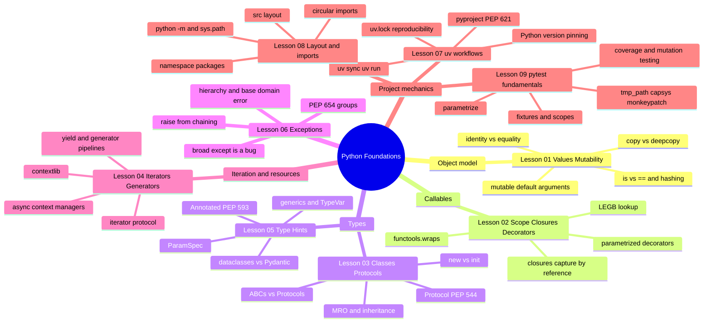
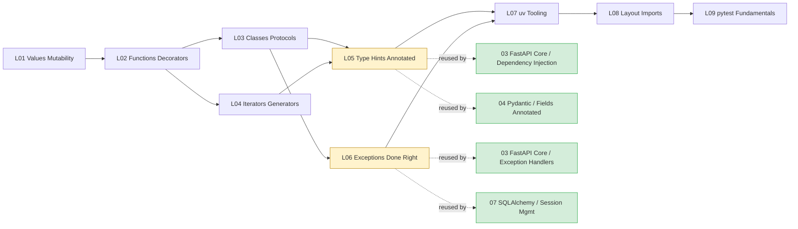

# Python Foundations: Map of Content

*Phase 1 of the FastAPI Engineering Academy. The nine lessons that follow are the ground truth everything else in the vault stands on.*

**Welcome to Phase 1.**

Hello, friend. Pull up a chair. Before you write a single FastAPI route, before you configure your first Pydantic model, before you migrate your first Alembic revision — you need to *truly* understand the language those tools are written in. Every "weird Python bug" you will meet in production (a mutable default that bleeds across requests, a closure that captures the wrong variable, a decorator that hides the wrong metadata, a type annotation that is silently ignored at runtime) traces back to one of the nine lessons in this section. Take your time. Type every code sample. Break it. Fix it. **This is how you learn.**

#python #foundations #moc

## What this section is

This is not a Python tutorial. We assume you can already read a `for` loop, define a `class`, and write a `def`. What we do here is go deeper than the surface — to the point where you can *predict* what CPython will do with a line before you run it. That predictive power is what separates the engineer who writes FastAPI routes that work from the engineer who writes FastAPI routes that scale.

Each lesson is structured the same way: a real runnable program first, then a line-by-line deep dive where every meaningful line is explained in three voices — *what it does*, *why it is there*, and *what Python does internally*. By the end of Phase 1 you will have a small but real library called `notesearch` (a tiny in-memory full-text-search engine) that you have built line by line, lesson by lesson. We will keep extending `notesearch` through the rest of the academy.

## Lessons in prerequisite order

| # | Lesson | One-line teaser | Time |
| --- | --- | --- | --- |
| 00 | [[01-Python-Foundations/00-Python-MOC\|This Map of Content (start here)]] | Orientation, verified versions (Oct 2026), the `notesearch` build arc, and four reading paths through the nine lessons. | 5 min |
| 01 | [[01-Python-Foundations/Values-Objects-Mutability\|Values, Objects, Mutability]] | Why `def f(x=[]): ...` is a bug, why tuples can still mutate, and the difference between `is` and `==`. | 60–90 min |
| 02 | [[01-Python-Foundations/Functions-Scope-Closures-Decorators\|Functions, Scope, Closures, Decorators]] | LEGB lookup, closures that capture by reference, decorators built from scratch, parameterized decorators with `functools.wraps`. | 75–100 min |
| 03 | [[01-Python-Foundations/Classes-Protocols-Structural-Typing\|Classes, Protocols, Structural Typing]] | `__new__` vs `__init__`, MRO, inheritance vs composition, `typing.Protocol` (PEP 544), ABCs vs Protocols — and when each wins. | 75–100 min |
| 04 | [[01-Python-Foundations/Iterators-Generators-Context-Managers\|Iterators, Generators, Context Managers]] | The iterator protocol, `yield`, generator pipelines, `contextlib.contextmanager`, async context managers — and why `with` is the only sane way to manage an engine or a session. | 75–100 min |
| 05 | [[01-Python-Foundations/Type-Hints-and-Annotations\|Type Hints and Annotations]] | The canonical lesson for `Annotated` and type hints overall. PEP 593 `Annotated[T, X]`, PEP 604 `X | Y`, `ParamSpec`, `TypeVar`, `dataclasses` vs Pydantic, and a preview of `Annotated[int, Depends(...)]`. | 90–120 min |
| 06 | [[01-Python-Foundations/Exceptions-Done-Right\|Exceptions Done Right]] | The canonical lesson for Python exceptions. The hierarchy, `raise from` chaining, a base domain exception with subclasses, why broad `except Exception: pass` is a bug, PEP 654 exception groups. | 75–100 min |
| 07 | [[01-Python-Foundations/uv-Tooling-Workflows\|uv Tooling Workflows]] | `uv init`, `pyproject.toml` (PEP 621), dependency groups, `uv sync`, `uv.lock`, `uv run`, Python version pinning, Windows PowerShell pitfalls. | 60–90 min |
| 08 | [[01-Python-Foundations/Project-Layout-and-Imports\|Project Layout and Imports]] | `src/` vs flat layout, namespace packages vs regular packages, absolute vs relative imports, breaking circular imports, `python -m`, `sys.path`, build-system basics. | 60–90 min |
| 09 | [[01-Python-Foundations/pytest-Fundamentals\|pytest Fundamentals]] | `assert`, `pytest.raises`, fixtures with `function`/`class`/`module`/`session` scope, `conftest.py`, `parametrize`, marks, `tmp_path`, `capsys`/`capfd`, coverage with `pytest-cov`. | 75–100 min |

Total estimated time: 9–14 hours of focused study, plus the exercises. Row 00 is this orientation page itself; rows 01–09 are the nine numbered lessons in prerequisite order.

## How the nine lessons fit together

## Dependency graph

Read in order. Lessons 05 and 06 are the canonical reference points for `Annotated`/type hints and Python exceptions respectively — every later section that touches those concepts links back here instead of re-explaining.

The yellow nodes (Lessons 05 and 06) are the two canonicals for this section. Their `first_taught_in` paths are recorded in [[00-Start-Here/Concept-Registry]] and reused by every downstream section. When you see `[[01-Python-Foundations/Type-Hints-and-Annotations]]` or `[[01-Python-Foundations/Exceptions-Done-Right]]` in a later lesson, that is a back-reference to Phase 1.

## The growing application: `notesearch`

Across the nine lessons you will build `notesearch`, a tiny in-memory full-text-search library. Each lesson contributes one piece, so by Lesson 09 you have a real, tested, installable package you wrote yourself.

- **Lesson 01.** An in-memory inverted index built from `dict[str, list[int]]`. The lesson focuses on aliasing, the mutable-default bug, and `copy.deepcopy`.
- **Lesson 02.** A decorator-based registry of tokenizers (`@register_tokenizer("default")`, `@register_tokenizer("whitespace")`). Closures power query parsing.
- **Lesson 03.** Real `Document`, `Indexer`, `Searcher` classes. A `Tokenizer` `Protocol` so any duck-typed tokenizer works.
- **Lesson 04.** Tokenization as a generator pipeline. A context manager that opens and closes a file-backed index safely.
- **Lesson 05.** Type-annotate everything. Introduce `Annotated[str, Field(description=...)]`-style metadata.
- **Lesson 06.** `NotesearchError` base, `IndexBuildError`, `QueryParseError`, `TokenizerNotFoundError`. Cleanly chained `raise ... from ...`.
- **Lesson 07.** Promote `notesearch` from a script to a real `uv`-managed package with a `pyproject.toml`.
- **Lesson 08.** Move `notesearch` to the `src/notesearch/` layout; wire absolute imports and break one circular import.
- **Lesson 09.** A `tests/` directory with fixtures, `parametrize`, `tmp_path`, and `coverage` at 100% of the public API.

By the end of the academy, `notesearch` is the example you reach for whenever you need to demonstrate a Python concept in isolation. It is small enough to read in one sitting and rich enough to exercise every foundation.

## How to read this section

**Tip — The single most important habit**

Type the code yourself. Do not copy-paste. The mechanical act of typing each line, fixing typos, and reading the tracebacks your typos produce is what builds the muscle memory that lets you read other people's Python without panic. The verified-versions table below shows what we tested every code block against. If your versions drift, expect small differences in output and traceback wording — and treat those differences as a learning opportunity, not an obstacle.

### Verified versions (October 2026)

| Tool | Version | Source |
| --- | --- | --- |
| Python | 3.12 (canonical learner version) — 3.13 also supported | https://docs.python.org/3.12/ |
| uv | 0.13.1 | https://docs.astral.sh/uv/ |
| pytest | 8.x (verified against 8.4.x) | https://docs.pytest.org/en/stable/ |
| ruff | 0.7.x | https://docs.astral.sh/ruff/ |
| mypy | latest stable as of Oct 2026 | https://mypy.readthedocs.io/ |
| pyright | latest stable as of Oct 2026 | https://microsoft.github.io/pyright/ |

Anything older than Python 3.10 will break the PEP 604 `X | Y` syntax used in later lessons. Anything older than Python 3.9 will break `list[int]` syntax. We pin to 3.12 because that is what the rest of the academy (FastAPI, Pydantic v2, SQLAlchemy 2.x, uv) tests against.

## What this section is *not*

- **Not a beginner's Python tutorial.** If `def`, `class`, and `import` are foreign to you, work through the official Python tutorial (https://docs.python.org/3/tutorial/) first and come back when you can read a 50-line script without panic.
- **Not an async primer.** Async is its own section ([[10-Async-Python/00-Async-MOC]]) and depends on the foundations here. We touch `async with` briefly in Lesson 04 because the FastAPI lifespan depends on it, but the deep async coverage belongs to Section 10.
- **Not exhaustive.** Topics that matter primarily in a FastAPI/Pydantic/SQLAlchemy context (descriptor protocol internals, metaclasses, `__init_subclass__`, `__set_name__`) appear as needed in their respective sections. We do not teach them here for the sake of completeness.

## Cross-section links

- `Annotated` and `type hints` are first taught here in [[01-Python-Foundations/Type-Hints-and-Annotations]] and reused in nearly every later section — most notably [[03-FastAPI-Core/Dependency-Injection]] and [[04-Pydantic/Fields-Annotated-Reusable-Annotations]].
- `Exceptions (Python)` is first taught here in [[01-Python-Foundations/Exceptions-Done-Right]] and reused by [[03-FastAPI-Core/Exception-Handlers]], [[07-SQLAlchemy/05-Session-and-Transaction-Management]], and [[12-Testing-and-Quality/Async-Testing]].
- The `uv` workflow taught in Lesson 07 is the substrate for every runnable code block in the vault. When a later lesson says `uv run pytest` or `uv run uvicorn`, that command was introduced here.

## Reading paths

- **The full foundational path.** Lessons 01 through 09, in order. Take two weeks. Do every exercise. This is what we recommend.
- **The FastAPI-fast-track path.** If you are confident in Python and just need a refresher: read Lessons 05 (type hints) and 06 (exceptions) in full, skim 01–04, and skip 07–09 if you already know `uv` and `pytest`. You will be back, though — every senior engineer eventually is.
- **The "I keep getting bitten by bugs" path.** Lessons 01 (mutability), 02 (closures), 06 (exceptions), 09 (pytest). These are the four that catch even experienced engineers.
- **The testing-focused path.** Lessons 07 (uv) → 08 (layout) → 09 (pytest), then jump to [[12-Testing-and-Quality/Test-Pyramid-and-Fixtures]]. If you can already read Python but your test suites are thin, flaky, or absent, this path rebuilds the testing muscle first and back-fills the foundations as the suite demands them. Budget one weekend.

## What's next

When you can write, run, and explain all nine lessons without checking the reference, you are ready for [[02-Web-and-HTTP/00-Web-MOC]]. The HTTP and ASGI section assumes you arrive with the Python foundations fresh in your mind — particularly type hints (Lesson 05), exceptions (Lesson 06), and async context managers (Lesson 04).

## Sources

- Python 3.12 documentation — https://docs.python.org/3.12/ (accessed 2026-10-15)
- uv documentation — https://docs.astral.sh/uv/ (verified for 0.13.1, accessed 2026-10-15)
- pytest documentation — https://docs.pytest.org/en/stable/ (verified for 8.x, accessed 2026-10-15)
- ruff documentation — https://docs.astral.sh/ruff/ (verified for 0.7.x, accessed 2026-10-15)
- PEP 593 (Annotated types) — https://peps.python.org/pep-0593/
- PEP 604 (X | Y syntax) — https://peps.python.org/pep-0604/
- PEP 544 (Protocols) — https://peps.python.org/pep-0544/
- PEP 654 (Exception groups) — https://peps.python.org/pep-0654/
- PEP 621 (pyproject.toml) — https://peps.python.org/pep-0621/
- PEP 695 (type parameter syntax) — https://peps.python.org/pep-0695/

## What We Learned

- Phase 1 has nine lessons in prerequisite order; lessons 05 and 06 are canonical for `Annotated`/type hints and Python exceptions respectively.
- The growing application is `notesearch`, a tiny full-text-search library you build piece by piece across all nine lessons.
- Verified October 2026 versions: Python 3.12 (or 3.13), uv 0.13.1, pytest 8.x, ruff 0.7.x.
- The next section is [[02-Web-and-HTTP/00-Web-MOC]].
