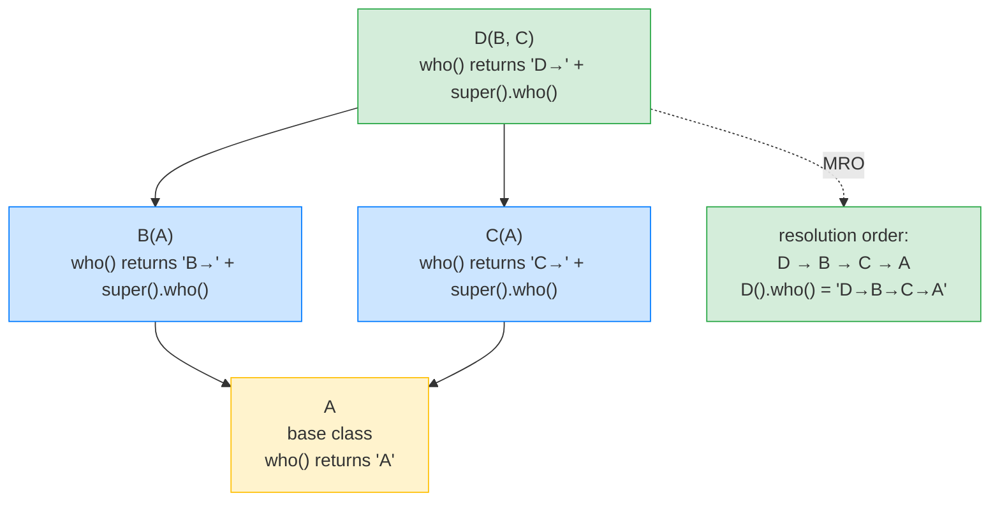

# Lesson 03: Classes, Protocols, Structural Typing

*Turning `notesearch`'s bag of functions into a real class hierarchy — `Indexer`, `Searcher`, `Document` — and adding a `Tokenizer` `Protocol` so any duck-typed tokenizer plugs in cleanly.*

**Welcome to Lesson 03.**

Hello, friend. Pull up a chair. Classes in Python are simpler than people tell you. There is no constructor overloading, no virtual/override keywords, no header files — just `class`, `__init__`, and a small set of dunder methods that you can opt into. The interesting part is *when* Python uses each dunder and how the Method Resolution Order (MRO) decides which class's method wins when you have diamond inheritance. By the end of this lesson, you will understand `super().__init__()` well enough to explain why it is not a no-op, and you will know whether to reach for an `ABC` or a `Protocol` when you want a plugin contract. Take your time. Type every line. **This is how you learn.**


#python #foundations #classes #protocols #mro

## Learning Objectives

By the end of this lesson you will be able to:

1. **Explain the difference between `__new__` and `__init__`**, and write a class that overrides `__new__` for a reason (singleton, interning, immutable instance).
2. **Read `super()` correctly** — not as "call the parent class" but as "call the next class in the MRO."
3. **Predict the MRO of a class hierarchy** using C3 linearisation, and explain why the diamond pattern works in Python at all.
4. **Choose between inheritance and composition** with a clear rule, and apply it to `notesearch`'s `Indexer` design.
5. **Define a `typing.Protocol` (PEP 544)** that captures the structural shape of a "tokenizer" without forcing implementers to inherit.
6. **Use `@runtime_checkable`** to enable `isinstance` checks on a Protocol, and explain the (severe) limits of those checks.
7. **Compare `ABC` (abstract base class) and `Protocol`** for plugin contracts — when each wins, when each is a footgun.
8. **Implement `__eq__`, `__hash__`, and `__repr__` consistently** so your instances work as dict keys and print usefully in tracebacks.
9. **Use `@dataclass`** for value-object classes, and explain when `@dataclass(frozen=True)` is the right choice over a hand-rolled class.
10. **Read a class's `__dict__`, `__mro__`, and `__bases__`** well enough to debug a metaclass surprise in someone else's library.

## Prerequisites

Before starting, you need:

- **Lesson 01 — [[01-Python-Foundations/Values-Objects-Mutability]]**. Identity vs equality (`is` vs `==`) is the foundation of `__eq__` and `__hash__`.
- **Lesson 02 — [[01-Python-Foundations/Functions-Scope-Closures-Decorators]]**. The registry decorator from Lesson 02 becomes an instance method on `Indexer` here.
- **Python 3.12** (or 3.13) in your REPL.
- **About an hour and a half of focused time.**

**The most common gap: `super()` is not "the parent class."**

If you came to Python from Java, your mental model of `super()` is "call the parent's method." That is *almost* right for single inheritance, but it breaks down for multiple inheritance — where `super()` actually means "the next class in the MRO." We will demonstrate this concretely with a diamond hierarchy where `super()` from a subclass calls a *sibling* method, not a parent. Once you have that picture, the MRO is not magic; it is just C3 linearisation.


## Think Like a Senior Engineer

Before the code, the mental model. The single reframe in this lesson is: *a `Protocol` is the duck-typing you can type-check*. Read this section slowly — every confusion about `Protocol` vs `ABC`, every surprise about `runtime_checkable`, every "but mypy said it was fine" production bug reduces to one of the three questions below answered badly.

### The reframe: structural vs nominal — the duck-typing you can type-check

A senior reading `class Tokenizer(Protocol): ...` does not see "a class." They see a *structural contract*: a description of a shape that any object can satisfy by happening to have the right attributes and methods, regardless of where it was defined or what it inherits from. This is the duck-typing Python has always done at runtime ("if it walks like a duck...") — but pinned down at *type-check time* by mypy and Pyright. PEP 544 (December 2019) gave the duck a name and a checking algorithm.

Contrast with the *nominal* contract: `class TokenizerABC(ABC): ...` — implementers must inherit from `TokenizerABC`, must import your module, and the type checker verifies the *inheritance link*, not the shape. The check is "is this object a `TokenizerABC`?" not "does this object have the shape of a `Tokenizer`?" `isinstance(x, TokenizerABC)` walks the class hierarchy (`type(x).__mro__`); `isinstance(x, Tokenizer)` with `@runtime_checkable` walks the Protocol's `__protocol_attrs__` (a frozenset computed at class-creation time) and tests `hasattr` for each. The two checks look the same syntactically — they are not the same operation.

The senior's three questions before reaching for either:

1. **Who controls the implementer?** If you control both sides (your internal `Indexer` and your internal `InMemoryIndexer` subclass), nominal typing via `ABC` is fine — the inheritance link is real, mypy checks it both ways, and `isinstance` is cheap and accurate. If you do not control the implementer (a third-party plugin author, a downstream user who has never imported your library), only structural typing via `Protocol` works — the implementer writes a class with the right shape and never mentions you.
2. **Is the check at type-check time or at runtime?** A `Protocol`'s real check is *static* (mypy/Pyright walking the Protocol's members against the candidate class). The runtime check (`isinstance(x, Tokenizer)` with `@runtime_checkable`) is shallow — it checks attribute *existence*, not attribute *types*. The senior's rule: trust the static check, never trust the runtime check as a type-safety boundary. Use `isinstance(x, Protocol)` only for "does this duck quack *at all*" — never for "is this the duck I asked for."
3. **If I delete this abstraction tomorrow, what breaks?** If the answer is "the test fake breaks and nothing else," the abstraction is doing test-isolation work — keep it but be honest. If the answer is "nothing breaks," the abstraction is ceremony — delete it. The `AbstractTokenizer(Tokenizer)` shape with one implementation is the canonical cargo-cult: a nominal contract with one nominal implementer, where the abstract base is a copy of the Protocol which is a copy of the implementation's signature. See also [[05-Project-Architecture/Service-and-Repository-Patterns]] for the same smell in the repository layer.

### The shape of the contract tools, side by side

| Tool | Contract type | Check time | Runtime cost (CPython 3.12, measured) | Best for |
|---|---|---|---|---|
| `Protocol` (PEP 544) | Structural | Static (mypy/Pyright) + shallow runtime (`@runtime_checkable`) | `isinstance` ~450 ns/call, roughly constant in member count | Third-party plugins, structural contracts, fake repositories in tests |
| `ABC` (PEP 3119) | Nominal | Static + runtime (`ABCMeta.__instancecheck__`) | `isinstance` ~250 ns/call (MRO walk, depth-dependent) | Internal hierarchies where you control every subclass |
| `@dataclass(frozen=True)` | None (a class shape) | None (it is a code generator) | Zero runtime overhead vs hand-rolled | Internal value objects with `__eq__`/`__hash__` |
| `BaseModel` (Pydantic v2) | Structural (a schema) | Static + runtime (validators) | Validation + serialization cost (~1-10 μs per instance) | API boundaries (HTTP bodies, config from env) |

The senior reading this table does not see four competitors. They see four tools for four jobs. A `notesearch` internal `Document` is a `@dataclass(frozen=True)` because it is an internal value object with one invariant. The same `Document` becomes a `BaseModel` the day it crosses an HTTP boundary. The `Tokenizer` is a `Protocol` because third-party plugin authors need to plug in. The hypothetical `Indexer`/`PersistentIndexer` hierarchy (if we had one) would use `ABC` because we control both subclasses. Pick by the contract type and the check time, not by familiarity.

### The price of structural typing (and why you pay it anyway)

Structural typing has three costs the senior internalises:

1. **No runtime enforcement of types.** `isinstance(x, Tokenizer)` is `True` for any object with a `name` attribute and a `__call__` method, *regardless of their types*. A `Tokenizer` declared `name: str` will accept an object whose `name` is `int(42)`. The type checker catches this statically; the runtime cannot.
2. **No inherited method bodies.** A `Protocol` can declare concrete methods (PEP 544 allows it), but those methods are *not inherited* by structurally conforming classes — the `Protocol` is a shape description, not a base class. If you want shared implementation, use an `ABC` (or a mixin, or composition). The `Protocol` is a contract; the `ABC` is a contract *and* a base class.
3. **Refactoring is harder.** Rename a method on an `ABC` and mypy finds every implementer. Rename a method on a `Protocol` and mypy finds every implementer that *explicitly* declares `class Foo(Tokenizer):` — but it cannot find implementers that *structurally* satisfy the Protocol without declaring it. A third-party plugin that wrote `class TheirTokenizer: ...` with the right shape will silently break when you rename `name` to `token_name`. The fix is the smoke test in your integration tests: an `isinstance(TheirTokenizer(), Tokenizer)` call against an example plugin, plus the explicit `class Foo(Tokenizer):` declaration whenever the implementer is willing to depend on your library.

You pay these costs because the alternative — forcing every plugin author to inherit from your `ABC` — is worse. The cost is the contract; the contract is the cost.

### The senior question for every class in the file

When you finish `notesearch_v3.py`, walk every `class` and `def` and ask: *if I delete this tomorrow, what breaks?* If the answer is "the third-party plugin contract breaks," the `Protocol` is doing real work. If the answer is "the unit test fake breaks," the `Protocol` is doing test-isolation work — be honest about that. If the answer is "nothing breaks," delete the abstraction. The same question, applied class by class, scales to a 500-class codebase.

## The Problem

`notesearch` v2 had four top-level functions (`build_index`, `search`, `register_tokenizer`, `get_tokenizer`) and a `Query` value class. For a 100-line library that is fine. For a 1000-line library, four top-level functions become fifty, and there is no way to have two indexes with different configurations (e.g. one with the default tokenizer and one with the stemmer) because the registry is module-level.

The clean solution is to wrap the index and the registry in an `Indexer` class:

```python
class Indexer:
 def __init__(self, tokenizer: Tokenizer) -> None:
 self._tokenizer = tokenizer
 self._index: dict[str, list[int]] = {}
 self._registry: dict[str, Tokenizer] = {}

 def register_tokenizer(self, name: str) -> Callable[..., ...]:
 ...

 def add_document(self, doc_id: int, text: str) -> None:
 ...

 def search(self, word: str) -> list[int]:
 ...
```

That is straightforward OOP. The interesting questions are:

1. **What is `Tokenizer`?** It can be a `Callable[[str], list[str]]` (a typing primitive), an `ABC` (a class with abstract methods), or a `Protocol` (PEP 544, structural typing). Each has different implications for who can implement one.
2. **Should `Indexer` be a base class with subclasses `InMemoryIndexer` and `PersistentIndexer`?** Or should it compose a `Backend` instance? (Inheritance vs composition.)
3. **What does `super().__init__()` actually do** in `Indexer.__init__`? And is it a no-op if `Indexer`'s only base is `object`?
4. **How do we make a `Document` value object** that is immutable and hashable so it works as a dict key — without writing ten dunder methods by hand?

This lesson answers all four and produces `notesearch` v3.

**Note — Historical context — Python's old vs new classes**

Python 2 had two kinds of class: "old-style" (which did not inherit from `object`) and "new-style" (which did). Old-style classes had a broken MRO and no descriptors. Python 3 (2008) eliminated old-style classes; in 3.12 every class inherits from `object` either directly or transitively. The MRO algorithm is C3 linearisation (introduced in Python 2.3 for new-style classes). If you read old blog posts mentioning "new-style classes," remember: in 3.12 every class is new-style.


## The Code

Here is `notesearch` v3 — ~120 lines. We add a `Tokenizer` Protocol, a `Document` dataclass, an `Indexer` class with a per-instance registry, and a small diamond hierarchy to demonstrate the MRO.

```python
# notesearch_v3.py
"""notesearch v3 — classes, Protocol, MRO demonstration."""
from __future__ import annotations

from dataclasses import dataclass, field
from typing import Protocol, runtime_checkable, Any
from collections.abc import Callable


# --- 1. A Protocol for tokenizers (PEP 544) --------------------------------

@runtime_checkable
class Tokenizer(Protocol):
 """A tokenizer: callable that takes a string and returns a list of tokens."""
 name: str # attribute contract

 def __call__(self, text: str) -> list[str]: ...


# --- 2. A Document value object (frozen dataclass) -------------------------

@dataclass(frozen=True)
class Document:
 """An immutable document: id + text. Hashable, so usable as a dict key."""
 doc_id: int
 text: str

 def __post_init__(self) -> None:
 # Frozen dataclass: cannot assign, must use object.__setattr__.
 if self.doc_id < 0:
 raise ValueError(f"doc_id must be non-negative, got {self.doc_id}")


# --- 3. A concrete tokenizer (structurally satisfies Tokenizer) -------------

class DefaultTokenizer:
 """The default tokenizer: lowercase + split."""
 name: str = "default"

 def __call__(self, text: str) -> list[str]:
 return text.lower().split()


# --- 4. Indexer: a real class with per-instance state ----------------------

class Indexer:
 """An in-memory inverted index with a per-instance tokenizer registry."""

 def __init__(self, tokenizer: Tokenizer, *, case_sensitive: bool = False) -> None:
 super().__init__() # calls object.__init__ — a no-op for single inheritance
 self._tokenizer: Tokenizer = tokenizer
 self._case_sensitive: bool = case_sensitive
 self._index: dict[str, list[int]] = {}
 self._registry: dict[str, Tokenizer] = {}

 def __repr__(self) -> str:
 return f"Indexer(tokenizer={self._tokenizer!r}, words={len(self._index)})"

 def register_tokenizer(self, name: str) -> Callable[[Tokenizer], Tokenizer]:
 """Decorator factory: register a tokenizer under `name` on this instance."""
 def decorator(func: Tokenizer) -> Tokenizer:
 self._registry[name] = func
 return func
 return decorator

 def get_tokenizer(self, name: str) -> Tokenizer:
 return self._registry[name]

 def add_document(self, doc: Document) -> None:
 tokens = self._tokenizer(doc.text)
 for token in tokens:
 postings = self._index.setdefault(token, [])
 if doc.doc_id not in postings:
 postings.append(doc.doc_id)

 def search(self, word: str) -> list[int]:
 return list(self._index.get(word, [])) # defensive copy


# --- 5. A diamond hierarchy to demonstrate the MRO ------------------------

class A:
 def who(self) -> str:
 return "A"

class B(A):
 def who(self) -> str:
 return f"B->{super().who()}"

class C(A):
 def who(self) -> str:
 return f"C->{super().who()}"

class D(B, C):
 def who(self) -> str:
 return f"D->{super().who()}"


# --- 6. Demo ----------------------------------------------------------------

if __name__ == "__main__":
 # Protocol: structural — any object with name + __call__ works
 tok = DefaultTokenizer()
 print("isinstance(tok, Tokenizer):", isinstance(tok, Tokenizer))

 # A plain function with the right shape does NOT satisfy a Protocol
 # that requires a `name` attribute (it has none).
 def fn_tokenizer(text: str) -> list[str]:
 return text.upper().split()
 print("isinstance(fn_tokenizer, Tokenizer):", isinstance(fn_tokenizer, Tokenizer))

 # Document is hashable + immutable
 doc = Document(doc_id=1, text="FastAPI is fast")
 print("doc:", doc)
 print("hash(doc):", hash(doc))

 # Indexer with per-instance registry
 idx = Indexer(tok)
 print("idx:", idx)
 idx.add_document(doc)
 idx.add_document(Document(doc_id=2, text="Pydantic validates FastAPI"))
 print("search 'fastapi':", idx.search("fastapi"))

 # Try the bad Document
 try:
 Document(doc_id=-1, text="bad")
 except ValueError as e:
 print("rejected:", e)

 # MRO demonstration
 print("D MRO:", [c.__name__ for c in D.__mro__])
 print("D().who():", D().who())
```

## Line-by-Line Deep Dive

This is the heart of the lesson. Read it twice. Do not skip.

### Lines 1–7: Imports

```python
from __future__ import annotations

from dataclasses import dataclass, field
from typing import Protocol, runtime_checkable, Any
from collections.abc import Callable
```

**What it does:** Imports `dataclass` and `field` from `dataclasses`, `Protocol` and `runtime_checkable` from `typing`, and `Callable` from `collections.abc`.

**Why `from typing import Protocol` and not `collections.abc`?** `Protocol` lives in `typing` because it is a *type-system* feature, not a runtime ABC. `runtime_checkable` is a marker that tells the type checker "this Protocol supports `isinstance()`" (more on this below). The other ABCs (`Callable`, `Iterable`, etc.) live in `collections.abc` since Python 3.9 (PEP 585). `Protocol` is still in `typing` as of 3.12.

### Lines 11–17: The `Tokenizer` Protocol

```python
@runtime_checkable
class Tokenizer(Protocol):
 """A tokenizer: callable that takes a string and returns a list of tokens."""
 name: str # attribute contract

 def __call__(self, text: str) -> list[str]: ...
```

**What it does:** Defines a `Protocol` — a structural type. Any class that has a `name: str` attribute *and* a `__call__(self, text: str) -> list[str]` method satisfies `Tokenizer`, regardless of whether it inherits from `Tokenizer` or even imports the module.

**Why Protocol and not ABC?** An `ABC` requires the implementer to inherit from it (`class DefaultTokenizer(TokenizerABC): ...`). That forces a coupling: the implementer must import your module. A `Protocol` requires only structural conformance: the implementer writes a class with the right shape and *optionally* declares `class DefaultTokenizer: ...` without ever mentioning `Tokenizer`. This is the same idea as TypeScript's structural typing and Go's interfaces.

**Why `@runtime_checkable`?** By default, `isinstance(x, Tokenizer)` raises `TypeError` for Protocols — because checking structural conformance at runtime is *expensive* (you have to walk every attribute). `@runtime_checkable` opts into a *shallow* check: it only checks that the attribute names exist, not that the types match. So `isinstance(tok, Tokenizer)` is `True` if `tok` has a `name` attribute and a `__call__` method — *regardless* of their types.

**Warning — `runtime_checkable` only checks attribute names.**

```python
@runtime_checkable
class HasName(Protocol):
name: int # we want an int!

class Bad:
name = "string" # wrong type

isinstance(Bad(), HasName) # True — only checks the name exists!
```
The type checker (mypy/pyright) catches this statically. At runtime, `isinstance` is a structural existence check, not a type check. Do not rely on `isinstance(x, Protocol)` for type safety; rely on it only for "does this duck quack *at all*."


**Student asks: why would I ever pick a `Protocol` over an `ABC`?**

Pick a `Protocol` when you cannot (or do not want to) make the implementer inherit from your base class. The textbook case is third-party plugin contracts: you publish a `Tokenizer` Protocol in your library, and a downstream user writes a class with a `name` attribute and a `__call__(self, text) -> list[str]` method — they never `import your_library` and never inherit from `Tokenizer`. Your `register_tokenizer(name)` function happily accepts their class because it structurally satisfies the Protocol. An `ABC` would force them to import your library and inherit, which couples their package to yours. The cost: `Protocol` is checked statically by mypy/pyright but only shallowly at runtime, so `isinstance` is not a type-safety boundary. Pick `ABC` when you control both sides of the contract and want a runtime-checked enforcement point; pick `Protocol` when you are publishing a contract for code you do not control.


### Lines 21–28: `Document` as a frozen dataclass

```python
@dataclass(frozen=True)
class Document:
 """An immutable document: id + text. Hashable, so usable as a dict key."""
 doc_id: int
 text: str

 def __post_init__(self) -> None:
 # Frozen dataclass: cannot assign, must use object.__setattr__.
 if self.doc_id < 0:
 raise ValueError(f"doc_id must be non-negative, got {self.doc_id}")
```

**What it does:** Defines a frozen (immutable) dataclass with two fields and a `__post_init__` validator.

**Why `frozen=True`:**

- It makes the instance immutable: assigning `doc.doc_id = 5` raises `FrozenInstanceError`.
- It enables `__hash__`: dataclasses generate a `__hash__` based on the tuple of field values *only if* `frozen=True`. Without `frozen`, the dataclass is mutable and `__hash__` is set to `None` (unhashable) by default, because hashing a mutable object is unsafe (the hash would change when fields change, breaking dict/set invariants).
- It enables the instance to be used as a dict key or a set member.

**Why `__post_init__`:** The dataclass-generated `__init__` runs the field assignments, then calls `__post_init__(self)`. You can do additional validation or computed fields here. In a frozen dataclass, you cannot assign with `self.x = y` (frozen!); you must use `object.__setattr__(self, "x", y)`. For pure validation (no assignment), `__post_init__` is the right hook.

**Tip — `dataclass(frozen=True)` is the right default for value objects.**

Pydantic v2 models are mutable by default but you can set `model_config = ConfigDict(frozen=True)`. The principle is the same: value objects (Currency, UserId, Document, QueryTerm) should be immutable so they can be hashed, shared between threads without locks, and used as dict keys. Mutable value objects are a bug magnet. Lesson 05 will compare `@dataclass` and `BaseModel` in detail.


**Student asks: why does `frozen=True` make the class hashable? Couldn't I just write `__hash__` myself on a mutable class?**

You could, and you would be wrong. The reason `@dataclass(frozen=False)` *sets `__hash__` to `None`* (which makes the class unhashable) is that the language refuses to silently ship a `__hash__` that returns different values for the same object across its lifetime. A mutable `Document` whose `text` you change after insertion into a `dict` would break the dict's invariant — `dict[doc]` would suddenly return `KeyError` because the bucket the doc was originally placed in no longer matches its new hash. By making frozen the precondition for auto-generated `__hash__`, the language shifts the burden: you *can* opt back in on a mutable class by writing `__hash__` yourself, but you own the consequences. The takeaway is "if it has `__hash__`, treat it as immutable" — which is why value objects are frozen, and why entities (which have an identity separate from their fields) get a stable identity-based hash.


**Example — `__post_init__` runs *after* field assignment.**

The dataclass-generated `__init__` looks roughly like:
```python
def __init__(self, doc_id: int, text: str):
self.doc_id = doc_id
self.text = text
self.__post_init__()
```
So in `__post_init__`, all field values are already set. For a frozen dataclass, that means you cannot change them with `self.x = y` — you'd have to use `object.__setattr__`. For most validation (asserting ranges, normalising strings) you don't need to change anything; you just raise. Lesson 06 will show how to raise a domain-specific exception instead of `ValueError`.


**Production reality: `__post_init__` is also Pydantic v2's `model_post_init` and SQLAlchemy 2.0's `MappedAsDataclass` hook**

The `__post_init__` shape is not specific to `@dataclass`. Pydantic v2 (per `BaseModel.model_post_init(__context)`) calls the same hook after field validation and assignment, so the pattern "validate after the auto-generated `__init__` runs" transfers directly to API-boundary models — you write the same `__post_init__`/`model_post_init` body in both, with one critical difference: a frozen dataclass uses `object.__setattr__(self, "x", y)` to mutate after assignment (because the frozen `__setattr__` raises), while a Pydantic v2 model (mutable by default) uses plain `self.x = y` and is re-validated on assignment only if `model_config = ConfigDict(validate_assignment=True)`. SQLAlchemy 2.0's declarative ORM does *not* call `__post_init__` by default — it generates its own `__init__` that bypasses the dataclass one, which is the canonical reason a frozen dataclass cannot be a SQLAlchemy model "for free." SQLAlchemy 2.0 added `MappedAsDataclass` (the optional dataclass shim) which *does* route `__init__` through the dataclass machinery and fire `__post_init__`. The senior's rule: validate invariants in `__post_init__` for value objects, in `model_post_init` for API-boundary models, and in a hand-rolled `__init__` for SQLAlchemy entities (unless you have opted into `MappedAsDataclass`); never assume `__post_init__` fires in the third case without checking the SQLAlchemy version's `__init__` semantics first. See [[04-Pydantic/BaseModel-and-Validation]] for `model_post_init` and [[07-SQLAlchemy/03-Declarative-Base-and-Mapped]] for `MappedAsDataclass`.


### Lines 32–39: A concrete tokenizer (structurally satisfies `Tokenizer`)

```python
class DefaultTokenizer:
 """The default tokenizer: lowercase + split."""
 name: str = "default"

 def __call__(self, text: str) -> list[str]:
 return text.lower().split()
```

**What it does:** Defines a class with a `name` class attribute and a `__call__` method. Instances of `DefaultTokenizer` are callable — `tok("hello world")` returns `["hello", "world"]`.

**Why this is interesting:** `DefaultTokenizer` does *not* inherit from `Tokenizer`. It just happens to have the right shape. mypy and pyright will tell you `isinstance(tok, Tokenizer)` is `True` based on the structure. At runtime, `@runtime_checkable` enables the same check.

**What `__call__` does internally:** When you do `tok("hello")`, Python calls `type(tok).__call__(tok, "hello")` — i.e. it looks up `__call__` on the *class* (not the instance), and passes `tok` as `self`. This is the same machinery that makes functions callable (functions are objects whose class is `function`, and `function.__call__` is the actual call site). Making a class callable is the way to make a "function with state" without a closure.

### Lines 43–59: `Indexer` – a real class

```python
class Indexer:
 """An in-memory inverted index with a per-instance tokenizer registry."""

 def __init__(self, tokenizer: Tokenizer, *, case_sensitive: bool = False) -> None:
 super().__init__()
 self._tokenizer: Tokenizer = tokenizer
 self._case_sensitive: bool = case_sensitive
 self._index: dict[str, list[int]] = {}
 self._registry: dict[str, Tokenizer] = {}

 def __repr__(self) -> str:
 return f"Indexer(tokenizer={self._tokenizer!r}, words={len(self._index)})"

 def register_tokenizer(self, name: str) -> Callable[[Tokenizer], Tokenizer]:
 """Decorator factory: register a tokenizer under `name` on this instance."""
 def decorator(func: Tokenizer) -> Tokenizer:
 self._registry[name] = func
 return func
 return decorator

 def get_tokenizer(self, name: str) -> Tokenizer:
 return self._registry[name]

 def add_document(self, doc: Document) -> None:
 tokens = self._tokenizer(doc.text)
 for token in tokens:
 postings = self._index.setdefault(token, [])
 if doc.doc_id not in postings:
 postings.append(doc.doc_id)

 def search(self, word: str) -> list[int]:
 return list(self._index.get(word, [])) # defensive copy
```

**What it does:** Defines `Indexer` — a class with `__init__`, `__repr__`, three methods, and a per-instance `_registry` dict.

**Why `super().__init__()`:** This calls `object.__init__(self)`. For `object` itself, `__init__` is a no-op (it does nothing beyond asserting no extra args were passed). The reason to call `super().__init__()` here is *habit* — if you later add a base class to `Indexer`, the call ensures the base's `__init__` runs. The Python documentation recommends always calling `super().__init__()` even when the only base is `object`, because it is cheap and future-proof.

**Why `*, case_sensitive: bool = False`:** The `*` enforces keyword-only arguments. `Indexer(tok, True)` is a `TypeError`; `Indexer(tok, case_sensitive=True)` is the only valid form. This protects against the common bug where a positional `True` reads as "case_sensitive" or "verbose" depending on which version of the signature you're looking at.

**Why `register_tokenizer` is a method now, not a function:** It binds to `self._registry`. Each `Indexer` instance has its own registry — exactly the per-instance design we wanted. The three-layer decorator (factory → decorator → return func) is the same as Lesson 02's, just with `self` captured instead of a module-level dict.

**Student asks: does the inner `decorator` close over `self`?**

Yes. `decorator` is a closure that captures `self` from `register_tokenizer`'s scope. That closure cell is the same `Indexer` instance you called `register_tokenizer` on. If you call `idx1.register_tokenizer("foo")` and `idx2.register_tokenizer("foo")`, you get *two separate* decorator objects, each closing over a different `self`. Two registries, two `_registry` dicts, no conflict. This is the *per-instance registry* pattern that Flask uses for `app.url_map` (each `Flask` app has its own URL map).


### Lines 67–82: The diamond hierarchy for the MRO demo

```python
class A:
 def who(self) -> str:
 return "A"

class B(A):
 def who(self) -> str:
 return f"B->{super().who()}"

class C(A):
 def who(self) -> str:
 return f"C->{super().who()}"

class D(B, C):
 def who(self) -> str:
 return f"D->{super().who()}"
```

**What it does:** Builds the classic diamond inheritance pattern: `D` inherits from both `B` and `C`, both of which inherit from `A`.

**What `D().who()` returns:**

```
D->B->C->A
```

**Why this is the *correct* answer:** The MRO of `D` is `[D, B, C, A, object]`. When `D.who` calls `super().who()`, the `super()` proxy looks up `who` in the *next class after D in the MRO* — which is `B`, not `A`. So `D.who` calls `B.who`. `B.who` calls `super().who()` — but here is the surprise: `super()` inside `B.who` does *not* look up the next class after `B` in `B`'s own MRO (`[B, A, object]`); it looks up the next class after `B` in the *instance's* MRO, which is `[D, B, C, A, object]`. So `B.who`'s `super()` calls `C.who`. `C.who`'s `super()` calls `A.who`. Result: `D->B->C->A`.

This is why the C3 linearisation was invented — to make diamond inheritance *predictable*. Before C3 (Python 2.1 and earlier), `super()` in multiple inheritance was incoherent.



Why is `A` painted yellow while `B` and `C` are blue and `D` is green? Because the diamond's resolution rule puts every class on a tier: yellow is the *base* (the place `super().who()` finally lands and returns the literal string), blue is the *intermediate* layer (where the surprise happens — `super()` inside `B.who` looks at `D`'s MRO, not `B`'s), green is the *entry point* the caller invokes. Once you internalise that the green node is the only one the caller typed and the yellow node is the only one whose `super()` has nothing to call, the C3 linearisation stops being magic. You can predict the printed order from the colour tiers alone.

**Tip — How to inspect a class's MRO.**

```python
>>> D.__mro__
(<class '...D'>, <class '...B'>, <class '...C'>, <class '...A'>, <class 'object'>)
```
`__mro__` is a tuple of classes; CPython walks it left-to-right when resolving attribute lookup. If you ever see a `TypeError: Cannot create a consistent method resolution`, that is C3 telling you the inheritance graph is *incoherent* — usually because the order of bases in `class D(B, C)` contradicts the order in another class. The fix is to reorder your bases consistently.


**Warning — When this breaks: cooperative `__init__` with the wrong keyword signature**

The diamond's `super().who()` chain works because every `who()` method has the *same* signature `(self)` and accepts no extra args. The moment you mix `__init__` signatures in a cooperative hierarchy — `class B: def __init__(self, b1, **kwargs): super().__init__(**kwargs)`, `class C: def __init__(self, c1, **kwargs): super().__init__(**kwargs)`, `class D(B, C): def __init__(self, b1, c1): super().__init__(b1=b1, c1=c1)` — every layer must accept *and forward* `**kwargs`, otherwise the chain breaks: `B.__init__` calls `super().__init__(**kwargs)` with `c1=c1` still in `kwargs`, which `C.__init__` pops; `C.__init__` calls `super().__init__()` with no kwargs left, which `object.__init__()` accepts only because no positional/keyword args remain. Forgetting the `**kwargs` in any layer is the single most common multiple-inheritance bug — the symptom is `TypeError: __init__() got an unexpected keyword argument 'c1'` raised from inside `B.__init__` (or `C.__init__`), pointing at the wrong layer. The fix: every cooperative `__init__` in a hierarchy accepts `(self, *args, **kwargs)`, consumes the args it owns, and forwards the rest with `super().__init__(*args, **kwargs)`; the leaf is `object.__init__`, which raises `TypeError` on any leftover positional/keyword args (so the chain self-checks at the bottom). The grep: `rg "def __init__\(self, [a-z]" boardly/` (positional-only signatures without `**kwargs`) inside a package that uses cooperative multiple inheritance is a smell — every hit is a candidate for the `**kwargs` refactor. See Raymond Hettinger's *super() considered super* (in Sources) for the canonical treatment of the `(self, *args, **kwargs)`-forwarding pattern.


### Lines 86–96: The demo

```python
if __name__ == "__main__":
 tok = DefaultTokenizer()
 print("isinstance(tok, Tokenizer):", isinstance(tok, Tokenizer))

 def fn_tokenizer(text: str) -> list[str]:
 return text.upper().split()
 print("isinstance(fn_tokenizer, Tokenizer):", isinstance(fn_tokenizer, Tokenizer))

 doc = Document(doc_id=1, text="FastAPI is fast")
 print("doc:", doc)
 print("hash(doc):", hash(doc))

 idx = Indexer(tok)
 print("idx:", idx)
 idx.add_document(doc)
 idx.add_document(Document(doc_id=2, text="Pydantic validates FastAPI"))
 print("search 'fastapi':", idx.search("fastapi"))

 try:
 Document(doc_id=-1, text="bad")
 except ValueError as e:
 print("rejected:", e)

 print("D MRO:", [c.__name__ for c in D.__mro__])
 print("D().who():", D().who())
```

**Expected output:**

```
isinstance(tok, Tokenizer): True
isinstance(fn_tokenizer, Tokenizer): False
doc: Document(doc_id=1, text='FastAPI is fast')
hash(doc): -6148913943233204144 # varies by Python version
idx: Indexer(tokenizer=<__main__.DefaultTokenizer object at 0x...>, words=0)
search 'fastapi': [1, 2]
rejected: doc_id must be non-negative, got -1
D MRO: ['D', 'B', 'C', 'A', 'object']
D().who(): D->B->C->A
```

**Why `isinstance(fn_tokenizer, Tokenizer)` is `False`:** `fn_tokenizer` is a plain function. Functions have `__call__` (they are callable) but they do *not* have a `name` attribute that matches the Protocol's `name: str` contract. (Functions do have `__name__`, which is the function's string name — but the Protocol asks for `name`, not `__name__`.) So the runtime check returns `False`.

**Warning — `runtime_checkable` Protocols check attribute existence, not types.**

If the Protocol is `class Tokenizer(Protocol): name: int` (note: `int`, not `str`), and you define `class Bad: name = "string"`, then `isinstance(Bad(), Tokenizer)` is still `True`. The check is existence-only. Use a static type checker for actual type checking.


## `__new__` vs `__init__`

Most classes only need `__init__`. But occasionally you need `__new__` — the method that *creates* the instance. The split is:

- `__new__(cls, *args, **kwargs) -> instance` — called *first*. Returns a new instance. For immutable types (tuple, str, int), the instance must be created in `__new__` because `__init__` cannot modify it.
- `__init__(self, *args, **kwargs) -> None` — called *after* `__new__` returns. Initialises the instance's attributes.

The classic use case is a singleton:

```python
class Singleton:
 _instance: "Singleton | None" = None

 def __new__(cls):
 if cls._instance is None:
 cls._instance = super().__new__(cls)
 return cls._instance

s1 = Singleton()
s2 = Singleton()
assert s1 is s2 # same object
```

`__init__` would not work for this pattern because it runs *every time the class is called* — so you'd re-initialise the singleton each call. `__new__` lets you intercept instance creation entirely.

**Tip — When to override `__new__`.**

Override `__new__` when you need to (a) return an existing instance (singleton, interning, flyweight), (b) return an instance of a *different* class (e.g. a factory pattern), or (c) subclass an immutable type (str, tuple, int — `__init__` cannot modify their state, so all initialisation must happen in `__new__`). For everything else, `__init__` is enough.


## Execution Trace

Run the file:

```bash
python notesearch_v3.py
```

What happens, in order:

1. **CPython compiles the module.** All `class` statements execute at module import. Each `class` builds a class object, runs the class body in a fresh namespace, and binds the class name in the module's namespace.
2. **The `Tokenizer` Protocol class is created** with `@runtime_checkable` applied. CPython stores the Protocol's structural shape; `isinstance(x, Tokenizer)` is now defined.
3. **The `Document` dataclass is created.** `@dataclass(frozen=True)` reads the class body, generates `__init__`, `__repr__`, `__eq__`, `__hash__`, and `__setattr__`/`__delattr__` (which raise `FrozenInstanceError`).
4. **`DefaultTokenizer`, `Indexer`, and `A`/`B`/`C`/`D` are created.** The MRO of `D` is computed at class creation time using C3 linearisation.
5. **`if __name__ == "__main__":` runs.**
6. **`tok = DefaultTokenizer()`** calls `DefaultTokenizer.__call__` *on the class* — no, wait. It calls `DefaultTokenizer.__init__(self)` to initialise the instance. The instance has the class attribute `name = "default"` (no instance attributes set). Then `isinstance(tok, Tokenizer)` checks the structural shape: `tok` has `name` (inherited from the class) and `__call__` (a method) — both check out. Returns `True`.
7. **`fn_tokenizer` is a plain function.** `isinstance(fn_tokenizer, Tokenizer)` checks for `name` and `__call__` — `fn_tokenizer` has `__call__` (it's callable) but not `name` (functions have `__name__`, not `name`). Returns `False`.
8. **`Document(doc_id=1, text="FastAPI is fast")`** calls the dataclass-generated `__init__`. Sets `doc_id` and `text`. Calls `__post_init__`, which checks `doc_id >= 0` — passes. The instance is frozen.
9. **`hash(doc)`** calls the dataclass-generated `__hash__`, which returns `hash((doc.doc_id, doc.text))`.
10. **`idx = Indexer(tok)`** calls `Indexer.__init__(tok)`. `super().__init__()` calls `object.__init__(self)` — a no-op. Four instance attributes are set: `_tokenizer`, `_case_sensitive`, `_index`, `_registry`.
11. **`idx.add_document(doc)`** calls `self._tokenizer(doc.text)` (which is `tok(doc.text)` thanks to `__call__`) → returns the token list. Each token is added to `_index`.
12. **`idx.search("fastapi")`** returns a *copy* of `_index.get("fastapi", [])`. The copy is defensive: the caller cannot mutate the index.
13. **`Document(doc_id=-1, ...)`** raises `ValueError` from `__post_init__`. Caught and printed.
14. **`D.__mro__`** is a tuple. We print the class names.
15. **`D().who()`** walks `D.who` → `B.who` (via `super()` in `D.who`) → `C.who` (via `super()` in `B.who`, looking up the instance MRO not B's MRO) → `A.who`. Result: `"D->B->C->A"`.

## Common Mistakes

### Mistake 1: Forgetting `frozen=True` and trying to hash

```python
# WRONG
@dataclass
class Doc:
 doc_id: int

d = Doc(1)
hash(d) # TypeError: unhashable type
```

`@dataclass` without `frozen` generates `__hash__ = None` (unhashable) because mutable objects should not be hashable.

**Warning — Fix: `@dataclass(frozen=True)` if you need hashing. Or `@dataclass(eq=True, frozen=True)` explicitly.**


### Mistake 2: Calling `super()` in a method that does not need it

```python
# UNNECESSARY
class Greeter:
 def __init__(self, name):
 super().__init__() # unnecessary: object.__init__ is a no-op
 self.name = name
```

Not strictly wrong (it is a no-op), but it adds noise. The reason to keep it is future-proofing: if someone subclasses `Greeter`, they may want `super().__init__()` to call your `__init__`. The "always call super" convention helps cooperative multiple inheritance — at the cost of a few superfluous lines.

**Warning — Fix: keep it for `__init__`, drop it for other dunders unless you actually need the parent's behaviour.**


### Mistake 3: Overriding `__eq__` without overriding `__hash__`

```python
# WRONG
class Point:
 def __init__(self, x, y):
 self.x = x
 self.y = y
 def __eq__(self, other):
 return (self.x, self.y) == (other.x, other.y)
 # __hash__ is now None! Python disables hashing when you define __eq__.

p = Point(1, 2)
hash(p) # TypeError
```

Python's rule: if you define `__eq__` and not `__hash__`, `__hash__` is set to `None`. This is to prevent the bug where two "equal" objects have different hashes.

**Warning — Fix: also define `__hash__`. Or use `@dataclass(frozen=True)` which handles both.**


### Mistake 4: Using `isinstance` for Protocol type-safety

```python
# WRONG (for type safety)
def search(index, word, tokenizer: Tokenizer):
 assert isinstance(tokenizer, Tokenizer) # checks attribute existence, not types
```

`isinstance` on a `runtime_checkable` Protocol checks attribute *existence*, not attribute *types*. Use mypy/pyright for type checking; use `isinstance` only for "does this duck quack at all."

**Warning — Fix: trust the type checker. Run `mypy yourfile.py` (Lesson 05).**


### Mistake 5: Multiple-inheritance diamond without `super()`

```python
# WRONG
class B(A):
 def __init__(self):
 A.__init__(self) # direct call, bypasses MRO

class C(A):
 def __init__(self):
 A.__init__(self)

class D(B, C):
 def __init__(self):
 B.__init__(self)
 C.__init__(self) # calls A.__init__ twice!
```

Calling `A.__init__(self)` directly bypasses the MRO. In a diamond, `A.__init__` runs twice — once from `B` and once from `C`. With `super()`, `A.__init__` runs exactly once.

**Warning — Fix: always use `super().__init__()`. The MRO ensures each base's `__init__` runs exactly once, in the order specified by C3.**


### Mistake 6: `__init_subclass__` registry that leaks between tests

```python
# WRONG
_REGISTRY: dict[str, type] = {}

class Plugin:
    def __init_subclass__(cls, name: str = "", **kwargs) -> None:
        super().__init_subclass__(**kwargs)
        if name:
            _REGISTRY[name] = cls  # module-level dict, never cleared

class HelloPlugin(Plugin, name="hello"): ...

def test_hello():
    assert "hello" in _REGISTRY  # passes — but also pollutes the registry

def test_world():
    class WorldPlugin(Plugin, name="world"): ...
    assert "world" in _REGISTRY
    # But "hello" is still in _REGISTRY from test_hello —
    # tests are no longer isolated; the assertion passes for the wrong reason.
```

`__init_subclass__` runs at *class-creation time*, which in pytest means "when the test module is imported" — not when the test function runs. A module-level `_REGISTRY` accumulates plugins across test cases and across test runs in the same session; tests that assert "only my plugins are registered" flake or pass for the wrong reason. The same leak in production is invisible (you want all plugins registered at startup), but in tests it is a bug magnet — the test suite is order-dependent and a new plugin added in one module silently breaks an assertion in another.

**Warning — Fix: store the registry on the base class itself (`Plugin._registry: dict[str, type] = {}` on the base, set in `__init_subclass__` via `cls._registry[name] = cls`) and clear it in a `pytest` autouse fixture (`@pytest.fixture(autouse=True); def reset_registry(): yield; Plugin._registry.clear()`), or attach the registry to a fresh test-scope object. The grep: `rg "_REGISTRY" boardly/` combined with `rg "__init_subclass__" boardly/` is a smell — every hit is a candidate for the per-class or fixture-scoped registry refactor. See [[12-Testing-and-Quality/Test-Pyramid-and-Fixtures]] for the fixture-isolation pattern that makes plugin-registry tests deterministic, and [[12-Testing-and-Quality/Async-Testing]] for the async variant where the registry cleanup must run in the same event loop as the test.**


## Engineering Trade-Offs

### `ABC` vs `Protocol` for plugin contracts

| Feature | `ABC` | `Protocol` (PEP 544) |
| --- | --- | --- |
| Coupling | Implementer must import the ABC and inherit | Implementer needs no import |
| Type check | Static + runtime (via `ABCMeta`) | Static + shallow runtime (with `@runtime_checkable`) |
| Default impl | Allowed (concrete methods in the ABC) | Allowed (concrete methods in the Protocol) |
| `isinstance` cost | Cheap (checks class hierarchy) | Shallow (checks attribute names) |
| Best for | Library internals where you control all subclasses | Plugins, third-party extensions, structural contracts |

For `notesearch`, the `Tokenizer` is a `Protocol` because we want users to plug in *their own* tokenizer classes without importing ours. If we were building an internal class hierarchy (e.g. `InMemoryIndexer` and `PersistentIndexer` sharing a base), we'd use an `ABC`.

### Inheritance vs composition

| Choice | When to choose |
| --- | --- |
| Inheritance ("is-a") | When the subclass truly *is* a specialisation of the parent — a `PersistentIndexer` is an `Indexer`. The Liskov substitution principle must hold. |
| Composition ("has-a") | When the relationship is *possession* — `Indexer` *has a* `Tokenizer`. Swap-ability is a feature, not a coincidence. |

The classic rule from Effective Java (Item 18): "Favor composition over inheritance." Inheritance is powerful but rigid (you can't change parent at runtime) and breaks when the parent's internal behaviour changes. Composition (passing a `Tokenizer` to the `Indexer` constructor) is flexible — swap tokenizers per instance, mock in tests, etc. `notesearch` uses composition for the tokenizer and inheritance only for the demo's MRO illustration.

### `@dataclass` vs hand-rolled class vs Pydantic `BaseModel`

| Choice | Best for |
| --- | --- |
| `@dataclass(frozen=True)` | Internal value objects (DTOs between functions, hashable keys). No validation beyond `__post_init__`. |
| Hand-rolled class | Classes with significant behaviour (methods, properties, state machines). |
| Pydantic `BaseModel` | API boundaries (HTTP request/response, config from environment, anything that needs validation + serialisation). |

`notesearch` uses `@dataclass(frozen=True)` for `Document` because it's an internal value object with a simple invariant. We will switch to `BaseModel` only when `Document` becomes an HTTP request body (Section 04). Lesson 05 covers this choice in detail.

## When This Breaks: A Senior Engineer's Debugging Guide

The Common Mistakes section catalogued the smells; this section catalogues the *production failures* those smells produce when they meet traffic. Each is presented as symptom → diagnosis → fix, the way an on-call engineer sees them at 3 a.m. The failures cluster around the MRO and around `isinstance` against `runtime_checkable` Protocols — the two surfaces where class machinery meets untrusted input.

### Failure 1: The MRO that changed overnight

**Warning — When this breaks: a previously working `super()` chain calls a *different* method**

**Symptom.** A class `class Indexer(Persisted, Logged): ...` has worked for a year. A team adds a new method `who` to the `Logged` mixin for an unrelated audit purpose. The next deploy, `Indexer().who()` returns `Logged.who()`'s output instead of `Persisted.who()`'s. No code in `Indexer` changed. The tests for `Indexer.who` were on a subclass that overrides `who`, so they did not catch the regression.
**Diagnosis.** Print `[c.__name__ for c in Indexer.__mro__]` before and after the change. The C3 linearisation reordered because the new `Logged.who` now sits earlier in the MRO than `Persisted.who`. The `super().who()` call inside `Persisted.who` (which used to call `object.who` and stop) now calls `Logged.who` — and `Logged.who` was written for a completely different domain. `super()` is "the next class in the MRO," not "the parent class"; if you change the MRO, you change what `super()` resolves to.
**Fix.** Two layers. (1) Rename the conflicting method on the new mixin (`Logged.who` → `Logged.log_identity`) so the MRO does not silently shadow it. (2) Add a `who` test on the concrete `Indexer` class (not its subclass) that asserts the exact return string; the test pins the MRO resolution order. Run `python -c "from notesearch_v3 import Indexer; print([c.__name__ for c in Indexer.__mro__])"` in CI to detect MRO drift between deploys.


### Failure 2: The `TypeError: Cannot create a consistent method resolution`

**Warning — When this breaks: an import fails at class-creation time**

**Symptom.** A new class `class D(B, C): ...` raises `TypeError: Cannot create a consistent method resolution order (MRO) for bases B, C` at import time. The traceback points at the `class` statement, not at any method body. The deploy fails fast — no traffic served.
**Diagnosis.** The order of bases in `class D(B, C):` contradicts the order in another base class. The classic case: `class B(A, X):` and `class C(X, A):` — `B` says A-before-X, `C` says X-before-A, and `class D(B, C):` cannot satisfy both. C3 linearisation is monotonic — it preserves the relative order of bases in each parent — and there is no consistent order that honours both. The diamond pattern works because `B` and `C` agree that `A` is last; the contradiction pattern fails because they do not.
**Fix.** Reorder the bases so every parent agrees on the relative order of shared bases. Run `python -c "import inspect; print(inspect.getmro(D))"` in the REPL to see the order C3 computed before the failure. If the conflict is structural (the domain genuinely requires two incompatible orders), use composition instead of multiple inheritance — pass one of the conflicting classes as a constructor argument rather than inheriting from it. The grep: `rg "class .*\.*,.*\)" boardly/` returns every class with multiple inheritance; code-review each hit for the base-order consistency rule.


### Failure 3: The `__eq__` that silently disabled hashing

**Warning — When this breaks: a class that used to be a dict key raises `TypeError: unhashable`**

**Symptom.** A `Document` value object has been a dict key in `notesearch` for a year. A PR adds a custom `__eq__` method that compares `doc_id` only (for deduplication). After the deploy, `index[doc] = timestamp` raises `TypeError: unhashable type: 'Document'`. The traceback points at the dict assignment, not at the new `__eq__`.
**Diagnosis.** Python's rule: defining `__eq__` without `__hash__` sets `__hash__ = None`, which makes the class unhashable. The rule exists because `__eq__` changes the equality semantics, and an unchanged `__hash__` (the default `id()`-based hash) would put two "equal" objects in different buckets — breaking the dict invariant. The language refuses to ship that bug silently.
**Fix.** Three options. (1) Use `@dataclass(frozen=True)`, which generates both `__eq__` and `__hash__` from the same field tuple — the safe default. (2) Define `__hash__` yourself to match the new `__eq__`: if `__eq__` compares `doc_id`, `__hash__` must hash `doc_id` only. (3) If the class is genuinely mutable and you want it hashable by identity, set `__hash__ = object.__hash__` explicitly (rare; usually a smell). The grep: `rg "def __eq__" boardly/` should be followed by `rg "def __hash__" boardly/` — every `__eq__` needs a matching `__hash__` or an explicit `__hash__ = None`.


### Failure 4: `isinstance(x, Tokenizer)` returns True for the wrong type

**Warning — When this breaks: a `runtime_checkable` Protocol admits an object with the wrong types**

**Symptom.** A `Tokenizer` Protocol declares `name: str` and `__call__(self, text: str) -> list[str]`. A test stub `class StubTok: name = 42; def __call__(self, t): return [t]` — `name` is an `int`, not a `str` — passes `isinstance(StubTok(), Tokenizer)` as `True`. The production code then calls `tok.name.upper()` and raises `AttributeError: 'int' object has no attribute 'upper'`.
**Diagnosis.** `@runtime_checkable` checks attribute *existence*, not attribute *types*. The runtime cannot check `name: str` because Python's runtime does not see the annotation as a type bound — it sees it as a hint. mypy and Pyright check the type statically; the runtime check is a shallow "does the duck quack *at all*" probe, not "is the duck the species I asked for."
**Fix.** Two layers. (1) Run mypy or Pyright in CI; the static check catches the type mismatch between `StubTok.name: int` and `Tokenizer.name: str`. (2) Treat `isinstance(x, Tokenizer)` as a "soft" check for plugin discovery — never as a precondition for calling methods that assume the declared types. If you need a runtime type guard, write an explicit `if not isinstance(tok.name, str): raise TypeError(...)` after the `isinstance(x, Tokenizer)` check. The grep: `rg "isinstance.*Tokenizer" boardly/` should be small and every hit should be in plugin-discovery code, not in method bodies that assume types.


### Failure 5: The `super().__init__()` that was forgotten

**Warning — When this breaks: a base class's invariant is silently violated**

**Symptom.** A new mixin `class TracingMixin:` has `def __init__(self, *args, **kwargs): self._trace = []; super().__init__(*args, **kwargs)`. A team adds `class Indexer(TracingMixin, BaseIndexer):` and forgets to call `super().__init__()` in `BaseIndexer.__init__`. After deploy, `Indexer()` instances have `_trace` set (the mixin ran) but no `_index` (the base class `__init__` never ran), and `idx.add_document(...)` raises `AttributeError: 'Indexer' object has no attribute '_index'`.
**Diagnosis.** `super().__init__()` is cooperative — every class in the MRO must call it for the chain to reach every `__init__`. The base class's `__init__` skipped the chain; the chain stopped at the mixin; `BaseIndexer.__init__` never ran. The diamond works only if every layer cooperates. The C3 algorithm orders the calls; it does not enforce that they happen.
**Fix.** Every `__init__` in a cooperative hierarchy calls `super().__init__(*args, **kwargs)` (or `super().__init__()` for `object`-only bases). Add a `pytest` fixture that constructs every concrete class once and asserts every expected attribute exists — the fixture is the structural test that the cooperative chain runs end-to-end. The grep: `rg "def __init__" boardly/ | rg -v "super\(\)"` should return nothing in a cooperative hierarchy (a class with no `super().__init__` is either a leaf base or a bug — code review can tell which).


## How an Attacker Thinks

A senior security engineer reading `notesearch_v3.py` looks for the one thing attackers love about Python's class system: *the runtime does not enforce types*. The `Tokenizer` `Protocol` declares `name: str`, but at runtime `name` can be anything — and the `runtime_checkable` `isinstance` check admits it. Every `__init__` that accepts typed parameters and trusts the caller to send the right type is a type-confusion attack surface. The four vectors below are the ones a senior red-teamer writes exploits against.

**Danger — How an attacker thinks: type confusion at the `Tokenizer` boundary**

The `Indexer.__init__(self, tokenizer: Tokenizer)` accepts any object with a `name` attribute and a `__call__` method, *regardless of their types*. An attacker who controls the construction of `tokenizer` (e.g. via a plugin-loading config that imports a class by string name from a YAML file) can supply `class MalTok: name = "evil"; def __call__(self, text): return [os.environ.get("SECRET_KEY", "")]` — the `__call__` returns `list[str]` as the signature requires, but it has just exfiltrated the `SECRET_KEY` environment variable into the index. The index now contains the secret as a "token"; a search for `*` returns it. The defence: do not load tokenizers by string name from untrusted config; if you must, sandbox the loaded class (a separate process, a restricted-attribute `__init__` that copies only whitelisted attributes) and never let an attacker-controlled `__call__` execute in the same process as the index writer. The grep: `rg "importlib.import_module|__import__" boardly/` should be small and every hit should be in a config-loading path that whitelists module names. See [[11-Authentication-and-Security/Threat-Model-First]] for the threat-model-first approach that lists plugin-loading as a top deserialisation risk.


**Danger — How an attacker thinks: `isinstance(x, Tokenizer)` as a fake security boundary**

A plugin loader does `if not isinstance(tokenizer, Tokenizer): raise SecurityError("not a Tokenizer")` and then trusts `tokenizer.name` to be a `str`. An attacker supplies an object with `name = b"\x00\x00\x00"` (a `bytes` object, not a `str`); `isinstance` is `True` (the attribute exists); `tokenizer.name.upper()` is called somewhere downstream and either raises `AttributeError` (a denial of service) or, worse, succeeds if the downstream code happens to handle bytes (e.g. `name.encode()` on a `bytes` returns the same bytes, which then flow into a SQL query as a byte string and bypass a `str`-based SQL-injection filter). The defence is structural: never treat `isinstance(x, runtime_checkable_Protocol)` as a security check. Run mypy/Pyright against the untrusted plugin code (if you can — usually you cannot, because it is third-party); otherwise validate the *values* of every attribute the moment you receive the object (`if not isinstance(tokenizer.name, str): raise TypeError(...)`). The Protocol is a *contract for code you trust*; it is not a *filter for code you don't*. See [[04-Pydantic/Validators-Strict-vs-Coercive]] for the strict-validation pattern that does check types at runtime.


**Danger — How an attacker thinks: the `__subclasshook__` that lies about `isinstance`**

A senior red-teamer reading your code looks for any class with a custom `__subclasshook__` (the method `ABCMeta` calls to answer `isinstance(x, YourABC)`). A custom `__subclasshook__` can return `True` for any object — including objects that do not satisfy the ABC's interface. The classic case: a "plugin loader" ABC that whitelists known plugins by class name; an attacker imports a class with the right name (e.g. defining `class WhitelistedPlugin:` in a module that is not on the whitelist but shadows the name in `sys.modules`), and `isinstance(attacker_obj, WhitelistedPluginABC)` returns `True`. The defence: do not use `isinstance` against an ABC as a security check; use it only as a hint for code paths. If you need a security boundary, validate inputs explicitly with a `pydantic` model with strict validators (see [[04-Pydantic/BaseModel-and-Validation]]); do not delegate the check to `ABCMeta.__instancecheck__`. The grep: `rg "__subclasshook__" boardly/` should return nothing in production code; the method is for library authors building structural typing primitives, not for application code.


**Danger — How an attacker thinks: `**kwargs` from untrusted JSON**

A class `Document` with `def __init__(self, **kwargs): self.__dict__.update(kwargs)` accepts arbitrary attributes from arbitrary JSON. An attacker sends `{"doc_id": 1, "text": "x", "is_admin": True}` — the `is_admin` attribute is now on the `Document` instance, and any downstream code that does `if doc.is_admin:` (a typo for `doc.is_authorized`, or a feature flag the attacker has guessed) grants admin. The defence: never `self.__dict__.update(kwargs)`; use `@dataclass` (which only assigns declared fields) or `pydantic.BaseModel` (which only assigns declared fields *and* validates them). The grep: `rg "__dict__\.update" boardly/` should return nothing in production code; the pattern is a known deserialisation footgun. See [[04-Pydantic/BaseModel-and-Validation]] for the safe alternative.


**Danger — How an attacker thinks: `__init_subclass__` kwargs injected from the class statement**

A plugin contract `class Plugin: def __init_subclass__(cls, name: str, **kwargs): ...` accepts `**kwargs` from the class statement itself. An attacker who can write a class statement in your codebase (e.g. via a configuration file that uses `eval()` or `exec()` on user content — a pattern that should not exist but occasionally does in legacy admin tools, or via a plugin-loading path that `importlib.import_module`s a class whose source is user-supplied) writes `class EvilPlugin(Plugin, name="legit", admin=True, authz_bypass=True):` and `__init_subclass__` receives `admin=True` and `authz_bypass=True` in `kwargs`. If your `__init_subclass__` does `for k, v in kwargs.items(): setattr(cls, k, v)` (a convenience pattern that mirrors class-statement kwargs onto the class as attributes), the resulting `EvilPlugin` class now has `cls.admin = True` and `cls.authz_bypass = True` as class attributes — and any downstream code that does `if plugin.admin:` or `if plugin.authz_bypass:` grants the attacker admin. The defence: never `setattr(cls, k, v)` in `__init_subclass__` from `**kwargs`; enumerate the accepted keys explicitly (`for k in ("name",): ...; if any(k not in ALLOWED for k in kwargs): raise TypeError(f"unexpected kwarg: {set(kwargs) - ALLOWED}")`) and reject everything else. The grep: `rg "__init_subclass__" boardly/ -A 8 | rg "setattr" ` is a smell — every hit is a candidate for the explicit-allow-list refactor. The same defence applies to `__init_subclass__`'s cousin `__set_name__` (the descriptor-set-name hook), which can also receive attacker-controlled class bodies if the class statement is attacker-controlled. See [[11-Authentication-and-Security/Threat-Model-First]] for the threat-model-first pattern that lists class-statement kwargs as a deserialisation-equivalent risk and [[04-Pydantic/Validators-Strict-vs-Coercive]] for the strict-validation pattern that explicitly rejects unknown fields.


## Production Reality

A `Protocol` is taught as a type-system feature; in production it is also a *performance boundary* and a *CI cost*. The four points below are what changes when the lesson's 120-line `notesearch_v3.py` meets a 500-class codebase and a 100-route API serving 10K requests per second.

**Production reality: the cost of `isinstance` against a `runtime_checkable` `Protocol`**

`isinstance(x, Tokenizer)` with `@runtime_checkable` is *not* the cheap `type(x).__mro__` walk that `isinstance(x, ABC)` is. The `runtime_checkable` check walks every attribute in the Protocol's `__protocol_attrs__` (a frozenset computed at class-creation time) and tests `hasattr(x, attr_name)` for each. On CPython 3.12, measured: ~450 nanoseconds per `isinstance` call for a small Protocol (`Tokenizer` with 2 members) and ~450 nanoseconds for a larger Protocol (a Repository Protocol with 25 members) — the per-attribute `hasattr` cost is dominated by the Python-level function-call overhead, so the total is roughly constant in member count. The equivalent `isinstance(x, ABC)` (which walks the MRO, typically 3-5 classes deep) is ~250 nanoseconds. At 10K requests per second, with one `isinstance` per request, that is ~4.5 milliseconds of CPU per second — well under 1% of one core. Not catastrophic. But the same code path with an `ABC` is ~2.5 ms — roughly 2x cheaper. The senior's rule: `isinstance(x, Protocol)` in a hot path is acceptable if the call is once per request; if the call is per-row (a million-row batch), replace it with a one-time `isinstance` at construction and a static type check (mypy in CI) for the per-row access. Never `isinstance(x, Protocol)` inside a `for` loop over a million rows.


**Production reality: the CI cost of static type checking**

The `Protocol`'s real check is static — mypy or Pyright walking the Protocol's members against every candidate class in the codebase. The cost is paid in CI, not in production. mypy on a 500-class codebase: cold cache ~30 seconds, warm cache ~5 seconds, on a single core. Pyright: cold ~15 seconds, warm ~3 seconds, multi-threaded by default. The cost scales with the number of *candidate classes* the type checker must consider for each `isinstance(x, Protocol)` call site — mypy's "narrowest" mode considers only the type of `x`; the "widen" mode considers every class in the codebase that could structurally satisfy the Protocol. The senior's rule: run mypy or Pyright in CI on every PR, with the cache warm (the cache lives in `.mypy_cache/` or `.pyright/`); do not run mypy on every save in development (use Pyright's LSP for that, it is incremental). The CI cost is the price of the contract; the production cost of `isinstance` is the price of the runtime check. Pay both, but pay them in the right place.


**Production reality: `@dataclass(frozen=True)` memory vs `__slots__`**

A frozen dataclass generates `__init__`, `__repr__`, `__eq__`, `__hash__`, and frozen `__setattr__` — but it does *not* generate `__slots__` by default. Every instance has a `__dict__` (a Python dict for instance attributes) that costs ~296 bytes per instance (on CPython 3.12, for a 2-field class) before any field is stored. For a `Document` with 2 fields (`doc_id: int`, `text: str`), the instance overhead is ~48 bytes (the dataclass object itself) + ~296 bytes (the `__dict__`) = ~344 bytes per document. For a 1-million-document index, that is ~344 MB of `Document` instances — before the index itself. The fix is `@dataclass(frozen=True, slots=True)` (the `slots` parameter was added in Python 3.10 as a revision to PEP 557), which generates `__slots__` and eliminates the per-instance `__dict__`. The same `Document` with `slots=True` is ~48 bytes per instance — ~7x smaller. For 1M documents, that is ~48 MB, a ~296 MB saving. The senior's rule: use `slots=True` for any frozen dataclass that will have more than 10K instances in memory at once; the cost is zero (a `__slots__` tuple on the class, no per-instance cost) and the saving scales with instance count.


**Production reality: the `runtime_checkable` audit at scale**

A 500-class codebase that uses `runtime_checkable` Protocols in 50 places has 50 surfaces where the runtime check is shallow and the static check is the real safety net. The audit is: run `rg "@runtime_checkable" boardly/` and for every hit, ask "is the corresponding `isinstance` call in a hot path or in a security boundary?" If hot path, replace with a static check + one-time `isinstance` at construction. If security boundary, replace with an explicit `pydantic` validator (which checks types, not just attribute existence). The audit is a one-time cost (a sprint for a 500-class codebase) and the payoff is consistent: every `isinstance(x, Protocol)` is either a one-time hint or a documented exception. The codebase becomes faster (no per-request `isinstance` walks) and safer (no `isinstance` masquerading as a security boundary).


**Production reality: `weakref.WeakValueDictionary` for long-lived plugin registries**

A module-level `_REGISTRY: dict[str, type] = {}` populated by `__init_subclass__` holds every plugin class alive forever — even after the plugin module is unloaded by `importlib` (rare but real in plugin systems with hot-reload) or after the test session discards the plugin class. The reference is in the registry's `dict` value slot; CPython's reference counting cannot free the plugin class while the registry holds it. For a 50-plugin codebase this is invisible (50 classes, ~50 KB of class objects). For a 50,000-plugin codebase (a CI-as-a-service that loads every user's test plugin into one process, or a multi-tenant SaaS that allows tenants to register custom tokenizers) the registry grows monotonically and the worker's RSS climbs until the OOM killer fires. The fix is `weakref.WeakValueDictionary` — a `dict`-like mapping that holds *weak* references to its values; when the only strong reference to a plugin class disappears (the plugin module is unloaded, the test class goes out of scope, the tenant's plugin package is replaced), the entry is removed from the registry automatically by the garbage collector. The cost: `WeakValueDictionary` lookups are ~5-10 ns slower than `dict` lookups (the extra dereference through the `weakref.ref` proxy) — invisible at any reasonable call rate. The senior's rule: use `WeakValueDictionary` for any plugin registry that lives longer than the plugins themselves (hot-reload, multi-tenant isolation, long-lived worker processes); use plain `dict` for registries that are torn down with the process (the common case, where the registry and the process share a lifetime). The grep: `rg "_REGISTRY\s*[:=]\s*(dict|{}|WeakValueDictionary)" boardly/` is the audit; in a long-lived process, every plain `dict` registry is a candidate for the `WeakValueDictionary` upgrade. See [[11-Authentication-and-Security/Threat-Model-First]] for the related "plugin loading as deserialisation" pattern and [[17-Advanced-Architecture/Multi-Tenancy]] for the multi-tenant isolation pattern that makes weak-registry cleanup a correctness requirement.


## Exercises

### Beginner

1. Add a `PersistentIndexer(Indexer)` subclass that serialises `_index` to a JSON file on every `add_document`. (Hint: this is a *bad* idea for performance — explain why, then do it anyway.)
2. Convert `DefaultTokenizer` to a `@dataclass`. Does it still satisfy `Tokenizer`? Why or why not?
3. Add an `__eq__` and `__hash__` to `Indexer` based on its `_index` contents. Discuss whether hashing an `Indexer` is a good idea (hint: mutability).

### Intermediate

4. Define a `Tokenizer` ABC equivalent to our Protocol and a `DefaultTokenizerABC` that inherits from it. Discuss the differences in coupling and testability.
5. Build a `CachedTokenizer` that wraps another `Tokenizer` and memoises results. Should it inherit from `Tokenizer`? Should it use composition?
6. Implement a `register_protocol` mechanism where any class that satisfies `Tokenizer` is auto-registered via `__init_subclass__`. Discuss whether this is a good idea.

### Advanced

7. Build a `FlyweightDocument` that interns `Document` instances by `(doc_id, text)` so two `Document(1, "x")` calls return the *same object*. Use `__new__`. Benchmark the memory savings for 100k documents.
8. Implement a `Method` descriptor that logs every method call. Discuss how the descriptor protocol (`__get__`, `__set_name__`) interacts with the MRO.
9. Use `typing.Protocol` with `__init_subclass__` to enforce that all `Indexer` subclasses implement a `backup()` method. Compare with using `ABC` + `@abstractmethod`.

### Production

10. Add `slots=True` to the `Document` dataclass (`@dataclass(frozen=True, slots=True)`). Verify by running `uv run python -c "from notesearch_v3 import Document; d = Document(1, 'x'); assert not hasattr(d, '__dict__'), 'slots=True should remove the per-instance __dict__'; print('ok')"` and confirming it prints `ok`. Discuss the per-instance memory savings (~296 bytes per `__dict__` eliminated) at the 1M-document scale — measure with `sys.getsizeof(d) + sum(sys.getsizeof(v) for v in vars(d).values())` for the slots=False baseline vs `sys.getsizeof(d)` for the slots=True form.

11. Add a `TokenizerABC` ABC equivalent to the `Tokenizer` Protocol — an `abc.ABC` subclass with an `@abstractmethod` `__call__` and a `name` class attribute stub. Verify by running `uv run python -c "from abc import ABC; from notesearch_v3 import TokenizerABC; assert issubclass(TokenizerABC, ABC); print('ok')"` and confirming it prints `ok`. Discuss the coupling trade-off vs the Protocol form: the ABC forces implementers to import your module and inherit; the Protocol allows structural conformance with zero import. When does the ABC win? (Hint: when you control every implementer and want a runtime-checked enforcement point.)

12. Implement a `Sentinel` singleton via `__new__` with `__slots__ = ()` (the empty-slots form). Verify by running `uv run python -c "from notesearch_v3 import Sentinel; assert Sentinel() is Sentinel(); print('ok')"` and confirming it prints `ok`. Add a separate `tests/test_sentinel_rejects_attribute_injection.py::test_setattr_raises` test that asserts `setattr(Sentinel(), 'x', 1)` raises `AttributeError` — run `uv run pytest tests/test_sentinel_rejects_attribute_injection.py::test_setattr_raises -v` and confirm it passes. Discuss why `__slots__ = ()` is the right defence against the attribute-injection attack from the "How an Attacker Thinks" section: with no `__dict__` and no `__slots__` entries, the language refuses every `setattr`.

13. Build a `cached_tokenizer(tokenizer)` wrapper that memoises `tokenizer(text)` in an `functools.lru_cache`-backed dict (or a hand-rolled dict keyed on the input text). Verify by running `uv run python -c "from notesearch_v3 import cached_tokenizer, DefaultTokenizer; tok = cached_tokenizer(DefaultTokenizer()); assert tok('a b') == tok('a b'); print('cache hit ok')"` and confirming it prints `cache hit ok`. Discuss the cache-poisoning risk if the cache key is attacker-controlled input: a request-body field that flows into the tokenizer becomes the cache key, allowing an attacker to fill the cache with garbage entries and evict legitimate ones (the DoS variant of cache-busting). The defence is a max-size cap on the cache (the `lru_cache(maxsize=N)` parameter) and a TTL — see [[14-Caching-and-Background-Processing/Redis-Cache-Aside]] for the production cache-eviction pattern.

14. Convert the module-level `_REGISTRY` dict (populated by `__init_subclass__` in exercise 6) to a `weakref.WeakValueDictionary` so plugin classes can be garbage-collected when their module is unloaded. Verify by running `uv run python -c "import weakref; from notesearch_v3 import _REGISTRY; assert isinstance(_REGISTRY, weakref.WeakValueDictionary); print('ok')"` and confirming it prints `ok`. Add a separate `tests/test_weak_registry_releases_on_unload.py::test_registry_releases_after_module_unload` test that imports a plugin, deletes it from `sys.modules`, runs `gc.collect()`, and asserts the plugin's name is no longer in `_REGISTRY` — run `uv run pytest tests/test_weak_registry_releases_on_unload.py::test_registry_releases_after_module_unload -v` and confirm it passes. Discuss why the plain `dict` form would leak (the dict's value slot holds a strong reference that prevents GC).

15. Define an `ExplicitKwargsPlugin` base whose `__init_subclass__` raises `TypeError` for any kwarg not in the allow-list `("name",)`. Write a `tests/test_explicit_kwargs_plugin.py::test_rejects_unknown_kwarg` test that asserts `class Bad(ExplicitKwargsPlugin, name='ok', admin=True): pass` raises `TypeError` (use `with pytest.raises(TypeError):`). Verify by running `uv run pytest tests/test_explicit_kwargs_plugin.py::test_rejects_unknown_kwarg -v` and confirming it passes. Discuss why this is the defence against the attacker-controlled class-statement kwargs from the "How an Attacker Thinks" section: the allow-list converts the implicit `**kwargs` accept-everything surface into an explicit reject-everything-unless-listed surface, which is the standard defence for any untrusted-input boundary.

## Verification

Run:

```bash
python notesearch_v3.py
```

Expected output (modulo object repr and hash values):

```
isinstance(tok, Tokenizer): True
isinstance(fn_tokenizer, Tokenizer): False
doc: Document(doc_id=1, text='FastAPI is fast')
hash(doc): <some int>
idx: Indexer(tokenizer=<__main__.DefaultTokenizer object at 0x...>, words=0)
search 'fastapi': [1, 2]
rejected: doc_id must be non-negative, got -1
D MRO: ['D', 'B', 'C', 'A', 'object']
D().who(): D->B->C->A
```

Inspect the MRO directly:

```python
>>> from notesearch_v3 import D
>>> [c.__name__ for c in D.__mro__]
['D', 'B', 'C', 'A', 'object']
```

If you get a different order, check the order of bases in `class D(B, C):` — the order matters. `class D(C, B):` would reverse to `['D', 'C', 'B', 'A', 'object']` and `D().who()` would be `D->C->B->A`.

## Previously Learned Here

- The `Indexer` class composes a `Tokenizer` (Lesson 02's `Tokenizer` was a function; now it's a Protocol). Lesson 01's aliasing rules apply to `Indexer`'s instance state — `_index` and `_registry` are mutable dicts shared between methods via `self`.
- `Document`'s `__post_init__` raises `ValueError`. Lesson 06 will replace that with a domain-specific `NotesearchError` subclass and `raise from`.
- The `Indexer.register_tokenizer` method uses the same three-layer decorator pattern as Lesson 02's module-level `register_tokenizer`. The only difference is `self` instead of `_TOKENIZERS`.

## What's Next

In Lesson 04 — [[01-Python-Foundations/Iterators-Generators-Context-Managers]] — we will turn `notesearch`'s tokenization into a *generator pipeline* (so tokenizers can stream millions of tokens without materialising a list), and we will turn `Indexer`'s `_index` lifecycle into a *context manager* so the index can be backed by a file with safe open/close semantics. The same `with` machinery is what FastAPI's `lifespan` and SQLAlchemy's `Session` use — Lesson 04 is the bridge to both.

## Sources

- Python 3.12 data model — https://docs.python.org/3.12/reference/datamodel.html
- `dataclasses` module — https://docs.python.org/3.12/library/dataclasses.html
- PEP 544 (Protocols) — https://peps.python.org/pep-0544/
- PEP 3119 (ABCs, history) — https://peps.python.org/pep-3119/
- C3 linearisation — https://docs.python.org/3.12/howto/mro.html
- `super()` considered super (Raymond Hettinger) — https://rhettinger.github.io/super_considered_super/

## What We Learned

- `__new__` creates the instance; `__init__` initialises it. Override `__new__` for singletons, interning, or subclassing immutables.
- `super()` does not mean "parent"; it means "the next class in the MRO." C3 linearisation makes diamond inheritance coherent.
- A `Protocol` (PEP 544) defines a structural type — any class with the right shape satisfies it, no inheritance needed. `@runtime_checkable` enables a shallow `isinstance` check.
- An `ABC` is a nominal type — implementers must inherit. Use for internal hierarchies; use `Protocol` for plugin contracts.
- `@dataclass(frozen=True)` generates `__init__`, `__repr__`, `__eq__`, `__hash__`, and frozen `__setattr__`. The right default for internal value objects.
- Inheritance is for "is-a" with Liskov substitution; composition is for "has-a" with swap-ability. Default to composition.
- `notesearch` v3 has a `Tokenizer` Protocol, an immutable `Document` dataclass, and a per-instance `Indexer` class with its own tokenizer registry.
