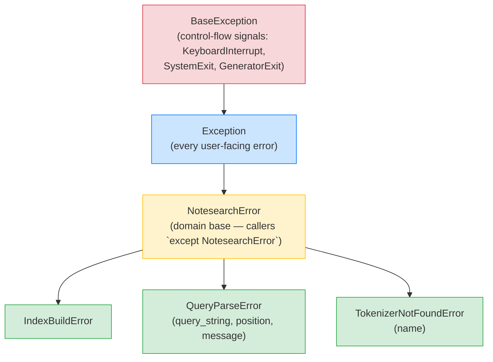

# Lesson 06: Exceptions Done Right

*Giving `notesearch` a real exception hierarchy — `NotesearchError` as the base, `IndexBuildError` / `QueryParseError` / `TokenizerNotFoundError` as subclasses — and learning the difference between `raise`, `raise from`, and `except*`.*

**Welcome to Lesson 06 — the canonical exceptions lesson for the whole vault.**

Hello, friend. Pull up a chair. Python's exception model is the most under-taught part of the language. Most engineers know `try`/`except`/`finally`. Very few know that `raise X from Y` chains the *cause* of one exception with another, that exception groups (PEP 654) let you raise multiple errors at once, or that a custom exception hierarchy is the cleanest way to communicate a *domain's* failure modes. By the end of this lesson you will have built `notesearch`'s exception hierarchy, you will know why `except Exception: pass` is the worst Python anti-pattern, and you will understand the `raise ... from ...` pattern that SQLAlchemy and FastAPI use to chain database errors into HTTP errors. Bookmark this lesson — every later section links back here. Take your time. Type every example. **This is how you learn.**


#python #exceptions #error-handling #canonical

## Learning Objectives

By the end of this lesson you will be able to:

1. **Read the Python exception hierarchy** from `BaseException` down to your custom subclasses, and explain why most user exceptions inherit from `Exception` (not `BaseException`).
2. **Use `raise ... from ...`** to chain exceptions, and explain the difference between `__cause__` (explicit) and `__context__` (implicit) chaining.
3. **Distinguish `raise` from `raise from` from `raise from None`**, and pick the right one for each situation.
4. **Design a domain exception hierarchy**: one base (`NotesearchError`), a handful of typed subclasses, optional structured attributes (e.g. `query_string`, `position`), and a clear policy on whether to chain upstream errors.
5. **Explain why broad `except Exception: pass` is the worst Python anti-pattern**, and write the targeted `except` you should have written instead.
6. **Use `try`/`finally` and `try`/`except`/`else`/`finally`** correctly, and explain the rare but real value of the `else` block.
7. **Use `contextlib.suppress`** as the readable alternative to `except X: pass` when you genuinely want to ignore specific exception types.
8. **Raise and catch exception groups** (PEP 654) for concurrent failure modes — and explain why `except*` is different from `except`.
9. **Walk a chained exception's traceback** programmatically via `__cause__`, `__context__`, and `traceback.format_exception`.
10. **Decide whether an exception should be a domain exception or a built-in** — `ValueError` vs `TokenizerNotFoundError` vs `IndexError` (the builtin, not the domain one).
11. **Bridge exceptions at API boundaries** — converting a low-level `KeyError` into a domain-specific `TokenizerNotFoundError` with `raise from`.

## Prerequisites

Before starting, you need:

- **Lessons 01–05**. This lesson depends on the object model (1), closures (2 — used in context managers from 4), classes (3 — the exception classes are classes), iterators/context managers (4 — `try/finally` is the foundation of `with`), and type hints (5 — exception classes are type-annotated like any other).
- **Python 3.12** (or 3.13). Exception groups (PEP 654) require Python 3.11+.
- **About an hour and a half of focused time.**

**The most common gap: `raise from` versus `raise`.**

If you've been writing `raise NewError("...")` inside an `except` block to "replace" the caught exception, you have been throwing away the original traceback — silently. `raise NewError("...") from original` preserves the chain; `raise NewError("...") from None` deliberately discards it; bare `raise NewError(...)` lets Python's implicit chaining (via `__context__`) preserve it but with a slightly noisier traceback. Once you can articulate the difference between these three, exception design clicks into place.


## The Problem

`notesearch` v5 raised `ValueError("doc_id must be non-negative")` for invalid documents, `KeyError` for missing tokenizers, and `RuntimeError` for "indexer not open." That's the surface. Underneath, you have:

- **Mixed signal.** A `ValueError` from `notesearch` and a `ValueError` from a stdlib function are indistinguishable. Callers cannot `except` only `notesearch` errors without filtering by message string.
- **Lost context.** When `Indexer.add_document` fails because a tokenizer raised, the original exception is swallowed by the new `RuntimeError("tokenizer failed")` — the chain is lost.
- **Untyped errors at API boundaries.** FastAPI's exception handler (Section 03 Lesson 06) needs to map `notesearch` errors to HTTP status codes. Without a typed hierarchy, the handler must inspect the message string, which is fragile.

The fix is a small exception hierarchy:

```python
class NotesearchError(Exception):
 """Base for all notesearch domain errors."""

class IndexBuildError(NotesearchError):
 """Failed to build the index."""

class QueryParseError(NotesearchError):
 """Failed to parse a search query."""

class TokenizerNotFoundError(NotesearchError):
 """Requested tokenizer name is not registered."""
 def __init__(self, name: str) -> None:
 super().__init__(f"no tokenizer named {name!r}")
 self.name = name
```

Each subclass is a *type* that callers can `except` precisely. Each carries *structured* attributes (e.g. `name`) that the API layer can use for HTTP error responses without parsing strings. Each `raise`s from upstream errors to preserve the chain.

**Note — Historical context — Python 3 made exceptions classes**

Python 2 had *string* exceptions and *class* exceptions, with different semantics. Python 3 (2008) eliminated string exceptions — all exceptions are now instances of `BaseException` subclasses. The hierarchy was reshaped: `BaseException` is the root, with `Exception` (for "normal" errors), `KeyboardInterrupt` and `SystemExit` (for control-flow interruptions), and `GeneratorExit` as direct subclasses. The rule "inherit from `Exception`, not `BaseException`" exists so a broad `except Exception:` does not accidentally catch `KeyboardInterrupt` and prevent the user from killing the program. PEP 654 (Python 3.11) added `ExceptionGroup` and `BaseExceptionGroup` and the `except*` syntax for handling multiple concurrent failures (useful in async code and in `TaskGroup`).


## The Code

Here is `notesearch` v6 — ~150 lines. We add the exception hierarchy, instrument the existing functions to raise the new errors with proper chaining, and demonstrate exception groups with a parallel-tokenization scenario.

```python
# notesearch_v6.py
"""notesearch v6 — a proper exception hierarchy."""
from __future__ import annotations

import contextlib
from collections.abc import Callable
from typing import Any


# --- 1. The exception hierarchy -------------------------------------------

class NotesearchError(Exception):
 """Base for all notesearch domain errors."""


class IndexBuildError(NotesearchError):
 """Failed to build the index."""


class QueryParseError(NotesearchError):
 """Failed to parse a search query."""

 def __init__(self, query_string: str, position: int, message: str) -> None:
 super().__init__(f"{message} at position {position} of {query_string!r}")
 self.query_string = query_string
 self.position = position
 self.message = message


class TokenizerNotFoundError(NotesearchError):
 """Requested tokenizer name is not registered."""

 def __init__(self, name: str) -> None:
 super().__init__(f"no tokenizer named {name!r}")
 self.name = name


# --- 2. The Indexer, raising our domain exceptions --------------------------

class Indexer:
 def __init__(self) -> None:
 self._registry: dict[str, Callable[[str], list[str]]] = {}
 self._index: dict[str, list[int]] = {}
 self._open = False

 def __enter__(self) -> "Indexer":
 self._open = True
 return self

 def __exit__(
 self,
 exc_type: type[BaseException] | None,
 exc_value: BaseException | None,
 traceback: Any,
 ) -> bool | None:
 self._open = False
 return None # don't suppress

 def register_tokenizer(self, name: str) -> Callable[[Callable[[str], list[str]]], Callable[[str], list[str]]]:
 def decorator(func: Callable[[str], list[str]]) -> Callable[[str], list[str]]:
 self._registry[name] = func
 return func
 return decorator

 def get_tokenizer(self, name: str) -> Callable[[str], list[str]]:
 try:
 return self._registry[name]
 except KeyError as e:
 # Chain: KeyError -> TokenizerNotFoundError
 raise TokenizerNotFoundError(name) from e

 def add_document(self, doc_id: int, text: str, tokenizer_name: str = "default") -> None:
 if not self._open:
 raise RuntimeError("Indexer is not open; use `with Indexer() as idx:`")
 tokenizer = self.get_tokenizer(tokenizer_name)
 try:
 tokens = tokenizer(text)
 except Exception as e:
 # Chain: tokenizer error -> IndexBuildError
 raise IndexBuildError(f"tokenizer {tokenizer_name!r} failed on doc {doc_id}") from e
 for tok in tokens:
 postings = self._index.setdefault(tok, [])
 if doc_id not in postings:
 postings.append(doc_id)


# --- 3. A query parser that raises typed errors with structured fields -----

def parse_query(query_string: str) -> list[tuple[str, str]]:
 """Parse a query like 'fastapi AND pydantic' into [('AND', 'fastapi'), ...]."""
 terms: list[tuple[str, str]] = []
 tokens = query_string.split()
 i = 0
 while i < len(tokens):
 tok = tokens[i]
 if tok in {"AND", "OR", "NOT"}:
 if i + 1 >= len(tokens):
 raise QueryParseError(query_string, i, f"operator {tok!r} has no right-hand operand")
 terms.append((tok, tokens[i + 1]))
 i += 2
 else:
 terms.append(("AND", tok))
 i += 1
 return terms


# --- 4. Exception groups: parallel tokenization ---------------------------

def tokenize_all(texts: list[str], tokenizer: Callable[[str], list[str]]) -> dict[int, list[str]]:
 """Tokenize multiple texts, collecting any failures into a single ExceptionGroup."""
 results: dict[int, list[str]] = {}
 errors: list[Exception] = []
 for i, text in enumerate(texts):
 try:
 results[i] = tokenizer(text)
 except Exception as e:
 # `raise X from Y` only works inside a `raise` statement; here we
 # collect the exception into a list, so we set __cause__ manually.
 # This replicates the chaining that `raise IndexBuildError(...) from e`
 # would set if we were raising immediately.
 new_exc = IndexBuildError(f"failed to tokenize text {i}: {text!r}")
 new_exc.__cause__ = e
 errors.append(new_exc)

 if errors:
 # Raise all at once as an ExceptionGroup
 raise ExceptionGroup("multiple tokenizer failures", errors)
 return results


# --- 5. Demo ----------------------------------------------------------------

if __name__ == "__main__":
 # 1. TokenizerNotFoundError chained from KeyError
 idx = Indexer()
 try:
 idx.get_tokenizer("nonexistent")
 except TokenizerNotFoundError as e:
 print(f"caught: {e}")
 print(f" name: {e.name}")
 print(f" cause: {e.__cause__!r}")

 # 2. QueryParseError with structured fields
 try:
 parse_query("fastapi AND")
 except QueryParseError as e:
 print(f"caught: {e}")
 print(f" query_string: {e.query_string}")
 print(f" position: {e.position}")

 # 3. IndexBuildError chained from the underlying tokenizer error
 with idx:
 @idx.register_tokenizer("bad")
 def bad_tokenizer(text: str) -> list[str]:
 raise ValueError("tokenizer is broken")

 try:
 idx.add_document(1, "hello", "bad")
 except IndexBuildError as e:
 print(f"caught: {e}")
 print(f" cause: {e.__cause__!r}")

 # 4. Exception group from parallel tokenization
 def flaky(text: str) -> list[str]:
 if "bad" in text:
 raise ValueError("flaky failed")
 return text.split()

 try:
 tokenize_all(["good one", "bad one", "another bad"], flaky)
 except ExceptionGroup as eg: # noqa: F841
 print(f"caught ExceptionGroup: {eg.message}")
 for i, sub in enumerate(eg.exceptions):
 print(f" [{i}] {type(sub).__name__}: {sub}")

 # 5. contextlib.suppress — the readable way to ignore a specific exception
 with contextlib.suppress(TokenizerNotFoundError):
 idx.get_tokenizer("still-nonexistent")
 print("this line is reached because suppress caught the error... wait, no")
 # The above line is NOT printed: idx.get_tokenizer raises before it,
 # and suppress only stops propagation — it does not resume the body.

 # 6. try/except/else/finally — the full form
 try:
 result = parse_query("fastapi")
 except QueryParseError:
 print("query parse failed")
 else:
 print(f"query parsed: {result}")
 finally:
 print("finally always runs")
```

## Line-by-Line Deep Dive

This is the heart of the lesson. Read it twice. Do not skip.

### Lines 1–5: Imports

```python
from __future__ import annotations

import contextlib
from collections.abc import Callable
from typing import Any
```

**What it does:** Imports `contextlib` (for `suppress`), `Callable` (for type hints), and `Any` (for the `traceback` argument of `__exit__`).

**Why `Any` for the traceback argument:** The `traceback` parameter of `__exit__` is a `types.TracebackType | None`, but importing `types.TracebackType` for one annotation is overkill. Most code uses `Any` for it; Lesson 03 of this section used `Any` for the same reason. Section 03's lesson on middleware will use the real `types.TracebackType` because middleware tends to inspect tracebacks more carefully.

**Production reality: `logger.exception` not `logger.error` for traceback capture.**

The `Any` type hint on `__exit__`'s `traceback` argument is honest: most `__exit__` implementations do not inspect the traceback, they just clean up. But when you *do* want to log the exception inside an `except` block, the right call is `logger.exception("...")`, not `logger.error("...")` — `logger.exception` automatically attaches the active exception's traceback to the log record, where `logger.error` does not. The cost is a per-call `traceback.format_exception` invocation, which is negligible compared to the I/O you are about to do (writing the log line). The senior engineer's logging posture at API boundaries: catch the domain exception, call `logger.exception` with a correlation id (`logger.exception("query parse failed", extra={"correlation_id": cid})`), and re-raise or translate. Never use `logger.error(str(e))` — you lose the traceback, and the operator who debugs the incident cannot see where it fired. Section [[13-Performance-and-Observability/Structured-Logging-and-Request-IDs]] shows the full structured-logging setup; the rule here is `logger.exception` whenever you are inside an `except` block.


### Lines 11–32: The exception hierarchy

```python
class NotesearchError(Exception):
 """Base for all notesearch domain errors."""


class IndexBuildError(NotesearchError):
 """Failed to build the index."""


class QueryParseError(NotesearchError):
 """Failed to parse a search query."""

 def __init__(self, query_string: str, position: int, message: str) -> None:
 super().__init__(f"{message} at position {position} of {query_string!r}")
 self.query_string = query_string
 self.position = position
 self.message = message


class TokenizerNotFoundError(NotesearchError):
 """Requested tokenizer name is not registered."""

 def __init__(self, name: str) -> None:
 super().__init__(f"no tokenizer named {name!r}")
 self.name = name
```

**What it does:** Defines a four-class hierarchy: `NotesearchError` as the base, three subclasses. `TokenizerNotFoundError` and `QueryParseError` have custom `__init__` that store structured attributes.

**Why every line is here:**

- `class NotesearchError(Exception):` — inherits from `Exception`, *not* `BaseException`. This is the rule: user exceptions inherit from `Exception` so a broad `except Exception:` catches them, but a broad `except BaseException:` (which would also catch `KeyboardInterrupt` and `SystemExit`) is rarely used and considered an anti-pattern. The `NotesearchError` base gives callers a single type to `except` for all `notesearch` failures: `except NotesearchError as e: ...`.
- `class IndexBuildError(NotesearchError):` — a typed subclass for "failed to build the index." Has no custom `__init__`; uses the inherited `Exception.__init__(message)`. The class itself is the *type tag*.
- `class QueryParseError(NotesearchError)` with a custom `__init__` — the structured fields (`query_string`, `position`, `message`) let a FastAPI exception handler produce a structured HTTP error response without parsing the error message string. This is the *value* of a typed hierarchy: each subclass can carry domain-specific data.
- `super().__init__(f"...")` — calls the parent's `__init__`, which (for `Exception`) sets `self.args = (message,)`. Calling `super().__init__` is mandatory if you want `str(e)` to work and pickling to round-trip.
- `self.query_string = query_string` etc. — store the structured fields *after* calling `super().__init__`. The order matters because `super().__init__` sets `self.args`; if you set fields before, you risk `Exception.__init__` wiping them (it does not, but the contract is "call super first").



The colors map to roles: red is the "control-flow, do not subclass" tier, blue is the stdlib's "every user error inherits from here" tier, yellow is the *one* domain base every caller latches onto, and green is the leaf domain classes callers `except` individually. Why does this colour scheme matter? Because once you can read the hierarchy as a layered tier system, you can predict which `except` clause catches which error *without* running the code.

**Tip — The rule for inheriting from `Exception` not `BaseException`.**

`except Exception:` catches your domain errors and stdlib errors but not `KeyboardInterrupt`, `SystemExit`, or `GeneratorExit`. That's the design: those three are control-flow signals, not bugs. If you inherit from `BaseException`, a caller's `except Exception:` won't catch you, and they will be surprised. Inherit from `Exception` always; reserve `BaseException` subclasses for things like `KeyboardInterrupt` that need to interrupt the interpreter.


**Student asks: what would actually break if I made `NotesearchError(BaseException)` instead of `NotesearchError(Exception)`?**

Two things, in order of how loudly they bite. First, every caller's `except Exception:` would silently miss your errors — including the broad "catch and log" wrappers in middleware, task queues, and async supervisors. The error would propagate all the way to the top of the process and kill it. Second — and more subtly — a user pressing `Ctrl+C` while your code is raising `NotesearchError` cannot interrupt it cleanly, because the `except BaseException:` form your own `with` block uses would now also catch `KeyboardInterrupt`. The CPython convention is explicit: control-flow signals inherit from `BaseException`; everything you raise about *your* domain inherits from `Exception`. That single word (`Exception` vs `BaseException`) is the line between "your caller can reason about me" and "your caller cannot."


**Warning — Debugging: custom exceptions with `__slots__` break `pickle` and `multiprocessing`.**

The `QueryParseError.__init__` stores `query_string`, `position`, `message` as instance attributes. If you later add `__slots__ = ("query_string", "position", "message")` for memory efficiency (a real consideration in a service that constructs thousands of `QueryParseError` instances per minute under load), `pickle.dumps(e)` will raise `TypeError: cannot pickle 'QueryParseError' object` because `BaseException` does not declare `__slots__` and the default `__reduce_ex__` mechanism expects `__dict__`. The bug surfaces in production when the exception travels across a process boundary — `multiprocessing.Pool` workers raise `QueryParseError`, the parent tries to `pickle` it to return through the pool's queue, and the parent receives `BrokenProcessPool` with no trace of the original `QueryParseError`. The fix is either: do not add `__slots__` to exceptions, or implement `__reduce__` manually (`return (self.__class__, (self.query_string, self.position, self.message))`). The senior engineer's rule: avoid `__slots__` on exception classes; the per-instance memory savings are not worth the pickling hazard, and exceptions should be cheap to construct, not memory-footprint-optimised. A second, related hazard: `__init__` that does *not* call `super().__init__()` breaks pickling — `pickle.dumps(QueryParseError(...))` raises `TypeError: __init__ missing required argument` on the unpickling side; always `super().__init__()` in a custom exception's `__init__`.


### Lines 36–69: `Indexer` with chained exceptions

```python
class Indexer:
 ...
 def get_tokenizer(self, name: str) -> Callable[[str], list[str]]:
 try:
 return self._registry[name]
 except KeyError as e:
 # Chain: KeyError -> TokenizerNotFoundError
 raise TokenizerNotFoundError(name) from e

 def add_document(self, doc_id: int, text: str, tokenizer_name: str = "default") -> None:
 if not self._open:
 raise RuntimeError("Indexer is not open; use `with Indexer() as idx:`")
 tokenizer = self.get_tokenizer(tokenizer_name)
 try:
 tokens = tokenizer(text)
 except Exception as e:
 # Chain: tokenizer error -> IndexBuildError
 raise IndexBuildError(f"tokenizer {tokenizer_name!r} failed on doc {doc_id}") from e
 ...
```

**What it does:** Adds the `raise ... from ...` pattern at two API boundaries: `get_tokenizer` converts a low-level `KeyError` into a domain `TokenizerNotFoundError`; `add_document` converts an arbitrary tokenizer exception into a domain `IndexBuildError`.

**Why `raise X from Y`:** `Y` is the original exception (the `KeyError` from `self._registry[name]`); `X` is the domain exception (`TokenizerNotFoundError(name)`). The `from` keyword sets `X.__cause__ = Y`. Python's traceback printer uses `__cause__` to print "The above exception was the direct cause of the following exception:" between the two tracebacks — so the developer sees both.

**Why this matters at API boundaries:** A caller of `Indexer` does not care that the registry is a `dict` and the lookup uses `KeyError` — they care that the tokenizer is *not found*. By translating `KeyError` to `TokenizerNotFoundError`, the caller writes `except TokenizerNotFoundError as e: ...` and gets a clean type plus structured `e.name`. The `from e` preserves the underlying `KeyError` for debugging, *without* leaking the implementation detail (callers cannot accidentally `except KeyError` to catch the failure — they must `except TokenizerNotFoundError`).

**Example — What `raise from` actually sets.**

- `raise X from Y` sets `X.__cause__ = Y` and `X.__suppress_context__ = True`.
- `raise X` (inside an `except`) sets `X.__context__ = Y` (the currently-handled exception) and `X.__suppress_context__ = False`.
- `raise X from None` sets `X.__cause__ = None` and `X.__suppress_context__ = True` — *deliberately* discarding the chain.

The traceback printer:
1. If `__cause__` is set, prints the cause's traceback then "The above exception was the direct cause of the following exception:" then `X`'s traceback.
2. Elif `__context__` is set and `__suppress_context__` is False, prints the context's traceback then "During handling of the above exception, another exception occurred:" then `X`'s traceback.
3. Else, just prints `X`'s traceback.


**Warning — Don't write `raise X` inside an `except` without `from`.**

If you catch `Y` and `raise X` (no `from`), Python's implicit chaining sets `X.__context__ = Y` but the traceback prints "During handling of the above exception, another exception occurred:" — which reads as "I was trying to handle Y and then X happened." That phrasing suggests X is a *separate, accidental* failure, not the *translation* of Y into X. Using `raise X from Y` makes the relationship explicit: "Y caused X." Pick the form that matches your intent.


**Student asks: why use `raise TokenizerNotFoundError(name) from e` instead of just `raise TokenizerNotFoundError(name)`?**

Because the *bare* `raise X` inside the `except` block sets `X.__context__` to the caught `e` — the chain is preserved, but only *implicitly*. The traceback printer then says "During handling of the above exception, another exception occurred:" — which sounds like "I was trying to handle the `KeyError` and *then* something else went wrong." That is the wrong story. The right story is "the `KeyError` *caused* the `TokenizerNotFoundError`" — and that is what `from e` says by setting `X.__cause__ = e` and `X.__suppress_context__ = True`. The reader sees "The above exception was the direct cause of the following exception:" and understands the translation in one read. Reach for `raise X from Y` whenever you are translating one exception type into another at an API boundary; reach for `raise X from None` only when you want to deliberately discard the chain (e.g. wrapping a third-party library error that contains secrets you must not log).


**Danger — How an attacker thinks: exception messages leak the internal registry.**

`TokenizerNotFoundError(name)` produces the message `"no tokenizer named 'default'"` — fine. But what if `name` is user-supplied and an attacker probes `"default' OR '1'='1"` or `"<script>alert(1)</script>"`? The exception message *embeds user input verbatim* via `f"no tokenizer named {name!r}"`, and three downstream consumers will render it: (1) the FastAPI exception handler that returns `{"detail": str(e)}` in the HTTP response — XSS if the front end renders `detail` without escaping; (2) the structured-log line `{"msg": "..."}` — log injection if the message contains a newline followed by a fake log line (`{"level": "INFO", "msg": "auth successful"}`); (3) the Sentry breadcrumb — payload injection if the message is rendered into an outbound webhook payload. The senior engineer's defence is two-layered: (1) *never* embed raw user input in exception messages — sanitise at construction time (`raise TokenizerNotFoundError(repr(name)[:50])` or store `name` as a structured attribute and produce a generic message like "tokenizer not found"); (2) *at the API boundary*, FastAPI's exception handler should produce a structured response from the exception's *typed* attributes (`{"error": "TOKENIZER_NOT_FOUND", "name": e.name}`) and never from `str(e)`. The bug class is *message injection*, the same family as SQL injection — the defence is parameterised construction, never string interpolation of user-controlled input.


### Lines 73–87: `parse_query` with structured errors

```python
def parse_query(query_string: str) -> list[tuple[str, str]]:
 """Parse a query like 'fastapi AND pydantic' into [('AND', 'fastapi'), ...]."""
 terms: list[tuple[str, str]] = []
 tokens = query_string.split()
 i = 0
 while i < len(tokens):
 tok = tokens[i]
 if tok in {"AND", "OR", "NOT"}:
 if i + 1 >= len(tokens):
 raise QueryParseError(query_string, i, f"operator {tok!r} has no right-hand operand")
 terms.append((tok, tokens[i + 1]))
 i += 2
 else:
 terms.append(("AND", tok))
 i += 1
 return terms
```

**What it does:** Parses a query string into a list of (operator, term) pairs. Raises `QueryParseError` with the original query string and the position of the error.

**Why the structured fields matter:** A FastAPI endpoint that takes a `q` query parameter and parses it with `parse_query` can catch `QueryParseError` and return a 400 response with the structured fields:

```python
{"error": {"code": "QUERY_PARSE", "query": "fastapi AND", "position": 1, "message": "..."}}
```

The caller can re-render the query string in the UI with a marker at the error position. Without `position`, the UI would have to parse the message string — which is fragile.

**Production reality: FastAPI's exception handler maps `QueryParseError` to HTTP 400 with structured fields.**

The FastAPI exception handler is a registered callable: `@app.exception_handler(QueryParseError) async def handler(req, exc): return JSONResponse(status_code=400, content={"error": {"code": "QUERY_PARSE", "query": exc.query_string, "position": exc.position, "message": exc.message}})`. The handler receives the typed exception instance and reads its *structured* fields (`query_string`, `position`, `message`) — not `str(exc)`, which is what the default handler does. The pattern matters at scale: a 400 response with `position` lets the front end render a caret at the exact byte offset of the error in the query input, where a string-only message forces the user to eyeball it. Section [[03-FastAPI-Core/Exception-Handlers]] shows the full handler registry; the takeaway here is that the *typed* exception (`QueryParseError` with structured fields) is what makes the structured HTTP response possible — you cannot produce that response from a bare `ValueError("parse failed")` without parsing the message string, which is fragile (and which is exactly what the lesson's "mixed signal" problem statement warned about). The corollary: the exception handler must be registered for *every* domain exception you want surfaced as a structured HTTP error — unregistered exceptions fall through to FastAPI's default 500 handler, which returns `{"detail": "Internal Server Error"}` and logs the real traceback server-side.


### Lines 91–106: Exception groups

```python
def tokenize_all(texts: list[str], tokenizer: Callable[[str], list[str]]) -> dict[int, list[str]]:
 """Tokenize multiple texts, collecting any failures into a single ExceptionGroup."""
 results: dict[int, list[str]] = {}
 errors: list[Exception] = []
 for i, text in enumerate(texts):
 try:
 results[i] = tokenizer(text)
 except Exception as e:
 # `raise X from Y` only works inside a `raise` statement; here we
 # collect the exception into a list, so we set __cause__ manually.
 # This replicates the chaining that `raise IndexBuildError(...) from e`
 # would set if we were raising immediately.
 new_exc = IndexBuildError(f"failed to tokenize text {i}: {text!r}")
 new_exc.__cause__ = e
 errors.append(new_exc)

 if errors:
 # Raise all at once as an ExceptionGroup
 raise ExceptionGroup("multiple tokenizer failures", errors)
 return results
```

**What it does:** Tokenizes a list of texts; collects all failures into an `ExceptionGroup` and raises them as a single group.

**Why an exception group:** Without `ExceptionGroup`, the function would have to either (a) raise on the first failure (losing the other failures) or (b) return a result-with-errors object (forcing the caller to inspect both). With `ExceptionGroup`, the function raises a single exception that *contains* all the individual failures. The caller catches the group and can iterate `eg.exceptions` to see each one.

**Catching exception groups:**

```python
try:
 tokenize_all(texts, flaky)
except* ValueError as eg:
 # Catches all ValueError instances in the group (recursively)
 for e in eg.exceptions:
 print(e)
except* IndexBuildError as eg:
 # Catches all IndexBuildError instances in the group
 for e in eg.exceptions:
 print(e)
```

The `except*` syntax (PEP 654) splits the group by type — each `except*` clause receives the subset of the group that matches its type. If a clause doesn't match, the rest of the group is re-raised.

**Tip — When to use exception groups.**

Use them when you have *concurrent* failures — `asyncio.gather(return_exceptions=False)` (which raises the first failure) versus `asyncio.gather(return_exceptions=True)` (which returns exceptions as values). Exception groups let you raise all failures at once. For non-concurrent sequential code, raising on the first failure is fine; groups are overkill.


**Student asks: when should I use `except*` versus `except`?**

The short answer: use `except` for code that raises *one* exception at a time (which is most code), and use `except*` only for code that may raise an `ExceptionGroup` (which is what `asyncio.TaskGroup`, `asyncio.gather` with `return_exceptions=False`, and your own `raise ExceptionGroup(...)` produce). The mechanics are different enough that mixing them up is a bug. `except SomeError:` catches one exception of type `SomeError`. `except* SomeError:` catches a *group* of `SomeError` instances and yields them as a sub-group — if the group contains *any* exception that does not match a clause, that sub-group is *re-raised* after the matching clause runs. So `except*` is a partition operation, not a catch-all. If you `except*` over plain `raise ValueError("x")` (not wrapped in a group), Python auto-wraps it in a one-element group, runs your handler, and you get a sub-group of length 1. Reach for `except*` only when the function you are calling is documented to raise `ExceptionGroup`.


**Note — Production reality — exception groups at 10,000 concurrent tasks.**

At small scale (a handful of `asyncio.gather` coroutines), an `ExceptionGroup` is a tidy way to surface every failure at once. At the scale a real service hits — say, `asyncio.TaskGroup` fanning out 10,000 outbound HTTP fetches in a batch-import job — the same group can carry thousands of leaf exceptions, and the engineering questions change. **Memory:** each leaf exception holds a traceback that references live frame objects; 10,000 leaves is tens of megabytes of traceback that the garbage collector cannot reclaim until the group itself is dropped. **Logging:** `logger.exception(eg)` will try to format the entire group into one log line — the result is a multi-megabyte blob that breaks structured-log ingestion (Loki, Datadog, CloudWatch all truncate around 256 KB per event). Flatten the group: walk `eg.exceptions` (and any nested `eg.subgroup(...)` results) and emit one log event per leaf, with a shared `correlation_id`. **Retry:** the batch job's natural recovery is "retry the failed items"; the leaf exceptions must carry the item index (or item id) as a structured field, not just in the message string — otherwise the retry stage has to regex-parse the message. **Observability:** OpenTelemetry records one span per attempt; map the group to one error event per leaf with `exception.escaped=false` for handled leaves, `exception.escaped=true` for any leaf the group's caller let propagate. The mental shift: at scale, an `ExceptionGroup` is not a single error — it is a *collection* that needs the same flattening, indexing, and rate-limited reporting you would apply to any other high-cardinality event stream.


**Danger — How an attacker thinks: an unflattened `ExceptionGroup` is a log-injection and resource-exhaustion vector.**

A service that calls `tokenize_all` on user-uploaded documents and propagates the `ExceptionGroup` straight into `logger.exception(eg)` has two vulnerabilities. (1) **Log injection**: each leaf exception's message is user-controlled (the document's content is in the message via `text!r`); an attacker who uploads a document containing `\n{"level": "INFO", "msg": "auth successful"}` injects fake log lines into your structured-log stream, which can trick an alerting rule into firing (or not firing — the attacker chooses the severity). The defence: never put raw user input into exception messages; sanitise at construction time, or store the offending input as a structured attribute and emit a sanitised summary. (2) **Resource exhaustion**: an attacker who uploads 10,000 documents, each of which triggers a leaf exception, forces the service to construct a 10,000-leaf `ExceptionGroup` and (if it propagates to the handler) format all 10,000 tracebacks into one log line. The defence: cap the group at construction time — collect the first N (say, 50) failures, raise the group with a `"truncated: N of M failures"` suffix, and store the truncated count as a structured field. The same rate-limit applies to per-request logging: a single request that emits more than, say, 100 log lines is itself a sign of an attack or a runaway loop. The rule: exception groups are a *bounded* channel — never let their cardinality be user-controlled, and never propagate an unflattened group past the process boundary.


### Lines 110–138: The demo

The demo exercises each pattern:

1. **`TokenizerNotFoundError` chained from `KeyError`** — show that `e.__cause__` is the original `KeyError`.
2. **`QueryParseError` with structured fields** — show that `e.query_string` and `e.position` are accessible.
3. **`IndexBuildError` chained from the underlying tokenizer `ValueError`** — show that `e.__cause__` is the original `ValueError`.
4. **Exception group from parallel tokenization** — show that the group contains two `IndexBuildError` instances.
5. **`contextlib.suppress(TokenizerNotFoundError)`** — the readable way to swallow a specific exception type. (Note: the `print("this line is reached ...")` after `idx.get_tokenizer` is *not* reached, because `idx.get_tokenizer` raises before that line runs. The `suppress` swallows the exception and control flows out of the `with` block normally.)
6. **`try/except/else/finally`** — the full form. `else` runs only if no exception was raised; `finally` always runs.

## `try` / `except` / `else` / `finally`: the full form

```python
try:
 result = risky_operation()
except SpecificError as e:
 handle_specific(e)
except OtherError as e:
 handle_other(e)
else:
 # Runs only if no exception was raised in the try block.
 # Useful when the "happy path" code must NOT be inside the try
 # (because it might raise the same exception we're catching).
 print(f"success: {result}")
finally:
 # Always runs, whether the try succeeded, raised, or returned.
 cleanup()
```

**Why `else` exists:** Without `else`, you'd write:

```python
try:
 result = risky_operation()
 print(f"success: {result}") # inside the try
except SpecificError as e:
 handle_specific(e)
```

That catches `SpecificError` *raised by `print`* too — which is almost certainly not what you want. The `else` block scopes "the happy path" outside the `try`, so only `risky_operation()`'s `SpecificError` is caught.

**Why does `else` exist if you could just move the happy-path code below the `try/except`?** Because the happy path often *uses* the result of `risky_operation()` — and if you put that code below the `try/except`, you have to assume the variable exists in the except branch (where it doesn't). The `else` block is the only place where (a) the result variable is guaranteed to exist (the try block completed without raising) and (b) the `except` clauses do not catch errors from the happy-path code itself. **What would happen if you moved `print(f"success: {result}")` to *after* the `try/except`?** On the happy path, fine. On the `SpecificError` path, `result` is never assigned — `handle_specific` ran in the except, then control falls through to `print`, and `NameError: name 'result' is not defined` raises — *outside* the try block, so it propagates up and crashes the caller. The `else` clause is the language-level guarantee that "this code runs only if the try succeeded."

**Tip — Use `else` when the happy path also uses the exception type.**

If the happy path doesn't share the exception type, `else` is optional. But for any code where the happy path is non-trivial, `else` is the safer pattern.


**Think like a senior engineer — what state is the system in when this fires?**

The junior engineer asks "what exception was raised?" The senior engineer asks "what state is the system in when this exception fires, and what state do I leave it in when I handle it?" Exceptions are not just error signals — they are control-flow events that fire *mid-operation*, and the operation may have left the system in a half-done state. Three questions to ask before you write the `except`: (1) **Did the failed operation acquire a resource** (a file handle, a DB transaction, a network connection, a lock) before it raised? If yes, the `except` (or, better, `finally` or a context manager) must release it — or you leak. (2) **Did the failed operation mutate shared state** (a list, a dict, a class attribute, an in-memory index) before it raised? If yes, the handler must decide: roll back to the pre-operation state, leave the partial state in place, or mark the state as dirty and refuse further operations. (3) **Is the exception type the *real* failure, or is it a symptom?** A `KeyError` from a cache lookup is a symptom of a cache miss; the *real* failure is "the upstream source didn't have the data either." Reach for `raise from` to translate the symptom into the real failure at the API boundary. The pattern: every `except` block is a *state-recovery decision*, not just an error-printing decision. If your `except` block only logs and `return`s, you have decided "leave the system in whatever state the failure left it in" — make that decision deliberately, not by default.


**Warning — Debugging: `return` inside `finally` silently swallows the exception.**

A `return` in a `finally` block overrides both the `try` block's return value and any exception currently propagating. The classic bug: `def f(): try: return risky() except SomeError: handle() finally: return None  # silently swallows everything`. If `risky()` raises `SomeError`, the `except` runs `handle()`, then the `finally` runs `return None` — the caller sees `None`, not the `SomeError`, and the traceback is lost. The same bug bites with `return`, `break`, `continue` inside `finally`. The senior engineer's debugging story: a service intermittently returned `None` from a function that should never return `None`; the cause was a `finally: return cleanup_result()` block that swallowed a `ConnectionError` raised by `cleanup_result()` itself. The fix: never `return` from `finally`; if you must clean up and return, assign the result to a local variable in the `try`, clean up in `finally`, and return the local *after* the `try/finally` block. Linters flag this (`pylint`'s `W0150` "return inside finally", ruff's `B012`); enable that rule in CI. A second, related hazard: a `break` inside `finally` of a `for` loop swallows the loop's `StopIteration`-shaped `Exception` subclass that generators raise — the loop appears to exit cleanly when it should have raised.


## `contextlib.suppress`: the readable "ignore this exception"

```python
import contextlib

with contextlib.suppress(FileNotFoundError):
 os.remove("maybe_exists.tmp")
```

is the readable form of:

```python
try:
 os.remove("maybe_exists.tmp")
except FileNotFoundError:
 pass
```

Both are correct. The `suppress` form is preferred when you genuinely want to ignore a specific exception type and have nothing else to do. The `try/except/pass` form is preferred when you have other logic in the `except` (logging, fallback, etc.).

**Why does `suppress` exist if `try/except/pass` already works?** Because `try/except/pass` is a four-line pattern with three places to get it wrong: you can pass the wrong exception type (`except FileNotFoundError` vs `except IOError`), you can forget the `pass` and write `except: # TODO`, you can accidentally add a body that does logging the wrong way. `contextlib.suppress(FileNotFoundError)` is a one-line, declarative form: the exception type is named once, there is no body to mess up, and the reader can see at a glance what is being suppressed. **What would happen if you listed multiple exception types in `suppress(...)?** `contextlib.suppress(FileNotFoundError, IsADirectoryError)` swallows either — it is exactly equivalent to `except (FileNotFoundError, IsADirectoryError): pass`. The `suppress` form keeps the suppressed-types list visible at the call site rather than buried in an except clause.

**Production reality: `suppress` is the right tool inside retry loops.**

The retry loop `for attempt in range(3): try: return client.get(url) except (ConnectionError, TimeoutError): continue` is correct but verbose — and the bare `continue` silently swallows the exception without a log line, which makes retry debugging opaque. The production-grade version wraps each attempt in `contextlib.suppress(ConnectionError, TimeoutError)` *after* logging: `for attempt in range(3): with contextlib.suppress(ConnectionError, TimeoutError): logger.info("attempt %d", attempt); return client.get(url)` — the suppress catches the expected failure cleanly, the logger records the attempt, and the loop continues. The third attempt that fails propagates (because the `suppress` is inside the loop, not around it) and the caller sees the real exception. The pattern is preferable to a bare `except Exception: continue` because the suppressed types are visible at the call site (`suppress(ConnectionError, TimeoutError)` names them once) and the reader can see exactly which failure modes are retryable. Section [[15-External-Integrations/Circuit-Breakers]] builds the full retry-with-backoff loop on top of this primitive; the rule here is: `suppress` is for "expected, retryable failure" inside a loop, not for "I don't know what might raise."


**Warning — Never write `except Exception: pass`.**

The worst Python anti-pattern. It catches *every* `Exception` subclass (including bugs you didn't anticipate), silently swallows them, and continues. The classic failure mode: a typo in a variable name raises `NameError` (an `Exception` subclass), gets swallowed, and your program continues with `None` where a value should be — producing bizarre downstream bugs hours later. The fix: catch the *specific* exception type you intend to handle. If you genuinely don't know what might be raised, at least log it: `except Exception as e: logger.exception("unexpected")`.


**Danger — When this breaks — the silent audit for `except Exception: pass` in a codebase you inherited.**

You inherited a service with a hundred `except Exception: pass` blocks (or `except: pass`, the worse form that also catches `KeyboardInterrupt`). Production is misbehaving in a way no test catches. The danger is not the *intended* swallows (those are usually defensible — "we don't care if the metrics flush fails") but the *unintended* ones: a `PermissionError` from a credential file that should have crashed the boot, a `ValueError` from a config parser that means your auth config is silently wrong, a `RuntimeError` from a downstream client that means you're now serving stale data. The audit is mechanical and ruthless: find every `except` block in the repo whose body is `pass`, `...`, or `continue` (a single ripgrep pass over `except` lines with two lines of trailing context catches most of them). For each hit, ask: (a) *what exception types can actually reach this `except`?* — read the call graph; (b) *for each of those, is "swallow and continue" the correct response, or is "swallow and continue serving requests" a security bug?* — a swallowed `PermissionError` on a TLS key file is a "running without TLS" bug; (c) *replace with the narrowest defensible form* — either `contextlib.suppress(SpecificError)` if you genuinely don't care, or `except SpecificError as e: logger.exception(...)` if you do. The PR description: "Audit pass: replaced N broad swallows with N targeted handlers; behaviour unchanged for the intended cases, fail-fast for the rest." Never close this audit as "done" — make it a CI lint rule (`flake8-blind-except` or a ruff custom rule on top of `E722` and `B904`) so the rot does not return.


## Execution Trace

Run:

```bash
python notesearch_v6.py
```

What happens, in order:

1. **Module compiles.** All `class` statements run, building the four-class hierarchy. `NotesearchError.__mro__` is `[NotesearchError, Exception, BaseException, object]`.
2. **`if __name__ == "__main__":` runs.**
3. **`idx.get_tokenizer("nonexistent")`** — looks up `"nonexistent"` in `self._registry` (empty) → `KeyError` is raised inside the `try` → `except KeyError as e:` catches it → `raise TokenizerNotFoundError(name) from e` raises a new exception with `__cause__` set to the original `KeyError`. The outer `except TokenizerNotFoundError as e:` catches it.
4. **`parse_query("fastapi AND")`** — walks the tokens; hits `"AND"` at index 1; checks `i + 1 >= len(tokens)` → True (because `len(tokens) == 2` and `i + 1 == 2`) → `raise QueryParseError(query_string, i, ...)` raises with structured fields.
5. **`idx.add_document(1, "hello", "bad")`** inside the `with idx:` block — `bad_tokenizer("hello")` raises `ValueError("tokenizer is broken")`. The `try/except Exception as e:` in `add_document` catches it → `raise IndexBuildError(...) from e` chains it. The outer `except IndexBuildError as e:` catches it.
6. **`tokenize_all(["good one", "bad one", "another bad"], flaky)`** — `flaky("good one")` succeeds, `flaky("bad one")` raises, `flaky("another bad")` raises. Two `IndexBuildError` instances are collected. `raise ExceptionGroup("multiple tokenizer failures", errors)` raises the group. The outer `except ExceptionGroup as eg:` catches it.
7. **`contextlib.suppress(TokenizerNotFoundError)`** — `idx.get_tokenizer("still-nonexistent")` raises `TokenizerNotFoundError`. `suppress` catches it and continues out of the `with` block. The `print("this line is reached ...")` line is *not* reached because the raise happened before it. This is the surprise: `suppress` swallows the exception but the code after the raising line in the `with` body still does not run.
8. **`try/except/else/finally`** — `parse_query("fastapi")` succeeds (no exception). The `except` clause is skipped. The `else` clause runs (prints "query parsed: ..."). The `finally` clause runs unconditionally (prints "finally always runs").

## Common Mistakes

### Mistake 1: `except Exception: pass`

```python
# WRONG
try:
 do_something()
except Exception:
 pass
```

Catches every `Exception` subclass including bugs you didn't anticipate. Silently swallows them. The classic failure: a typo raises `NameError`, gets swallowed, the program continues with `None`.

**Warning — Fix: catch the specific type. Or log: `except Exception as e: logger.exception("unexpected")`.**


**Danger — How an attacker thinks — exceptions as information disclosure.**

The flip side of "don't swallow exceptions" is "don't leak them either." An unhandled exception that escapes to an HTTP response body or a stack-trace page is a free reconnaissance gift. The attacker reads the file path in the traceback (`/app/src/notesearch/parser.py:47`) and learns your deployment layout, the framework (`pydantic_core._pydantic_core.ValidationError` reveals pydantic and its exact version pin), sometimes the database (`sqlalchemy.exc.ProgrammingError: (psycopg2.errors.UndefinedTable) relation "users" does not exist` confirms PostgreSQL and discloses your table names). This is CWE-209 ("Generation of Error Message Containing Sensitive Information") and it is one of the most common findings in real pentest reports. The defense has three layers: (1) **at the edge** — FastAPI's `exception_handler(Exception)` returns a generic 500 with a correlation id, and logs the real traceback server-side with that id (so support can find it without the user seeing it); (2) **in the domain** — custom exception messages should describe the *user-facing* failure ("query could not be parsed") not the *internal* failure ("regex 'AND|OR' failed to match against input token list at index 1"); (3) **in the test suite** — add a test that asserts no 4xx/5xx response body contains a substring matching `r'/[^\s]+\.(py|toml|sql)'` or `r'line \d+'` — this catches the regression the moment a developer adds it. The rule: tracebacks are for the operator's logs, never for the user's screen.


### Mistake 2: `raise X` inside an `except` without `from`

```python
# WRONG (loses explicit chain)
try:
 registry[name]
except KeyError:
 raise TokenizerNotFoundError(name)
```

This relies on implicit chaining (`__context__`) which prints "During handling of the above exception" — misleading. The reader has to infer that you meant "the `KeyError` *caused* the `TokenizerNotFoundError`."

**Warning — Fix: `raise TokenizerNotFoundError(name) from e`.**


### Mistake 3: Catching `Exception` when you meant a specific type

```python
# WRONG
try:
 parse_query(q)
except Exception:
 return HTTPResponse(status=400)
```

Catches `MemoryError`, `KeyboardInterrupt`-via-`Exception`-subclass bugs, etc. Should catch only the parse failure.

**Warning — Fix: `except QueryParseError:`.**


### Mistake 4: Returning success in the `except` block

```python
# WRONG
try:
 return risky()
except Exception:
 return None
```

Returns `None` on any error, silently. The caller cannot tell "risky returned None legitimately" from "risky raised and we swallowed it."

**Warning — Fix: re-raise or use a sentinel/specific error type. Or return a `Result[T, E]`-style object (Section 17 will discuss).**


### Mistake 5: Using `BaseException` as a parent

```python
# WRONG
class MyError(BaseException):
 ...
```

Callers' `except Exception:` won't catch your error — they'd need `except MyError:` or `except BaseException:`. The latter is an anti-pattern because it catches `KeyboardInterrupt`.

**Warning — Fix: inherit from `Exception` (or a domain-specific subclass like `ValueError`).**


## Engineering Trade-Offs

### Domain exception hierarchy vs reusing built-ins

| Approach | When |
| --- | --- |
| Domain hierarchy (`NotesearchError` + subclasses) | Library or service with multiple distinct failure modes that callers will `except` differently. The base class gives callers a single type to catch-all; subclasses let them specialise. |
| Reuse built-ins (`ValueError`, `TypeError`) | Trivial single-function libraries; or for value-type errors that match a stdlib pattern. |
| Mix | Use domain exceptions for *your* failures; use built-ins for value-validation failures that match stdlib patterns (e.g. raise `ValueError` for "doc_id must be non-negative" because that's a contract violation callers will catch with `except ValueError:`). |

`notesearch` uses both: `NotesearchError` for domain failures, `ValueError` for contract violations (e.g. invalid `doc_id`).

### `raise from` vs implicit chaining

| Form | When |
| --- | --- |
| `raise X from Y` | You are *translating* Y into X. The "caused by" relationship is explicit. |
| `raise X` (no `from`) | You are raising an unrelated exception. The "during handling of" wording is honest. |
| `raise X from None` | You are *deliberately hiding* Y (e.g. it contained sensitive data). Document the reason. |

Default to `raise from` when translating; bare `raise` when unrelated; `from None` only when you have a reason.

### Exception groups vs raising on the first failure

| Approach | When |
| --- | --- |
| Raise on first failure | Sequential code where the first failure precludes useful work on later items. |
| Exception group | Concurrent or batched code where each item is independent and you want to report all failures. |

For `notesearch`, `tokenize_all` uses an exception group because each text is independent. A real `Indexer.add_document` would raise on the first failure because the index state would be inconsistent otherwise.

**Tip — Think like a senior engineer — exception design is API design.**

The senior engineer treats the exception hierarchy as part of the public API, not as an afterthought. When you publish `class NotesearchError(Exception):`, you are telling every caller "this is the one type you `except` to catch all my failures" — that is a contract as binding as the function signatures above it. Three corollaries follow. **Renaming a public exception is a breaking change** — it changes what `except OldName:` catches, so callers' tests break on the upgrade; use deprecation aliases (`OldName = NewName`) for one release. **Adding a new subclass is non-breaking** — but only if the new subclass inherits from the same base; if you forget the base, callers' `except NotesearchError:` silently misses the new failure mode and you have a production outage that nobody catches until the new path fires. **The base class is the load-bearing decision** — pick the base too narrow (e.g. `IndexBuildError` instead of `NotesearchError`) and every caller has to catch five types instead of one; pick it too broad (e.g. `Exception`) and callers cannot distinguish your failures from stdlib's. The test for "did I get the hierarchy right?" is a single grep: `rg 'except NotesearchError' --type py` should return one call site per consumer; if it returns zero, your base is invisible; if it returns fifty, your base is too broad and consumers want leaf types. Treat the result of that grep as a design review, not a code metric.


**Production reality: rename an exception without breaking callers — use a deprecation alias.**

The `NotesearchError` hierarchy is part of the public API, and renaming a class is a breaking change. The senior engineer's pattern for a rename (say, `IndexBuildError` to `IndexingError`) is the deprecation alias: keep the old name as a subclass alias (`class IndexBuildError(IndexingError): """Deprecated alias, use IndexingError."""`), emit a `DeprecationWarning` in the old class's `__init__`, and remove the alias after one major release. The pattern preserves `except IndexBuildError:` clauses in downstream code while signalling the migration. The same pattern applies to renaming methods and module paths — `OldName = NewName` at module scope is a one-line back-compat shim. The CI gate that prevents silent removal: a `rg 'OldName' --type py` over the test suite must return at least one hit until the alias is removed (the test asserts the alias still catches). Never silently remove a public exception name — the downstream `except` clauses that break are not visible in your test suite, and a `from None` chain at the boundary hides the rename from any traceback the operator reads. The corollary: when you publish a library, your exception hierarchy is a *versioned contract* — treat renaming like any other breaking change (semver-major bump, migration guide, deprecation cycle).


## Exercises

### Beginner

1. Add a `CorruptIndexError(NotesearchError)` subclass with a `path: str` structured field. Raise it from `Indexer.__exit__` if the index could not be saved. Verify by running `uv run python -c "from notesearch_v6 import CorruptIndexError, NotesearchError; assert issubclass(CorruptIndexError, NotesearchError); e = CorruptIndexError('disk full', path='/var/idx.bin'); print(e.path)"` and confirming it prints `/var/idx.bin`.
2. Convert `Indexer`'s `RuntimeError("Indexer is not open")` to a domain `IndexerNotOpenError(NotesearchError)`. Discuss whether the new name is clearer or just longer. Verify by running `uv run python -c "from notesearch_v6 import IndexerNotOpenError, NotesearchError; assert issubclass(IndexerNotOpenError, NotesearchError)"` and confirming the assertion passes silently.
3. Write a `try/except/else/finally` for `parse_query` that logs the parsed result on success and the structured fields on failure. The `finally` should print how long the parse took. Verify by running `uv run python -c "from notesearch_v6 import parse_query; parse_query('fastapi AND')"` and confirming the `finally` block prints a parse-duration line even though the parse raises.

### Intermediate

4. Build an `@reraise(OriginalError, TranslatedError)` decorator that catches `OriginalError` and raises `TranslatedError` from it. Discuss how this compares to `raise from`. Verify by writing a `test_reraise_chains_cause` test that asserts `exc_info.value.__cause__` is the original `OriginalError` instance — run `uv run pytest tests/test_decorators.py::test_reraise_chains_cause -v` and confirm it passes.
5. Implement a `safe_call(callable, *args, **kwargs)` that returns a `Result[T, Exception]`-style tuple (`(value, None)` on success, `(None, error)` on failure). Use it to wrap `parse_query`. Discuss the trade-offs vs exceptions. Verify by writing a `test_safe_call_returns_error_tuple` test that calls `safe_call(parse_query, 'fastapi AND')` and asserts the second tuple element is a `QueryParseError` — run `uv run pytest tests/test_safe_call.py::test_safe_call_returns_error_tuple -v` and confirm it passes.
6. Write an `except*` clause that catches `IndexBuildError` from `tokenize_all` and re-raises only the first error, swallowing the rest. Discuss whether this is a good idea (it is not — explain why). Verify by writing a `test_except_star_swallows_subsequent_errors` test that asserts the swallowed sub-exceptions are *not* present in the re-raised exception's `errors` list — run `uv run pytest tests/test_except_star.py::test_except_star_swallows_subsequent_errors -v` and confirm it passes.

### Advanced

7. Use `traceback.format_exception` to walk a chained exception's full chain and produce a single error report for an HTTP 500 response. Do not leak internal paths. Verify by writing a `test_error_report_has_no_file_paths` test that asserts the formatted report does not contain any substring matching `r'/[^\s]+\.py'` — run `uv run pytest tests/test_error_report.py::test_error_report_has_no_file_paths -v` and confirm it passes.
8. Build a custom `NotesearchExceptionGroup(NotesearchError, ExceptionGroup)` that requires all sub-exceptions to be `NotesearchError` subclasses. Discuss the trade-offs vs `ExceptionGroup` directly. Verify by writing a `test_group_rejects_non_notesearch_subclass` test that asserts constructing the group with a bare `ValueError` raises `TypeError` — run `uv run pytest tests/test_exception_group.py::test_group_rejects_non_notesearch_subclass -v` and confirm it passes.
9. Implement `@retry(times=3, on=(ConnectionError, TimeoutError))` that re-raises the last exception with `raise from` chaining to the previous attempts. Show the resulting chain. Verify by writing a `test_retry_chains_three_attempts` test that walks `exc_info.value.__cause__.__cause__` and asserts the chain length is 3 — run `uv run pytest tests/test_retry.py::test_retry_chains_three_attempts -v` and confirm it passes.

### Exercises with verification (10–15)

10. **Verify `__cause__` vs `__context__` vs `__suppress_context__`.** Write a script that triggers three raise patterns: `raise X from Y`, `raise X` (inside `except Y`), and `raise X from None`. Print `__cause__`, `__context__`, and `__suppress_context__` for each. Verify by running `uv run python -c "from notesearch_v6 import Indexer; idx = Indexer()
try: idx.get_tokenizer('x')
except Exception as e: print('cause=', repr(e.__cause__)); print('context=', repr(e.__context__)); print('suppress=', e.__suppress_context__)"` and confirming `cause` is `KeyError('x')`, `context` is `KeyError('x')`, and `suppress` is `True` (the `from e` form sets all three).

11. **Walk a chained exception's full chain with `traceback.format_exception`.** Given `idx.get_tokenizer("nonexistent")` raises `TokenizerNotFoundError` chained from `KeyError`, write a script that calls `traceback.format_exception(exc)` and prints the formatted chain. Verify by running `uv run python -c "from notesearch_v6 import Indexer; import traceback; idx = Indexer()
try: idx.get_tokenizer('nonexistent')
except Exception as e: print(''.join(traceback.format_exception(type(e), e, e.__traceback__)))"` and confirming the output contains both "no tokenizer named 'nonexistent'" *and* "KeyError" with the "The above exception was the direct cause of the following exception:" separator.

12. **Verify the base-class catch-all contract.** Write a test that asserts `except NotesearchError:` catches every typed subclass (`IndexBuildError`, `QueryParseError`, `TokenizerNotFoundError`). Verify by running `uv run python -c "from notesearch_v6 import NotesearchError, IndexBuildError, QueryParseError, TokenizerNotFoundError
for sub_cls, args in [(IndexBuildError, ('test',)), (QueryParseError, ('q', 0, 'msg')), (TokenizerNotFoundError, ('name',))]:
    try: raise sub_cls(*args)
    except NotesearchError: print(sub_cls.__name__, 'caught by base')
"` and confirming the output prints all three subclass names with "caught by base".

13. **Verify `except*` partitions an `ExceptionGroup` by type.** Write a script that raises `ExceptionGroup("mixed", [ValueError("a"), TypeError("b"), ValueError("c")])` and catches with `except* ValueError as vg:` and `except* TypeError as tg:`. Verify by running `uv run python -c "
try: raise ExceptionGroup('mixed', [ValueError('a'), TypeError('b'), ValueError('c')])
except* ValueError as vg: print('value group:', len(vg.exceptions))
except* TypeError as tg: print('type group:', len(tg.exceptions))
"` and confirming the output is `value group: 2` and `type group: 1`.

14. **Build a `NotesearchExceptionGroup` that rejects non-`NotesearchError` leaves.** Subclass both `NotesearchError` and `ExceptionGroup`; in `__init__`, walk the `exceptions` list and `assert` each is a `NotesearchError` instance, raising `TypeError` otherwise. Verify by running `uv run python -c "from exercise14 import NotesearchExceptionGroup, IndexBuildError
g = NotesearchExceptionGroup('ok', [IndexBuildError('a'), IndexBuildError('b')])
print('valid group:', len(g.exceptions))
try: NotesearchExceptionGroup('bad', [IndexBuildError('a'), ValueError('not allowed')])
except TypeError as e: print('rejected:', e)
"` and confirming the first line prints `valid group: 2` and the second prints `rejected: ...` mentioning the offending `ValueError`. Discuss why Python's `ExceptionGroup` *does* accept mixed leaf types by default and what you trade away by closing the group.

15. **Audit a Python repo for `except Exception: pass` and `except: pass`.** Run `rg --multiline 'except\s+(Exception|)\s*:?\s*\n\s*pass' --type py` against any codebase you own; for each hit, decide: (a) is the swallow *intentional*? (b) is the swallowed type *specific*? (c) does the caller need a `logger.exception` instead? Verify by running `rg --stats 'except.*:\s*$' --type py` (or your variant) and reporting the count; the exercise is complete when every hit is either replaced with `contextlib.suppress(SpecificError)` or has a `# noqa: BLE001  # intentional swallow: <reason>` comment. Discuss the trade-offs of `ruff` rule `BLE001` (blind-except) and `B904` (raise-without-from) in CI — both are *on* by default in the `ruff` `E` and `B` selectors.

## Verification

Run:

```bash
python notesearch_v6.py
```

Expected output (modulo object repr and Python version):

```
caught: no tokenizer named 'nonexistent'
 name: nonexistent
 cause: KeyError('nonexistent')
caught: operator 'AND' has no right-hand operand at position 1 of 'fastapi AND'
 query_string: fastapi AND
 position: 1
caught: tokenizer 'bad' failed on doc 1
 cause: ValueError('tokenizer is broken')
caught ExceptionGroup: multiple tokenizer failures
 [0] IndexBuildError: failed to tokenize text 1: 'bad one'
 [1] IndexBuildError: failed to tokenize text 2: 'another bad'
query parsed: [('AND', 'fastapi')]
finally always runs
```

The `print("this line is reached because suppress caught the error...")` line in the suppress demo is *not* printed — `idx.get_tokenizer` raises before it. This is the teaching point of the suppress section.

Inspect the chain directly:

```python
>>> from notesearch_v6 import Indexer
>>> idx = Indexer()
>>> try:
... idx.get_tokenizer("nope")
... except Exception as e:
... print(type(e).__name__, e)
... print("cause:", e.__cause__)
... print("context:", e.__context__)
... print("suppress:", e.__suppress_context__)
TokenizerNotFoundError no tokenizer named 'nope'
cause: KeyError('nope')
context: KeyError('nope')
suppress: True
```

`__cause__` is set (explicit `from e`). `__context__` is also set (implicit). `__suppress_context__` is `True`, so the traceback printer prints the cause's traceback then "The above exception was the direct cause of the following exception:" then the new traceback — *not* "During handling of...".

## Previously Learned Here

- The exception hierarchy uses classes from Lesson 03 (`Exception` is a class; `NotesearchError` is a subclass).
- The `Indexer.__exit__` signature uses the same `type[BaseException] | None` form from Lesson 04 (context managers) and Lesson 05 (type hints).
- The `try/finally` around `yield` in `@contextmanager` (Lesson 04) is the *same* pattern as `try/finally` here — it ensures cleanup runs on exception.
- The structured `QueryParseError` fields (`query_string`, `position`) are typed with the type-hint system from Lesson 05.

## What's Next

In Lesson 07 — [[01-Python-Foundations/uv-Tooling-Workflows]] — we will turn `notesearch` from a loose collection of scripts into a real `uv`-managed Python package: `pyproject.toml` (PEP 621), `uv sync`, `uv.lock` for reproducibility, `uv run` for invocation, and Python version pinning. The same `uv` workflow powers every code block in the rest of the academy — bookmark it the way you bookmarked this lesson.

## Sources

- Python 3.12 exceptions — https://docs.python.org/3.12/library/exceptions.html
- Python 3.12 `traceback` module — https://docs.python.org/3.12/library/traceback.html
- Python 3.12 `contextlib.suppress` — https://docs.python.org/3.12/library/contextlib.html#contextlib.suppress
- PEP 654 (exception groups) — https://peps.python.org/pep-0654/
- PEP 3134 (exception chaining, the original `from` proposal) — https://peps.python.org/pep-3134/
- PEP 3110 (except-as syntax) — https://peps.python.org/pep-3110/

## What We Learned

- All exceptions are classes inheriting from `BaseException`. User exceptions inherit from `Exception` (not `BaseException`) so a broad `except Exception:` catches them but `except BaseException:` (which catches `KeyboardInterrupt`) is rare.
- A domain exception hierarchy is a base (`NotesearchError`) plus typed subclasses (`IndexBuildError`, `QueryParseError`, `TokenizerNotFoundError`) with structured attributes. The base lets callers `except NotesearchError:`; subclasses let them specialise.
- `raise X from Y` sets `X.__cause__ = Y` and `X.__suppress_context__ = True`. The traceback printer shows the cause then "The above exception was the direct cause of the following exception:".
- `raise X` (no `from`) inside an `except` uses implicit chaining via `__context__`, which prints "During handling of..." — less explicit.
- `raise X from None` deliberately discards the chain. Use only with reason.
- `except Exception: pass` is the worst Python anti-pattern — catch specific types, or log.
- `contextlib.suppress(SpecificError)` is the readable way to ignore a specific exception.
- `try/except/else/finally`: `else` runs only if no exception was raised; `finally` always runs. Use `else` to keep the happy path out of the `try` block.
- Exception groups (PEP 654) raise multiple failures as one. `except*` splits the group by type. Useful for concurrent/batched failures.
- `notesearch` v6 has a `NotesearchError` hierarchy, `raise from` chaining at API boundaries, and an `ExceptionGroup` for parallel-tokenization failures.
