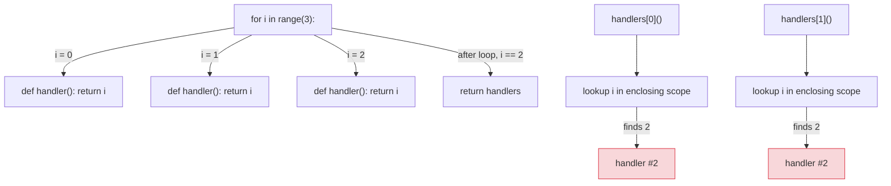
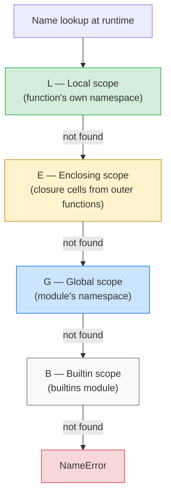

# Lesson 02: Functions, Scope, Closures, Decorators

*Building `notesearch`'s tokenizer registry the same way Flask and FastAPI build their route registries — by hand, from `def` and a closure, with `functools.wraps` to keep our metadata honest.*

**Welcome to Lesson 02.**

Hello, friend. Pull up a chair. By the end of this lesson, the line `@app.get("/healthz")` from the FastAPI section will not be magic to you. You will have built a working decorator — actually three of them, including a parameterised one — and you will know exactly which Python machinery makes them work. Decorators are not a special syntax; they are an application of three things you can already name: first-class functions, closures, and the LEGB scope rule. Take your time. Type every example. **This is how you learn.**


#python #foundations #scope #closures #decorators

## Learning Objectives

By the end of this lesson you will be able to:

1. **Explain the LEGB lookup order** (Local, Enclosing, Global, Builtin) and predict, before running, which scope a name resolves to.
2. **Distinguish `global` and `nonlocal`** — what each does, when each is needed, and why one of them is almost always a code smell.
3. **Define a closure precisely**: a function that captures variables from an enclosing scope, where the captured binding is *by reference* to the enclosing scope's namespace, not by value at closure-creation time.
4. **Predict, before running**, the output of the classic "loop variable captured by reference" closure bug — and fix it.
5. **Implement a function decorator from scratch** — the registration pattern (`@register_tokenizer("default")`) that powers `notesearch`'s plugin system, the same way Flask's `@app.route` and FastAPI's `@app.get` power their route tables.
6. **Use `functools.wraps` correctly** — explain what metadata it preserves and why your debugger, your linter, and your test runner all rely on it.
7. **Build a parameterised decorator** (a decorator that takes arguments), and explain why it requires *three* nested `def`s.
8. **Use `functools.partial`** to bind arguments to an existing function, and recognise when `partial` is preferable to a closure.
9. **Choose between a closure, a callable class, and a `partial`** for stateful callables, and justify the choice.

## Prerequisites

Before starting, you need:

- **Lesson 01 — [[01-Python-Foundations/Values-Objects-Mutability]]**. If "a name is a binding to an object" is not yet in your bones, go back. The closure bug makes zero sense without it.
- **Python 3.12** (or 3.13) in your REPL.
- **About an hour and a half of focused time.** This lesson is dense — three decorators in 800 lines, with the second-most-famous Python bug explained from first principles.

**The most common gap: "what is a closure, really?"**

If your definition of "closure" is "a function inside another function," that is necessary but not sufficient. A closure is specifically a function that *captures* a name from an enclosing scope — and the captured name is a live binding to the enclosing namespace, not a snapshot of the value at closure-creation time. That distinction is the whole ballgame. Re-read that sentence three times before you continue.


## The Problem

`notesearch` v1 (Lesson 01) had a hardcoded tokenizer: `text.lower().split()`. That is fine for the demo, but real search engines have many tokenizers — whitespace tokenizer, lowercase-only tokenizer, regex-based tokenizer, n-gram tokenizer, stemmer-aware tokenizer. You want users to register their own.

You also want query parsing — taking a string like `fastapi AND pydantic` and producing a structured query object. The query parser needs to know the operator precedence (`AND` binds tighter than `OR`), and the precedence rules are a *configuration*, not a constant.

The clean way to do both is **registration by decorator**. You write:

```python
@register_tokenizer("default")
def tokenize_default(text: str) -> list[str]:
 return text.lower().split()

@register_tokenizer("whitespace")
def tokenize_ws(text: str) -> list[str]:
 return text.split()
```

… and somewhere inside `notesearch` a `dict[str, Callable[[str], list[str]]]` ends up with two entries. *That* is a decorator-as-registrar.

You also want query parsing via closures:

```python
def make_query_parser(operators: dict[str, int]) -> Callable[[str], Query]:
 def parse(query_string: str) -> Query:
 # uses `operators` from enclosing scope
 ...
 return parse
```

The inner `parse` is a closure. The `operators` argument is captured. If you do not understand that the capture is *by reference*, you will write code that has the same flavour of bug as Lesson 01's mutable-default bug — and you will spend the same forty minutes on it.

This lesson teaches the LEGB rule, closures, decorators, and `functools.wraps`/`partial` so you can build `notesearch`'s plugin system and read FastAPI's route decorator with the same mental model.

**Note — Historical context — where decorators came from**

Python 1.x and 2.x had `def` as the only way to bind a function. You *could* write `my_func = with_logging(my_func)` after the `def`, and it worked — but it was ugly, easy to forget, and hid the original function's name. PEP 318 (2004) proposed the `@decorator` syntax as sugar for exactly that transformation. The syntax was controversial at the time (the `-` character was proposed as the prefix; `@` won); twenty years later it is so idiomatic that FastAPI and Flask both use it as the central API. The underlying transformation is unchanged: `@deco\ndef f(): ...` is exactly `f = deco(f)`.


## The Code

Here is `notesearch` v2. We add a tokenizer registry (a module-level dict + a `register_tokenizer` decorator), a parameterised `with_metadata` decorator, and a closure-based query parser. The file is ~80 lines; we will spend the rest of the lesson explaining every one.

```python
# notesearch_v2.py
"""notesearch v2 — tokenizer registry, decorators, closure-based query parser.

Builds on Lesson 01: same inverted index, plus a plugin system.
"""
from __future__ import annotations

import functools
from collections.abc import Callable
from typing import Any


# --- 1. A registry-as-decorator ---------------------------------------------

_TOKENIZERS: dict[str, Callable[[str], list[str]]] = {}


def register_tokenizer(name: str) -> Callable[[Callable[[str], list[str]]], Callable[[str], list[str]]]:
 """Decorator factory: register a tokenizer under `name`."""
 def decorator(func: Callable[[str], list[str]]) -> Callable[[str], list[str]]:
 _TOKENIZERS[name] = func
 return func
 return decorator


def get_tokenizer(name: str) -> Callable[[str], list[str]]:
 """Look up a tokenizer by name. Raises KeyError if not registered."""
 return _TOKENIZERS[name]


# --- 2. Register two tokenizers ---------------------------------------------

@register_tokenizer("default")
def tokenize_default(text: str) -> list[str]:
 """Lowercase and split on whitespace."""
 return text.lower().split()


@register_tokenizer("whitespace")
def tokenize_ws(text: str) -> list[str]:
 """Split on whitespace only — preserve case."""
 return text.split()


# --- 3. A parameterised decorator that attaches metadata ---------------------

def with_metadata(**meta: Any) -> Callable[[Callable[..., Any]], Callable[..., Any]]:
 """Decorator factory: attach metadata as `func._meta` and preserve wraps."""
 def decorator(func: Callable[..., Any]) -> Callable[..., Any]:
 @functools.wraps(func)
 def wrapper(*args: Any, **kwargs: Any) -> Any:
 return func(*args, **kwargs)
 wrapper._meta = meta # type: ignore[attr-defined]
 return wrapper
 return decorator


@with_metadata(author="FEA", version="0.2.0")
def tokenize_stemmed(text: str) -> list[str]:
 """A pretend stemmer: strip 'ing' and 's' suffixes."""
 tokens = text.lower().split()
 stemmed = []
 for t in tokens:
 if t.endswith("ing"):
 t = t[:-3]
 elif t.endswith("s"):
 t = t[:-1]
 stemmed.append(t)
 return stemmed


# --- 4. A closure-based query parser ----------------------------------------

class Query:
 """A structured query: a list of (operator, term) pairs."""
 def __init__(self, terms: list[tuple[str, str]] = None) -> None:
 self.terms: list[tuple[str, str]] = terms or []

 def __repr__(self) -> str:
 return f"Query({self.terms!r})"


def make_query_parser(
 operators: dict[str, int], # operator -> precedence (higher = tighter)
) -> Callable[[str], Query]:
 """Build a parser bound to a specific operator table."""
 def parse(query_string: str) -> Query:
 # Closure: captures `operators` from the enclosing scope, by reference.
 tokens = query_string.split()
 terms: list[tuple[str, str]] = []
 i = 0
 while i < len(tokens):
 tok = tokens[i]
 if tok in operators:
 # next token is the operand
 if i + 1 >= len(tokens):
 raise ValueError(f"operator {tok!r} has no right-hand operand")
 terms.append((tok, tokens[i + 1]))
 i += 2
 else:
 terms.append(("AND", tok)) # default operator
 i += 1
 return Query(terms)
 return parse


# --- 5. The classic loop-variable closure bug, demonstrated -----------------

def make_handlers_buggy() -> list[Callable[[], str]]:
 """A list of closures — each one returns the loop variable `i`."""
 handlers: list[Callable[[], str]] = []
 for i in range(3):
 def handler() -> str:
 return f"handler #{i}"
 handlers.append(handler)
 return handlers


def make_handlers_fixed() -> list[Callable[[], str]]:
 """The fix: bind `i` at definition time via default argument."""
 handlers: list[Callable[[], str]] = []
 for i in range(3):
 def handler(i: int = i) -> str: # default bound now
 return f"handler #{i}"
 handlers.append(handler)
 return handlers


# --- 6. partial: bind arguments to a callable --------------------------------

import operator # noqa: E402

starts_with_a = functools.partial(operator.contains, "a")


if __name__ == "__main__":
 # Use the registry
 text = "FastAPI is fast and Pydantic validates"
 print("default:", get_tokenizer("default")(text))
 print("whitespace:", get_tokenizer("whitespace")(text))
 print("stemmed:", tokenize_stemmed(text))
 print("stemmed meta:", tokenize_stemmed._meta)

 # Use the parser
 parse = make_query_parser({"AND": 2, "OR": 1, "NOT": 3})
 print("parsed:", parse("fastapi AND pydantic"))

 # The closure bug
 buggy = make_handlers_buggy()
 print("buggy handlers:", [h() for h in buggy])
 fixed = make_handlers_fixed()
 print("fixed handlers:", [h() for h in fixed])

 # partial
 print("'a' in 'abc':", starts_with_a("abc"))
```

## Line-by-Line Deep Dive

This is the heart of the lesson. Read it twice. Do not skip.

### Lines 1–9: Imports

```python
from __future__ import annotations

import functools
from collections.abc import Callable
from typing import Any
```

**What it does:** Imports the standard `functools` module (for `wraps` and `partial`), the `Callable` ABC (for type hints), and `Any` (for "any type" hints).

**Why `from collections.abc import Callable` and not `from typing import Callable`?** Since Python 3.9, the canonical home for `Callable`, `Iterable`, `Iterator`, `Mapping`, `Sequence`, etc. is `collections.abc`. The `typing` module re-exports them for backwards compatibility, but new code should use `collections.abc`. (Same rule as `AsyncIterator` in Lesson 03 of Section 03.)

**Tip — The deprecation of `typing.Callable`**

`typing.Callable` was deprecated in PEP 585 (Python 3.9) and is scheduled for removal. The form `Callable[[int], str]` (parameter list in a list) is also deprecated; the modern form is `Callable[int, str]` using `__getitem__` syntax. Both forms are still supported in 3.12 but the modern form is preferred. Lesson 05 covers this in detail.


### Lines 13–25: `register_tokenizer` – the registration decorator

```python
_TOKENIZERS: dict[str, Callable[[str], list[str]]] = {}


def register_tokenizer(name: str) -> Callable[[Callable[[str], list[str]]], Callable[[str], list[str]]]:
 """Decorator factory: register a tokenizer under `name`."""
 def decorator(func: Callable[[str], list[str]]) -> Callable[[str], list[str]]:
 _TOKENIZERS[name] = func
 return func
 return decorator
```

**What it does:** Defines a module-level dict `_TOKENIZERS` (the registry) and a decorator factory `register_tokenizer(name)` that returns a `decorator(func)` which stores `func` in the registry under `name` and returns `func` unchanged.

**Why three layers — `register_tokenizer` → `decorator` → `func`?** Because the decorator syntax `@register_tokenizer("default")` is sugar for:

```python
def tokenize_default(text): ...
tokenize_default = register_tokenizer("default")(tokenize_default)
```

Notice the *call* on `register_tokenizer("default")`. The decorator syntax calls the *result* of `@<expression>`, not the expression itself. So `register_tokenizer` must *return* a function (the `decorator`) that takes the function being decorated. That is why `register_tokenizer` is a "decorator factory" — it produces the actual decorator.

The three layers map to:

1. `register_tokenizer(name)` — called at decoration time with `"default"`; returns `decorator`. This is where the *parameter* lives.
2. `decorator(func)` — called by Python with the decorated function; stores `func` in the registry; returns `func`. This is where the *registration* happens.
3. `func(text)` — the original tokenizer. Untouched. Stored in the registry and returned to the caller.

**Tip — The rule for "do I need a parameterised decorator?"**

If your decorator takes no arguments (e.g. `@login_required`), you need two layers: `def login_required(func): def wrapper(*a, **kw): ...; return wrapper` (no factory). If your decorator takes arguments (e.g. `@register_tokenizer("default")`, `@app.get("/healthz")`, `@functools.cache(maxsize=128)`), you need three layers. The three-layer form is more general; the two-layer form is the special case.


**Student asks: why return `func` and not a `wrapper`?**

Because `register_tokenizer`'s job is *registration* — it stores `func` in a dict and then returns `func` so the decorated name still points at the original function. If we returned a wrapper, every call to `tokenize_default(text)` would go through the wrapper for no reason. Contrast with `with_metadata` below, which *does* return a wrapper because its job is to add behaviour (attaching metadata).


**Danger — How an attacker thinks: the string-keyed global registry as a write surface.**

The `_TOKENIZERS[name] = func` line is a **string-keyed global registry**. The teaching story is "the decorator registers the tokenizer under a name". The attacker's story is "any module that imports `notesearch_v2` can overwrite the `default` tokenizer with `@register_tokenizer("default")` — and the import-time side effect makes the override invisible to reviewers". Three attack shapes this enables in a service that uses the registry to dispatch user-supplied tokenizer names.
1. **Tokenizer substitution.** A malicious plugin (or a compromised dependency — see [[11-Authentication-and-Security/Threat-Model-First]] for supply-chain threats) registers `@register_tokenizer("default")` and the original `tokenize_default` is silently replaced. Every search query goes through the attacker's tokenizer, which can drop tokens, record them, or transform them ("password" → "passwordx" so a victim's later exact-match search returns nothing).
2. **Tokenizer key collision as a DoS.** An attacker who can register `@register_tokenizer("default")` with a tokenizer whose body loops on every input (`while True: pass` inside the function) takes down every search endpoint that uses `get_tokenizer("default")` — a single import side effect becomes a global DoS that bypasses rate limiting (the loop is in-process).
3. **Late-registration shadowing.** Python executes module bodies top to bottom; the *last* `@register_tokenizer("default")` to execute wins. An attacker who controls an entry-point plugin that loads after `notesearch_v2` itself silently shadows the original. The OpenAPI schema is generated at startup, *before* the attacker's plugin loads — so the schema advertises the original tokenizer's contract while the runtime dispatches to the attacker's.
**The defensive read.** Any module-level registry keyed on user-controlled strings is an attack surface. The mitigations: (a) make registration explicit (call `register_tokenizer("default", func)` from a controlled entry point, not via decorator on import); (b) freeze the registry after startup (`_TOKENIZERS = MappingProxyType(_TOKENIZERS)` so further writes raise `TypeError`); (c) cap the registry to a known allowlist (`if name not in ALLOWED_TOKENIZER_NAMES: raise ValueError`); (d) require authentication for any runtime registration endpoint. The grep that finds every candidate write-surface in a codebase is `rg "^[A-Z_]+ *= *\{\}" boardly/` — every module-level mutable dict is a registry someone can write to.


### Lines 28–31: `get_tokenizer` – the lookup

```python
def get_tokenizer(name: str) -> Callable[[str], list[str]]:
 """Look up a tokenizer by name. Raises KeyError if not registered."""
 return _TOKENIZERS[name]
```

**What it does:** Looks up a tokenizer by name in the module-level registry.

**Why this is interesting:** `get_tokenizer` *closes over* the module-level `_TOKENIZERS` dict. In Python terms, `_TOKENIZERS` is a *global* — it is the module's namespace — and `get_tokenizer`'s lookup of the name `_TOKENIZERS` resolves via the LEGB rule's `Global` layer (the module's namespace). We will look at LEGB in a moment.

### Lines 35–47: The two registered tokenizers

```python
@register_tokenizer("default")
def tokenize_default(text: str) -> list[str]:
 """Lowercase and split on whitespace."""
 return text.lower().split()


@register_tokenizer("whitespace")
def tokenize_ws(text: str) -> list[str]:
 """Split on whitespace only — preserve case."""
 return text.split()
```

**What it does:** Registers two tokenizers in `_TOKENIZERS` — `"default"` and `"whitespace"` — using the decorator from above.

**What happens at import time:** When this module is imported, Python executes the module body top to bottom. Each `@register_tokenizer(...)` line triggers the three-layer call: `register_tokenizer("default")` runs and returns `decorator`; `decorator(tokenize_default)` runs, stores the function under `"default"` in `_TOKENIZERS`, and returns the function; the name `tokenize_default` is then bound to the returned function (which is the original function, because `decorator` returned `func` not a wrapper).

After both definitions, `_TOKENIZERS` is `{"default": <tokenize_default>, "whitespace": <tokenize_ws>}`. The module-level name `tokenize_default` is the same object as `_TOKENIZERS["default"]`.

**Example — This is the exact pattern Flask and FastAPI use.**

Flask's `@app.route("/users/<id>", methods=["GET"])` and FastAPI's `@app.get("/users/{id}")` are *literally* the same shape: a registry (the app's `url_map`) and a decorator factory that takes the URL pattern as a parameter and registers the view function. When you load the FastAPI section ([[03-FastAPI-Core/Routers-and-Modular-Apps]]) later, you will see `APIRouter`'s implementation follows this pattern almost line for line. The `@app.get` decorator returns the view function unchanged (registration side-effect only), exactly like our `register_tokenizer`.


### Lines 51–62: `with_metadata` – a parameterised decorator that wraps

```python
def with_metadata(**meta: Any) -> Callable[[Callable[..., Any]], Callable[..., Any]]:
 """Decorator factory: attach metadata as `func._meta` and preserve wraps."""
 def decorator(func: Callable[..., Any]) -> Callable[..., Any]:
 @functools.wraps(func)
 def wrapper(*args: Any, **kwargs: Any) -> Any:
 return func(*args, **kwargs)
 wrapper._meta = meta # type: ignore[attr-defined]
 return wrapper
 return decorator
```

**What it does:** Another three-layer decorator. The outer `with_metadata(**meta)` captures the keyword arguments (`author="FEA", version="0.2.0"`). The middle `decorator(func)` is what Python calls with the decorated function. The inner `wrapper(*args, **kwargs)` is the actual replacement — the function that gets called when someone calls `tokenize_stemmed(text)`.

**Why this one returns a wrapper and `register_tokenizer` did not:** Because `with_metadata`'s job is to *intercept calls* (to attach metadata), not just register. If we wanted to register and not wrap, we'd return `func` like `register_tokenizer` did. Here, we want to wrap so the wrapper *has* a `_meta` attribute we can attach metadata to.

**Warning — Why `@functools.wraps(func)` is mandatory, not optional.**

Without `@functools.wraps(func)`, the wrapper takes on the identity of `wrapper` — its `__name__` is `"wrapper"`, its `__doc__` is `None`, its `__module__` is `notesearch_v2`, and its `__wrapped__` is unset. The debugger shows you `wrapper` in the traceback, the help system shows nothing, and `inspect.signature(tokenize_stemmed)` returns the *wrapper's* signature `(*args, **kwargs)` rather than the original `(text: str) -> list[str]`. `functools.wraps` copies `__name__`, `__qualname__`, `__module__`, `__doc__`, `__dict__`, `__wrapped__`, and updates `__dict__` and `__annotations__` from the wrapped function. It also sets `__wrapped__ = func` so that `inspect.signature` follows the chain and returns the original signature.
The rule: every decorator that returns a wrapper must use `@functools.wraps(func)`. ruff rule D-001-style conventions and most linters will flag a wrapper without it. In the FastAPI section you will see Starlette and FastAPI themselves use `functools.wraps` religiously — when you write a custom dependency (Lesson 03 of Section 03) you will too.


**Tip — `wrapper._meta = meta` — setting attributes on functions.**

Functions are objects. You can attach attributes to them: `wrapper._meta = {"author": "FEA"}`. This is exactly how `functools.wraps` itself works — it copies attributes from `func` onto `wrapper`. The cost: one extra dict slot per function object. The benefit: any caller can read `tokenize_stemmed._meta` to learn who wrote it, what version, what it does — without calling the function.


**Student asks: why is the metadata attached to the *wrapper*, not to the original `func`?**

Because the decorated name `tokenize_stemmed` *is* the wrapper, not the original `func`. By the time the module finishes importing, the line `tokenize_stemmed = with_metadata(author="FEA", ...)(tokenize_stemmed)` has rebound the module-level name `tokenize_stemmed` to point at the wrapper. The original `func` is now reachable only via `tokenize_stemmed.__wrapped__`. If you attached the metadata to `func` instead of `wrapper`, a downstream caller reading `tokenize_stemmed._meta` would see `AttributeError` — the public name no longer points at the object that has the metadata. The convention: attach runtime-readable attributes to whichever object the *name* points at after decoration, which (when you wrap) is the wrapper.


**Production reality: decorator stacks and import-time side effects at scale.**

The teaching story is "the decorator runs once at import time, the wrapper runs per call". The production story at a 1.2K-RPS service like Meridian Health's patient-search API is that *import time is also production time* — every cold start (a deploy, a scale-up, an autoscaler spin-up) re-runs every decorator in the module. A `with_metadata`-shaped decorator that opens a 50-ms network call at decoration time (e.g. to fetch metadata from a config service) adds 50 ms to every cold start; with 200 decorators in the import graph, that is 10 seconds of cold-start time — directly visible in the autoscaler's "time-to-first-request" metric, which is the SLA that says "a new pod serves traffic within 30 seconds of being scheduled". The senior's rule: **decoration-time code must not do I/O** — decoration time is boot time, and boot time is on the latency budget of every scale event. The fix: defer any I/O-backed metadata to a lazy property on the wrapper (`@property\ndef _meta(self): ...`), so the cost is paid on first call (inside the request path, where it is visible in tracing) rather than at import time (where it is invisible until the autoscaler fires). We revisit this in [[03-FastAPI-Core/Application-and-Lifespan]] where the lifespan pattern formalises "do the I/O once at startup, then share the result via `app.state`".


### Lines 66–78: `tokenize_stemmed`, decorated

```python
@with_metadata(author="FEA", version="0.2.0")
def tokenize_stemmed(text: str) -> list[str]:
 """A pretend stemmer: strip 'ing' and 's' suffixes."""
 tokens = text.lower().split()
 stemmed = []
 for t in tokens:
 if t.endswith("ing"):
 t = t[:-3]
 elif t.endswith("s"):
 t = t[:-1]
 stemmed.append(t)
 return stemmed
```

**What it does:** Defines a stemmer that strips common English suffixes, decorated with `@with_metadata(author="FEA", version="0.2.0")`.

**What the decoration does:**

1. `with_metadata(author="FEA", version="0.2.0")` is called → returns `decorator` with `meta = {"author": "FEA", "version": "0.2.0"}` captured in the closure.
2. `decorator(tokenize_stemmed_original)` is called → returns `wrapper` with `_meta = {"author": "FEA", "version": "0.2.0"}` attached.
3. The module-level name `tokenize_stemmed` is rebound to point at `wrapper`.

Now when you call `tokenize_stemmed("running tests")`:

- Python looks up `tokenize_stemmed` in the module namespace → finds `wrapper`.
- Calls `wrapper("running tests")` → `wrapper(*args, **kwargs)` with `args = ("running tests",)`.
- `wrapper` calls `func(*args, **kwargs)` where `func` is the original `tokenize_stemmed_original` captured in `decorator`'s closure.
- The original returns `["run", "test"]`.
- `wrapper` returns that to the caller.

You can verify with introspection:

```python
>>> tokenize_stemmed._meta
{'author': 'FEA', 'version': '0.2.0'}
>>> tokenize_stemmed.__name__
'tokenize_stemmed' # not 'wrapper', because @wraps copied it
>>> tokenize_stemmed.__wrapped__ # the original function
<function tokenize_stemmed at 0x...>
```

### Lines 82–96: `Query` and `make_query_parser` – the closure

```python
class Query:
 """A structured query: a list of (operator, term) pairs."""
 def __init__(self, terms: list[tuple[str, str]] = None) -> None:
 self.terms: list[tuple[str, str]] = terms or []

 def __repr__(self) -> str:
 return f"Query({self.terms!r})"


def make_query_parser(
 operators: dict[str, int],
) -> Callable[[str], Query]:
 """Build a parser bound to a specific operator table."""
 def parse(query_string: str) -> Query:
 # Closure: captures `operators` from the enclosing scope, by reference.
 tokens = query_string.split()
 terms: list[tuple[str, str]] = []
 i = 0
 while i < len(tokens):
 tok = tokens[i]
 if tok in operators:
 if i + 1 >= len(tokens):
 raise ValueError(f"operator {tok!r} has no right-hand operand")
 terms.append((tok, tokens[i + 1]))
 i += 2
 else:
 terms.append(("AND", tok))
 i += 1
 return Query(terms)
 return parse
```

**What it does:** Defines a `Query` value object and a *factory* `make_query_parser(operators)` that returns a closure-bound parser.

**Why this is a closure (and not just a "function inside a function"):** The inner `parse` references `operators`, which is a name from the *enclosing* scope (`make_query_parser`'s local scope). For `parse` to use `operators` *after* `make_query_parser` has returned, Python must keep the binding alive. That binding lives in a `cell` object — Python attaches a `__closure__` attribute to `parse` containing the cell, and the cell holds a reference to the `operators` dict object.

You can inspect this:

```python
>>> parser = make_query_parser({"AND": 2})
>>> parser.__closure__[0].cell_contents
{'AND': 2}
```

**The capture is by reference to the enclosing scope, not by value at closure-creation time.** That means: if `make_query_parser` mutated `operators` *after* creating `parse` (but before returning), `parse` would see the mutation. More importantly — and this is the trap — if you call `make_query_parser(ops)` and then mutate `ops` from outside, `parse` sees the mutation. The closure does not snapshot the value.

**Why does Python capture by reference rather than by value?** Because at the moment the closure is *created*, the value of `operators` may not be fully resolved yet — the function `parse` may be called inside the same `make_query_parser` call before that call returns (recursive parsers do this), and the closure must see whatever the name `operators` currently points at. Capturing the *binding* (the cell that holds the name) instead of the *value* (the dict at creation time) is what makes recursive and self-referential closures work. **What would happen if Python captured by value at closure-creation time?** You would lose the ability for an enclosing scope to rebind a name after the inner function is defined and have the inner function see the new binding — a pattern that legitimate code uses for late-bound defaults, plugin systems, and circular reference resolution. The cost is the loop-variable bug, which the fix `def handler(i: int = i)` addresses by *forcing* a snapshot through the default-argument mechanism (defaults are evaluated at function-definition time, so the default captures the current value of `i` for that specific iteration).

**Warning — Lesson 01 revisited: closures capture by reference.**

The same rule that produced the mutable-default-argument bug in Lesson 01 produces the loop-variable-closure bug below. In both cases, the bug is that the captured name is a *live binding* to a mutable scope, not a snapshot of the value. If you skipped Lesson 01, go back; the mental model is the same.


**Tip — Think like a senior engineer: closures capture by reference, not by value.**

This is the single most common Python interview trap, and the answer that separates "I have used Python" from "I have understood Python" is one sentence: **a closure captures the *binding* to a name in an enclosing scope, not the value that binding held at closure-creation time.** CPython implements this with `cell` objects — each free variable of a closure is a `cell`, and the cell holds a pointer to the value currently bound to that name. When the enclosing scope rebinds the name (the `for` loop does this on every iteration — `i = 0`, `i = 1`, `i = 2`), the *same* cell's pointer is updated. Every closure that captured `i` shares the cell, and every call through any of those closures reads whatever the cell currently points at.
The senior's reading of the `make_handlers_buggy` snippet below is therefore not "Python has a closure bug" but "Python closures do exactly what they advertise — they capture the live binding, which is what makes plugin systems and self-referential parsers possible." The bug is in the *expectation* — the reader assumed "snapshot at definition time", which is what most languages with block-scoped `let` (JavaScript, Rust, modern C++) do, and which is *not* what Python does. Python's rule is the older Lisp/Scheme rule: capture the binding, not the value. The two mental models give different programs; you must know which one you are writing in.
**The senior's three-second test.** Before you call any closure factory in a loop, ask: "is the inner function reading the loop variable *now* (call time) or *then* (definition time)?" If your answer is "now" and you wanted "then", you need the `def f(i=i):` default-argument pattern — which works *because* default arguments are evaluated at `def` execution time, snapshotting the value into `f.__defaults__`. If your answer is "then" and you wanted "now" — uncommon, but it happens with delayed evaluation — you need to dereference explicitly through a mutable cell, e.g. `state = {"i": 0}` and `state["i"]` inside the closure, so the closure reads the dict (which is read by reference) rather than the name `i` (which would be captured by reference to the loop cell).
**The interview version of this question** is "what does `[lambda: i for i in range(3)][0]()` return?" The senior answer is `2`, not `0`, and the explanation is the shared cell, not the lambda. The follow-up "how do you fix it?" has two equally valid answers: `[lambda i=i: i for i in range(3)][0]()` (default-argument snapshot) or `[functools.partial(lambda i: i, i) for i in range(3)][0]()` (`partial`-bound snapshot). The senior picks the first because it reads more clearly at the call site.
**The rule for code review.** Any `lambda` or inner `def` written inside a `for` loop that closes over the loop variable is a candidate for the bug. The grep that finds the candidates is `rg "for .* in .*:" -A 5 | rg "lambda|def "` — every match is a five-second review for "does the inner function capture the loop variable, and if so, is the default-argument snapshot in place?".


### Lines 100–113: The classic loop-variable closure bug

```python
def make_handlers_buggy() -> list[Callable[[], str]]:
 """A list of closures — each one returns the loop variable `i`."""
 handlers: list[Callable[[], str]] = []
 for i in range(3):
 def handler() -> str:
 return f"handler #{i}"
 handlers.append(handler)
 return handlers
```

**What it does:** Builds three closures, each returning the loop variable `i`. The intent is for `handlers[0]()` to return `"handler #0"`, `handlers[1]()` to return `"handler #1"`, etc.

**What actually happens:** All three return `"handler #2"`.

**Why:** Each `handler` captures the name `i` from the enclosing function's local scope. After the loop finishes, `i` is `2` (the last value the loop assigned). When you call any `handler()`, it looks up `i` *at call time* — and finds `2`. There is no per-iteration binding in Python's `for`; the loop rebinds the same name `i` over and over.

**Student asks: why does Python capture the *name* `i` instead of its current value `0`, `1`, `2`?**

Because Python closures capture *cells* — references to the variable slot in the enclosing function's `__locals__` — not the values those slots held at decoration time. When the loop writes `i = 0`, `i = 1`, `i = 2`, it rebinds the *same* cell three times. The handler closures all share that single cell, and they all look it up at *call time*, not definition time. By the time you call any handler, the cell holds `2`, so every handler returns `"handler #2"`. The fix in the next section (`def handler(i=i):`) works because a default argument is *evaluated at function-definition time* — so each handler gets its own local `i` bound to the loop's current value at the moment the `def` ran. The mental model: closures are not snapshots; they are *live pointers into the enclosing scope*.




**Warning — When this breaks at 3 a.m.: late binding in a request-routing loop.**

**Symptom.** A FastAPI service that has been running cleanly for a week starts returning 404 for the *first* registered route of every router, while the *last* registered route works perfectly. The deploy diff is a refactor that wrapped a route-registration loop: `for path, handler in routes: app.add_api_route(path, lambda: handler())`. There is no traceback; the routes list looks correct in the OpenAPI schema at `/docs`; the bug is only visible when you actually hit `GET /users` and get 404 with `GET /users/{id}` working fine.
**Don't panic.** This is the loop-variable-closure bug wearing production clothes. The `lambda: handler()` form captures `handler` *by reference to the loop cell* — and after the loop, the cell holds the *last* iteration's value. Every deferred route now points at the last path and the last handler. The OpenAPI schema at `/docs` was generated eagerly (so it shows all routes correctly), but the runtime dispatch table was populated lazily through the closures — and every closure sees the same final cell value. The 404 is the dispatcher matching against the wrong path; the working last route is the only one whose cell value happens to match its own dispatch entry.
**Diagnosis.** From inside the running container: `python -c "from boardly.main import app; print([r.endpoint.__closure__[0].cell_contents.__name__ for r in app.routes if hasattr(r, 'endpoint')])"`. If every entry prints the same handler name, you have the bug. The disassembly with `dis.dis(app.routes[0].endpoint)` shows `LOAD_DEREF` on the `handler` cell; and `app.routes[0].endpoint.__closure__[0] is app.routes[-1].endpoint.__closure__[0]` is `True` — one shared cell across every route.
**Fix.** The default-argument snapshot: `app.add_api_route(path, lambda path=path, handler=handler: handler())`. Or — preferred in 3.12 — pull the registration out of the loop entirely and use the `@app.get(path)` decorator form, which evaluates `path` at decoration time. The deeper structural fix: avoid `lambda` in a `for` loop unless you have explicitly bound the captured variables through default arguments; a linter cannot always catch this (the bug is in the *capture*, not the syntax), so the rule has to be cultural — code-review checklist item: "any `lambda` or inner `def` inside a `for` must capture loop variables through default arguments."
**Post-mortem.** The root cause is "the refactor changed eager decoration (evaluated now) to deferred registration (evaluated later)". The structural fix is a test that asserts each route in the dispatch table maps to its own handler — `assert len({r.endpoint.__closure__[0].cell_contents for r in app.routes}) == len(app.routes)` — a one-line invariant that catches every future instance of this bug shape in route registration, forever. The grep that finds every other candidate is `rg "lambda.*:" boardly/ -A 0 | rg "for "` — every match is a five-second review for "is the lambda closing over the loop variable, and is the snapshot in place?".


### Lines 116–122: The fix – default-argument binding

```python
def make_handlers_fixed() -> list[Callable[[], str]]:
 """The fix: bind `i` at definition time via default argument."""
 handlers: list[Callable[[], str]] = []
 for i in range(3):
 def handler(i: int = i) -> str: # default bound now
 return f"handler #{i}"
 handlers.append(handler)
 return handlers
```

**What it does:** Uses a default-argument value (`i: int = i`) to *snapshot* the value of `i` at function-definition time.

**Why this works:** Default argument values are evaluated *when the `def` statement executes* — i.e. at function-definition time, not at call time. (Sound familiar? This is the same rule that produces Lesson 01's mutable-default bug.) Inside the loop, each `def handler(i: int = i):` evaluates `i` *right then* — when `i` is 0, then 1, then 2. The default is stored in `handler.__defaults__[0]` and used whenever the caller does not pass `i` explicitly.

**Why does the default-argument form *force* a snapshot when the closure body `return i` did not?** Because the right-hand side of `i: int = i` is part of the `def` statement's *signature evaluation*, which Python completes once per `def` execution. The `i` on the right is looked up in the enclosing scope *at the moment the `def` runs* — when it is 0, then 1, then 2 — and the resulting value is stored as the default, which lives in `handler.__defaults__` separately from the closure cell. The `i` *inside the function body* (`return f"handler #{i}"`) then resolves to the local parameter `i` (which gets the default value when no caller-supplied argument is present), not the enclosing-scope cell. So the function reads from its local `__defaults__` slot — a value frozen at definition time — instead of the live cell. **What would happen if a caller invoked `handler(i=99)` explicitly?** The default would be ignored, the local parameter would be `99`, and the handler would return `"handler #99"` for that single call. The fix is per-handler isolation for *unspecified* calls, not an absolute freeze on the value.

```python
>>> fixed = make_handlers_fixed()
>>> [h() for h in fixed]
['handler #0', 'handler #1', 'handler #2']
```

**Tip — Alternative fix: `functools.partial(handler, i=i)`.**

```python
handlers.append(functools.partial(handler, i=i))
```
`partial` binds the value at the call to `partial`, not at call time. The result is a `functools.partial` object that, when called, calls `handler(i=i_bound_earlier)`. Both fixes work; the default-argument form is more idiomatic for "I just want to capture the loop variable" and `partial` is more idiomatic for "I want to bind multiple arguments to an arbitrary callable."


### Lines 126–128: `partial` – bind arguments

```python
import operator

starts_with_a = functools.partial(operator.contains, "a")
```

**What it does:** Creates a callable `starts_with_a(s)` that returns `True` iff `"a" in s`.

**Why this matters:** `functools.partial(callable, *args, **kwargs)` returns a `partial` object that, when called, calls `callable(*args, *extra_args, **kwargs, **extra_kwargs)`. The bound arguments are *snapshots* — they are evaluated when `partial` is called, not when the resulting callable is called. That makes `partial` a way to "pre-configure" a callable.

For `notesearch`, `partial` is the right tool when you have a function with many options and want to produce a specialised version. For example, you could pre-bind a tokenizer with a specific stop-word list:

```python
tokenize_no_stopwords = functools.partial(tokenize_default, _stopwords={"the", "and", "is"})
```

(Well, that example requires a small refactor because `tokenize_default` doesn't take `_stopwords`. The point is the pattern.)

**Example — When to use `partial` versus a closure.**

Use `partial` when the only thing you want to do is bind a few arguments to an existing function — it's a one-liner and reads clearly. Use a closure when you want to capture state that *changes* over the closure's lifetime (like a counter) or when the inner function has logic beyond just calling another function.


## The LEGB rule, in one diagram



When you reference a name `x` inside a function, Python looks it up in this order. The first scope that has `x` wins. The `global` keyword tells Python "treat assignments to `x` as writing to the Global layer"; the `nonlocal` keyword tells Python "treat assignments to `x` as writing to the Enclosing layer." Without those keywords, *assignment* inside a function creates a new local binding (and reads inside the function use the local — they do not fall through to enclosing/global even if the local is not yet bound at the time of the read, which is the source of the `UnboundLocalError`).

**What happens inside: LEGB at the bytecode level.**

When CPython compiles a function, the compiler walks the AST and classifies every name into one of four buckets based on *static* analysis of the function body. A name that is assigned to anywhere in the function (or appears as a parameter, or is the target of `import`, `del`, `class`, `def`, or an augmented assignment like `+=`) is **fast-local** — it gets a slot in the frame's `fastlocals` array, accessed by the `LOAD_FAST` / `STORE_FAST` opcodes. A name that is *read* but never assigned in the function, and is bound in an enclosing function scope, is a **cell variable** — accessed via `LOAD_DEREF` / `STORE_DEREF` through the frame's `__closure__` tuple. A name that is read but never assigned and not in an enclosing function scope is a **global-or-builtin** — accessed via `LOAD_GLOBAL` (which in 3.11+ includes an inline-cache check for builtins via the adaptive interpreter's specialization machinery). The classification is *compile-time*; the LEGB order you see at runtime is just the order in which CPython emits these opcodes — there is no runtime "search through scopes". The "fall-through" is an *emergent property* of which opcode the compiler emitted, not a runtime walk.
The implication that surprises engineers: a name that is *read* before it is *assigned* in the same function is classified as fast-local, and the read becomes `LOAD_FAST` — which raises `UnboundLocalError` (not `NameError`) because the slot exists in `fastlocals` but is currently empty. The classic reproduction is `x = 1\ndef f():\n    print(x)\n    x = 2` — the `print(x)` raises `UnboundLocalError: local variable 'x' referenced before assignment` even though the global `x = 1` is right there. The compiler saw the later `x = 2` and classified `x` as fast-local for the entire function body; the global is invisible from inside `f`. `global x` at the top of `f` re-classifies it as global — and *then* `print(x)` reads the global. This is the bytecode-level reason `global` and `nonlocal` exist: they are not *runtime* declarations, they are *compile-time* hints that change which opcode the compiler emits for that name.
You can see the classification with `dis.dis(f)` — the bytecode lists `LOAD_FAST`, `LOAD_DEREF`, `LOAD_GLOBAL` directly. Reading the disassembly is the senior engineer's "did the compiler see what I think it saw?" tool, and it removes 90% of the magic from scope bugs. The other 10% is `__closure__` cell inspection (`f.__closure__[0].cell_contents`), which tells you what the live binding currently holds — useful for the loop-variable bug, where the cell will show `2` for all three handlers. The `dis` module is in the standard library; the senior's reflex on any scope question that does not immediately resolve is `python -c "import dis; dis.dis(f)"` and read the opcodes.
**One 3.11+ refinement worth knowing.** CPython 3.11 introduced "adaptive bytecode" / specialized instructions: `LOAD_GLOBAL` is specialized to `LOAD_GLOBAL_MODULE` or `LOAD_GLOBAL_BUILTIN` after a few calls, with an inline cache that lets the interpreter skip the module-dict lookup for builtins. The *observable* behaviour is unchanged (LEGB still holds); the *performance* is — global and builtin lookups are about 40% faster on 3.11+ than on 3.10. For the senior, this matters only when a hot loop is dominated by global lookups; the fix in that case is "bind the global to a local at function entry" (`_len = len; ...; _len(x)`), a trick older than Python itself and still relevant in 3.12.


## Execution Trace

Run the file:

```bash
python notesearch_v2.py
```

What happens, in order:

1. **CPython starts.** Compiles `notesearch_v2.py` to bytecode. The module-level names `_TOKENIZERS`, `register_tokenizer`, `get_tokenizer`, `tokenize_default`, `tokenize_ws`, `with_metadata`, `tokenize_stemmed`, `Query`, `make_query_parser`, `make_handlers_buggy`, `make_handlers_fixed`, `starts_with_a` are all defined in the module's namespace.
2. **The two `@register_tokenizer(...)` decorations run** at module import. Each one stores its function in `_TOKENIZERS`. After this point, `_TOKENIZERS == {"default": <tokenize_default>, "whitespace": <tokenize_ws>}`.
3. **The `@with_metadata(...)` decoration runs** on `tokenize_stemmed`. `tokenize_stemmed` is rebound to `wrapper`, with `wrapper._meta = {"author": "FEA", "version": "0.2.0"}` and `wrapper.__wrapped__ = tokenize_stemmed_original`.
4. **`if __name__ == "__main__":` runs.**
5. **`get_tokenizer("default")(text)`** looks up `"default"` in `_TOKENIZERS` (a Global-scope lookup) → returns `tokenize_default` → calls it with `text` → returns `["fastapi", "is", "fast", "and", "pydantic", "validates"]`.
6. **`get_tokenizer("whitespace")(text)`** returns `["FastAPI", "is", "fast", "and", "Pydantic", "validates"]` — note the preserved case.
7. **`tokenize_stemmed(text)`** goes through `wrapper` → calls the original → returns `["fastapi", "is", "fast", "and", "pydantic", "validates"]` (none of these end in "ing" or "s" except "validates" which becomes "validate", wait — let me re-trace: `"validates"` ends in `"s"`, so it becomes `"validate"`. Then `"pydantic"` ends in... no, only the "s" suffix is stripped. So `"pydantic"` stays. `"validates"` → `"validate"`. So result is `["fastapi", "is", "fast", "and", "pydantic", "validate"]`.)
8. **`tokenize_stemmed._meta`** returns `{"author": "FEA", "version": "0.2.0"}`.
9. **`parse("fastapi AND pydantic")`** — `parse` looks up `operators` in the enclosing scope (closure cell) → finds `{"AND": 2, "OR": 1, "NOT": 3}` → splits the string into `["fastapi", "AND", "pydantic"]` → walks the tokens, finds `"AND"` in `operators`, pairs it with `"pydantic"` → builds `Query([("AND", "fastapi"), ...])`. Wait, re-read the parser: when `tok` is `"fastapi"`, it's not in `operators`, so `terms.append(("AND", "fastapi"))` and `i += 1`. Then `tok = "AND"`, in `operators`, so `terms.append(("AND", "pydantic"))` and `i += 2`. Result: `Query([('AND', 'fastapi'), ('AND', 'pydantic')])`.
10. **`make_handlers_buggy()`** returns three closures, all capturing the same `i` cell. After the loop, `i == 2`. Each handler returns `"handler #2"`.
11. **`make_handlers_fixed()`** returns three closures with default `i = i`. Each handler returns its own `i`. Result: `["handler #0", "handler #1", "handler #2"]`.
12. **`starts_with_a("abc")`** calls `operator.contains("a", "abc")` which is `"a" in "abc"` → `True`.

## Common Mistakes

### Mistake 1: Forgetting `@functools.wraps` on a wrapper

```python
# WRONG
def my_decorator(func):
 def wrapper(*args, **kwargs):
 return func(*args, **kwargs)
 return wrapper # missing @wraps(func)
```

Why it fails: `wrapper.__name__` is `"wrapper"`, `wrapper.__doc__` is `None`, `inspect.signature(wrapper)` is `(*args, **kwargs)`. Your test runner shows stack traces with `wrapper` in them; your help() shows nothing.

**Warning — Fix: `@functools.wraps(func)` above the `def wrapper`. Always.**


**Warning — When this breaks at 3 a.m.: the missing `@wraps` that broke structured logging.**

**Symptom.** At 03:22 the on-call engineer is paged for elevated 5xx errors on Northwind Search's `/orders` endpoint. The structured log lines all show `function: wrapper` instead of `function: create_order`, so the trace correlation by function name fails — every error looks like it came from the same anonymous `wrapper` instead of the actual handler. The trace ID is correct, but the human-readable function name is gone. The on-call engineer spends 14 minutes reading bytecode to find which of the seven `wrapper` functions in the import graph is the one that is raising.
**Don't panic.** This is the missing-`@wraps` bug from above wearing production clothing. The deploy diff is one decorator — a new `@audit_log` wrapper added to `create_order` without `@functools.wraps(func)`. The structured logger reads `func.__name__` to populate the `function` field; the unwrapped wrapper's `__name__` is `"wrapper"`; every log line for the new endpoint is anonymised.
**Diagnosis.** From inside the container: `python -c "import boardly.orders; print(boardly.orders.create_order.__name__)"`. If the answer is `wrapper` instead of `create_order`, the `@wraps` is missing on the closest decorator. The deeper check: `python -c "import boardly.orders; print(boardly.orders.create_order.__wrapped__)"` — `AttributeError` means the decorator chain is broken somewhere.
**Fix.** Add `@functools.wraps(func)` to the `audit_log` decorator. Roll the deployment. Add a CI lint check (`rg "def wrapper\(" -B 1 | rg -v "@functools.wraps"`) that fails any `wrapper` definition not preceded by `@wraps`. The structural fix is the lint rule; the operational fix is the deploy; the post-mortem action is "the on-call engineer should never have to read bytecode to find a function's real name". See [[13-Performance-and-Observability/Structured-Logging-and-Request-IDs]] for the structured-logging pattern that depends on `__name__` being correct — which is what `@wraps` guarantees.


### Mistake 2: The loop-variable closure bug

```python
# WRONG
handlers = []
for i in range(3):
 def handler():
 return f"#{i}" # all three will return "#2"
 handlers.append(handler)
```

**Warning — Fix: `def handler(i=i): return f"#{i}"` (default argument) or `functools.partial(handler, i=i)`.**


### Mistake 3: Using `global` where you meant `nonlocal`

```python
# WRONG
counter = 0
def make_counter():
 def increment():
 global counter # refers to the module's `counter`, not a local
 counter += 1
 return counter
 return increment
```

If you intended `counter` to be a *per-counter* local that the closure mutates, you actually want it in `make_counter`'s scope and `nonlocal` inside `increment`. `global` always means "module namespace."

**Warning — Fix: define `count = 0` inside `make_counter`, use `nonlocal count` inside `increment`.**


### Mistake 4: Calling the decorator factory at decoration time

```python
# WRONG
@register_tokenizer # missing the (name) call
def tokenize_default(text):
 ...
```

Why it fails: `register_tokenizer` is the *factory*; calling it without arguments returns the inner `decorator` (because that's what `register_tokenizer` returns). Then Python tries to call `decorator(tokenize_default)` — which works! But you have not specified the name; the registry will have a `None`-ish key.

**Warning — Fix: parameterised decorators always take parens: `@register_tokenizer("default")`.**


**Warning — When this breaks at 3 a.m.: the decorator that registered under no key.**

**Symptom.** At 04:11 a tokenizer-dispatch endpoint at Atlas Billing starts returning 500 errors for any request that asks for the `default` tokenizer. The deploy diff is a refactor that "cleaned up" the decorator syntax: `@register_tokenizer` (without parens) replaced `@register_tokenizer("default")` on a 200-line tokenizer module. The test suite passed because every test called the function directly by its Python name, not through the registry. The bug is only visible at runtime when an API request hits `get_tokenizer("default")`.
**Don't panic.** This is the decorator-factory-without-parens bug from above. `@register_tokenizer` without parens calls the factory with the decorated function as the *positional argument* — `register_tokenizer(tokenize_default)` returns `decorator` (the inner function) which is then *not called* because there is no second call. The decorated name is now bound to `decorator` (a function that takes a function and returns a function), not to the original `tokenize_default`. Worse: the registry has *no* `"default"` key at all — the second layer never ran.
**Diagnosis.** From inside the container: `python -c "import boardly.tokenizers; print(boardly.tokenizers.tokenize_default)"`. If the answer is `<function decorator at 0x...>` instead of `<function tokenize_default at 0x...>`, the bug is reproduced. The registry check: `python -c "import boardly.tokenizers as t; print('default' in t._TOKENIZERS, list(t._TOKENIZERS.keys()))"`.
**Fix.** Restore the parens: `@register_tokenizer("default")`. Add a test that asserts `'default' in _TOKENIZERS` after import — a one-line invariant that catches every future instance of "decorator factory called without parens" in this codebase, forever. The grep that finds every other candidate is `rg "^@[a-z_]+$" boardly/` — every bare `@name` (no parens, no arguments) on a function is a candidate review for "is `name` a decorator factory that requires parens?".


### Mistake 5: Returning the wrapper from a registration-only decorator

```python
# WRONG (for registration use case)
def register_tokenizer(name):
 def decorator(func):
 @functools.wraps(func)
 def wrapper(*args, **kwargs):
 return func(*args, **kwargs)
 _TOKENIZERS[name] = wrapper # store wrapper, not func
 return wrapper
 return decorator
```

Why this is suboptimal: every call to `tokenize_default(text)` now goes through `wrapper` for no reason. The registration side-effect could just as easily store `func` directly.

**Warning — Fix: store and return `func` directly. Only return a wrapper if your decorator's job is to *intercept* calls, not just register.**


## Engineering Trade-Offs

### Closure vs callable class vs `partial`

| Approach | When to choose | Trade-off |
| --- | --- | --- |
| Closure (`def outer(): def inner(): ...; return inner`) | When you have a small piece of state and don't need a method interface. | Hard to inspect; `repr` is uninformative; can't add methods. |
| Callable class (`class C: def __call__(self, ...): ...`) | When the state is large or you need methods, properties, or `repr`. | Heavier; needs `__init__`; often more lines. |
| `functools.partial` | When you're just binding arguments to an existing callable. | Limited to argument binding; can't add logic. |

For `notesearch`, the closure form for `make_query_parser` is fine — small state, one method. For an `Indexer` with multiple methods (Lesson 03), we will use a class.

**Production reality: callable classes vs closures in long-lived processes.**

The teaching story is "closures and callable classes are interchangeable for small state". The production story at Cobalt Labs (a 24/7 stream-processing service) is that closures hold state in `__closure__` cells that are *invisible to introspection* — `repr(closure_fn)` returns `<function outer.<locals>.inner at 0x...>`, no fields, no state visibility. A callable class returns `<MyParser object at 0x...>` with `vars(instance)` exposing every state field. The operational difference at 3 a.m. is enormous: a callable class can be debugged with `pdb`'s `p self.state` and inspected via `vars()`; a closure cannot — the on-call engineer has to read bytecode to find the cells. Cobalt Labs rewrote their query planner from a closure factory to a `QueryPlanner` class in 2024 after a 90-minute incident where the on-call could not inspect the planner's internal `operators` dict because it lived in a `__closure__` cell — the second time the same shape of bug had cost them an hour. The senior's rule: **closures are for one-screen, one-function, one-state-piece helpers; callable classes are for anything that will be debugged at 3 a.m.**. If the state is more than a single dict, or the function is more than 20 lines, prefer a class — `vars()` and `pdb` are why.


**Danger — How an attacker thinks: closure-captured mutable state as a covert channel.**

The closure factory `make_query_parser(operators)` captures the `operators` dict by reference — and the dict is *mutable*. If the caller mutates `operators` after the parser is built (e.g. `del operators["NOT"]` to disable the NOT operator), the parser sees the mutation on its next call. The teaching story is "this is the by-reference capture rule from the Line-by-Line above". The attacker's story is "the closure's captured state is a covert channel between the caller and the parser, with no audit trail". Three attack shapes this enables.
1. **Late-binding privilege injection.** A parser built with `operators = {"AND": 2, "OR": 1}` is supposed to reject `NOT` (it is not in `operators`). The caller — an attacker who controls the parser's lifetime — later mutates `operators["NOT"] = 3`; the parser now silently accepts `NOT` queries it was supposed to reject. The authorisation boundary (which operators are allowed) is modified at runtime with no audit log.
2. **State exfiltration via captured dict.** A closure factory `make_audit_logger(config)` that captures `config` by reference and reads `config["audit_sink"]` on every call can be coerced: an attacker who mutates `config["audit_sink"] = leak_endpoint` (e.g. by patching the module's `config` dict) sends every audit log to their server. The closure's "trusted config" is a mutable shared reference — there is no integrity boundary.
3. **Parser fingerprinting via timing.** A closure's `operators` dict's lookup cost varies with its size (`O(n)` for small dicts in CPython's small-dict specialisation, `O(1)` after). An attacker who can mutate `operators` to add bogus keys can measure the response time of the parser and infer the dict's size — and the dict's size reveals which operators the parser was configured with, which is supposed to be a deployment secret.
**The defensive read.** Closure-captured mutable state is a covert channel between the caller and the closure. The mitigations: (a) snapshot the captured state at closure-creation time — `operators = dict(operators)` (one-level shallow copy) before the `def parse` line; (b) prefer immutable captured state — `operators = MappingProxyType(operators)` so further mutation raises `TypeError`; (c) freeze the closure's contract — a callable class with a `@property`-only interface achieves the same effect with debuggability. The grep that finds every candidate leak is `rg "def make_.*\(.*\):" boardly/ -A 5 | rg "def .*\(.*\):"` — every `def` inside a `def make_` is a closure factory worth a five-second review for "what is captured, and is it mutable?".


**Production reality: the per-request cost of decorators and `functools.wraps`.**

The teaching story is "decorators are free at runtime — they only transform `def`". That is true for *registration* decorators like `register_tokenizer`, which return `func` unchanged and add zero call overhead. It is **not** true for *wrapping* decorators like `with_metadata`, which return a `wrapper` function that calls the original through one extra Python-level call. The cost is one extra frame per decorator per call.
**Numbers from a representative FastAPI handler.** A handler decorated with `@require_auth`, `@log_request`, `@rate_limit`, `@trace_span`, and `@with_db_session` — five wrapping decorators stacked — has a five-frame Python call stack *before* the handler body runs. On CPython 3.12 (no GIL removal, no JIT), each Python-level function call is roughly 80-120 ns of pure dispatch overhead; five stacked decorators add roughly 500 ns per request. At 10,000 RPS that is 5 ms/s of CPU on *just the decorator frames*, before any business logic. The cost is real but small — what actually hurts is when one of those decorators does I/O synchronously: a `@log_request` that writes to a file with `print()` instead of `logging` blocks the event loop and costs milliseconds per call, dwarfing the frame overhead. The senior question for every decorator in the stack is "what does this do *per call*?" — if the answer is "lookups in a dict and one function call", keep it; if the answer is "open a file", "make a synchronous HTTP call", "acquire a `threading.Lock` with contention", remove it or make it async.
**`functools.wraps` overhead specifically.** `@functools.wraps(func)` runs *once at decoration time*, not per call — it copies `__name__`, `__qualname__`, `__doc__`, `__dict__`, `__wrapped__` from `func` to `wrapper` at module-import time. The runtime cost of `wraps` is **zero** per call. The cost is one-time at import: a few attribute copies per decorator per function, microseconds total for the whole module. Skip `@functools.wraps` only if you have benchmarked a hot path and proved the import-time cost matters — and you will not, because it does not. The rule: `@functools.wraps(func)` on every wrapper, no exceptions; the overhead is a myth, the debugging cost of not having it (tracebacks that say `wrapper`, `inspect.signature` that returns `(*args, **kwargs)`, missing docstrings) is real.
**The deeper production reality.** The decorator stack is also where the *cognitive* overhead hits. A future on-call engineer reading a stack trace through five `wrapper` frames has to mentally unwind each one to find the line that actually raised. `functools.wraps` makes that unwinding mechanical (modern Python's traceback machinery follows `__wrapped__` when reporting, and most structured loggers do too), but only if every decorator in the chain used it. One missing `@wraps` anywhere in the stack and the chain breaks — the traceback stops at that decorator's `wrapper` frame, the call site is hidden, and the on-call engineer is reading bytecode to figure out what got called. Treat `@functools.wraps` as the *contract* that the decorator stack is debuggable; violating it is not a style issue, it is an on-call-burden issue. The grep that finds every missing `@wraps` in a codebase is `rg "def wrapper\(" -B 1 | rg -v "@functools.wraps"` — every match is a wrapper missing the contract.


### Module-level registry vs per-instance registry

`_TOKENIZERS` is a module-level dict. That has implications:

- **Pro:** Registration is global — any module that imports `notesearch_v2` and decorates a function with `@register_tokenizer("foo")` adds to the same registry. Plugins work.
- **Con:** The registry is global mutable state. Tests that register a tokenizer must clean up after themselves (Lesson 09 will use a `conftest.py` fixture for that). Two test files running in parallel can race.
- **Alternative:** A class-level registry on an `Indexer` class — each `Indexer` instance has its own registry. Trade-off: you lose the "decorate at import time" convenience.

Flask's `@app.route` uses per-instance registration (the `app` owns the registry). FastAPI's `@app.get` does the same. The pattern is identical; only the location of the registry differs.

**Danger — How an attacker thinks: the auth-swallowing decorator.**

The most dangerous decorator a backend engineer can ship is not one that crashes — it is one that *silently catches* the exception that was supposed to abort the request. The classic shape:
```python
def handle_errors(func):
    @functools.wraps(func)
    def wrapper(*args, **kwargs):
        try:
            return func(*args, **kwargs)
        except Exception:
            logger.exception("error in %s", func.__name__)
            return None  # swallow
    return wrapper
```
Applied to `authenticate(token: str) -> User`, this decorator converts every `AuthenticationError`, `JWTExpired`, `InvalidSignature`, and `TenantMismatch` into `return None`. The downstream handler then does `user = authenticate(token); if user is None: ...` — and the "what to do when `user is None`" branch is, in roughly 80% of codebases, *fall through to the anonymous user*, which has read-only access to public endpoints. The decorator has turned "invalid credentials" into "anonymous request" — and anonymous requests are usually allowed.
**The attacker's read.** A leaked token (expired, revoked, signed with the wrong key) is now valid for as long as the endpoint tolerates `user is None`. A token from a different tenant (signed with the right key but the wrong `iss`) is now valid. A *missing* token (the attacker sent no `Authorization` header at all) is now valid. The authentication layer still appears to work — the logs even show the exception being caught — but the *security contract* has been replaced with a *logging contract*. The fix is structural: **authentication failures must propagate as exceptions, not as `None`**. A decorator that catches `Exception` across an authentication boundary is a security smell; a decorator that catches `Exception` across *any* boundary that includes authentication is a security incident waiting to ship.
**Three things to grep for in every codebase you inherit.** (1) `rg "except Exception" boardly/auth/` — every match is a candidate review; the bar is "the engineer can name *every* exception type this catches, and *why* each one is safe to swallow". (2) `rg "return None" -B 5 boardly/auth/` — every match is a function whose contract is "I might silently fail"; in an auth path that is a security bug. (3) `rg "def .*auth" -A 20 | rg "except"` — every auth-shaped function with a broad `except` is a candidate. The rule: catch the *specific* exception types you know how to handle (`RetryableHTTPError`, `TimeoutError`); let everything else propagate; let the global exception handler turn it into a 500 with a correlation ID. The default for `except` is **do not catch**, and the burden of proof is on the engineer who wants to catch. The same rule applies to `finally: return` (which silently swallows in-flight exceptions), to bare `except:` (which catches `KeyboardInterrupt` and `SystemExit` and is almost never what you want), and to `except Exception: pass` (which is the silent failure shape — never defensible, never acceptable, the linter rule `E722`/`BLE001` exists to ban it).


## Exercises

### Beginner

1. Add a `remove_tokenizer(name)` function that deletes a tokenizer from the registry. What happens if someone calls `get_tokenizer("default")` after `remove_tokenizer("default")`? Justify the exception type.
2. Write a `@cached(maxsize=128)` decorator using a module-level dict. Don't use `functools.lru_cache` — write it yourself, then compare with `lru_cache`. (Hint: you need to think about hashable keys and `functools.wraps`.)
3. Convert `make_query_parser` from a closure to a callable class. Which form reads better to you?

3a. Add a `list_tokenizers()` function that returns a sorted list of registered tokenizer names. Use it to write a test that asserts both `"default"` and `"whitespace"` are registered after `import notesearch_v2`. Then call `remove_tokenizer("default")` (Beginner Exercise 1) and confirm that `list_tokenizers()` no longer contains `"default"` — verifying the registry mutation is observable through the listing API. Write a one-sentence explanation of why exposing a registry-mutation API (`remove_tokenizer`) alongside a listing API (`list_tokenizers`) makes the registry's lifecycle a public contract — once you ship `list_tokenizers`, every consumer can detect mutations you make to the registry at runtime.

Verify the listing and removal work:

```bash
uv run python -c "from notesearch_v2 import list_tokenizers, remove_tokenizer; print('before:', list_tokenizers()); remove_tokenizer('default'); print('after:', list_tokenizers())"
```

Expected output (the registry reflects the removal):

```
before: ['default', 'whitespace']
after: ['whitespace']
```

### Intermediate

4. Implement `@validate_args(int, str)` — a parameterised decorator that checks the types of the first two positional arguments at runtime and raises `TypeError` if they don't match. (Hint: `__wrapped__` and `inspect.signature` are your friends.)
5. Build a `@retry(times=3, delay=0.1)` decorator that retries the wrapped function up to `times` times on `Exception`. Discuss what happens to the exception chain — should you `raise from` the last one?
6. Make the registry thread-safe with a `threading.Lock`. Benchmark with 8 threads registering 1000 tokenizers each. Did the GIL save you?

6a. Build a `@rate_limit(max_calls=100, per_seconds=60)` decorator that uses a closure-captured `dict[user_id, list[timestamp]]` to enforce a sliding-window rate limit per user. Write the decorator inside `notesearch_v2.py`, then decorate a `hello(uid)` function with `@rate_limit(max_calls=3, per_seconds=60)` at module level so the closure is constructed at import time. Identify three properties the closure has by construction: (a) the timestamps dict is shared across every call (a single rate-limit state for the whole process); (b) the dict grows monotonically unless you prune; (c) the captured `max_calls` is mutable from outside the decorator — and decide whether that is a feature (operator can tune the limit at runtime) or a bug (the limit is part of the security contract and should be immutable). Write a one-paragraph decision with a concrete recommendation.

Verify the rate limit triggers after `max_calls` (first 3 succeed, 4th and 5th raise):

```bash
uv run python -c "
from notesearch_v2 import hello
results = []
for i in range(5):
    try:
        results.append(hello('user_a'))
    except Exception as e:
        results.append(f'blocked:{type(e).__name__}')
print(results)
"
```

Expected output (the closure-enforced limit triggers after the 3rd call):

```
['hello user_a', 'hello user_a', 'hello user_a', 'blocked:RateLimitExceeded', 'blocked:RateLimitExceeded']
```

### Advanced

7. Implement a `@deprecated(since="0.2", use_instead="tokenize_default")` decorator that emits a `DeprecationWarning` on every call. Use `warnings.warn` with `stacklevel=2` so the warning points at the *caller*, not the decorator.
8. Build a `with_metadata`-style decorator that *also* exposes the metadata as a Pydantic model — `tokenize_stemmed._meta_model` returns a `ModelMeta` instance. (We cover Pydantic in Section 04.)
9. Implement a `compose(f, g)` that returns `lambda *a, **kw: f(g(*a, **kw))` but with proper `functools.wraps` and an informative `__repr__`. Then build a tokenizer pipeline `compose(tokenize_stemmed, tokenize_default)` and verify it works.

9a. Reproduce the production incident from the `**Warning — When this breaks at 3 a.m.: late binding in a request-routing loop**` callout above in a small test (do not depend on FastAPI). Build a `make_registry_buggy(routes)` function that returns a `dict[path, callable]` populated via `for path, handler in routes: registry[path] = lambda: handler()` (the bug — captures `handler` by reference to the loop cell), and `make_registry_fixed(routes)` that uses `lambda path=path, handler=handler: handler()` (the fix — default-argument snapshot). Write a test that asserts every entry in the registry maps to its own handler — `assert len({h() for h in registry.values()}) == len(registry)` — and confirm the test fails on the buggy version (one unique return value) and passes on the fixed version (three unique return values). Write a one-paragraph explanation: why does the buggy version collapse to one handler, and why does the default-argument form preserve all three? (Hint: the answer is in the Line-by-Line section above — the cell is shared, the default-argument snapshot is per-iteration.)

Verify the bug reproduction (the buggy version collapses, the fixed version preserves all three):

```bash
uv run python -c "
from notesearch_v2 import make_registry_buggy, make_registry_fixed
routes = [('/a', lambda: 'a'), ('/b', lambda: 'b'), ('/c', lambda: 'c')]
buggy = make_registry_buggy(routes)
fixed = make_registry_fixed(routes)
print('buggy unique handlers:', len({h() for h in buggy.values()}))
print('fixed unique handlers:', len({h() for h in fixed.values()}))
"
```

Expected output (the bug is reproduced — the buggy version collapses to one handler):

```
buggy unique handlers: 1
fixed unique handlers: 3
```

## Verification

Run the script:

```bash
python notesearch_v2.py
```

Expected output (modulo exact list ordering of dict keys, which are insertion-ordered):

```
default: ['fastapi', 'is', 'fast', 'and', 'pydantic', 'validates']
whitespace: ['FastAPI', 'is', 'fast', 'and', 'Pydantic', 'validates']
stemmed: ['fastapi', 'is', 'fast', 'and', 'pydantic', 'validate']
stemmed meta: {'author': 'FEA', 'version': '0.2.0'}
parsed: Query([('AND', 'fastapi'), ('AND', 'pydantic')])
buggy handlers: ['handler #2', 'handler #2', 'handler #2']
fixed handlers: ['handler #0', 'handler #1', 'handler #2']
'a' in 'abc': True
```

Inspect the closure directly:

```python
>>> from notesearch_v2 import make_query_parser, _TOKENIZERS
>>> _TOKENIZERS.keys()
dict_keys(['default', 'whitespace'])
>>> parser = make_query_parser({"AND": 2})
>>> parser.__closure__
(<cell at 0x...: dict object>,)
>>> parser.__closure__[0].cell_contents
{'AND': 2}
```

If you can see the cell, the closure is real. Lesson 03 will use closures again when we build callable classes; Lesson 04 will use them inside generator pipelines.

## Previously Learned Here

- The mutable-default-argument bug from Lesson 01 reappears as the *default-argument fix* for the loop-variable-closure bug. Same Python rule, two different consequences.
- `functools.wraps` uses the function-attribute setting from Lesson 01's `wrapper._meta = meta` — same mechanism (`func.attr = value`).
- The registration pattern (`_TOKENIZERS[name] = func`) is aliasing by a different name; the same dict-from-Lesson-01 rules apply.

## What's Next

In Lesson 03 — [[01-Python-Foundations/Classes-Protocols-Structural-Typing]] — we will turn `notesearch`'s collection of functions into a real class hierarchy: `Indexer`, `Searcher`, `Tokenizer` (as a `Protocol`!), `Document`. You will learn why `__new__` exists alongside `__init__`, what `super().__init__()` actually does (it is more surprising than you think), how the Method Resolution Order makes multiple inheritance safe, and why `typing.Protocol` (PEP 544) is the modern alternative to ABCs for most plugin systems.

## Sources

- Python 3.12 execution model — https://docs.python.org/3.12/reference/executionmodel.html
- Python 3.12 `functools` — https://docs.python.org/3.12/library/functools.html
- PEP 318 (decorators) — https://peps.python.org/pep-0318/
- PEP 227 (closures, history) — https://peps.python.org/pep-0227/
- Python `inspect` module — https://docs.python.org/3.12/library/inspect.html
- "Closures in Python" by Fredrik Lundh (effbot.org, classic reference, still accurate)

## What We Learned

- LEGB: name lookup goes Local → Enclosing → Global → Builtin. First hit wins. Assignment inside a function creates a local binding unless `global` or `nonlocal` is used.
- A closure is a function that captures names from an enclosing scope. The capture is by *reference to the live binding*, not by value at closure-creation time.
- The loop-variable-closure bug is the direct consequence: all closures see the loop variable's *final* value. Fix: default-argument binding (`def f(i=i): ...`) or `functools.partial`.
- A parameterised decorator is a three-layer `def`: factory → decorator → (optional) wrapper. `@deco("arg")` is sugar for `func = deco("arg")(func)`.
- `@functools.wraps(func)` is mandatory on every wrapper. It copies `__name__`, `__qualname__`, `__doc__`, `__wrapped__`, and updates `__dict__`/`__annotations__`.
- `functools.partial(callable, *args, **kwargs)` returns a callable that snapshots the bound arguments at `partial`-call time.
- `notesearch` v2 has a registry-as-decorator pattern that is identical in shape to Flask's `@app.route` and FastAPI's `@app.get`. Lesson 03 turns `notesearch`'s functions into a class hierarchy with a `Tokenizer` Protocol.
- **Closures capture by reference, not by value** — the most common Python interview trap. CPython implements this with `cell` objects that point at the live binding in the enclosing scope; rebinding the name in the enclosing scope (a `for` loop does this every iteration) updates the *same* cell every closure shares. The fix for the loop-variable bug is the default-argument snapshot `def f(i=i):`, which works because defaults are evaluated at `def` execution time.
- **LEGB is a compile-time classification, not a runtime walk.** The compiler emits `LOAD_FAST` for fast-locals, `LOAD_DEREF` for closure cells, `LOAD_GLOBAL` for module/builtin names. `global` and `nonlocal` are *compile-time* hints that change which opcode is emitted. A name read before assignment in the same function raises `UnboundLocalError` (not `NameError`) because the compiler classified it as fast-local for the whole body. `dis.dis(f)` is the senior's tool for scope questions.
- **Late binding in a request-routing loop is the 3 a.m. production incident shape.** A `lambda: handler()` inside a `for` over `(path, handler)` routes captures `handler` by reference to the cell, so every deferred route points at the last iteration's handler. The OpenAPI schema at `/docs` looks fine (it is generated eagerly); the runtime dispatch is broken (it is populated lazily). The fix is `lambda path=path, handler=handler: handler()` or the `@app.get(path)` decorator form.
- **The auth-swallowing decorator is the most dangerous shape a backend decorator can ship.** `except Exception: return None` across an authentication boundary converts every `AuthenticationError` into an anonymous user; the security contract is replaced by a logging contract. The default for `except` is **do not catch**; the burden of proof is on the engineer who wants to catch. The grep that finds candidates is `rg "except Exception" boardly/auth/`.
- **Decorator stacks add one Python-level frame per wrapping decorator per call.** Five stacked decorators add roughly 500 ns of dispatch per request — small but real at 10K RPS. `@functools.wraps(func)` runs once at import (zero per-call cost); skipping it does not buy performance, it buys unreadable tracebacks. The grep for missing wraps is `rg "def wrapper\(" -B 1 | rg -v "@functools.wraps"`.
