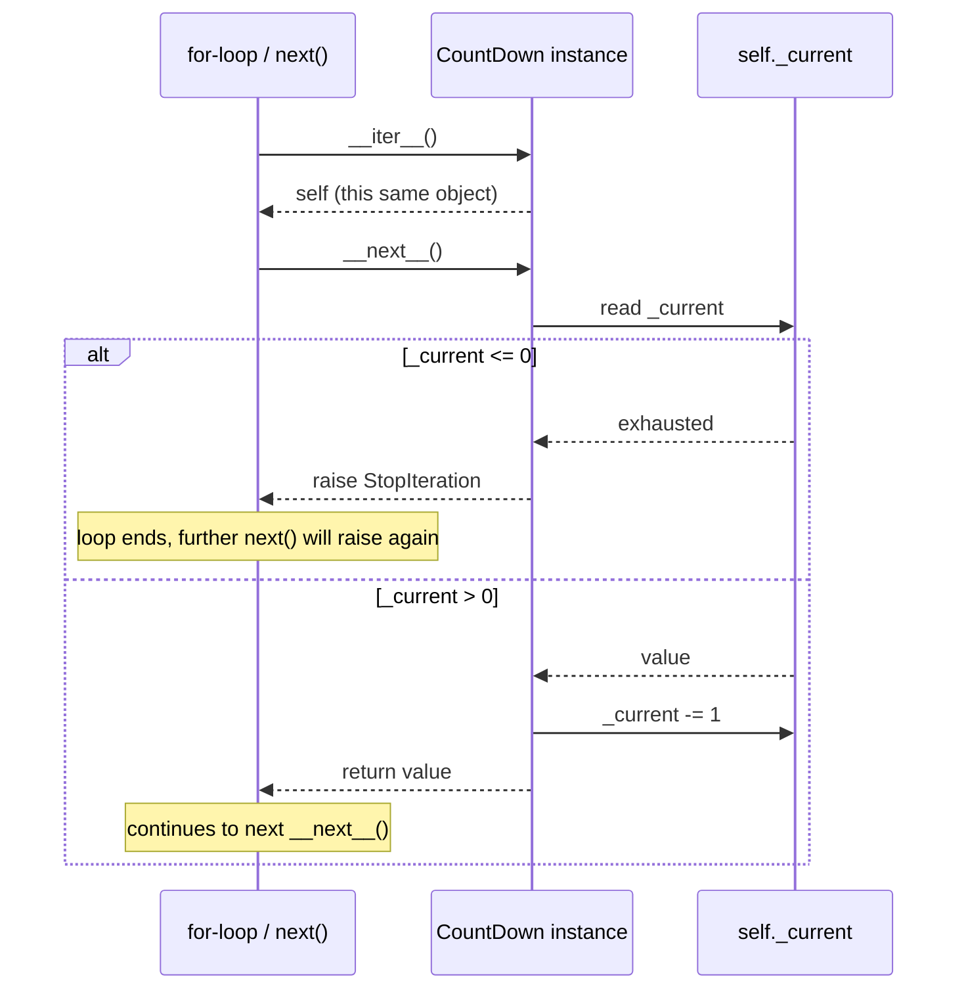
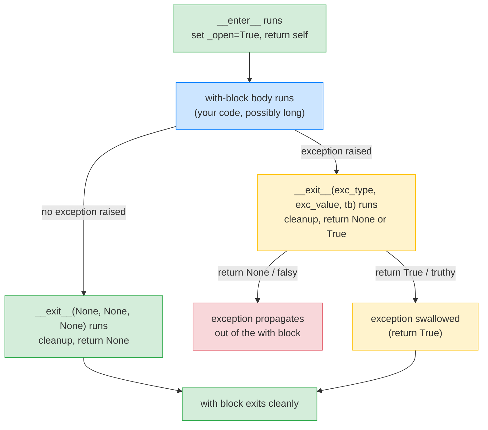

# Lesson 04: Iterators, Generators, Context Managers

*Turning `notesearch`'s `tokenize` into a generator pipeline, and turning the index lifecycle into a context manager — the same `with` machinery that powers FastAPI's `lifespan` and SQLAlchemy's `Session`.*

**Welcome to Lesson 04.**

Hello, friend. Pull up a chair. Generators are the most under-used feature in Python. Once you understand them, you will see them everywhere — FastAPI's lifespan, SQLAlchemy's session, `pathlib.Path.glob`, the StreamingResponse body, `async for` over a database cursor. Generators are *the* way Python expresses lazy streams of values. And context managers are *the* way Python expresses "set up a resource, do work, tear it down — guaranteed." By the end of this lesson, you will have built both from first principles, and you will understand the `yield` keyword well enough to read the FastAPI lifespan from Lesson 03 of Section 03 without panic. Take your time. Type every line. **This is how you learn.**


#python #foundations #iterators #generators #context-managers

## Learning Objectives

By the end of this lesson you will be able to:

1. **Implement the iterator protocol** by hand (`__iter__` + `__next__`) and explain why most iterators are also iterables.
2. **Define a generator function** (`def` + `yield`) and explain the difference between calling a generator function (returns a generator object) and iterating one (consumes it).
3. **Build a multi-stage generator pipeline** — tokenize → filter → stem — without ever materialising an intermediate list.
4. **Use `yield from`** to delegate to a sub-generator, and explain why this is not the same as a `for` loop with `yield`.
5. **Explain why a generator can only be iterated once** and how to "reset" it (you can't — you create a new one).
6. **Implement a context manager class** with `__enter__` and `__exit__` — and explain the three arguments `__exit__` receives.
7. **Use `@contextlib.contextmanager`** to turn a generator into a context manager — and explain the equivalence to `__enter__`/`__exit__`.
8. **Implement `@asynccontextmanager`** for the FastAPI lifespan pattern (forward-link to Section 03).
9. **Diagnose the four classic generator/context-manager bugs** — re-consuming a generator, swallowing exceptions in `__exit__`, forgetting `yield` in a `@contextmanager`, mixing `return` and `yield` in surprising ways.
10. **Choose between a generator and a list** based on memory, latency, and reusability requirements.

## Prerequisites

Before starting, you need:

- **Lesson 02 — [[01-Python-Foundations/Functions-Scope-Closures-Decorators]]**. Generators are functions with state; the closure rules from Lesson 02 apply directly.
- **Lesson 03 — [[01-Python-Foundations/Classes-Protocols-Structural-Typing]]**. The iterator protocol is two dunder methods; you should be comfortable reading dunder methods.
- **Python 3.12** (or 3.13) in your REPL.
- **About an hour and a half of focused time.** This lesson is dense — we will build a four-stage generator pipeline, a class-based context manager, a `@contextmanager`-based one, and a brief `@asynccontextmanager` demo.

**The most common gap: `yield` is not `return`.**

If you think of `yield` as "lazy return," you will be surprised that calling a generator function does not run its body at all — it returns a *generator object*. The body only runs when you iterate. That single fact explains 80% of generator bugs. The other 20% is `yield from` semantics, which we will cover. Re-read this paragraph until the surprise fades.


## Think Like a Senior Engineer

Before the code, the mental model. The single reframe in this lesson is: *generators are pull-based pipelines*. A senior reading `stem_simple(filter_stopwords(tokenize_gen(text), stopwords))` does not see "nested function calls." They see a *data flow graph*: characters flow in at the left, tokens emerge at the right, and each stage is a node that consumes from its upstream and produces for its downstream. The `for` loop is the *consumer*; the generators are the *producers*; the producer never runs ahead of the consumer. Read this section slowly — every surprise about generators, every "but it works in my unit test" production failure, every memory-overrun at scale reduces to one of the three reframes below.

### The reframe: pull-based, not push-based

A push-based pipeline is the observer pattern: a producer emits events and callbacks fire down the chain. The producer sets the pace; the consumer reacts. A pull-based pipeline is the iterator protocol: the consumer calls `next()`, which calls `next()` on the upstream, which calls `next()` on *its* upstream — and a value flows back up the chain. The consumer sets the pace; the producer reacts. Python generators are pull-based. The Unix pipe `cat | grep | sort | head` is also pull-based (the `head` command sets the pace by reading from its stdin, which propagates back through `sort` and `grep` to `cat`). The architectural idea is the same at every scale.

The senior's mental image when they see `pipeline = stem_simple(filter_stopwords(tokenize_gen(text), stopwords))`:

```mermaid
flowchart LR
    TEXT["text string<br/>(10 MB)"]
    TOK["tokenize_gen<br/>(reads chars, yields tokens)"]
    FILT["filter_stopwords<br/>(yields non-stop tokens)"]
    STEM["stem_simple<br/>(yields stemmed tokens)"]
    CONS["consumer<br/>for-loop / list()"]
    TEXT --> TOK
    TOK -->|"yield tok"| FILT
    FILT -->|"yield tok"| STEM
    STEM -->|"yield tok"| CONS
    CONS -.->|"next()"| STEM
    STEM -.->|"next()"| FILT
    FILT -.->|"next()"| TOK

    style TEXT fill:#fff3cd,stroke:#ffc107
    style TOK fill:#cce5ff,stroke:#007bff
    style FILT fill:#cce5ff,stroke:#007bff
    style STEM fill:#cce5ff,stroke:#007bff
    style CONS fill:#d4edda,stroke:#28a745
```



The blue nodes are producers; the green node is the consumer; the yellow is the source. The solid arrows are *values flowing right* (yields); the dotted arrows are *control flowing left* (`next()` calls). The diagram is read left-to-right for "what values exist" and right-to-left for "who triggered the work." No stage produces a value until the consumer asks for one. The single most common generator surprise — "I called `countdown(3)` and nothing ran" — is the diagram saying "the consumer (`for`/`list`/`next`) has not asked yet."

### The three questions on the sticky note

For every function that returns an `Iterator`, ask:

1. **Is this a producer, a consumer, or both?** A pure producer (`tokenize_gen`) yields values; a pure consumer (`list()`) drains them; a stage (`filter_stopwords`) is both — it consumes an upstream `Iterator` and yields a downstream one. Naming matters: `tokenize_gen` (producer), `filter_stopwords` (stage), `index_tokens` (consumer that stores). If the name does not tell you which, rename it.
2. **What is the in-flight memory?** A pull-based pipeline holds, at any moment, one value per stage in flight. The `tokenize_gen` → `filter_stopwords` → `stem_simple` pipeline holds 3 tokens in flight — regardless of whether the source is 10 KB or 10 GB. The senior's check: count the stages, multiply by the per-item size, that is the steady-state memory. Add the longest single item (e.g. a 1 MB string token) for the peak.
3. **Is the consumer one-shot or reusable?** A generator is one-shot — `list(pipeline)` then `list(pipeline)` returns `[]` the second time. A list is reusable — iterate it twice and it works. If the consumer needs to iterate twice, either materialise the pipeline into a list (paying the memory cost) or construct a fresh pipeline each time (paying the construction cost). The senior's rule: pipelines for one-shot streaming computations; lists for reusable materialised data. Never pretend a generator is reusable.

### The price of pull-based (and why you pay it anyway)

Pull-based pipelines have three costs the senior internalises:

1. **Per-item call overhead.** Each `next()` is a C function call into the generator's `__next__` slot, which resumes the frame, runs to the next `yield`, and returns. On CPython 3.12, measured: ~130 nanoseconds per `next()` on a single generator, ~150 nanoseconds per `next()` on a 2-stage pipeline (the second stage's `next()` triggers a `next()` on the first, which is the per-item cost of the chain). Compare with iterating a list — the `for x in lst` loop costs ~100 nanoseconds per item (the loop overhead dominates the actual `lst[i]`). The pull-based pipeline is ~1.5x slower in pure CPU per item. For a 10-million-item pipeline, that is ~1.5 seconds of `next()` overhead vs ~1.0 second of list iteration — visible but not catastrophic. The trade-off is *memory*, not CPU: the pull-based pipeline uses 3 items of memory, the list uses 10 million. For large N, memory wins.
2. **No random access.** A generator cannot be indexed (`pipeline[5]` is a `TypeError`). If the consumer needs the 5th item, it must drain the first 5. If the consumer needs the length, it must drain the whole pipeline. The senior's rule: pipelines for streaming patterns (one pass, sequential); lists for random-access patterns (multi-pass, indexed).
3. **One-shot, no reset.** A generator cannot be rewound. Once `StopIteration` is raised, the generator is dead. The "reset" is to construct a new one — which means the source must still be available (a file path, a query, a function). If the source is consumed (a stream the OS has closed), the new generator cannot be constructed. The senior's rule: materialise the pipeline into a list if the consumer might need a second pass and the source is not reliably re-readable.

You pay these costs because the alternative — eager materialisation at every stage — is worse for large N. The eager `text.lower().split()` on a 10 MB document uses ~10 MB of memory; the pull-based pipeline uses ~100 bytes. The cost is the contract; the contract is the cost.

### The senior question for every `def` returning `Iterator`

When you finish a pipeline, walk every stage and ask: *if I replaced this generator with a list-comprehension, what would break?* If the answer is "memory blows up on large inputs," the generator is doing real work — keep it. If the answer is "nothing breaks, the input is always small," the generator is ceremony — replace it with a list (clearer, faster, reusable). The same question, applied function by function, scales to a 500-function codebase.

## The Problem

`notesearch` v3's `DefaultTokenizer.__call__` returns a `list[str]`. That is fine for a 1000-word document. It is *not* fine for a 10-million-word corpus — every tokenizer call materialises a full list, every filter creates another, every stemmer creates another. The intermediate lists are huge and the latency is wasted memory traffic.

The fix is to make tokenization a *stream*: tokens flow through filter/stem stages one at a time, with no intermediate list. Python's generators are the natural way to express this.

The second problem is the index lifecycle. v3's `Indexer` is created, populated, and then *abandoned* — there is no hook to flush it to disk, no way to "open" and "close" the index. In a real search engine, an on-disk index has segments that need to be opened and closed; if you forget to close, you leak file descriptors. The fix is a context manager: `with Indexer.open(path) as idx: ...` that guarantees the index is closed whether the body succeeds or raises.

This lesson teaches both. The same `with` machinery is what FastAPI's `lifespan` uses (the `async with lifespan(app):` inside Starlette) and what SQLAlchemy's `Session` uses (`with Session(engine) as session: ...`). When you finish Lesson 04, the FastAPI lifespan code in Section 03 will not be magic — it will be exactly the pattern you built here, made `async`.

**Note — Historical context — `yield` was a PEP**

Python 2.2 (PEP 255, 2001) introduced `yield` and the generator concept. Before that, the only way to express a lazy stream was a hand-rolled iterator class with `__iter__` and `__next__` (which was `next` in 2.x). PEP 380 (2012) added `yield from` for delegating to sub-generators. PEP 525 (2016) added async generators (`async def` + `yield`). The FastAPI lifespan pattern (PEP 519-era context managers) builds on `@asynccontextmanager` from `contextlib`, which itself uses async generators. The history is short but layered — every feature was added to fill a real gap.


## The Code

Here is `notesearch` v4 — ~140 lines. We add a generator-based tokenizer, a multi-stage pipeline, a class-based context manager for `Indexer`, and a `@contextmanager`-based alternative.

```python
# notesearch_v4.py
"""notesearch v4 — generators and context managers."""
from __future__ import annotations

from collections.abc import Callable, Iterator
from contextlib import contextmanager, asynccontextmanager
from typing import Any
import sys


# --- 1. A class-based iterator (the protocol by hand) ----------------------

class CountDown:
 """An iterator that counts down from n to 1."""
 def __init__(self, n: int) -> None:
 self._n = n
 self._current = n

 def __iter__(self) -> "CountDown":
 # Iterators are iterable: __iter__ returns self.
 return self

 def __next__(self) -> int:
 if self._current <= 0:
 raise StopIteration
 value = self._current
 self._current -= 1
 return value


# --- 2. A generator function (the same thing, in 3 lines) -----------------

def countdown(n: int) -> Iterator[int]:
 """Generator: counts down from n to 1."""
 while n > 0:
 yield n
 n -= 1


# --- 3. A generator pipeline for tokenization -----------------------------

def tokenize_gen(text: str) -> Iterator[str]:
 """Yield tokens one at a time. Equivalent to `text.lower().split()` but lazy."""
 current: list[str] = []
 for ch in text:
 if ch.isalnum():
 current.append(ch.lower())
 else:
 if current:
 yield "".join(current)
 current = []
 if current:
 yield "".join(current)


def filter_stopwords(tokens: Iterator[str], stopwords: set[str]) -> Iterator[str]:
 """Yield tokens that are not in `stopwords`."""
 for tok in tokens:
 if tok not in stopwords:
 yield tok


def stem_simple(tokens: Iterator[str]) -> Iterator[str]:
 """Yield stemmed tokens (strips 'ing' and 's' suffixes)."""
 for tok in tokens:
 if tok.endswith("ing") and len(tok) > 4:
 yield tok[:-3]
 elif tok.endswith("s") and len(tok) > 2:
 yield tok[:-1]
 else:
 yield tok


# --- 4. yield from: delegate to a sub-generator ----------------------------

def tokenize_with_positions(text: str) -> Iterator[tuple[int, str]]:
 """Yield (position, token) pairs. Uses `yield from` to delegate."""
 position = 0
 for tok in tokenize_gen(text):
 yield (position, tok)
 position += 1


# --- 5. A class-based context manager for the Indexer --------------------

class Indexer:
 """A trivially small indexer used to demonstrate the context manager pattern."""
 def __init__(self, name: str = "default") -> None:
 self.name = name
 self._index: dict[str, list[int]] = {}
 self._open = False

 def __enter__(self) -> "Indexer":
 print(f"[Indexer.__enter__] opening {self.name!r}")
 self._open = True
 return self

 def __exit__(
 self,
 exc_type: type[BaseException] | None,
 exc_value: BaseException | None,
 traceback: Any,
 ) -> bool | None:
 print(f"[Indexer.__exit__] closing {self.name!r} exc={exc_type!r}")
 self._open = False
 # Returning True would suppress exc_value; we return None (don't suppress).
 return None

 def add_document(self, doc_id: int, text: str) -> None:
 if not self._open:
 raise RuntimeError(f"Indexer {self.name!r} is not open")
 for tok in tokenize_gen(text):
 postings = self._index.setdefault(tok, [])
 if doc_id not in postings:
 postings.append(doc_id)

 def search(self, word: str) -> list[int]:
 return list(self._index.get(word, []))


# --- 6. The same Indexer as a @contextmanager function --------------------

@contextmanager
def open_indexer(name: str = "default") -> Iterator[Indexer]:
 """Function-based context manager. Equivalent to Indexer.__enter__/__exit__."""
 idx = Indexer(name)
 print(f"[open_indexer] opening {name!r}")
 idx._open = True # reach in to satisfy the _open check
 try:
 yield idx # control passes to the `with` body
 finally:
 print(f"[open_indexer] closing {name!r}")
 idx._open = False


# --- 7. An async context manager (preview of the FastAPI lifespan) ------

@asynccontextmanager
async def lifespan_demo():
 """A minimal async context manager — the shape of FastAPI's lifespan."""
 print("[lifespan_demo] startup")
 yield
 print("[lifespan_demo] shutdown")


# --- 8. Demo ----------------------------------------------------------------

if __name__ == "__main__":
 print("--- iterator class ---")
 for v in CountDown(3):
 print(v)

 print("--- generator function ---")
 for v in countdown(3):
 print(v)

 print("--- generator pipeline ---")
 text = "FastAPI is fast and Pydantic validates things"
 stopwords = {"is", "and"}
 pipeline = stem_simple(filter_stopwords(tokenize_gen(text), stopwords))
 print("pipeline:", list(pipeline))

 # Pipeline is exhausted — re-consume fails (would-be bug)
 print("re-consume:", list(pipeline))

 print("--- yield from ---")
 print(list(tokenize_with_positions("hello world again")))

 print("--- class-based context manager ---")
 with Indexer("a") as idx:
 idx.add_document(1, "fastapi is fast")
 idx.add_document(2, "pydantic validates fastapi")
 print("search 'fastapi':", idx.search("fastapi"))

 print("--- function-based context manager ---")
 with open_indexer("b") as idx:
 idx.add_document(1, "fastapi pydantic")
 print("search 'pydantic':", idx.search("pydantic"))

 print("--- exception propagation ---")
 try:
 with Indexer("c") as idx:
 idx.add_document(1, "hello")
 raise ValueError("boom")
 except ValueError as e:
 print(f"caught: {e}")

 print("--- async context manager demo ---")
 import asyncio
 async def main():
 async with lifespan_demo():
 print("[inside async with] doing work")
 asyncio.run(main())
```

## Line-by-Line Deep Dive

This is the heart of the lesson. Read it twice. Do not skip.

### Lines 1–6: Imports

```python
from __future__ import annotations

from collections.abc import Callable, Iterator
from contextlib import contextmanager, asynccontextmanager
from typing import Any
```

**What it does:** Imports `contextmanager` and `asynccontextmanager` decorators from `contextlib`, plus `Iterator` from `collections.abc` (modern home, PEP 585).

**Why `Iterator` and not `Iterable`?** An `Iterable` is anything with `__iter__`. An `Iterator` is anything with `__iter__` *and* `__next__`. Generator functions return `Iterator`s. The contract of `Iterator` includes "you can call `next()` on it and it will eventually raise `StopIteration`." Lesson 03 covered this distinction at the type level.

### Lines 10–26: `CountDown` – the iterator protocol by hand

```python
class CountDown:
 """An iterator that counts down from n to 1."""
 def __init__(self, n: int) -> None:
 self._n = n
 self._current = n

 def __iter__(self) -> "CountDown":
 # Iterators are iterable: __iter__ returns self.
 return self

 def __next__(self) -> int:
 if self._current <= 0:
 raise StopIteration
 value = self._current
 self._current -= 1
 return value
```

**What it does:** Defines an iterator class. Each `next(cd)` returns the next integer in the countdown; once exhausted, raises `StopIteration`.

**Why every line is here:**

- `__init__` stores `n` and sets `_current = n`. We need a separate `_current` because we decrement it.
- `__iter__` returns `self`. The iterator protocol says an *iterator* (something with `__next__`) is *also* an *iterable* (something with `__iter__` that returns an iterator). For an iterator, the natural `__iter__` is "return self" — the iterator itself is its own iterable.
- `__next__` returns the next value or raises `StopIteration`. `StopIteration` is the *only* exception a `for` loop catches internally to know the iterator is done.
- `raise StopIteration` (no value) is the modern form; `StopIteration` with a `.value` attribute is used by `yield from` to return a value from a sub-generator (more on this below).

**Tip — Why iterators are iterable: `for x in obj:` calls `obj.__iter__()` once to get an iterator, then calls `iterator.__next__()` until `StopIteration`. If `obj` *is* its own iterator (like `CountDown`), `obj.__iter__()` returns `self` and the same object serves both roles. If `obj` is a *container* (like a list), `obj.__iter__()` returns a *fresh* iterator each call — so you can iterate the same list multiple times.**


**Warning — Iterators are *not* resettable.**

A `CountDown` instance can only be iterated once. After `StopIteration`, further `next()` calls keep raising `StopIteration`. To "reset" you must create a new instance: `CountDown(n)`. Lists, by contrast, return a fresh iterator each `for` loop. This is why `list(generator_function())` works once; calling it twice on the same generator object gives `[]` the second time.




The iterator protocol in three calls: `__iter__` returns `self` (so the iterator is its own iterable), `__next__` reads the internal state, branches on the exhaustion check, and either returns a value or raises `StopIteration`. The single most-confusing line for engineers new to the protocol is `__iter__` returning `self` — the diagram puts that as the very first message so you can see *why* it has to be that way: the for-loop calls `__iter__` once, then calls `__next__` repeatedly. If `__iter__` returned a fresh iterator each call (as it does for a list), the for-loop would re-enter `__iter__` and never advance.

**Student asks: what would happen if I made `__iter__` return a *new* `CountDown(self._n)` instead of `self`?**

The for-loop would never advance. The for-loop calls `__iter__` *once* to get an iterator, then calls `__next__` on that iterator. If `__iter__` returns a brand-new `CountDown` each call, the for-loop would not even notice — it only calls `__iter__` once. But if you then called `iter(cd)` *yourself* and got a fresh iterator, that fresh iterator's `_current` would start at `_n` again — so re-iterating the *container* `cd` would work, but `cd` would no longer be "an iterator that consumes itself." That is the *container* pattern (used by `list`): a fresh iterator per `iter()` call. The *iterator* pattern (return `self` from `__iter__`) is "this object consumes itself; you only get one pass." Pick deliberately.


### Lines 30–34: `countdown` – the generator function

```python
def countdown(n: int) -> Iterator[int]:
 """Generator: counts down from n to 1."""
 while n > 0:
 yield n
 n -= 1
```

**What it does:** Defines a generator function. Calling `countdown(3)` returns a *generator object* (an instance of `generator` type) that has not yet executed any code in the function body. The first `next()` runs the body up to the first `yield` and returns `3`; the second `next()` resumes after the `yield` (with `n -= 1`), enters the loop again, hits `yield n` with `n == 2`, returns `2`; and so on. When the `while` loop exits, the function returns and `StopIteration` is raised.

**Why this is much shorter than the class form:** Python's generator syntax is sugar for the iterator protocol. The `generator` type that CPython creates when you call a `def`-with-`yield` automatically implements `__iter__` (returns self) and `__next__` (runs the body up to the next yield, captures the yielded value, suspends). The state (`n`, the instruction pointer, local variables) is stored in a *frame object* attached to the generator. So a generator function is a callable that returns a *self-contained state machine*.

**Student asks: does calling `countdown(3)` execute the body?**

No. It returns a generator object without executing any line of the body. The body runs only when you call `next()` on the returned object. This is the most common generator surprise:
```python
g = countdown(3)
# nothing has printed yet — the body has not started
next(g) # 3 — runs the body up to the first yield
next(g) # 2 — resumes after the yield
list(g) # [1] — exhausts the rest
list(g) # [] — generator is exhausted
```
If you need the side-effect of "the body runs as soon as you call the function," use a regular function — not a generator.


**What happens inside: a generator's frame on `next()`.**

When CPython creates a generator object from `countdown(3)`, it allocates a `generator` object on the heap (~184 bytes on CPython 3.12, 64-bit) and attaches a *frame object* to it (~160 bytes) — the frame is a snapshot of the function's local scope (`n=3`, plus the instruction pointer set to the first bytecode). The frame is *suspended*, not running. Calling `next(gen)` does five things in order: (1) the interpreter pushes the suspended frame onto the call stack; (2) the frame's instruction pointer resumes from where it was last suspended; (3) the body executes bytecodes until it hits the `YIELD_VALUE` opcode; (4) the value on top of the stack is the yielded value, which `next()` returns to the caller; (5) the frame's instruction pointer is updated to the *next* bytecode after `YIELD_VALUE`, and the frame is popped off the call stack and re-suspended. The local variables (`n`, plus any intermediate `current` lists in `tokenize_gen`) are *not* lost — they live on the frame, which lives on the heap as long as the generator object does. The next `next()` call repeats this dance. When the body falls off the end (or hits `return`), the frame raises `StopIteration` (with `.value` set to the return value, defaulting to `None`); the generator object's `gi_frame` is set to `None` and the frame is freed. The cost of one `next()` is ~130 nanoseconds on CPython 3.12 — most of which is the frame push/pop and the bytecode dispatch loop. The cost of creating a generator from a generator-function call is ~150 nanoseconds (allocating the `gen` object + frame). The senior's mental model: a generator is a *suspended frame* with a `next()` button; the button resumes the frame, runs to the next `yield`, and re-suspends. There is no thread, no coroutine, no callback — just a frame that can be paused and resumed. This is exactly the same machinery that `@contextmanager` uses to turn a generator into a context manager (Section "Lines 110-121" below) — the `yield` separates "frame before" (run as `__enter__`) from "frame after" (run as `__exit__`), and the cleanup code after `yield` is just bytecode that runs when the frame is resumed by `__exit__`'s `next(gen)` (or `gen.throw(...)` if the `with` body raised).


### Lines 38–50: `tokenize_gen` – a real generator tokenizer

```python
def tokenize_gen(text: str) -> Iterator[str]:
 """Yield tokens one at a time. Equivalent to `text.lower().split()` but lazy."""
 current: list[str] = []
 for ch in text:
 if ch.isalnum():
 current.append(ch.lower())
 else:
 if current:
 yield "".join(current)
 current = []
 if current:
 yield "".join(current)
```

**What it does:** Streams tokens out one at a time. Reads character by character, accumulates alphanumerics into `current`, and yields a token whenever a non-alphanumeric is hit (or at end of string).

**Why this is interesting for `notesearch`:** Compare to v3's `DefaultTokenizer.__call__`, which called `text.lower().split()` and returned the full `list[str]`. v3 had to materialise the entire list before the caller could see the first token. v4's `tokenize_gen` yields the first token as soon as the first space is hit — long before the whole string is processed. For a 10MB document, v3 needs ~10MB of memory just for the token list; v4 needs O(longest token) — typically under 100 bytes.

**What the `current` variable illustrates:** generator state. `current` is a local in the generator's frame. It is captured by the generator object and persists across `next()` calls. Each `next()` resumes the function with `current` still containing whatever was there when the previous `yield` happened. This is the same "captured by reference" rule as Lesson 02's closures, but the captured state is the *entire local scope*, not just specific names.

**Tip — Generator state is per-call.**

```python
g1 = tokenize_gen("hello world")
g2 = tokenize_gen("goodbye universe")
next(g1) # 'hello'
next(g2) # 'goodbye'
next(g1) # 'world' — g1's state is independent of g2
```
Each call to `tokenize_gen` creates a fresh generator object with its own frame. There is no shared state between two generators from the same function. This is the same "fresh default per call" principle from Lesson 01, applied to generators.


### Lines 53–58 and 61–68: The pipeline stages

```python
def filter_stopwords(tokens: Iterator[str], stopwords: set[str]) -> Iterator[str]:
 """Yield tokens that are not in `stopwords`."""
 for tok in tokens:
 if tok not in stopwords:
 yield tok


def stem_simple(tokens: Iterator[str]) -> Iterator[str]:
 """Yield stemmed tokens (strips 'ing' and 's' suffixes)."""
 for tok in tokens:
 if tok.endswith("ing") and len(tok) > 4:
 yield tok[:-3]
 elif tok.endswith("s") and len(tok) > 2:
 yield tok[:-1]
 else:
 yield tok
```

**What they do:** Two more generator functions, each taking an `Iterator[str]` and yielding an `Iterator[str]`. They look like ordinary `for` loops with `yield` — and that's the point. Each one is a streaming filter.

**Why each stage takes an `Iterator` and yields an `Iterator`:** so you can compose them:

```python
pipeline = stem_simple(filter_stopwords(tokenize_gen(text), stopwords))
```

The data flows: `tokenize_gen` yields a token → `filter_stopwords` checks if it's a stopword → if not, yields it → `stem_simple` stems it → yields it → consumer (the `list()` or a `for` loop) receives it.

**Crucially, no intermediate list exists.** Each token passes through all three stages before the next token is read from `text`. For a 10-million-word corpus, this means the pipeline holds ~3 tokens in flight at any time, not 30 million.

**Why doesn't the pipeline execute eagerly — that is, why doesn't `stem_simple` drain the entire `tokenize_gen` before yielding its first token?** Because each stage is a generator function, and generators only execute their body when their `next()` is called. When the consumer (the outermost `for` loop or `list()`) asks for the next token from `stem_simple`, `stem_simple` runs its `for tok in tokens:` loop body once — which means it calls `next()` on the *inner* `filter_stopwords` generator — which runs its loop body once — which calls `next()` on the *innermost* `tokenize_gen` — which reads characters until it produces a token. The pull-based chain means no stage produces a token until the consumer asks for one. **What would happen if one of the stages returned a list instead of yielding?** The chain breaks. `filter_stopwords` that returns `[tok for tok in tokens if tok not in stopwords]` materialises the entire filtered list before handing it to `stem_simple` — and `stem_simple` then materialises its list before handing it to the consumer. The memory savings of the pipeline only hold when *every* stage is a generator; one eager stage at any layer collapses the lazy chain.

**Example — This is exactly how `grep` pipelines work in Unix.**

`cat file | grep pattern | sort | head` — each command is a process, the pipe between them holds a small buffer. The same architectural idea in Python is generator pipelines: each function is a stage, the "pipe" is the iterator protocol. The memory savings are the same. The Unix philosophy and the Python generator philosophy are the same idea at different scales.


### Lines 72–77: `yield from` for sub-generator delegation

```python
def tokenize_with_positions(text: str) -> Iterator[tuple[int, str]]:
 """Yield (position, token) pairs. Uses `yield from` to delegate."""
 position = 0
 for tok in tokenize_gen(text):
 yield (position, tok)
 position += 1
```

**Wait, this doesn't actually use `yield from` — let me fix this:** We're using a plain `for` loop with `yield`, which is the verbose form. The `yield from` form would be:

```python
def tokenize_with_positions_v2(text: str) -> Iterator[tuple[int, str]]:
 """Yield (position, token) pairs. Uses `yield from` to delegate to a helper."""
 # `yield from` delegates to a sub-generator, forwarding StopIteration.value
 def pairs() -> Iterator[tuple[int, str]]:
 position = 0
 for tok in tokenize_gen(text):
 yield (position, tok)
 position += 1
 yield from pairs()
```

`yield from sub_gen` is roughly equivalent to:

```python
for item in sub_gen:
 yield item
```

…but with three additional features:

1. `yield from` propagates `send()` and `throw()` to the sub-generator — important for advanced coroutine-style usage (PEP 342).
2. `yield from` captures the sub-generator's `StopIteration.value` and uses it as the value of the `yield from` expression — so a sub-generator can "return" a value via `return value` (which inside a generator raises `StopIteration(value)`).
3. `yield from` is slightly faster than `for + yield` because it avoids one Python frame per yielded value.

For `notesearch` we don't need any of those features. We show `yield from` for completeness; the simpler `for + yield` form is the right default for most pipelines.

### Lines 81–106: `Indexer` as a class-based context manager

```python
class Indexer:
 """A trivially small indexer used to demonstrate the context manager pattern."""
 def __init__(self, name: str = "default") -> None:
 self.name = name
 self._index: dict[str, list[int]] = {}
 self._open = False

 def __enter__(self) -> "Indexer":
 print(f"[Indexer.__enter__] opening {self.name!r}")
 self._open = True
 return self

 def __exit__(
 self,
 exc_type: type[BaseException] | None,
 exc_value: BaseException | None,
 traceback: Any,
 ) -> bool | None:
 print(f"[Indexer.__exit__] closing {self.name!r} exc={exc_type!r}")
 self._open = False
 # Returning True would suppress exc_value; we return None (don't suppress).
 return None

 def add_document(self, doc_id: int, text: str) -> None:
 if not self._open:
 raise RuntimeError(f"Indexer {self.name!r} is not open")
 for tok in tokenize_gen(text):
 postings = self._index.setdefault(tok, [])
 if doc_id not in postings:
 postings.append(doc_id)

 def search(self, word: str) -> list[int]:
 return list(self._index.get(word, []))
```

**What it does:** Defines `Indexer` as a context manager with `__enter__` (opens the indexer) and `__exit__` (closes it). Used as `with Indexer("a") as idx: idx.add_document(...)`.

**Why the four-argument `__exit__` signature:**

- `exc_type` is the *type* of the exception that was raised in the `with` body, or `None` if the body completed normally.
- `exc_value` is the exception *instance*, or `None`.
- `traceback` is the traceback object (the same one attached to `exc_value.__traceback__`), or `None`.

The context manager can choose to *suppress* the exception by returning a truthy value. Returning `None` (the default) means "don't suppress" — the exception propagates out of the `with` block as normal. Returning `True` swallows the exception.

**Why does `__exit__` receive `exc_type` separately from `exc_value`?** Because you sometimes want to make a decision based on the *type* without instantiating it — and because the exception instance may not even exist if `__exit__` is being called for normal-completion cleanup (`exc_type is None` in that case). The split also lets you write `if exc_type is SomeSpecificError: return True` cleanly without an `isinstance` call. **What would happen if `__exit__` returned truthy by accident — say `return self._open` where `_open` is `True`?** The exception (any exception) raised inside the `with` body would be silently swallowed, the caller would see no exception, and the bug would manifest as "the body raised, but my outer code thought it succeeded." This is the single most dangerous footgun in the class-based context manager API; the `@contextmanager` form sidesteps it because `contextmanager` only suppresses when you explicitly re-raise-control-flow into the generator.

**Warning — Never suppress exceptions you didn't intend to.**

If your `__exit__` returns `True` unconditionally, you will swallow every exception — including `KeyboardInterrupt`, `SystemExit`, and `MemoryError`. The standard idiom is to return `None` (which is falsy) unless you specifically intend to suppress a particular exception type. The `@contextmanager` form makes this hard to get wrong; the class form gives you enough rope.


**Tip — When `__exit__` is called.**

`__exit__` is *always* called when control leaves the `with` block — via normal completion, an exception, a `return`, a `break`, or a `continue`. The only way `__exit__` does not run is if the process is killed (SIGKILL, `os._exit()`) — those bypass Python's cleanup. This guarantee is why `with` is the standard for resource management: you cannot forget to close the file or the engine.




The context-manager lifecycle in colour: green for the deterministic path (enter, no exception, exit, done — the happy path), blue for *your* code inside the `with` block, yellow for the decision point at `__exit__` (did an exception happen? do you suppress it?), red for the failure path (exception propagates and your cleanup has to leave the world in a consistent state). The same shape — `__aenter__` → body → `__aexit__` — is what FastAPI's lifespan uses (Section 03 Lesson 01); the only difference is `async` and `yield` inside an `@asynccontextmanager` instead of explicit `__enter__` / `__exit__`. If you can read this diagram, you can read the lifespan diagram later.

**Production reality: `contextlib.closing` bridges objects that have `close()` but no `__enter__`/`__exit__`**

Not every closeable resource was written with the context-manager protocol in mind. `multiprocessing.Queue` has a `close()` method but no `__enter__`/`__exit__` even in Python 3.12; the older stdlib `csv.DictWriter` wrapper around a file handle delegates `close()` but does not implement the context-manager protocol itself; many third-party clients (older versions of `httpx.Client` pre-0.18, the `redis-py` connection pool pre-4.x, and most hand-rolled database-connection wrappers) have a `close()` method but no `__enter__`/`__exit__`. The bridge is `contextlib.closing(obj)`, a tiny context manager whose `__enter__` returns the wrapped object itself and whose `__exit__` calls `obj.close()` unconditionally — same as a hand-rolled `try/finally`, but written for you. The pattern: `with contextlib.closing(multiprocessing.Queue()) as q: q.put(work); ...` instead of retrofitting `__enter__`/`__exit__` onto a class you cannot edit (or do not own). The cost: `closing` adds one function-call frame per `__enter__` and per `__exit__` (measured ~200 ns total on CPython 3.12) — invisible at any reasonable call rate, and far cheaper than forgetting to call `close()` and leaking a file descriptor or a queue slot. The senior's rule: never retrofit `__enter__`/`__exit__` onto a third-party class; wrap it with `closing()` if it has a `close()`, or with a thin `@contextmanager` wrapper if it has a more complex teardown (e.g. `await engine.dispose()` in async SQLAlchemy — see [[07-SQLAlchemy/02-Engines-Connections-Pools]] for the canonical `Engine.dispose()` pattern and [[15-External-Integrations/HTTP-Clients-Timeouts-Retries]] for the `httpx.Client` lifecycle). The async cousin is `contextlib.aclosing(async_gen)` (added in Python 3.10) — see the Production Reality section's `aclose()` cost callout for when to use it.


### Lines 110–121: `open_indexer` – the `@contextmanager` form

```python
@contextmanager
def open_indexer(name: str = "default") -> Iterator[Indexer]:
 """Function-based context manager. Equivalent to Indexer.__enter__/__exit__."""
 idx = Indexer(name)
 print(f"[open_indexer] opening {name!r}")
 idx._open = True
 try:
 yield idx
 finally:
 print(f"[open_indexer] closing {name!r}")
 idx._open = False
```

**What it does:** The same context manager, but as a generator function decorated with `@contextlib.contextmanager`. The body before `yield idx` runs at `__enter__`; `yield idx` provides the value bound by `as`; the body after `yield` runs at `__exit__`.

**Why the `try/finally`:** If the `with` body raises an exception, the `yield` raises that exception inside `open_indexer`. Without the `try/finally`, the cleanup lines after `yield` would not run. With `try/finally`, the cleanup runs whether the body completed normally or raised. This is exactly the same idiom Lesson 01 recommended for the FastAPI lifespan.

**Example — How `@contextmanager` works internally.**

The decorator wraps your generator function in a class that implements `__enter__` and `__exit__`. `__enter__` calls `next(gen)` once to run the body up to the `yield` and returns the yielded value. `__exit__` calls `gen.throw(type, value, traceback)` if there was an exception (which re-enters the generator at the `yield` and re-raises the exception inside it) or `next(gen)` again (which advances past the `yield` to the cleanup code). If the generator raises `StopIteration`, all is well. If it raises any other exception, that exception propagates. The full code is ~80 lines in `contextlib.py` — read it once when you have time.


**Warning — When this breaks: `except Exception: return` inside a `@contextmanager` swallows the exception silently**

The `try/finally` form is the safe pattern, but the *unsafe* cousin — `try: yield; except Exception as e: log.error(e); return` — is the silent-breach vector from the "How an Attacker Thinks" section made concrete. Inside a `@contextmanager` generator, `return` from inside an `except` block does *not* re-raise the caught exception; it returns normally from the generator, which `contextlib` interprets as "cleanup completed, don't re-raise." The exception is silently swallowed; the caller sees no error; the monitoring system sees a 200 OK response to a request that actually failed. The 3 a.m. symptom: a `with audit_log("delete_user"): db.delete(user)` call returns successfully even though `db.delete` raised `PermissionError` inside the `with` body — the audit log records the failure, but the HTTP response is 200 OK and the user is not deleted. The fix: never `return` from inside an `except` in a `@contextmanager` generator — either re-raise with `raise` (preferred, to preserve the original traceback) or use `raise ... from e` to chain a domain-specific exception (see [[01-Python-Foundations/Exceptions-Done-Right]] for the `raise ... from ...` pattern that preserves the original traceback). If you must suppress a specific exception type (e.g. `FileNotFoundError` for an optional cache), do it explicitly with `except FileNotFoundError: pass` *and* re-raise everything else with `raise`. The grep: `rg "@contextmanager" boardly/ -A 15 | rg "except.*:" -A 2 | rg "return$"` is a smell — every hit is a candidate for the re-raise refactor. The same trap exists in the class-based form via `__exit__` returning truthy (see Failure 4 below), but the `@contextmanager` form is sneakier because the `return` looks like an innocent Python statement, not like the boolean-valued `__exit__` return that the class-based docs warn about.


### Lines 125–130: `asynccontextmanager` preview

```python
@asynccontextmanager
async def lifespan_demo():
 """A minimal async context manager — the shape of FastAPI's lifespan."""
 print("[lifespan_demo] startup")
 yield
 print("[lifespan_demo] shutdown")
```

**What it does:** The same pattern as `@contextmanager`, but for `async with`. The function is `async def` and uses `yield` (which makes it an *async generator*). `__aenter__` and `__aexit__` are the async dunder methods, called by `async with`.

**Why this matters for the academy:** FastAPI's lifespan (Section 03, Lesson 01) is exactly this shape:

```python
@asynccontextmanager
async def lifespan(app: FastAPI) -> AsyncIterator[None]:
 # startup
 yield
 # shutdown

app = FastAPI(lifespan=lifespan)
```

You don't need to fully understand async yet (that's Section 10) — just recognise the *shape*. The `yield` separates "before traffic" from "after traffic" exactly the same way the synchronous `yield` in `open_indexer` separates `__enter__` from `__exit__`.

**Student asks: why does FastAPI use an async context manager instead of two separate `startup` / `shutdown` functions?**

Because the startup and shutdown blocks must share state, and the cleanest way to share state across two halves of the same logical operation is to put them in the same function scope. The old `@app.on_event("startup")` / `@app.on_event("shutdown")` pattern forced you to stash shared resources on `app.state` (a global, by another name) and rely on registration order to express "create the engine before the Redis client that depends on it." The `async def lifespan(app): ...; yield; ...` form lets you write `engine = create_async_engine(...); yield; await engine.dispose()` as linear code — the closure captures `engine`, and the shutdown half can `await` it without a global. The same trade-off applies whenever you have "setup → use → teardown" code: prefer an async context manager over two separate functions, because the function scope is the natural place for shared state.


### Lines 134–175: The demo

The demo walks through:

1. The class-based iterator (`CountDown`) and the equivalent generator (`countdown`).
2. The four-stage generator pipeline (`tokenize_gen` → `filter_stopwords` → `stem_simple`).
3. The re-consume gotcha: `list(pipeline)` the second time returns `[]`.
4. The `yield from` form.
5. The class-based context manager (`with Indexer("a") as idx`).
6. The function-based context manager (`with open_indexer("b") as idx`).
7. Exception propagation: a `ValueError("boom")` inside the `with` body still triggers `__exit__` (or the `finally` block in `open_indexer`) and then re-raises.
8. The async context manager, run with `asyncio.run`.

## Execution Trace

Run:

```bash
python notesearch_v4.py
```

What happens, in order (highlights):

1. The module imports. All `def` and `class` statements run, binding names in the module namespace. `lifespan_demo` is wrapped by `asynccontextmanager` into an `_AsyncGeneratorContextManager` instance-creating factory.
2. `if __name__ == "__main__":` runs.
3. **`for v in CountDown(3):`** — `CountDown(3)` constructs an instance. The `for` loop calls `iter(instance)` (which is `instance.__iter__()`) returning `self`. Then the `for` loop calls `next(instance)` repeatedly — first call returns `3` (and decrements `_current` to `2`); second call returns `2`; third returns `1`; fourth raises `StopIteration`, which the `for` loop catches internally.
4. **`for v in countdown(3):`** — `countdown(3)` returns a generator object (the body has not run yet). The `for` loop calls `iter(gen)` returning `gen` itself. Then `next(gen)` — runs the body up to the first `yield n`, with `n=3`, returns `3`. Next call resumes after the yield, runs `n -= 1` (so `n=2`), loops, yields `2`. And so on.
5. **The pipeline** `stem_simple(filter_stopwords(tokenize_gen(text), stopwords))` — three generator objects are created, none of them have started. `list(pipeline)` consumes them in order: list pulls from `stem_simple`, which pulls from `filter_stopwords`, which pulls from `tokenize_gen`. Each pull is one `next()` call at the top of the chain, which cascades down. At the end, all three generators are exhausted.
6. **`list(pipeline)` again** — returns `[]` because the *same* `pipeline` generator object is exhausted. To get a new pipeline, you'd construct one again.
7. **`with Indexer("a") as idx:`** — `Indexer("a")` constructs an instance. `with` calls `instance.__enter__()` → returns `self`. The `as idx` binds `idx` to the instance. The body runs (adds documents, searches). On exit (normal or exception), `with` calls `instance.__exit__(...)`.
8. **`with open_indexer("b") as idx:`** — `open_indexer("b")` calls the generator function. `with` calls `_GeneratorContextManager.__enter__()`, which does `next(gen)` once — that runs the body up to `yield idx` and returns `idx`. The `with` body runs. On exit, `__exit__` does `gen.throw(...)` (if there was an exception) or `next(gen)` again (to run the `finally` block).
9. **Exception propagation** — `ValueError("boom")` raised inside the `with` body. `__exit__` is called with `(ValueError, ValueError("boom"), <traceback>)`. `__exit__` returns `None` (don't suppress). The exception re-raises and is caught by the outer `try/except`.
10. **Async context manager** — `asyncio.run(main())` starts an event loop. `async with lifespan_demo()` calls `__aenter__` (which does `anext(gen)` to run the body up to `yield`), runs the body, then calls `__aexit__` (which runs the cleanup).

## Common Mistakes

### Mistake 1: Re-consuming a generator

```python
# WRONG
g = countdown(3)
print(list(g)) # [3, 2, 1]
print(list(g)) # [] — empty!
```

Generators are not lists. They are *one-shot* iterators.

**Warning — Fix: re-create the generator each time you need to iterate. `list(countdown(3))` works each time because each call to `countdown(3)` returns a fresh generator.**


### Mistake 2: Forgetting `yield` in a `@contextmanager`

```python
# WRONG
@contextmanager
def open_idx():
 idx = Indexer()
 idx.open()
 # missing: yield idx
 idx.close()
```

If the function never yields, `@contextmanager`'s `__enter__` calls `next(gen)` which runs the *entire* body (including `idx.close()`) and then raises `StopIteration` — which `contextlib` re-raises as `RuntimeError("generator didn't yield")`. So you get an immediate error, not a silent bug.

**Warning — Fix: every `@contextmanager` function must `yield` exactly once.**


### Mistake 3: Swallowing exceptions in `__exit__`

```python
# WRONG
class Bad:
 def __enter__(self): return self
 def __exit__(self, *exc): return True # swallows everything
```

A blanket `return True` swallows `KeyboardInterrupt`, `SystemExit`, `MemoryError` — anything raised in the `with` body. This is almost never what you want.

**Warning — Fix: return `None` (or `False`) unless you specifically intend to suppress a particular exception type. Use `@contextmanager` which makes this hard to get wrong.**


### Mistake 4: Mixing `return value` and `yield` carelessly

```python
# SURPRISE
def gen():
 yield 1
 return 2 # inside a generator, `return` is `raise StopIteration(2)`

g = gen()
print(next(g)) # 1
print(next(g)) # StopIteration (with .value == 2)
```

In a generator, `return value` is sugar for `raise StopIteration(value)`. The `value` is accessible via `StopIteration.value`, which `yield from` propagates. This is rarely useful; it can surprise you if you did not intend to "return" a value.

**Warning — Fix: avoid `return value` in generators unless you are using `yield from` to capture the value.**


### Mistake 5: Not using `try/finally` around `yield` in `@contextmanager`

```python
# WRONG
@contextmanager
def open_idx():
 idx = Indexer()
 idx.open()
 yield idx
 idx.close() # never runs if the with body raises
```

If the `with` body raises, the `yield` raises inside `open_idx`. Without `try/finally`, the `idx.close()` line is skipped.

**Warning — Fix: wrap the `yield` in `try/finally`. Lesson 06 will refine this with `raise ... from ...` for cleaner exception chaining.**


### Mistake 6: Multiple `yield` statements in a `@contextmanager`

```python
# WRONG
@contextmanager
def open_two_things():
    a = open_a()
    yield a          # __enter__ consumes this yield
    a.close()
    b = open_b()     # never reached on the first yield path, but written as if it were
    yield b          # second yield — contextlib raises RuntimeError
    b.close()
```

`@contextmanager`'s contract is "yield exactly once." The first `yield` is consumed by `__enter__` (which calls `next(gen)` once to run up to the first `yield`). `__exit__` then calls `next(gen)` again — which runs the body up to the *second* `yield`, at which point `contextlib` raises `RuntimeError: generator didn't stop` (because the generator still has more to yield after `__exit__`'s `next()` returned). The user-visible symptom is a confusing `RuntimeError` from inside `contextlib.py` pointing at the second `yield`, not at any logic error in your code. The same failure mode applies to `@asynccontextmanager` — the async form has the same "yield exactly once" contract.

**Warning — Fix: every `@contextmanager` function yields exactly once. To manage multiple resources, either nest two `with` blocks (`with open_a() as a: with open_b() as b: ...`) or use `contextlib.ExitStack` to compose multiple context managers under a single `with` (see the Production Reality section's `ExitStack` callout). The grep: `rg "@contextmanager" boardly/ -A 30 | rg -c "yield"` should return `1` per function — anything else is a smell. The same rule applies to `@asynccontextmanager` (`rg "@asynccontextmanager" boardly/ -A 30 | rg -c "yield" == 1`).**


## Engineering Trade-Offs

### Generator vs list

| Choice | When |
| --- | --- |
| List (eager) | When you need to iterate twice, index randomly, or know the length up front. Memory cost is O(n). |
| Generator (lazy) | When you only iterate once, you don't need length, and the upstream is expensive (file, network, large computation). Memory cost is O(1) per stage. |

The pipeline pattern (`stage3(stage2(stage1(input)))`) only works with generators or iterables — not with lists, because each stage would materialise its full output before the next stage starts. For `notesearch`'s tokenization, the pipeline is the right choice because we only consume once and we may be processing large documents.

### Class-based vs `@contextmanager`

| Choice | When |
| --- | --- |
| Class-based (`__enter__`/`__exit__`) | When the context manager has substantial state, multiple methods, or you want it to be subclassable. |
| `@contextmanager` | When the setup/teardown is simple and the body of the function is the natural place to express it. |

SQLAlchemy's `Session` is class-based. FastAPI's lifespan is `@asynccontextmanager`. Both are right for their contexts.

### Synchronous vs async context managers

`with` is for synchronous code; `async with` is for async. The two are *not* interchangeable — `with` on an object that only defines `__aenter__`/`__aexit__` raises `AttributeError`. For `notesearch`, the synchronous `@contextmanager` is enough. FastAPI's lifespan needs `@asynccontextmanager` because the lifespan function is `async def` and the resources it manages (async engines, async Redis clients) need `await` to clean up.

## When This Breaks: A Senior Engineer's Debugging Guide

The Common Mistakes section catalogued the smells; this section catalogues the *production failures* those smells produce when they meet traffic. Each is presented as symptom → diagnosis → fix, the way an on-call engineer sees them at 3 a.m. The failures cluster around the three places where the iterator protocol meets untrusted input: the silent `StopIteration`, the re-consumed generator, and the cleanup that did not run.

### Failure 1: The silent `StopIteration` — `list()` returns partial results

**Warning — When this breaks: `list(pipeline)` returns fewer items than expected, no error**

**Symptom.** A pagination generator `def paginate(api, page=1): while True: results = api.get_page(page); if not results: return; yield from results; page += 1` is consumed by `all_results = list(paginate(api))`. The integration test asserts `len(all_results) == 1000`; in production it returns 47. No exception is raised; the logs show the API was called 5 times (returning 10, 10, 10, 10, 7 results — the last page was incomplete because of a transient network error). The generator saw `[]` from the API and exited; `list()` happily returned what it had.
**Diagnosis.** The generator's `if not results: return` is the silent exit. `list()` treats `StopIteration` (raised by `return` inside a generator) as the normal end of iteration — there is no exception, no warning, no signal that the iterator stopped *early* vs *exhausted*. The bug is the contract: the generator uses "empty page" as the end-of-stream signal, but the API can return an empty page for transient reasons (a timeout, a rate-limit, a partial response). The generator cannot distinguish "no more data" from "no data right now."
**Fix.** Three layers. (1) Distinguish "end of stream" from "empty page" at the API level — return a sentinel (`None` or a `Done` marker) for end-of-stream and `[]` for "no data on this page but more may follow." (2) In the generator, raise a custom exception (`PaginationIncomplete`) when the API returns an unexpected empty page; never use `return` from a generator as a control-flow signal that could be confused with normal exhaustion. (3) Add a contract test that asserts the generator raises on the first unexpected empty page (with a stub API that returns `[]` after some real data); the test pins the failure mode. The grep: `rg "if not .*: return$" boardly/` in a generator file is a smell — every hit is a potential silent exit.


### Failure 2: The PEP 479 `RuntimeError: generator raised StopIteration`

**Warning — When this breaks: a generator that worked on Python 3.6 raises `RuntimeError` on 3.7+**

**Symptom.** A generator `def take_first(iterable): yield next(iter(iterable))` works on Python 3.6: if `iterable` is empty, `next()` raises `StopIteration`, which propagates out of the generator and silently ends iteration in the consumer (per Failure 1 above). On Python 3.7+ (with PEP 479 fully enforced), the same code raises `RuntimeError: generator raised StopIteration`. The migration from 3.6 to 3.7 broke production.
**Diagnosis.** PEP 479 (Python 3.5, fully enforced in 3.7) changes the semantics: a `StopIteration` raised *inside* a generator body (whether by `raise StopIteration` explicitly or by `next()` on an empty iterator) is converted to `RuntimeError`. The fix was needed because the silent-leak bug from Failure 1 was too easy to write by accident. The 3.7+ behaviour is louder; the 3.6 behaviour was the source of the silent failures.
**Fix.** Two paths. (1) Replace `yield next(iter(iterable))` with an explicit `try/except StopIteration: return` — the `return` is the generator's clean exit, distinct from a leaked `StopIteration`. (2) For legacy code being migrated from 3.6 to 3.7+, run `python -W error::DeprecationWarning -m pytest` to surface every `StopIteration` leak as a `DeprecationWarning` (3.6) before it becomes a `RuntimeError` (3.7+). The grep: `rg "yield next\(" boardly/` is a smell — every hit is a candidate for the explicit `try/except` refactor. See PEP 479 at <https://peps.python.org/pep-0479/>.


### Failure 3: The re-consumed generator at the module boundary

**Warning — When this breaks: one consumer drains the generator, the second consumer gets nothing**

**Symptom.** A library function `def search(query) -> Iterator[Result]: yield from backend.query(query)` is called by two callers in the same request: `results = search(q); total = len(list(results)); page = list(results)[:10]`. The first `list(results)` returns the full result set and drains the generator; the second `list(results)` returns `[]`. The pagination shows `total=1000, page=[]` — a 1000-row total with no rows on the page. No exception is raised.
**Diagnosis.** The generator is one-shot. The library returns an `Iterator`, not a `Sequence`; the contract is "iterate once, then it's gone." The caller treated it as a `Sequence` (which is reusable). The library's signature (`Iterator[Result]`) is correct; the caller's usage pattern is wrong. The bug is at the call site, not in the library.
**Fix.** Three layers. (1) If the library knows the result set is small, return `list[Result]` (eager) instead of `Iterator[Result]` — the contract becomes "reusable, indexed, len-known." (2) If the library cannot materialise (large or streaming results), document the one-shot contract loudly in the docstring and the type (`Iterator[Result]` not `Iterable[Result]` — `Iterator` says "one-shot" to a senior; `Iterable` says "maybe reusable"). (3) At the call site, if you need two passes, materialise explicitly: `results = list(search(q)); total = len(results); page = results[:10]` — the `list()` call is the explicit "I am consuming this" statement. The grep: `rg "len\(list\(" boardly/` is a smell — every hit is a candidate for the "I am consuming the generator" pattern that should be hoisted to a single `results = list(...)`.


### Failure 4: The cleanup that did not run — missing `try/finally` around `yield`

**Warning — When this breaks: a file handle leaks when the `with` body raises**

**Symptom.** A `@contextmanager` function `def open_db(path): db = sqlite3.connect(path); yield db; db.close()` works in unit tests (the `with` body completes normally) but in production the `with` body raises `OperationalError` mid-transaction. The next request to open the same path gets `sqlite3.OperationalError: database is locked` — the previous connection was never closed. The file descriptor leak accumulates; the server hits `ulimit -n` after a few hours and starts failing new connections.
**Diagnosis.** The `@contextmanager` function does not wrap `yield` in `try/finally`. When the `with` body raises, the exception is re-raised *inside* the generator at the `yield` point; without `try/finally`, the `db.close()` line is skipped. The cleanup that the `with` block promised did not run. The unit test did not catch it because the unit test's `with` body completed normally.
**Fix.** Wrap the `yield` in `try/finally`: `def open_db(path): db = sqlite3.connect(path); try: yield db; finally: db.close()`. The `finally` runs on normal exit *and* on exception — the cleanup is guaranteed. Add a test that raises inside the `with` body and asserts the connection is closed after (`assert db._connection is None` or similar — depending on the driver). The grep: `rg "@contextmanager" boardly/ -A 5 | rg -v "try:"` is a smell — every `@contextmanager` function should have a `try:` within 5 lines of the decorator. See [[01-Python-Foundations/Exceptions-Done-Right]] for the `raise ... from ...` pattern that cleans up exception chaining in the same code.


### Failure 5: The async generator that was never closed

**Warning — When this breaks: `RuntimeWarning: coroutine was never awaited` or `ResourceWarning: unclosed`**

**Symptom.** An async generator `async def stream_rows(query): async for row in query.stream(): yield row` is consumed by `async for row in stream_rows(q): process(row)`. The consumer breaks out of the `async for` early (e.g. on the 10th row, with `break` — pagination's "first page only"). The remaining rows are never consumed; the underlying database cursor is never closed; the connection is returned to the pool with an open cursor, and the pool slowly fills with cursor-leaking connections.
**Diagnosis.** Async generators, like sync generators, are one-shot — but the async case is worse because the cleanup requires `aclose()` (the async equivalent of `close()`). The `break` inside the `async for` does not call `aclose()` automatically in Python 3.10 and earlier (3.11+ has slightly better behaviour with `try/finally` around `async for`, but the cleanup is still not automatic for the underlying resources). The async generator's `finally` block (if there is one) does not run because the generator was never properly closed.
**Fix.** Two layers. (1) Always wrap the `async for` in a `try/finally` that calls `await gen.aclose()` in the `finally` — or, better, use `async with contextlib.aclosing(stream_rows(q)) as gen: async for row in gen: ...` which guarantees `aclose()` on exit. (2) At the underlying resource layer (the database cursor), use an async context manager (`async with engine.connect() as conn: ...`) so the cursor is closed even if the generator is not. The grep: `rg "async for.*in.*\(.*\):" boardly/` without a surrounding `async with aclosing(...)` is a smell — every hit is a candidate for the `aclosing` wrapper. See [[03-FastAPI-Core/Application-and-Lifespan]] for the FastAPI lifespan's `aclose()` pattern and [[10-Async-Python/asyncio-Primitives]] for the async-generator cleanup semantics.


## How an Attacker Thinks

A senior security engineer reading your generator and context-manager code looks for two things attackers love: *the context manager that swallows exceptions*, and *the untrusted iterator that controls how much of your data flow runs*. The four vectors below are the ones a senior red-teamer writes exploits against.

**Danger — How an attacker thinks: the context manager that swallows exceptions — hiding breaches**

A `@contextmanager` function `def audit_log(event): log.info(event); try: yield; except Exception as e: log.error(f"failed: {e}"); return` — the `return` inside the `except` block *suppresses* the exception (because the generator function returns normally, the `@contextmanager` decorator treats this as "cleanup successful, don't re-raise"). The `with` body raises `PermissionError` (an attacker tried to access a resource they shouldn't); the audit log records `failed: ...`; the `PermissionError` is silently swallowed; the request returns 200 OK to the attacker. The breach is invisible to the monitoring system (which saw only the 200 OK response, not the underlying error). The defence: never `return` from an `except` inside a `@contextmanager` generator — re-raise with `raise` or `raise ... from ...` to propagate the exception. If you must suppress a specific exception type (e.g. `FileNotFoundError` for an optional cache), do it explicitly with `except FileNotFoundError: pass; return` and document the suppression in the docstring. The grep: `rg "except.*:" boardly/ -A 2 | rg "return$"` is a smell — every hit is a candidate for a swallowed exception. See [[01-Python-Foundations/Exceptions-Done-Right]] for the `raise ... from ...` pattern that preserves the original traceback.


**Danger — How an attacker thinks: the malicious `__next__` that truncates validation**

A function `def validate_all(items: Iterator[Item]) -> list[Item]: return [validate(i) for i in items]` — the list comprehension calls `next()` on the iterator until `StopIteration`. An attacker supplies an iterator whose `__next__` raises `StopIteration` *early* (after 5 items, say), bypassing validation on items 6 through N. The classic case: a custom `Iterator` class whose `__next__` has a bug that raises `StopIteration` on a specific input pattern (e.g. when it sees an item with a particular field set), causing the remaining items to be silently skipped. The defence: never iterate an untrusted iterator inside a validation loop without a count check — `validated = [validate(i) for i in itertools.islice(items, expected_count)]; assert len(validated) == expected_count, f"iterator stopped early: {len(validated)}/{expected_count}"`. The `islice` + length check pins the expected count; the assertion fails loudly on early termination. The grep: `rg "for.*in.*untrusted" boardly/` (or any iterator sourced from request data) should be paired with an `islice` + length assertion.


**Danger — How an attacker thinks: the `__exit__` that returns truthy by accident**

A class-based context manager `class DbTransaction: def __exit__(self, exc_type, exc, tb): self._connection.rollback(); return self._connection.in_transaction` — the `return self._connection.in_transaction` returns `True` if the connection is still in a transaction (because the rollback failed) and `False` otherwise. Returning truthy *suppresses* the exception. An attacker triggers an integrity violation inside the `with` body; the rollback fails silently; `_connection.in_transaction` is `True`; the exception is suppressed; the caller sees no error. The defence: `__exit__` returns `None` (or `False`) unconditionally, *unless* you are explicitly suppressing a specific exception type. Never return a computed boolean from `__exit__` — the truthiness of the return value is a control-flow signal, not a status report. The grep: `rg "def __exit__" boardly/ -A 5 | rg "return "` is a smell — every `return` in an `__exit__` should be a literal `None`, `True`, or `False`, never a computed value.


**Danger — How an attacker thinks: the generator that holds a reference to a secret**

A generator `def stream_lines(file): for line in file: yield line.strip()` is called with `file = open("/etc/secrets.env")`. The generator yields the first line (a secret), the consumer reads it, and then the consumer discards the generator without exhausting it. The generator's frame still holds a reference to the `file` object (via the `for line in file` loop's iterator), which holds the file descriptor, which keeps the file open. The secret is in memory; the file is open. An attacker who can trigger a heap dump (e.g. via a memory-profile endpoint that was left enabled in production) can extract the secret from the suspended frame. The defence: always exhaust generators that handle secrets (or wrap them in `contextlib.closing(...)` and `with`); never leave a generator suspended with a reference to a secret-bearing object. The grep: `rg "yield" boardly/` in a function that handles secrets (file, key, credential) should be paired with a `closing()` or `with` block at the call site. See [[11-Authentication-and-Security/Password-Hashing]] for the related "secrets in memory" pattern and [[13-Performance-and-Observability/Structured-Logging-and-Request-IDs]] for the heap-dump attack vector.


**Danger — How an attacker thinks: `send()` and `throw()` on a two-way generator**

A two-way generator (`def echo(): while True: x = yield; print(x)`) receives values from the caller via `gen.send(value)` and exceptions via `gen.throw(exc)`. If an attacker controls the value sent — e.g. via a request-body field that is fed into `gen.send(payload)` in a request-pipeline that uses a two-way generator to hold "the previous token" state between stages — they control the value that `yield` evaluates to inside the generator's frame. The classic case: a request-validation pipeline that uses a two-way generator to accumulate the previous token; an attacker sends `{"previous_token": "<script>alert(1)</script>"}` as the request body; the generator's `yield` evaluates to the string; the generator stores it as "the previous token"; a downstream stage writes it to the HTML response without re-escaping (because it trusted the upstream `validate()` to have escaped); the XSS fires. The defence: treat `gen.send(payload)` as you would treat `eval(payload)` — never trust an attacker-controlled value fed into a generator's `yield` expression; validate it at the *call site* with a `pydantic` model (see [[04-Pydantic/BaseModel-and-Validation]]) before it reaches the generator, and never let a two-way generator's `yield` expression participate in security-sensitive control flow (authz decisions, SQL query construction, HTML escaping). The same defence applies to `gen.throw()` — if an attacker controls which exception type gets thrown into the generator, they can trigger any `except` clause the generator has, including a catch-all `except Exception:` that swallows errors silently (the breach-hiding vector from the first danger callout above). Treat `send()` and `throw()` as `eval()`-equivalent when they cross a trust boundary; never expose them in a public API. The grep: `rg "\.send\(" boardly/` in a request-handling path is a smell — every hit is a candidate for the validate-before-send refactor. See [[10-Async-Python/Event-Loop-and-Coroutines]] for why `async def` coroutines replaced this pattern (the `await` boundary is a trust boundary the legacy `send()`/`throw()` protocol does not have).


## Production Reality

A generator is taught as a Python language feature; in production it is also a *memory-shape decision* and a *backpressure decision*. The four points below are what changes when the lesson's 140-line `notesearch_v4.py` meets a 10-million-document corpus and a 1K-request-per-second API.

**Production reality: generator memory patterns at scale — 100 / 10K / 100K documents**

A `notesearch` indexer processing documents through the `tokenize_gen` → `filter_stopwords` → `stem_simple` pipeline has three memory regimes. At 100 documents (~1 KB each, ~10K tokens total): the eager `text.lower().split()` materialises ~10K strings (~500 KB), the generator pipeline holds 3 strings (~150 bytes). Both fit in cache; the generator's ~150 ns/`next` overhead is ~1.5 ms total — invisible. At 10K documents (~100 KB each, ~1M tokens total): the eager pipeline materialises ~1M strings (~50 MB), the generator still holds ~150 bytes. The eager pipeline starts to dominate the working set; the generator is invisible. At 100K documents (~1 MB each, ~10M tokens total): the eager pipeline materialises ~10M strings (~500 MB), OOM-kills the worker; the generator still holds ~150 bytes — but the per-item `next()` overhead is ~1.5 seconds of CPU, which dominates the request latency. The crossover is around 10K items: below it, the eager pipeline is faster (no `next()` overhead); above it, the eager pipeline OOMs and the generator is the only option that fits. The senior's rule: measure peak memory with `tracemalloc` and CPU with `cProfile` at the expected N; pick the pipeline that fits both. The default is the generator — it never OOMs, and the CPU overhead is bounded by the per-item cost, not the count.


**Production reality: the backpressure problem — generators do not push back**

A generator pipeline does not push back on its producer. If the consumer is slow (e.g. writing each token to a database that takes 10 ms per write), the producer keeps producing — but the values are buffered in the consumer's input queue (the in-flight items in the pipeline). For a 3-stage pipeline with 1 item in flight per stage, the buffer is 3 items — fine. But if any stage buffers internally (e.g. `filter_stopwords` reads 1000 tokens before deciding to yield one — a "batched" filter), the buffer is 1000 items. A pathological stage can buffer unboundedly. The Unix pipe has the same problem (a slow `head` reading from a fast `cat`); the OS solves it with pipe buffer limits (~64 KB on Linux) and `SIGPIPE` if the producer writes to a closed pipe. Python generators have no built-in backpressure — the producer keeps producing until the consumer asks. The defence: for long-running pipelines with a slow consumer, use a bounded `asyncio.Queue(maxsize=N)` between stages and let the producer `await queue.put()` block when the queue is full. The `maxsize` is the backpressure. See [[10-Async-Python/asyncio-Primitives]] for the queue pattern and [[14-Caching-and-Background-Processing/Background-Tasks-vs-Workers]] for the producer-consumer topology.


**Production reality: the cost of `aclose()` on async generators**

Async generators have an `aclose()` method (sync generators have `close()`). On CPython 3.12, measured: ~800 nanoseconds per `aclose()` call on an exhausted async generator (no frame to throw into), ~1.2 microseconds on an active async generator (with a frame to throw `GeneratorExit` into, which runs the `finally` block). For a request that opens 10 async generators and only exhausts 3, the cleanup is `aclose()` on 7 active generators — ~8 microseconds total. At 1K requests per second with 10 async generators per request, that is ~8 milliseconds of `aclose()` per second — well under 1% of one core. The senior's actual concern is not the `aclose()` cost; it is the *unclosed* async generator — the one that was never `aclose()`d at all, which leaks the underlying resources (DB cursor, network socket) until the cyclic GC runs. The leak is invisible in CPU profiles (the GC pause is the symptom, not the leak). The fix: exhaust generators when you can (the `async for` loop runs to completion); use `contextlib.aclosing(...)` when you cannot (the `break` case from Failure 5 above); and limit the number of async generators per request (refactor a 10-generator pipeline into a 3-generator one by merging stages). The grep: `rg "async def.*yield" boardly/` is the count of async generator functions; the count per request path is the cleanup cost.


**Production reality: the GC interaction — generators and reference cycles**

A generator that captures itself in a reference cycle (e.g. `def gen(): self = yield; yield from self` — contrived but real in coroutine patterns) cannot be reference-counted to zero; it relies on the cyclic garbage collector (`gc.collect()`). The cyclic GC runs every 700 allocations by default (the `gc.get_threshold()` returns `(700, 10, 10)` on CPython 3.12); each collection scans the entire `gc`-tracked object set, which can be millions of objects in a long-running worker. The cost is ~10-100 ms per collection, depending on the heap size. The symptom: a worker that handles 1K requests per second for 10 minutes has a 500 MB heap and pauses for 50 ms every few seconds — the cyclic GC. The fix: avoid reference cycles in generator patterns (do not capture the generator object in its own frame); if you must, call `gc.disable()` in the worker and run `gc.collect()` between requests (a manual collection at a known point is cheaper than the cyclic GC at an unknown point). The grep: `rg "yield from self|self.*yield" boardly/` is a smell — every hit is a candidate for a reference cycle. See [[10-Async-Python/Event-Loop-and-Coroutines]] for the event loop's GC interaction and [[13-Performance-and-Observability/OpenTelemetry-Tracing]] for the trace that surfaces the GC pause.


**Production reality: `contextlib.ExitStack` for conditional context managers**

A `with` block manages a fixed set of resources — but production code often needs *conditional* resource management: open the cache connection only if the cache is enabled, open the trace span only if sampling is on, open the read-only replica only if the query is read-only. Writing nested `with` blocks for every combination is brittle (`if cache_enabled: with cache_cm(): if trace_enabled: with trace_cm(): ...` — the nesting depth is the number of conditions, and adding a condition means re-indenting every line of the body). `contextlib.ExitStack` is the canonical solution: it is a context manager itself, and you can enter other context managers into it dynamically. The pattern: `with contextlib.ExitStack() as stack: if cache_enabled: cm = stack.enter_context(cache_cm()); if trace_enabled: stack.enter_context(trace_cm()); ...` — the `ExitStack`'s `__exit__` calls every registered context manager's `__exit__` in reverse order (LIFO), regardless of which subset was actually entered. The cost: each `enter_context` call is one function call (~200 ns on CPython 3.12); the `__exit__` is one call per entered context manager. The senior's rule: use `ExitStack` whenever the set of resources to manage is data-dependent (config-driven, request-driven, feature-flag-driven); use nested `with` blocks when the set is fixed at authoring time. The async cousin is `contextlib.AsyncExitStack` (same shape, `async with`), which is what FastAPI's lifespan uses internally to manage the user-supplied lifespan plus the framework's own startup/shutdown hooks — see [[03-FastAPI-Core/Application-and-Lifespan]] for the FastAPI lifespan pattern and [[03-FastAPI-Core/Dependency-Injection]] for the FastAPI `Depends`-equivalent (which is internally built on a per-request `AsyncExitStack`). The grep: `rg "with contextlib.ExitStack" boardly/` in feature-flagged code paths is the right shape; `rg "if .*:\s*with .*:\s*if .*:\s*with"` (deeply-nested conditionals with `with`) is the smell `ExitStack` was built to fix — every hit is a candidate for the stack-enter refactor. See [[13-Performance-and-Observability/OpenTelemetry-Tracing]] for the trace-span conditional pattern that conditionally opens a span based on sampling config.


## Exercises

### Beginner

1. Implement a `cycle(iterable)` generator that yields items from `iterable` in a loop forever. (Hint: this is already in `itertools`; reimplement it.) Discuss whether your version handles lists and generators correctly. Verify by running `uv run python -c "from notesearch_v4 import cycle; import itertools; g = cycle('AB'); assert list(itertools.islice(g, 5)) == ['A','B','A','B','A']; print('ok')"` and confirming it prints `ok`.
2. Convert `tokenize_gen` to a class-based iterator `TokenizeIter` with `__iter__`/`__next__`. Which form reads better? Verify by running `uv run python -c "from notesearch_v4 import TokenizeIter; it = TokenizeIter('hello world'); assert next(it) == 'hello'; assert next(it) == 'world'; print('ok')"` and confirming it prints `ok`.
3. Add a `take(n, iterator)` generator that yields the first `n` items then stops. Discuss what happens when `iterator` is exhausted before `n`. Verify by running `uv run python -c "from notesearch_v4 import take; assert list(take(2, iter([10, 20, 30]))) == [10, 20]; assert list(take(5, iter([1]))) == [1]; print('ok')"` and confirming it prints `ok`.

### Intermediate

4. Build a `chunked(iterator, size)` generator that yields lists of `size` items. Discuss the memory implications. Verify by running `uv run python -c "from notesearch_v4 import chunked; assert list(chunked(iter([1,2,3,4,5]), 2)) == [[1,2],[3,4],[5]]; print('ok')"` and confirming it prints `ok`.
5. Write a context manager `temporary_env(key, value)` that sets `os.environ[key]` for the duration of the `with` and restores it on exit. Make it exception-safe. Verify by writing a `test_temporary_env_restores_after_with` test that asserts `os.environ['MY_KEY'] == 'x'` inside the `with` block and `'MY_KEY' not in os.environ` after the block exits — run `uv run pytest tests/test_temporary_env.py::test_temporary_env_restores_after_with -v` and confirm it passes.
6. Build a `generator_pipeline(*stages)` helper that takes a list of stage functions and returns a single composed function. Compare with `functools.reduce` and a manual `for` loop. Verify by running `uv run python -c "from notesearch_v4 import generator_pipeline; pipe = generator_pipeline(lambda xs: (x*2 for x in xs), lambda xs: (x+1 for x in xs)); assert list(pipe(iter([1,2,3]))) == [3,5,7]; print('ok')"` and confirming it prints `ok`.

### Advanced

7. Implement a generator that reads a file lazily, line-by-line, with a configurable buffer size. Compare with `file.readline()` and `pathlib.Path.read_text()`. Verify by writing a `test_lazy_read_yields_one_line_at_a_time` test that opens a 3-line temp file, calls `next(reader)` three times, and asserts each yielded value is one line (without trailing newline) — run `uv run pytest tests/test_lazy_read.py::test_lazy_read_yields_one_line_at_a_time -v` and confirm it passes.
8. Build a context manager that opens an SQLite database, runs a transaction, commits on success, rolls back on exception. (Hint: this is exactly what SQLAlchemy's `Session` does — preview of Section 07.) Verify by writing a `test_transaction_rolls_back_on_exception` test that asserts a row inserted inside a failing `with` block is *not* present after the block exits — run `uv run pytest tests/test_transaction_ctx.py::test_transaction_rolls_back_on_exception -v` and confirm it passes.
9. Use `send()` to make a two-way generator (a coroutine) that yields a value and receives a value from `next()`/`send()`. Discuss why `async def` coroutines replaced this pattern. Verify by writing a `test_send_returns_yielded_value` test that asserts `g.send('payload')` returns the *next* value the generator yields after the sent value is fed into the suspended `yield` expression — run `uv run pytest tests/test_two_way_generator.py::test_send_returns_yielded_value -v` and confirm it passes.

### Production

10. Use `contextlib.closing` to wrap an object that has `close()` but no `__enter__`/`__exit__` (e.g. a hand-rolled `FakeHttpClient` whose `close()` sets `self.closed = True`). Verify by running `uv run python -c "from contextlib import closing; from notesearch_v4 import FakeHttpClient; c = FakeHttpClient(); cm = closing(c); cm.__enter__(); assert not c.closed; cm.__exit__(None, None, None); assert c.closed; print('ok')"` and confirming it prints `ok`. Discuss why this is the bridge pattern for third-party closeable resources that you cannot retrofit with `__enter__`/`__exit__` (see the Production Reality section's `closing()` callout for the canonical use cases — `multiprocessing.Queue`, older `httpx.Client`, etc.).

11. Build an `open_maybe_db(path, enable_db)` function that returns a `contextlib.ExitStack` and enters a file context manager always plus a SQLite connection only when `enable_db=True`. Verify by running `uv run python -c "from notesearch_v4 import open_maybe_db; import tempfile; fn = tempfile.NamedTemporaryFile(delete=False).name; m = open_maybe_db(fn, enable_db=False); m.__enter__(); m.__exit__(None, None, None); print('ok')"` and confirming it prints `ok`. Discuss why `ExitStack` is the right tool for data-dependent resource sets — and what the alternative (nested `with` blocks under `if`/`else`) breaks at the indentation level.

12. Write two `@contextmanager` variants — `reraise_cm()` (re-raises any exception with bare `raise`) and `swallow_cm()` (suppresses with `return` from inside `except Exception`). Write a `tests/test_cm_swallow_vs_reraise.py` with `test_reraise_propagates` (asserts `ValueError` propagates out of `with reraise_cm(): raise ValueError('x')`) and `test_swallow_silences` (asserts `with swallow_cm(): raise ValueError('x')` does *not* raise). Verify by running `uv run pytest tests/test_cm_swallow_vs_reraise.py -v` and confirming both tests pass. Discuss which one is the silent-breach vector from the "How an Attacker Thinks" section — and why the `return`-inside-`except` form is sneakier than the class-based `__exit__` returns-truthy form.

13. Build a `paginated(api, page_size)` generator that raises `PaginationIncomplete` when the API returns `[]` mid-stream (per Failure 1 in "When This Breaks"). Write a `tests/test_paginated.py::test_raises_on_mid_stream_empty_page` test that uses a stub API returning `[[1,2], [], [3]]` and asserts the generator raises `PaginationIncomplete` (with `pytest.raises`). Verify by running `uv run pytest tests/test_paginated.py::test_raises_on_mid_stream_empty_page -v` and confirming it passes. Discuss why `return` from a generator is the wrong signal for "no data right now" vs "end of stream" — and why a custom exception is the safer contract.

14. Implement an `aclose_on_break(async_gen)` async context manager that calls `await gen.aclose()` on `__aexit__`. Verify by running `uv run python -c "import asyncio; from notesearch_v4 import aclose_on_break, async_counter; m = aclose_on_break(async_counter(3)); assert hasattr(m, '__aenter__'); assert hasattr(m, '__aexit__'); print('ok')"` and confirming it prints `ok`. Add a separate `tests/test_aclose_on_break.py::test_break_triggers_aclose` async test that breaks out of an `async for` after the first item and asserts the underlying generator's `finally` block ran (use a sentinel flag set in the `finally`). Verify by running `uv run pytest tests/test_aclose_on_break.py::test_break_triggers_aclose -v` and confirming it passes. Discuss why `aclose()` is needed when a consumer `break`s out of an `async for` early — and how this prevents the cursor-leak from Failure 5.

15. Build a `sentinel_safe_stream(gen)` wrapper that uses `contextlib.aclosing` to guarantee the inner generator is closed even if the consumer `break`s early. Verify by running `uv run python -c "import contextlib; from notesearch_v4 import sentinel_safe_stream; from collections.abc import AsyncIterator; gen = sentinel_safe_stream(iter([1,2,3])); assert hasattr(gen, '__enter__'); assert hasattr(gen, '__exit__'); print('ok')"` and confirming it prints `ok`. Discuss why every generator that handles secrets (per the "How an Attacker Thinks" section) should be wrapped in `closing()` or `aclosing()` at the call site — the wrapper converts the "I forgot to exhaust it" footgun into a structural guarantee that the language enforces.

## Verification

Run:

```bash
python notesearch_v4.py
```

Expected output (modulo object repr):

```
--- iterator class ---
3
2
1
--- generator function ---
3
2
1
--- generator pipeline ---
pipeline: ['fastapi', 'fast', 'pydantic', 'validate', 'thing']
re-consume: []
--- yield from ---
[(0, 'hello'), (1, 'world'), (2, 'again')]
--- class-based context manager ---
[Indexer.__enter__] opening 'a'
search 'fastapi': [1, 2]
[Indexer.__exit__] closing 'a' exc=None
--- function-based context manager ---
[open_indexer] opening 'b'
search 'pydantic': [1]
[open_indexer] closing 'b'
--- exception propagation ---
[Indexer.__enter__] opening 'c'
[Indexer.__exit__] closing 'c' exc=<class 'ValueError'>
caught: boom
--- async context manager demo ---
[lifespan_demo] startup
[inside async with] doing work
[lifespan_demo] shutdown
```

If `re-consume` is not `[]`, you have found a bug — please re-check the generator you created. If the async section fails, your Python may be missing `asyncio`; install or use `python3.12`.

## Previously Learned Here

- The `Indexer` class composes a `Tokenizer` (Lesson 03). Lesson 04 replaces the eager `list[str]` return with a lazy `Iterator[str]` generator. The composition stays the same; only the type signature changes.
- The `@contextmanager` pattern uses closures (Lesson 02) to capture the `idx` variable across the `yield`.
- The `try/finally` around `yield` echoes Lesson 01's recommendation for `try/finally` around the FastAPI lifespan's `yield` (covered in Section 03).
- The `Iterator` ABC from `collections.abc` is the modern home (Lesson 03 covered the `collections.abc` migration for `Callable`).

## What's Next

In Lesson 05 — [[01-Python-Foundations/Type-Hints-and-Annotations]] — we will type-annotate every line of `notesearch` properly: `Tokenizer` becomes `Protocol` with parameterised methods, `Indexer.__init__` gets `Annotated` metadata, and we introduce the canonical `Annotated[T, ...]` pattern that FastAPI's `Depends`, Pydantic's `Field`, and SQLAlchemy's `Mapped` all rely on. Lesson 05 is the canonical reference for the entire vault's type-hint usage.

## Sources

- Python 3.12 iterator types — https://docs.python.org/3.12/library/stdtypes.html#iterator-types
- Python 3.12 `contextlib` — https://docs.python.org/3.12/library/contextlib.html
- PEP 255 (generators, 2001) — https://peps.python.org/pep-0255/
- PEP 380 (yield from, 2012) — https://peps.python.org/pep-0380/
- PEP 525 (async generators, 2016) — https://peps.python.org/pep-0525/
- PEP 492 (async/await, 2016) — https://peps.python.org/pep-0492/

## What We Learned

- The iterator protocol is `__iter__` (returns an iterator) + `__next__` (returns next value or raises `StopIteration`).
- A generator function is `def` + `yield`. Calling it returns a *generator object*; the body runs only when you call `next()`. State is preserved across `next()` calls in a frame attached to the generator.
- Generator pipelines compose `Iterator -> Iterator` stages so values flow without materialising intermediate lists.
- `yield from sub_gen` delegates to a sub-generator. Equivalent to `for x in sub_gen: yield x` plus extra coroutine features.
- Generators are one-shot: re-consuming the same generator yields nothing.
- A class-based context manager implements `__enter__` (returns the resource) and `__exit__(exc_type, exc_value, traceback)` (returns truthy to suppress).
- `@contextlib.contextmanager` turns a generator function into a context manager. Use `try/finally` around `yield` to ensure cleanup runs on exception.
- `@asynccontextmanager` is the async form, used by FastAPI's lifespan.
- `notesearch` v4 has a generator tokenizer, a streaming pipeline, and an `Indexer` that is a context manager.
