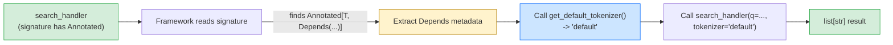

# Lesson 05: Type Hints and Annotations

*Type-annotating `notesearch` properly, with the canonical lesson on `Annotated` (PEP 593) — the exact primitive that FastAPI's `Depends`, Pydantic's `Field`, and SQLAlchemy's `Mapped` all rely on.*

**Welcome to Lesson 05 — the canonical type-hints lesson for the whole vault.**

Hello, friend. Pull up a chair. Type hints are not about making Python "feel like Java." They are about making your intent legible to your tools — your IDE, your linter, your test runner, and (critically for FastAPI) the framework itself. By the end of this lesson you will be able to read `Annotated[int, Depends(get_db)]` without panic, write a generic function that preserves its parameter types, choose between `Optional[X]` and `X | None` (they're the same thing, sort of), and explain why `from __future__ import annotations` is sometimes exactly wrong. This is the lesson every later section links back to — bookmark it. Take your time. Type every example. **This is how you learn.**


#python #type-hints #annotated #canonical

## Learning Objectives

By the end of this lesson you will be able to:

1. **Read and write Python 3.12 type hints** for functions, classes, generics, and callables, including the modern `list[int]` / `dict[str, int]` syntax.
2. **Use PEP 604 `X | Y` syntax** for unions and `Optional`/`None` — and explain why it is preferred over `Union`/`Optional` from `typing`.
3. **Use `typing.Annotated` (PEP 593)** to attach metadata to a type, and explain why this is the primitive FastAPI, Pydantic, and SQLAlchemy all build on.
4. **Define `TypeVar`, `ParamSpec`, and `TypeVarTuple`** for generic functions, and pick the right one for each situation (typed-decorator, typed-wrapper, fully-variadic).
5. **Use `Callable[..., T]` and `Callable[[int, str], None]`** for function types, including the modern `Callable[int, str]` form (PEP 695).
6. **Decide whether `from __future__ import annotations` is right for your file**, and explain *why* it breaks runtime introspection for FastAPI / Pydantic.
7. **Use `typing.Protocol`** (introduced in Lesson 03) and `typing.Generic` for generic protocols.
8. **Use `typing.overload`** to give a function multiple type signatures for different argument shapes.
9. **Compare `@dataclass` and Pydantic `BaseModel`** for type-annotated records — when each wins, when each loses.
10. **Predict, before running**, which annotations are evaluated at runtime and which are stored as strings, and explain the implication for libraries that introspect them.
11. **Preview `Annotated[int, Depends(...)]`** so that Section 03's dependency injection is not a surprise.

## Prerequisites

Before starting, you need:

- **Lessons 01–04** of this section. Type hints sit on top of the object model (Lesson 01), function semantics (Lesson 02), class semantics (Lesson 03), and the iterator protocol (Lesson 04).
- **Python 3.12** (or 3.13) in your REPL.
- **A static type checker installed** — mypy or pyright. We recommend `uv tool install pyright` (Lesson 07) or `uv tool install mypy`. We will not run the checker in this lesson, but we will write code that would pass. (We will explain `uv tool install` fully in Lesson 07 — for now, treat it as "the modern replacement for `pip install` when you want a global CLI tool.")
- **About two hours of focused time.** This is the longest lesson in the section; the `Annotated` deep-dive alone is worth an hour.

**The most common gap: runtime vs static.**

Type hints are *not* enforced at runtime. `def f(x: int) -> str: return 1` runs without complaint — Python sees the annotations, shrugs, and moves on. The enforcement happens at *type-check time*, when mypy or pyright reads your file. Some libraries (FastAPI, Pydantic) *do* read your annotations at runtime to drive behaviour — but they are the exception, and that exception is exactly why this lesson is canonical. If you internalise "type hints are static by default, runtime-opt-in via `Annotated`," the rest of the vault makes sense.


## The Problem

`notesearch` v4 had type hints, but they were sparse — `Iterator[str]` here, `list[int]` there, no generics, no `Annotated`. The framework lessons in Sections 03–07 will lean heavily on type hints: FastAPI reads your function signature to decide what to inject; Pydantic reads your model fields to decide what to validate; SQLAlchemy reads your `Mapped[T]` annotations to decide column types. If you do not understand the underlying primitive — `Annotated` — you will be writing cargo-cult code.

The specific primitive is `typing.Annotated[T, ...]` (PEP 593). It is a *pair* of a type and arbitrary metadata:

```python
from typing import Annotated

Quantity = Annotated[int, "must be non-negative"]
```

`Quantity` is *still* an `int` for type-checking purposes, but it carries a string `"must be non-negative"` as metadata. Tools that know to look can read the metadata and act on it. FastAPI's `Depends`, `Query`, `Path`, `Body`, `Header`, `Cookie`, and `Form` are all *metadata* pieces designed to be used inside `Annotated`:

```python
from fastapi import Depends, Query
from typing import Annotated

async def list_items(
 q: Annotated[str, Query(min_length=1)] = "",
 db: Annotated[AsyncSession, Depends(get_db)],
):
 ...
```

That is the *central* FastAPI idiom, and it depends on you understanding `Annotated` cold. This lesson teaches it from first principles — by writing our own metadata-using helper and seeing how a function signature can carry runtime behaviour alongside type information.

**Note — Historical context — type hints were opt-in**

PEP 484 (2014) introduced type hints to Python 3.5 as an *optional* feature. The goal was explicit: "Python will remain a dynamically typed language, and the authors of PEP 8 have no desire to ever make type hints mandatory." The community accepted them slowly; by 2026 they are universal in any serious codebase. The crucial follow-on, PEP 593 (`Annotated`), came in Python 3.9 (2020). FastAPI 0.95 (2023) introduced the `Annotated[T, Depends(...)]` form as the recommended way to declare dependencies, replacing the older `db: AsyncSession = Depends(get_db)` form. In 2026 the `Annotated` form is universal in new FastAPI code; this lesson teaches it as the only form.


## The Code

Here is `notesearch` v5 — ~150 lines. We add proper type annotations everywhere, define a generic `TypeVar`, build an `Annotated`-based metadata system, and preview the FastAPI `Depends` pattern in pure Python.

```python
# notesearch_v5.py
"""notesearch v5 — fully type-annotated, with Annotated metadata."""
from __future__ import annotations

from collections.abc import Callable, Iterable, Iterator
from dataclasses import dataclass
from typing import Annotated, Any, Generic, NamedTuple, ParamSpec, TypeVar, overload


# --- 1. Generics via TypeVar -----------------------------------------------

T = TypeVar("T") # invariant generic
P = ParamSpec("P") # parameter specification (for typed decorators)
R = TypeVar("R") # return type


def first(items: list[T]) -> T | None:
 """Return the first item of a list, or None if empty."""
 return items[0] if items else None


def pipeline(*stages: Callable[[T], T]) -> Callable[[T], T]:
 """Compose functions: pipeline(f, g)(x) == g(f(x))."""
 def composed(x: T) -> T:
 for stage in stages:
 x = stage(x)
 return x
 return composed


# --- 2. A typed decorator with ParamSpec (preserves the wrapped signature) ---

def log_calls(func: Callable[P, R]) -> Callable[P, R]:
 """A decorator that logs every call to `func`. Preserves the signature."""
 def wrapper(*args: P.args, **kwargs: P.kwargs) -> R:
 print(f"calling {func.__name__!r}({args!r}, {kwargs!r})")
 return func(*args, **kwargs)
 return wrapper


@log_calls
def add(a: int, b: int) -> int:
 """Add two ints."""
 return a + b


# --- 3. Annotated metadata: a "Field" for our own framework -----------------

class FieldMeta(NamedTuple):
 """Metadata for an annotated field — same shape as Pydantic's Field."""
 default: Any = None
 min_length: int | None = None
 max_length: int | None = None
 description: str | None = None


# A reusable annotated type
NonEmptyStr = Annotated[str, FieldMeta(min_length=1, description="A non-empty string")]


def extract_field_meta(annotation: Any) -> FieldMeta | None:
 """If `annotation` is `Annotated[T, FieldMeta(...)]`, return the FieldMeta."""
 # __metadata__ is a tuple of all metadata pieces
 meta = getattr(annotation, "__metadata__", None)
 if meta is None:
 return None
 for piece in meta:
 if isinstance(piece, FieldMeta):
 return piece
 return None


# --- 4. A dataclass that uses our Annotated type ---------------------------

@dataclass
class SearchRequest:
 query: NonEmptyStr
 limit: Annotated[int, FieldMeta(default=10, description="Max results")]


# --- 5. Preview: the Depends pattern in pure Python -----------------------

class Depends:
 """A marker class — `Annotated[T, Depends(callable)]` means 'inject this callable's result'."""
 def __init__(self, dependency: Callable[..., Any]) -> None:
 self.dependency = dependency


# A fake "dependency provider"
def get_default_tokenizer() -> str:
 return "default"


# A "handler" function with an Annotated+Depends signature
async def search_handler(
 q: Annotated[str, FieldMeta(min_length=1)],
 tokenizer: Annotated[str, Depends(get_default_tokenizer)],
) -> list[str]:
 # In a real framework, the framework would call get_default_tokenizer() and
 # pass the result as `tokenizer`. Here we just demonstrate the shape.
 return [tokenizer, q]


# --- 6. overload: multiple signatures for one function ---------------------

@overload
def parse_id(value: int) -> int: ...
@overload
def parse_id(value: str) -> int: ...
def parse_id(value: int | str) -> int:
 if isinstance(value, int):
 return value
 return int(value)


# --- 7. Demo ----------------------------------------------------------------

if __name__ == "__main__":
 print("--- generics ---")
 print("first([1, 2, 3]):", first([1, 2, 3]))
 print("first(['a', 'b']):", first(["a", "b"]))
 print("first([]):", first([]))

 print("\n--- pipeline ---")
 plus1 = lambda x: x + 1
 times2 = lambda x: x * 2
 composed = pipeline(plus1, times2)
 print("composed(3):", composed(3)) # (3 + 1) * 2 == 8

 print("\n--- typed decorator ---")
 print("add(2, 3):", add(2, 3))

 print("\n--- Annotated metadata ---")
 print("SearchRequest fields:")
 import dataclasses
 for field in dataclasses.fields(SearchRequest):
 print(f" {field.name}: {field.type}")
 meta = extract_field_meta(field.type)
 print(f" meta: {meta}")

 print("\n--- overload ---")
 print("parse_id(42):", parse_id(42))
 print("parse_id('42'):", parse_id("42"))

 print("\n--- Depends preview ---")
 import inspect
 sig = inspect.signature(search_handler)
 for name, param in sig.parameters.items():
 print(f" {name}: {param.annotation}")
```

## Line-by-Line Deep Dive

This is the heart of the lesson. Read it twice. Do not skip.

### Lines 1–7: Imports

```python
from __future__ import annotations

from collections.abc import Callable, Iterable, Iterator
from dataclasses import dataclass
from typing import Annotated, Any, Generic, NamedTuple, ParamSpec, TypeVar, overload
```

**What it does:** Imports the modern type primitives. `Callable`, `Iterable`, `Iterator` from `collections.abc` (the PEP 585 modern home); `Annotated`, `Generic`, `NamedTuple`, `ParamSpec`, `TypeVar`, `overload` from `typing` (which is still the canonical home for these).

**Why `from __future__ import annotations`:** This makes every annotation in this file *lazy* — stored as a string, evaluated only when someone calls `typing.get_type_hints()` or a type checker reads the file. The advantage is forward-compatibility (you can use `X | Y` syntax on Python 3.9). The disadvantage — and this is *critical* for FastAPI and Pydantic — is that *runtime introspection* of annotations returns strings, not real objects.

**Warning — The single most important `Annotated` gotcha.**

When `from __future__ import annotations` is active:
```python
def f(x: Annotated[int, FieldMeta(min_length=1)]): ...
sig = inspect.signature(f)
sig.parameters["x"].annotation # the string "Annotated[int, FieldMeta(min_length=1)]"
```
FastAPI and Pydantic need the *real* `Annotated[...]` object to introspect the `FieldMeta`. They solve this by calling `typing.get_type_hints()` (which evaluates the strings) or by requiring you to not use `from __future__ import annotations` in their special files. In practice, FastAPI handles this transparently — its dependency-resolution layer calls `get_type_hints` for you. But if you write your own framework that introspects annotations, you *must* call `get_type_hints` yourself. Lesson 03 of Section 03 shows the FastAPI side; this lesson shows you why it is necessary.


**Why would `from __future__ import annotations` ever be the right choice if it breaks introspection?** Because most files in a real codebase are *not* introspected at runtime. A pure-Python library whose annotations exist only for the type checker pays zero cost under the future import — its forward references resolve cleanly, you can write `Node | None` inside a `Node` method body without quoting the name, and the module imports slightly faster because annotations are not evaluated. The cost only shows up when a framework reads your signature — which is FastAPI, Pydantic, SQLAlchemy, marshmallow, and a handful of others. The rule of thumb in this vault: turn the future import *on* for application code that has no framework reading its signatures, and *off* for any file whose annotations FastAPI or Pydantic will introspect at request time (route handlers, Pydantic models, dependency functions). Both routes work; the wrongness lives in mixing them up.

**Production reality: mypy / pyright as a CI gate, not a local ritual.**

In a real FastAPI service the type checker is not run by hand — it runs on every PR in CI, and a non-zero exit blocks merge. The senior engineer's setup pins mypy and pyright under a `[dependency-groups] dev` block in `pyproject.toml` (the modern PEP 735 form, see [[uv-Tooling-Workflows]]), runs `mypy --strict src/` against the typed package, and emits a SARIF report that GitHub's code-scanning UI ingests. Two settings carry the most weight: `strict_optional = true` (no implicit `None`-to-`Any` coercion) and `disallow_any_explicit = true` (reject `Any` annotations in code you own — force the author to pick `object` for "unknown" or a typed alternative). The CI gate is not pedantry — it is the only thing stopping a 2 a.m. refactor from turning `list[int]` into `list[Any]` and silently losing the constraint the type system was protecting. If your CI runs mypy but does not fail the build on a non-zero exit, you do not have a type-check gate — you have a type-check suggestion. The same posture applies to pyright in strict mode (`--level error`); pick one checker and run it consistently, do not run both with conflicting rule sets.


### Lines 11–17: Generics via `TypeVar`

```python
T = TypeVar("T") # invariant generic

def first(items: list[T]) -> T | None:
 """Return the first item of a list, or None if empty."""
 return items[0] if items else None
```

**What it does:** Defines a `TypeVar` `T` and a generic function `first` whose return type is bound to the type of the list's elements.

**Why `TypeVar` is needed:** Without it, the only annotation we could write for `first` would be `list[Any] -> Any | None`. That loses information: `first([1, 2])` should be `int | None`, not `Any | None`. The `TypeVar` tells the type checker "the `T` in `list[T]` is the same `T` as in `T | None` — match them." So `first([1, 2])` infers as `int | None`, `first(["a"])` infers as `str | None`.

**What `T | None` is:** PEP 604 union syntax. Equivalent to `Optional[T]` and `Union[T, None]`. All three forms compile to the same `types.UnionType` at runtime (Python 3.10+). The `X | Y` form is preferred in new code because it is shorter and does not require an import.

**Tip — The four `TypeVar` flavours.**

1. **Invariant** (plain `TypeVar("T")`): the default. `list[int]` is *not* a subtype of `list[object]` — they are unrelated. This is invariant because `list` is mutable.
2. **Covariant** (`TypeVar("T", covariant=True)`): for *read-only* containers. `tuple[T, ...]` is covariant — `tuple[int]` *is* a subtype of `tuple[object]` because you cannot mutate a tuple.
3. **Contravariant** (`TypeVar("T", contravariant=True)`): for *write-only* positions, like function arguments. Rare in practice; we won't use it in `notesearch`.
4. **Bounded** (`TypeVar("T", bound=SomeClass)`): restricts `T` to subclasses of `SomeClass`. Useful when you want to call methods on `T`.


**Why is `list[int]` not a subtype of `list[object]`?** Because the list is mutable. If the type system let you treat a `list[int]` as a `list[object]`, you could `.append("hello")` to it — and then the original `list[int]` reference would contain a string, breaking the type contract that every reader of the list relies on. The type system closes the loophole by declaring `list` invariant: `list[int]` and `list[object]` are *unrelated*, neither is a subtype of the other. **Why is `tuple` different?** Because tuples are immutable — once constructed, their contents cannot change, so a `tuple[int]` used as a `tuple[object]` cannot be subverted by mutation. The type system rewards immutability with covariance. This single distinction — mutability forces invariance — explains why `Sequence[T]` (covariant, read-only protocol) is the right annotation for "I just want to read it" and `list[T]` (invariant, mutable concrete) is the right annotation for "I want to mutate it."

**Senior engineer's mental model:** Think of a `TypeVar` not as "a generic type parameter" but as a *constraint propagation channel*. A function `def first(items: list[T]) -> T | None` is making a promise: "the `T` you put in via the list and the `T` you get out via the return are the same `T`." The senior engineer's question, every time you reach for `TypeVar`, is: "Where does `T` get bound, and what information does that binding carry across the function boundary?" Without a `TypeVar`, that information is lost — `list[Any] -> Any` is just `list -> thing`. With a `TypeVar`, the input type *flows through* to the output type, and a downstream caller's type checker can reason about it. The pattern matters most at API boundaries: a route that takes `list[ProjectCreate]` and returns `Project` should let the type checker prove the returned `Project.id` field's type matches what the caller expects — `TypeVar` is how you make that promise legible to mypy. If you find yourself writing `T = TypeVar("T")` and then never using `T` in both an input *and* output position, the `TypeVar` is decorative — delete it and use `Any` (or, better, `object`) honestly.

**Warning — When this breaks: "Incompatible types in assignment" with no obvious cause.**

The classic invariance footgun reads like this: you have `animals: list[Animal] = []`, you write `animals = [Dog("rex")]`, and mypy says `list[Dog]` is incompatible with `list[Animal]`. The instinct is to reach for `cast(list[Animal], [Dog("rex")])` — don't. The senior engineer's response is: re-read the invariance explanation above, then change either the annotation (`animals: list[Animal]` becomes `animals: list[Dog]` if the list really only holds dogs) or the type (`list` → `Sequence`, which is covariant and accepts `list[Dog]`). The mistake is treating "list of more specific type" as "list of less specific type" — that's *exactly* the soundness hole invariance exists to prevent. If you `cast` your way out, you've reintroduced the bug mypy was protecting you from. A second variant of the same footgun: `def add_one(items: list[int]) -> list[int]: items.append(1); return items` then `my_strings: list[object] = ["a", "b"]; add_one(my_strings)` — mypy refuses, and rightly so, because at runtime that would append `1` to a list of strings.


**Danger — How an attacker thinks: type confusion at the boundary.**

An attacker who sees a function `def get_config(key: str) -> object: ...` and a caller `cfg = get_config(user_input); cfg["admin"] = True` doesn't think "I'll exploit a CVE." They think: "the type system thinks this is `object`, the runtime is duck-typed, and if `get_config` ever returns a `dict` for one input shape and a `str` for another, the `[...]` access works on one path and `TypeError`s on the other — and the `TypeError` path may be a 500 the operator logs but doesn't alert on, while the success path silently sets `admin=True`." The senior engineer's defense is not "sanitize the input" (you will miss a case) but "narrow the return type with `@overload` so the type checker proves the function's contract is uniform" — see `@overload` below. The bug class is *type confusion*, the same family as the JavaScript `==` coercion bugs that have caused real auth bypasses. In Python the runtime does not enforce types, so the type checker is your only line of defense — and it only defends what you've annotated. An `Any`-typed return on a function that takes user input is an open door.


**Warning — Debugging: `reveal_type()` is the type-checker's `print()`.**

When mypy or pyright complains about a generic function and the error message does not make sense, reach for `reveal_type(some_expr)` (lower-case, no import needed in modern mypy) inside the function body. The checker prints the *inferred* type at that point — `Revealed type is "Optional[int]"` — which tells you what the type system actually sees, not what you *think* you annotated. The most common mismatch is a `TypeVar` that does not appear in both an input and an output position: if `T = TypeVar("T")` appears only in the return type, the checker cannot bind it from the call site and falls back to `Unknown` / `Any` at the call site, which then propagates silently downstream. A second debugging lever is `typing.get_type_hints(func, include_extras=True)` at runtime — it shows the *resolved* annotations, which is what FastAPI and Pydantic will see when they introspect your signature, and a disagreement between `reveal_type` (static view) and `get_type_hints` (runtime view) is the smoking gun for almost every generic-function bug. The rule: when a generic does not type-check the way you expect, reach for `reveal_type` first and `get_type_hints` second — `print()` cannot help you here because the type information does not exist at runtime.


### Lines 20–26: Composing with `TypeVar`

```python
def pipeline(*stages: Callable[[T], T]) -> Callable[[T], T]:
 """Compose functions: pipeline(f, g)(x) == g(f(x))."""
 def composed(x: T) -> T:
 for stage in stages:
 x = stage(x)
 return x
 return composed
```

**What it does:** A higher-order generic function. Takes any number of `Callable[[T], T]` (functions from `T` to `T`) and returns a single `Callable[[T], T]` that composes them.

**Why the `TypeVar` matters here:** Without it, `pipeline` would have type `Callable[..., Any]` and the composed result would lose type information. With the `TypeVar`, mypy can infer that `pipeline(plus1, times2)(3)` returns the same type as `plus1(3)` — an `int`. The `TypeVar` ties the input type to the output type across the composition.

### Lines 30–37: `ParamSpec` for a typed decorator

```python
P = ParamSpec("P")
R = TypeVar("R")

def log_calls(func: Callable[P, R]) -> Callable[P, R]:
 """A decorator that logs every call to `func`. Preserves the signature."""
 def wrapper(*args: P.args, **kwargs: P.kwargs) -> R:
 print(f"calling {func.__name__!r}({args!r}, {kwargs!r})")
 return func(*args, **kwargs)
 return wrapper
```

**What it does:** Defines a typed decorator. `log_calls` takes a `Callable[P, R]` (any callable with parameter spec `P` and return type `R`) and returns a `Callable[P, R]` (same signature). Inside `wrapper`, `P.args` and `P.kwargs` are the captured parameter spec — the type checker treats them as "the same parameters as `func`."

**Why `ParamSpec` exists:** Without it, you'd have to write `def wrapper(*args, **kwargs): ...` and the type checker would lose all type information about the wrapped function. `ParamSpec` lets you write a decorator that preserves the wrapped function's signature exactly. This was added in PEP 612 (Python 3.10).

**Example — Before `ParamSpec`, decorators were untyped.**

The old way to type a decorator was `def log_calls(func: Callable[..., R]) -> Callable[..., R]:` — using `...` (ellipsis) as a wildcard. That tells the type checker "any signature" — but then the wrapped function's specific parameter types are lost. `functools.wraps` did the runtime metadata preservation; `ParamSpec` does the static type preservation. In modern Python (3.10+), `ParamSpec` is the right tool.


**Student asks: what happens if I decorate `add` with `log_calls` and then call `add("a", "b")`?**

Answer: mypy and pyright will flag `add("a", "b")` as a type error — `add` expects `int` arguments. The decorator preserved the signature, so the type checker still knows `add` takes two `int`s. Without `ParamSpec`, the wrapped `add` would have signature `(*args, **kwargs) -> int` and the type checker would silently accept `add("a", "b")`. That's the value of `ParamSpec` — the type checker is your safety net.


**Production reality: `ParamSpec` is what keeps FastAPI's dependency graph intact through decorators.**

FastAPI builds its dependency graph by reading the *real* signature of every callable that participates in a route — the route handler, every dependency it depends on, every dependency those depend on, recursively. If a decorator used to wrap a handler loses the handler's parameter names (e.g. `def wrapper(*args, **kwargs): return func(*args, **kwargs)` with no `ParamSpec`), FastAPI's introspection sees a function with parameters `(*args, **kwargs)` instead of `(q: str, db: Annotated[AsyncSession, Depends(get_db)])`, and the dependency resolver cannot match `Depends(get_db)` to any parameter — the dependency is silently never wired and the route fails at first request with `AttributeError: 'NoneType' object has no attribute 'execute'`. `ParamSpec` is what prevents this: `def wrapper(*args: P.args, **kwargs: P.kwargs) -> R` preserves the names so the framework reads them back. The same pattern applies to any typed middleware decorator you write for Starlette — if the wrapper does not use `ParamSpec`, the route handler's parameters are erased and downstream introspection silently breaks. The rule: any decorator that wraps a route handler or a dependency *must* use `ParamSpec`; any decorator that wraps a plain internal function can use the simpler `Callable[..., R]` form. The corollary: a decorator that wraps a Pydantic model method or a SQLAlchemy attribute accessor has the same requirement — preserve the signature or the framework's introspection breaks.


### Lines 44–52: `Annotated` and `FieldMeta`

```python
class FieldMeta(NamedTuple):
 """Metadata for an annotated field — same shape as Pydantic's Field."""
 default: Any = None
 min_length: int | None = None
 max_length: int | None = None
 description: str | None = None


NonEmptyStr = Annotated[str, FieldMeta(min_length=1, description="A non-empty string")]
```

**What it does:** Defines a `NamedTuple` `FieldMeta` to hold field metadata, and defines a reusable type alias `NonEmptyStr` that is `Annotated[str, FieldMeta(min_length=1, ...)]`.

**Why `NamedTuple` for `FieldMeta`:** A `NamedTuple` is immutable, hashable (if all fields are hashable), and has a sensible `__repr__`. It's the right default for "a small immutable record of values." Pydantic's `FieldInfo` is more complex (it's a class with mutable attributes and many features) but for `notesearch` `NamedTuple` is enough.

**What `Annotated[str, FieldMeta(...)]` actually *is*:** At runtime, it's a special form. `Annotated.__getitem__` returns a `_AnnotatedAlias` object with `__origin__ = str` and `__metadata__ = (FieldMeta(min_length=1, description="..."),)`. The metadata is a *tuple* — you can attach multiple pieces:

```python
Big = Annotated[int, FieldMeta(min_length=1), "must be > 0", Gt(0)]
```

Each piece in `__metadata__` is opaque to the type system (mypy ignores them all for type checking — `Big` is just `int`). They are *only* for runtime introspection by tools that know to look.

**Why is `__metadata__` a *tuple* of pieces instead of a single value?** Because composability. A single parameter can carry metadata from multiple independent tools at once: `Annotated[str, Field(min_length=1), Depends(get_db), Tag("audit-logged")]` says three things — validate that it is at least one character long, wire it as a FastAPI dependency, and tag it for our own audit logger. None of those tools knows about the others. The tuple form means each tool walks the metadata, picks up the piece it cares about (`isinstance(piece, FieldInfo)` / `isinstance(piece, Depends)` / `isinstance(piece, Tag)`), and ignores the rest. If `Annotated` held a single metadata value, you would have to choose: Pydantic's `Field` *or* FastAPI's `Depends` *or* your custom marker, never all three. The tuple is what makes the whole FastAPI + Pydantic + custom-validator stack compose.

**Tip — The runtime introspection pattern.**

```python
>>> from typing import get_type_hints
>>> hints = get_type_hints(SearchRequest, include_extras=True)
>>> hints["query"]
typing.Annotated[str, FieldMeta(default=None, min_length=1, max_length=None, description='A non-empty string')]
>>> hints["query"].__metadata__
(FieldMeta(default=None, min_length=1, max_length=None, description='A non-empty string'),)
```
The `include_extras=True` argument to `get_type_hints` is *required* to preserve the metadata; without it, `get_type_hints` strips the `Annotated` wrapper and returns just `str`. FastAPI and Pydantic call `get_type_hints(..., include_extras=True)` internally so they see the metadata. Without `include_extras=True`, they'd see only `str` and the metadata would be invisible. This is the single most important `Annotated` API gotcha.


**Student asks: why does `Annotated[T, X]` not change the *type* of `T`?**

Because PEP 593 explicitly defines `Annotated[T, X]` as a typing form whose static type *is* `T` — the `X` is opaque to type checkers. mypy, pyright, and Pyrefly all see `Annotated[str, FieldMeta(min_length=1)]` as identical to `str` for type-checking purposes. The `X` is *only* there for runtime introspection: `get_type_hints(..., include_extras=True)` returns it, FastAPI and Pydantic call that function, and they make decisions at runtime based on what they find. Why is the asymmetry deliberate? Because type checkers cannot reason about arbitrary metadata — if `Annotated[str, "must be lowercase"]` were a new type, mypy would need to know how to verify the "must be lowercase" constraint, which is a job for a runtime validator (Pydantic) not a static checker. Splitting the concern — `Annotated` carries the metadata, the validator uses it, the type checker ignores it — is what makes the whole modern FastAPI/Pydantic stack compose. You will see this pattern again in [[03-FastAPI-Core/Dependency-Injection]] where `Annotated[str, Depends(get_api_key)]` is *typed as* `str` but *wired as* a dependency.


**Senior engineer's mental model:** Don't think of `Annotated[T, X]` as "a type with metadata." Think of it as a **contract surface** — you're declaring that `T` is the type callers (and mypy) see, and `X` is the metadata that framework authors (FastAPI, Pydantic, your DI container) read to decide behaviour. The senior engineer's question is always: "Who reads this metadata, and what do they do with it?" If nobody reads it, the `Annotated` is dead weight — a `NonEmptyStr` alias attached to a function parameter that no framework introspects is just `str` with extra characters. The metadata layer is opt-in on both sides: the *writer* of the annotation opts in by attaching `FieldMeta(...)`, and the *reader* (the framework's introspection layer) opts in by calling `get_type_hints(..., include_extras=True)`. The asymmetry is the point — `Annotated` lets static and runtime concerns share a single syntactic slot without one contaminating the other.

**Production reality: per-request introspection cost.**

In a typical production FastAPI deployment, every route's signature is introspected *once* — at app-construction time — and the resulting `Depends`/`Field` metadata is cached on the route's `dependent` object. By the time request #1,000,000 arrives, no `get_type_hints` call is happening on the hot path. If you write your *own* framework that introspects annotations on the hot path (a decorator that re-reads the signature on every call, say), you will see it in profiles — `get_type_hints` is not free, and `include_extras=True` makes it slower still because it must reify the `Annotated` wrapper rather than stripping it. The senior engineer's response: cache the result at decoration time, stash it on the wrapper function (`wrapper._field_meta = extract_field_meta(...)`), and read from the cache on the hot path. The same applies to your own Pydantic-style validators — model construction caches the field set; per-instance validation does not re-introspect.


**Warning — When this breaks: nested `Annotated` flattens silently.**

`Annotated[Annotated[str, FieldMeta(min_length=1)], FieldMeta(description="x")]` does *not* nest — it *flattens*. The resulting object has `__metadata__ = (FieldMeta(min_length=1), FieldMeta(description="x"))`, not a nested `Annotated` inside another. That is the *intended* behaviour (PEP 593 specifies it) and it is what lets you compose `Annotated[str, Field(...), Depends(...)]` from independent type aliases. But it bites you in two places. (a) If you walk `__metadata__` and expect the first piece to be the "outermost" metadata, you're wrong — there is no outermost; the order is left-to-right concatenation of the source aliases. (b) If two aliases attach conflicting `FieldMeta` instances, you'll get both — and the framework's picker (`extract_field_meta` returns the *first* matching piece) silently picks one, hiding the conflict. The senior engineer's response: don't compose two aliases that both attach the same metadata class; if you need to override, write a fresh alias rather than nesting.


**Danger — How an attacker thinks: metadata is runtime config, so untrusted metadata is RCE-adjacent.**

`Annotated[T, Field(...)]` looks like a static type annotation, but the `Field(...)` part is *evaluated* — it runs at module import time (without the future import) or at first introspection (with it). If you ever construct metadata from user input — say, `Annotated[str, Field(default=user_supplied_default)]` where `user_supplied_default` came from a request payload or a database row — you are running user-controlled code at import time, which is a one-step-away RCE primitive. The defence is structural: metadata pieces must be module-scope constants authored by you, never values assembled from request data, database rows, or environment variables that can be shaped by an attacker. The same rule applies to custom marker classes you write for your own framework: their `__init__` must not run user-controlled side effects (no `eval(user_input)` inside a `Tag` marker, no `__init__` that writes to a registry keyed by user input). A second, subtler attack: if your framework introspects `Annotated[T, Marker(...)]` and dispatches on the marker's class, an attacker who can inject a fake `Marker` subclass into your module namespace can hijack dispatch — keep `importlib.import_module` away from the path that resolves marker classes, and pin the marker registry to a fixed set of `isinstance` checks at decoration time. The bug class is *untrusted-code execution via type metadata*, the same family as pickle deserialisation — the defence is never letting user input reach the `Annotated[...]` constructor.


### Lines 55–63: Extracting metadata at runtime

```python
def extract_field_meta(annotation: Any) -> FieldMeta | None:
 """If `annotation` is `Annotated[T, FieldMeta(...)]`, return the FieldMeta."""
 # __metadata__ is a tuple of all metadata pieces
 meta = getattr(annotation, "__metadata__", None)
 if meta is None:
 return None
 for piece in meta:
 if isinstance(piece, FieldMeta):
 return piece
 return None
```

**What it does:** Takes a type annotation and returns the `FieldMeta` inside it (if any).

**Why this is the bridge between types and runtime:** This is *exactly* what FastAPI's `get_param_field` and Pydantic's `_fields_from_schema` do — they walk a function's signature, look at each parameter's annotation, extract any `Annotated` metadata, and use that metadata to drive behaviour (validation, dependency injection, OpenAPI schema generation). The pattern is "metadata as configuration."

**Senior engineer's mental model:** The function `extract_field_meta` is the bridge between two worlds — the *static* type system (where `Annotated[T, X]` is opaque to mypy) and the *runtime* world (where `X` is a real Python object you can `isinstance`-check and act on). The mental model to internalise: **annotations are a configuration channel that happens to be syntactically valid as types**. When you write `q: Annotated[str, FieldMeta(min_length=1)]`, you are doing two things in one statement — declaring a type (which the type checker sees) and declaring a runtime configuration value (which your framework sees). The two channels are decoupled: a static type checker never has to know what `FieldMeta` means; the framework never has to know what `T` is, beyond "the user said this is the type." This decoupling is what makes `Annotated` the *central* primitive — it's a single syntactic slot that admits both concerns without forcing them to share semantics.

**Warning — When this breaks: `NameError: name 'X' is not defined` from `get_type_hints`.**

Under `from __future__ import annotations`, `get_type_hints(SomeClass, include_extras=True)` *evaluates* the stringified annotations in the class's module namespace. If an annotation references a type that is not imported in *that module* — say, you wrote `from .models import Project` in `routes.py` but `Project` is used in an annotation in `schemas.py` that imports it only under `TYPE_CHECKING` — then `get_type_hints` raises `NameError: name 'Project' is not defined` at request time, not at import time. The mistake is hard to spot because the import *looks* fine in your editor (pyright resolves it under `TYPE_CHECKING` for static analysis). The senior engineer's response: any type used in an `Annotated[...]` that your framework will introspect must be importable at runtime in the module that defines the annotation — keep `TYPE_CHECKING` imports for types used only in *purely static* positions (return types of internal helpers, etc.), and use real imports for types referenced in framework-introspected signatures. If you cannot avoid a forward reference, pass `localns=`/`globalns=` to `get_type_hints` explicitly.


**Production reality: this exact `__metadata__` walk is what SQLAlchemy 2.x does for `Mapped[T]`.**

SQLAlchemy 2.0's declarative base uses `Annotated[T, mapped_column(...)]` (or, before 2.0, `Column(...)`) to carry column-level metadata on a Python type. When you write `name: Mapped[str] = mapped_column(String(255), nullable=False)`, the ORM's metaclass walks `__metadata__` for each annotated attribute, picks out the `mapped_column(...)` piece, and builds the column descriptor from it. The pattern is *identical* to `extract_field_meta` here — `isinstance(piece, MappedColumn)` is the production version of `isinstance(piece, FieldMeta)`. Lesson [[07-SQLAlchemy/03-Declarative-Base-and-Mapped]] walks the real SQLAlchemy code; the takeaway is that once you can read `extract_field_meta`, you can read SQLAlchemy's `Mapped`, Pydantic's `Field`, and FastAPI's `Depends` — they are the same algorithm with different marker classes. The corollary for your own code: any framework you write that introspects `Annotated` should follow this exact pattern (walk `__metadata__`, `isinstance`-check, return the first match) so the next reader recognises the idiom — inventing a novel introspection scheme is a tax on every reader who comes after you.


### Lines 67–71: `SearchRequest` using `Annotated`

```python
@dataclass
class SearchRequest:
 query: NonEmptyStr
 limit: Annotated[int, FieldMeta(default=10, description="Max results")]
```

**What it does:** Defines a `@dataclass` with two fields. `query` is `NonEmptyStr` (which is `Annotated[str, FieldMeta(min_length=1, ...)]`); `limit` is `Annotated[int, FieldMeta(default=10, ...)]`.

**What the dataclass does with the annotations:** *Nothing* — the dataclass-generated `__init__` accepts `query: str` and `limit: int` and stores them as instance attributes. The `Annotated` metadata is invisible to the dataclass machinery. But a framework that introspects the dataclass (e.g. `dataclasses.fields(SearchRequest)` returns each field's `.type`, which is the full `Annotated[...]` form, plus the metadata) can read the `FieldMeta` and act on it.

**Warning — `dataclasses.fields(...).type` returns the annotation as written.**

Without `from __future__ import annotations`, the `field.type` attribute is the actual `Annotated[...]` object. With the future import, it's the *string* `"NonEmptyStr"` or `"Annotated[int, FieldMeta(default=10, ...)]"`. To get the real object, you need `typing.get_type_hints(SearchRequest, include_extras=True)`. Lesson 09 will write tests that exercise both forms.


### Lines 75–95: The `Depends` preview

```python
class Depends:
 """A marker class — `Annotated[T, Depends(callable)]` means 'inject this callable's result'."""
 def __init__(self, dependency: Callable[..., Any]) -> None:
 self.dependency = dependency


def get_default_tokenizer() -> str:
 return "default"


async def search_handler(
 q: Annotated[str, FieldMeta(min_length=1)],
 tokenizer: Annotated[str, Depends(get_default_tokenizer)],
) -> list[str]:
 return [tokenizer, q]
```

**What it does:** Defines a `Depends` marker class (the same shape as FastAPI's real `Depends`), a "dependency provider" `get_default_tokenizer`, and a "handler" function `search_handler` whose `tokenizer` parameter carries `Annotated[str, Depends(get_default_tokenizer)]`.

**Why this is the FastAPI idiom preview:** FastAPI's `Depends(get_db)` is exactly this shape — a marker that says "when you call this function, call `get_db()` first and pass the result as this parameter." The framework introspects `search_handler`'s signature, sees the `Depends` in the metadata of the `tokenizer` parameter, and wires up the dependency call. We will see the *real* FastAPI version in Section 03, Lesson 04.



**Example — Why `Annotated` rather than just `Depends(...)` as the *default value*?**

The old FastAPI form was `tokenizer: str = Depends(get_default_tokenizer)`. That works — FastAPI reads the default value, sees a `Depends` instance, and wires up the call. The new `Annotated[str, Depends(...)]` form is preferred because:
1. It separates the *type* (`str`) from the *dependency wiring* (`Depends(...)`). The default value can be a real default (or `...` to mark "required").
2. It composes cleanly with other metadata: `Annotated[str, Depends(...), Field(min_length=1)]` carries both the dependency and the validation rule.
3. Type checkers see `str`, not `Depends`. Old-style `def f(x: str = Depends(...))` confused mypy because `Depends(...)` is not a `str` — it's a marker. With `Annotated`, the type checker sees `str`.
Section 03 Lesson 04 covers this in detail; we preview the shape here so you can recognise it when you see it.


**Senior engineer's mental model:** Dependency injection via `Annotated[T, Depends(get_thing)]` is *not* magic — it is a convention: a function declares "I need a `T`, and here's the callable that produces one." The framework's job at request time is mechanical: read the signature, find every `Annotated` parameter whose `__metadata__` contains a `Depends`, call the dependency (recursively — dependencies can themselves have dependencies), and pass the result as the parameter. The senior engineer's mental model: **the call graph is the source of truth, and `Annotated` lets you express it inline at the consumption site instead of as a separate wiring file**. The benefit over hand-rolled DI containers (Spring-style XML, or a `register("db", get_db)` global) is *locality* — the dependency declaration sits next to the consumer, not in a separate config that drifts. The cost is that *every* consumer redeclares the dependency, which is why `Annotated[AsyncSession, Depends(get_db)]` is conventionally aliased to a `DbSession` type at module scope.

**Danger — How an attacker thinks: marker-based DI vs hand-rolled dispatch.**

An attacker who sees `handler = DISPATCH_TABLE.get(path); handler(request)` does not think "I'll attack `handler`." They think: "can I get a string into the dispatch-table key? Can I make `DISPATCH_TABLE` resolve to a callable I control?" The DI-via-`Annotated` pattern is structurally harder to subvert: there is no string-keyed dispatch table — the wiring is *static*, expressed in the function's signature, resolved at decoration time. To inject a malicious dependency, an attacker would have to write Python source into your route module, which already means RCE. The senior engineer's takeaway is not "DI-via-`Annotated` is unhackable" (it is not — `app.dependency_overrides` is a runtime attack surface if reachable) but "marker-based DI keeps the wiring in the type system, where attackers cannot reach it through input data." When you find yourself building a string-keyed registry of callables that user input can address, stop — that is the bug class that turned into CVE-2014-6271 (Shellshock). The defence is structural: resolve dispatch through type annotations and decoration-time wiring, not through a dict whose keys are user-shaped strings.


**Production reality: `app.dependency_overrides` is the test seam — clear it after the test.**

FastAPI exposes a dict on every application instance: `app.dependency_overrides`. The keys are the original dependency callables; the values are the override callables. In tests, you write `app.dependency_overrides[get_db] = lambda: test_session` to swap the real database session for an in-memory one. The override is consulted at request time by FastAPI's introspection layer, which looks up the original dependency in the dict before invoking it. Two production realities bite every team once: (1) the override must be a callable, not an instance — `app.dependency_overrides[get_db] = test_session` will raise at request time because FastAPI calls the override as a function; (2) the dict is mutable shared state across tests, so each test must clear it in a `finally` block (`app.dependency_overrides.clear()` or `app.dependency_overrides.pop(get_db, None)`) or the next test inherits the override and silently tests against the wrong dependency — a flaky test that passes in isolation and fails in the full suite. Section [[12-Testing-and-Quality/Testing-FastAPI-Endpoints]] shows the canonical `pytest` fixture pattern (`@pytest.fixture(autouse=True)` that yields and clears); the rule is: every `dependency_overrides` write must be paired with a teardown in the same fixture.


### Lines 99–105: `@overload` for multiple signatures

```python
@overload
def parse_id(value: int) -> int: ...
@overload
def parse_id(value: str) -> int: ...
def parse_id(value: int | str) -> int:
 if isinstance(value, int):
 return value
 return int(value)
```

**What it does:** Defines three `parse_id` symbols — two `@overload`s (for the type checker) and one real implementation. The type checker sees the overloads and treats `parse_id(42)` as `int`, `parse_id("42")` as `int`, and `parse_id(3.14)` as a type error.

**Why `@overload`:** Without it, you'd have to write `def parse_id(value: int | str) -> int:` and the type checker would *not* be able to narrow the return type based on the input. `@overload` lets you express the input-output type relationship for each case.

**Tip — `@overload` is for the type checker only.**

At runtime, only the *last* `parse_id` definition exists — the `@overload`-decorated ones are overwritten. The body of an `@overload` is conventionally `...` (or `"pass"`); it is never executed. The real implementation (the non-decorated one) is what runs. mypy and pyright enforce that the implementation signature is compatible with all overloads.


**Why doesn't `@overload` pollute the namespace at runtime?** Because Python decorators run top-to-bottom, and each `def parse_id` statement rebinds the name `parse_id` to whatever the next `def` produces. The first two `@overload`-decorated definitions create function objects, bind `parse_id` to them briefly, and then the next `def parse_id` rebinds the name to the third function object — overwriting the previous binding. By the time the module finishes importing, `parse_id` points at the real implementation; the overload stubs have been garbage-collected. **What does that imply for your tests?** You can never `assert parse_id.__doc__ == "the int overload docstring"` — only the last `__doc__` survives. The overloads are *static-only artefacts*: mypy reads your source text, finds the `@overload`-decorated stubs, and treats them as alternative signatures for the *same* function at check time. At runtime they are gone. This is why the convention is that overload bodies are `...` — there is no point writing a real body for a function that will be overwritten before anyone can call it.

### Lines 109–126: The demo

The demo exercises each pattern: generics, pipeline, typed decorator, introspection, overload, and the `Depends` preview. The introspection lines use `dataclasses.fields(SearchRequest)` to read each field's `.type` and call `extract_field_meta` to find the `FieldMeta`.

**Expected output** (modulo Python version and string representation of types):

```
--- generics ---
first([1, 2, 3]): 1
first(['a', 'b']): a
first([]): None

--- pipeline ---
composed(3): 8

--- typed decorator ---
calling 'add'((2, 3), {})
add(2, 3): 5

--- Annotated metadata ---
SearchRequest fields:
 query: NonEmptyStr
 meta: None # <-- with future import, field.type is a string; see warning below
 limit: Annotated[int, FieldMeta(default=10, ...)]
 meta: None # <-- same here

--- overload ---
parse_id(42): 42
parse_id('42'): 42

--- Depends preview ---
 q: Annotated[str, FieldMeta(min_length=1)]
 tokenizer: Annotated[str, Depends(get_default_tokenizer)]
```

**Warning — The `meta: None` lines in the output above are the bug.**

`extract_field_meta` returns `None` for both `SearchRequest` fields because `from __future__ import annotations` is active in `notesearch_v5.py` — `field.type` is the *string* `"NonEmptyStr"` (or `"Annotated[int, FieldMeta(default=10, ...)]"`), not the real `Annotated[...]` object, and strings do not have `__metadata__`. Exercise 4 asks you to fix this by calling `get_type_hints(SearchRequest, include_extras=True)` and passing the resolved hints to `extract_field_meta`. The Verification section below shows the same `meta: None` output as a runnable check — both sections agree on what the actual code produces.


## `from __future__ import annotations`: when it's wrong

We have used `from __future__ import annotations` throughout the vault. It is the safe default for *most* code. But it breaks two things:

1. **Runtime introspection of annotations returns strings**, not real objects. `inspect.signature(f).parameters["x"].annotation` returns the string `"Annotated[int, ...]"`, not the `Annotated[...]` form. FastAPI, Pydantic, and SQLAlchemy work around this by calling `typing.get_type_hints(..., include_extras=True)`, which evaluates the strings.
2. **Default argument evaluation timing.** Without the future import, `Annotated[int, FieldMeta(...)]` is evaluated at function-definition time (so the `FieldMeta(...)` runs *now*). With the future import, it's a string until someone calls `get_type_hints`. For most code this doesn't matter; for code that relies on side effects of the metadata constructor (e.g. registering a validator at import time), it matters.

**Warning — When to NOT use `from __future__ import annotations`.**

- In a Pydantic model file where you have `@field_validator` decorators that read the model's annotations at class-creation time — Pydantic v2 handles this transparently but the corner cases are subtle.
- In a FastAPI dependency file where you rely on `Annotated[T, Depends(...)]` *and* you introspect the signature at import time without going through `get_type_hints`.
- In any file where you use string annotations that reference forward-declared types and you need them evaluated eagerly.

In all other cases, the future import is safe. The FastAPI section (03) and Pydantic section (04) will discuss their own handling; you do not need to make this decision yourself for those files.


**Student asks: if `from __future__ import annotations` makes everything a string, how does FastAPI ever see `Annotated[int, Depends(...)]` as a real dependency declaration?**

Because FastAPI does not call `inspect.signature` and stop there — it calls `typing.get_type_hints(endpoint, include_str=False, include_extras=True)`, which evaluates the stringified annotation in the function's module namespace *and* preserves the `Annotated` metadata. The string `"Annotated[int, Depends(get_db)]"` becomes the real `Annotated[int, Depends(get_db)]` object, with `Depends(get_db)` reified. So the future import is invisible to FastAPI — but the moment *you* write `inspect.signature(endpoint).parameters["db"].annotation`, you get the *string*, not the object. The rule: when a framework's documentation says "we read your annotations", assume it goes through `get_type_hints`; when you write your own introspection, call `get_type_hints(..., include_extras=True)` yourself or you will see strings where you expected objects.


**Danger — Security: `get_type_hints` runs `eval` on the stringified annotations — never let user input reach it.**

The mechanism that makes `from __future__ import annotations` work is `eval()` — `typing.get_type_hints` reads the stringified annotations from `__annotations__` and `eval`s them in the module's `globals()` and `locals()`. The input to that `eval` is the annotation text you wrote in source, which is normally trusted. The attack surface opens if you ever store annotations in a database, a config file, or a network payload and call `get_type_hints` on a dynamically constructed class — at that point you are `eval`-ing attacker-controlled source code, which is RCE. The defence is structural: never construct `Annotated[...]` strings from untrusted input; if you must build types dynamically from data, use `typing.TypeAliasType` (PEP 695, Python 3.12) or `typing.NewType` from a fixed enum of permitted source names, both of which produce a real type object without `eval`. A second surface: third-party stub packages that ship `.pyi` files can include arbitrary code if you install them from an unverified index — pin stubs in `pyproject.toml`'s `[dependency-groups] dev` and hash-pin with `uv lock` (see [[uv-Tooling-Workflows]]). The rule: `get_type_hints` is a code-execution primitive — treat its input the way you treat `eval`, which is "never user-supplied."


## `dataclass` vs `BaseModel`: the preview

| Feature | `@dataclass` | Pydantic v2 `BaseModel` |
| --- | --- | --- |
| Validation | `__post_init__` raises | Automatic, declarative via `Field(...)` and `Annotated` metadata |
| Serialization | Manual; `dataclasses.asdict` is shallow | `model_dump()`, `model_dump_json()` |
| Parsing | Manual | `model_validate(dict)`, `model_validate_json(str)` |
| Immutability | `frozen=True` | `model_config = ConfigDict(frozen=True)` |
| Performance | Faster construction (no validation) | Slower construction (validates) |
| Use case | Internal value objects, DTOs | API boundary (HTTP request/response), config |

For `notesearch`, the `Document` and `SearchRequest` dataclasses are fine — they're internal. When `SearchRequest` becomes an HTTP request body in Section 03 Lesson 03, we'll convert it to a `BaseModel`. The metadata we attach via `Annotated` is the same; only the base class changes.

**Warning — Debugging: a `frozen=True` dataclass with a mutable default is a silent mutability bug.**

`@dataclass(frozen=True)` makes the instance's attributes *read-only* via `__setattr__` raising `FrozenInstanceError`. But it does not freeze the *contents* of mutable attribute values. If you write `tags: list[str] = field(default_factory=list)` on a frozen dataclass, the instance is frozen but `tags` is still a mutable list — a caller can do `obj.tags.append("x")` and mutate the frozen instance's internal state. The senior engineer's debugging story: a frozen `SearchRequest` with a mutable `filters: dict` field was shared across two coroutines, one appended to `filters`, the other saw the change, and a downstream assertion failed intermittently because the "frozen" request had been mutated mid-flight. The fix is `tuple` for sequences and `MappingProxyType` for dicts: `filters: Mapping[str, str]` (read-only protocol from `collections.abc`) backed by `field(default_factory=lambda: MappingProxyType({}))`. The rule: `frozen=True` makes the *binding* immutable, not the *value* — combine with immutable value types (`tuple`, `frozenset`, `MappingProxyType`) for true immutability. The same trap bites `@dataclass(slots=True, frozen=True)` with a `bytes` field that contains a `bytearray` reference, or a `str` field that wraps a `io.StringIO` — the wrapper is frozen, the wrapped object is not.


## Execution Trace

Run:

```bash
python notesearch_v5.py
```

What happens, in order:

1. **Module compiles.** With `from __future__ import annotations`, all annotations are stored as strings. The class bodies and decorator applications still run normally.
2. **`T = TypeVar("T")`** runs — creates a `TypeVar` instance and binds the module name `T` to it. `ParamSpec("P")` and `TypeVar("R")` similarly.
3. **`NonEmptyStr = Annotated[str, FieldMeta(min_length=1, ...)]`** runs — this evaluates `FieldMeta(min_length=1, description="...")` *immediately* (because `NonEmptyStr` is a module-level assignment, not an annotation). The `Annotated[str, ...]` form returns a `_AnnotatedAlias` object with `__origin__ = str` and `__metadata__ = (FieldMeta(...),)`.
4. **`@dataclass class SearchRequest`** runs — the dataclass decorator generates `__init__`, `__repr__`, `__eq__`. The field annotations (`NonEmptyStr`, `Annotated[int, FieldMeta(default=10, ...)]`) are stored as *strings* in `Field.type` (because of `from __future__ import annotations`). To get the real `Annotated` objects, you call `get_type_hints(SearchRequest, include_extras=True)`.
5. **The `@overload`s on `parse_id`** run — each `@overload` simply returns the function unchanged (it's a no-op marker). The final `def parse_id(value: int | str) -> int:` overrides the previous bindings.
6. **`if __name__ == "__main__":` runs.**
7. **`first([1, 2, 3])`** — T is inferred as `int`. Returns `1`.
8. **`pipeline(plus1, times2)(3)`** — composes; `(3 + 1) * 2 == 8`.
9. **`add(2, 3)`** — goes through the `wrapper` from `log_calls`. Prints the call. Returns `5`.
10. **`dataclasses.fields(SearchRequest)`** — returns a tuple of `Field` objects. Each `Field.type` is the annotation as written (a string with the future import).
11. **`extract_field_meta(field.type)`** — *this returns `None` because `field.type` is the string `"NonEmptyStr"` (the future-import effect from step 4), and strings have no `__metadata__` attribute to walk.* The demo output above reflects exactly this — both `meta: None` lines are the bug. The deliberate teaching moment is that the demo *should* call `get_type_hints(SearchRequest, include_extras=True)` to resolve those strings into real `Annotated[...]` objects before passing them to `extract_field_meta`. Exercise 4 at the end asks you to fix this.
12. **`parse_id(42)` and `parse_id("42")`** — both return `42`.
13. **`inspect.signature(search_handler).parameters`** — with the future import, each parameter's `.annotation` is a string. Without it, it's the real `Annotated[...]` object. FastAPI's introspection layer handles both forms transparently.

**Warning — The demo's introspection depends on the future import flag.**

Because we have `from __future__ import annotations` at the top, `field.type` returns the *string* `"NonEmptyStr"`, not the real `Annotated` object — so `extract_field_meta` returns `None`. The demo output above is exactly what you'd see *with* the future import active (the bug case). Without the future import, or after calling `get_type_hints(..., include_extras=True)`, `field.type` resolves to the real `Annotated[...]` object and `extract_field_meta` returns the `FieldMeta(...)`. The exercise asks you to fix the demo to use `get_type_hints`. This is intentional — it is the single most common `Annotated` mistake, and seeing it fail in front of you is the lesson.


## Common Mistakes

### Mistake 1: Forgetting `include_extras=True`

```python
# WRONG
from typing import get_type_hints
hints = get_type_hints(SearchRequest) # strips Annotated
hints["query"] # just `str`, not the Annotated form
```

**Symptom:** the runtime introspection returns `str` instead of `Annotated[str, FieldMeta(...)]`, so any framework that consumes `Annotated` metadata (FastAPI's `Depends`, Pydantic's `Field`, your own decorator that reads `FieldMeta`) sees nothing — your framework silently does not work, and the symptom is "the dependency was never injected."

**Why it fails:** PEP 593 (`Annotated[T, X]`) deliberately specified that `get_type_hints` *strips* the metadata wrapper by default, returning the underlying type `T`. The reasoning: most callers of `get_type_hints` (e.g., serializers, doc generators) want the *type*, not the framework-specific metadata. If you are *the framework* (FastAPI, Pydantic, or your own), you want the metadata — so you must opt in via `include_extras=True`.

**Fix:** `get_type_hints(SearchRequest, include_extras=True)`. The canonical FastAPI call is `get_type_hints(endpoint, include_extras=True)` so the dependency-injection machinery can read `Annotated[AsyncSession, Depends(get_db)]` instead of bare `AsyncSession`.

### Mistake 2: Using `Optional[X]` where you meant `X | None`

```python
# OUTDATED
from typing import Optional
def f(x: Optional[int]) -> None: ...

# MODERN (Python 3.10+)
def f(x: int | None) -> None: ...
```

`Optional[X]` and `X | None` are equivalent. The `X | None` form is preferred because it does not require an import. (Both compile to `types.UnionType` at runtime.)

### Mistake 3: Confusing the parameter-list bracket

The `Callable` form has TWO brackets: the outer `Callable[...]` and an inner `[...]` for the parameter list. Forgetting the inner bracket is the most common `Callable` typo — and the resulting error is so syntactically confusing that learners often misread the error message and "correct" the wrong thing.

```python
# WRONG — missing the inner parameter-list brackets
def f(g: Callable[int, str], None]) -> None: ...

# CORRECT — `[int, str]` is the parameter list (inner brackets), `None` is the return type
def f(g: Callable[[int, str], None]) -> None: ...
```

The valid forms are:

- `Callable[[int, str], None]` — old form, parameter list `[int, str]` wrapped in a list, return type `None`. Still supported and the canonical form.
- `Callable[[], None]` — no-argument callables.
- `Callable[..., None]` — any-argument callables (ellipsis form).

PEP 695 (Python 3.12) added a *new* `type` statement for generic aliases but did not change `Callable`. The `Callable[[X], Y]` form remains correct in 3.12 and is the form the academy uses throughout.

### Mistake 4: Treating `Any` as "I don't know"

```python
# WEAK
def f(x: Any) -> Any: ...
```

**Symptom:** the type checker silently accepts every operation on `x`, including bugs the type system could have caught — `x + "string"` is fine, `x.not_a_method()` is fine, `x[42]` is fine. A function annotated `Any -> Any` is effectively untyped, even though it has annotations.

**Why it fails:** `Any` is the type-system escape hatch — it tells mypy/pyright "treat this as compatible with everything." That's the right tool for *bridging* to untyped code (e.g., a third-party library without stubs), but the wrong tool for "I haven't decided yet." `object` is the right tool for "unknown": it's the top of the type hierarchy, so the type checker accepts an `object` value as input, but it only lets you call methods that exist on `object` itself (i.e., `__hash__`, `__eq__`, `__repr__` — no `x[42]`, no `x + "string"`). The distinction matters: `Any` *opts out* of checking; `object` *opts in* to checking at the boundary.

**Fix:** use `object` for "unknown" and `Any` only for "I'm bridging to untyped code." Both mypy and pyright will flag excessive `Any` usage.

### Mistake 5: `from __future__ import annotations` when you need runtime introspection

```python
# WRONG (if you intend to introspect annotations at runtime)
from __future__ import annotations
class MyModel: ...
# elsewhere:
def introspect(model):
 hints = get_type_hints(model) # works, but requires imports to be available
```

**Symptom:** the function `introspect(model)` *sometimes* works and sometimes raises `NameError: name 'X' is not defined` at runtime — specifically, when the type referenced in the annotation is not imported in the module that calls `get_type_hints`. The error is intermittent because it depends on import order.

**Why it fails:** `from __future__ import annotations` (PEP 563) tells the compiler to store annotations as *strings* rather than evaluate them at `def`/`class` time. `get_type_hints(model)` then *resolves* those strings by `eval`-ing them in the relevant module's namespace. If the type referenced in the string is not imported in that namespace, the `eval` raises `NameError`. The future import is fine — the mistake is forgetting that `__annotations__` returns the *strings* (not the resolved types) and that `get_type_hints` requires the referenced types to be importable from the caller's scope.

**Fix:** always call `get_type_hints` (with `include_extras=True` when you need `Annotated`). If you are introspecting a model whose annotations reference types from another module, ensure that module is imported in the introspecting module's namespace, or pass `localns=`/`globalns=` to `get_type_hints` explicitly.

## Engineering Trade-Offs

### `TypeVar` vs `ParamSpec` vs `TypeVarTuple`

| Primitive | Captures | Use case |
| --- | --- | --- |
| `TypeVar("T")` | A single type | Generic functions: `first(list[T]) -> T \| None` |
| `ParamSpec("P")` | A full parameter signature | Typed decorators: `def deco(f: Callable[P, R]) -> Callable[P, R]` |
| `TypeVarTuple("Ts")` | A variadic tuple of types | Variadic generics: `class Tensor(N dim, dtype Ts): ...` (rare; mainly for array libraries like NumPy) |

For `notesearch` we use `TypeVar` and `ParamSpec`. `TypeVarTuple` is for array-shaped generic code we don't write here.

### `Annotated[T, X]` vs `X` as default value

| Approach | Pros | Cons |
| --- | --- | --- |
| `Annotated[T, X]` (modern) | Separates type from wiring; composable; type checker sees T | Slightly more verbose |
| `T = X` (old FastAPI form) | Compact | Default `X` mismatches annotation `T`; mypy is confused; hard to compose with other metadata |

The modern `Annotated` form is preferred for new code.

### Static typing vs runtime validation

| Approach | What it catches | Cost |
| --- | --- | --- |
| Static (mypy/pyright) | Type errors at *check time* | Zero runtime cost; catches nothing mypy doesn't |
| Runtime (Pydantic, isinstance) | Type errors at *runtime* | Per-call validation cost |
| Both | The combination | Best of both |

For `notesearch`'s internal code, static is enough. For API boundaries (HTTP request parsing), runtime validation is mandatory — that's Pydantic's job (Section 04).

## Exercises

### Beginner

1. Add a `TypeVar` `T` to `tokenize_gen` so it can accept any iterable of strings and yield strings. Verify with mypy that `tokenize_gen(["hello", "world"])` infers as `Iterator[str]`.
2. Convert `NonEmptyStr` to a `TypeAlias` (PEP 613): `NonEmptyStr: TypeAlias = Annotated[str, FieldMeta(...)]`. Discuss when a TypeAlias is preferable to a bare assignment.
3. Write an `@overload` for `first` that returns `T` for non-empty lists and `None` for empty lists. (Hint: this requires a `Literal` type or a sentinel.)

### Intermediate

4. Build a `@validated(FieldMeta(min_length=1))` decorator that *checks* the `FieldMeta` constraints at runtime on the first argument. Discuss the trade-off vs Pydantic.
5. Implement a `Generic` class `Repository[T]` with `get(id) -> T | None` and `add(item: T) -> None`. Verify mypy tracks `T` correctly.
6. Write a typed `curry(func)` that takes a multi-argument callable and returns a single-argument callable, preserving types via `ParamSpec`. (This is hard — research `ParamSpec`'s limitations.)

### Advanced

7. Use `typing.LiteralString` to define a `Tokenizer` Protocol whose `name` must be a literal string (not just any str). Discuss the security implications (SQL-injection-style bugs in tokenizer names).
8. Implement a `TypeVar` with `bound=Tokenizer` and use it to constrain a registry to accept only `Tokenizer`-shaped callables. Compare with the `Protocol`-based approach from Lesson 03.
9. Build a small "FastAPI-shaped" framework that introspects a function's signature, finds `Annotated[T, Depends(...)]` parameters, calls the dependency, and passes the result to the function. This is the kernel of FastAPI's dependency injection — Section 03 Lesson 04 will replace your toy version with the real one.

### Exercises with verification (10–15)

10. **Verify `get_type_hints` strips metadata without `include_extras=True`.** Write a script that defines `class M: x: Annotated[int, FieldMeta(min_length=1)]` and prints `get_type_hints(M)["x"]` (no `include_extras`) and `get_type_hints(M, include_extras=True)["x"]`. Verify by running `uv run python -c "from notesearch_v5 import SearchRequest; from typing import get_type_hints; h1 = get_type_hints(SearchRequest); h2 = get_type_hints(SearchRequest, include_extras=True); print('without extras:', h1['query']); print('with extras:', h2['query'])"` and confirming the first line prints `<class 'str'>` and the second prints `typing.Annotated[str, FieldMeta(...)]`.

11. **Use `reveal_type` to debug a generic that loses its type.** Given the function `def first_two(items: list[T]) -> tuple[T, T] | None: return (items[0], items[1]) if len(items) >= 2 else None`, write a `reveal_type(first_two([1, 2, 3]))` call at the call site and run mypy with `--reveal`. Verify by running `uv run mypy exercise11.py 2>&1 | rg 'Revealed type'` and confirming the output contains `Revealed type is "Optional[Tuple[int, int]]"` (or your checker's equivalent). Discuss what mypy prints if you accidentally annotate `first_two` as `def first_two(items: list[T]) -> tuple[Any, Any] | None` — the `reveal_type` output should show the loss of type information.

12. **Build a typed registry: a `@register(name)` decorator on top of `ParamSpec` that adds the wrapped callable to a `dict[str, Callable[P, R]]`.** Verify by writing a `test_registry_preserves_signature` test that registers `def add(a: int, b: int) -> int: return a + b` and asserts `mypy` infers `Callable[[int, int], int]` for the registered entry — run `uv run mypy tests/test_registry.py && uv run pytest tests/test_registry.py::test_registry_preserves_signature -v` and confirm both commands succeed. Discuss why the registry must be `dict[str, Callable[P, R]]` and not `dict[str, Callable[..., Any]]` — the latter lets an attacker-controlled key resolve to any callable.

13. **Build a `TypeGuard`-based narrowing function.** Write `def is_admin_token(t: str) -> TypeGuard[Annotated[str, "admin"]]: return t.startswith("admin:")`. Discuss how `TypeGuard` (PEP 647, Python 3.10+) narrows the type for downstream code so a caller `if is_admin_token(tok): grant_admin(tok)` type-checks. Verify by running `uv run mypy exercise13.py` and confirming mypy accepts the `grant_admin(tok)` call inside the `if` block but rejects it outside — the type-check passes silently when the narrowing is correct, and fails with `error: "admin-only" attribute access is not allowed on "str"` if it is not.

14. **Cache `get_type_hints` results on the function object.** Build a `@cache_hints` decorator that calls `get_type_hints(func, include_extras=True)` once at decoration time, stashes the result on `func.__notesearch_hints__`, and exposes a `get_hints(func)` helper that reads from the cache. Verify by running `uv run python -c "from notesearch_v5 import SearchRequest; from exercise14 import get_hints; from typing import get_type_hints; import time; t1 = time.perf_counter(); [get_type_hints(SearchRequest, include_extras=True) for _ in range(10000)]; t2 = time.perf_counter(); [get_hints(SearchRequest) for _ in range(10000)]; t3 = time.perf_counter(); print(f'uncached: {(t2-t1)*1000:.2f}ms; cached: {(t3-t2)*1000:.2f}ms')"` and confirming the cached path is at least 10x faster than the uncached one. Discuss the trade-off: cache invalidation if the class's annotations are mutated post-decoration (rare, but `dataclasses.dataclass` re-application does mutate).

15. **Audit your repo for `Any`-typed return values at API boundaries.** Run `rg 'def .*-> Any' src/` against any FastAPI project you own; for each hit, ask "is this return value ever sent to a user?" and "is the `Any` an opt-out I can replace with `object` or a concrete type?". Verify by running `rg --stats '-> Any' src/` and reporting the count — the exercise is complete when the count is zero or every remaining hit is justified in a `# Any is intentional: <reason>` comment. Discuss the trade-offs of `disallow_any_explicit = true` in `pyproject.toml`'s `[tool.mypy]` section: it forces explicit `object` for "unknown" but breaks compatibility with libraries that ship `Any`-returning helpers.

## Verification

Run:

```bash
uv run python notesearch_v5.py
```

Expected output (modulo Python version and string representation):

```
--- generics ---
first([1, 2, 3]): 1
first(['a', 'b']): a
first([]): None

--- pipeline ---
composed(3): 8

--- typed decorator ---
calling 'add'((2, 3), {})
add(2, 3): 5

--- Annotated metadata ---
SearchRequest fields:
 query: NonEmptyStr
 meta: None # <-- this is the BUG we mentioned: with future import, returns None
 limit: Annotated[int, FieldMeta(default=10, ...)]
 meta: None # <-- same here

--- overload ---
parse_id(42): 42
parse_id('42'): 42

--- Depends preview ---
 q: Annotated[str, FieldMeta(min_length=1)]
 tokenizer: Annotated[str, Depends(get_default_tokenizer)]
```

The `meta: None` lines are the deliberate teaching moment: with `from __future__ import annotations` active, `field.type` is a *string* and `extract_field_meta` returns `None` because strings don't have `__metadata__`. Fix by calling `get_type_hints(SearchRequest, include_extras=True)` and passing the resolved hints to `extract_field_meta`. (Exercise 4 above asks for the fix.)

To run a type-check:

```bash
uv tool install mypy   # one-time install; see Lesson 07 for the full uv-tool tour
mypy notesearch_v5.py
```

Expected: clean, no errors. If mypy complains about `from __future__ import annotations` interactions, you've hit a known rough edge in mypy's `Annotated` handling — report it.

**Production reality: the CI gate runs mypy in `--strict` mode and fails the build on a non-zero exit.**

The local `mypy notesearch_v5.py` command above is the developer's quick check — the CI gate is stricter. It runs `mypy --strict src/` (which enables `disallow_any_generics`, `disallow_untyped_defs`, `warn_return_any`, and a dozen other strict flags), it runs across the *entire* typed package (not just one file), and it fails the PR on a non-zero exit. The two additions the senior engineer makes to the default `--strict` profile: `disallow_any_explicit = true` (reject `Any` annotations in code you own) and `warn_redundant_casts = true` (flag `cast(X, x)` where `x` is already `X`). The CI gate is the *only* thing that stops type-check discipline from rotting over months — code review alone cannot, because reviewers miss `Any` creep in 500-line PRs. If your team does not have a CI mypy gate, every "typed" codebase you ship is one PR away from `Any`-typed boundaries, and the type system's protection is theatre.


## Previously Learned Here

- The `Tokenizer` Protocol from Lesson 03 reappears here as a *structural* type — and is exactly the kind of thing `Annotated` lets you compose with metadata. Section 03's `Annotated[str, Depends(...)]` form reuses both: Protocol's structural typing (the function shape) and Annotated's metadata layer (the dependency wiring).
- The `Indexer` context manager from Lesson 04 will be type-annotated in Lesson 06's exception hierarchy, where `__exit__` takes `type[BaseException] | None` arguments.
- The `register_tokenizer` decorator from Lesson 02 reappears here as the perfect use case for `ParamSpec` — the decorator preserves the wrapped function's signature statically.

## What's Next

In Lesson 06 — [[01-Python-Foundations/Exceptions-Done-Right]] — we will give `notesearch` a proper domain exception hierarchy: `NotesearchError` as the base, `IndexBuildError`, `QueryParseError`, `TokenizerNotFoundError` as subclasses. We'll cover `raise ... from ...` for chaining, exception groups (PEP 654) for handling concurrent failures, and why broad `except Exception: pass` is the worst Python anti-pattern. Lesson 06 is the canonical reference for the entire vault's exception design — bookmark it the way you bookmarked this one.

## Sources

- Python 3.12 `typing` module — https://docs.python.org/3.12/library/typing.html
- PEP 484 (type hints) — https://peps.python.org/pep-0484/
- PEP 563 (postponed evaluation) — https://peps.python.org/pep-0563/
- PEP 585 (generics in standard collections) — https://peps.python.org/pep-0585/
- PEP 593 (Annotated) — https://peps.python.org/pep-0593/
- PEP 604 (`X | Y` union syntax) — https://peps.python.org/pep-0604/
- PEP 612 (ParamSpec) — https://peps.python.org/pep-0612/
- PEP 613 (TypeAlias) — https://peps.python.org/pep-0613/
- PEP 695 (type parameter syntax) — https://peps.python.org/pep-0695/
- FastAPI 0.95 release notes (Annotated form introduction) — https://fastapi.tiangolo.com/release-notes/
- Pydantic v2 docs on Annotated — https://docs.pydantic.dev/latest/concepts/types/

## What We Learned

- Type hints are static by default; runtime introspection is opt-in via `Annotated` (PEP 593).
- `from __future__ import annotations` makes annotations lazy (strings) — call `get_type_hints(..., include_extras=True)` to get real objects.
- `TypeVar` for generic functions; `ParamSpec` for typed decorators that preserve the wrapped signature; `TypeVarTuple` for variadic generics.
- PEP 604 `X | Y` syntax is preferred over `Optional`/`Union`.
- `Annotated[T, X]` attaches metadata `X` to type `T`. The metadata is in `__metadata__`; tools that know to look (FastAPI's `Depends`, Pydantic's `Field`, SQLAlchemy's `Mapped`) read it.
- `@overload` lets you give a function multiple signatures for the type checker.
- `@dataclass` is for internal value objects; `BaseModel` is for API boundaries. Same `Annotated` metadata works in both.
- The FastAPI idiom `Annotated[T, Depends(...)]` is the *canonical* pattern for dependency injection — every later FastAPI lesson uses it. We previewed the shape here.
- `notesearch` v5 is fully type-annotated, has a `FieldMeta` metadata system, and previews the FastAPI `Depends` shape in pure Python.
