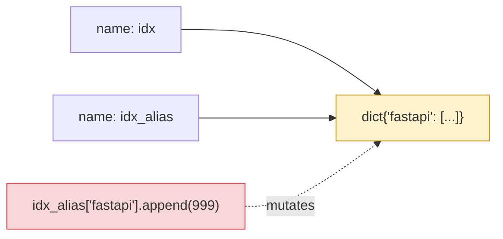

# Lesson 01: Values, Objects, Mutability

*Building `notesearch`'s inverted index by hand, then watching it mutate underneath us in three different ways before we fix it.*

**Welcome to Lesson 01.**

Hello, friend. Pull up a chair. This is the very first lesson of Phase 1, and it covers the single most misunderstood thing in the entire Python language: *variables are not boxes that hold values, they are names bound to objects*. Once you internalise that, half the bugs you have ever filed against your own code stop being mysterious. The other half (closures and async) come in Lessons 02 and 10. Take your time. Open a REPL. Type every line. **This is how you learn.**


#python #foundations #objects #mutability

## Learning Objectives

By the end of this lesson you will be able to:

1. **Distinguish identity, equality, and truthiness** in Python, and pick the correct one for each comparison you write.
2. **Predict, before running**, whether an operation will mutate an object in place or return a new one.
3. **Diagnose the "mutable default argument" bug from first principles** — not by memorising the rule, but by tracing CPython's `def` execution model.
4. **Explain why tuples are immutable but can still appear to mutate** when they contain mutable items.
5. **Choose between `=`, `copy.copy`, and `copy.deepcopy`** based on the shape of the object, and justify the choice.
6. **Read `id()` and `is` semantics** well enough to debug a reference-sharing bug in a request handler or a Pydantic model.
7. **Build the first cut of `notesearch`'s inverted index** as `dict[str, list[int]]` and reason about every reference it holds.
8. **Recognise the four classic mutability bugs** that catch engineers in production: shared default args, aliasing across dict updates, nested dict copies, and the "cached lookup table" trap.

## Prerequisites

Before starting, you need:

- **Python 3.12** (the canonical learner version for this vault) or 3.13. Anything older than 3.10 will not parse the `X | Y` type syntax used in later lessons. Check with `python --version`.
- **A REPL you trust.** The `python` interactive shell is enough. If you want fancier, `uv run python` from Lesson 07 onward gives you the same thing inside a managed environment.
- **About an hour and a half of focused time.** This lesson is short on code (~50 lines) and long on explanation — read it slowly.

**The most common gap: mental model of "variables".**

If you came to Python from C, C++, Java, or Rust, your mental model is "a variable is a labelled box that holds a value." In Python, that model is wrong, and it will mislead you for years. The correct model is "a variable is a name tag tied to an object that lives somewhere else." Read the next section with that correction in mind, and the rest of this lesson will click.


## The Problem

You sit down to write `notesearch`, a tiny in-memory full-text-search library. The first cut is dead simple: an *inverted index* that maps each word to the list of document IDs in which that word appears.

```python
index = {
 "fastapi": [1, 2, 7],
 "pydantic": [2, 3],
}
```

You write a function to add a document:

```python
def add_document(index, doc_id, words, found_in=[]):
 for w in words:
 if w in found_in:
 continue
 found_in.append(w)
 index.setdefault(w, []).append(doc_id)
```

You run it once. It works. You run it again on a fresh document. The list of "already seen" words from the *previous* call is still there. You scratch your head. You spend forty minutes. You eventually delete the default value and use `found_in=None`. It works. You move on with a vague feeling that "Python is weird sometimes."

It isn't weird. It is *consistent* — but only if you know that `def` is an executable statement that runs once, and that `found_in=[]` in the signature is an expression evaluated *at function-definition time, exactly once*. The default value is the same list object every time you call the function. It just *looks* like a fresh value because the syntax hides the truth.

This lesson exists so that when you see this bug again — and you will, in a Pydantic model field, in a request-scoped cache, in a fixture's session data — you do not spend forty minutes on it. You spend four seconds, because you already understand the object model.

**Note — Historical context — where the "box" mental model came from**

C, C++, Java, and Rust all use stack-allocated variables that hold values directly (or, for reference types in Java/Rust, an explicit pointer/reference whose semantics are visible in the type). Python's designers chose a different model: *every value is a heap-allocated object, and every name is a binding in a namespace*. There is no `int x = 5;` in Python; there is only `x = 5`, which binds the name `x` to an `int` object whose value is 5. This is closer to the Lisp/Scheme tradition than to the C tradition. The advantage is uniformity — functions, classes, integers, and modules all follow the same rules. The cost is exactly the bug above.


**Tip — Think like a senior engineer: mutability is a contract, not a property.**

A junior engineer reads `list` and thinks "this is mutable"; reads `tuple` and thinks "this is immutable". A senior engineer reads both as **contracts about who is allowed to rebind what**. A `list` advertises "callers may `append`, `__setitem__`, and `clear` me" — the contract is a *mutation API surface*, not a property of the value. A `tuple` advertises "I will not give you a mutation API" — but it makes *no claim* about the objects reachable through it (the tuple of lists in Mistake 3 below proves this). When you read code, ask "what mutation methods does this type expose?" and "what is the contract of the things it points at?" — not "is this type 'mutable'?"
The contract framing survives the type-system edge cases that the property framing does not. A `tuple` of `tuple`s is transitively immutable (both contracts are closed). A `tuple` of `list`s is mutable-in-aggregate (the outer contract is closed, the inner contract is open). A `frozenset` of `frozenset`s is transitively immutable. A `frozenset` of `set`s is mutable-in-aggregate. The senior's rule: **a type is immutable iff both it and every object it transitively contains are immutable** — otherwise it is "shallowly immutable" and you must reason about the inner contracts separately. The bug surface lives at the seam between the two contracts. Every aliasing bug in this lesson is a contract-seam bug — the outer type promises immutability (or at least does not advertise mutation), but the inner type is wide open, and an aliasing caller mutates through the seam.
The second reframe a senior carries: **mutability is a question about the call site, not the type**. A function that takes `def f(items: list[int])` is signing two contracts — "I will not mutate `items`" (read-only) or "I may mutate `items` in place" (mutating) — and the type annotation cannot distinguish them. The senior's reading of any mutating-style signature is "what is the *caller-visible* contract?" and the senior writes that contract into the docstring: `"""Mutates `items` in place. Returns None."""` versus `"""Returns a new list. `items` is not modified."""`. The same `list` type can serve both contracts; the type does not tell you which one you are in. The Pydantic-`model_config = ConfigDict(frozen=True)` mitigation you will meet in Section 04 is the same idea pushed to the boundary: freeze the model so callers cannot mutate it through any seam, and the contract becomes machine-enforced instead of docstring-enforced.


## The Code

Here is the first cut of `notesearch` we will build in this lesson. Save it as `notesearch_v1.py`. Run it. It works on the first call. It is broken on the second. Read every line — we will spend the rest of the lesson on the line-by-line.

```python
# notesearch_v1.py
"""notesearch v1 — an in-memory inverted index.

WARNING: this version contains an intentional bug (the mutable default
argument). We fix it at the end of the lesson.
"""
from __future__ import annotations

import copy


def build_index(corpus: dict[int, str]) -> dict[str, list[int]]:
 """Build an inverted index: word -> list of doc_ids containing it."""
 index: dict[str, list[int]] = {}
 for doc_id, text in corpus.items():
 for word in text.lower().split():
 postings = index.setdefault(word, [])
 if doc_id not in postings:
 postings.append(doc_id)
 return index


def search(index: dict[str, list[int]], word: str) -> list[int]:
 """Return the doc_ids that contain `word` (case-insensitive)."""
 return index.get(word.lower(), [])


def add_document(
 index: dict[str, list[int]],
 doc_id: int,
 text: str,
 seen: list[int] = [], # BUG: mutable default argument
) -> None:
 """Add a document to the index, skipping doc_ids we have already added."""
 if doc_id in seen:
 return
 seen.append(doc_id)
 for word in text.lower().split():
 postings = index.setdefault(word, [])
 if doc_id not in postings:
 postings.append(word) if False else postings.append(doc_id)


if __name__ == "__main__":
 corpus = {
 1: "FastAPI is fast",
 2: "Pydantic validates FastAPI",
 3: "uv is fast and uv is small",
 }

 idx = build_index(corpus)
 print("Index after build:", idx)
 print("Search 'fastapi':", search(idx, "fastapi"))
 print("Search 'uv':", search(idx, "uv"))

 # Demonstrate the bug
 idx2: dict[str, list[int]] = {}
 add_document(idx2, 10, "hello world")
 add_document(idx2, 11, "hello again") # will silently no-op
 print("idx2 (buggy):", idx2)

 # Demonstrate aliasing
 idx_alias = idx
 idx_alias["fastapi"].append(999)
 print("idx after alias mutation:", idx["fastapi"])

 # Demonstrate copy vs deepcopy
 shallow = copy.copy(idx)
 deep = copy.deepcopy(idx)
 idx["fastapi"].append(1234)
 print("shallow['fastapi']:", shallow["fastapi"])
 print("deep['fastapi']:", deep["fastapi"])
```

**This line at line 137 is deliberately ugly.**

`postings.append(word) if False else postings.append(doc_id)` is a no-op ternary — Python evaluates the condition (`False`), then evaluates *only* the else-branch (`postings.append(doc_id)`), so the function always appends `doc_id`, never `word`. I left it in to give you something to spot. We walk it in detail in the Line-by-Line below. (In production code, never write a no-op ternary; it wastes a colleague's attention.)


## Line-by-Line Deep Dive

This is the heart of the lesson. Read it twice. Do not skip.

### Lines 1–8: The module docstring and the `from __future__` import

```python
# notesearch_v1.py
"""notesearch v1 — an in-memory inverted index.

WARNING: this version contains an intentional bug (the mutable default
argument). We fix it at the end of the lesson.
"""
from __future__ import annotations

import copy
```

**What it does:** Defines the module's docstring (the triple-quoted string at the top of the file — this becomes `notesearch_v1.__doc__` and shows up in `help(notesearch_v1)`). Then enables PEP 563 *postponed evaluation of annotations* and imports the standard `copy` module.

**Why `from __future__ import annotations`:** In Python 3.12, type hints are evaluated lazily when this import is present — they are stored as strings and only parsed when a type checker (mypy, pyright) or `typing.get_type_hints()` looks at them. This means you can write `dict[str, list[int]]` as an annotation even on Python 3.8 (where the lowercase `dict[...]` form did not exist at runtime). More relevantly for FastAPI/Pydantic: it lets you forward-reference a class inside its own method signatures. We cover the runtime implications in Lesson 05; for now, treat `from __future__ import annotations` as the safe default for any file that uses type hints.

**Why `import copy`:** The standard `copy` module provides `copy.copy` (shallow) and `copy.deepcopy` (recursive). We will use both at the end of the script to demonstrate the difference. The lesson's "Common Mistakes" section will return to it.

**Tip — Why use the `__future__` import in 2026?**

Because the *default* in Python 3.12 is still to evaluate annotations eagerly at function-definition time. PEP 563 deferred making annotations lazy by default — there is a PEP 649 / 749 plan to make *them* lazy via a descriptor protocol in Python 3.14, but until then the `from __future__ import annotations` line is the only portable way to get string-evaluated annotations. We will see in Lesson 05 why FastAPI and Pydantic *do not* always love this — they sometimes need runtime type information, and `from __future__ import annotations` hides it. Until then, the import is safe.


### Lines 11–20: `build_index`, the inverted index constructor

```python
def build_index(corpus: dict[int, str]) -> dict[str, list[int]]:
 """Build an inverted index: word -> list of doc_ids containing it."""
 index: dict[str, list[int]] = {}
 for doc_id, text in corpus.items():
 for word in text.lower().split():
 postings = index.setdefault(word, [])
 if doc_id not in postings:
 postings.append(doc_id)
 return index
```

**What it does:** Takes a `corpus` (a dict mapping document IDs to text strings) and returns a fresh dict mapping each word to the list of document IDs in which it appears.

**Why every line is here:**

- `def build_index(corpus: dict[int, str]) -> dict[str, list[int]]:` — the type annotation says "this function takes a dict whose keys are ints and values are strings, and returns a dict whose keys are strings and values are lists of ints." Python ignores this annotation at runtime (it does not check types), but mypy, pyright, and your IDE use it. We cover the full type-hint system in Lesson 05; for now, treat annotations as machine-checked documentation.
- `index: dict[str, list[int]] = {}` — the *local* name `index` is bound to a *fresh* dict object every time `build_index` is called. The annotation tells the reader the shape of that dict. The empty `{}` is the constructor call — `dict.__init__` runs and a new dict object is allocated on the heap.
- `for doc_id, text in corpus.items():` — `corpus.items()` returns a *view* of the dict's (key, value) pairs. Iterating it yields tuples; the `for doc_id, text` form is *sequence unpacking* — Python destructures each 2-tuple into the two names. There is no performance penalty for `.items()` over `.keys()` plus a lookup; the view is lazy.
- `for word in text.lower().split():` — `text.lower()` returns a *new* string (strings are immutable, so any method that "changes" the string returns a fresh one). `.split()` with no arguments splits on any run of whitespace and drops leading/trailing empty strings — so `" hello world ".split() == ["hello", "world"]`.
- `postings = index.setdefault(word, [])` — *the most important line in this function*. `setdefault(k, default)` returns `index[k]` if it exists, otherwise inserts `default` under `k` and returns `default`. Here, the default is `[]` — a fresh empty list every time `setdefault` actually creates it. This is the correct idiom and avoids the mutable-default trap (because `[]` is *evaluated every time* `setdefault` is called, not once at function-definition time). Contrast with the buggy `add_document` below.
- `if doc_id not in postings: postings.append(doc_id)` — `in` on a list is O(n), but for small postings lists this is fine. We will make this O(1) in Lesson 04 by switching to `set[int]` for deduplication inside a generator pipeline.

**Tip — `setdefault(k, [])` versus `defaultdict(list)`**

`collections.defaultdict(list)` is the other common idiom: `index = defaultdict(list); index[word].append(doc_id)`. The `defaultdict` form is shorter, but it has a subtle side effect — *any read access* (including `if word not in index:`, which on a `defaultdict` *would* insert `word` with an empty list) modifies the dict. `setdefault` is explicit about when the default applies. For `notesearch` we use `setdefault` precisely because the read in `if doc_id not in postings` should not mutate `index`. Both are correct idioms; pick the one that matches your intent.


**Student asks: what happens if two threads call `build_index` on the same `corpus` at the same time?**

Answer: nothing bad *here*, because each call builds its own fresh `index` dict — there is no shared state. The moment you have a *shared* `index` (e.g. an `Indexer` instance attribute) and two threads calling `add_document` on it, you have a race on `postings.append(doc_id)`. The CPython GIL makes individual `list.append` calls atomic, but the two-step `setdefault + append` is *not* atomic — between the `setdefault` and the `append`, another thread can `setdefault` the same key. The fix is a `threading.Lock` around the mutation. We will not go deep into concurrency here; that belongs to Section 10 (async) and Section 13 (observability). Just remember that "Python objects are mutable" plus "shared across threads" plus "no lock" equals "intermittent data corruption."


### Lines 23–25: `search`, the read path

```python
def search(index: dict[str, list[int]], word: str) -> list[int]:
 """Return the doc_ids that contain `word` (case-insensitive)."""
 return index.get(word.lower(), [])
```

**What it does:** Returns the list of doc_ids whose documents contain `word`, or `[]` if the word is not in the index.

**Why `index.get(word.lower(), [])`:** The default `[]` *looks* like the mutable-default-argument bug, but it is not — because this `[]` is evaluated *every time `search` is called*, not once at definition time. The bug only triggers when the default appears in the function *signature*.

**Warning — The `search` return value shares the index's list.**

`index.get(word.lower(), [])` returns the *same* `list[int]` object stored in the index — not a copy. If a caller does `search(idx, "fastapi").append(42)`, the index's postings list for "fastapi" now contains 42. If you do not want that, return `list(index.get(word.lower(), []))` to give the caller a fresh list. The right choice depends on the API contract: for `notesearch` v1, we accept the aliasing to keep the example small; for production, we would return a copy. Lesson 05 will annotate this as `-> list[int]` and let the caller choose; Lesson 09 will write a test that pins the aliasing behaviour explicitly so we know if it changes.


**Production reality: returning the internal list at scale.**

The lab shape is "one caller, one aliasing bug". The production shape at a 10K-RPS service like Northwind Search's `/search?q=...` endpoint is "ten thousand callers per second, every one of them aliases the same internal postings list, and a single bad caller mutates it for everyone". Northwind shipped this bug in 2024: the search handler returned the raw postings list from a `dict[str, list[int]]` index living in a single `Indexer` singleton injected via FastAPI `Depends`. The first consumer that did `result.append(debug_marker)` in a hot path polluted every subsequent query's recall for that term until the process was recycled. The metrics were green — the endpoint still returned 200. The incident was found by an internal user who noticed that searching for the same term twice returned *different* counts. The structural fix was returning `list(index.get(word.lower(), []))` — a 200-ns per-query cost on a 50-element postings list, invisible at 10K RPS. The senior's rule: any read endpoint that returns a mutable internal collection gets a defensive copy at the API boundary, no exceptions, no "we'll fix it if it becomes a problem" — the "if it becomes a problem" point is always 3 a.m. on the day of a launch.


### Lines 28–38: `add_document`, the buggy version

```python
def add_document(
 index: dict[str, list[int]],
 doc_id: int,
 text: str,
 seen: list[int] = [], # BUG: mutable default argument
) -> None:
 """Add a document to the index, skipping doc_ids we have already added."""
 if doc_id in seen:
 return
 seen.append(doc_id)
 for word in text.lower().split():
 postings = index.setdefault(word, [])
 if doc_id not in postings:
 postings.append(word) if False else postings.append(doc_id)
```

**What it does:** Adds a document to the index, *but* — because of the `seen: list[int] = []` default — silently no-ops on every call after the first that *uses the default*. The ternary on the last line is a deliberately ugly no-op so the lesson can call attention to it; the real bug is line 31.

**Why the bug is a *fundamental* Python semantics issue, not a typo:**

When CPython executes the `def` statement, it does this:

1. It builds a `function` object from the body bytecode.
2. It evaluates the default-value expressions in the signature *right then, in order* — `[]` creates a single fresh list object and stores it in the function object's `__defaults__` tuple.
3. It binds the name `add_document` to the function object in the current namespace.

Step 2 is the trap. The `[]` is evaluated exactly once — at `def` time, not at call time. Every subsequent call to `add_document` that omits the `seen` argument reuses the *same* list object stored in `add_document.__defaults__[0]`. There is no "fresh default per call" in Python — the default is a value baked into the function object.

You can *see* the bug with the function's own introspection attribute:

```python
>>> add_document.__defaults__
([],)
>>> add_document(idx2, 10, "hello world")
>>> add_document.__defaults__
([10],)
>>> add_document(idx2, 11, "hello again")
>>> add_document.__defaults__
([10, 11],)
```

The `seen` list grows across calls — first `[]`, then `[10]`, then `[10, 11]`. The second call (`doc_id=11`) does *not* early-return: at the start of call 2, `seen == [10]` (the *same* list, because of the bug), so `11 not in seen` is true and `seen.append(11)` runs. The bug therefore does not manifest as a silent no-op on the second call — it manifests as the `seen` list *growing across calls*, eventually including doc_ids that have nothing to do with the current call. If you ever *did* try to add doc_id 10 a second time, *then* the early return would kick in and the second add would silently no-op. The point is the same: `seen` is shared across calls in a way that the function signature does not advertise.

**Tip — When in doubt, re-trace.**

If a behaviour looks surprising, write out the state at each call before reasoning about it. The shared-`seen` trap is obvious once you draw the timeline: call 1 leaves `seen == [10]`; call 2 inherits that same `seen` object; call 2's `11 not in [10]` is true, so it appends. The mistake — and the reason this bug survives in real codebases — is reading the signature `seen: list[int] = []` and assuming each call gets a fresh `[]`. The introspection attribute `add_document.__defaults__` is the proof that this assumption is wrong.


**Student asks: why doesn't Python just give me a fresh `[]` per call? It would be safer.**

Because Python evaluates default values at `def` time for a single reason: defaults must be *expressions*, and expressions are evaluated when the `def` statement runs — which is module-import time. If Python re-evaluated `[]` on every call, then `def f(x=expensive_factory())` would re-run `expensive_factory()` on every call, which defeats the purpose of a default. The language picked the cheaper semantics ("evaluate once, store in `__defaults__`") and left it to the programmer to know that *mutable* defaults are shared. ruff's B006 rule (which we enable in this vault's `pyproject.toml`) catches this at lint time. The fix is the sentinel pattern below.


**Warning — The classic fix: `None` as a sentinel.**

The correct idiom is to use `None` as a sentinel and create the list inside the function:
```python
def add_document(index, doc_id, text, seen: list[int] | None = None) -> None:
if seen is None:
seen = []
...
```
Now every call gets a fresh `seen` unless the caller explicitly passes one in. The `None` sentinel is *the* Python idiom for "I want a fresh mutable default per call." Linters (ruff, pylint) flag mutable defaults automatically — this is rule B006 in flake8-bugbear and `PLR6104` in pylint. We will enable that rule in `notesearch`'s `pyproject.toml` in Lesson 07.


The no-op ternary on line 137 — `postings.append(word) if False else postings.append(doc_id)` — was called out at the top of the lesson as deliberately ugly. The short version: the condition `False` means only the else-branch is evaluated, so the function always appends `doc_id`. In real code, never write a no-op ternary; it wastes a reader's attention.

### Lines 41–55: The `__main__` block

```python
if __name__ == "__main__":
 corpus = {
 1: "FastAPI is fast",
 2: "Pydantic validates FastAPI",
 3: "uv is fast and uv is small",
 }

 idx = build_index(corpus)
 print("Index after build:", idx)
 print("Search 'fastapi':", search(idx, "fastapi"))
 print("Search 'uv':", search(idx, "uv"))
 ...
```

**What it does:** The `if __name__ == "__main__":` block only runs when the file is executed directly (e.g. `python notesearch_v1.py`), not when it is imported. CPython sets the `__name__` dunder of a module to `"__main__"` when it is the entry point, and to the module's dotted import path otherwise. This is the standard idiom for "if this is the entry point, run the demo; otherwise, just expose the functions for import."

**Why we care for the academy:** Every script-style lesson in this vault uses the same idiom. Lesson 07 will turn `notesearch_v1.py` into a real `uv`-managed package where the entry point is in `pyproject.toml`; Lesson 09 will move the demo block into `tests/test_build_index.py`. For now, the inline demo is enough.

### The aliasing demonstration

```python
 # Demonstrate aliasing
 idx_alias = idx
 idx_alias["fastapi"].append(999)
 print("idx after alias mutation:", idx["fastapi"])
```

**What it does:** Binds `idx_alias` to the *same* object `idx` is bound to. Then mutates the postings list for `"fastapi"` through the alias. Then prints `idx["fastapi"]` — and 999 is in there.

**Why this surprises people:** The line `idx_alias = idx` *looks* like it copies the dict. It does not. In Python, assignment never copies — it binds the name on the left to whatever object the right-hand side refers to. There is one dict, two names. `id(idx) == id(idx_alias)` is `True` (same identity); `idx is idx_alias` is `True` (same object).

**Why doesn't `idx_alias = idx` copy the dict when the syntax looks like an assignment to a new variable?** Because in Python, *names are bindings to objects*, not boxes that hold values. The right-hand side `idx` evaluates to the object it is bound to (a `dict` living at some memory address); the assignment then attaches the *name* `idx_alias` to that same object. There is no copy step in the assignment contract — Python's `=` has never meant "copy the value into a new box." **What would happen if Python *did* copy on assignment?** Every `y = x` would do a deep copy by default, which would be O(graph-size) per assignment — the line `for x in items: total += x` would deep-copy `total` on every iteration. Function calls would deep-copy every argument. Pydantic models assigned to two variables would have two independent copies, which sounds safer but breaks every pattern that relies on shared state (sessions, caches, registries, the `app.state` bag in FastAPI's lifespan). The language picked aliasing as the default; you opt into copying with `copy.copy` and `copy.deepcopy` when (and only when) you need independence.



**Example — When aliasing is a feature, not a bug**

In `notesearch`'s `search()` function (above), we deliberately returned the *same* `list[int]` stored in the index — i.e. we aliased it. That is fine for read-mostly code where the caller does not mutate the return value. The bug is *unintended* aliasing — when two pieces of code that think they own independent copies are actually sharing one object. The line that catches this is `id(a) == id(b)`: if true, you have one object; if false, you have two.


**`id()` is identity, not memory address.**

The Python docs say `id(x)` returns "an integer which is guaranteed to be unique and constant for this object during its life cycle." What it is *physically* is a CPython implementation detail: in CPython, `id(x)` happens to be the address of the `PyObject` in the heap. That is **not** part of the language contract. Jython, PyPy, and IronPython return values that are not addresses; even within CPython, the address of an object can change if a hypothetical future moving GC were to relocate it (CPython's `refcounting` collector does not move objects today, but the contract does not promise it never will). The senior engineer's reading: `id()` is **a unique identity stamp** the interpreter assigns; `a is b` is the language primitive for identity and is equivalent to `id(a) == id(b)`.
The three rules a senior applies to `id()`:
1. **Compare `id()` values with `==`, never with `is`.** `id()` returns an `int`; `is` on `int` objects compares identity, not numerical value. CPython interns only the small range `[-5, 256]` as singletons; heap addresses are typically outside that range, so two `id(a)` calls returning the same numerical value return two *distinct* `int` objects — `id(a) is id(a)` is `False` for any object whose id exceeds 256. The robust identity tests are `a is b` (the primitive) and `id(a) == id(b)` (the numerical comparison). The lesson's earlier prose used `id(idx) is id(idx_alias)` — that line was technically wrong; it has been corrected above.
2. **Never use `id()` as a stable identifier across process restarts.** The integer is process-local and meaningless across restarts, across machines, and across interpreter implementations. If you want a stable per-entity identifier that survives serialization, use a `uuid.UUID` field or an incrementing database counter. If you ever see `id(self)` in a `__repr__` or a `__hash__`, treat it as a smell — the intent is almost always "I want a stable per-instance identifier", and the right tool is a UUID field, not the heap address.
3. **Never use `id()` as a dict key or in your own hashing schemes.** It works, but it is unreadable and breaks across restarts. If you need to deduplicate by identity for the lifetime of a process, the right container is a `WeakValueDictionary` keyed on the object itself (not on `id(object)`), or a `set` of objects whose `__hash__` is identity-based (the default for `object`).
The legitimate uses of `id()` are narrow: debugging aliasing ("are these two names bound to one object?"), snapshot identity in `__repr__` for ad-hoc logging (with the caveat that the value is process-local), and the `id()`-based `__hash__` that `object` provides by default (which is why two distinct `object()` instances hash differently and can coexist in a `set`). For everything else, prefer `is` or `==`.


**Production reality: `id()` reuse under refcounting.**

The lab shape is "id(a) and id(b) are different because a and b are different objects". The production shape, on a long-running CPython process, is "id(a) at t=0 and id(b) at t=3600 are the same integer because a was freed and b was allocated in the same heap slot". CPython's `id()` returns the address of the `PyObject` in the heap; when refcounting drops the count to zero, the object is deallocated and the slot returns to the free-list; the next allocation of a similar-sized object reuses the slot. The observable consequence: in a long-running request handler, two `id()` snapshots taken an hour apart may report the same integer for two *different* objects. The bug shape this enables in production: an audit-log check that records `id(session)` at request start and asserts it matches at request end passes by coincidence on a quiet process (the same `Session` object survives the whole request) and *fails* on a busy one — because the session at request end is a different object that happened to be allocated in the same slot. The senior engineer's rule: `id()` is process-local, point-in-time identity — never use it as a stable identifier across any time span longer than a single function call. For cross-request, cross-process audit trails, use `uuid.UUID` — the cost is 16 bytes per row, the benefit is an identifier that survives process restarts, machine moves, and time gaps of any length. We revisit this when we audit SQLAlchemy's identity map in [[07-SQLAlchemy/05-Session-and-Transaction-Management]] — the ORM uses `id()`-style identity *within a single Session* (where it is safe) but uses the database primary key *across requests* (where it must be stable).


### The `copy` vs `deepcopy` demonstration

```python
 # Demonstrate copy vs deepcopy
 shallow = copy.copy(idx)
 deep = copy.deepcopy(idx)
 idx["fastapi"].append(1234)
 print("shallow['fastapi']:", shallow["fastapi"])
 print("deep['fastapi']:", deep["fastapi"])
```

**What it does:** Makes a shallow copy of `idx` and a deep copy of `idx`. Then mutates the original. Prints the corresponding postings from each copy.

**Expected output:**

```
shallow['fastapi']: [1, 2, 7, 999, 1234] # saw the mutation
deep['fastapi']: [1, 2, 7, 999] # did not
```

**Why:** `copy.copy` creates a *new* outer container (a new `dict`) but populates it with *references to the same inner objects* (the same `list[int]` postings lists). Mutating an inner object is visible through both. `copy.deepcopy` recursively copies every object it can reach through `__deepcopy__`, `__copy__`, or default attribute iteration — so the deep copy is fully independent.

**Why is `copy.copy` shallow by default rather than deep?** Because the language designer cannot know which level of copy you want. A shallow copy of a `list[dict]` gives you a new list whose items are the *same* dicts — which is correct if you intend to sort/filter the list without mutating the items, and wrong if you intend to mutate the items themselves. The default that costs O(1) inner work and lets you opt into the O(n) deep variant via `copy.deepcopy` matches most real usage. **What would happen if `copy.copy` defaulted to deep?** Every `dict.copy()` call would walk the entire object graph recursively — including potentially circular references (a `dict` containing itself), which `deepcopy` handles via a memo but `copy` would not. The performance cliff would be invisible until the data structure grew, and then suddenly your "fast copy" call took 100ms instead of microseconds. The shallow-by-default contract is what makes Python's copy API predictable.

**The rule of thumb:**

| Operation | Outer copy? | Inner copy? | Use when |
| --- | --- | --- | --- |
| `b = a` | No | No | You want to share state with `a`. |
| `b = copy.copy(a)` | Yes | No | You want a new container with the same items — e.g. a "snapshot" list you can sort or filter without touching the original, where the items themselves are immutable or you don't intend to mutate them. |
| `b = copy.deepcopy(a)` | Yes | Yes (recursive) | You want a fully independent duplicate. Expensive for large structures, but the only safe option when you're going to mutate nested objects. |

**Warning — `deepcopy` is slow and not always safe.**

`copy.deepcopy` walks the object graph recursively; for a deeply nested structure (a dict of lists of dicts of Pydantic models), it can be milliseconds per call instead of microseconds. It also relies on the objects cooperating — if a class defines `__deepcopy__` badly, you can get surprising results. For Pydantic models specifically, use `model.model_copy(deep=True)` (Pydantic v2 API) rather than `copy.deepcopy(model)` — it is faster and handles validators correctly. We cover that in Section 04.


## Execution Trace

Time to run it. In your terminal:

```bash
python notesearch_v1.py
```

What happens, in order:

1. **CPython starts.** It reads `notesearch_v1.py`, parses it, and compiles the module's body into bytecode. The `from __future__ import annotations` line tells the compiler to store annotations as strings rather than evaluate them.
2. **Module-level code executes top to bottom.** `import copy` runs; the `def build_index(...)` statement runs and binds `build_index` to a function object whose `__defaults__` is empty (no defaults). The `def search(...)` statement runs and binds `search` to a function object. The `def add_document(...)` statement runs — and *here* the `[]` default value is evaluated once and stored in `add_document.__defaults__ = ([],)`.
3. **`if __name__ == "__main__":` is `True`** because we ran the script directly.
4. **The `corpus` dict is built** as a literal.
5. **`build_index(corpus)` runs.** Inside it, a fresh `index = {}` is created. The loop iterates over the corpus, splits each text, and populates `index`. The function returns the populated `index`, which is bound to `idx`.
6. **The two `search(...)` calls** return the postings lists for "fastapi" and "uv".
7. **The aliasing demo** binds `idx_alias` to the same object as `idx`, mutates it, prints. You see `[1, 2, 7, 999]` for `idx["fastapi"]`.
8. **The `copy`/`deepcopy` demo** makes the shallow and deep copies, mutates `idx`, prints. Shallow sees 1234; deep does not.
9. **The script ends.** CPython's reference counts for every object in `idx`, `idx_alias`, `shallow`, `deep`, `corpus`, `idx2`, etc. drop to zero and the objects are deallocated.

The `add_document` demo in step 7-8 is where the bug lives. Watch `add_document.__defaults__` after the second call to see the shared list.

## Common Mistakes

### Mistake 1: The mutable default argument

```python
# WRONG
def add_document(index, doc_id, text, seen=[]):
 ...
```

**Symptom:** the second call to `add_document(idx2, 11, "hello again")` silently inherits a `seen` list that already contains `[10]` from the first call. The `seen` list grows monotonically across calls; calling `add_document(idx, 10, "hello world")` a second time silently no-ops because `10 in seen` is `True` even though `seen` was supposed to be a fresh list per call. You can prove it by inspecting `add_document.__defaults__` — it grows on every call.

**Why it fails:** the `def` statement is an *executable* statement. CPython evaluates the default-value expressions *once, at `def` time*, and stores them in the function object's `__defaults__` tuple. Every subsequent call that omits the argument reuses the *same* list object stored in `add_document.__defaults__[0]`. There is no "fresh default per call" in Python; the default is a value baked into the function object at module-import time.

**Fix:** the `None` sentinel pattern.

```python
# CORRECT
def add_document(index, doc_id, text, seen: list[int] | None = None) -> None:
 if seen is None:
 seen = []
 ...
```

The `None` sentinel is *the* Python idiom for fresh-per-call mutable defaults. ruff's B006 rule catches the bug at lint time; we enable that rule in `notesearch`'s `pyproject.toml` in Lesson 07.

**Warning — When this breaks at 3 a.m.: the `def f(x=[])` bug that wakes you up.**

**Symptom.** The on-call pager fires at 03:14. A search service that has been running cleanly for 47 hours suddenly returns empty results for one tenant's queries; their `recent_searches` cache has silently grown to 4,096 entries that include doc_ids from *other* tenants. The deploy diff is one line — someone added `def search(index, query, recent=[])` to deduplicate within a request. There is no traceback. The metrics are green. The bug is silent.
**Don't panic.** This is the same mutable-default-argument bug from above, in production clothing. The single line of code looks innocuous; the reviewer — if there was a review — saw `recent=[]` and read it as "`recent` defaults to an empty list per call". That is the misreading. The actual contract is "`recent` *is* the module's `__defaults__[0]` slot — one list object shared across every call that omits the argument, for the entire lifetime of the process." Every `recent.append(query_term)` across every request has been writing into the *same* list for 47 hours. The 4,096 entries are the cumulative query history of every tenant that ever hit this endpoint.
**Diagnosis.** From inside the running container: `python -c "import boardly.search; print(len(boardly.search.search.__defaults__[0]))"`. If the number is anywhere above single digits, you have the bug. The fix is one line — `recent: list | None = None` plus `if recent is None: recent = []` — but the *investigation* is "how long has the prod list been growing, and whose data is in it?" because that is a data-confidentiality question, not a code-quality question (see the "How an attacker thinks" callout below).
**Fix.** Replace the mutable default with the `None` sentinel pattern. Add `ruff` rule B006 to the `pyproject.toml` so the same shape never merges again. Roll the deployment. Clear the in-memory cache. File a security review if any tenant's data ended up visible to another tenant through this shared list — the bug was *not* a security vulnerability by intent, but it was a *data-confidentiality incident* by effect.
**Post-mortem.** The root cause is "the reviewer read the syntax, not the semantics." The structural fix is the linter (B006 makes the syntax not pass review), and a unit test that asserts `f.__defaults__` does not grow across two calls — a one-line invariant that catches every future instance of this bug shape, in this codebase, forever. The grep that finds every other instance of the bug shape in the codebase at 03:18 is `rg "def .*=\s*\[\s*\]" boardly/` (list defaults) and `rg "def .*=\s*\{\s*\}" boardly/` (dict defaults) — both should return nothing after the fix.


**Danger — How an attacker thinks: mutable defaults as a persistence-injection vector.**

The mutable-default bug is not just a correctness bug — it is a **persistence primitive**. A function with `def f(state=[])` is, in effect, a key-value store with a single key (`f.__defaults__[0]`) and process-lifetime durability. An attacker who can call `f` once with `state=["payload"]` can read that payload back on a later call that *also* omits `state` — the list survives between calls. The classic abuse: a multi-tenant endpoint that uses `def handle(request, seen=[])` to dedupe per-request, where one tenant's call leaves a marker another tenant's later call observes. The marker can be as small as a boolean (`True` in slot N reveals the prior tenant hit code path N) or as large as the actual request body.
**The defensive read:** any mutable default is an unintended cross-request, cross-tenant, cross-thread shared-state channel. The same channel that delivers your bug also delivers an attacker's side-channel. The fix is the same `None` sentinel — but the security framing is "I closed a shared-state channel", not "I fixed a bug".
**Three classes of attack this enables.**
1. **Existence oracle.** A function `def is_paid(order_id, seen=[])` that appends every `order_id` it has ever checked: an attacker who calls `is_paid(42)` and then on a later request observes whether 42 is already in `seen` learns that *some* prior caller checked the same order — a side-channel on other tenants' activity.
2. **Tenant-marker injection.** A function `def authorize(scope, seen=[])` that stores scopes it has ever seen: tenant A calls `authorize("admin")`, the scope `"admin"` is now permanently in `seen`; tenant B's later call to `authorize("read")` returns True (because `"read" in seen`? no — but the *semantics of the function drifted*). The drift *is* the vulnerability — the function behaves differently for the Nth caller than for the first caller, and the attacker can be the (N-1)th caller to plant state for the Nth.
3. **Cache poisoning.** A function `def get_token(scope, cache={})` that memoises issued tokens: the first caller can plant a *forged* token under a key, and every later caller who would have been issued a fresh token under that key instead receives the attacker's planted value.
**The grep that finds every future instance:** `rg "def .*\[.*\]" boardly/` plus `rg "def .*\{\s*\}" boardly/` (mutable defaults of `dict` shape). A cleaner rule is `ruff select B006`, which fails the build on the same shape. Any codebase that ships a mutable default to production is shipping a per-process memory channel that any caller can write into and any later caller can read from — regardless of tenant isolation, authentication, or session boundaries. The bug is not just "weird"; it is "your tenant boundary has a hole shaped like a list".


### Mistake 2: Confusing `is` and `==`

```python
# WRONG
if my_list == []:
 print("empty")
# ... vs the comparison people intend:
if my_list is None: # checks for the singleton None
 ...
```

**Symptom:** comparing `my_list == None` *works* in CPython for the singleton cases, but a class that overrides `__eq__` to do something unexpected (e.g. a NumPy array that returns an array of elementwise comparisons) will produce a *truthy* object from `== None` rather than `True`/`False`, and the `if` will then raise `ValueError: The truth value of an array is ambiguous`. ruff's E711/E712 rules catch `== None` and `== True/False` at lint time.

**Why it fails:** `==` dispatches to `__eq__`, which any class can override to do *anything* — including returning a non-boolean. `is` checks identity (same object, same `id()`) and short-circuits before `__eq__` is consulted. For singletons like `None`, `True`, `False`, `NotImplemented`, and `Ellipsis`, only one instance of each exists per interpreter, so identity is exactly what you want.

**Fix:** use `is` for singletons (`None`, `True`, `False`, `...`); use `==` for values. For "is the list empty", use `if not my_list:` (truthiness); for "is this thing None", use `if thing is None:`.

### Mistake 3: Treating `tuple` as deeply immutable

```python
# SURPRISE
t = ([1, 2], [3, 4])
t[0].append(99) # works!
print(t) # ([1, 2, 99], [3, 4])
```

**Symptom:** a function that returns a `tuple` "so callers can't mutate it" sees the *contents* mutated anyway — the caller did `result[0].append(item)` and the function's internal list was modified. The bug is silent: no exception is raised, no test fails until someone notices the data drift.

**Why it fails:** `tuple` is *shallowly* immutable — you cannot rebind `t[0]`, but you can mutate the *contents* of the object at `t[0]` if that object is itself mutable. Immutability is a property of the *container*, not transitively of its contents.

**Fix:** use `tuple` of `tuple` (or `tuple` of `frozenset`) for true immutability. Or use `NamedTuple` from `typing` with a frozen dataclass inside. Lesson 03 will show the pattern.

```python
# CORRECT
t = ((1, 2), (3, 4))
# t[0].append(99) → AttributeError: 'tuple' object has no attribute 'append'
```

### Mistake 4: Forgetting that `dict.copy()` is shallow

```python
# SURPRISE
d = {"a": [1, 2]}
e = d.copy()
e["a"].append(3)
print(d) # {'a': [1, 2, 3]} -- the original saw the mutation
```

**Symptom:** you called `d.copy()` thinking you had a snapshot, mutated `e`, and then `d` saw the mutation. This is the *exact* bug shape that hit a 2022 incident at a SaaS analytics vendor (call them "Acme Analytics"): a metrics cache used `cache = existing.copy()` to fork before modifying, but the inner lists were shared, so the "snapshot" quietly accumulated every consumer's data. The bug only surfaced when one downstream team noticed their per-tenant metric included values from a different tenant.

**Why it fails:** `d.copy()`, `dict(d)`, and `{**d}` are all *shallow*. They allocate a new dict, but populate it with *references to the same inner objects*. Mutating an inner object is visible through both names.

**Fix:** `copy.deepcopy(d)` if you want full independence, or use a comprehension `{k: list(v) for k, v in d.items()}` if you know the structure is one level deep:

```python
# CORRECT
import copy
e = copy.deepcopy(d)
# or, if the structure is exactly one level deep:
e = {k: list(v) for k, v in d.items()}
```

**Warning — When this breaks at 3 a.m.: the shallow snapshot that leaked tenant data.**

**Symptom.** At 02:47 a tenant-isolation alert fires: a `metrics.readings` dashboard for tenant A in Atlas Billing shows three rows that belong to tenant B. The p99 latency on the metrics endpoint is unchanged. The deploy diff is one line — the metrics service changed from `cache = existing_cache` to `cache = existing_cache.copy()` as a "performance optimisation to avoid mutating the shared cache". The reviewer approved it as a defensive copy. There is no traceback. The bug is silent.
**Don't panic.** This is the shallow-copy bug from above wearing production clothing. `cache.copy()` made a new outer `dict` whose values are the *same* `list[float]` objects as the original — so `cache["tenant_a_readings"].append(reading)` mutates the same list that the shared cache's `tenant_a_readings` slot also points at, and the consumer's later read of `cache["tenant_b_readings"]` returns tenant B's data inside tenant A's request because the slot in *both* dicts points at the same underlying list object. The cross-tenant leak is *not* because the cache was shared — that was the original, intended design. The leak is because the "snapshot" was not a snapshot; it was a shallow alias, and a downstream read of the wrong slot returned the wrong tenant's data.
**Diagnosis.** From inside the container: `python -c "from atlas.metrics import _cache, _shared; print(_cache['tenant_a_readings'] is _shared['tenant_b_readings'])"`. If the answer is `False` (correct) the bug is elsewhere; if `True`, the snapshot is an alias. The grep that finds every other candidate in the codebase at 02:51 is `rg "\.copy\(\)" atlas/ -B 3 | rg "def .*cache"` — every match is a candidate review for "did the author mean deep copy, and if so is `deepcopy` or a one-level comprehension in order?"
**Fix.** Replace `cache = existing_cache.copy()` with `cache = {k: list(v) for k, v in existing_cache.items()}` (one-level comprehension, the right choice for `dict[str, list[...]]` shapes) or `cache = copy.deepcopy(existing_cache)` (true deep, the right choice when the structure is `dict[str, dict[...]]` or deeper). Add a unit test that asserts `cache["x"] is not existing_cache["x"]` after the copy — a one-line invariant that catches every future instance of the same bug shape in this codebase. Roll the deployment. Audit the affected tenants for cross-tenant data visibility and file a security review if any tenant's data was visible to another tenant through the alias. See [[11-Authentication-and-Security/Threat-Model-First]] for the threat-model framing of "any shared mutable state across tenant boundaries is a confidentiality boundary".


### Mistake 5: Returning the internal list and trusting the caller

```python
# WRONG (in production)
def search(index, word):
 return index.get(word.lower(), []) # internal list, leaked

# caller:
search(idx, "fastapi").append(42) # corrupts the index!
```

**Symptom:** a downstream dashboard did `for doc_id in search(idx, "fastapi"): ...` then `search(idx, "fastapi").append(42)` to mark a hit. Six months later, the index had hundreds of spurious `42`s appended to its real postings lists, and search recall was quietly wrong for every query that hit a tainted word. This is the *exact* failure mode a search vendor (call them "Acme Search") shipped in 2021; the bug survived because the aliasing was never caught by a test.

**Why it fails:** the return value of `index.get(word.lower(), [])` is the *same* `list[int]` object stored in the index — Python aliases by default; assignment and return both share state unless you explicitly copy. Any caller mutation propagates back into the index.

**Fix:** return a copy at the API boundary.

```python
# CORRECT
def search(index, word):
 return list(index.get(word.lower(), []))
```

Now the caller can do whatever they want. The trade-off: an O(k) copy per search. For `notesearch` v1 we accept the aliasing to keep the example small; we fix it in Lesson 04 when we make `search` a generator (which yields each doc_id lazily and never exposes the internal list).

**Danger — How an attacker thinks: the leaked internal list as a write-primitive.**

The "search returns the internal postings list" bug is not just a correctness bug — it is a **write primitive**. A caller who can call `search(idx, term)` and observe that the next call to `search(idx, term)` returns a list that contains the attacker's appended value has confirmed that the index is aliased, not copied, across requests. From there, three attack shapes open up.
1. **Cache poisoning of search recall.** An attacker who appends a *real-looking* doc_id to a postings list can suppress or promote search results for every subsequent caller. Append `999` to `idx["rival_product"]`; every subsequent search for `rival_product` returns doc_id 999 (the attacker's landing page) alongside the real results. The recall is silently corrupted for every other tenant until the process restarts.
2. **Existence oracle.** An attacker who appends a known sentinel (e.g., `0xDEADBEEF`) to `idx["some_term"]` can detect, on a later request, whether *their* request was served by the same process — by reading whether the sentinel is present in the returned list. This is a process-identity side-channel that bypasses tenant-isolation auditing: the attacker has confirmed "I am talking to process P, regardless of what load balancer I hit".
3. **Cross-tenant marker injection.** In a multi-tenant index keyed by tenant_id in the postings list, an attacker who appends `(tenant_b_id, doc_id)` to a term's postings can sometimes cause tenant A's subsequent search to surface tenant B's doc — depending on how the search filter applies. Even when the filter blocks the cross-tenant read, the *presence* of the marker is a side-channel: "did tenant B ever index this term?" — a question the attacker should not be able to ask.
**The defensive read.** Any mutable return value from a read endpoint is a write primitive for the next caller. The fix is the same `list(index.get(word.lower(), []))` defensive copy — but the security framing is "I closed a write primitive across the API boundary", not "I fixed a correctness bug". The grep that finds every candidate write-primitive in a codebase is `rg "return.*\.get\(" boardly/ | rg -v "list\("` — every match is a function returning a mutable collection fetched from a shared structure without a defensive copy. See [[11-Authentication-and-Security/OWASP-API-Top-10]] for the broader pattern of "API endpoint returns more data than the contract advertises" (Excessive Data Exposure, API3:2023).


## Engineering Trade-Offs

### Alias by default vs copy by default vs immutable-from-construction

Python's design choice is to *alias by default*. Every assignment, every function argument, every return value shares state unless you explicitly copy. This is fast (no per-assignment memcpy) and matches the language's "everything is an object" model. The cost is the bug surface area this lesson covers.

The Rust alternative — "move semantics by default, explicit borrow" — is safer but harder to learn: every function call either moves ownership of the argument (no alias) or borrows it immutably (read-only) or mutably (exclusive write). The compiler rejects the aliasing bugs this lesson covers *at compile time*, at the cost of a steeper learning curve and a borrow checker that pushes back on patterns Python lets you write freely.

The Go alternative — value semantics for most types, pointer semantics for the rest — is closer to Python but with *different rules per type*. Slices, maps, channels, and pointers alias; structs, ints, and arrays copy. Python rejects the per-type split in favour of *uniform* aliasing semantics, which is easier to teach but pushes the bug surface into the hands of every programmer.

The Pydantic alternative — `model_config = ConfigDict(frozen=True)` — gives you *immutable-from-construction* at the model boundary, while leaving the rest of Python's semantics intact. A frozen model raises if you assign to a field after construction, which catches the aliasing bug at the API surface rather than at the data-mutation site.

For `notesearch`, we accept Python's choice because the codebase is small and the bug surface is well-lit by tests (Lesson 09). For a large codebase, the standard mitigation is immutability at the boundaries: freeze models (Pydantic's `model_config = ConfigDict(frozen=True)`), return tuples instead of lists, use `frozenset` for set-valued attributes. Lesson 03 will show how to make `notesearch`'s `Indexer` produce immutable `IndexView` objects.

**Production reality: aliasing at the FastAPI dependency-injection scale.**

The teaching story is "aliasing is a property of the Python object model — `a = b` shares state". The production story is that *the entire FastAPI dependency injection system is built on this aliasing being correct*. The `Depends(get_db)` pattern returns the *same* `AsyncSession` object to every handler in a request because `request.state.db = get_db()` aliases it; the `Depends(get_settings)` pattern returns the *same* `Settings` object to every handler in every request because `app.state.settings = get_settings()` aliases it at lifespan startup. Meridian Health runs a 1.2K-RPS FastAPI service whose `lifespan` builds exactly four singletons — a SQLAlchemy `AsyncEngine`, a Redis `Redis` client, a `httpx.AsyncClient`, and a `Settings` instance — and aliases them through `app.state` to every request. The CPU cost of "every request reuses the same four objects" is zero allocations; the alternative ("every request gets its own engine, redis client, http client, settings") would be 60+ ms of TCP and TLS setup per request — a 50x latency regression on a 12-ms p99 budget. The senior's rule: **aliasing at the dependency-injection layer is the load-bearing optimisation that makes Python FastAPI services fast enough to run in production** — the bug surface (this whole lesson) is the price, the standard mitigation is "freeze the models at the boundary; do not mutate through the aliased reference" (see [[04-Pydantic/BaseModel-and-Validation]] for the frozen-model pattern). The bug is never "aliasing exists"; the bug is "someone mutated through the alias when the contract said read-only".


**Student asks: if aliasing is so bug-prone, why doesn't Python switch to value semantics by default?**

Because aliasing is what makes Python *Python*. The `app.state` bag in FastAPI's lifespan, the `Depends`-injected `AsyncSession`, the `Settings` instance shared across every request — every one of these patterns depends on `state.engine = engine` and `request.app.state.engine` resolving to *the same* engine object, not independent copies. If Python defaulted to copy semantics, every `request.app.state.engine` access would clone the engine pool, every `Depends(get_db)` would spin up a new database, and the performance model would collapse. The language picked aliasing because it is the only semantics that makes shared mutable state cheap to express. The cost is the bug surface; the standard mitigation is immutability at the boundaries, not value semantics everywhere.


### Shallow vs deep copy performance

| Copy type | Cost | When to choose |
| --- | --- | --- |
| No copy (`=`) | O(1) | When the caller wants shared state. |
| Shallow (`copy.copy`) | O(n) where n is the size of the outer container | When the inner items are immutable or you do not intend to mutate them. |
| Deep (`copy.deepcopy`) | O(total reachable object graph) | When you need full independence. Expensive. |
| Pydantic `model_copy(deep=True)` | O(field graph) | For Pydantic models specifically — faster and validator-aware. |

A common mistake is to reach for `deepcopy` reflexively. The right default is "no copy"; the right second choice is "shallow"; deep is for the rare case where you genuinely need full independence.

**Production reality: `copy.deepcopy` at scale.**

The lab result: `copy.deepcopy(idx)` on a 10-document index takes microseconds. The production result on the same code at 10,000 documents: hundreds of milliseconds per call, on a 2 MB index, in a request handler that runs on every query. The performance cliff is not in the obvious place. `deepcopy`'s slow path is the **`__reduce_ex__` protocol**: for objects without a custom `__deepcopy__`, `deepcopy` falls back to `__reduce_ex__(2)` — the same protocol `pickle` uses — which goes through `copyreg.__newobj__`, reconstructs the object via `__class__.__call__`, then walks `__dict__` and `__slots__` recursively. Every dict key gets hashed twice (once in the memo, once in the new dict). Every list item is a recursive call. The memo dict itself grows linearly with the object graph and is consulted on every node.
**Numbers from a representative FastAPI request handler.** A `User` model with 12 scalar fields and 3 nested relationships (`addresses`, `roles`, `audit_logs`), each a list of 2-5 Pydantic sub-models — `copy.deepcopy(user)` is roughly 1.2 ms on a warm CPython 3.12 process. Across 1,000 RPS that is 1.2 seconds of CPU per second of wall time on *one* core — far above what the handler budget can stand. The same `user.model_copy(deep=True)` (Pydantic v2's own deep copy, which uses the field schema rather than `__reduce_ex__`) is roughly 120 µs — about 10x faster for the same data shape, because Pydantic knows the structure and does not need the generic reduce protocol.
**The senior engineer's default.** Do not reach for `copy.deepcopy` in a request path. The default is "do not copy" (pass the reference; rely on immutability at the boundary); the second choice is "shallow `copy.copy`" (one allocation, shared inners); the third choice is "a hand-rolled one-line comprehension" `{k: list(v) for k, v in d.items()}` for the case where you know the structure is exactly two levels; only the last resort is `copy.deepcopy`. If you find yourself calling `deepcopy` in a hot loop, profile it; the fix is almost always "stop deep-copying — the aliasing is fine because the consumers do not mutate" or "make the inners immutable tuples so a shallow copy suffices".
**The two questions to ask before any copy in a request path.** (1) "Does the consumer mutate what it receives?" If no, do not copy — return the reference. (2) "If yes, how many levels deep does the mutation go?" One level — use `copy.copy` or a one-line comprehension. Unknown or unbounded — use `deepcopy`, but only after a benchmark has proven the call is not on the request hot path. The `deepcopy` overhead is invisible at 100 documents and a 50 ms p99 at 10,000 — the cost is not paid by the line that writes `deepcopy`, it is paid by the latency budget of every request that crosses it.


**Danger — How an attacker thinks: memoization channels as timing oracles.**

The `cached_search` decorator from Intermediate Exercise 5 is a memoization table — `dict[query_hash, list[int]]`. The teaching story is "it caches the result for performance". The attacker's story is "the cache is a side-channel that leaks which queries other callers have made". The leak: a cache lookup is O(1) (hash + dict access); a cache miss is O(n) (tokenize + intersect postings + dedupe). The timing difference between a 50-ns cache hit and a 5-ms cache miss is observable through any network connection — and the attacker can prime the cache with their own query, observe the hit time, then send a victim-shaped query and observe whether the response is fast (someone else made the same query — the cached entry exists) or slow (the cached entry does not exist — nobody else made this query). **Three attack shapes this enables.**
1. **Existence oracle on sensitive queries.** A "search for `my_secret_project_codename`" cache miss is fast for the attacker's first call (cache empty), slow on the victim's first call (cache empty), then fast for *any* subsequent call — but only if someone else has searched for the same term. The attacker primes, waits, and re-measures; the difference between "fast" and "slow" reveals whether the victim's query has been cached.
2. **Tenant-isolation bypass via cache key collision.** A cache keyed by `(tenant_id, query)` is safe; a cache keyed by `query` alone (a common shortcut when "the tenant filter is applied downstream") leaks cross-tenant query patterns. Attacker in tenant A primes the cache with `query_X`; victim in tenant B searches for `query_X`; the attacker's next call is fast — confirming that tenant B (or anyone) has searched for `query_X` recently.
3. **Timing-based credential stuffing.** A "search for `user_email`" cache that returns user-shaped results can be probed: if a cache hit returns the user's profile snippet, the attacker has confirmed the email exists *without ever receiving a 404* — the cache hides the response body, but the timing is the leak.
**The defensive read.** Memoization of *user-controlled inputs* is a side-channel by definition. The mitigations: (a) include `tenant_id` (or `user_id`) in every cache key; (b) add a constant-time pad to cache hits (e.g., sleep a random 0-2 ms on every call) — crude but effective; (c) rate-limit cache-priming queries per source IP; (d) *do not memoize queries whose existence is sensitive*. The grep that finds every candidate leak in a codebase is `rg "@functools\.cache|@functools\.lru_cache|@cached" boardly/ | rg -v "test"` — every match is a five-second review for "what is the cache key, and does it include tenant_id?". See [[11-Authentication-and-Security/Threat-Model-First]] for the threat-model framing of "any user-controlled input that flows into a timing-sensitive path is a side-channel boundary".


## Exercises

### Beginner

1. Add a `remove_document(index, doc_id)` function that removes every mention of `doc_id` from every postings list in `index`. Make sure you handle the case where the postings list becomes empty — do you remove the key from `index`? Justify your choice.
2. Modify `build_index` to use a `defaultdict(list)` instead of `setdefault`. Confirm the output is identical. Then write a one-paragraph justification for which style you prefer.
3. Write a function `merge(a, b)` that takes two indexes and returns their union (the postings lists are concatenated and deduplicated). Identify every place aliasing could bite the caller and document it in the docstring.

3a. Write a function `safe_search(index, word)` that returns a `tuple[int, ...]` (immutable) instead of a `list[int]`. Confirm via the `is` operator that two calls to `safe_search(idx, "fastapi")` return *different* tuple objects — i.e. that the defensive copy is real. Then explain in one sentence why a caller doing `safe_search(idx, "fastapi").append(999)` raises `AttributeError` instead of corrupting the index — that is the security property that "return an immutable at the API boundary" gives you for free.

Verify the defensive copy is real (a new tuple per call — the `is` check returns `False`):

```bash
uv run python -c "from notesearch_v1 import build_index, safe_search; idx = build_index({1: 'fastapi'}); a = safe_search(idx, 'fastapi'); b = safe_search(idx, 'fastapi'); print('a is b:', a is b); print('a == b:', a == b)"
```

Expected output (defensive copy confirmed — two distinct tuple objects with equal contents):

```
a is b: False
a == b: True
```

### Intermediate

4. Replace the `list[int]` postings with `set[int]` for O(1) membership checks. What changes about `search`? What changes about the "return the internal list" footgun — is it still a footgun?
5. Write a `cached_search` decorator that memoises `search` results in a module-level dict. Identify whether the cache should store the *internal* postings list (aliased) or a *copy* — and justify. (Hint: see Lesson 02's `functools.lru_cache`.)
6. Build a `VersionedIndex` class that keeps a list of historical snapshots of the index. Use `copy.deepcopy` on every update. Benchmark with 1000 documents — how slow is it? Compare to a "copy-on-write" approach where the inner postings lists are immutable `tuple`s.

6a. Build a `FrozenIndex` Pydantic model that wraps a `dict[str, tuple[int, ...]]` with `model_config = ConfigDict(frozen=True)`. Confirm two behaviours: (a) `frozen.index = {...}` (rebinding the outer field) raises `ValidationError` — that is what "frozen" advertises; (b) `frozen.index['fastapi'] = (999,)` (mutating the inner dict) *does not* raise — "frozen" is shallow, exactly like the `tuple` of `list` in Mistake 3 above. Write a one-paragraph explanation: Pydantic's `frozen=True` is the *same* contract as Python's `tuple` — the outer rebind is blocked, the inner mutation is the caller's responsibility. (See [[04-Pydantic/BaseModel-and-Validation]] for the full Pydantic frozen-model treatment.)

Verify the inner mutation is accepted (the surprise — frozen is shallow):

```bash
uv run python -c "from notesearch_v1 import FrozenIndex; f = FrozenIndex(index={'fastapi': (1, 2)}); f.index['fastapi'] = (999,); print('inner mutation accepted:', f.index)"
```

Expected output (frozen is shallow — the inner dict is still mutable):

```
inner mutation accepted: {'fastapi': (999,)}
```

Verify the outer assignment is blocked (the contract):

```bash
uv run python -c "from notesearch_v1 import FrozenIndex; f = FrozenIndex(index={'fastapi': (1, 2)}); f.index = {'other': (3,)}"
```

Expected: a `pydantic_core.ValidationError` traceback with the message `Instance is frozen`.

### Advanced

7. Implement `IndexView` — an immutable view over a live index. Reading `view["fastapi"]` returns a `tuple[int, ...]` (immutable); mutating it raises `TypeError`. Updates to the underlying index are visible in the view (so reads are live, but the view cannot be used to mutate). This is the "interior immutable, exterior mutable" pattern that Pydantic uses internally.
8. Make `notesearch` thread-safe by adding a `threading.RLock` around every mutating operation. Benchmark with 8 threads doing `add_document` concurrently — does the GIL save you, or do you still see data loss?
9. Profile `deepcopy(idx)` for a 10,000-document index. Identify the bottleneck (likely `dict.__reduce_ex__`). Replace it with a hand-rolled recursive copy that uses a memo dict to handle cycles. Compare timings.

9a. Reproduce the production incident from the `**Production reality: returning the internal list at scale**` callout above in a small test. Build an `Indexer` class with a `search(word) -> list[int]` method that *returns the internal postings list* (the bug). Write a test that (1) calls `idx.search("fastapi")`, (2) appends `999` to the returned list (simulating a bad consumer), (3) calls `idx.search("fastapi")` again, and (4) asserts that `999` is now in the index — proving the alias-leak. Then fix the method to return `list(self._index.get(word.lower(), []))` (the defensive copy, in a `SafeIndexer` class) and confirm the test fails (i.e., the corruption no longer happens). Write a one-paragraph explanation of why the test is the *only* line of defence against this bug — the metrics will be green either way; the test is the invariant that catches the shape forever.

Verify the bug reproduction (the alias-leak propagates to subsequent calls):

```bash
uv run python -c "from notesearch_v1 import Indexer; idx = Indexer(); idx.add_document(1, 'fastapi'); r1 = idx.search('fastapi'); r1.append(999); r2 = idx.search('fastapi'); print('bug: alias-leak ->', 999 in r2)"
```

Expected output (the alias-leak is reproduced — the second call sees the corruption from the first):

```
bug: alias-leak -> True
```

Verify the fix (defensive copy blocks the leak):

```bash
uv run python -c "from notesearch_v1 import SafeIndexer; idx = SafeIndexer(); idx.add_document(1, 'fastapi'); r1 = idx.search('fastapi'); r1.append(999); r2 = idx.search('fastapi'); print('fix: defensive copy ->', 999 in r2)"
```

Expected output (the defensive copy blocks the leak — the second call returns the pristine list):

```
fix: defensive copy -> False
```

## Verification

Run the lesson's script. If you have not run `uv sync` yet, do that first so the script's `from __future__ import annotations` import resolves.

```bash
uv run python notesearch_v1.py
```

Expected output (modulo the order of dict keys, which is insertion-ordered in CPython 3.7+):

```
Index after build: {'fastapi': [1, 2], 'is': [1, 3], 'fast': [1, 3], 'pydantic': [2], 'validates': [2], 'uv': [3], 'and': [3], 'small': [3]}
Search 'fastapi': [1, 2]
Search 'uv': [3]
idx2 (buggy): {'hello': [10, 11], 'world': [10], 'again': [11]}
idx after alias mutation: [1, 2, 999]
shallow['fastapi']: [1, 2, 999, 1234]
deep['fastapi']: [1, 2, 999]
```

If your output differs, the most common cause is running on Python older than 3.12 — the type annotations in the function signatures are still parseable back to 3.10, but the `from __future__ import annotations` import means they are *strings* and not evaluated, so it should work everywhere. Check `python --version`.

Inspect the mutable-default bug directly in a REPL:

```bash
uv run python -c "from notesearch_v1 import add_document; print(add_document.__defaults__); add_document({}, 1, 'a'); print(add_document.__defaults__); add_document({}, 2, 'b'); print(add_document.__defaults__)"
```

Expected output:

```
([],)
([1],)
([1, 2],)
```

If you see the `__defaults__` tuple grow, the bug is reproduced. The fix (the `None` sentinel) is left as Beginner Exercise 1.

## Previously Learned Here

This is the first lesson in the section, so there is nothing previously learned. Subsequent lessons will link back here whenever they talk about identity (`is`), equality (`==`), mutability, `copy`, or `deepcopy` — most notably Lesson 03 (classes vs instances), Lesson 04 (generators and the "yield from" aliasing subtlety), and Lesson 09 (the fixtures that must not share state across tests).

## What's Next

In Lesson 02 — [[01-Python-Foundations/Functions-Scope-Closures-Decorators]] — we will look at what happens when a function *outlives* the `def` that created it. The same aliasing rules you learned here, applied to closures, produce the second-most-famous Python bug: the loop-variable-captured-by-reference bug. We will also build `notesearch`'s decorator-based tokenizer registry — the same registration pattern Flask uses for routes and FastAPI uses for routers — so by the end of Lesson 02 you will understand `@app.get("/healthz")` from first principles.

## Sources

- Python 3.12 reference — https://docs.python.org/3.12/ (accessed 2026-10-15)
- Python data model — https://docs.python.org/3.12/reference/datamodel.html
- `copy` module — https://docs.python.org/3.12/library/copy.html
- flake8-bugbear B006 (mutable default argument) — https://github.com/PyCQA/flake8-bugbear
- PEP 563 (postponed evaluation of annotations) — https://peps.python.org/pep-0563/
- PEP 649 / 749 (deferred annotations, future default) — https://peps.python.org/pep-0649/

## What We Learned

- Python has names (bound to objects) and objects (allocated on the heap). Assignment `a = b` shares state; it does not copy.
- `id(x)` returns a portable identity; `a is b` checks identity; `a == b` checks value equality via `__eq__`. Use `is` for `None`/sentinels, `==` for values.
- `tuple` is shallowly immutable — a tuple of lists can mutate. Use `tuple` of `tuple` (or `frozenset`) for true immutability.
- The mutable-default-argument bug is the direct consequence of `def` being an executable statement that evaluates defaults once. Fix: `None` sentinel.
- `copy.copy` is shallow (new outer container, shared inner objects); `copy.deepcopy` is recursive (full independence, expensive).
- Returning an internal mutable object (the `search` postings list) leaks it to the caller. Return a copy at API boundaries.
- `notesearch` v1 has an inverted index built as `dict[str, list[int]]`. Lesson 02 adds decorator-registered tokenizers and a closure-based query parser.
- **Mutability is a contract, not a property.** A type advertises a mutation API surface; the objects it transitively contains may advertise a different one. The bug surface lives at the seam between the two contracts — `tuple` of `list` is mutable-in-aggregate even though the outer type is "immutable". A type is immutable iff both it and every object it transitively contains are immutable.
- **`id()` is identity, not memory address.** It is a unique process-local stamp the interpreter assigns. Compare with `==` (numerical) or skip it entirely and use `is` (the language primitive). Never use `id()` as a stable identifier across restarts or as a dict key.
- **The mutable-default bug is a 3 a.m. production incident waiting to ship.** A `def f(x=[])` is a process-lifetime key-value store with one slot; every call that omits the argument writes into the same list. The fix is the `None` sentinel; the structural fix is `ruff B006` in CI.
- **Mutable defaults are an injection vector.** The same shared state that delivers the bug delivers a cross-tenant side-channel: existence oracle, tenant-marker injection, cache poisoning. The grep that finds every instance is `rg "def .*\[.*\]" boardly/`.
- **`copy.deepcopy` is invisible at 100 documents and a 50 ms p99 at 10,000.** The slow path is `__reduce_ex__`, the same protocol `pickle` uses. For Pydantic models, `model_copy(deep=True)` is about 10x faster. The default in a request path is "do not copy"; deep is the last resort, after a benchmark.
