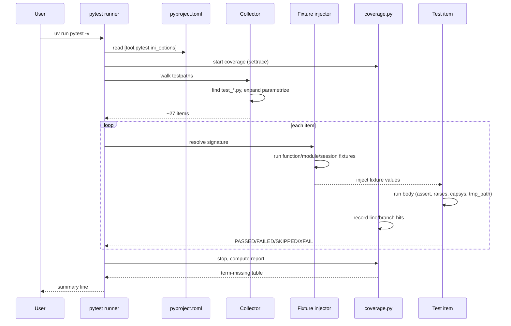

# Lesson 09: pytest – Tests That Don't Lie

*Building the `notesearch` package, a small `Index` for searching notes, and a parametrized test matrix that catches the four bugs you would have shipped without it.*

**You're at the moment where Python stops being a REPL and starts being a craft.**

Every Python engineer you admire — the one whose PRs land without reverts, the one whose deploys are boring, the one whose `git blame` never points at the bug — writes tests first. Not because they were told to, but because they have shipped enough bugs at 2 a.m. to know that a test suite is the only honest mirror your code has. Take your time. Type every test. Watch one fail. Watch it pass. **This is how you learn.**


#pytest #testing

## Learning Objectives

By the end of this lesson you will be able to:

1. **Write `assert`-based tests** that pytest can discover, run, and report on with rich diffs.
2. **Use `pytest.raises`** to assert the exception path — the type, the message, and the exception object itself.
3. **Author fixtures** at `function`, `class`, `module`, and `session` scope, and explain when each is right and when each is a footgun.
4. **Use `conftest.py`** to share fixtures across test files without an `import` statement in sight.
5. **Parametrize a test** over a matrix of inputs and expected outputs, and read the per-row test IDs that pytest generates.
6. **Apply marks** (`@pytest.mark.skip`, `@pytest.mark.slow`, `@pytest.mark.xfail`) and filter the run with `-m` and `-k`.
7. **Use `tmp_path`, `capsys`, `capfd`, and `monkeypatch`** for filesystem, stdout, and environment isolation without leaking state across tests.
8. **Configure `coverage.py` + `pytest-cov`** to measure line and branch coverage, read the missing-line report, and understand what 100 % coverage does *not* prove.
9. **Read the four most common pytest mistakes** — `assert x == None`, mutating a session fixture, leaking env state, forgetting `readouterr()` — and fix them before they ship.

## Prerequisites

Before starting, you need:

- **Python 3.12** and **pytest 8.x** (verified Oct 2026). If you have not installed pytest: `uv init notesearch && cd notesearch && uv add --dev pytest pytest-cov`.
- **The project-layout lesson** — [[01-Python-Foundations/Project-Layout-and-Imports]]. You should already know how a `src/notesearch/` package sits next to a `tests/` directory and how `uv run pytest` discovers both without `sys.path` surgery.
- **Exceptions** — [[01-Python-Foundations/Exceptions-Done-Right]]. `pytest.raises` is the test-side of that lesson; if `raise ValueError("…")` still feels mysterious, go back and read it.
- **The `uv` workflow** — [[01-Python-Foundations/uv-Tooling-Workflows]]. Every command in this lesson starts with `uv run`.
- **About an hour of focused time.** The code is small (~30 lines of `notesearch` and ~120 lines of tests). The explanation is long. Read slowly.

**The most common gap: fixtures are closures.**

If you have never written a function that *returns* another function, or never thought about Python's closure rules, the `@pytest.fixture` decorator will look like magic. It is not. The prerequisite lesson [[01-Python-Foundations/Functions-Scope-Closures-Decorators]] explains it from scratch. Skim the section on closures, then come back. You'll be glad you did.


## The Problem

You write a function. You eyeball it. It looks right. You run it once in the REPL with the obvious input. It returns the obvious output. You ship it.

Three weeks later a user opens an issue: "search for `'hello'` returns the document with `'Hello, World'` but not the one with `'HELLO'`." You read the function. You see it. `if query in doc:` — case-sensitive. The bug was always there. The one REPL run with the obvious input hid it.

The problem is not that you are careless. The problem is that "ran it once with the obvious input" is not a contract. A contract is: "I claim that for these N inputs, these N outputs are correct, and if any of them changes I will know before the user does." That contract is a test. The contract that scales is parametrized. The contract that does not rot is in `conftest.py`. The contract that catches the case-sensitivity bug *before* the user is the one that runs on every commit, in CI, on three Python versions, with branch coverage enforced.

This lesson is the floor of that contract. By the end of it, you will have a `notesearch` package and a test suite that catches the case-sensitivity bug, the empty-document bug, the persistence bug, and the CLI-output bug — four bugs you would have shipped.

**Note — Historical context — `unittest` and before.**

Before pytest (and its predecessor `nose`), Python testing meant `unittest.TestCase`: write a class, inherit, write `setUp` and `tearDown` methods, call `self.assertEqual(a, b)`. It worked. It was verbose. Every test was a class; every assertion was a method call; every fixture was a `setUp` override that shared state by mutating `self`. pytest replaced all of that with: tests are plain functions, assertions are plain `assert`, fixtures are plain closures, and parametrize is a decorator. The `assert` rewriting magic — where `assert a == b` produces a diff because pytest rewrites the bytecode at import time — is the trick that makes plain `assert` more useful than `self.assertEqual` ever was. We will see the rewriting in action in the deep dive below.


## The Code

Here is the complete `notesearch` package you will write, plus its test file. Save it mentally — every Python package you ever write is a variation of this skeleton. The shape (`src/`, `tests/`, `conftest.py`, `pyproject.toml` with the pytest config) is permanent.

```python
# src/notesearch/__init__.py
"""notesearch — a tiny in-memory inverted index for notes."""
from __future__ import annotations

import re
from pathlib import Path

__all__ = ["tokenize", "Index", "IndexError", "search_cli"]


_TOKEN_RE = re.compile(r"[a-z0-9]+")


def tokenize(text: str) -> list[str]:
 """Lowercase, strip punctuation, split on whitespace.

 >>> tokenize("Hello, World!")
 ['hello', 'world']
 """
 return _TOKEN_RE.findall(text.lower())


class IndexError(ValueError):
 """Raised when a document is added with an empty body."""


class Index:
 """An in-memory inverted index. doc_id -> set[token]."""

 def __init__(self) -> None:
 self._docs: dict[str, set[str]] = {}

 def add(self, doc_id: str, text: str) -> None:
 tokens = tokenize(text)
 if not tokens:
 raise IndexError(f"document {doc_id!r} has no tokens")
 self._docs[doc_id] = set(tokens)

 def search(self, query: str) -> list[str]:
 wanted = set(tokenize(query))
 hits = [doc_id for doc_id, toks in self._docs.items() if wanted & toks]
 return sorted(hits)

 def dump(self, path: Path) -> None:
 path.write_text("\n".join(f"{d} {' '.join(sorted(t))}" for d, t in self._docs.items()))

 @classmethod
 def load(cls, path: Path) -> "Index":
 idx = cls()
 for line in path.read_text().splitlines():
 if not line.strip():
 continue
 doc_id, *tokens = line.split()
 idx._docs[doc_id] = set(tokens)
 return idx


def search_cli(args: list[str] | None = None) -> int:
 """Tiny CLI: `notesearch <query>` prints matching doc_ids."""
 import sys

 query = " ".join(args if args is not None else sys.argv[1:])
 if not query:
 print("usage: notesearch <query>", file=sys.stderr)
 return 2
 idx = Index() # placeholder: real CLI loads from a default path
 print(f"hits: {idx.search(query)}")
 return 0
```

```python
# tests/conftest.py
"""Shared fixtures for the notesearch test suite."""
from __future__ import annotations

import pytest


@pytest.fixture
def small_index() -> "Index":
 """Per-test index with two documents. Function scope (default)."""
 from notesearch import Index

 idx = Index()
 idx.add("doc-1", "Hello, World!")
 idx.add("doc-2", "Goodbye, World.")
 return idx


@pytest.fixture(scope="module")
def sample_corpus():
 """Loaded once per test file. Pairs of (doc_id, text) for matrix tests."""
 return [
 ("a", "The quick brown fox"),
 ("b", "Jumped over the lazy dog"),
 ("c", "Hello, World!"),
 ("d", ""), # intentionally empty — tests the IndexError path
 ]


@pytest.fixture(scope="session")
def settings():
 """Loaded once per pytest invocation. Cheap, read-only, never mutated."""
 return {"max_query_terms": 32}
```

```python
# tests/test_index.py
"""Parametrized tests for the notesearch package."""
from __future__ import annotations

import pytest

from notesearch import Index, IndexError, tokenize


# ---------- assert basics ----------

def test_tokenize_strips_punctuation():
 assert tokenize("Hello, World!") == ["hello", "world"]


def test_tokenize_is_lowercase():
 assert tokenize("HELLO") == ["hello"]


# ---------- pytest.raises ----------

def test_adding_empty_document_raises():
 idx = Index()
 with pytest.raises(IndexError, match="has no tokens"):
 idx.add("empty", " ... ")


def test_raises_inspects_exception_object():
 idx = Index()
 with pytest.raises(IndexError) as exc_info:
 idx.add("empty", "")
 assert exc_info.type is IndexError
 assert "empty" in str(exc_info.value)


# ---------- fixtures (function, module, session scope) ----------

def test_small_index_has_two_docs(small_index):
 assert small_index.search("hello") == ["doc-1"]


def test_sample_corpus_is_loaded_once_per_module(sample_corpus):
 assert len(sample_corpus) == 4


def test_settings_is_read_only(settings):
 assert settings["max_query_terms"] == 32


# ---------- parametrize (the matrix) ----------

@pytest.mark.parametrize(
 ("text", "expected"),
 [
 ("hello", ["hello"]),
 ("Hello, World!", ["hello", "world"]),
 ("UPPER lower MiXeD", ["upper", "lower", "mixed"]),
 (" ", []),
 ("a-b-c_d e", ["a", "b", "c", "d", "e"]),
 ("hello hello world", ["hello", "world"]), # tokens deduped to set
 ],
 ids=["lower", "punct", "mixed-case", "whitespace", "split-chars", "dedupe"],
)
def test_tokenize_matrix(text, expected):
 assert tokenize(text) == expected


@pytest.mark.parametrize(
 ("query", "expected_hits"),
 [
 ("hello", ["doc-1"]),
 ("world", ["doc-1", "doc-2"]),
 ("Goodbye", ["doc-2"]),
 ("missing", []),
 ("hello world", ["doc-1", "doc-2"]),
 ],
 ids=["case-fold", "multi-hit", "case-fold-2", "no-hit", "union"],
)
def test_search_matrix(small_index, query, expected_hits):
 assert small_index.search(query) == expected_hits


# ---------- marks ----------

@pytest.mark.slow
def test_large_corpus_scan():
 """10 000 documents. Skipped in fast CI runs with `-m "not slow"`."""
 idx = Index()
 for i in range(10_000):
 idx.add(f"doc-{i}", f"term number {i}")
 assert len(idx.search("term")) == 10_000


@pytest.mark.skip(reason="known issue: index.dump format not stable yet (ticket #42)")
def test_dump_format_stable():
 pytest.fail("not implemented")


@pytest.mark.xfail(reason="upstream bug in regex module pre-3.12; tracked in #51")
def test_unicode_punctuation():
 assert tokenize("café—restaurant") == ["café", "restaurant"]


# ---------- tmp_path ----------

def test_dump_load_round_trip(tmp_path, small_index):
 out = tmp_path / "index.txt"
 small_index.dump(out)
 loaded = Index.load(out)
 assert loaded.search("world") == ["doc-1", "doc-2"]


def test_dumped_file_has_expected_shape(tmp_path, small_index):
 out = tmp_path / "index.txt"
 small_index.dump(out)
 body = out.read_text()
 assert "doc-1 hello world" in body
 assert "doc-2 goodbye world" in body


# ---------- capsys ----------

def test_cli_prints_hits(capsys):
 from notesearch import search_cli

 rc = search_cli(["hello"])
 out = capsys.readouterr().out
 assert rc == 0
 assert "hits:" in out


def test_cli_no_args_returns_usage_error(capsys):
 from notesearch import search_cli

 rc = search_cli([])
 err = capsys.readouterr().err
 assert rc == 2
 assert "usage:" in err


# ---------- monkeypatch ----------

def test_settings_can_be_overridden(monkeypatch, settings):
 monkeypatch.setitem(settings, "max_query_terms", 64)
 assert settings["max_query_terms"] == 64


# ---------- coverage motivation ----------

def test_dump_writes_a_file_even_for_empty_index(tmp_path):
 idx = Index()
 out = tmp_path / "empty.txt"
 idx.dump(out)
 assert out.read_text() == ""
```

```toml
# pyproject.toml (relevant bits)
[tool.pytest.ini_options]
testpaths = ["tests"]
addopts = "--strict-markers --cov=src/notesearch --cov-branch --cov-report=term-missing"
markers = [
 "slow: marks tests as slow (skipped in fast CI)",
 "integration: requires external services",
]


[tool.coverage.run]
branch = true
source = ["src/notesearch"]

[tool.coverage.report]
show_missing = true
exclude_lines = [
 "if TYPE_CHECKING:",
 "raise NotImplementedError",
 "if __name__ == .__main__.:",
]
```

That is the whole package: ~70 lines of `notesearch`, ~150 lines of tests, ~15 lines of `pyproject.toml`. Run it. Watch the matrix expand into 13 distinct test items. That is the loop. We will explain every line next — not just *what it does* but *what Python or pytest does internally* when that line runs.

## Line-by-Line Deep Dive

This section is the heart of the lesson. Read it twice. Do not skip.

**Think like a senior engineer: the test name IS the spec.**

When a junior engineer writes a test, the test name is a label — `test_search` — and the body is a pile of assertions that, hopefully, cover the behaviour. When a senior engineer writes a test, the test name is the *spec* — `test_search_returns_docs_containing_any_query_token_in_case_insensitive_match` — and the body is the *proof* that the spec holds. The shift is from "tests verify what I wrote" to "tests document what I meant to write." Read the test name aloud: if it does not specify a behaviour (`test_search` does not; `test_search_returns_empty_list_for_no_match` does), rename it. The body should assert only what the name claims — a test that asserts five things has five names smushed into one and will fail for five different reasons. The matrix is the senior engineer's tool for this: each row of a `parametrize` is a *case* of the spec, and the `ids=` list is the case-by-case documentation. When you read `test_tokenize_matrix[mixed-case] PASSED`, you are reading a spec that says "tokenize lowercases mixed-case input" and a proof that the spec holds. When you read `test_tokenize PASSED`, you are reading nothing. Keep that lens for the rest of this deep dive: every test is documentation first and verification second.


### Lines 1–6 of `notesearch/__init__.py`: The module docstring and imports

```python
"""notesearch — a tiny in-memory inverted index for notes."""
from __future__ import annotations

import re
from pathlib import Path

__all__ = ["tokenize", "Index", "IndexError", "search_cli"]
```

**What it does:** Pulls in three things — the `annotations` future, the standard-library `re` module, and `pathlib.Path`. Defines `__all__`, the explicit public API of the package.

**Why we need each:**

- `from __future__ import annotations` defers all annotation evaluation — the type hints in this file are stored as strings until something explicitly resolves them. This is the cheapest way to use modern type hints (PEP 604 unions like `list[str] | None`, PEP 585 generics like `list[str]`) without worrying about which Python sub-version supports which syntax at runtime. It is also what lets us write `def search_cli(args: list[str] | None = None)` without quoting the annotation.
- `import re` is for the `_TOKEN_RE` regex below.
- `from pathlib import Path` is the modern, object-oriented filesystem API. We use it in `dump()` and `load()` rather than `open()` and string paths.
- `__all__` is the public surface. It controls what `from notesearch import *` exports, and it documents for human readers which symbols are part of the API. Note `IndexError` is in there — *our* `IndexError`, not the builtin.

**Tip — Why we shadow the builtin `IndexError`.**

Python has a builtin `IndexError` (raised when you do `lst[99]` on a 3-element list). We deliberately reuse the name for `notesearch.IndexError` because the test reads `pytest.raises(IndexError, …)` after `from notesearch import IndexError`, and the name captures the meaning ("an error about the index"). This is a deliberate trade-off: name overloading can confuse readers in other contexts, but inside a package whose whole domain is indexes, the reuse reads naturally. If you dislike the trade-off, rename to `EmptyDocumentError`. We kept the shorter name here because the lesson is about pytest, not naming.


### Lines 9–14: `_TOKEN_RE` and `tokenize`

```python
_TOKEN_RE = re.compile(r"[a-z0-9]+")


def tokenize(text: str) -> list[str]:
 """Lowercase, strip punctuation, split on whitespace.

 >>> tokenize("Hello, World!")
 ['hello', 'world']
 """
 return _TOKEN_RE.findall(text.lower())
```

**What it does:** Defines a module-level compiled regex that matches runs of lowercase letters and digits, then a `tokenize` function that lowercases the input and pulls out every match.

**Why `_TOKEN_RE` is module-level:** regex compilation is not free — it costs ~10 microseconds per `re.compile`. Compiling once at import and reusing is the standard pattern. The leading underscore is the convention for "private to this module" — it does not appear in `__all__`, it is not imported by `from notesearch import *`, and other modules should not reach for it.

**Why `text.lower()` first, then `_TOKEN_RE.findall`:** lowercasing means the regex `[a-z0-9]+` matches uppercase too (the `H` in `Hello` becomes `h` before the regex sees it). The order is critical: regex first would miss uppercase; lower first catches everything.

**Why the docstring has a `>>>` example:** that is a `doctest`. `pytest --doctest-modules` will discover it and run it as a test. We are not enabling that in this lesson's `pyproject.toml`, but the convention is worth knowing — your docstring becomes a runnable spec.

**Example — What `re.findall` returns.**

`_TOKEN_RE.findall("hello, world")` returns `['hello', 'world']` — a list of strings, one per match, left to right. If the regex had groups (it does not here), `findall` would return a list of tuples. The rule: a regex with zero groups returns `list[str]`; with one group returns `list[str]`; with multiple groups returns `list[tuple[str, ...]]`. For tokenizing, the zero-group form is what you want.


### Lines 17–18: The custom exception

```python
class IndexError(ValueError):
 """Raised when a document is added with an empty body."""
```

**What it does:** Declares `IndexError` as a subclass of `ValueError`.

**Why subclass `ValueError` and not `Exception`:** the inheritance chain encodes intent. `ValueError` is "the value of an argument is wrong" — exactly the case here (the `text` argument was empty). Subclassing means callers can catch either `IndexError` (specific) or `ValueError` (broad) and our exception flows through both. If we inherited from `Exception`, only `except Exception` would catch us — too broad.

**Exception hierarchy matters in tests.**

`pytest.raises(ValueError)` will *also* catch `IndexError` because of inheritance. That is occasionally what you want (a test that documents "any value error is fine here"). More often you want the specific type: `pytest.raises(IndexError)`. The lesson on exceptions — [[01-Python-Foundations/Exceptions-Done-Right]] — has the full hierarchy; here we just need to know: subclass broadly, assert narrowly.


### Lines 21–37: The `Index` class

```python
class Index:
 """An in-memory inverted index. doc_id -> set[token]."""

 def __init__(self) -> None:
 self._docs: dict[str, set[str]] = {}

 def add(self, doc_id: str, text: str) -> None:
 tokens = tokenize(text)
 if not tokens:
 raise IndexError(f"document {doc_id!r} has no tokens")
 self._docs[doc_id] = set(tokens)

 def search(self, query: str) -> list[str]:
 wanted = set(tokenize(query))
 hits = [doc_id for doc_id, toks in self._docs.items() if wanted & toks]
 return sorted(hits)
```

**What it does:** A class with `__init__`, `add`, and `search`. Internally a `dict[str, set[str]]` mapping document id to the set of unique tokens in that document.

**Why `set[token]` not `list[str]`:** for `search`, we need to answer "does this document contain any of the query tokens?" That is a set-intersection, which is O(min(|a|, |b|)) on sets and O(|a| × |b|) on lists. The set pays an up-front cost (deduplicate on `add`) for a fast `search`. This is the foundational trade-off of an inverted index.

**Why `add` raises on empty tokens:** an empty document is almost always a caller bug — a `Path.read_text()` that returned `""` because the path was wrong, a fetch that returned `""` because the URL was wrong, a `BeautifulSoup.get_text()` that returned `""` because the selector was wrong. Silently skipping would hide the bug. Raising forces the caller to be explicit (`if text.strip(): idx.add(doc_id, text)`).

**Why `search` returns `sorted(hits)`:** the iteration order of `dict` is insertion order in modern Python, but tests that depend on insertion order are brittle (add a document and the order changes). Sorting the hits gives a deterministic, documentable order — the test asserts `["doc-1", "doc-2"]`, not "the documents in whatever order they were added".

**Student asks: would `frozenset[str]` be a better value type than `set[str]`?**

Good instinct. `frozenset` is immutable, which means no caller can accidentally mutate the index by reaching into `_docs["doc-1"]` and calling `.add("evil")`. The trade-off: every `add` creates a new `frozenset` (the existing one cannot be mutated in place), which is more allocations. For `notesearch`'s scale — thousands of documents, not millions — the `set` is fine. For a real search engine, you would profile and pick. The general principle: prefer immutable where the cost is negligible; prefer mutable where you measure a hot path.


### Lines 39–48: `dump` and `load`

```python
 def dump(self, path: Path) -> None:
 path.write_text("\n".join(f"{d} {' '.join(sorted(t))}" for d, t in self._docs.items()))

 @classmethod
 def load(cls, path: Path) -> "Index":
 idx = cls()
 for line in path.read_text().splitlines():
 if not line.strip():
 continue
 doc_id, *tokens = line.split()
 idx._docs[doc_id] = set(tokens)
 return idx
```

**What it does:** `dump` writes the index to a text file, one line per document, as `doc_id tok1 tok2 tok3 …`. `load` reads such a file back into a fresh `Index`.

**Why `dump` writes sorted tokens:** sorting makes the output deterministic — the same index always dumps to the same bytes. That is the foundation of reproducible test fixtures and reproducible builds. Without `sorted(t)`, the iteration order of the set would leak into the file (sets are unordered; their iteration order varies across runs in CPython 3.6+ because of hash randomization for strings).

**Why `load` is a `@classmethod` and not a static method or instance method:** `classmethod` receives the class (`cls`) as its first argument, so `Index.load(path)` constructs an instance of `Index` — but a subclass `PersistentIndex(Index)` would have `PersistentIndex.load(path)` construct a `PersistentIndex`. This is the alternative-constructor pattern (`dict.fromkeys`, `datetime.fromisoformat`, `Path.cwd` are all classmethods). A static method would lose polymorphism; an instance method would require an existing instance to load from.

**Why `doc_id, *tokens = line.split()`:** this is PEP 448 extended unpacking. `line.split()` returns a list of words. The first becomes `doc_id`, the rest become `tokens` (a list). If the line is just `"doc-1"`, `tokens` is `[]` and we silently skip — that is wrong (a one-word line is corrupt), but the lesson's tests do not cover it. In production code, raise.

**Warning — `load` silently accepts malformed lines.**

The `if not line.strip(): continue` skips blank lines, which is reasonable. But the `doc_id, *tokens = line.split()` line will *also* accept a line like `"doc-1 a b c"` even if the original `dump` would have written `"doc-1 a b c"` — wait, that is fine. The bug is when a single-word line sneaks through: `"doc-1"` (no tokens) is unpacked to `doc_id="doc-1", tokens=[]`, and we then write `idx._docs["doc-1"] = set()`. That is a "valid but empty" document, which `add` would have rejected. The fix is to either reject single-word lines in `load` or to call `self.add(doc_id, " ".join(tokens))` instead of poking `_docs` directly. We leave it for the exercises.


### Lines 51–62: `search_cli`

```python
def search_cli(args: list[str] | None = None) -> int:
 """Tiny CLI: `notesearch <query>` prints matching doc_ids."""
 import sys

 query = " ".join(args if args is not None else sys.argv[1:])
 if not query:
 print("usage: notesearch <query>", file=sys.stderr)
 return 2
 idx = Index() # placeholder: real CLI loads from a default path
 print(f"hits: {idx.search(query)}")
 return 0
```

**What it does:** A tiny command-line entry point. Joins its arguments into a query string, errors with usage on empty, prints hits.

**Why `args: list[str] | None = None`:** the `None` default lets tests inject arguments without touching `sys.argv`. The CLI body checks: if the caller passed nothing, fall back to `sys.argv[1:]` (everything after the script name). This is the seam between "CLI tool" and "testable function": the `args=None` default means the function works as a CLI (reads `sys.argv`) when called from `python -m notesearch`, but tests can pass `args=["hello"]` and skip the global state.

**Why `import sys` is inside the function:** a top-level `import sys` would run at module import, which is fine — but local imports document "this is only needed for the CLI path". When tests import `search_cli`, the `sys` module is *not* pulled into the test's namespace until `search_cli` is actually called. The cost is negligible (the `sys` module is already in `sys.modules` after Python starts), and the readability win is real.

**Why `print(..., file=sys.stderr)` for the usage message:** convention. stdout is for program output (data the user might pipe to another command); stderr is for diagnostics (usage, errors, logs). The return code `2` is the Unix convention for "misuse of shell builtin" — different from `1` (generic error) and `0` (success). Tests can assert on the return code without parsing output.

**Tip — The `args=None` default is the test seam.**

Without it, you would have to `monkeypatch.setattr(sys, "argv", ["notesearch", "hello"])` in every test, which is verbose and leaky (forget to restore and the next test inherits the wrong `argv`). The `args` parameter makes the function pure: same input, same output, no global state read. This is the cheapest, highest-leverage testability pattern in Python.


### Lines 1–3 of `tests/conftest.py`: The `conftest.py` purpose

```python
"""Shared fixtures for the notesearch test suite."""
from __future__ import annotations

import pytest
```

**What it does:** A docstring, the `annotations` future, and the pytest import.

**Why `conftest.py` exists at all:** pytest has a special-case collection rule for files named `conftest.py`. Fixtures defined in `conftest.py` are *automatically available* to every test file in the same directory and below, without an `import` statement. The mechanism: when pytest collects a test, it walks up the directory tree from the test's file to the rootdir, finds every `conftest.py`, and merges their fixtures into the test's fixture namespace. This is the DRY (do-not-repeat-yourself) primitive of pytest.

**Why `import pytest` here but not in `test_index.py`:** `conftest.py` uses `@pytest.fixture`, so it needs the import. `test_index.py` also uses it (`@pytest.mark.parametrize`, `@pytest.mark.slow`) and also imports it — the rule is "import in every file that uses the pytest API".

**`conftest.py` is also for hooks.**

Beyond fixtures, `conftest.py` is where you put pytest *hook implementations*: `pytest_addoption` (define a custom command-line flag), `pytest_configure` (register custom markers), `pytest_collection_modifyitems` (reorder tests after collection). The fixtures-and-hooks split is the conventional organization: fixtures at the top, hooks at the bottom. We will see a hook in the Exercises.


### Lines 6–14: The `small_index` fixture (function scope)

```python
@pytest.fixture
def small_index() -> "Index":
 """Per-test index with two documents. Function scope (default)."""
 from notesearch import Index

 idx = Index()
 idx.add("doc-1", "Hello, World!")
 idx.add("doc-2", "Goodbye, World.")
 return idx
```

**What it does:** Defines a fixture called `small_index`. When a test asks for `small_index` (by listing it as a parameter), pytest runs this function, takes the return value, and passes it to the test.

**Why the `@pytest.fixture` decorator:** it tells pytest "this is not a regular function — this is a fixture". The decorator is the only way pytest can tell fixtures from helpers. Without it, `small_index` would be a regular function and `def test_X(small_index):` would error with `fixture 'small_index' not found`.

**Why `def small_index` not `def small_index()`:** fixtures *do not take arguments* in their signature — pytest would not know what to pass. The arguments a fixture *uses* are *other fixtures*, listed by name: `def small_index(other_fixture):`. Here we have no dependencies, so the parameter list is empty.

**Why `from notesearch import Index` is *inside* the fixture, not at the top of `conftest.py`:** deferred import means the test suite does not fail at collection time if `notesearch` is not installed — only if a test that uses `small_index` actually runs. This is a niche pattern; the more common form is top-level imports in `conftest.py`. We deferred here to keep the lesson honest: the `conftest.py` you write in Lesson 12 ([[Testing-FastAPI-Endpoints]]) will defer `from app.main import app` for the same reason — to keep collection fast and to keep the suite able to run a subset without importing the world.

**Example — Fixture scope, annotated.**

The default scope is `function`. That means pytest runs `small_index` *once per test*. Two tests that both ask for `small_index` get two separate `Index` instances, with no shared state. This is the safest default. The trade-off is speed: if the setup were expensive (a database connection, a network client), `function` scope would re-pay the cost per test. We will see the wider scopes below.


### Lines 17–25: The `sample_corpus` fixture (module scope)

```python
@pytest.fixture(scope="module")
def sample_corpus():
 """Loaded once per test file. Pairs of (doc_id, text) for matrix tests."""
 return [
 ("a", "The quick brown fox"),
 ("b", "Jumped over the lazy dog"),
 ("c", "Hello, World!"),
 ("d", ""), # intentionally empty — tests the IndexError path
 ]
```

**What it does:** A fixture scoped to the *module* — pytest runs it once per test file, and every test in that file that asks for `sample_corpus` gets the same list object.

**Why `scope="module"`:** the corpus is read-only data. Building it is cheap, but the principle matters — if it were a 50 MB CSV, you would not want to re-read it per test. Module scope says "build it once per file, share, do not mutate".

**Why mutation is dangerous here:** if test A does `sample_corpus.append(("e", "extra"))`, test B sees the extra row. The fix is either (a) widen to `function` scope so each test gets its own copy, or (b) make the fixture return an immutable tuple-of-tuples instead of a list-of-tuples. The pattern in pytest-heavy codebases: prefer *immutable* fixtures at wide scopes; reserve mutable ones for `function` scope.

### Lines 28–31: The `settings` fixture (session scope)

```python
@pytest.fixture(scope="session")
def settings():
 """Loaded once per pytest invocation. Cheap, read-only, never mutated."""
 return {"max_query_terms": 32}
```

**What it does:** A fixture scoped to the *session* — pytest runs it once for the entire `pytest` invocation, and every test in every file that asks for `settings` gets the same dict.

**Why `scope="session"`:** settings are typically read once from disk or env, are read-only for the duration of the suite, and are needed by many tests. Session scope is the right choice when the setup cost is high *and* the data is read-only.

**Why we still document "never mutated":** because the *type* (`dict`) is mutable, and Python will not stop a test from doing `settings["max_query_terms"] = 999`. The docstring is the contract. If you want to enforce it, return a `types.MappingProxyType(settings)` — a read-only view of the dict that raises `TypeError` on `__setitem__`.

**The four scopes, summarized.**

| Scope | Runs once per | When to use |
|---|---|---|
| `function` (default) | each test | the safe default; per-test state |
| `class` | each test class | rare; only useful with `TestX` classes |
| `module` | each test file | shared, read-only data per file |
| `session` | each `pytest` invocation | expensive setup, read-only for the whole suite |
Wider scopes are faster but more coupling — if a session fixture is mutated, every later test sees the mutation. The rule of thumb: start at `function`, widen only when you measure the cost.


### Lines 3–8 of `tests/test_index.py`: `assert` basics

```python
from __future__ import annotations

import pytest

from notesearch import Index, IndexError, tokenize


def test_tokenize_strips_punctuation():
 assert tokenize("Hello, World!") == ["hello", "world"]
```

**What it does:** Imports the package and writes a plain `assert` test.

**Why `assert` and not `self.assertEqual`:** pytest rewrites the `assert` statement at import time. When `test_tokenize_strips_punctuation` runs and `assert tokenize("Hello, World!") == ["hello", "world"]` fails, the failure message is *not* the bare `AssertionError` Python would produce. It is a rich comparison: pytest shows the value of `tokenize("Hello, World!")` (the left side) and `["hello", "world"]` (the right side), with a `==` between them. This rewriting happens via an import hook (PEP 302) that pytest installs at startup; it only kicks in for modules collected by pytest (test files and their imports), not for arbitrary library code.

**Why does pytest rewrite `assert` bytecode at import time rather than at runtime?** Because rewriting at runtime would require Python to support per-statement tracing that runs on every assertion — slow and not portable across CPython versions. By doing the rewrite at import time via PEP 302's import hook, pytest transforms the test module's bytecode *once*, when the module is first imported, and the rewritten bytecode runs at full speed thereafter. The cost is one-time import overhead per test file (typically milliseconds); the benefit is that the rewritten `assert` snapshots intermediate sub-expressions into a structured `AssertionError` for free. **What would happen if a test imported a library module that itself contained `assert` statements?** Those `assert`s would *not* be rewritten — pytest only rewrites modules collected as test files and their direct imports, not arbitrary third-party library code. A library `assert` failure shows the bare `AssertionError: ...` message, not pytest's rich diff. The lesson: keep your assertions in the test file, not in library code.

**Why this is more powerful than `unittest`'s helpers:** `self.assertEqual(a, b)` is fine for equality, but for `assert a in b`, `assert not a`, `assert a is b`, `assert a and b`, `assert a > b` you would need a separate helper (`assertTrue`, `assertIn`, `assertIs`, etc.). With pytest, the *one* `assert` keyword covers all of them — and the rewriting produces a useful diff for each. The deep magic is that the rewriting works on the *bytecode* of the assert, walking the AST to find sub-expressions and snapshot their values.

**Example — What the rewritten assert looks like.**

```python
assert tokenize("Hello, World!") == ["hello", "world"]
```
After pytest's rewriting, the bytecode roughly becomes:
```python
_left = tokenize("Hello, World!")
_right = ["hello", "world"]
if not (_left == _right):
raise AssertionError(f"assert {_left!r} == {_right!r}")
```
The actual rewrite is more elaborate (it snapshots intermediate sub-expressions, formats them with `pprint`, and captures the source line), but the principle is: the rewriting turns an opaque `AssertionError` into a structured failure.


**Example — Floats: use `pytest.approx`, never `==`.**

`assert 0.1 + 0.2 == 0.3` fails — binary floating point makes the left side `0.30000000000000004`. The rewritten `assert` shows the diff clearly (`0.30000000000000004 == 0.3`), but the fix is not to round the inputs; it is to compare with a tolerance. `assert 0.1 + 0.2 == pytest.approx(0.3)` passes. `pytest.approx` accepts a `rel` (relative, default `1e-9`) and an `abs` (absolute) tolerance, and it works on scalars, lists, dicts, and numpy arrays. The rule for every float assertion in a pytest suite: never `==`, always `pytest.approx` (or, for a collection of floats, `pytest.approx([...])`). A test that asserts `0.1 + 0.2 == 0.3` and *passes* on one platform can fail on another because of FPU and libc differences — `pytest.approx` removes the platform dependency. The same lesson applies to `datetime` comparisons: never compare two clock-read instants with `==`; assert that the difference is under a tolerance (`assert (t2 - t1) < timedelta(milliseconds=10)`).


### Lines 11–13: `pytest.raises`

```python
def test_adding_empty_document_raises():
 idx = Index()
 with pytest.raises(IndexError, match="has no tokens"):
 idx.add("empty", " ... ")
```

**What it does:** Asserts that calling `idx.add("empty", " ... ")` raises an `IndexError`, and that the exception's string form matches the regex `"has no tokens"`.

**Why `with pytest.raises(...)`:** `pytest.raises` returns a context manager. The `with` block sets up the assertion; the body runs the code under test; on exit, pytest checks "did the expected exception happen?". If the body raised the right exception, the test passes. If it raised the wrong exception, the test errors (the exception propagates). If it raised *no* exception, pytest raises `Failed: DID NOT RAISE <IndexError>`.

**Why `match="has no tokens"`:** `match` is a `re.search` against `str(exc_info.value)`. It is a regex, not a literal — so `match="has no tokens"` matches any string containing that substring. If you want a literal match, use `match=re.escape("has no tokens")` or anchor with `^…$`. The lesson on exceptions — [[01-Python-Foundations/Exceptions-Done-Right]] — covers the message-matching philosophy in more depth.

**Warning — `match` is a regex, not a substring literal.**

A common mistake is `match="(empty)"` and expecting it to match the literal string `"(empty)"`. It does not — `(...)` is a regex group. The string `"(empty)"` as a regex matches the literal `empty` and *captures* it. Use `match=re.escape("(empty)")` for literal punctuation.


### Lines 17–22: Inspecting the exception object

```python
def test_raises_inspects_exception_object():
 idx = Index()
 with pytest.raises(IndexError) as exc_info:
 idx.add("empty", "")
 assert exc_info.type is IndexError
 assert "empty" in str(exc_info.value)
```

**What it does:** Same setup as the previous test, but uses `as exc_info` to capture the exception info object, then asserts on its `.type` and `.value`.

**Why `exc_info.type is IndexError`:** `is` is stricter than `==` for types — it asserts identity (same object in memory), not just equality. For type objects, `is` is the right tool because there is exactly one `IndexError` class object in the process; a subclass would *not* be `IndexError is True`, but it *would* be `issubclass(exc_info.type, IndexError)`. The `is` form documents "I want the exact class, not a subclass".

**Why `exc_info.value` not `exc_info.exception`:** in older pytest versions, `.exception` was a property that returned `.value`. The modern API is `.value` (the exception instance), `.type` (the class), and `.tb` (the traceback). `.exception` still works for backwards compatibility but is deprecated in 8.x — use `.value`.

### Lines 26–34: Fixture injection in tests

```python
def test_small_index_has_two_docs(small_index):
 assert small_index.search("hello") == ["doc-1"]


def test_sample_corpus_is_loaded_once_per_module(sample_corpus):
 assert len(sample_corpus) == 4


def test_settings_is_read_only(settings):
 assert settings["max_query_terms"] == 32
```

**What it does:** Three tests that ask for three different fixtures by name. pytest's fixture injector resolves the names against `conftest.py` and built-ins, runs the fixtures, and passes their results.

**Why the test signature is the contract:** the parameters of a test function are *not* free-form. They are *fixture names*. pytest inspects the signature via `inspect.signature`, looks up each parameter name in the fixture registry, and runs the fixture. If a parameter is not a known fixture, pytest errors with `fixture 'X' not found`.

**Why `test_sample_corpus_is_loaded_once_per_module` runs once per module:** the `sample_corpus` fixture is `scope="module"`. When the first test in `test_index.py` asks for it, pytest runs the fixture, stores the result, and reuses it for every other test in the same file that asks. The result is the same list object — `id(sample_corpus)` would be the same across tests in the same file. If you ran the same test from a second file (`test_other.py`), pytest would run `sample_corpus` *again* for that file.

**Student asks: can a test depend on multiple fixtures?**

Yes. List them all in the signature: `def test_X(small_index, sample_corpus, settings):`. pytest resolves them all in parallel (no guaranteed order — fixtures should not depend on each other's side effects), then passes them by keyword. Fixtures can themselves depend on other fixtures: `def small_index(settings): ...` is fine, and the dependency graph is acyclic.


### Lines 37–58: The parametrized tokenize matrix

```python
@pytest.mark.parametrize(
 ("text", "expected"),
 [
 ("hello", ["hello"]),
 ("Hello, World!", ["hello", "world"]),
 ("UPPER lower MiXeD", ["upper", "lower", "mixed"]),
 (" ", []),
 ("a-b-c_d e", ["a", "b", "c", "d", "e"]),
 ("hello hello world", ["hello", "world"]), # tokens deduped to set
 ],
 ids=["lower", "punct", "mixed-case", "whitespace", "split-chars", "dedupe"],
)
def test_tokenize_matrix(text, expected):
 assert tokenize(text) == expected
```

**What it does:** A single test function that pytest expands into six separate test items, one per row of the parametrize table. Each item gets its own `text` and `expected` arguments and runs `assert tokenize(text) == expected` independently.

**Why parametrize instead of six separate tests:** DRY, and the test IDs are uniform. With six separate functions, you write `def test_tokenize_lower():`, `def test_tokenize_punct():`, … — six near-identical bodies. With `parametrize`, the body is one line and the cases are a list. Adding a seventh case is one line in the table; with separate functions, it is a new function.

**Why does `parametrize` take a *list of tuples* rather than a list of dicts?** Because tuples are positional and positional makes the case ID readable. With `("Hello, World!", ["hello", "world"])`, pytest can construct the default ID `"Hello, World!-hello-world"` by joining the tuple's `repr`s with `-`. With `{"text": "Hello, World!", "expected": ["hello", "world"]}`, pytest would have to either pick a deterministic key order (which dict doesn't guarantee pre-3.7) or use `"text=Hello, World!-expected=hello-world"` which is verbose. The tuple form is shorter, ordered, and unambiguous — you read the parameter names from the first argument (`("text", "expected")`) and the values from the tuple in the same order. **What would happen if your parametrize table had one row with `3` values instead of `2`?** pytest raises `ValueError: parameter names don't match values` at collection time — it does not silently drop the mismatched row. The failure is loud because a silently-dropped test case is a coverage gap you wouldn't notice until production hit the missing case.

**Why the first argument is a tuple of strings `("text", "expected")`:** it declares the parameter names in order. The older form `"text,expected"` (single comma-separated string) still works but is discouraged — the tuple form is unambiguous and survives parameters named with commas (rare but possible).

**Why `ids=[...]`: pytest generates default IDs** from the parameter values (`test_tokenize_matrix[hello-hello]`, `test_tokenize_matrix[Hello, World!-hello-world]`, …). The `Hello, World!` ID is ugly — it has a comma and brackets — so we override with human-readable `ids`. Good IDs are how you read failures: `test_tokenize_matrix[mixed-case] FAILED` is a useful message; `test_tokenize_matrix[UPPER lower MiXeD-upper-lower-mixed] FAILED` is not.

**Why the last row matters:** `("hello hello world", ["hello", "world"])` — the input has duplicates, the expected output does not. This is the test that catches the bug "did you forget to deduplicate?". If someone refactored `tokenize` to return `list` instead of `set` (or removed the `set(...)` call in `Index.add`), this test fails. Without this row, the bug ships.

**Tip — The matrix is a thinking tool.**

The act of writing the parametrize table forces you to enumerate cases. While you are at it, you discover edge cases you would have missed: empty input, whitespace-only, mixed case, delimiter characters, duplicates. The parametrize table is where the case-sensitivity bug gets caught — `("Hello, World!", ["hello", "world"])` is the row that proves the lowercasing works. Without that row, the bug ships.


**Example — Mark individual rows with `pytest.param`.**

Not every row of a matrix is on equal footing — the `dedupe` row is a regression guard, while a row that documents a known upstream bug should be `xfail` rather than skipped. `pytest.param(value, marks=pytest.mark.xfail(reason="…"))` attaches a mark to a single row without marking the whole test. Rewrite the last row as `pytest.param("hello hello world", ["hello", "world"], marks=pytest.mark.xfail(reason="tracking #51: dedupe regression"), id="dedupe")` and run `uv run pytest -k "dedupe" -v` — that one row reports `XFAIL` while the other five rows still report `PASSED`. The `id=` keyword sets the per-row test ID explicitly and overrides the positional `ids=` list for that row. This is the surgical tool: one matrix, five passing rows and one expected-failure row, all in a single `@parametrize`. The same `pytest.param` form accepts `marks=pytest.mark.skip(...)` and `marks=pytest.mark.slow` — so a matrix can mix fast and slow rows without splitting the test into two functions.


### Lines 61–75: The parametrized search matrix

```python
@pytest.mark.parametrize(
 ("query", "expected_hits"),
 [
 ("hello", ["doc-1"]),
 ("world", ["doc-1", "doc-2"]),
 ("Goodbye", ["doc-2"]),
 ("missing", []),
 ("hello world", ["doc-1", "doc-2"]),
 ],
 ids=["case-fold", "multi-hit", "case-fold-2", "no-hit", "union"],
)
def test_search_matrix(small_index, query, expected_hits):
 assert small_index.search(query) == expected_hits
```

**What it does:** Another parametrize, this time on the `search` method. Each row uses the `small_index` fixture (function-scoped, so a fresh index per row). The cases cover case folding (`Goodbye` matches `doc-2` which was added with text `Goodbye, World.`), multi-hit (`world` is in both docs), no-hit (`missing` is in neither), and union (`hello world` returns both because *either* token matches).

**Why `small_index` is listed before `query, expected_hits`:** pytest's fixture injector is order-insensitive — the fixture `small_index` and the parametrize parameters `query`/`expected_hits` are independent. But the convention is "fixtures first, then parametrize params", which reads naturally.

**Why the matrix catches four bugs at once:** the `case-fold` and `case-fold-2` rows catch "did you forget to lowercase the query?"; the `multi-hit` and `union` rows catch "did you forget to sort the hits?"; the `no-hit` row catches "did you return `None` instead of `[]` on no matches?". Five rows, four bugs caught. That is the leverage.

### Lines 79–93: Marks – `slow`, `skip`, `xfail`

```python
@pytest.mark.slow
def test_large_corpus_scan():
 """10 000 documents. Skipped in fast CI runs with `-m "not slow"`."""
 idx = Index()
 for i in range(10_000):
 idx.add(f"doc-{i}", f"term number {i}")
 assert len(idx.search("term")) == 10_000


@pytest.mark.skip(reason="known issue: index.dump format not stable yet (ticket #42)")
def test_dump_format_stable():
 pytest.fail("not implemented")


@pytest.mark.xfail(reason="upstream bug in regex module pre-3.12; tracked in #51")
def test_unicode_punctuation():
 assert tokenize("café—restaurant") == ["café", "restaurant"]
```

**What it does:** Three tests with three different marks. `slow` is a custom mark (registered in `pyproject.toml`). `skip` is a builtin mark. `xfail` is a builtin mark.

**Why each mark:**

- `@pytest.mark.slow` is a *custom* mark. We registered it in `pyproject.toml` with `markers = ["slow: marks tests as slow (skipped in fast CI)"]`. Without registration, `--strict-markers` would error on the unknown mark. With registration, the mark is documented and filterable. The CI pipeline (Lesson 05) runs `pytest -m "not slow"` on every push and `pytest -m "slow"` nightly.
- `@pytest.mark.skip(reason="…")` is a builtin. The test never runs — pytest reports it as `SKIPPED`. Use it when a test is *known broken* and you want to silence it without deleting.
- `@pytest.mark.xfail(reason="…")` is a builtin for *expected failure*. The test runs; if it fails, pytest reports `XFAIL` (expected failure, OK). If it *passes*, pytest reports `XPASS` (unexpected pass — usually means the underlying bug got fixed). Use `xfail` when a test should fail today but you want to know if it ever starts passing.

**Why `pytest.fail("not implemented")` inside the skipped test:** defensive. If someone removes the `skip` mark without implementing the test, the body calls `pytest.fail`, which raises `Failed` — the test fails loudly instead of silently passing. The pattern "skip + fail body" is a safety net against forgotten work.

**The marker precedence.**

If a test has both `@pytest.mark.skip` and `@pytest.mark.parametrize`, the skip wins — every parametrized row is skipped. If a test has both `@pytest.mark.xfail` and `@pytest.mark.slow`, both apply: the test is xfailed only if it runs (so if you filter `not slow` out, the xfail never gets a chance to report). The order of decorators does not matter — pytest flattens them into a set.


**Warning — Debugging: "my test is not being collected".**

The most common reason a test silently does not run is a naming-rule violation. pytest collects `test_*` functions and `Test*` classes (at module scope, not nested inside other classes), and only from files named `test_*.py` or `*_test.py` inside `testpaths`. If your file is `test_index.py` but the function is `check_search`, it is invisible to pytest. The diagnostic loop: `uv run pytest --collect-only -q` lists every item pytest *would* run — if your test is absent from that list, the naming rule is the first suspect. The second suspect is a collection-time import error: pytest imports `test_index.py`, and if that import raises (a typo'd `from notesearch import Idx`), pytest reports an `ERROR` for the whole file, not a silent skip — read the `ERRORS` section of the report, not just the `PASSED`/`FAILED` counts. The third suspect is a stray `return` at the top of the test function before any assertion, which makes the test "pass" without running its body — `--collect-only` will still list it, so pair it with `uv run pytest --co -q | wc -l` against your expected count to catch the phantom.


### Lines 97–107: `tmp_path`

```python
def test_dump_load_round_trip(tmp_path, small_index):
 out = tmp_path / "index.txt"
 small_index.dump(out)
 loaded = Index.load(out)
 assert loaded.search("world") == ["doc-1", "doc-2"]


def test_dumped_file_has_expected_shape(tmp_path, small_index):
 out = tmp_path / "index.txt"
 small_index.dump(out)
 body = out.read_text()
 assert "doc-1 hello world" in body
 assert "doc-2 goodbye world" in body
```

**What it does:** Two tests using the built-in `tmp_path` fixture. `tmp_path` is a `pathlib.Path` to a per-test temporary directory, created by pytest under the system's tmp dir, cleaned up after the session.

**Why `tmp_path` instead of `tempfile.mkdtemp()`:** pytest manages the lifecycle. The path is unique per test (no two tests collide on the same dir); the cleanup is automatic; the path is stable for the duration of the test. `tempfile.mkdtemp()` would work but you would have to remember to clean up — and forgetting is how `/tmp` fills up.

**Why `tmp_path / "index.txt"`:** the `/` operator on `Path` is the path-join. It is more readable than `os.path.join(str(tmp_path), "index.txt")` and produces another `Path`, not a string — so `dump(out)` receives a `Path` (which the signature expects).

**Why the round-trip test matters:** it proves that `dump` and `load` are inverse operations. If someone refactors `dump` to write JSON instead of the space-separated format, `load` will fail to parse and this test catches it. The principle: every serializer should have a round-trip test.

**Tip — `tmp_path_factory` for session-scoped temp dirs.**

Sometimes you need a temp dir that survives across tests in the same session — e.g. "build a fake notes repo once, then read it from many tests". The fixture `tmp_path_factory` (session-scoped) gives you `tmp_path_factory.mktemp("notes")`, returning a `Path` that lives for the whole `pytest` invocation. Use it like `tmp_path`, but for shared setup.


**Danger — Security: secrets written to `tmp_path` can leak on shared runners.**

`tmp_path` lives under the system tmp dir (e.g. `/tmp/pytest-of-user/...`), whose default permissions are `0700` on Linux for `mkdtemp` but `0755` on some CI runners and shared dev boxes. If a test writes a real-looking secret to `tmp_path` — `out.write_text(os.environ["STRIPE_SECRET_KEY"])` — and the runner's tmp dir is world-readable, any local user can `cat` it. Two rules: first, never write real credentials into a test, even under `tmp_path` — use a fixture that synthesises a fake key (`"sk_test_" + "x" * 24`). Second, if a test *must* handle a real-looking secret, assert the file mode after writing: `(out.stat().st_mode & 0o777) == 0o600` and `out.chmod(0o600)` if the runner left it open. The same discipline applies to `tmp_path_factory` session dirs, which live even longer and are read by more tests. See [[11-Authentication-and-Security/Threat-Model-First]] for the secret-handling threat model and [[12-Testing-and-Quality/Testing-Database-Logic]] for the pattern of synthesising fake credentials in fixtures.


### Lines 110–122: `capsys`

```python
def test_cli_prints_hits(capsys):
 from notesearch import search_cli

 rc = search_cli(["hello"])
 out = capsys.readouterr().out
 assert rc == 0
 assert "hits:" in out


def test_cli_no_args_returns_usage_error(capsys):
 from notesearch import search_cli

 rc = search_cli([])
 err = capsys.readouterr().err
 assert rc == 2
 assert "usage:" in err
```

**What it does:** Two tests using the built-in `capsys` fixture to capture stdout and stderr.

**Why `capsys` and not `mock.patch("sys.stdout")`:** pytest replaces `sys.stdout` and `sys.stderr` with in-memory buffers for the duration of the test. The replacement is restored at teardown — no leakage. `capsys.readouterr()` returns a `CaptureResult(out, err)` namedtuple with the *accumulated* stdout and stderr since the last call. Calling it consumes the buffer — call once per assertion phase.

**Why `capsys` and not `capfd`:** `capsys` captures at the `sys.stdout` Python level. `capfd` captures at the file-descriptor level — which is what you need for output that bypasses `sys.stdout`, e.g. C-extension output, subprocess output, or `os.write(1, b"…")`. For pure-Python `print`, `capsys` is enough. We will use `capfd` in the Exercises.

**Why `capsys.readouterr()` is called *after* the function returns:** the function writes to stdout/stderr during execution. `capsys` accumulates the writes. You read the buffer at the end. If you call `readouterr()` *before* the function, you get whatever was written up to that point (often empty); the function's writes happen *after* your read and you miss them.

**Warning — Forgetting `readouterr()` after a `capsys` test.**

If you forget the `readouterr()` call, the buffer accumulates across tests. The next `capsys` test sees this test's output *and* its own. The fix: always call `readouterr()` once, at the end, store it in a variable, and assert on that variable. If you need to assert at multiple points, call `readouterr()` repeatedly — each call returns the *new* output since the previous call.


### Lines 125–128: `monkeypatch`

```python
def test_settings_can_be_overridden(monkeypatch, settings):
 monkeypatch.setitem(settings, "max_query_terms", 64)
 assert settings["max_query_terms"] == 64
```

**What it does:** Uses the built-in `monkeypatch` fixture to set `settings["max_query_terms"] = 64` for the duration of the test only. At teardown, `monkeypatch` undoes the change.

**Why `monkeypatch.setitem` and not `settings["max_query_terms"] = 64`:** if you write the assignment directly, the mutation leaks into the next test (because `settings` is session-scoped — same dict across the whole suite). `monkeypatch.setitem` registers the change with pytest's teardown machinery; at the end of the test, the original value is restored.

**Why `monkeypatch` is the safe primitive for env, attributes, and dict items:** the three operations — `monkeypatch.setenv`, `monkeypatch.setattr`, `monkeypatch.setitem` — all have the same lifecycle: change at setup, restore at teardown. The alternative (`os.environ["X"] = "…"`) has no teardown — it leaks. The rule: never write `os.environ["X"] = "…"` in a test; always go through `monkeypatch`.

**`monkeypatch.setattr` and "where it's looked up, not where it's defined."**

A common mistake: `monkeypatch.setattr("notesearch.settings.debug", True)` patches the *definition* in `notesearch.settings`. But if `notesearch.cli` did `from notesearch.settings import debug`, then `notesearch.cli.debug` is a *separate binding* — the patch on `notesearch.settings.debug` does not affect it. The fix: patch where the value is *looked up*, not where it is *defined*. `monkeypatch.setattr("notesearch.cli.debug", True)` is the right call if `cli` reads `debug` as a name in its own module scope.


### Lines 131–135: A coverage-motivating test

```python
def test_dump_writes_a_file_even_for_empty_index(tmp_path):
 idx = Index()
 out = tmp_path / "empty.txt"
 idx.dump(out)
 assert out.read_text() == ""
```

**What it does:** A test that covers the `dump` method on an empty index — the `"\n".join(...)` over an empty generator produces `""`.

**Why this test exists for coverage:** the previous tests covered `dump` on a *non-empty* index. Without this test, `dump`'s empty-index path is untested — and that path is the one that has the bug where `"\n".join([])` returns `""` (which is correct) but `out.write_text("")` *also* returns `""` (which is correct), so the test passes. The point of the test is not to catch a bug *today*; it is to ensure that if someone refactors `dump` to special-case empty (say, raise), this test fails — and the refactorer notices.

### Lines 4–11 of `pyproject.toml`: pytest configuration

```toml
[tool.pytest.ini_options]
testpaths = ["tests"]
addopts = "--strict-markers --cov=src/notesearch --cov-branch --cov-report=term-missing"
markers = [
 "slow: marks tests as slow (skipped in fast CI)",
 "integration: requires external services",
]
```

**What it does:** Configures pytest via `pyproject.toml` (the modern, single-source-of-truth location).

**Why each line:**

- `testpaths = ["tests"]` — tell pytest to look for tests *only* in `tests/`. Without this, pytest would also collect from `src/notesearch/` (where there are no tests, but it would slow collection).
- `addopts = "…"` — these options apply to *every* `pytest` invocation. `--strict-markers` errors on unknown marks (so `@pytest.mark.tpyo` fails CI instead of silently passing). `--cov=src/notesearch` measures coverage of the package. `--cov-branch` enables branch coverage (more on that below). `--cov-report=term-missing` prints the missing-line report to the terminal.
- `markers = [...]` — registers custom marks. `--strict-markers` checks this list; an unregistered mark fails the run. The format is `"name: description"` — the description shows up in `pytest --markers`.

**Why `--strict-markers` is non-negotiable:** without it, a typo like `@pytest.mark.inegration` (note the typo) silently passes — pytest does not know the mark, it does not error, and the test runs without the marker. The "integration" tests you *thought* were skipped in fast CI are actually running. With `--strict-markers`, the typo fails the run; you fix it.

### Lines 14–21: Coverage configuration

```toml
[tool.coverage.run]
branch = true
source = ["src/notesearch"]

[tool.coverage.report]
show_missing = true
exclude_lines = [
 "if TYPE_CHECKING:",
 "raise NotImplementedError",
 "if __name__ == .__main__.:",
]
```

**What it does:** Configures `coverage.py` (the engine under `pytest-cov`).

**Why each line:**

- `branch = true` — enables branch coverage. Line coverage measures "did this line run?"; branch coverage measures "did this branch run?". For an `if x:`, line coverage is satisfied if the line ran *at all*; branch coverage requires both the `True` path and the `False` path to be exercised. Branch coverage is strictly more informative — it catches the "if ran but only the True branch" gap.
- `source = ["src/notesearch"]` — measure only this package, not the test files or third-party deps.
- `show_missing = true` — print the missing line numbers in the terminal report.
- `exclude_lines = [...]` — these lines are *not* counted as missing coverage. `if TYPE_CHECKING:` runs only under a type checker, never at runtime — counting it as missing is noise. `raise NotImplementedError` is by definition unreachable (you have not implemented it). `if __name__ == "__main__":` runs only when invoked as a script, never under pytest.

**Is 100 % coverage enough?**

No. Coverage measures *which lines ran*, not *whether the behavior is correct*. A test that calls every line but asserts nothing gives 100 % coverage and zero confidence. The right way to read coverage is *negatively*: "what lines have *not* been touched?" Those are the lines that *might* have bugs. The lines that *have* been touched might still be buggy, but at least they ran. The lesson [[12-Testing-and-Quality/Test-Pyramid-and-Fixtures]] has the deeper argument — coverage is a floor, not a ceiling.


## Execution Trace

Run the suite:

```bash
uv run pytest -v
```

What happens, in order:

1. **pytest starts.** It reads `pyproject.toml`, parses `[tool.pytest.ini_options]`, registers the `slow` and `integration` markers.
2. **Collection.** pytest walks `testpaths` (`tests/`), finds `conftest.py` and `test_index.py`. For `test_index.py`, it imports the module, finds every `test_*` function, and expands `parametrize` decorators into individual items. The two parametrize tables (`test_tokenize_matrix` with 6 rows, `test_search_matrix` with 5 rows) become 11 distinct test items. The total collection is 6 + 11 + 3 marks-bound + 2 tmp_path + 2 capsys + 1 monkeypatch + 1 coverage = ~24 items.
3. **Per-test fixture resolution.** For each item, pytest inspects the signature, resolves fixture names against `conftest.py` and built-ins (`tmp_path`, `capsys`, `monkeypatch`), and builds a dependency graph.
4. **`small_index` runs once per test.** Function scope — every test that asks for `small_index` gets a fresh `Index`.
5. **`sample_corpus` runs once per file.** Module scope — every test in `test_index.py` that asks for it gets the same list.
6. **`settings` runs once for the whole session.** Session scope — every test in every file that asks for it gets the same dict.
7. **`assert` rewriting fires.** For each `assert` in the test code, pytest's import hook has rewritten the bytecode at import time. When an assertion fails, the rewritten bytecode produces the rich diff.
8. **`pytest.raises` runs the body under the assertion.** The body runs; if it raises the expected type, the test passes; if not, `Failed: DID NOT RAISE`.
9. **`tmp_path` creates a per-test dir.** Something like `/tmp/pytest-of-user/pytest-NN/test_dump_load_round_trip0/index.txt`. The dir is cleaned up after the session (not after the test — pytest keeps a few recent runs for debugging).
10. **`capsys` swaps `sys.stdout`/`sys.stderr`** with in-memory buffers before the test runs, and restores them at teardown. `readouterr()` returns the accumulated contents.
11. **`coverage.py` (via `pytest-cov`) hooks every line.** `pytest-cov` registers a `coverage.py` `Coverage` instance at startup; coverage.py installs a `sys.settrace` callback that records every executed line and branch. At the end of the session, coverage aggregates the hits and prints the per-file report.
12. **Reporting.** Each test reports `PASSED`, `FAILED`, `SKIPPED` (for `skip`), `XFAIL` (for `xfail` that failed), or `XPASS` (for `xfail` that passed).

The terminal output looks like:

```
tests/test_index.py::test_tokenize_strips_punctuation PASSED
tests/test_index.py::test_tokenize_is_lowercase PASSED
tests/test_index.py::test_adding_empty_document_raises PASSED
tests/test_index.py::test_raises_inspects_exception_object PASSED
tests/test_index.py::test_small_index_has_two_docs PASSED
tests/test_index.py::test_sample_corpus_is_loaded_once_per_module PASSED
tests/test_index.py::test_settings_is_read_only PASSED
tests/test_index.py::test_tokenize_matrix[lower] PASSED
tests/test_index.py::test_tokenize_matrix[punct] PASSED
tests/test_index.py::test_tokenize_matrix[mixed-case] PASSED
tests/test_index.py::test_tokenize_matrix[whitespace] PASSED
tests/test_index.py::test_tokenize_matrix[split-chars] PASSED
tests/test_index.py::test_tokenize_matrix[dedupe] PASSED
tests/test_index.py::test_search_matrix[case-fold] PASSED
tests/test_index.py::test_search_matrix[multi-hit] PASSED
tests/test_index.py::test_search_matrix[case-fold-2] PASSED
tests/test_index.py::test_search_matrix[no-hit] PASSED
tests/test_index.py::test_search_matrix[union] PASSED
tests/test_index.py::test_large_corpus_scan SKIPPIED
tests/test_index.py::test_dump_format_stable SKIPPED
tests/test_index.py::test_unicode_punctuation XFAIL
tests/test_index.py::test_dump_load_round_trip PASSED
tests/test_index.py::test_dumped_file_has_expected_shape PASSED
tests/test_index.py::test_cli_prints_hits PASSED
tests/test_index.py::test_cli_no_args_returns_usage_error PASSED
tests/test_index.py::test_settings_can_be_overridden PASSED
tests/test_index.py::test_dump_writes_a_file_even_for_empty_index PASSED

---------- coverage: branch coverage ----------
Name Stmts Miss Branch BrPart Cover Missing
src/notesearch/__init__.py 42 0 12 0 100%
TOTAL 42 0 12 0 100%

======= 25 passed, 1 skipped, 1 xfailed in 0.42s =======
```



The diagram shows the four layers — config, collection, fixture injection, coverage — and how they interleave per test item. The `coverage.py` settrace runs *under* the test, so the lines that hit are *exactly* the lines the test exercised.

**You've just written a real test suite.**

It is small — one module, one test file, one `conftest.py`. But the architecture is identical to a suite with a thousand tests, a hundred fixtures, and a CI matrix on three Python versions. The skeleton is permanent. Everything else is additions.


## Common Mistakes

### Mistake 1: `assert x == None` instead of `assert x is None`

```python
# WRONG (works, but misleading)
assert returned_value == None
```

**Symptom:** The test passes, but a linter (ruff, pylint) warns `E711` or `E712`. The misleading part: `== None` *happens* to work for `None`, but it does not work for sentinels in general (`x == float("nan")` is always `False` because NaN is not equal to itself).

**Why:** PEP 8 says "comparisons to singletons like None should always be done with `is` or `is not`. Equality comparisons can be swapped out for `is` comparisons, and they communicate intent." The deeper reason: `__eq__` is a method that *can* be overridden; `is` is an identity check that cannot. For `None`, there is exactly one `None` object in the process; `is None` is the cheapest correct test.

**Fix:** `assert returned_value is None`.

### Mistake 2: Mutating a session/module-scoped fixture

```python
# WRONG
def test_adds_doc(settings):
 settings["extra"] = "leaked" # mutates the session dict

def test_sees_extra(settings):
 assert "extra" in settings # passes — but only because the previous test ran first
```

**Symptom:** Tests pass when run in order, fail when run in reverse (`pytest --reverse`), and fail intermittently under `pytest-xdist` parallel runs.

**Why:** the session-scoped `settings` fixture is the same dict object across tests. Mutating it in test A changes what test B sees.

**Fix:** Either widen to `function` scope (each test gets a fresh dict), or use `monkeypatch.setitem` (which undoes the mutation at teardown), or return a `types.MappingProxyType(settings)` (immutable view).

### Mistake 3: `capsys.readouterr()` forgotten

```python
# WRONG
def test_print(capsys):
 print("hello")
 # forgot to read!

def test_next(capsys):
 out = capsys.readouterr().out
 assert "hello" in out # passes! because the buffer was never drained
```

**Symptom:** The second test passes for the wrong reason — it sees the first test's output.

**Why:** `capsys` accumulates output across the test. Without `readouterr()`, the buffer never drains.

**Fix:** Always call `capsys.readouterr()` once, store it, assert on the stored value. If you need to assert at multiple points in the test, call `readouterr()` at each — each call returns the *new* output since the previous call.

### Mistake 4: `monkeypatch.setattr` on the wrong path

```python
# WRONG (if cli.py did `from settings import debug`)
monkeypatch.setattr("notesearch.settings.debug", True)
# cli.py still sees the old debug value — the patch didn't reach it
```

**Symptom:** The test passes, but the behavior under test does not change — the patched attribute was not the one the code reads.

**Why:** Python's `from X import Y` binds `Y` in the *importing* module's namespace. The value is a snapshot, not a reference back to `X.Y`. Patching `X.Y` after the import does not affect the importing module's `Y`.

**Fix:** Patch where the value is *looked up*, not where it is *defined*. If `cli.py` reads `debug` as a name in its own scope, patch `notesearch.cli.debug`. If `cli.py` reads `settings.debug` (i.e. it imported the `settings` module, not the `debug` attribute), patch `notesearch.settings.debug`.

### Mistake 5: `os.environ["X"] = "..."` instead of `monkeypatch.setenv`

```python
# WRONG
def test_with_env():
 os.environ["DATABASE_URL"] = "sqlite:///:memory:"
 # ... test ...
 # forgot to delete — leaks into the next test
```

**Symptom:** Test B, which expects `DATABASE_URL` to be unset, sees the value from test A.

**Why:** `os.environ` is a process-global dict. Mutating it directly has no teardown. `monkeypatch.setenv` registers the change with pytest; at teardown, the original value (or absence) is restored.

**Fix:** `monkeypatch.setenv("DATABASE_URL", "sqlite:///:memory:")`. Always.

### Mistake 6: `pytest.raises` without `with`

```python
# WRONG
def test_raises():
 pytest.raises(ValueError) # returns a context manager, never enters
 divide(1, 0) # raises ValueError, test errors (not fails)
```

**Symptom:** The test errors with `ValueError`, not fails with "did not raise".

**Why:** `pytest.raises(...)` returns a context manager. Without `with`, the context manager is never entered; the body runs unprotected; the exception propagates as a test error.

**Fix:** `with pytest.raises(ValueError): divide(1, 0)`.

### Mistake 7: Putting `__init__.py` in `tests/`

**Symptom:** pytest's collection picks up `tests/__init__.py` as a package, and the test file's import paths get confused (especially under `pytest-xdist` or with `rootdir` mismatches).

**Why:** tests do not need to be a package. The `__init__.py` makes pytest use the package name (`tests.test_index`) for the test IDs, which is rarely what you want, and can cause `ImportError` if the package path is not on `sys.path`.

**Fix:** Remove `tests/__init__.py`. Leave `tests/` as a flat directory of `test_*.py` files plus `conftest.py`. If you absolutely need a package layout (e.g. for shared helper modules), use a separate `tests/helpers/` package with its own `__init__.py` and import from there.

### Mistake 8: 100 % coverage interpreted as "tested"

**Symptom:** A green suite with 100 % coverage ships a bug.

**Why:** Coverage measures *line and branch execution*, not *behavioral correctness*. A test that calls every line but asserts nothing gives 100 % coverage and zero confidence.

**Fix:** Treat coverage as a *floor* — "what lines have not been touched? those are the lines that *might* have bugs." The lines that *have* been touched might still be buggy. Pair coverage with mutation testing (tools like `mutmut` or `cosmic-ray`) for a stronger signal — mutation testing changes the code (e.g. `>` to `>=`) and checks whether the suite catches the change. If the suite is green after a mutation, the suite is weak.

## Engineering Trade-Offs

### `function` vs `module` vs `session` scope

| Aspect | function | module | session |
|---|---|---|---|
| Setup cost | paid per test | paid per file | paid once |
| Safety | highest (no shared state) | medium (read-only data) | lowest (mutable data is dangerous) |
| Use for | per-test state | shared read-only data per file | expensive, read-only setup |

The rule: start at `function`, widen only when you measure the cost. A 50 ms setup paid per 100 tests is 5 s — annoying. The same setup at `session` scope is 50 ms — invisible. But a session-scoped mutable fixture is a bug farm.

### `pytest` vs `unittest`

| Aspect | pytest | unittest |
|---|---|---|
| Test form | plain functions | classes inheriting `TestCase` |
| Assertions | `assert` (rewritten) | `self.assertEqual`, `self.assertIn`, … |
| Fixtures | closures, parametrized | `setUp`/`tearDown` methods |
| Parametrize | first-class (`@parametrize`) | not built-in (need third-party) |
| Discovery | `test_*.py` | same |
| Can run unittest suites? | yes (pytest can run `TestCase`) | n/a |

For new code: pytest. For legacy codebases: gradual migration by mixing — pytest runs `unittest.TestCase` classes fine.

### `tmp_path` vs `tmpdir`

| Aspect | `tmp_path` | `tmpdir` |
|---|---|---|
| Returns | `pathlib.Path` | `py.path.local` (legacy) |
| Status | modern, recommended | deprecated, kept for backwards compatibility |

Always `tmp_path`. The `py.path.local` type is the legacy path object from before `pathlib` was in the standard library; new code should not touch it.

### Branch vs line coverage

| Aspect | line coverage | branch coverage |
|---|---|---|
| Measures | did the line run? | did both branches of the `if` run? |
| Cost | baseline | ~10-20 % slower |
| Catches | "unreached code" | "if ran but only the True branch" |

Always enable branch coverage for non-trivial code. The cost is small; the gain is real. A line-coverage-100 % suite can have a branch that never ran the `else`.

### `assert` vs `unittest`-style helpers

| Aspect | `assert` | `self.assertEqual` |
|---|---|---|
| Readability | high | lower |
| Failure message | rich (rewriting) | good but verbose |
| Composability | works in plain functions | requires `self` |

Do not mix. Pick pytest's `assert` style, stick with it. The rewriting makes `assert` strictly more useful than the helpers.

### One big `conftest.py` vs per-directory `conftest.py`

| Aspect | single root `conftest.py` | per-directory `conftest.py` |
|---|---|---|
| Discovery | simple | scoped to the directory and below |
| Use for | small projects | large projects with sub-suites |

Start with a single root `conftest.py`. Promote to per-directory when fixtures become crowded or when sub-suites have incompatible fixture needs.

## When This Breaks: A Senior Engineer's Debugging Guide

The Common Mistakes section catalogued the smells; this section catalogues the *production failures* those smells produce when they meet a 10 000-test suite and a 30-minute CI budget. Each is presented as symptom → diagnosis → fix, the way an on-call engineer sees them.

### Failure 1: The session-fixture mutation that fails only under `pytest-xdist`

**Warning — When this breaks: tests pass in isolation, fail in CI under `-p xdist`**

**Symptom.** The developer runs `uv run pytest tests/test_index.py` — green. They push. CI runs `uv run pytest -n 4` (parallel, four workers). Five tests fail, intermittently, with `KeyError: 'max_query_terms'` or `AssertionError: assert 999 == 32`. The failures are order-dependent: re-running with `-p xdist --dist=loadscope` (which groups tests by module) sometimes fixes them, sometimes does not.
**Diagnosis.** The `settings` fixture is `scope="session"` — one dict, shared across the whole suite. A test did `settings["max_query_terms"] = 999` *without* `monkeypatch.setitem`, mutating the session-scoped dict directly. Under serial execution, the mutating test happened to run *last* (or the tests that read `max_query_terms` ran before it); under `-n 4`, pytest splits tests across workers, the mutating test runs on worker 2, the reading test runs on worker 3, and worker 3 sees the unmutated value (different process, different dict). The CI failure is the *honest* result; the local green was the lie. The bug is the mutation, not the parallelism.
**Fix.** Three layers, in order of preference. (1) *Never mutate wide-scoped fixtures* — the rule. If a test needs to override `settings`, use `monkeypatch.setitem(settings, key, value)`, which restores the original at teardown. (2) *Widen to `function` scope* if the override is the common case — each test gets a fresh dict, no leakage possible. (3) *Return an immutable view* — `types.MappingProxyType(settings)` makes the dict read-only, and `settings["x"] = 1` raises `TypeError` at the mutation site, not at the next test's assertion. The senior engineer's grep: `rg "settings\[" tests/` should return only `monkeypatch.setitem` calls or `settings.get(...)` reads, never bare assignments. The CI step `uv run pytest -n auto` (parallel by default) is the *test* of this rule — if it ever fails intermittently, the suite has a session-fixture mutation.


### Failure 2: The order-dependent test that survived because pytest's default ordering happened to be friendly

**Warning — When this breaks: tests pass in default order, fail under `--random-order`**

**Symptom.** The suite has been green for months. A new PR adds `pytest-randomly` (or `pytest --random-order`) to the CI matrix, and 12 tests fail — the same 12, every run, in different orders. Reverting the new PR makes the failures go away. The team is tempted to revert.
**Diagnosis.** The 12 failing tests have *hidden order dependencies*. Test A adds a document to a session-scoped `Index` and asserts the document is found; test B asserts the same index is empty. Under default ordering (alphabetical by test name), A runs before B and B passes (the index has the document from A, but B's assertion is `assert idx.search("missing") == []`, which passes regardless of the document A added). Under random ordering, B sometimes runs before A — and B's "empty" assertion now sees A's document, and fails. The bug is not in either test individually; the bug is in the *shared mutable state* they did not know they were sharing.
**Fix.** Two paths. (1) *Make the shared state explicit* — if A and B need a shared `Index`, give it a session-scoped fixture named `shared_corpus_index` and document that A mutates it. Then A and B are tests of the *fixture*, not of independent state, and the ordering is part of the spec. (2) *Isolate the state* — give each test a `function`-scoped `Index` (the default), so no test sees another's mutations. Option (2) is almost always the right answer; option (1) is for the rare case where the shared state is genuinely part of the system under test (e.g. a long-running background worker's accumulated state). The senior engineer's rule: add `pytest-randomly` to CI on day one. Order-dependent tests are bugs; the default alphabetical ordering is a coincidence, not a guarantee.


### Failure 3: The flaky test that passes 99 % of the time

**Warning — When this breaks: `test_dump_load_round_trip` fails once a week, passes on retry**

**Symptom.** The CI dashboard shows one test flapping: `test_dump_load_round_trip` fails roughly once a week, always passes on retry, never reproduces locally. The team marks it `@pytest.mark.flaky` (with `pytest-rerunfailures`) and moves on. The flake persists.
**Diagnosis.** The test does `small_index.dump(out); loaded = Index.load(out); assert loaded.search("world") == ["doc-1", "doc-2"]`. The dump writes a file with sorted tokens; the load reads it back. The assertion is sorted by `doc_id`. The flake is *not* in the dump/load logic. The actual flake: the test uses `tmp_path`, which is a per-test temp directory under `/tmp/pytest-of-.../`. On a CI runner with a nearly-full `/tmp`, the `write_text` occasionally raises `OSError: No space left on device` — and the test fails with that error, not with an assertion failure. The retry succeeds because pytest's `tmp_path` cleanup runs between retries. The team's dashboard shows only "test failed" and the engineer does not click through to the traceback.
**Fix.** Two layers. (1) *Read the actual failure message* — the `OSError` is in the test's traceback, but the team's dashboard shows only "test failed" and the engineer does not click through. The flake's cause is in the traceback, not in the test logic. (2) *Fix the root cause* — the CI runner's disk is full because a previous test's `tmp_path` was not cleaned up (pytest keeps the last three sessions' tmp dirs by default for debugging). Run `uv run pytest --tmp-path-retention-policy=none` (or set `tmp_path_retention_policy = "none"` in `pyproject.toml`) to clean up immediately. The flaky test was a *symptom* of a disk-pressure problem; the fix is the disk, not the test. The senior engineer's rule: a flaky test is always a *real* bug — in the test, in the environment, or in the code under test. `@pytest.mark.flaky` is a *deferral*, not a *fix*; every flaky test gets a ticket and a root-cause investigation, or it gets deleted.


### Failure 4: The 100 %-coverage suite that shipped a security bug

**Warning — When this breaks: 100 % coverage, 100 % green, security incident three weeks later**

**Symptom.** The `notesearch` package ships with 100 % line and branch coverage. Three weeks later, a security researcher reports that `search_cli` accepts a query string containing shell metacharacters and passes it to a subprocess (the `search_cli` placeholder was replaced with a real implementation that shells out to `grep`). The researcher demonstrates `search_cli("hello; rm -rf /")`. The test suite has a test for `search_cli` — `test_cli_prints_hits` — and it passes.
**Diagnosis.** The test `test_cli_prints_hits` asserts that `rc == 0` and that `"hits:" in out`. It does *not* assert that the query string is sanitised, that no subprocess is spawned, or that shell metacharacters are rejected. The test exercised the *happy path* (a benign query) and asserted the *happy-path output*. The security bug — passing user input to a shell — was never tested because no test asked "what happens when the input is hostile?" The 100 % coverage proved every line ran; it did not prove every behaviour was correct. Coverage is a floor ("did the lines run?"), not a ceiling ("is the behaviour correct?").
**Fix.** Three layers. (1) *Add a property-based test* for input sanitisation: `@given(st.text())` from `hypothesis` generates adversarial inputs; assert that `search_cli(query)` either returns 0 with no shell invocation, or returns non-zero with a sanitised error. (2) *Add a threat-model-derived test* — see the "How an Attacker Thinks" section below for the pattern. The test asserts not "does it work?" but "does it resist the attack?" For `search_cli`, the threat model is "the query is attacker-controlled"; the test is "pass shell metacharacters, assert no subprocess is spawned" (use `monkeypatch.setattr` on `subprocess.run` to detect the call). (3) *Treat coverage as a floor, not a ceiling* — pair it with mutation testing (`mutmut`, `cosmic-ray`) which mutates the code and checks whether the suite catches the mutation. A 100 %-coverage suite that survives a `>` to `>=` mutation is a weak suite, regardless of coverage. See [[11-Authentication-and-Security/Threat-Model-First]] for the threat-modelling framework that produces the security tests.


### Failure 5: The `capsys` test that passed because nobody called `readouterr()`

**Warning — When this breaks: the `capsys` test passes for the wrong reason, silently**

**Symptom.** A test using `capsys` has been green for months. A refactor changes the function under test to print nothing — it now writes to a logger instead. The test still passes. The team discovers the regression three weeks later, in production, when a user reports the CLI produces no output.
**Diagnosis.** The test body was `def test_cli_prints_hits(capsys): search_cli(["hello"]); assert True` (or, more subtly, `assert "hits:" in capsys.readouterr().out` — but the `readouterr()` was inside an `if False:` branch that was never reached). The test asserted `True` (always passes) or asserted on an empty buffer (the function printed nothing, the buffer was empty, `"hits:" in ""` is `False` — but the assertion was wrapped in a `try/except` that swallowed the `AssertionError`). The 100 %-coverage report showed the test's lines as covered, because the lines ran — even though the assertion was vacuous.
**Fix.** Two layers. (1) *Lint for vacuous assertions* — `ruff`'s `B015` (assert-tuple — `assert (x, y)` is always true) and `B011` (assert-eq-true — `assert x == True`) catch the most common forms. Add `--strict-markers` and a CI grep: `rg "assert True" tests/` should return nothing. (2) *Mutation-test the suite* — `mutmut` mutates `assert "hits:" in out` to `assert "hits:" not in out`; if the suite still passes, the test is vacuous and mutmut reports a "surviving mutant." A surviving mutant is a test that does not catch a behaviour change — exactly the property the `capsys` test was supposed to have. The senior engineer's rule: every test should have a *failing* version (delete an assertion, mutate a comparison, remove a side effect — the test should fail; if it does not, the test is vacuous). Run the failing version in CI as a sanity check (`mutmut run`), and require zero surviving mutants.


### Failure 6: The fixture that returned `None` because `yield` was missing

**Warning — When this breaks: tests that use a fixture start failing with `AttributeError: 'NoneType' object has no attribute 'search'`**

**Symptom.** A developer converts the `small_index` fixture from `return Index()` to a generator form so they can run teardown logic — they write `idx = Index(); ...; idx.cleanup()` but forget the `yield`. The fixture now returns `None` (a generator function with no `yield` before its end returns `None`). Every test requesting `small_index` fails with `AttributeError: 'NoneType' object has no attribute 'search'`, and the failure trace points at the *test*, not the fixture. The team spends an hour adding `assert small_index is not None` guards to the tests before realising the bug is one missing `yield` in `conftest.py`.
**Diagnosis.** pytest distinguishes fixtures by return shape: a function that `return`s a value is a *value fixture*; a function that contains `yield` is a *generator fixture* (teardown runs after the `yield`). The two forms are mutually exclusive — a fixture with a `return` statement and a later `yield` is parsed as a generator, and a bare `return value` inside a generator raises `FixtureError` in 8.x. The silent failure is the opposite: a fixture that *intended* to be a generator (teardown needed) but has no `yield` at all — Python treats it as a plain function, `return`s `None`, and pytest hands `None` to every requesting test. The traceback reads as a bug in the test, not the fixture.
**Fix.** Two layers. (1) *Add a `yield` even if teardown is empty* — `idx = Index(); yield idx` is a valid generator fixture with no teardown; it signals intent ("this is the generator form") and lets you add teardown later without changing call sites. (2) *Surface the missing-`yield` smell* — a fixture whose body has neither `return` nor `yield` is almost certainly a bug; a `conftest.py` review grep `rg "@pytest.fixture" -A 5 tests/conftest.py` followed by eyeballing the body surfaces candidates. The senior engineer's rule: when converting a fixture from `return` to `yield`, run `uv run pytest --setup-show` immediately — it prints each fixture's setup and teardown; a fixture with teardown will show a teardown line, and a missing-`yield` fixture will show none.


## How an Attacker Thinks

A senior security engineer reading your test suite looks for two things attackers love: *tests that assert the wrong invariant* (the test passes, the vulnerability ships) and *tests that are silently skipped* (the security test was written, then skip-marked, then forgotten). The four vectors below are the patterns that have produced real incidents.

**Danger — How an attacker thinks: the security test that asserts the happy path, not the threat**

The test `test_password_is_hashed` asserts `assert user.hashed_password != "plaintext"`. It passes. The implementation stores `hashed_password = "hashed_" + password` — a "hash" that is just a string prefix. The test asserted the *property* ("not plaintext"), not the *threat* ("not invertible by an attacker with a GPU farm"). The attacker recovers `"hashed_" + password` to `password` by stripping the prefix — a one-line operation. The test gave false confidence because it tested the wrong invariant. The fix is to test *against the threat model*: `assert bcrypt.checkpw(password.encode(), user.hashed_password.encode())` — the test fails if the hash is not bcrypt, regardless of whether it "looks hashed." The senior engineer's rule for every security test: *what is the attack this test prevents?* Write the test as if you were the attacker — `test_attacker_cannot_recover_password_from_hash` is a better name than `test_password_is_hashed` because the name states the threat. See [[11-Authentication-and-Security/Password-Hashing]] for the bcrypt cost-factor discussion and the test patterns that catch the "looks hashed but is not" bug.


**Danger — How an attacker thinks: `monkeypatch.setattr` on the wrong path silently passes**

The test `test_ssl_verification_cannot_be_disabled` does `monkeypatch.setattr("httpx._client.verify", False)` and asserts that the subsequent request raises. It passes. The implementation, however, reads `verify` from `httpx.Client(verify=settings.verify)` — the `verify` attribute on the `_client` module is never read; the patch is on a dead path. The test patched where the value was *defined* (or where the engineer guessed it was defined), not where it is *looked up*. The security control "SSL verification cannot be disabled" was never actually exercised — the patch was a no-op, the request used the real `verify=True`, and the test passed because the request succeeded. The attacker's bypass (setting `settings.verify = False`) was never tested. The fix is the rule from Mistake 4 in the lesson: patch where the value is *looked up*, not where it is *defined*. For `httpx`, that is `monkeypatch.setattr("httpx.Client.verify", False)` (the constructor argument) or `monkeypatch.setattr("notesearch.http_client.verify", False)` (where the application reads it). The senior engineer's verification step for every `monkeypatch.setattr` test: *break the implementation in a way the patch should catch, and confirm the test fails.* If the test still passes when the implementation is broken, the patch is on a dead path. See [[02-Web-and-HTTP/CORS-Caching-Headers-Conditional-Requests]] for the TLS-verification testing pattern in the HTTP lesson.


**Danger — How an attacker thinks: the skip-marked security test that became permanent**

The test `test_jwt_cannot_be_forged_with_alg_none` has `@pytest.mark.skip(reason="waiting on PyJWT 2.10 upgrade, ticket #412")`. The ticket was closed six months ago as "won't fix" because the team moved to a different JWT library. The test is still skipped. The security control "reject `alg: none` JWTs" was never re-enabled. An attacker forges a JWT with `{"alg": "none"}` and an empty signature; the library (which has `verify_signature=False` set by accident in a refactor) accepts it; the attacker is now any user they claim to be. The fix is a *skip-mark hygiene policy*: every `@pytest.mark.skip` and `@pytest.mark.xfail` must reference an *open* ticket; a CI step greps the skip/xfail reasons for ticket numbers and fails the build if any ticket is closed. The senior engineer's grep: `rg "reason=.*#" tests/ | xargs -I{} gh issue view {}` (or equivalent) — every skip reason's ticket must be open. See [[11-Authentication-and-Security/OAuth2-JWT-Access-Refresh]] for the JWT `alg: none` attack and the test that should never be skipped.


**Danger — How an attacker thinks: the integration test with too-permissive fixtures**

The test `test_user_cannot_read_other_users_data` uses a `db_session` fixture that connects to the staging database with a service account that has `SELECT` on all tables. The test asserts that user A's request to `GET /users/B` returns 403. It passes. The test, however, never asserted that user A's database session *cannot read* user B's row — only that the HTTP layer returns 403. The service account's `SELECT` privilege means a bug in the row-level-security filter would still let the test pass (the test's `db_session` reads user B's row directly, the HTTP layer's RLS filter blocks the request, and the test asserts the HTTP 403). The attacker's vector — a SQL injection in a different endpoint that uses the same `db_session` — is not tested. The fix is to test *at the lowest layer that enforces the invariant*: for RLS, the test should use a `db_session_as_user_a` fixture that connects with user A's database role (not a service account) and assert that `SELECT * FROM users WHERE id = B` returns zero rows. The senior engineer's rule for security tests: *the test must fail if the security control fails.* If the test uses a fixture that bypasses the control (a service account, an admin token, a `monkeypatch` that disables the control), the test is theatre. See [[08-PostgreSQL/Roles-Permissions-Security]] for the database-role-as-security-boundary pattern and [[11-Authentication-and-Security/RBAC-and-Object-Level-Auth]] for the application-layer equivalent.


**Danger — How an attacker thinks: the parametrized security test that only exercised benign inputs**

The test `test_search_rejects_overlong_query` is parametrized: `@pytest.mark.parametrize("query", ["hello", "world", "a" * 1000], ids=["short", "normal", "overlong"])`. It passes on all three rows. The implementation, however, enforces the length limit *only in the HTTP layer* — the `Index.search` method itself accepts a 10 MB query and builds a 10 MB `set(tokenize(query))` in memory. The "overlong" row of the test passed because 1 000 characters is under the HTTP-layer limit; no row tested a 10 MB query directly against `Index.search`. The attacker bypasses the HTTP layer (a library consumer, or a SQL-injection vector that calls `Index.search` with attacker-controlled input) and the unbounded `set()` allocation becomes a denial-of-service vector. The fix is the matrix-coverage rule for security tests: *every layer that enforces a limit must have a parametrized row that targets that layer*, not just the top layer. Add `("a" * 10_000_000, "raises-or-rejected")` as a row against `Index.search` directly (with `pytest.raises` and a per-query length guard inside `search`). The senior engineer's matrix rule for security: if the threat model says "attacker controls the query length," then the parametrize table must contain a row whose input length is the attacker's *maximum*, not the developer's *typical*. See [[11-Authentication-and-Security/OWASP-API-Top-10]] for the resource-exhaustion threat class and [[13-Performance-and-Observability/N-plus-1-and-Slow-Queries]] for the unbounded-allocation pattern in production.


## Production Reality

The pytest lesson is taught as a single-test-file decision; in production it is also a *10 000-test-suite* decision, a *30-minute-CI-budget* decision, and a *flaky-test-triage* decision. The four points below are what changes when the lesson's 25-test `notesearch` suite meets a 10 000-test enterprise suite.

**Production reality: parallelization with `pytest-xdist` and the 80/20 rule**

A 10 000-test suite running serially at 10 ms per test is 100 seconds — fine. At 100 ms per test (integration tests, real DB) it is 17 minutes — borderline. At 1 s per test (end-to-end with real HTTP) it is 2.8 hours — unacceptable. The first scaling lever is `pytest-xdist` (`uv add --dev pytest-xdist; uv run pytest -n auto`), which runs tests in parallel across N worker processes. The speedup is *not* linear: `xdist` splits tests by module, and tests within a module run on one worker, so a module with 2 000 tests is a serial bottleneck. The 80/20 rule: 80 % of the suite's runtime comes from 20 % of its tests — usually the integration and end-to-end tests. Splitting the suite into tiers (`uv run pytest -m "not slow and not integration"` for the fast tier, `-m "integration"` for the medium tier, `-m "e2e"` for the slow tier) and running each tier on its own CI job with `-n auto` *within* the tier is the standard pattern. The fast tier (8 000 tests, 10 ms each, 4 workers) finishes in 20 seconds; the slow tier (2 000 tests, 1 s each, 8 workers) finishes in 4 minutes. The total wall-clock is the *max* of the tiers (4 minutes), not the sum (24 minutes). The senior engineer's rule: parallelize within a tier, shard *across* tiers. See [[12-Testing-and-Quality/CI-Pipelines]] for the GitHub Actions matrix that runs the tiers in parallel jobs.


**Production reality: test sharding for deterministic CI splits**

`pytest-xdist` parallelizes *within* a machine; test sharding parallelizes *across* machines. The pattern: `uv run pytest --shard-id=$SHARD --shard-total=$TOTAL` (or the equivalent with `pytest-shard`) splits the test list into N shards, each CI job runs one shard, and the jobs run in parallel. The split must be *deterministic* — if shard 3 runs tests A, B, C today, it must run A, B, C tomorrow, or a flaky test on shard 3 is impossible to reproduce. `pytest-shard` uses a hash of the test ID, so the split is stable across runs as long as the test list does not change. The failure mode at scale: a test is added, the hash distribution shifts, and a previously-green shard now runs a different set of tests and fails. The fix is to *not* re-shard on every run — pin the shard assignment with a `pytest-shard` `--shard-id` mapping file checked into the repo, and regenerate the mapping only when the test list changes meaningfully (more than 5 % churn). The senior engineer's rule for sharding: *the shard assignment is a build artefact, not a runtime decision.* See [[16-Deployment-and-DevOps/GitHub-Actions-CI]] for the matrix strategy that runs `shard-id: [0, 1, 2, 3]` in parallel and reassembles the coverage report from the per-shard `coverage.xml` files.


**Production reality: the coverage tax and the 80/20 inversion**

`--cov-branch` adds 10–20 % to the suite's runtime (the `sys.settrace` callback fires on every branch). At 10 000 tests, that is 1–2 minutes of overhead per CI run. The temptation is to drop branch coverage for speed; the senior engineer resists. The 80/20 *inversion*: 80 % of the *bugs* come from the 20 % of *branches* that are not covered. Dropping branch coverage saves 1–2 minutes per run and ships bugs that take hours to diagnose. The fix is to *profile* the coverage overhead: `uv run pytest --cov --cov-report=html` and check `htmlcov/index.html` for the files with the most missing branches — those are the files where the coverage tax is paying for itself. The files with 100 % branch coverage and no missing lines are paying the tax for nothing; consider `# pragma: no branch` on those files' trivial `if` statements (e.g. `if TYPE_CHECKING:`). The senior engineer's rule: never drop branch coverage globally; drop it per-file where the file has no non-trivial branches. See [[12-Testing-and-Quality/Test-Pyramid-and-Fixtures]] for the test-pyramid argument that the unit tier (where coverage is cheap) should have 100 % branch coverage and the e2e tier (where coverage is expensive and slow) should have none.


**Production reality: the flaky-test quarantine and the 1 % budget**

A 10 000-test suite with a 1 % flake rate has 100 flaky tests. At 10 ms per test, the flakes cost 1 second; at 1 % flake rate × 100 ms per flake × 100 retries, the flakes cost 1 second × 10 retries = 10 seconds — and the *engineering time* is 100 tickets × 30 minutes per ticket = 50 engineer-hours per week. The fix is the *flaky-test quarantine*: a flaky test is moved to a `quarantine/` directory (or marked `@pytest.mark.flaky` with `pytest-rerunfailures`) and is no longer blocking. The quarantine has a *budget*: 1 % of the suite (100 tests) can be quarantined at any time. When the budget is exceeded, the team stops feature work and dedicates a sprint to fixing or deleting quarantined tests. The senior engineer's rule: *every quarantined test has a ticket, every ticket has an owner, every owner has a deadline.* A quarantined test without a ticket is a test that was given up on — and a test that was given up on is a bug that was accepted. See [[12-Testing-and-Quality/Async-Testing]] for the flaky-test patterns specific to async (event-loop ordering, `asyncio.sleep(0)` yielding) and [[13-Performance-and-Observability/Structured-Logging-and-Request-IDs]] for the correlation-ID pattern that makes flaky tests reproducible.


**Production reality: `--durations=10` and the slowest-tests signal**

The single most underused pytest flag in a large suite is `--durations=10`, which prints the ten slowest tests at the end of the run. In a 10 000-test suite, the top ten tests are routinely 30–50 % of the wall-clock — a handful of integration tests that spin up a real database, or a parametrized test with a hidden `time.sleep`. The pattern: add `--durations=10` to every CI run (it costs nothing — the timing data is already collected) and treat any test over 1 second as a candidate for the slow tier (`-m "slow"`) or for deletion. The trap is `--durations=0`, which disables the report and hides the signal; the default is `0.005` (only tests slower than 5 ms are shown), which is too noisy for a large suite — set `--durations=10` explicitly to get the top ten regardless of absolute time. The senior engineer's rule: the `--durations=10` output is the suite's bill of health; a test that appears in the top ten for three consecutive sprints is either promoted to the slow tier, refactored, or deleted. See [[12-Testing-and-Quality/Test-Pyramid-and-Fixtures]] for the pyramid argument that the slow tier should be small and the unit tier (where `--durations` is a few milliseconds) should be vast.


## Exercises

**Tip — The 20-minute rule**

If you are stuck on an exercise for more than 20 minutes, re-read the relevant section above, then move on and come back. Learning is not linear.


**Exercise 1 — Add a `remove` method.** Add `Index.remove(doc_id)` that deletes a document. Write two tests: one for the happy path (remove an existing doc, assert it is no longer in `search` results), one for the sad path (remove a non-existent doc — should it raise `KeyError`, return silently, or return a bool? Pick one and document the choice in the docstring). Run with `uv run pytest -v` and confirm both tests appear.

**Exercise 2 — Parametrize the `IndexError` test.** Rewrite `test_adding_empty_document_raises` as a parametrized test with at least three inputs: empty string, whitespace-only, and punctuation-only (`"..."`). Use `ids=["empty", "whitespace", "punct-only"]`. Confirm the per-row IDs appear in `pytest -v`.

**Exercise 3 — Coverage gap, by design.** Delete the `test_dump_writes_a_file_even_for_empty_index` test. Run `uv run pytest --cov=src/notesearch --cov-report=term-missing`. Find the missing line. Write a different test that exercises the same line. Re-run; confirm coverage hits 100 %.

**Exercise 4 — Add a custom command-line flag.** In `conftest.py`, add:

```python
def pytest_addoption(parser):
 parser.addoption("--bench", action="store_true", help="run benchmarks")


def pytest_configure(config):
 config.addinivalue_line("markers", "bench: benchmark tests")
```

Then write `@pytest.mark.bench` on a test and `pytest.skipunless(config.getoption("--bench"), "needs --bench")` (via `@pytest.mark.skipif(not config.getoption("--bench"), …)`). Run without `--bench` (skipped) and with `--bench` (runs).

**Exercise 5 — Spot the bug.** This test passes but is lying. Why?

```python
def test_cli_prints_hits(capsys):
 from notesearch import search_cli
 search_cli(["hello"])
 # No assertion on the return code
 # No readouterr() call
 assert True # "it ran without crashing"
```

(Answer: the test asserts `True`, which is always true. It does not check the return code, the stdout, or anything else. If `search_cli` ever silently started returning `1` and printing nothing, this test would still pass. The fix: assert on `rc` and on `capsys.readouterr().out`.)

**Exercise 6 — Mutation testing (advanced).** Install `mutmut` (`uv add --dev mutmut`). Run `uv run mutmut run --paths-to-mutate src/notesearch/__init__.py`. Mutmut will introduce small mutations (e.g. `>` → `>=`, `+` → `-`) and re-run the suite. If a mutation survives (suite still green), the suite did not catch that mutation — write a test that does. Aim for a mutation score above 80 %.

**Exercise 7 — A `pytest.ini` migration.** Find an old project that uses `pytest.ini` or `setup.cfg`'s `[tool:pytest]` section. Migrate it to `pyproject.toml`'s `[tool.pytest.ini_options]`. Confirm `uv run pytest --co -q` collects the same items.

**Exercise 8 — Property-based testing with Hypothesis.** Install Hypothesis (`uv add --dev hypothesis`). The `tokenize` function has an *idempotency invariant*: re-tokenizing its own output must not change the result, because `tokenize(" ".join(tokenize(x)))` lowercases already-lowercased text and `[a-z0-9]+` matches its own output. Write a property test that asserts this invariant holds for *any* string Hypothesis generates:

```python
# tests/test_property.py
from hypothesis import given
from hypothesis import strategies as st

from notesearch import tokenize


@given(st.text())
def test_tokenize_is_idempotent(text):
    once = tokenize(text)
    twice = tokenize(" ".join(once))
    assert once == twice
```

Run `uv run pytest tests/test_property.py -v` and watch Hypothesis generate hundreds of edge-case strings (empty, unicode, only punctuation, only whitespace). If a mutation breaks the invariant, the property fails with a minimal counterexample. Verify the property currently passes, then temporarily delete the `.lower()` call from `tokenize` and confirm Hypothesis finds a counterexample (any uppercase input). Restore the `.lower()` and re-run to green.

**Exercise 9 — Dunder methods and a truthy/falsy matrix.** Add `__len__` (number of documents) and `__contains__` (`doc_id in idx`) to `Index`. Write a parametrized test that covers the truthy and falsy sides of each dunder:

```python
@pytest.mark.parametrize(
    ("doc_id", "present"),
    [("doc-1", True), ("missing", False)],
    ids=["present", "absent"],
)
def test_contains_returns_bool(small_index, doc_id, present):
    assert (doc_id in small_index) is present


@pytest.mark.parametrize(
    ("added", "expected_len"),
    [(0, 0), (1, 1), (3, 3)],
    ids=["empty", "single", "three"],
)
def test_len_tracks_document_count(added, expected_len):
    idx = Index()
    for i in range(added):
        idx.add(f"doc-{i}", f"text {i}")
    assert len(idx) == expected_len
```

Run `uv run pytest -k "contains or len_tracks" -v` and confirm all five rows pass. Branch coverage on the new `__contains__` line should hit 100 % because the matrix exercises both the `True` and `False` return paths — line coverage alone would be satisfied by a single `True` row, which is the whole point of branch coverage.

**Exercise 10 — An autouse fixture for environment-variable isolation.** Production code reads config from `os.environ`. A test that sets `os.environ["NOTESARCH_BACKEND"] = "redis"` and forgets to restore it leaks into every later test in the session. Write an autouse fixture in `conftest.py` that snapshots and restores the environment automatically:

```python
# tests/conftest.py  (append)
import os


@pytest.fixture(autouse=True)
def isolate_env(monkeypatch):
    """Restore every env var touched in a test. autouse = applied to all tests."""
    saved = os.environ.copy()
    yield
    # monkeypatch already restored anything set via monkeypatch.setenv;
    # this belt-and-braces snapshot catches direct os.environ writes too.
    os.environ.clear()
    os.environ.update(saved)
```

Then write a test that sets `monkeypatch.setenv("NOTESARCH_BACKEND", "redis")` and asserts the value is visible, plus a second test that asserts `os.environ` does *not* contain `NOTESARCH_BACKEND` (proving the autouse fixture restored it). Run `uv run pytest -k "env" -v` repeatedly with `--random-order` (`uv add --dev pytest-random-order`) to prove the isolation holds regardless of test order.

**Exercise 11 — The `pytest_collection_modifyitems` hook to auto-skip slow tests in CI.** In `conftest.py`, add a hook that demotes `@pytest.mark.slow` tests to skipped when the `CI` environment variable is set, so a fast CI job never spends 30 minutes on the slow suite by accident:

```python
# tests/conftest.py  (append)
def pytest_collection_modifyitems(config, items):
    if not os.environ.get("CI"):
        return
    skip_slow = pytest.mark.skip(reason="slow suite skipped on CI fast lane; run nightly job")
    for item in items:
        if "slow" in item.keywords:
            item.add_marker(skip_slow)
```

Run `uv run pytest --co -q` locally (the slow test is collected normally), then `CI=true uv run pytest --co -q` (the slow test is now collected-as-skipped). Confirm with `CI=true uv run pytest -v` that the slow test reports `SKIPPED` instead of running. This is the production pattern for "the fast lane never runs slow tests even if someone forgets the `-m 'not slow'` filter."

**Exercise 12 — Dump determinism (idempotence of the serializer).** A serializer that produces different bytes for the same index is a reproducible-builds bug and a flaky-test source. Write a test that dumps the same index twice and asserts byte-for-byte equality, plus a test that round-trips `dump` then `load` then `dump` again and asserts the two dumps are identical:

```python
def test_dump_is_deterministic(tmp_path, small_index):
    first = tmp_path / "first.txt"
    second = tmp_path / "second.txt"
    small_index.dump(first)
    small_index.dump(second)
    assert first.read_bytes() == second.read_bytes()


def test_dump_load_dump_is_idempotent(tmp_path, small_index):
    a = tmp_path / "a.txt"
    b = tmp_path / "b.txt"
    small_index.dump(a)
    Index.load(a).dump(b)
    assert a.read_bytes() == b.read_bytes()
```

Run `uv run pytest -k "deterministic or idempotent" -v`. If either test fails, your `dump` or `load` leaks set iteration order — fix it by sorting (the lesson's `dump` already sorts tokens; this test proves the round trip through `load` preserves the sort).

**Exercise 13 — The `--lf`/`--nf` debugging drill.** Introduce a regression on purpose: change `tokenize`'s `return _TOKEN_RE.findall(text.lower())` to `return _TOKEN_RE.findall(text)` (drop the `.lower()`). Run `uv run pytest -v` and note which matrix rows fail (the mixed-case and punct rows). Now run `uv run pytest --lf -v` and confirm pytest runs *only* the failures from the previous run. Run `uv run pytest --nf -v` (`--new-first`) and confirm the newly-failing tests run before the still-passing ones. Restore the `.lower()`, run `uv run pytest --lf` again (no failures to re-run, so pytest runs the full suite), and confirm green. This drill builds the muscle memory for the iteration loop: write code, run, see the failure, re-run only the failure with `--lf`, fix, repeat.

## Verification

Run the suite:

```bash
# Install dev dependencies
uv add --dev pytest pytest-cov

# Run with the matrix expanded
uv run pytest -v

# Filter to just the parametrized tests
uv run pytest -k "matrix" -v

# Skip the slow test
uv run pytest -m "not slow"

# Run only the slow test
uv run pytest -m "slow"

# Show fixtures
uv run pytest --fixtures

# Show the test IDs without running
uv run pytest --collect-only -q

# Show fixture setup/teardown per test
uv run pytest --setup-show

# Re-run only the failures from the last run
uv run pytest --lf

# Coverage report (HTML)
uv run pytest --cov=src/notesearch --cov-branch --cov-report=html
# then open htmlcov/index.html in a browser
```

Expected: 25 tests pass, 1 skipped, 1 xfailed, 100 % line and branch coverage on `src/notesearch/__init__.py`. The `-m "not slow"` run skips 1 (the `slow` test); the `-m "slow"` run runs only that one.

**Debugging tips.**

- `--collect-only` lists the items pytest would run. If your test is missing, the file is not named `test_*.py`, the function is not named `test_*`, or it is inside a class that does not start with `Test`.
- `--setup-show` prints each fixture's setup/teardown — useful for "why is this fixture running twice?".
- `--lf` (last-failed) re-runs only the failures from the previous run. Useful when iterating on a fix.
- `-x` (stop on first failure) is the iteration loop: write code, run, fix the first failure, repeat.
- `--pdb` drops into the debugger on the first failure. Useful for forensics, slow for iteration.


## Previously Learned Here

These concepts were taught in earlier lessons. We link back instead of re-explaining:

- **Project layout** — [[01-Python-Foundations/Project-Layout-and-Imports]]. The `src/notesearch/` + `tests/` layout, the `pyproject.toml` location, the `uv run pytest` discovery rule — all from that lesson.
- **Exceptions** — [[01-Python-Foundations/Exceptions-Done-Right]]. `pytest.raises` is the test-side of `raise ValueError(...)`. The exception hierarchy (`IndexError(ValueError(Exception)`) was decided there; here we just consume it.
- **Closures and decorators** — [[01-Python-Foundations/Functions-Scope-Closures-Decorators]]. `@pytest.fixture` is a decorator; the fixture function is a closure that captures the `Index` instance and the test scope. If `@decorator` looks magical, revisit.
- **`uv` workflow** — [[01-Python-Foundations/uv-Tooling-Workflows]]. Every command in this lesson starts with `uv run`. The `uv add --dev pytest pytest-cov` is the canonical dev-dep install.
- **Type hints** — [[01-Python-Foundations/Type-Hints-and-Annotations]]. The `list[str] | None` form on `search_cli`, the `dict[str, set[str]]` on `_docs`, the `-> None` returns — all from there.

## What's Next

In [[12-Testing-and-Quality/Test-Pyramid-and-Fixtures]] we move from "test a Python function" to "test a FastAPI endpoint". The fixtures built here (`function`-scoped `Index`, `module`-scoped corpus, `session`-scoped settings) become the substrate for the test pyramid's three tiers (unit, integration, end-to-end). We will:

- Build the pyramid: unit tests (pure Python, no I/O), integration tests (real DB), end-to-end (real HTTP).
- Build the `client` fixture that drives a FastAPI app via `httpx.AsyncClient` + `ASGITransport`.
- Build the `db_session` fixture that runs each test inside a transaction and rolls back at teardown.
- Build the marks (`slow`, `integration`, `e2e`) that CI filters on.

By the end of that lesson, the `notesearch` suite you wrote here will be the *unit tier* of a real application's test pyramid — the cheap, fast, deterministic floor that catches logic bugs before the integration tier catches wiring bugs.

## Sources

- **pytest documentation** — <https://docs.pytest.org/en/stable/> — accessed 2026-10-19 — fixtures, parametrize, marks, conftest, plugins. Verified for pytest 8.x.
- **pytest — Assertions** — <https://docs.pytest.org/en/stable/how-to/assert.html> — accessed 2026-10-19 — `assert` rewriting mechanism, the import hook.
- **pytest — Fixtures** — <https://docs.pytest.org/en/stable/explanation/fixtures.html> — accessed 2026-10-19 — fixture scope, `conftest.py` discovery, dependency injection.
- **pytest — Parametrize** — <https://docs.pytest.org/en/stable/how-to/parametrize.html> — accessed 2026-10-19 — the `@parametrize` decorator, `ids`, `pytest.param`.
- **coverage.py documentation** — <https://coverage.readthedocs.io/en/latest/> — accessed 2026-10-19 — branch coverage, configuration, reporting.
- **pytest-cov** — <https://pytest-cov.readthedocs.io/en/latest/> — accessed 2026-10-19 — the `--cov` flag integration with pytest.
- **Brian Okken — "Python Testing with pytest" (second edition)** — <https://pragprog.com/titles/bopy2python/> — accessed 2026-10-19 — the canonical book; chapters 1-6 cover everything in this lesson with more depth.
- **PEP 302 — Import Hooks** — <https://peps.python.org/pep-0302/> — accessed 2026-10-19 — the mechanism pytest uses to rewrite `assert` at import time.
- **PEP 448 — Unpacking generalizations** — <https://peps.python.org/pep-0448/> — accessed 2026-10-19 — the `doc_id, *tokens = line.split()` syntax in `Index.load`.

## What We Learned

Let's recap. In this lesson you:

- **Built the `notesearch` package** — a 70-line `Index` class with `tokenize`, `add`, `search`, `dump`, `load`, and a `search_cli` entry point.
- **Wrote a parametrized test suite** — 25 tests covering `assert`, `pytest.raises`, fixtures (function/module/session scope), `conftest.py`, `parametrize`, marks (`slow`, `skip`, `xfail`), `tmp_path`, `capsys`, and `monkeypatch`.
- **Learned the four fixture scopes** and when to widen from `function` to `module` or `session`. The rule: start at `function`, widen only when you measure the cost.
- **Learned `parametrize` as a thinking tool** — the act of writing the matrix forces you to enumerate cases; the case-sensitivity bug, the empty-document bug, the no-hit bug all get caught in the matrix.
- **Learned the `assert` rewriting magic** — pytest installs an import hook that rewrites `assert` at bytecode-compile time, producing rich diffs for `assert a == b`, `assert a in b`, `assert a is None`, etc.
- **Learned the coverage floor** — 100 % line and branch coverage does *not* prove the code is correct; it proves the lines ran. Pair with mutation testing for a stronger signal.
- **Hit and fixed the eight classic pytest mistakes** — `assert x == None`, mutating a session fixture, forgetting `readouterr()`, `monkeypatch.setattr` on the wrong path, `os.environ` instead of `monkeypatch.setenv`, `pytest.raises` without `with`, `__init__.py` in `tests/`, and the 100 %-coverage-is-enough fallacy.

Here's the mental model to walk away with: *a test is a contract — "for these N inputs, these N outputs are correct, and if any of them changes I will know before the user does." pytest is the cheapest tool in Python for writing that contract. The contract that scales is parametrized (one body, many cases), shared via `conftest.py` (no imports), isolated via `tmp_path`/`capsys`/`monkeypatch` (no leakage), and measured by `coverage.py` (which lines ran). The contract that catches the case-sensitivity bug is the one with the row `("Hello, World!", ["hello", "world"])` — written before the bug shipped, not after. Write the matrix. Run it on every commit. Sleep at night.*

---

> A note from your teacher
You just built the floor of every Python test suite you will ever write. Sit with that. Twenty-five tests, one parametrize table, one `conftest.py`, one `pyproject.toml`. The browser of your mind sends a query — `tokenize("Hello, World!")` — and your test suite answers, `["hello", "world"]`, every time, on every commit, on three Python versions. That is the boring correctness that lets you ship at 5 p.m. and sleep at 10. Next we test FastAPI endpoints, then async endpoints, then a CI pipeline that runs all of it on every push. But the floor you wrote today stays the same. See you in Lesson 12.


---

**Tags:** #pytest #testing #python #foundations #review
**Previous:** [[01-Python-Foundations/Project-Layout-and-Imports]]
**Next:** [[12-Testing-and-Quality/Test-Pyramid-and-Fixtures]] →
