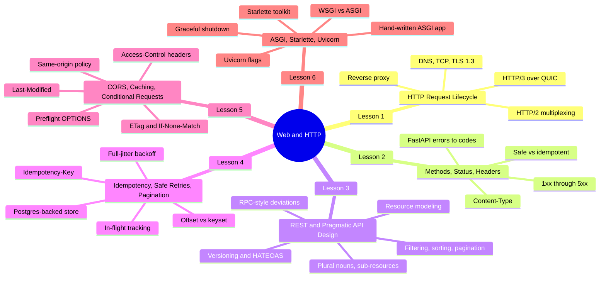
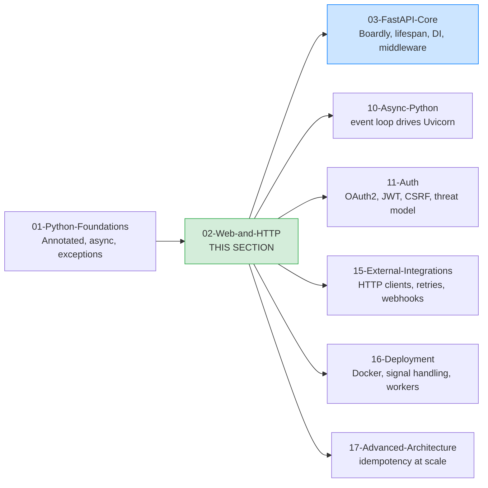

# 02: Web and HTTP

**Bookmark this page.**

This is the **home base** for Section 02 — Web and HTTP. Every lesson in this folder, every concept, every link back to the rest of the vault — all reachable from here. When you get lost, come back to the MOC.

Hello, friend. Pull up a chair.

Before you write a single FastAPI route, before you touch dependency injection, before you reason about async, you need to be honest about what HTTP actually is: a stateless, request/response, mostly-text protocol layered on top of TCP (and UDP, in HTTP/3), with a small set of verbs that mean specific things, and a status code space that clients actually parse. That is the bedrock. If you skip it, the rest of the vault will feel like magic — and not in a good way.

This section is the bedrock. Six lessons. Each one starts with a real `curl` or `httpie` trace, a real Starlette snippet, or a real Postgres schema — the actual bytes and code, not abstractions — and then we walk through every line of what you just saw. By the end you will be able to read an HTTP exchange like a sentence, choose the right verb and status code without thinking, design an API surface that ages well, make a `POST` safely retryable, configure CORS without cargo-culting it, and explain to a junior engineer what `async def app(scope, receive, send)` actually means.

**You're in the right place.**

If you've poked at HTTP via curl but never had to explain *why* `POST /v1/charges` returns `201 Created` and not `200 OK`, or *why* the browser sends an `OPTIONS` preflight before your `DELETE` — this section was written for you. We'll go slow. We'll explain every line. You will read real wire traces.

---

## What This Section Is, and What It Isn't

This is **not** a networking course. We will not derive TCP congestion control. We will not parse the binary frames of HTTP/2 by hand. We will not implement TLS 1.3 from RFC 8446.

This **is** a course about the HTTP vocabulary that a backend engineer uses every day, the API design conventions that age well, the reliability primitives (idempotency keys, safe retries, cursor pagination) that every production service needs, and the ASGI protocol that FastAPI sits on top of. We are deliberately conceptual on the wire-format details and deliberately concrete on the engineering decisions.

If you want the wire-format depth later, the RFCs are linked in every lesson's Sources section. Read RFC 9110 (HTTP Semantics) cover to cover once in your career; we will cite it throughout this section.

---

## The Section at a Glance #http

Six lessons, three of them canonical for the vault's concept registry. By the end of Lesson 6 you will be ready for Section 03 — FastAPI Core, where you start writing the `Boardly` application. Section 03's first lesson, [[Application-and-Lifespan]], assumes you have read Lesson 6 of this section; the lifespan is an ASGI concept, and we are not going to re-explain it there.

---

## Lessons in Order

| # | Lesson | What you walk away with | Time |
|---|--------|--------------------------|------|
| 1 | [[HTTP-Request-Lifecycle]] | A mental model of the full client-to-database round-trip — DNS, TCP, TLS 1.3, HTTP/2 multiplexing, HTTP/3 over QUIC, the reverse proxy, the ASGI server, Starlette, FastAPI, your route, the database, and back. You will read a real `curl -v` trace and explain every line. | 75–100 min |
| 2 | [[Methods-Status-Headers-Content-Types]] | The HTTP vocabulary: every method's safe/idempotent status, every status code that matters for an API, the headers you will actually set or read in FastAPI code, and a practical table mapping FastAPI exceptions to status codes. | 75–100 min |
| 3 | [[REST-and-Pragmatic-API-Design]] | How to design a REST API that ages well: resource modeling, plural nouns, sub-resources, filtering/sorting/pagination as query parameters, when to deviate with RPC-style endpoints, versioning (`/v1/`), and an honest word about HATEOAS. | 75–100 min |
| 4 | [[Idempotency-Safe-Retries-Pagination]] | How to make a `POST` safely retryable with `Idempotency-Key` and a Postgres-backed store, in-flight tracking, response replay, full-jitter backoff for client retries, and offset vs keyset pagination with code. **Canonical for Idempotency.** | 90–120 min |
| 5 | [[CORS-Caching-Headers-Conditional-Requests]] | Same-origin policy, the CORS preflight flow, `Access-Control-*` headers, the common CORS misconfigurations, and conditional GET with `ETag`/`If-None-Match` and `Last-Modified`/`If-Modified-Since`. **Canonical for CORS.** | 75–100 min |
| 6 | [[ASGI-Starlette-Uvicorn]] | WSGI vs ASGI, the ASGI spec at a glance, a hand-written minimal ASGI app, Starlette as the toolkit FastAPI builds on, Uvicorn internals and flags, Uvicorn vs Hypercorn, and graceful shutdown. **Canonical for ASGI.** | 90–120 min |

**Tip — How to read this section**

Read the lessons **in order**. Lesson 1 lays the request-lifecycle mental model that every later lesson references; Lesson 2 builds the vocabulary that Lesson 3's design discussion uses freely; Lesson 3 establishes the URL shapes that Lessons 4 and 5 implement; Lesson 6's ASGI material is assumed by Section 03's first lesson.

Each lesson follows the same shape: **Learning Objectives, Prerequisites, The Problem, The Code, Line-by-Line Deep Dive, Execution Trace, Common Mistakes, Engineering Trade-Offs, Exercises, Verification, Previously Learned Here, What's Next, Sources, What We Learned**. Open the lesson in one pane and a terminal in another, side by side. Run the `curl` traces. Modify the code. Break it on purpose. That is how you learn.

---

## How This Section Connects to the Rest of the Vault

This section is the prerequisite for [[03-FastAPI-Core/00-FastAPI-MOC|Section 03 — FastAPI Core]] — you cannot reason about middleware, exception handlers, or lifespan without the HTTP lifecycle. The three canonical lessons here are reused throughout the vault:

- **ASGI** (Lesson 6) is reused in [[03-FastAPI-Core/Application-and-Lifespan]], [[10-Async-Python/Event-Loop-and-Coroutines]], [[16-Deployment-and-DevOps/Docker-Multi-Stage-Non-Root]].
- **CORS** (Lesson 5) is reused in [[03-FastAPI-Core/Middleware-and-Request-Order]], [[11-Authentication-and-Security/Threat-Model-First]].
- **Idempotency** (Lesson 4) is reused in [[17-Advanced-Architecture/Idempotency-and-Retries]], [[15-External-Integrations/HTTP-Clients-Timeouts-Retries]], [[18-Portfolio-Projects/02-Multi-Tenant-Billing-SaaS]].

The status code table from Lesson 2 is the reference used in [[03-FastAPI-Core/Exception-Handlers]] and [[12-Testing-and-Quality/Testing-FastAPI-Endpoints]]. When a later lesson touches one of these concepts, it links back here instead of re-explaining.

---

## Concepts First Taught Here

Three recurring concepts are taught for the first time in this section. They each have a canonical lesson:

- **`ASGI`** — first taught in [[ASGI-Starlette-Uvicorn]]. The async server-gateway-interface protocol: `async def app(scope, receive, send)`.
- **`CORS`** — first taught in [[CORS-Caching-Headers-Conditional-Requests]]. The browser's same-origin policy and the headers that relax it selectively.
- **`Idempotency`** — first taught in [[Idempotency-Safe-Retries-Pagination]]. The property that calling an operation N times has the same effect as calling it once, and the engineering pattern that makes `POST` safely retryable.

If a later section touches one of these, it links back here instead of re-explaining. That is the rule from [[00-Start-Here/Concept-Registry]].

## Concepts Reused Here (not re-explained)

These were taught in earlier sections. We link back instead of repeating:

- `Annotated` — [[01-Python-Foundations/Type-Hints-and-Annotations]].
- `Async iterators / context managers` — [[01-Python-Foundations/Iterators-Generators-Context-Managers]].
- `Exceptions (Python)` — [[01-Python-Foundations/Exceptions-Done-Right]].

---

## The Growing Application

Unlike Section 03 — FastAPI Core, which builds one growing application called `Boardly` across its seven lessons, this section is about HTTP itself. The "real code" for each lesson is therefore small and standalone: a `curl -v` trace, an `httpie` exchange, a Starlette snippet, a Postgres schema, a minimal ASGI app. We are not writing a feature here; we are reading the wire.

Where a lesson previews a concept that Section 03 uses (the lifespan, ASGI, middleware), we forward-link. The `Boardly` app you will start building in [[03-FastAPI-Core/Application-and-Lifespan|Lesson 1 of Section 03]] sits on top of everything in this section.

**Example — A note on the verified versions.**

All the code in this section is verified against the versions in the table below. If you are on older versions, most of it will still run — we will call out the diffs that matter (the `lifespan` async context manager replaced `on_event` in FastAPI 0.93 / Starlette 0.27; the `Annotated[T, Depends(...)]` form became the preferred form in FastAPI 0.95). The HTTP RFCs themselves (9110, 9111, 9112, 9113, 9114) are stable standards, not moving targets — read them once and they will serve you for years.

---

## Verified Versions (October 2026)

This section targets the following versions, all verified current as of 2026-10-19:

| Package / Standard | Version | Notes |
|--------------------|---------|-------|
| FastAPI | 0.148.0 | Released 2026-10-19. Cited in Lessons 2, 4, 5, 6. |
| Starlette | 1.9.0 | Pinned by FastAPI. Cited in Lessons 5 and 6. |
| Uvicorn | latest stable | The default ASGI server. Cited in Lessons 1 and 6. |
| Python | 3.12 | The canonical learner version (3.13 also works). |
| HTTP semantics | RFC 9110 (2022) | Methods, status codes, headers. Cited throughout. |
| HTTP caching | RFC 9111 (2022) | `Cache-Control`, `Vary`, conditional requests. Cited in Lesson 5. |
| HTTP/1.1 | RFC 9112 (2022) | Wire format and keep-alive. Cited in Lessons 1 and 2. |
| HTTP/2 | RFC 9113 (2022) | Multiplexing and stream semantics. Cited in Lesson 1. |
| HTTP/3 | RFC 9114 (2022) | HTTP over QUIC. Cited in Lesson 1. |
| TLS 1.3 | RFC 8446 (2018) | Modern TLS handshake. Cited in Lesson 1. |

**Warning — The HTTP RFCs were reorganized in 2022.**

RFC 7230–7235 (the previous HTTP/1.1 specs) were obsoleted in 2022 by RFC 9110–9114. If you read a blog post from before 2022 and it cites RFC 7230 for "HTTP/1.1 message syntax", the same material now lives in RFC 9112. We use the post-2022 citations throughout this section. The semantics did not change; the document structure did.

---

## Reading Paths

Not everyone has eight hours in one block. Pick a path:

### The Fast Path (3 hours)

Just want to ship a typed CRUD API today? Read Lesson 1 (request lifecycle), Lesson 2 (methods/status), and Lesson 6 (ASGI/Uvicorn). You'll have the mental model, the vocabulary, and the runtime. Come back for 3, 4, 5 as the codebase grows.

### The Thorough Path (6–8 hours)

Linear. The lessons deliberately build on each other: the lifecycle gives you the mental model, the vocabulary gives you the words, the design lesson applies the words to a real API, the idempotency lesson solves the reliability problem the design lesson surfaces, the CORS lesson solves the browser problem the lifecycle lesson previewed, and the ASGI lesson closes the loop by explaining what sits between Uvicorn and your route function. Skip none of it.

**Which path are you on?**

Open a daily note and write down: which path, when you'll study each lesson, and a target completion date. Committing to a schedule beats willpower every time.

---

## Reference Links

- FastAPI documentation — <https://fastapi.tiangolo.com/>
- FastAPI release notes — <https://fastapi.tiangolo.com/release-notes/> — verified 0.148.0 on 2026-10-19.
- Starlette documentation — <https://www.starlette.io/>
- Uvicorn documentation — <https://www.uvicorn.org/>
- ASGI specification — <https://asgi.readthedocs.io/>
- RFC 9110 (HTTP Semantics) — <https://www.rfc-editor.org/rfc/rfc9110>
- RFC 9111 (HTTP Caching) — <https://www.rfc-editor.org/rfc/rfc9111>
- RFC 9112 (HTTP/1.1) — <https://www.rfc-editor.org/rfc/rfc9112>
- RFC 9113 (HTTP/2) — <https://www.rfc-editor.org/rfc/rfc9113>
- RFC 9114 (HTTP/3) — <https://www.rfc-editor.org/rfc/rfc9114>
- See [[21-Reference-Library/Source-Register]] for the full source list with dates accessed.

---

## Exercises and Labs

Hands-on exercises for this section live in [[20-Exercises-and-Labs/00-Exercises-MOC]]. Specifically, the curl/httpie-driven endpoint inspection lab and the "break CORS on purpose" lab. Each lesson also has its own Exercises section at the end — do at least the Beginner one for every lesson; the Intermediate ones are where the real learning lives.

**Your map is ready.**

Six lessons, three canonical concepts, one bedrock. Pick a starting point and go. We'll see you on the other side.

---

**Tags:** #moc #web #http #index #home
**Previous:** [[00-Start-Here/Curriculum-Index]]
**Start:** [[HTTP-Request-Lifecycle]] ->
