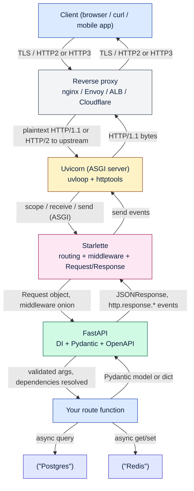
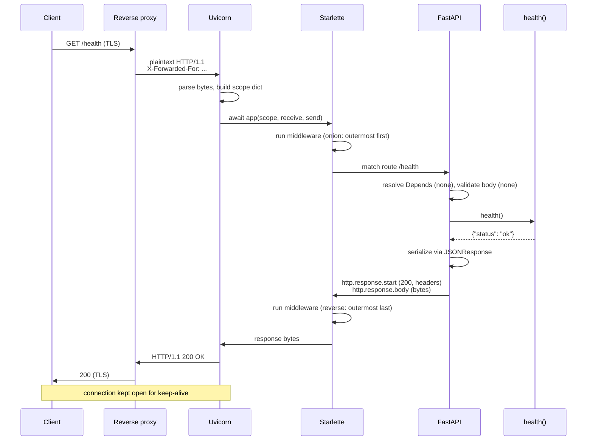

# Lesson 06: ASGI, Starlette, Uvicorn

*The protocol between Uvicorn and your route function — what `(scope, receive, send)` actually means, what Starlette gives you for free, and what Uvicorn does with your sockets.*

**Half of FastAPI's "magic" becomes predictable once you know the layers.**

A surprising amount of FastAPI behavior — middleware order, dependency cleanup, lifespan startup/shutdown, the existence of `BackgroundTasks`, the way streaming responses work — makes no sense unless you know that FastAPI is Starlette plus Pydantic plus a routing layer, that Starlette speaks ASGI, and that ASGI is just a Python callable with a specific signature. Once you know that, half of the magic becomes predictable. This is the canonical lesson for **ASGI** in this vault. By the end you will write a minimal ASGI app by hand, configure Uvicorn for production, and read the layered architecture diagram as a sentence. Take your time. Type the ASGI app yourself. **This is how you learn.**


#http #asgi #uvicorn #canonical

> Previously learned in: [[HTTP-Request-Lifecycle|the request lifecycle]]. We introduced Uvicorn and Starlette as the layers between the reverse proxy and your route function. Here we go inside them: what the ASGI protocol actually is, what Starlette gives you for free, and what Uvicorn (or Hypercorn) is doing with your sockets.

## Learning Objectives

By the end of this lesson you will be able to:

1. **Explain the difference between WSGI and ASGI** and why ASGI exists.
2. **Read an ASGI app** as a Python callable with the `(scope, receive, send)` signature.
3. **Write a minimal ASGI app by hand** that returns a JSON response, without Starlette or FastAPI.
4. **Describe Starlette's responsibilities** and the boundary between Starlette and FastAPI.
5. **Choose between Uvicorn and Hypercorn** for a deployment and explain the trade-offs.
6. **Configure Uvicorn for development** (`--reload`) **and for production** (workers, `--proxy-headers`, graceful shutdown).
7. **Explain what happens during a graceful shutdown** and why it matters.

## Prerequisites

- **[[HTTP-Request-Lifecycle]]** — you should know where Uvicorn sits in the stack.
- **[[10-Async-Python/Event-Loop-and-Coroutines]]** — ASGI is async-first; you should know what a coroutine is and what an event loop does. If `async def` and `await` are still magic, re-read this section.
- **[[01-Python-Foundations/Iterators-Generators-Context-Managers]]** — the ASGI app is an `async` callable; understanding async context managers will help with the lifespan discussion.
- **`uv` installed** (`uv 0.13.1` verified Oct 2026). We will use `uv run uvicorn` throughout.
- **About an hour and a half of focused time.** This lesson has the most code of any lesson in the section — a hand-written ASGI app, a Starlette snippet, a Uvicorn command-line tour.

**The most common gap: thinking Uvicorn and FastAPI are the same layer.**

Uvicorn is the ASGI server; FastAPI is the ASGI application. They are different layers connected by the ASGI protocol. Uvicorn does not know about your routes, your dependencies, or your Pydantic models. It only knows about bytes on a socket and the `scope/receive/send` triple it hands to your app. FastAPI does not know about sockets, TCP, or TLS. It only knows about the `scope` dict and the `receive`/`send` callables. The boundary is the ASGI spec.


## The Problem

When you write `uv run uvicorn boardly.main:app --reload`, what is `app`? What is `uvicorn`? What sits between the two of them?

The honest answer: `app` is an ASGI callable. `uvicorn` is the program that holds the socket, accepts TCP connections, parses HTTP bytes, and calls `app(scope, receive, send)` for each request. Between them sits the ASGI specification — a Python protocol that defines what `scope`, `receive`, and `send` look like.

If you do not know this, you will be confused by:

- Why middleware runs in the order it does (it is Starlette's onion, layered around your route function).
- Why the lifespan is the place to open and close resources (it is the ASGI lifespan protocol, fired by Uvicorn on startup and shutdown).
- Why `BackgroundTasks` exist (they are a Starlette primitive that lets your route return before the background work is done).
- Why streaming responses work the way they do (they are an ASGI `http.response.body` event with `more_body=True`).

This lesson makes all of that predictable. We are not going to teach you to write production code in raw ASGI — you will use Starlette and FastAPI for that. But you will write a minimal ASGI app by hand, once, so the abstraction is honest.

**Note — ASGI is not a standard in the RFC sense.**

ASGI is a community spec, maintained by the encode organization (the same people who maintain Starlette, Uvicorn, and httpx). The spec lives at `https://asgi.readthedocs.io/`. It is not an RFC; it is a Python protocol description. It is the de-facto standard for async Python web servers.


## The Code: Part 1 – A Hand-Written ASGI App

Real-code-first. Here is a complete ASGI application, written by hand, with no Starlette and no FastAPI. Save it as `app.py` and run it with Uvicorn. It returns `{"hello": "world"}` for any request.

```python
# app.py
"""Lesson 6 reference: a minimal ASGI application, written by hand.

This is the protocol between Uvicorn and your route function. Starlette
and FastAPI wrap this; Uvicorn calls it. Read every line.
"""


async def app(scope, receive, send):
 """The ASGI callable. Uvicorn calls this for every HTTP request.

 Args:
 scope: a dict describing the connection.
 receive: an awaitable that yields event dicts (more body chunks,
 disconnect notifications).
 send: an awaitable that accepts event dicts (response start,
 response body chunks).
 """
 # 1. Handle only HTTP requests. (Lifespan is handled separately by
 # Starlette and FastAPI; a raw ASGI app like this one would also
 # need to handle scope["type"] == "lifespan" if it cared.)
 assert scope["type"] == "http"

 # 2. Drain the request body. We are not using it, but we must
 # consume all events from `receive` so the connection does not
 # stall. For a GET there is typically one event with no body.
 more_body = True
 while more_body:
 message = await receive()
 more_body = message.get("more_body", False)

 # 3. Send the response start: status code and headers.
 # Headers is a list of (bytes, bytes) tuples, not a dict —
 # because HTTP allows duplicate header names.
 await send({
 "type": "http.response.start",
 "status": 200,
 "headers": [
 (b"content-type", b"application/json"),
 ],
 })

 # 4. Send the response body. The body is bytes. `more_body=True`
 # would mean "more chunks are coming" — used for streaming.
 await send({
 "type": "http.response.body",
 "body": b'{"hello": "world"}',
 })
```

Run it:

```bash
uv run uvicorn app:app --reload --port 8000
# In another terminal:
curl -i http://127.0.0.1:8000/
# HTTP/1.1 200 OK
# content-type: application/json
# content-length: 17
#
# {"hello": "world"}
```

That is the ASGI spec in 30 lines. You would never write this by hand for production — Starlette wraps it in `Request`, `Response`, routing, middleware. FastAPI wraps Starlette in DI, validation, OpenAPI. But knowing the shape is what lets you read middleware, write custom ASGI middleware, and reason about ordering.

## Line-by-Line Deep Dive

### The function signature

```python
async def app(scope, receive, send):
```

**What it does:** Defines an async callable named `app`. Uvicorn will call `await app(scope, receive, send)` for each request. The name `app` is conventional — it is what `uvicorn app:app` (module:attribute) refers to.

**Why `async def`:** ASGI is async-first. Uvicorn drives an event loop; your app is a coroutine that runs on it. The same event loop handles many concurrent requests — that is how ASGI scales without threads.

**Why no type annotations on `scope`, `receive`, `send`:** The ASGI spec uses structural typing — `scope` is a dict with specific keys depending on `scope["type"]`, `receive` is `Callable[[], Awaitable[Mapping[str, Any]]]`, `send` is `Callable[[Mapping[str, Any]], Awaitable[None]]`. You can annotate them in production code (Starlette does), but the types are structural, not nominal. For the lesson, we omit them to focus on the shape.

**Why are `scope`, `receive`, and `send` three separate arguments instead of one `Request` object?** Because ASGI models the protocol *before* the abstraction. A `Request` object (like Starlette's `starlette.requests.Request`) is the projection you build *from* `scope` plus `receive` — it has parsed headers, a typed `body` accessor, a `json()` coroutine, a `form()` coroutine, a `query_params` MultiDict. But to construct that `Request`, you need raw `scope` and `receive`. The ASGI spec hands you the raw materials and trusts you to compose them. Why? Because Starlette, FastAPI, Litestar, and any future framework all need to compose them differently. Starlette's `Request` is one composition; FastAPI wraps it; a custom ASGI middleware you write in Section 03 might use `scope` directly without ever building a `Request`. The three-argument signature is what keeps ASGI framework-neutral. **What would happen if ASGI handed you a `Request` object instead?** Every ASGI framework would have to inherit from a base `Request` class to interoperate, and innovating on the request abstraction (e.g., adding `Annotated`-based accessors) would require either subclassing or breaking compatibility. The three-argument form is the minimum surface area that lets every framework build whatever abstraction it wants on top.

**The ASGI "application" is just a callable.**

The ASGI application is any callable that takes `(scope, receive, send)` and returns an awaitable. It can be a function, a class with `__call__`, a lambda (in theory), or a partial. Starlette's `Starlette` class is a callable whose `__call__` does the routing and middleware. FastAPI's `FastAPI` class inherits from `Starlette` and adds Pydantic + DI + OpenAPI on top of the same `__call__`.


### The `scope` dict

```python
assert scope["type"] == "http"
```

**What it does:** Asserts that the request is an HTTP request. The `scope["type"]` field can be `"http"`, `"websocket"`, or `"lifespan"` — the three ASGI protocols.

A `scope` dict for an HTTP request looks roughly like:

```python
scope = {
 "type": "http", # or "websocket", "lifespan"
 "asgi": {"version": "3.0", "spec_version": "2.3"},
 "http_version": "1.1", # or "2", "3"
 "method": "GET",
 "scheme": "https", # or "http", "ws", "wss"
 "path": "/v1/orders/42",
 "query_string": b"",
 "headers": [(b"host", b"api.example.com"), ...],
 "client": ("198.51.100.7", 53821),
 "server": ("127.0.0.1", 8000),
 "app": <whatever you attached>,
 "state": {}, # per-app mutable state
 "root_path": "",
 "extensions": {},
}
```

Three scope types are defined:

- **`http`** — an HTTP/1.x or HTTP/2 request/response.
- **`websocket`** — a WebSocket connection.
- **`lifespan`** — application startup and shutdown events.

The `headers` field is a list of `(bytes, bytes)` tuples, not a dict — because HTTP allows duplicate header names (e.g., `Set-Cookie`). Bytes, not strings, because headers are bytes on the wire.

**Student asks: why is `headers` a list of tuples and not a dict? Isn't `dict[str, str]` more convenient?**

It would be — and that convenience is exactly what Starlette's `Request.headers` gives you on top of the raw ASGI scope. But the ASGI spec itself exposes headers as `list[tuple[bytes, bytes]]` for one specific reason: HTTP allows duplicate header names. `Set-Cookie` is the canonical example — a single response can set three cookies, and the wire representation is three `Set-Cookie:` headers, not one. If ASGI normalised to a dict at the protocol boundary, either you would lose two of the three cookies, or you would have to invent a special-case rule ("for `Set-Cookie` use a list, for everything else use a string"). The list-of-tuples form is honest: it represents the wire bytes verbatim and lets upper layers (Starlette's `Headers` class) decide how to project. When you read `request.headers["set-cookie"]` in a route function, you are reading a *projection* of the underlying list — and the projection is documented to return the first match for non-list-valued headers. Reach for `request.headers.getlist("set-cookie")` when you need every value.


**Danger — Security: never trust `scope["client"]` for authz unless `--proxy-headers` is configured.**

`scope["client"]` is `(ip, port)` as Uvicorn sees it on the socket — by default that is the immediate TCP peer, which behind a reverse proxy is always the proxy (typically `127.0.0.1` or the proxy's container IP). Without `--proxy-headers --forwarded-allow-ips="<proxy CIDR>"`, any client can send `X-Forwarded-For: 1.2.3.4` and your `request.client.host` will surface `1.2.3.4` to your rate limiter, audit log, or IP-based authz. Worse, the *leftmost* entry in an `X-Forwarded-For` chain is the most attacker-controlled (the client sets it), and only the *rightmost* hop is the proxy you actually trust. Uvicorn's `--proxy-headers` flag wraps the app in Starlette's `ProxyHeadersMiddleware`, which walks the chain backwards and only honours entries from IPs in `--forwarded-allow-ips`. If you build an IP-based rate limiter or an IP allow-list on top of `request.client.host` without `--proxy-headers`, the entire control is forgeable — the first request from a "trusted" IP that the attacker spoofs is the one that lets them in. Treat "we use the client IP for security" and "we did not configure `--forwarded-allow-ips`" as a critical finding in any production review.


### The `receive` callable

```python
more_body = True
while more_body:
 message = await receive()
 more_body = message.get("more_body", False)
```

**What it does:** Drains the request body. `receive` is an awaitable that yields event dicts. For HTTP, the events are `http.request` (with `body` and `more_body` keys) and `http.disconnect`.

A `http.request` event looks like:

```python
{
 "type": "http.request",
 "body": b'{"customer_id": 7, "total_cents": 4200}', # bytes
 "more_body": False, # True if more chunks are coming
}
```

For small bodies (most API requests), there is one `http.request` event with the full body and `more_body=False`. For large bodies (file uploads, streaming), there are multiple events, each with a chunk and `more_body=True` until the last one.

**Why we drain it even when we don't use it:** If we don't drain the body, the client's send buffer may fill, the client may block, and the connection may stall. For a `GET` with no body, this loop iterates once on a `http.request` event with `body=b""` and `more_body=False`, then exits.

**Why does the protocol require *us* to drain `receive` instead of letting Uvicorn do it?** Because ASGI is explicit about resource ownership. If Uvicorn drained the body silently before calling your app, your app could not stream-upload — a route that wanted to read the body chunk-by-chunk (e.g., to spool a 4 GB upload to disk via `UploadFile`) would never see the chunks. The protocol hands you `receive` because the body is *yours* to consume, and the contract is "if you don't consume it, the connection stalls and you're responsible." **What would happen if you forgot to drain in a `GET` handler?** For a typical small `GET` request the body fits in one TCP packet, Uvicorn has already read it into a buffer by the time it calls `app()`, and the connection might survive — which is why the bug is invisible in development and only manifests under load (large bodies, slow clients, HTTP/2 multiplexing where the next stream is waiting on the same connection). The `assert scope["type"] == "http"` plus the drain loop is the minimum a hand-written ASGI app must do to be a well-behaved citizen on a real server.

**Warning — Debugging: skipping the `receive` drain stalls the connection under HTTP/2 multiplexing.**

The lesson drains `receive` even though the handler does not use the body, with the comment that "for a GET there is typically one event with no body." In development that is true and the bug is invisible; in production with HTTP/2 between the client and the proxy, the bug is loud. HTTP/2 multiplexes many logical streams over one TCP connection; if your handler returns without draining, the proxy's send buffer for that stream may fill, the proxy blocks on write, and every other stream on the same connection stalls behind it — the symptom is "one slow-upload request froze the entire user's session, including unrelated endpoints." The fix is unconditional: always drain `receive` in a `while more_body:` loop, even in handlers that ignore the body, or use Starlette's `Request` (which drains on `__del__` as a backstop, though relying on `__del__` is not safe for the timing-critical case). To reproduce the stall locally: send a `POST` with a 10 MB body to a handler that returns immediately without draining, over a connection that pipelines a second request — the second request's response will not arrive until the first connection times out.


### The `send` callable: `http.response.start`

```python
await send({
 "type": "http.response.start",
 "status": 200,
 "headers": [
 (b"content-type", b"application/json"),
 ],
})
```

**What it does:** Sends the response status and headers. This is the first event the server sends back. The `headers` is a list of `(bytes, bytes)` tuples — same as in `scope["headers"]`.

**Why start and body are separate:** ASGI separates the response start (status + headers) from the response body. This lets you stream a response — you send `http.response.start` once, then `http.response.body` events with `more_body=True` for each chunk. Starlette's `StreamingResponse` is built on this.

### The `send` callable: `http.response.body`

```python
await send({
 "type": "http.response.body",
 "body": b'{"hello": "world"}',
})
```

**What it does:** Sends the response body. The body is bytes. If `more_body=True` is set (we don't here), more body chunks will follow.

For a streaming response, you would send multiple `http.response.body` events, each with a chunk and `more_body=True` until the last:

```python
await send({"type": "http.response.body", "body": b"chunk1\n", "more_body": True})
await send({"type": "http.response.body", "body": b"chunk2\n", "more_body": True})
await send({"type": "http.response.body", "body": b"chunk3\n", "more_body": False})
```

This is what `StreamingResponse` does under the hood.

**Student asks: why bytes, not strings?**

HTTP is bytes on the wire. Headers can contain non-ASCII bytes (though modern HTTP specs strongly recommend ASCII); bodies can be any bytes. ASGI chose bytes over strings to avoid the encoding ambiguity that plagued WSGI. You decode to strings where you need to (e.g., parsing JSON), with an explicit encoding (typically UTF-8). The cost is verbosity; the benefit is correctness.


**Production: chunk large responses and respect `send` backpressure.**

The lesson's `http.response.body` example sends the entire body in one event. For a 50 MB CSV export, that means allocating 50 MB in memory and writing it to the socket in one `await send(...)` call — which blocks the event loop until the OS accepts the bytes (backpressure). The production pattern is to chunk: send `http.response.start`, then iterate the data in fixed-size chunks (64–256 KB is a reasonable default for HTTP/1.1; HTTP/2 prefers smaller frames), each with `more_body=True`, and end with `more_body=False`. The `await send(...)` between chunks yields to the event loop, which lets Uvicorn write to the socket and apply backpressure (the client reads slowly → the kernel socket buffer fills → `await send` does not complete → your coroutine suspends → other requests on the same event loop keep running). Starlette's `StreamingResponse` and `FileResponse` do this for you; if you write raw ASGI, you must do it yourself. The bug signature of "forgot to chunk" is "one user's CSV export makes the whole worker unresponsive for 30 seconds" — that is the event loop blocked on a single oversized `send`.


## Under the Hood: WSGI vs ASGI

WSGI (PEP 3333, 2010) is the synchronous Python web-server-to-application protocol: a callable `def app(environ, start_response)` that returns an iterable of bytes. It is request/response, blocking, and was defined in 2010. It cannot model long-lived connections (WebSockets), server push, or streaming responses cleanly.

ASGI (Asynchronous Server Gateway Interface, 2016) is the async successor: `async def app(scope, receive, send)`. It supports HTTP, HTTP/2, and WebSockets, and it is event-based — `receive` and `send` are streams of event dicts. The protocol was originally developed for the Django Channels project and is now the de-facto async web protocol for Python.

| Property | WSGI | ASGI |
|----------|------|------|
| Call signature | `def app(environ, start_response) -> Iterable[bytes]` | `async def app(scope, receive, send)` |
| Concurrency model | one thread per request | one event loop, many concurrent coroutines |
| WebSocket support | none | native |
| HTTP/2 server push | none | native |
| Streaming bodies | clunky | first-class via `receive` events |
| Servers | Gunicorn (sync), uWSGI, mod_wsgi | Uvicorn, Hypercorn, Daphne, Granian |
| Frameworks | Flask, Django (sync), Bottle | Starlette, FastAPI, Litestar, Django (async views) |

**Why ASGI exists.**

WSGI was designed for a world of synchronous Python web servers and request/response HTTP. By 2015, two things had changed: (a) Python gained `asyncio` and the event-loop model, which let one process handle thousands of concurrent connections without threads; (b) the web gained WebSockets and HTTP/2, which need long-lived connections that WSGI could not model cleanly. ASGI was designed to fill both gaps. The async model lets one process serve many concurrent connections; the event-based protocol lets it model WebSockets and streaming responses.


**Production: bridge WSGI apps into ASGI with `a2wsgi` during incremental migrations.**

If you are migrating a Flask or Django-sync app to FastAPI piece by piece, you do not need a flag-day rewrite. The `a2wsgi` library (`uv add a2wsgi`) wraps a WSGI callable as an ASGI callable: `from a2wsgi import WSGIApp; asgi_app = WSGIApp(wsgi_app)`, and you mount it under a Starlette route (`app.mount("/legacy", WSGIApp(flask_app))`) while the new FastAPI routes serve `/v2/*`. The bridge runs the WSGI callable in a threadpool (anyio's `to_thread.run_sync` under the hood, default 40 tokens) so it does not block the event loop. The trade-off: every request through the bridge pays a threadpool hop and a context-switch, so measure before committing a high-traffic route to the bridge long-term. The migration pattern that works: keep new code on FastAPI, keep legacy code on the WSGI bridge, retire the bridge as legacy endpoints are rewritten — never let the bridge become the permanent shape. As of Oct 2026, `a2wsgi` is the encode-org-blessed shim; Starlette's own migration docs reference it.


## Starlette: The Toolkit FastAPI Builds On

Starlette is the ASGI toolkit FastAPI builds on. It provides:

- **Routing**: path-parameterized routes, mounts, sub-applications.
- **Request/Response objects**: the typed wrappers around ASGI scope and events.
- **Middleware base class** with `BaseHTTPMiddleware` so you can write `async def dispatch(self, request, call_next)`.
- **Built-in middleware**: `CORSMiddleware`, `SessionMiddleware`, `TrustedHostMiddleware`, `GZipMiddleware`, `ProxyHeadersMiddleware`.
- **Exception handlers**: the mapping of exception types to response functions.
- **`BackgroundTasks`**: a lightweight in-process post-response worker. (For real background work, see [[14-Caching-and-Background-Processing/Background-Tasks-vs-Workers|Lesson 1 of Section 14]].)
- **`TestClient`**: wraps the ASGI app with a synchronous in-process HTTP client (built on `httpx`).
- **Streaming responses**: `StreamingResponse` (chunks from an async generator) and `FileResponse` (uses `sendfile(2)` when available).
- **WebSockets**: `WebSocket`, `WebSocketRoute`.

FastAPI's additions on top of Starlette:

- **Dependency injection** (`Depends`, `Annotated[..., Depends(...)]`).
- **Pydantic-powered request validation and response serialization.**
- **Automatic OpenAPI schema generation.**
- **A more ergonomic decorator-based routing API** (`@app.get(...)` instead of `@app.route("/", methods=["GET"])`).

The boundary is clean: anything you can do in Starlette, you can do in FastAPI, because FastAPI *is* Starlette plus extras. Most of Starlette's middleware is available in FastAPI unchanged via `app.add_middleware(...)`.

**Example — A minimal Starlette app.**

```python
from starlette.applications import Starlette
from starlette.routing import Route
from starlette.responses import JSONResponse

async def health(request):
return JSONResponse({"status": "ok"})

app = Starlette(routes=[Route("/health", health)])
```
That is Starlette with no FastAPI. Run it with `uvicorn app:app`. You get routing and JSONResponse for free. FastAPI adds Pydantic validation, DI, and OpenAPI on top of this. The cost is the dependency; the benefit is everything FastAPI gives you for free.


**Student asks: why does FastAPI sit *on top of* Starlette rather than *next to* it?**

Because Starlette already solves the parts of the stack where the right answer is one opinion: routing, the request/response cycle, middleware composition, lifespan, the test client. Reimplementing any of those would burn the FastAPI maintainer's time without adding a feature the user sees. What FastAPI adds on top is *typed* ergonomics that Starlette's API deliberately does not have — Pydantic body validation, `Annotated[..., Depends(...)]` parameter resolution, automatic OpenAPI schema, automatic status-code inference. Sitting on top means FastAPI inherits every Starlette bug fix the day it lands, and a Starlette middleware you write in Section 03 works identically inside FastAPI. The trade-off is that you cannot upgrade Starlette past what FastAPI pins — but FastAPI pins Starlette tightly for a reason (the API surface changes are mostly additive), and the academy's `uv.lock` makes the pin exact.


**Danger — Security: `BaseHTTPMiddleware` buffers the response; do not stream secrets or large auth tokens through it.**

Starlette's `BaseHTTPMiddleware` (the base class for most custom middleware) is known to fully buffer the response body before sending it under several code paths, because its `dispatch(request, call_next)` API needs to read the downstream `Response` to wrap it — which means the response is materialized in memory before `send` is called. Two consequences: (a) streaming responses streamed through `BaseHTTPMiddleware` lose their streaming property (the client receives the whole body at once after the entire response is buffered, which breaks `curl -N` progressive display and inflates TTFB for streaming endpoints), and (b) a response containing a large auth token, a JWT, or a signed URL is materialized in the worker's heap before being sent — doubling peak memory per request and exposing the secret to any middleware above that logs or samples response bodies. The Starlette team's recommendation as of Oct 2026 is "prefer raw ASGI middleware over `BaseHTTPMiddleware` for anything that touches the response body" (the Starlette docs track this on the "Middleware" page and the encode org has the long-running issue about the buffering). For middleware that must inspect or modify the response body, write it as a raw `async def __call__(self, scope, receive, send)` that wraps `send` — that lets you stream and inspect without buffering. Never put a request/response logger built on `BaseHTTPMiddleware` in front of routes that return access tokens.


## Uvicorn: The ASGI Server

Uvicorn is an ASGI server built on `uvloop` (a fast `libuv`-backed event loop implementation, a drop-in replacement for `asyncio` with significantly better performance) and `httptools` (the Node.js HTTP parser, used for parsing request bytes). It is the default ASGI server for FastAPI.

Common commands:

```bash
# Development with auto-reload on file changes
uv run uvicorn app:app --reload

# Production: bind, workers, proxy headers, log level
uv run uvicorn app:app \
 --host 0.0.0.0 \
 --port 8000 \
 --workers 4 \
 --proxy-headers \
 --forwarded-allow-ips="10.0.0.0/8" \
 --log-level info

# Bind a Unix socket (faster than TCP for local IPC with a reverse proxy)
uv run uvicorn app:app --uds /tmp/uvicorn.sock
```

Key flags:

| Flag | What it does |
|------|--------------|
| `--reload` | Watch files; restart the app on change. Dev only. |
| `--workers N` | Spawn N worker processes; each runs its own event loop and copy of the app. |
| `--proxy-headers` | Trust `X-Forwarded-*` headers from the proxy and use them in `request.client`, `request.url`. |
| `--forwarded-allow-ips` | CIDRs whose `X-Forwarded-*` we trust. Default is `127.0.0.1` only. |
| `--uds PATH` | Bind a Unix domain socket instead of TCP. |
| `--limit-concurrency N` | Reject new connections beyond N concurrent in-flight requests. |
| `--limit-max-request-size BYTES` | Reject request bodies larger than this. |
| `--timeout-keep-alive SECONDS` | Drop idle keep-alive connections after this. |
| `--timeout-graceful-shutdown SECONDS` | Wait this long for in-flight requests to finish on shutdown. |
| `--log-level` | `critical`, `error`, `warning`, `info`, `debug`, `trace`. |
| `--loop` | `auto` (uvloop if available), `asyncio`, `uvloop`. |
| `--http` | `auto`, `httptools`, `h11`. |
| `--ssl-keyfile`, `--ssl-certfile` | Run TLS directly (rarely needed; usually the proxy terminates TLS). |

**Warning — Debugging: `--limit-max-request-size` returns `413` without your route ever seeing the request.**

Uvicorn's `--limit-max-request-size` flag is enforced at the HTTP parser layer, before the ASGI app is called. When a client uploads a body larger than the limit, Uvicorn returns `413 Payload Too Large` and your route function is never called — your dependency cleanup, your `try/finally`, your `Request` body parser all never run. The bug signature: "users report 413 on the file-upload endpoint but our logs show no request ever arrived" — because the request was rejected at the ASGI-server layer, not the app layer. Debug by checking Uvicorn's access log (it shows the 413) and the app's structured logs (which show nothing for that request). The fix is to set `--limit-max-request-size` deliberately to your real maximum (e.g., 5 GB for a video-upload endpoint, 1 MB for a JSON API) and to handle the 413 in your reverse proxy with a friendly error page, because Uvicorn's 413 body is empty and unhelpful to clients. Pair with `--limit-concurrency` to bound the in-flight request count, which is a separate but related backpressure control.


### `--workers N`: pre-forking

Uvicorn's `--workers N` spawns N processes via pre-forking. Each process runs its own event loop and its own copy of the application. Why multiple processes when ASGI is async-concurrent?

- **The Python GIL means one process can use one CPU core for CPU-bound Python.** Multiple processes let you use multiple cores.
- **Each process has its own event loop**, so a CPU-heavy coroutine in one worker does not block requests in another.
- **A crash in one worker does not take down the others.**

Rule of thumb: `workers = (2 * CPU cores) + 1`. This is the Gunicorn default and a reasonable starting point. For I/O-bound workloads, fewer workers may be enough; for CPU-bound work mixed into your routes, more workers (or moving CPU-bound work out of the event loop entirely, see [[10-Async-Python/Concurrency-vs-Parallelism|Lesson 2 of Section 10]]) is better.

Behind a reverse proxy or a container orchestrator, you often run one Uvicorn worker per container and scale horizontally — `--workers 1` per pod, many pods. The right shape depends on where you do load balancing.

**Warning — Workers do not share state.**

Each worker is a separate process with its own copy of the app, its own lifespan, its own `app.state`, its own connection pool. If you store a counter in `app.state.counter` and increment it per request, you have N independent counters, not one. For shared state, use Redis or Postgres — not module-level variables or `app.state`.


**Production: one Uvicorn worker per container, scale horizontally via HPA, and avoid `--preload` with `lifespan`.**

The lesson's rule of thumb `workers = (2 * CPU cores) + 1` is the Gunicorn-era default from a world where one process served the whole machine. In a containerized deployment (Kubernetes, ECS, Nomad), the right shape is one Uvicorn worker per container (`--workers 1`) and horizontal scaling via HPA — because the orchestrator handles process supervision, restart-on-crash, and load balancing, and adding `--workers 4` *inside* the container just multiplies your memory footprint (4× the connection pool, 4× the lifespan) without giving you anything the orchestrator was not already giving you. The exception is a single-node deployment where you have unused cores and want to use them without the ops cost of horizontal scaling — there `--workers N` is correct. Do not pair `--preload` (which imports the app once in the master and shares it via `fork`) with a `lifespan` that opens resources: the lifespan runs once in the master *before* fork, and the forked workers inherit a copy of the engine pool that the master never closes — the classic "Postgres connection count grows by N per deploy" bug. Run `--preload` only with stateless apps; pair `lifespan` with `--workers N` (no preload) so each worker runs its own lifespan and opens its own pool.


### `--proxy-headers` and `--forwarded-allow-ips`

These two flags together configure Uvicorn to trust the `X-Forwarded-*` headers from the reverse proxy and use them in `request.client` (the client IP) and `request.url` (the scheme).

Without `--proxy-headers`, every request looks like it came from `127.0.0.1` over `http`, even when the original client was on the public internet over `https`. With `--proxy-headers` and `--forwarded-allow-ips="<proxy CIDR>"`, Uvicorn parses `X-Forwarded-For` and `X-Forwarded-Proto` from requests in the trusted CIDR and surfaces them to your app.

The `--forwarded-allow-ips` flag is the security gate: Uvicorn only trusts `X-Forwarded-*` from clients in that CIDR. Without that gate, any client could forge `X-Forwarded-For: 1.2.3.4` and you would log whatever they wanted. Always set this to your proxy's CIDR.

**Danger — Security: `X-Forwarded-For` is a comma-separated chain; only the rightmost hop is trustworthy.**

`X-Forwarded-For: 1.2.3.4, 10.0.0.1, 10.0.0.2` means "the request was sent from 1.2.3.4 (claimed), forwarded by 10.0.0.1, forwarded by 10.0.0.2." Only `10.0.0.2` — the *last* entry — is the proxy that actually handed you the request on the socket; every entry to its left was put there by some upstream hop and is forgeable. An attacker connecting directly to your Uvicorn can send `X-Forwarded-For: 1.2.3.4, 10.0.0.2` (claiming to come through your trusted proxy at `10.0.0.2`) and your app, if it parses the chain left-to-right and trusts the leftmost, will record `1.2.3.4` as the client IP. Starlette's `ProxyHeadersMiddleware` (which Uvicorn's `--proxy-headers` flag enables) walks the chain from the right and stops at the first entry whose source IP is not in `--forwarded-allow-ips` — so only hops from trusted proxies are surfaced. Never hand-roll `X-Forwarded-For` parsing; always use the middleware. If you must inspect the raw chain for forensic reasons, treat every entry to the left of the rightmost trusted hop as untrusted user input — because that is what it is.


### Uvicorn vs Hypercorn

| Property | Uvicorn | Hypercorn |
|----------|---------|-----------|
| HTTP/1.x | yes | yes |
| HTTP/2 | experimental (requires the `h2` package; enable with `--http h2`) | yes, native |
| HTTP/3 (QUIC) | no | yes (experimental) |
| WebSocket | yes | yes |
| `uvloop` | yes (default on Unix) | yes (optional) |
| Multi-worker | `--workers N` (pre-forks processes) | `--workers N` |
| Worker process manager | its own (or via `gunicorn -k uvicorn.workers.UvicornWorker`) | its own |
| Mature in production | very common | common |

**Engineering judgment: start with Uvicorn.** Move to Hypercorn only if you specifically need HTTP/3, or you have a Hard Requirement for HTTP/2 server push (which has limited browser support anyway).

Most production deployments run HTTP/2 or HTTP/3 at the *reverse proxy* (nginx, Cloudflare, AWS ALB), and HTTP/1.1 from the proxy to Uvicorn. The proxy handles the modern protocol with the client; Uvicorn handles the simple protocol with the proxy. This is the right shape — let the proxy do the protocol work it is good at.

## The Layered Architecture: Color-Coded



Read the diagram top-to-bottom on the way in (request) and bottom-to-top on the way out (response). The colors:

- **Blue (client, your code)** — what you write or what your client sends.
- **Grey (proxy)** — the reverse proxy; usually nginx.
- **Yellow (ASGI server)** — Uvicorn.
- **Pink (Starlette)** — the toolkit.
- **Green (FastAPI)** — the framework.
- **Indigo (datastores)** — Postgres, Redis.

Each layer has a clean job. The boundary between proxy and Uvicorn is HTTP bytes. The boundary between Uvicorn and Starlette is the ASGI `scope/receive/send` triple. The boundary between Starlette and FastAPI is the `Request`/`Response` objects and the routing layer. The boundary between FastAPI and your route is the validated arguments FastAPI hands you.

**Tip — The mental model.**

Uvicorn is the kernel driver; Starlette is the standard library; FastAPI is the framework; your route is the application. Each layer trusts the layer below it and exposes a slightly higher-level API to the layer above it. When something breaks, identify which layer is broken before you fix it.


## Lifespan Events

ASGI servers send lifespan events at startup and shutdown. Starlette and FastAPI turn these into the `lifespan` async context manager. We saw this in [[HTTP-Request-Lifecycle|Lesson 1]]; we will see it built properly in [[03-FastAPI-Core/Application-and-Lifespan|Lesson 1 of Section 03]].

```python
from contextlib import asynccontextmanager
from fastapi import FastAPI

@asynccontextmanager
async def lifespan(app: FastAPI):
 # Runs on "lifespan.startup"
 print("starting up")
 # ... open engine pools, Redis clients, etc. ...
 yield
 # Runs on "lifespan.shutdown"
 print("shutting down")
 # ... close engine pools, Redis clients, etc. ...

app = FastAPI(lifespan=lifespan)
```

You typically use this to open and close shared resources: database engine pools, Redis clients, HTTP client pools. The deep dive is in [[03-FastAPI-Core/Application-and-Lifespan|Lesson 1 of Section 03]] — that lesson assumes you have read this one.

**Warning — Debugging: a failing lifespan startup block prevents Uvicorn from serving any request.**

If the `lifespan` startup block raises (the DB is unreachable, the Redis URL is wrong, a settings validation fails), Uvicorn prints `Application startup failed. Exiting.` and the process exits non-zero — *no* request is served, even `/health`. The bug signature in Kubernetes: pods go into `CrashLoopBackOff` because the orchestrator restarts the pod, the lifespan fails again, the pod crashes again, and the cycle continues forever — your healthcheck never gets a chance to mark the pod unhealthy because the pod never becomes healthy. The fix is structural: (a) make startup failures fail loudly and fast (do not retry-the-DB-forever inside the lifespan — let the pod crash and let the orchestrator's exponential backoff handle retries), (b) split your `/healthz` (liveness — "is the process alive?") from your `/readyz` (readiness — "are dependencies reachable?"), so a Redis outage does not kill a pod that serves only DB-backed routes, and (c) catch and re-raise the *specific* exception with context — `"startup failed: could not reach Postgres at <DSN redacted>"` is a one-line fix in the logs; `KeyError: 0` from inside `asyncio.gather` is a 30-minute debugging session. The liveness/readiness split is taught in [[02b-Backend-Foundations/Health-Checks-and-Probes|Health-Checks-and-Probes]].


## Graceful Shutdown

When Uvicorn receives `SIGTERM` or `SIGINT`:

1. **It stops accepting new connections.**
2. **It signals the lifespan to run its shutdown handler** (which closes DB pools, Redis clients, etc.).
3. **It waits for in-flight requests to complete**, bounded by `--timeout-graceful-shutdown`.
4. **It forcefully closes any remaining connections.**

This is why your lifespan shutdown handler should be idempotent and fast: a hung shutdown blocks deployment, scaling, and the next restart.

```python
@asynccontextmanager
async def lifespan(app: FastAPI):
 engine = create_async_engine(DB_URL, pool_size=10)
 app.state.engine = engine
 try:
 yield
 finally:
 # Disposes of the pool; closes connections.
 await engine.dispose()
```

Kubernetes sends `SIGTERM` to terminate a pod. With a `terminationGracePeriodSeconds` of 30 and a Uvicorn `--timeout-graceful-shutdown=25`, you leave 5 seconds of headroom for the OS to deliver the signal and Uvicorn to start shutdown.

**Warning — The 5-second headroom rule.**

If your Kubernetes pod's `terminationGracePeriodSeconds` is 30 and your Uvicorn `--timeout-graceful-shutdown` is 30, you have zero headroom. The OS may take a second or two to deliver `SIGTERM`; Uvicorn may take a second to start the shutdown. By second 30, K8s sends `SIGKILL`, which forcefully terminates Uvicorn mid-shutdown — your in-flight requests are cut off, your lifespan shutdown may not complete, your connection pools may leak. Always set `--timeout-graceful-shutdown` to `terminationGracePeriodSeconds - 5` or more.


**Danger — Security: SIGKILL mid-shutdown leaks DB connections and breaks in-flight transactions.**

When Kubernetes sends `SIGTERM` and you have `--timeout-graceful-shutdown` set too high (or equal to `terminationGracePeriodSeconds`), the OS sends `SIGKILL` after the grace period and your `lifespan` shutdown block is terminated mid-`await engine.dispose()` — the Postgres connections stay open on the server side until the TCP socket times out (default ~2 hours on most Postgres deployments, controlled by `idle_in_transaction_session_timeout` and the kernel's TCP keepalive settings). The visible symptom is `pg_stat_activity` showing tens of "idle" connections from pods that no longer exist, and eventually `max_connections` is exhausted and new pods fail to start — a cascading failure. The defence in depth: (a) `--timeout-graceful-shutdown = terminationGracePeriodSeconds - 5` (the lesson's 5-second rule), (b) a `lifespan` shutdown that calls `await engine.dispose()` with its own deadline (`asyncio.wait_for(engine.dispose(), timeout=20)`), (c) your reverse proxy or ALB deregistration delay set so the load balancer stops sending new requests *before* Uvicorn stops accepting them (typically a 5–10s deregistration delay), so in-flight requests have time to finish, (d) a Postgres `idle_in_transaction_session_timeout` set to a finite value so a leaked transaction cannot hold locks forever. The Postgres connection-leak cascade is one of the most common FastAPI-in-production incidents; configure all four layers.


## Execution Trace

For one request to `/health` on a `Boardly` app:

1. **Client opens TCP to Uvicorn** (or to the proxy, which forwards).
2. **Uvicorn accepts the connection on `uvloop`**, hands off the request bytes to `httptools` to parse.
3. **Uvicorn builds an ASGI `scope` dict** and calls `await app(scope, receive, send)` — your FastAPI app.
4. **Starlette runs middleware in the order they were added.** (See [[03-FastAPI-Core/Middleware-and-Request-Order|Lesson 5 of Section 03]] for the onion model.)
5. **Starlette's router matches `/health` to your route.**
6. **FastAPI resolves dependencies** (none here), **validates the request** (no body), and **calls your `health()` function.**
7. **Your function returns `{"status": "ok"}`.**
8. **FastAPI serializes the dict to JSON** and emits `http.response.start` (200, headers) and `http.response.body` (bytes).
9. **Starlette runs middleware in reverse order.**
10. **Uvicorn writes the response bytes to the socket.**
11. **The connection is returned to a keep-alive pool**; the next request reuses it.



## Common Mistakes

### Mistake 1: Running `--reload` in production

**Symptom:** Uvicorn restarts on every file change — including log writes, including `.pyc` regeneration. In production this means restarts during traffic, which means dropped requests.

**Fix:** `--reload` is for dev only. In production, use `--workers N --proxy-headers --forwarded-allow-ips="<proxy CIDR>"`. Use a process manager (systemd, Kubernetes) to handle restarts on deploy.

### Mistake 2: `--workers 1` and being surprised that a CPU-bound route stalls the server

**Symptom:** A route that does heavy CPU work (image processing, ML inference) blocks the event loop. Other requests queue up behind it. The server appears to "freeze."

**Fix:** Either run more workers (`--workers 4` lets you use 4 cores), or offload the CPU-bound work to a thread pool (`await asyncio.to_thread(cpu_bound_fn, ...)`) or a separate worker process (Celery, RQ, Dramatiq). See [[10-Async-Python/Concurrency-vs-Parallelism|Lesson 2 of Section 10]].

### Mistake 3: No `--proxy-headers` behind a proxy

**Symptom:** Your logs show `127.0.0.1` for every client; your rate limiter is useless.

**Fix:** `uvicorn app:app --proxy-headers --forwarded-allow-ips="<proxy CIDR>"`. Without the `--forwarded-allow-ips` gate, any client could forge `X-Forwarded-For`.

### Mistake 4: Holding resources open in the lifespan that you forget to close

**Symptom:** Connection leaks across reloads and restarts. Postgres eventually refuses new connections.

**Fix:** Wrap the lifespan in `try/finally` so the shutdown block runs even if the startup block raises. See [[03-FastAPI-Core/Application-and-Lifespan|Lesson 1 of Section 03]] for the canonical pattern.

### Mistake 5: Letting the lifespan shutdown handler hang

**Symptom:** Kubernetes waits 30 seconds (`terminationGracePeriodSeconds`), then `SIGKILL`s the pod. In-flight requests are cut off abruptly. Your connection pools may leak.

**Fix:** Make the shutdown handler idempotent and fast. Set `--timeout-graceful-shutdown` to `terminationGracePeriodSeconds - 5`. If your shutdown has to wait for an external service, give it a deadline.

### Mistake 6: Mixing `--workers N` with shared mutable state

```python
# WRONG
_VISITS = 0 # module-level

@app.get("/visit")
async def visit() -> dict:
 global _VISITS
 _VISITS += 1
 return {"count": _VISITS}
```

**Symptom:** With `--workers 4`, the counter is incremented independently in each worker. The total you see is roughly 1/4 of what it should be.

**Fix:** Use a shared store (Redis) for cross-process state. Or use a single worker and accept the throughput hit. Or use atomic operations in Postgres (`UPDATE counters SET count = count + 1 RETURNING count`).

### Mistake 7: Assuming FastAPI adds CORS for you

**Symptom:** Your browser-frontend calls fail with CORS errors. You wonder why FastAPI "did not enable CORS."

**Fix:** FastAPI does not add CORS by default. You must `app.add_middleware(CORSMiddleware, ...)`. See [[CORS-Caching-Headers-Conditional-Requests|Lesson 5]] for the canonical configuration.

### Mistake 8: Using `gunicorn -k uvicorn.workers.UvicornWorker` without checking the import path

**Symptom:** Import errors on Uvicorn upgrade; the worker class moves between versions.

**Fix:** The current import is `uvicorn.workers.UvicornWorker`. Future Uvicorn may drop the Gunicorn worker entirely — Uvicorn's own `--workers N` pre-forking is fine for most deployments. Use Gunicorn as a process manager only if you need its `--max-requests` (worker recycling) or `--preload` semantics.

**Production: the `gunicorn -k uvicorn.workers.UvicornWorker` pattern is on the deprecation path; migrate to Uvicorn's own `--workers N`.**

For years the recommended production pattern was `gunicorn -k uvicorn.workers.UvicornWorker boardly.main:app` — Gunicorn as the process manager, Uvicorn as the worker class. As of Oct 2026, the encode org treats this as a legacy path: the `UvicornWorker` class still ships in `uvicorn.workers` (the import path the lesson's Mistake 8 warns about), but new features (the reworked `--timeout-graceful-shutdown`, the new `Server` lifecycle hooks, the HTTP/2 work) land in Uvicorn's own worker manager first and are backported to the Gunicorn worker with a delay or not at all. The migration path is one of: (a) `uv run uvicorn boardly.main:app --workers 4 --proxy-headers --forwarded-allow-ips=... --timeout-graceful-shutdown=25` (Uvicorn alone — sufficient for most teams), (b) keep Gunicorn if you have an existing investment in Gunicorn config files and tooling and specifically need `--max-requests` worker recycling — it is not *broken*, just not where new work lands, or (c) move to a managed ASGI runtime (Daphne in Django-Channels deployments, Granian for a Rust-backed alternative). The decision is reversible; pick the option your on-call can debug at 03:00.


## Engineering Trade-Offs

### Uvicorn vs Hypercorn

Uvicorn is simpler and faster for HTTP/1.x. Hypercorn gives you HTTP/2 and HTTP/3 today. Most teams are fine with Uvicorn behind a proxy that itself speaks HTTP/2/3 to clients.

### Single-process vs multi-worker

Single-process is simpler to reason about; you avoid shared-state confusion. Multi-worker uses more cores and isolates crashes. Pick multi-worker for any non-trivial service.

### uvloop vs asyncio

uvloop is 2-4x faster on Linux. On Windows, asyncio is the default (uvloop does not support Windows). Do not override the default unless you have a reason.

### Gunicorn as a process manager vs Uvicorn alone

Gunicorn gives you `--max-requests` (worker recycling) and a battle-tested process manager. Uvicorn's worker manager is fine. Either works; pick the one your team can debug.

### TCP port vs Unix socket

Behind a reverse proxy on the same host, a Unix socket avoids a TCP round-trip and removes the network from the threat surface. Use it when both processes are on the same host. For containerized deployments where the proxy and Uvicorn are in different containers, use TCP.

**Tip — The deployment rule of thumb.**

Dev: `uv run uvicorn app:app --reload`. Staging: `uv run uvicorn app:app --workers 2 --proxy-headers --forwarded-allow-ips="<proxy CIDR>" --timeout-graceful-shutdown 25`. Production: same as staging, behind a Kubernetes deployment with `terminationGracePeriodSeconds: 30`. The only flag that changes between staging and prod is the worker count, which scales with traffic.


## Exercises

**Tip — The 20-minute rule**

If you're stuck on an exercise for more than 20 minutes, re-read the relevant section above, then move on and come back.


**Exercise 1 — Write a minimal ASGI app.** Save the 30-line `app.py` from this lesson. Run it with `uvicorn app:app`. Hit it with `curl`. Modify the body to `{"hello": "there"}` and verify the change.

**Exercise 2 — Add routing by hand.** Modify your minimal ASGI app to return different responses for `/health` and `/version` based on `scope["path"]`. Do not use Starlette — just inspect the path and dispatch. (This is what Starlette does for you, more elegantly.)

**Exercise 3 — Stream a response.** Modify your minimal ASGI app to stream a response: send `http.response.start`, then three `http.response.body` events with `more_body=True`, then a final `http.response.body` with `more_body=False`. Verify with `curl -N` (no buffering) that you see the chunks arrive one at a time.

**Exercise 4 — Run with `--workers 2`.** Start `uvicorn app:app --workers 2 --port 8000`. In the logs you should see two "Started server process" lines. Add a `print(os.getpid())` in your route and verify (via repeated `curl`) that requests are load-balanced across the two PIDs.

**Exercise 5 — Test `--proxy-headers`.** Run `uvicorn app:app --proxy-headers --forwarded-allow-ips="127.0.0.1"`. Send a request with `curl -H 'X-Forwarded-For: 1.2.3.4' http://127.0.0.1:8000/health`. Print `request.client.host` in your route — verify it shows `1.2.3.4`, not `127.0.0.1`.

**Exercise 6 — Spot the bug.** This deployment command will cause "intermittent" restarts in production. Why?

```bash
uvicorn app:app --reload --workers 4
```

(Answer: `--reload` is for dev only. It restarts on every file change, including `.pyc` regeneration and log writes. In production this causes restarts during traffic, which drops in-flight requests. Drop `--reload` for prod.)

**Exercise 7 — Write a minimal WebSocket ASGI app.** Extend the lesson's hand-written `app.py` to handle `scope["type"] == "websocket"`: on `websocket.connect` send `{"type": "websocket.accept"}`, then echo each `websocket.receive` back as `{"type": "websocket.send", "text": message["text"]}` until `websocket.disconnect`. Test with `uv run uvicorn app:app --port 8000` and a `wscat` client (`uv run --with wscat wscat ws://127.0.0.1:8000/`). Confirm the echo round-trips. Verify the scope shape by inspecting the server log to confirm the connect and disconnect events fire, then tear down with `Ctrl-C` and confirm the server reports the closed connection. Run the server with `uv run uvicorn app:app --port 8000`.

**Exercise 8 — Reproduce the "forgot to drain" stall.** Write a minimal ASGI app with a handler that returns `http.response.start` and `http.response.body` immediately, *without* draining `receive`. Run `uv run uvicorn app:app --port 8000` and use a client that sends a 10 MB `POST` body and then immediately pipelines a second request on the same connection — measure the time until the second response arrives. Then add the drain loop and confirm the second request returns immediately. Run the test harness with `uv run python -c "import httpx, time; t=time.time(); r=httpx.post('http://127.0.0.1:8000/', content=b'a'*10_000_000); print(time.time()-t)"` and compare the wall-clock with and without the drain.

**Exercise 9 — Stream a chunked ASGI response with backpressure.** Modify the hand-written `app.py` to stream a 1 MB response in 64 KB chunks, sending `http.response.body` with `more_body=True` for each chunk and `more_body=False` for the last. Verify with `curl -N http://127.0.0.1:8000/` that the chunks arrive progressively (not all at once). Then artificially slow the consumer (`curl -N --limit-rate 100k http://127.0.0.1:8000/`) and confirm that `await send(...)` suspends — observe in the server logs that other requests on the same worker continue to be served while the slow client drains. Run with `uv run uvicorn app:app --port 8000` and time it with `uv run python -c "import time, httpx; t=time.time(); httpx.get('http://127.0.0.1:8000/'); print(time.time()-t)"`.

**Exercise 10 — Demonstrate `--forwarded-allow-ips` rejects forged `X-Forwarded-For`.** Run `uv run uvicorn app:app --proxy-headers --forwarded-allow-ips="10.0.0.0/8" --port 8000`. From `127.0.0.1` (not in the trusted CIDR), send `curl -H 'X-Forwarded-For: 1.2.3.4' http://127.0.0.1:8000/health` and verify `request.client.host` is `127.0.0.1` (the forged header was rejected because the source IP is not trusted). Then put a trusted proxy in front (or temporarily add `127.0.0.1` to the CIDR) and verify the same header *is* honoured. Confirm the rejection programmatically with `uv run python -c "import httpx; r = httpx.get('http://127.0.0.1:8000/health', headers={'X-Forwarded-For': '1.2.3.4'}); print(r.json())"`.

**Exercise 11 — Wire a lifespan that opens and disposes a Postgres engine pool.** Using the lesson's `lifespan` pattern, open `create_async_engine(DB_URL, pool_size=10)` in the startup block and `await engine.dispose()` in the shutdown block. Run `uv run uvicorn boardly.main:app --port 8000` and confirm on startup that the pool opens — check Postgres `pg_stat_activity` for 10 idle connections from your worker PID (e.g., `psql -c "select pid, application_name, state from pg_stat_activity where application_name='uvicorn';"`). Send `SIGTERM` and confirm the pool is closed (the connections disappear from `pg_stat_activity`). Then deliberately break the shutdown by omitting `await engine.dispose()` and confirm the connections leak across a restart. Verify the engine status directly with `uv run python -c "import asyncio; from sqlalchemy.ext.asyncio import create_async_engine; e = create_async_engine('postgresql+asyncpg://localhost/boardly'); print(e.pool.status())"`.

**Exercise 12 — Spot the bug: `--workers 4` with shared `app.state.counter`.** This deployment and route will produce a counter that is off by a factor of ~4 under load. Why?

```python
# boardly/main.py
app = FastAPI()

@app.get("/visit")
async def visit():
    app.state.counter = getattr(app.state, "counter", 0) + 1
    return {"count": app.state.counter}
```

```bash
uv run uvicorn boardly.main:app --workers 4 --port 8000
```
(Answer: each of the 4 worker processes has its *own* copy of `app.state` because pre-fork gives each worker a separate process with separate memory — incrementing `app.state.counter` in worker 1 does not affect worker 2. Four concurrent clients each hit a different worker and see `1`, `1`, `1`, `1` instead of `4`. The fix is to move shared mutable state out of the process: Redis `INCR` for cross-process counters, Postgres `UPDATE counters SET count = count + 1 RETURNING count` for transactional counters, or — if you genuinely need an in-process counter and can accept the throughput hit — `--workers 1`. Verify the bug with `uv run python -c "import asyncio, httpx; async def hit():\n  async with httpx.AsyncClient() as c:\n    return (await c.get('http://127.0.0.1:8000/visit')).json()['count']\nprint(asyncio.run(asyncio.gather(*[hit() for _ in range(20)])))"` and observe the values cluster around four small counts instead of one monotonic count.)

## Verification

```bash
# Minimal ASGI app
uv run uvicorn app:app --reload
curl http://127.0.0.1:8000/
# {"hello": "world"}

# Workers
uv run uvicorn app:app --workers 2 --port 8000
# In logs you should see two "Started server process" lines.

# Proxy headers
uv run uvicorn app:app --proxy-headers --forwarded-allow-ips="127.0.0.1"
# Behind a proxy that sets X-Forwarded-For, request.client.host returns the real client IP.
```

If you can run all three and explain what each flag does, you have the ASGI mental model. If `--reload` is in your production command, fix Mistake 1.

## Previously Learned Here

These concepts were taught in earlier lessons. We link back instead of re-explaining:

- **The HTTP request lifecycle** — [[HTTP-Request-Lifecycle|Lesson 1 of this section]]. We named Uvicorn and Starlette as layers; here we went inside them.
- **CORS** — [[CORS-Caching-Headers-Conditional-Requests|Lesson 5 of this section]]. Starlette's `CORSMiddleware` is the middleware we configured; this lesson explains where in the stack it sits.
- **Async context managers** — [[01-Python-Foundations/Iterators-Generators-Context-Managers|Section 01]]. The lifespan is an async context manager.
- **The event loop** — [[10-Async-Python/Event-Loop-and-Coroutines|Section 10]]. Uvicorn drives it; your route runs on it.

## What's Next

In [[03-FastAPI-Core/Application-and-Lifespan|Lesson 1 of Section 03]] you start building the `Boardly` application. The lesson assumes you have read this one — the lifespan is an ASGI concept, and we are not going to re-explain it. You will write `app = FastAPI(lifespan=...)`, a `/healthz` endpoint, and run it under `uv run uvicorn boardly.main:app --reload`. You will see "Boardly starting up…" and "Boardly shutting down…" in the Uvicorn logs, and you will know exactly which ASGI messages cause each. That is the payoff for the protocol knowledge you just built.

## Sources

- **ASGI specification** — <https://asgi.readthedocs.io/> — accessed 2026-10-19 — the canonical protocol definition. Read the HTTP and Lifespan specs in full once in your career.
- **PEP 3333 — Python Web Server Gateway Interface v1.0.1** — <https://www.python.org/dev/peps/pep-3333/> — accessed 2026-10-19 — the WSGI spec we are contrasting with.
- **Starlette documentation** — <https://www.starlette.io/> — accessed 2026-10-19 — middleware, routing, request/response, lifespan.
- **Uvicorn documentation** — <https://www.uvicorn.org/> — accessed 2026-10-19 — command-line flags, deployment, settings.
- **Uvicorn source** — <https://github.com/encode/uvicorn> — accessed 2026-10-19 — confirms worker behavior and lifespan handling.
- **Hypercorn documentation** — <https://hypercorn.readthedocs.io/> — accessed 2026-10-19 — HTTP/2, HTTP/3, alternative server.
- **Gunicorn documentation** — <https://docs.gunicorn.org/> — accessed 2026-10-19 — `--max-requests`, `--preload`, the alternative process manager.
- **uvloop repository** — <https://github.com/MagicStack/uvloop> — accessed 2026-10-19 — the libuv-backed event loop implementation.
- **Django Channels** — <https://channels.readthedocs.io/> — accessed 2026-10-19 — the project ASGI was originally developed for; the historical context for why the protocol is what it is.

## What We Learned

Let's recap. In this lesson you:

- **Built a mental model of the ASGI layered architecture** — Client → Reverse proxy → Uvicorn → Starlette → FastAPI → your route → datastores → back.
- **Wrote a minimal ASGI app by hand** — 30 lines that return `{"hello": "world"}`, using only `scope`, `receive`, and `send`. You now know what `http.response.start` and `http.response.body` actually are.
- **Learned the WSGI vs ASGI contrast** — sync vs async, one-thread-per-request vs one-event-loop-many-coroutines, no WebSockets vs native WebSockets.
- **Saw Starlette's responsibilities** — routing, Request/Response, middleware base class, exception handlers, BackgroundTasks, TestClient, StreamingResponse, WebSockets.
- **Saw FastAPI's additions** — DI, Pydantic validation, OpenAPI, ergonomic decorators.
- **Learned the Uvicorn flags** — `--reload` (dev only), `--workers N` (pre-fork), `--proxy-headers` + `--forwarded-allow-ips` (trust the proxy), `--uds` (Unix socket), `--timeout-graceful-shutdown` (graceful shutdown deadline).
- **Chose Uvicorn over Hypercorn** for the default, and knew when to switch (HTTP/3, native HTTP/2).
- **Walked through graceful shutdown** — stop accepting → run lifespan shutdown → wait for in-flight → force-close. Set `--timeout-graceful-shutdown = terminationGracePeriodSeconds - 5`.
- **Hit and fixed eight classic ASGI/Uvicorn mistakes** — `--reload` in prod, single-worker CPU stalls, no `--proxy-headers`, leaked lifespan resources, hung shutdown, shared mutable state across workers, FastAPI-does-CORS-for-you assumption, deprecated Gunicorn worker import.

Here's the mental model to walk away with: *FastAPI is Starlette plus Pydantic plus a routing layer. Starlette speaks ASGI. ASGI is a Python callable with the `(scope, receive, send)` signature. Uvicorn is the program that holds the socket, parses HTTP bytes, and calls your ASGI app. Each layer trusts the layer below it and exposes a slightly higher-level API to the layer above it. The boundary between Uvicorn and Starlette is the ASGI protocol; the boundary between Starlette and FastAPI is the Request/Response objects and routing; the boundary between FastAPI and your route is the validated arguments FastAPI hands you. When something breaks, identify which layer is broken before you fix it. Most "magic" in FastAPI is just Starlette doing its job, and most "weird" bugs in deployment are Uvicorn doing its job in a way you did not configure for.*

---

**Note — A note from your teacher.**

You just finished Section 02 — Web and HTTP. You have walked the entire chain from a URL typed in a terminal to a row in Postgres and back; you have learned the HTTP vocabulary; you have designed a REST API; you have built the reliability primitives; you have configured CORS and conditional GET; and you have written a minimal ASGI app by hand. That is the bedrock. Everything in Section 03 — the `Boardly` app, the lifespan, the routers, the dependencies, the middleware, the exception handlers, the background tasks — sits on top of this bedrock. Go build `Boardly`. We'll see you in Section 03.


---

**Tags:** #http #asgi #uvicorn #canonical #review
**Previous:** [[CORS-Caching-Headers-Conditional-Requests]]
**Next:** [[03-FastAPI-Core/Application-and-Lifespan]] ->
