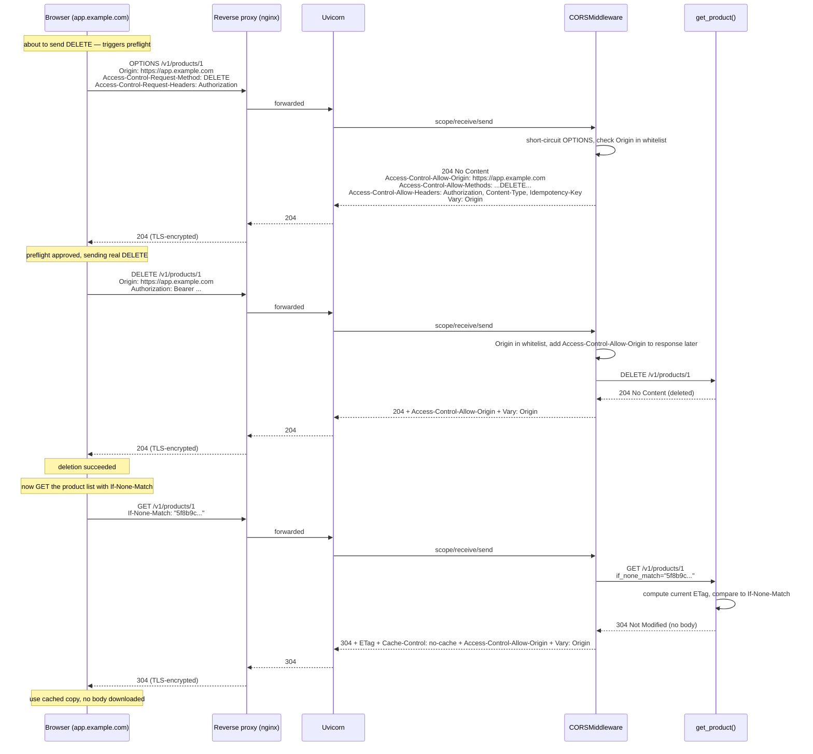
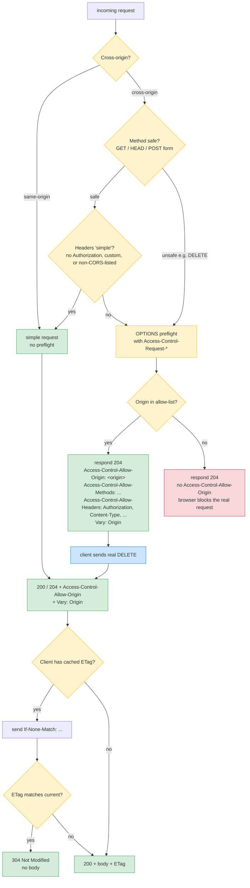

# Lesson 05: CORS, Caching Headers, Conditional Requests

*The browser security model that affects every API serving a web frontend, and the conditional GET that lets clients stop re-downloading what they already have.*

**Two failure modes that show up only in browsers.**

Your `curl https://api.example.com/orders/42` works fine. Your React app on `https://app.example.com` calling the same URL gets blocked by the browser with a vague "CORS error." And: your endpoint returns 10 MB of JSON that never changes, the client polls it every 30 seconds, and your database is melting — because nobody is using `ETag`/`If-None-Match`. CORS is a browser security mechanism that lets a server declare which origins may read its responses. Conditional requests let a server tell a client "you already have the latest version; do not re-download it." Both are simple in concept, exacting in detail, and the source of many real production bugs. By the end of this lesson you will configure CORS without cargo-culting it and implement conditional GET correctly. **This is how you learn.**


#http #security #caching #cors #canonical

> Previously learned in: [[Methods-Status-Headers-Content-Types|HTTP headers]]. We listed `ETag`, `If-None-Match`, `Last-Modified`, `If-Modified-Since`, and `Vary` in a table there. Here we explain how they fit together for caching and conditional requests, and we introduce the part of the browser security model that affects every API serving a web frontend: CORS.

## Learning Objectives

By the end of this lesson you will be able to:

1. **Explain the browser's same-origin policy** and how CORS relaxes it selectively.
2. **Predict whether a request will trigger a CORS preflight** and which response headers the preflight must carry.
3. **Configure FastAPI's `CORSMiddleware` correctly** and recognize the common misconfigurations.
4. **Implement conditional `GET`** with `ETag`/`If-None-Match` and `Last-Modified`/`If-Modified-Since`.
5. **Explain why `Vary` matters** and what happens to caches when you forget it.
6. **Read a real CORS preflight and conditional GET trace** and explain every line.

## Prerequisites

- **[[HTTP-Request-Lifecycle]]** — you should know where the preflight fits in the request sequence.
- **[[Methods-Status-Headers-Content-Types]]** — you must know headers and `OPTIONS`. The `OPTIONS` method is what the preflight uses.
- **A browser** (Chrome, Firefox, Safari) for the CORS exercises. The DevTools Network tab is where you will see the preflight fire.

**The most common gap: thinking CORS is server-side security.**

CORS is enforced by the browser, not the server. The server *declares* which origins may read its responses (via `Access-Control-Allow-Origin`). The browser *enforces* that declaration (it blocks JavaScript from reading responses that lack the declaration). curl does not enforce CORS — which is why "it works in curl but breaks in the browser" is the classic CORS-bug signature. If you internalize this one fact, half of CORS confusion evaporates.


## The Problem

Two browser-only failure modes that show up in every API that serves a web frontend:

1. **The browser blocks your cross-origin request.** Your frontend on `https://app.example.com` calls your API on `https://api.example.com`. curl works; the browser does not. The DevTools console says "CORS error" with no further detail. You add `Access-Control-Allow-Origin: *` to make it work — and now you have an unauthenticated API anyone can read.

2. **Your bandwidth bill is 10x what it should be.** Your `GET /v1/products` returns 5 MB of JSON that changes once a week. Your frontend polls it every 30 seconds. 5 MB × 2880 polls/day = 14 GB/day of egress for data that did not change. `ETag` + `If-None-Match` would turn those 2880 polls into 2879 `304 Not Modified` responses with no body — but you did not implement it.

This lesson solves both. CORS is the controlled relaxation of the browser's same-origin policy. Conditional GET is the mechanism by which a server tells a client "you already have the latest version; do not re-download it." Both are well-specified (CORS by the Fetch Standard; conditional GET by RFC 9110 and RFC 9111). Both are widely misunderstood.

This is the **canonical lesson for CORS** in this vault. Later lessons on [[03-FastAPI-Core/Middleware-and-Request-Order|middleware]] and [[11-Authentication-and-Security/Threat-Model-First|threat modeling]] reuse this material without re-explaining it.

**Note — The CORS reorganization (2022).**

CORS used to be a W3C spec; it is now part of the WHATWG Fetch Standard. The headers did not change. The flow did not change. The canonical URL is `https://fetch.spec.whatwg.org/`. We cite this and RFC 9110/9111 throughout.


## The Code: Part 1 – The CORS Preflight

Real-code-first. Here is a real CORS preflight exchange. The browser is about to send a `DELETE` request to delete a product. Before sending the `DELETE`, it sends an `OPTIONS` preflight. Read the trace slowly.

```text
# What the browser sends (you can see this in DevTools Network tab,
# or simulate it with curl):

$ curl -i -X OPTIONS http://127.0.0.1:8000/v1/products/1 \
 -H 'Origin: https://app.example.com' \
 -H 'Access-Control-Request-Method: DELETE' \
 -H 'Access-Control-Request-Headers: Authorization, Content-Type'
HTTP/1.1 204 No Content
access-control-allow-origin: https://app.example.com
access-control-allow-methods: GET, POST, PUT, PATCH, DELETE, OPTIONS
access-control-allow-headers: Authorization, Content-Type, Idempotency-Key
access-control-allow-credentials: true
access-control-max-age: 600
vary: Origin
```

That is the preflight response. The browser, on receiving it, decides whether to send the real `DELETE`. If the preflight does not permit the `DELETE` (e.g., `access-control-allow-methods` does not include `DELETE`, or `access-control-allow-origin` does not match the request's `Origin`), the browser does not send the `DELETE` and JavaScript gets a CORS error.

The FastAPI code that produces that response:

```python
# boardly/main.py
"""Lesson 5 reference: CORS middleware configured correctly for an
authenticated API serving a known frontend."""
from fastapi import FastAPI
from fastapi.middleware.cors import CORSMiddleware

app = FastAPI(title="Boardly")

app.add_middleware(
 CORSMiddleware,
 allow_origins=[
 "https://app.example.com", # production frontend
 "https://staging.app.example.com", # staging frontend
 "http://localhost:5173", # local Vite dev server
 ],
 allow_credentials=True,
 allow_methods=["GET", "POST", "PUT", "PATCH", "DELETE", "OPTIONS"],
 allow_headers=["Authorization", "Content-Type", "Idempotency-Key"],
 expose_headers=["ETag", "Location", "X-Request-Id"],
 max_age=600,
)
```

We will walk every line of that code and every line of the trace next.

## Line-by-Line Deep Dive

### The same-origin policy

A browser running `https://app.example.com` enforces the **same-origin policy**: by default, JavaScript on that page may not read responses from a different origin. "Origin" = scheme + host + port. `https://app.example.com` and `https://api.example.com` are different origins (different host). `https://app.example.com:80` and `https://app.example.com:443` are different origins (different port). `http://app.example.com` and `https://app.example.com` are different origins (different scheme).

This is a defense-in-depth measure against a malicious page reading your bank's API responses using your cookies. The policy is on the *response* side: the browser will *send* the cross-origin request (for `GET`/`HEAD`/simple `POST`), but it will *not let JavaScript read the response* unless the server says so.

CORS (Cross-Origin Resource Sharing) is the controlled relaxation. The server sends headers like `Access-Control-Allow-Origin: https://app.example.com`, and the browser lets the page read the response.

**Same-origin policy, in one sentence.**

By default, JavaScript on origin A may not read responses from a request to origin B (where A and B differ in scheme, host, or port). The server on origin B can relax this selectively by sending `Access-Control-Allow-Origin` headers.


### The CORS request taxonomy

| Request kind | Triggers preflight? | Conditions |
|--------------|----------------------|------------|
| Simple | No | Method is `GET`, `HEAD`, or `POST`; `Content-Type` is one of `application/x-www-form-urlencoded`, `multipart/form-data`, `text/plain`; only CORS-safelisted request headers. |
| Non-simple (preflighted) | Yes | Anything else — `PUT`/`PATCH`/`DELETE`, custom headers (`Authorization`, `Idempotency-Key`, `X-Anything`), JSON `Content-Type`, etc. |

Almost every modern API call from a browser is non-simple, because `Content-Type: application/json` alone triggers a preflight. This is why "my `GET` works in the browser but my `POST` does not" is a common CORS-bug signature — the `GET` (no preflight) works, the `POST` with `Content-Type: application/json` (preflight) fails.

### The preflight flow

For a non-simple request, the browser sends an `OPTIONS` preflight first:

```text
OPTIONS /v1/products/1 HTTP/1.1
Host: api.example.com
Origin: https://app.example.com
Access-Control-Request-Method: DELETE
Access-Control-Request-Headers: Authorization, Content-Type
```

The server responds with what it allows:

```text
HTTP/1.1 204 No Content
Access-Control-Allow-Origin: https://app.example.com
Access-Control-Allow-Methods: GET, POST, PUT, PATCH, DELETE, OPTIONS
Access-Control-Allow-Headers: Authorization, Content-Type, Idempotency-Key
Access-Control-Max-Age: 600
Vary: Origin
```

If the preflight permits the request, the browser sends the real request. Otherwise, the real request is never sent and JavaScript gets a CORS error.

**Student asks: why does the browser send a preflight at all? Why not just send the request and check the response?**

Two reasons. First, the preflight protects servers that were written before CORS existed and assume the same-origin policy. A `DELETE` request from a malicious page, if sent without preflight, would actually delete the resource before the server could refuse. The preflight gives the server a chance to say "no" before any side-effecting request is sent. Second, the preflight is cacheable (`Access-Control-Max-Age`), so the per-request overhead is amortized. Most browsers cache preflight results for the duration specified, so a follow-up `DELETE` an hour later may not need a new preflight.


**Warning — Debugging: preflight-cache changes lag your CORS edits.**

Browsers cache the preflight result for `Access-Control-Max-Age` seconds, capped by per-browser maxima: Chrome caps at 7200s (2 hours) and Firefox at 86400s (24 hours), per the WHATWG Fetch Standard which leaves the cap to the implementation. If you remove an origin from the allow-list and redeploy, browsers that already preflighted that origin keep approving the deleted origin until the cached entry expires. This is the "I fixed CORS but the bug ticket is still open" signature. Two fixes during active debugging: temporarily set `max_age=0` server-side so every request gets a fresh preflight, and instruct the reporter to hard-reload (which in Chrome and Firefox clears the per-origin preflight cache alongside the disk cache). In tests, drive the preflight with `curl -X OPTIONS` (curl does not cache) to confirm the server's actual response before blaming the browser.


### The CORS request/response headers

| Header | Direction | Purpose |
|--------|-----------|---------|
| `Origin` | request | Sent by the browser on cross-origin requests. Contains the origin of the calling page. |
| `Access-Control-Request-Method` | request (preflight) | The method of the upcoming real request. |
| `Access-Control-Request-Headers` | request (preflight) | Comma-separated list of headers the real request will send. |
| `Access-Control-Allow-Origin` | response | The origin allowed to read the response. Must be present for the browser to expose the response to JS. Can be `*` (any origin) only when credentials are not used. |
| `Access-Control-Allow-Methods` | response (preflight) | Methods the server will allow. |
| `Access-Control-Allow-Headers` | response (preflight) | Headers the server allows in the real request. |
| `Access-Control-Expose-Headers` | response | Headers the browser should expose to JS beyond the safelisted set. |
| `Access-Control-Allow-Credentials` | response | `true` if the browser may send cookies/HTTP auth. Must be `true` (not `*`) if the client uses `credentials: 'include'`. |
| `Access-Control-Max-Age` | response (preflight) | Seconds the browser may cache the preflight result. |
| `Vary: Origin` | response | Tells caches: the response varies by `Origin` header, so cache a separate copy per origin. |

The `Vary: Origin` point is the most-missed detail. If your server sends a different `Access-Control-Allow-Origin` per origin (the whitelist case), a shared cache (CDN, reverse proxy) might serve a response cached for origin A to a request from origin B. `Vary: Origin` prevents this.

**Danger — Security: `Origin` is a request header; anyone can set it.**

The browser sets `Origin` on cross-origin requests and the server treats it as the input that drives the allow-list decision. Nothing in the protocol stops a non-browser client (curl, a malicious server, a browser extension with `host` permissions, or a server-to-server script) from sending `Origin: https://app.example.com` directly. The server's `Access-Control-Allow-Origin` response is therefore a *declaration*, not a *gate* — it tells browsers "you may let your JS read this," but it does not stop non-browser callers from reading the body. CORS is a relaxation of the same-origin policy for browsers, never a substitute for Bearer tokens, signed cookies, mTLS, or the threat-model-first authentication taught in [[11-Authentication-and-Security/Threat-Model-First|Threat-Model-First]]. If you are tempted to use `Origin` checks as authentication on a route, the route is already broken; attackers who can read the response can also forge the header.


### The `CORSMiddleware` configuration

```python
app.add_middleware(
 CORSMiddleware,
 allow_origins=[
 "https://app.example.com",
 "https://staging.app.example.com",
 "http://localhost:5173",
 ],
 allow_credentials=True,
 allow_methods=["GET", "POST", "PUT", "PATCH", "DELETE", "OPTIONS"],
 allow_headers=["Authorization", "Content-Type", "Idempotency-Key"],
 expose_headers=["ETag", "Location", "X-Request-Id"],
 max_age=600,
)
```

**What it does:** Adds Starlette's `CORSMiddleware` to the FastAPI app. The middleware handles `OPTIONS` preflight by short-circuiting the request and returning `204 No Content` with the appropriate `Access-Control-Allow-*` headers. For non-preflight requests, it adds the `Access-Control-Allow-Origin` header (and `Vary: Origin`) if the request has an `Origin` header that is in the whitelist.

**Why each parameter:**

- **`allow_origins`** — the whitelist of origins permitted to read responses. Listing them explicitly is the only safe default for authenticated APIs. `["*"]` is fine for unauthenticated public data; it is wrong for anything that touches user data (see Common Mistakes).
- **`allow_credentials=True`** — the browser may send cookies and HTTP auth. This is required for any API that uses cookie sessions or `Authorization` headers in conjunction with a browser frontend. Without `True`, the browser will not send credentials cross-origin, and your authenticated endpoints will get `401` from the browser even though curl works.
- **`allow_methods`** — the methods the server will allow on cross-origin requests. Listing them explicitly is clearer than `["*"]`, but `["*"]` works because Starlette expands it. We list explicitly because it documents the API surface.
- **`allow_headers`** — the request headers the server will allow on cross-origin requests. `Authorization`, `Content-Type`, and `Idempotency-Key` cover most modern APIs. Without `Idempotency-Key` here, the browser would block any request that sends the header, and your idempotency (Lesson 4) would silently fail in the browser.
- **`expose_headers`** — the response headers the browser exposes to JavaScript. `ETag`, `Location`, and `X-Request-Id` are not in the browser's safelisted set (which is `Cache-Control`, `Content-Language`, `Content-Length`, `Content-Type`, `Expires`, `Last-Modified`, `Pragma`). Without `expose_headers=[...]`, the browser hides them from JS even though they are on the wire.
- **`max_age=600`** — the browser may cache the preflight result for 600 seconds. Within that window, the browser will not re-send the `OPTIONS` preflight for the same origin + method + headers combination. 600 seconds is the typical default; longer reduces preflight traffic but means changes to your CORS policy take longer to propagate.

**Why does the browser hide response headers like `ETag` from JavaScript by default?** Because the same-origin policy is about *information leakage*, not just blocking requests. A response header that reveals something about the resource (an `ETag` that proves the user has a particular version of a document, an `X-Total-Count` that reveals a count the user should not see, a `Location` that reveals an internal URL) is information. The safelisted set (`Cache-Control`, `Content-Type`, etc.) is the headers the spec authors deemed safe to always expose — they carry no user-identifying information. Anything else has to be opt-in via `expose_headers` so the developer is making an explicit decision: "yes, my JS needs this header, and I have considered the leak." **What would happen if you forgot to expose `Location` on a redirect response?** Your JS would `fetch()` the URL, get a `200` or `3xx`, and be unable to read the `Location` header to know where the user was redirected — the response would silently lack the field from the JS perspective, even though it is on the wire. The bug signature is "the redirect works in curl but my JS can't see the new URL."

**Warning — The `*` + `credentials=True` invalid combo.**

The spec forbids `Access-Control-Allow-Origin: *` together with `Access-Control-Allow-Credentials: true`. If you set both, the browser will refuse to send credentials, and the response will not be readable. Starlette's `CORSMiddleware` detects this combo and reflects the specific origin instead of `*` — but you should not rely on that. Pick one: `allow_origins=["*"]` for unauthenticated public data, or a whitelist for authenticated APIs.


**Production: read origins from settings, not from a hardcoded list.**

The lesson's example hardcodes three origins in `main.py` for clarity, but in a real deployment the allow-list changes per environment (local dev adds `http://localhost:5173`, staging adds `https://staging.app.example.com`, prod adds `https://app.example.com`) and you do not want to redeploy code to rotate a leaked origin. Read the list from your settings layer — `pydantic-settings` is the canonical pattern (see [[04-Pydantic/Pydantic-Settings|Pydantic-Settings]]) — and validate it at startup so a misconfigured `CORS_ORIGINS=""` fails loudly on boot instead of silently disabling CORS. The same applies to `allow_headers` and `expose_headers`: keep them in code (they change with the API surface, not the environment), but keep `allow_origins` in config. Logging the effective origin list at startup makes "which origins did this build actually allow?" a one-line `grep` instead of a code read.


### How the middleware actually works

When a request arrives at the FastAPI app:

1. The `CORSMiddleware` checks the request for an `Origin` header. If absent (e.g., from curl, or from a same-origin request), the middleware does nothing — no CORS headers added, no preflight short-circuit. The request flows through the rest of the app normally.
2. If the `Origin` is present, the middleware checks if it is in the whitelist. If yes, the middleware will add `Access-Control-Allow-Origin: <origin>` and `Vary: Origin` to the response.
3. If the request method is `OPTIONS` and the request has `Access-Control-Request-Method`, the middleware short-circuits: it returns `204 No Content` immediately with the preflight response headers, never calling your route function.
4. Otherwise, the request flows through the rest of the app. The middleware adds the `Access-Control-Allow-Origin` header to the response on its way back out.

This means the preflight `OPTIONS` request **never reaches your route function**. The middleware handles it. Your `DELETE /v1/products/1` route is called only on the real `DELETE` request, after the preflight has approved it.

### Common CORS misconfigurations

These are the bugs you will hit. Read carefully.

1. **`allow_origins=["*"]` with `allow_credentials=True`.** Invalid per the spec. The browser will refuse to send credentials, and the response will not be readable. Starlette detects this and reflects the specific origin instead — but you should not rely on that; pick one.
2. **`allow_origins=["*"]` for an authenticated API.** Without `allow_credentials`, the browser will not send cookies. So you either have an API nobody can authenticate to from a browser, or you have `allow_credentials=True` and `allow_origins=["*"]` (the invalid combo above). Whitelist your real origins.
3. **Forgetting `Vary: Origin` when you whitelist.** Starlette's middleware does this for you. A custom CORS middleware you write might not. A shared cache will then serve the wrong `Access-Control-Allow-Origin` to the wrong origin.
4. **Forgetting `OPTIONS` in your reverse proxy.** Some proxies are configured to handle only `GET/POST/PUT/DELETE`. An `OPTIONS` request returns `405` from the proxy and the preflight fails. Allow `OPTIONS` everywhere.
5. **Forgetting to expose headers the client needs.** `Location`, `X-Request-Id`, `ETag` are not in the browser's safelisted set. Without `expose_headers=[...]`, the browser hides them from JS even though they are on the wire.
6. **Catching all errors with `*`.** `allow_origins=["*"]` is fine for a public, unauthenticated, read-only API. It is wrong for anything that touches user data.
7. **Setting CORS on the wrong layer.** If your reverse proxy adds CORS headers and FastAPI also adds CORS headers, you get duplicates and some browsers fail. Pick one layer.
8. **Adding CORS to non-browser APIs.** CORS is a browser mechanism. Your mobile app, your server-to-server client, and curl do not enforce it. Do not use CORS as authentication.
9. **Trusting `Origin` as authentication.** CORS is a relaxation of the same-origin policy, not an authentication mechanism. Any client can set an `Origin` header; the server's response is just a declaration. CSRF protection is a separate concern.
10. **Disabling preflight via "simple" request shapes.** You can theoretically avoid preflights by using `Content-Type: text/plain` and a hand-rolled body, but you lose validation, you confuse intermediaries, and you have built an elaborate workaround to save one round-trip. Do not.

**Danger — CORS is not authentication.**

A common mistake: "I set `Access-Control-Allow-Origin: https://app.example.com`, so only `app.example.com` can call my API." Wrong. The header is a *declaration* to the browser; it does not stop a malicious server from sending requests directly to your API. Your API's authentication (Bearer tokens, signed cookies, mTLS) is what stops malicious callers. CORS only stops *browsers* from letting their JavaScript read responses. Do not conflate the two.


**Warning — Debugging: the browser console says "CORS error" with no detail.**

When a CORS check fails, Chrome and Firefox show a generic "blocked by CORS policy" message in the console and *redact the failing header* from the Network tab — the browser will not tell you which `Access-Control-*` header was missing because that information could leak to the calling page. To debug, you need the raw response headers. The fastest path: reproduce the exact preflight in `curl -i -X OPTIONS -H 'Origin: <origin>' -H 'Access-Control-Request-Method: <method>' -H 'Access-Control-Request-Headers: <headers>' <url>` and read the headers yourself — curl shows everything. If the curl preflight is correct and the browser still fails, the suspect list is short: (a) a duplicate `Access-Control-Allow-Origin` header (Mistake 8 — double-CORS), (b) a 4xx or 5xx status on the preflight that the browser interprets as a denial even though the headers are present, (c) a redirect that strips the `Origin` header mid-flight, or (d) the browser's preflight cache returning a stale denial. Always start from `curl -i` before reading the browser tab.


## The Code: Part 2 – Conditional GET with ETag

Real-code-first. Here is a real conditional GET exchange. The client already has a cached copy of `/v1/products/1` with `ETag: "abc123..."`. It sends `If-None-Match` to check whether the resource has changed. The server returns `304 Not Modified` with no body. Read the trace slowly.

```text
# First request (client has nothing cached):
$ curl -i http://127.0.0.1:8000/v1/products/1
HTTP/1.1 200 OK
content-type: application/json
etag: "5f8b9c32a3e1d2b"
cache-control: no-cache
x-request-id: 4f7b9c32-1a3e-4d2b-8f6f-9c0b7d3a1e2c

{"id":1,"name":"Widget","price_cents":4200}

# Second request (client cached the etag and sends If-None-Match):
$ curl -i -H 'If-None-Match: "5f8b9c32a3e1d2b"' http://127.0.0.1:8000/v1/products/1
HTTP/1.1 304 Not Modified
etag: "5f8b9c32a3e1d2b"
cache-control: no-cache
x-request-id: 4f7b9c32-1a3e-4d2b-8f6f-9c0b7d3a1e2c

# Note: no body. The client uses its cached copy.
```

The FastAPI code that produces that exchange:

```python
# boardly/routers/products.py
"""Lesson 5 reference: conditional GET with ETag and If-None-Match."""
import hashlib
from typing import Annotated

from fastapi import APIRouter, Header, HTTPException, Request, status
from fastapi.responses import JSONResponse, Response
from pydantic import BaseModel

router = APIRouter(prefix="/v1/products", tags=["products"])


class ProductRead(BaseModel):
 id: int
 name: str
 price_cents: int


# In-memory data; in production this is a database row.
_PRODUCTS: dict[int, dict] = {
 1: {"id": 1, "name": "Widget", "price_cents": 4200, "version": 1},
 2: {"id": 2, "name": "Gadget", "price_cents": 9999, "version": 1},
}


def _etag_of(product: dict) -> str:
 """Compute an ETag from a stable representation of the resource.
 Sorting the keys ensures that semantically-equal dicts hash
 identically across runs."""
 body = (str(sorted(product.items())) + str(product["version"])).encode()
 return '"' + hashlib.sha256(body).hexdigest()[:16] + '"'


@router.get("/{product_id}")
async def get_product(
 product_id: int,
 request: Request,
 if_none_match: Annotated[str | None, Header(alias="If-None-Match")] = None,
) -> Response:
 product = _PRODUCTS.get(product_id)
 if product is None:
 raise HTTPException(status.HTTP_404_NOT_FOUND, detail="product not found")

 etag = _etag_of(product)

 # Conditional GET: client sent If-None-Match with a previous ETag.
 if if_none_match is not None and if_none_match == etag:
 return Response(
 status_code=status.HTTP_304_NOT_MODIFIED,
 headers={"ETag": etag, "Cache-Control": "no-cache"},
 )

 return JSONResponse(
 content=ProductRead(
 id=product["id"], name=product["name"], price_cents=product["price_cents"]
 ).model_dump(),
 headers={"ETag": etag, "Cache-Control": "no-cache"},
 )
```

We will walk every line next.

### `ETag` and `If-None-Match`: line by line

```python
def _etag_of(product: dict) -> str:
 body = (str(sorted(product.items())) + str(product["version"])).encode()
 return '"' + hashlib.sha256(body).hexdigest()[:16] + '"'
```

**What it does:** Computes an `ETag` — an opaque validator for the response body — by hashing a stable representation of the product. The `"..."` quoting is the ETag format (a quoted string).

**Why sorting the items:** Two semantically-equal dicts with different insertion order produce different `str(d.items())` representations, and therefore different hashes. Sorting the items before stringifying ensures that `{"a":1, "b":2}` and `{"b":2, "a":1}` hash identically. This matters because the same resource rendered twice (once with one insertion order, once with another) would otherwise produce different ETags for the same data.

**Why is the ETag quoted (`"5f8b9c32..."`)?** Because RFC 9110 requires ETag values to be quoted strings. The quotes are part of the wire format — a validator that compares `5f8b9c32` to `"5f8b9c32"` will get a mismatch even though they represent the same hash. Every browser, proxy, and cache implementation parses the quotes as part of the value; if your server omits them, some intermediaries will reject the header entirely and the conditional GET will silently degrade to a full response every time. **What about the `W/` prefix (`W/"5f8b..."`)?** That marks a *weak* validator — the server says "this representation is byte-for-byte equivalent for caching purposes but may not be byte-identical" (e.g., the body was re-rendered with different whitespace). A strong validator (`"5f8b..."` without `W/`) is a byte-equality promise. Browsers treat weak validators as valid for `304` responses but not for range requests. For APIs, strong validators are simpler and correct almost always; reach for `W/` only when you genuinely cannot guarantee byte equality.

**Why `+ str(product["version"])`:** In production, you would not re-hash the whole body — you would use a version column from the database. If the row changes, the version bumps, the ETag changes. We simulate this here with a `version` field.

```python
@router.get("/{product_id}")
async def get_product(
 product_id: int,
 request: Request,
 if_none_match: Annotated[str | None, Header(alias="If-None-Match")] = None,
) -> Response:
 ...
 etag = _etag_of(product)
 if if_none_match is not None and if_none_match == etag:
 return Response(
 status_code=status.HTTP_304_NOT_MODIFIED,
 headers={"ETag": etag, "Cache-Control": "no-cache"},
 )
 return JSONResponse(
 content=ProductRead(...).model_dump(),
 headers={"ETag": etag, "Cache-Control": "no-cache"},
 )
```

**What it does:** Reads the `If-None-Match` request header. If the client sent it and it matches the current ETag, returns `304 Not Modified` with no body. Otherwise returns `200 OK` with the body and the current ETag.

**Why `if if_none_match == etag`:** RFC 9110 says `If-None-Match` is a list of ETags, and the server returns `304` if the current ETag is in the list. For simplicity we compare equality; in production, parse the comma-separated list and check membership.

**Why `Cache-Control: no-cache`:** The name is misleading. `no-cache` does NOT mean "do not cache." It means "you may cache, but you must revalidate before using." That is the right default for an API where the underlying data may change. The browser caches the response, but on the next request, it sends `If-None-Match` to revalidate. If the server returns `304`, the browser uses its cached copy. If the server returns `200`, the browser replaces its cached copy.

**Why is `no-cache` not called `must-revalidate`?** Because in HTTP caching, `must-revalidate` is a *different* directive that means "if you cannot revalidate (e.g., the origin is down), do NOT serve a stale copy — return an error or block." The naming collision trips every engineer at least once. The mental model: `no-cache` = "you may store, but you must check before reuse"; `no-store` = "do not store at all"; `must-revalidate` = "if you stored it and you cannot reach me to revalidate, do not fall back to the stale copy." The three compose: `Cache-Control: no-cache, must-revalidate` says "you may store, you must check before reuse, and if my server is unreachable do not silently serve the stale copy."

`Cache-Control: no-store` means "do not cache at all" — use for sensitive, per-user data that should never be cached. `Cache-Control: max-age=N` means "you may cache for N seconds without revalidating" — use for data that changes rarely and is not personalized (e.g., a list of countries).

**Tip — The caching directive decision tree.**

- Per-user, sensitive, changes-frequently → `Cache-Control: no-store`.
- Per-user, not sensitive, changes-frequently → `Cache-Control: no-cache` (revalidate).
- Public, not sensitive, changes-rarely → `Cache-Control: public, max-age=300` (cache for 5 minutes without revalidation).
- Public, never changes → `Cache-Control: public, max-age=31536000, immutable` (cache for a year, do not even revalidate).


**Production: prefer a DB version column over a body hash for ETags.**

The lesson computes the ETag by hashing `str(sorted(product.items()))` — that is correct for a 30-line teaching example and catastrophic for a 5 MB JSON list endpoint. Hashing the body on every request means materializing the full response, then running SHA-256 over it, before you can even check `If-None-Match`; for a list endpoint you have turned a `304` optimization into a `200`-worth of CPU. The production pattern is a version column on the row (`updated_at timestamptz`, or an explicit `etag_version bigint` updated by a trigger), computed once on write and indexed; the `GET` reads the column from the row it already loaded, compares it to `If-None-Match`, and only serializes the body if they differ. For collection endpoints, hash the list of per-row version columns (a 1000-row index scan is cheaper than a 1000-row JSON serialization plus a megabyte hash). Postgres `xmin` is not safe to use as a version because VACUUM can rewrite it; use an explicit column or a content-addressed key computed at write time.


**Danger — Security: ETags can leak user-identifying information; HMAC them for private resources.**

A naive `ETag = sha256(body)` is a content-addressed fingerprint of the response. For a public, immutable resource that is fine. For a per-user resource (`GET /me/financial-summary`), it is not: two users who see the same ETag know they have the same financial summary, and an attacker who can enumerate bodies (by submitting known inputs and watching the returned ETag) can build a dictionary mapping `ETag -> body` and then probe any victim's `If-None-Match` to confirm a guess. The defence is to HMAC the body hash with a server-side secret: `ETag = '"' + hmac.new(SECRET, body_hash, sha256).hexdigest()[:16] + '"'`. The secret rotates with deploy, so ETags from one deploy do not match another (forcing a one-time cache miss, which is the correct trade for privacy). For per-user responses that must never be cross-compared, include the user id in the HMAC message. Never reuse a public-content hash function for private responses — the byte-equality promise that makes ETags cheap is the same property that makes them a side-channel.


### `Last-Modified` and `If-Modified-Since`

The same idea with an HTTP date instead of an opaque hash. The client sends `If-Modified-Since: <date>`; the server returns `304` if the resource has not changed since that date.

```python
from datetime import datetime, timezone
from email.utils import format_datetime, parsedate_to_datetime

LAST_MODIFIED = datetime(2026, 10, 1, 12, 0, 0, tzinfo=timezone.utc)


@router.get("/{product_id}")
async def get_product(product_id: int, request: Request) -> Response:
 product = _PRODUCTS.get(product_id)
 if product is None:
 raise HTTPException(404, "product not found")
 lm_header = format_datetime(LAST_MODIFIED, usegmt=True)
 if (ims := request.headers.get("if-modified-since")):
 ims_date = parsedate_to_datetime(ims)
 # If the resource has not changed since the client's date, return 304.
 if LAST_MODIFIED <= ims_date:
 return Response(
 status_code=304,
 headers={"Last-Modified": lm_header},
 )
 return JSONResponse(
 content=ProductRead(...).model_dump(),
 headers={"Last-Modified": lm_header},
 )
```

`ETag` is strictly more powerful — `Last-Modified` is 1-second granularity; `ETag` is exact. Use both for maximum compatibility. Some clients only send `If-Modified-Since`; some only send `If-None-Match`. If you support both, more clients can revalidate.

**Warning — Debugging: `Last-Modified` has 1-second resolution and breaks under same-second writes.**

The HTTP date format is RFC 7231 IMF-fixdate, which truncates to the second. If two writes land within the same second on the same row, the `updated_at` column shows the same value both times, the server emits the same `Last-Modified`, and a client that holds the first version sends `If-Modified-Since` with that date — the server compares `LAST_MODIFIED <= ims_date` and returns `304` for the *second* version, silently hiding the update from the client. The bug signature is "I edited the record and the list endpoint did not update until I refreshed 2 seconds later." Two fixes: use `ETag` (which has byte-resolution when derived from a monotonic version column) as the *primary* validator and fall back to `Last-Modified` only for clients that do not send `If-None-Match`, or bump the version column atomically on every write so the ETag changes even within the same wall-clock second. `Last-Modified` alone is acceptable for static assets where the file system's `mtime` granularity is the source of truth and you accept 1-second staleness; for any row that a user can edit, treat it as the weak secondary validator only.


### `Vary`, in detail

`Vary` tells caches which request headers affect the response. If you serve a different response per `Origin`, you must declare `Vary: Origin`. If you serve different content types based on `Accept`, you must declare `Vary: Accept`. If you compress based on `Accept-Encoding`, you must declare `Vary: Accept-Encoding`.

The cost of forgetting `Vary`: a cache returns the wrong response to the wrong client. The cost of over-declaring `Vary`: cache hit rates drop because every variation is a separate cache entry.

For CORS, `Vary: Origin` is automatic in Starlette's `CORSMiddleware` — but if you write your own CORS middleware, you must add it yourself.

**Example — The cache-poisoning scenario.**

Imagine a CDN caching your `Access-Control-Allow-Origin: https://app.example.com` response. A request from `https://evil.example.com` arrives at the same CDN edge. The CDN looks up the cache by URL — and finds the cached response with `Access-Control-Allow-Origin: https://app.example.com`. The CDN returns it. The browser on `evil.example.com` sees `Access-Control-Allow-Origin: https://app.example.com` — which does not match its own origin — and blocks the response. So far, so good — the browser blocked it. But what if it had matched? If the server had returned `Access-Control-Allow-Origin: https://evil.example.com` for the *first* request, the CDN would cache that, and the next request from `app.example.com` would get the wrong origin and be blocked. `Vary: Origin` tells the CDN to keep separate cache entries per origin, so this cannot happen.


**Student asks: if my CORS allow-list has only one origin, do I still need `Vary: Origin`?**

Yes. Even with a single-origin allow-list, the server's response varies by Origin: an allowed origin gets `Access-Control-Allow-Origin: https://app.example.com`; a disallowed origin gets no `Access-Control-Allow-Origin` header (or a 403, depending on middleware). Those are two different responses to the same URL. A CDN that keys only on URL would cache the first response it sees and serve it to the second origin's request — which means a lucky first request from `app.example.com` poisons the cache for every subsequent request from `evil.example.com` (or vice versa). `Vary: Origin` makes the cache key include the Origin request header, so each origin gets its own cache slot. The rule: any response header you set conditionally on a request header mandates a `Vary` entry for that request header. Always.


**Student asks: when should I use `ETag` versus `Last-Modified`?**

Use both when you can. They serve different debug paths. `ETag` is a content hash — change a single byte and the ETag changes, so `If-None-Match` is the *strong* validator: byte-identical cached copies match, byte-different copies do not. `Last-Modified` is a *weak* validator — the second-resolution timestamp means two writes within the same second produce the same `Last-Modified` even though the bodies differ. For static assets where the content hash is cheap to compute, use `ETag` and skip `Last-Modified`. For dynamic endpoints where computing a hash is expensive but the row's `updated_at` is already loaded, use `Last-Modified` and skip `ETag`. For HTML pages where you want maximum cacheability, use both: the client may send `If-None-Match` *or* `If-Modified-Since`, and you should honour either. The spec lets you return 304 if *either* validator matches; the safer reading is "return 304 if both match" because that prevents false-positive cache hits when only one validator is fresh.


**Danger — Security: missing `Vary` is a cache-poisoning vector for any conditional header, not just `Origin`.**

The lesson's poisoning example is for `Vary: Origin` because that is the CORS-specific case. The general rule is broader: any response header you set *conditionally on a request header* mandates a `Vary` entry for that request header, or a shared cache will hand one client's response to another. The same bug class hits `Vary: Accept` (a JSON-accepting client gets an XML-accepting client's response — usually a UX bug, sometimes a data-leak bug when the variants differ in sensitivity), `Vary: Accept-Encoding` (a bro-compressed response served to a client that cannot decode it — usually a crash), and `Vary: Cookie` (an authenticated user's personalized response served to an unauthenticated request — a real data leak). The last one is the most dangerous: if your CDN caches the response from a logged-in user and serves it to the next anonymous visitor, you have leaked the logged-in user's data. The defence is `Cache-Control: private` for any response that depends on a cookie or authorization header (which removes the CDN from the cache chain entirely and leaves only the browser cache), plus `Vary: Cookie` as a belt-and-suspenders for any per-user public response that is allowed to be cached browser-side. Audit your `Vary` headers as part of any security review — a missing entry is a silent data-leak waiting for the right cache shape.


## Execution Trace

For a CORS preflight + conditional GET round-trip:





Why a single decision tree when the sequence diagram already walked a full DELETE + GET round-trip? Because the sequence diagram shows one happy path; the decision tree shows the *whole space*. Every CORS question your future self will debug — "why does my Safari request not send credentials?", "why does my Chrome extension see an opaque response?", "why is the conditional GET returning 200 not 304?" — collapses into one of these yellow decision diamonds. Read the diagram once with the request you are debugging in mind, and the answer falls out.

**Production: propagate `X-Request-Id` across every layer so the CORS preflight and the 304 are correlatable in logs.**

The lesson's trace shows `x-request-id: 4f7b9c32-1a3e-4d2b-8f6f-9c0b7d3a1e2c` on every response, including the `304`. In production, generate the id at the edge (the reverse proxy — nginx's `$request_id`, or your CDN's request id) and propagate it down through Uvicorn, Starlette middleware, FastAPI dependencies, your structured logger, and any outbound HTTP client calls to dependencies. The payoff is that a single user's "CORS preflight failed then the conditional GET returned 200 instead of 304" ticket is one `grep X-Request-Id` across the proxy, app, and CDN logs — three services, one id, one timeline. The canonical pattern is in [[13-Performance-and-Observability/Structured-Logging-and-Request-IDs|Structured-Logging-and-Request-IDs]]: a Starlette middleware reads `X-Request-Id` from the request (or mints a UUIDv4 if absent), stores it in a `contextvars`-backed logger context, and echoes it on the response — which is why `expose_headers=["X-Request-Id"]` in the lesson's `CORSMiddleware` is not optional; without it, the browser cannot read the id and your frontend cannot attach it to its own error reports.


## Common Mistakes

### Mistake 1: `allow_origins=["*"]` + `allow_credentials=True`

```python
# WRONG
app.add_middleware(
 CORSMiddleware,
 allow_origins=["*"],
 allow_credentials=True, # ← invalid combo
)
```

**Symptom:** Browser refuses to send credentials; the response is not readable.

**Fix:** Pick one. Either `allow_origins=["*"]` for unauthenticated public data (no credentials), or a whitelist with `allow_credentials=True`.

### Mistake 2: Forgetting `OPTIONS` in the reverse proxy

```text
WRONG:
nginx config with `limit_except GET POST PUT DELETE { deny all; }` ← blocks OPTIONS
```

**Symptom:** The browser sends an `OPTIONS` preflight; nginx returns `405 Method Not Allowed`; the preflight fails; the real `DELETE` is never sent.

**Fix:** Allow `OPTIONS` everywhere. nginx, by default, allows all methods; do not restrict `OPTIONS`.

### Mistake 3: Forgetting `expose_headers`

```python
# WRONG
app.add_middleware(CORSMiddleware, allow_origins=["..."], allow_credentials=True)
# ← no expose_headers
```

**Symptom:** Your JavaScript tries to read `response.headers.get("ETag")` and gets `null`. The header is on the wire (curl shows it) but the browser hides it from JS because it is not in the safelisted set.

**Fix:** `expose_headers=["ETag", "Location", "X-Request-Id"]`.

### Mistake 4: Computing `ETag` from a string of the dict without sorting

```python
# WRONG
def _etag_of(product: dict) -> str:
 body = str(product.items()).encode() # ← order-dependent
 return '"' + hashlib.sha256(body).hexdigest()[:16] + '"'
```

**Symptom:** The same resource rendered twice produces different ETags because the dict's insertion order differs. Clients see ETag changes on every request even though the data did not change. Conditional GET never returns `304`.

**Fix:** Sort the items before stringifying: `str(sorted(product.items())).encode()`. Or use a version column from the database.

### Mistake 5: Returning `304` with a body

```python
# WRONG
return JSONResponse(
 content=ProductRead(...).model_dump(),
 status_code=304,
 headers={"ETag": etag},
)
```

**Symptom:** The browser is confused. `304` has no body by spec; the client uses its cached copy. Including a body confuses intermediaries and wastes bandwidth.

**Fix:** `return Response(status_code=304, headers={"ETag": etag, "Cache-Control": "no-cache"})`. No body.

### Mistake 6: Using `Cache-Control: no-store` for everything

```python
# WRONG (bandwidth waste)
return JSONResponse(content=..., headers={"Cache-Control": "no-store"})
```

**Symptom:** Your clients re-download 10 MB on every poll because they are not allowed to cache. Your egress bill is enormous.

**Fix:** Use `no-cache` (must revalidate) for things that may change — the client caches and revalidates with `If-None-Match`. Use `no-store` only for sensitive, per-user data that should never be cached.

### Mistake 7: Letting CORS do authentication

**Symptom:** You set `Access-Control-Allow-Origin: https://app.example.com` and conclude that only `app.example.com` can call your API. An attacker sends a request directly to your API (no browser, no CORS) and reads the response.

**Fix:** CORS is a relaxation, not a gatekeeper. CSRF tokens and authenticated sessions are separate. Implement real authentication (Bearer tokens, signed cookies, mTLS).

### Mistake 8: Double-CORS

```text
WRONG:
nginx config: add_header Access-Control-Allow-Origin "https://app.example.com" always;
FastAPI: app.add_middleware(CORSMiddleware, allow_origins=["https://app.example.com"], ...)
```

**Symptom:** The response has two `Access-Control-Allow-Origin` headers. Some browsers see the duplicate and fail the preflight.

**Fix:** Pick one layer. Either configure CORS in nginx (and do not add `CORSMiddleware` in FastAPI), or add `CORSMiddleware` in FastAPI (and do not configure CORS in nginx). The FastAPI middleware is easier to reason about because it lives next to your code; we recommend the FastAPI layer.

**Warning — Debugging: detect double-CORS with `curl -i` and count the `Access-Control-Allow-Origin` headers.**

Mistake 8 (double-CORS) is the second-most-common production CORS bug after the `*` + credentials combo, and the symptom is "works in Chrome, fails in Firefox or Safari or the iOS in-app browser" because browsers differ in how they treat duplicate `Access-Control-Allow-Origin` headers — some take the first, some take the last, some reject the response outright. The detection is a one-liner against the failing origin: `curl -s -i -X OPTIONS -H 'Origin: <origin>' -H 'Access-Control-Request-Method: GET' <url> | grep -ic '^access-control-allow-origin:'` — anything greater than 1 means two layers are adding the header. The usual culprits, in order: nginx `add_header ... always` combined with FastAPI's `CORSMiddleware`; a CDN's "CORS" toggle combined with the origin's `CORSMiddleware`; a legacy `add_header` block from an old config file that was not removed when the app took over. The fix is to pick one layer (the academy recommends the app layer because it lives next to the code and travels with deploys); disable the other. If the duplicate comes from the proxy and you cannot remove the proxy config, set the proxy's CORS to passthrough and let only the app emit the header.


## Engineering Trade-Offs

### Whitelist vs `*`

Whitelist is more work but is the only safe default for authenticated APIs. `*` is fine for unauthenticated public data. For `Boardly`, we whitelist the three origins we actually serve (production, staging, local dev).

### `Access-Control-Max-Age`

A larger value reduces preflight traffic but means changes to your CORS policy take longer to propagate to clients. 600 seconds is a reasonable default. For a stable CORS policy, 3600 seconds is fine.

### `ETag` computation

A hash is exact but costs CPU on every request (and you have to canonicalize). A version number from the database is cheaper but requires the schema to track it. For most read-heavy APIs, a version column is the better trade.

### `Last-Modified` vs `ETag`

Use both — `Last-Modified` for clients that do not speak `ETag` (rare), `ETag` for exactness. They are not exclusive. RFC 9110 says servers should send both, and clients should send both `If-None-Match` and `If-Modified-Since`.

### Caching in the proxy vs in the client

Proxy caching (CDN) multiplies your savings but only works for non-personalized responses. Personalized responses should be `Cache-Control: private` so the CDN does not cache them. The browser cache is private by default.

**Tip — The CORS-and-cache rule of thumb.**

CORS is for browsers; curl does not care. Conditional GET is for every client; curl uses it too. Caching directives are for every cache between the client and your server, including the browser, the CDN, and any intermediate proxy. Get all three right and your API is both safe to call from a browser and cheap to operate.


**Production: use `s-maxage` and `stale-while-revalidate` for shared caches; keep `max-age` honest for the browser.**

`Cache-Control: max-age=N` applies to *every* cache in the path, including the browser. `Cache-Control: s-maxage=N` applies only to shared caches (CDNs, reverse proxies). For a public list endpoint that changes once an hour, the right header is `Cache-Control: public, max-age=30, s-maxage=300, stale-while-revalidate=60`: the browser caches for 30s and revalidates with `If-None-Match` (which means a 304 even on cache hit if the row changed), the CDN caches for 300s, and if the CDN's entry is stale by up to 60s it serves the stale copy while revalidating in the background (RFC 5861 `stale-while-revalidate`, supported by Cloudflare, Fastly, and AWS CloudFront as of Oct 2026). The pattern keeps the browser cache short (so user-visible updates land quickly) while letting the CDN absorb the read load. For per-user responses, never set `s-maxage` — `Cache-Control: private, max-age=0, must-revalidate` keeps the CDN out and forces the browser to revalidate every time. The 5 MB JSON egress problem in the lesson's "Problem" section is the canonical use case for this combination: with `s-maxage=300`, 2880 polls/day become 288 CDN hits instead of 2880 origin hits, and the 5 MB body is served once per 5-minute window per edge POP.


## Exercises

**Tip — The 20-minute rule**

If you're stuck on an exercise for more than 20 minutes, re-read the relevant section above, then move on and come back.


**Exercise 1 — Configure CORS for a whitelist.** Configure `CORSMiddleware` with a whitelist of two origins. Verify with `curl -X OPTIONS` that the preflight returns the right headers (the right `Access-Control-Allow-Origin` matching the request's `Origin`, `Vary: Origin`, the right `Access-Control-Allow-Methods`).

**Exercise 2 — Implement conditional GET.** Implement conditional `GET` on a list endpoint using `ETag`. Verify that a second request with `If-None-Match` returns `304`. Modify the underlying data and verify the third request returns `200` with a new ETag.

**Exercise 3 — Implement `Last-Modified` conditional GET.** Implement the `Last-Modified`/`If-Modified-Since` version. Verify with `curl -H 'If-Modified-Since: ...'` that you get `304` for a resource that has not changed and `200` for one that has.

**Exercise 4 — Custom CORS middleware.** Write a custom CORS middleware that, on a request with no `Origin` header (e.g., from curl), does not add CORS headers. Verify that a direct `curl` request gets no `Access-Control-Allow-Origin`. (Starlette's `CORSMiddleware` already does this; the exercise is to understand why.)

**Exercise 5 — Cache-poisoning demo.** Set up a CDN in front of your app. Without `Vary: Origin`, request from origin A, then request from origin B. Observe (in the CDN's cache state) that origin B gets origin A's response. Add `Vary: Origin` and verify the cache now keeps separate entries.

**Exercise 6 — Spot the bug.** This CORS config will not work for an authenticated browser frontend. Why?

```python
app.add_middleware(
 CORSMiddleware,
 allow_origins=["*"],
 allow_credentials=True,
 allow_methods=["*"],
 allow_headers=["*"],
)
```

(Answer: `allow_origins=["*"]` with `allow_credentials=True` is the invalid combo. The browser will refuse to send credentials, and authenticated requests from the browser will all fail with `401`.)

**Exercise 7 — Inspect a real preflight in DevTools.** Open Chrome DevTools on a page that makes a cross-origin `DELETE` call (use the lesson's `boardly` app with `--reload`). In the Network tab, find the `OPTIONS` preflight, click it, and read the Response Headers — confirm `access-control-allow-origin`, `access-control-allow-methods`, `access-control-allow-headers`, `access-control-max-age`, and `vary: Origin` are all present. Then toggle "Disable cache" in DevTools and repeat the `DELETE` — confirm the preflight fires again. Verify the same exchange with `curl -i -X OPTIONS -H 'Origin: https://app.example.com' -H 'Access-Control-Request-Method: DELETE' http://127.0.0.1:8000/v1/products/1` (curl does not enforce or cache CORS, so it shows the raw server response — the source of truth when the browser tab is misleading). Run the server with `uv run uvicorn boardly.main:app --reload --port 8000`.

**Exercise 8 — HMAC the ETag for a per-user resource.** Take the lesson's `get_product` route and add a per-user variant: `GET /v1/me/profile` that returns the authenticated user's profile. Compute the ETag as `'"' + hmac.new(SECRET, body_hash + str(user_id), sha256).hexdigest()[:16] + '"'` where `SECRET` comes from settings (use `pydantic-settings` and `SECRET_KEY`). Verify with two different users that the same profile body produces *different* ETags (because the user_id is in the HMAC message), and that `curl -H "If-None-Match: <user-a-etag>"` against user B's profile returns `200` (not `304`) — proving the per-user salt prevents cross-user cache-inversion. Run with `uv run uvicorn boardly.main:app --reload` and verify the HMAC output with `uv run python -c "import hmac, hashlib; print(hmac.new(b'secret', b'body1', hashlib.sha256).hexdigest()[:16])"`.

**Exercise 9 — Parse `If-None-Match` list semantics per RFC 9110.** The lesson's equality comparison `if_none_match == etag` is the teaching simplification; RFC 9110 says `If-None-Match` is a comma-separated list of ETags (or `*` meaning "any existing representation"). Write a parser that splits the header on `,`, strips whitespace and outer quotes, handles the `W/` weak-validator prefix, and returns `True` if the current ETag is in the parsed list *or* if the header is `*`. Verify with `curl -H 'If-None-Match: "abc", W/"def", "5f8b9c32a3e1d2b"' http://127.0.0.1:8000/v1/products/1` (matches, expect 304), `curl -H 'If-None-Match: *' http://127.0.0.1:8000/v1/products/1` (always matches, expect 304), and `curl -H 'If-None-Match: "nope"' http://127.0.0.1:8000/v1/products/1` (no match, expect 200). Test the parser directly with `uv run python -c "from boardly.etag import if_none_match_matches; print(if_none_match_matches('\\"abc\\", W/\\"def\\"', '\\"abc\\"'))"`.

**Exercise 10 — Reproduce the `Vary: Origin` cache-poisoning scenario.** Build an in-memory "CDN" cache in front of your app (a 30-line ASGI middleware that caches responses by URL only — *no* `Vary` keying). Configure `CORSMiddleware` with a two-origin allow-list (`https://a.example.com` and `https://b.example.com`). Send `curl -H 'Origin: https://a.example.com' http://127.0.0.1:8000/v1/products/1` (cache populates with `Access-Control-Allow-Origin: https://a.example.com`), then `curl -H 'Origin: https://b.example.com' http://127.0.0.1:8000/v1/products/1` and confirm the response still says `Access-Control-Allow-Origin: https://a.example.com` (the poisoning — `b.example.com` got `a.example.com`'s cached response). Then fix the cache to key on `(URL, Origin)` and confirm `b.example.com` now gets `Access-Control-Allow-Origin: https://b.example.com`. Run the demo with `uv run uvicorn boardly.main:app --reload --port 8000` and inspect cache state with `uv run python -c "from boardly.cache import _CACHE; print(_CACHE)`.

**Exercise 11 — Tune `Cache-Control` for a CDN-cached list endpoint.** Modify the lesson's `GET /v1/products` (the list endpoint) to set `Cache-Control: public, max-age=30, s-maxage=300, stale-while-revalidate=60` and emit an `ETag` computed from the max of all per-row `version` columns. Send `curl -i http://127.0.0.1:8000/v1/products` and confirm the headers are present. Then send a conditional request with `curl -i -H "If-None-Match: <etag>" http://127.0.0.1:8000/v1/products` and confirm `304 Not Modified`. Modify a row and confirm the next conditional request returns `200` with a new ETag. Verify the headers round-trip with `uv run python -c "import httpx; r = httpx.get('http://127.0.0.1:8000/v1/products'); print(r.headers.get('cache-control'))"`.

**Exercise 12 — Spot the bug: the deleted origin that still works.** This CORS config and operational sequence will allow a *removed* origin for up to 24 hours after removal. Why?

```python
app.add_middleware(
    CORSMiddleware,
    allow_origins=settings.CORS_ORIGINS,
    allow_credentials=True,
    allow_methods=["*"],
    allow_headers=["*"],
    max_age=86400,  # 24 hours
)
```
Sequence: prod allows `["https://app.example.com", "https://old-app.example.com"]`; the operator removes `old-app.example.com` from `CORS_ORIGINS` and redeploys at 12:00; a browser that preflighted `old-app.example.com` at 11:55 makes another `DELETE` at 13:00. Expected: blocked. Actual: succeeds. (Answer: `max_age=86400` means Firefox caches the preflight result for 24 hours, so the browser keeps treating `old-app.example.com` as approved until 11:55 the next day — `max_age` is a *client-side* cache, not a server-side one, and the redeploy only changes what *new* preflights will see. Fix: when you rotate an origin out of the allow-list, set `max_age=0` for one deploy cycle to flush client caches, then restore a reasonable `max_age` on the next deploy. Verify the deploy-time config with `uv run python -c "from boardly.settings import settings; print(settings.CORS_ORIGINS, 'max_age=', settings.CORS_MAX_AGE)"`.)

## Verification

```bash
uv run uvicorn boardly.main:app --reload

# CORS preflight:
curl -i -X OPTIONS http://127.0.0.1:8000/v1/products/1 \
 -H 'Origin: https://app.example.com' \
 -H 'Access-Control-Request-Method: DELETE' \
 -H 'Access-Control-Request-Headers: Authorization, Content-Type'
# Expect HTTP/1.1 204 and Access-Control-Allow-Origin: https://app.example.com

# Conditional GET (first request):
ETAG=$(curl -s -i http://127.0.0.1:8000/v1/products/1 | awk '/^[Ee][Tt][Aa][Gg]:/ {print $2}' | tr -d '\r')
echo "$ETAG"
curl -i http://127.0.0.1:8000/v1/products/1
# Expect HTTP/1.1 200 OK with ETag and Cache-Control: no-cache

# Conditional GET (second request, with If-None-Match):
curl -i -H "If-None-Match: $ETAG" http://127.0.0.1:8000/v1/products/1
# Expect HTTP/1.1 304 Not Modified (no body)
```

If you see `204` on the preflight with `Access-Control-Allow-Origin: https://app.example.com`, your CORS is correct. If you see `304` on the conditional GET, your conditional GET is correct. If you see `200` without an `ETag`, fix the route.

## Previously Learned Here

These concepts were taught in earlier lessons. We link back instead of re-explaining:

- **HTTP headers** — [[Methods-Status-Headers-Content-Types|Lesson 2 of this section]]. We listed `ETag`, `If-None-Match`, `Last-Modified`, `If-Modified-Since`, `Vary`, `Cache-Control` in a table there.
- **The HTTP request lifecycle** — [[HTTP-Request-Lifecycle|Lesson 1 of this section]]. The preflight adds a stage to the request lifecycle.
- **The status code families** — [[Methods-Status-Headers-Content-Types|Lesson 2]]. `304 Not Modified` is in the `3xx` family, alongside redirects.
- **`Annotated`** — [[01-Python-Foundations/Type-Hints-and-Annotations|Section 01]]. The canonical code uses `Annotated[str | None, Header(alias="If-None-Match")]` for the conditional-GET header; the typing primitive is taught in Phase 1.

## What's Next

In [[ASGI-Starlette-Uvicorn|Lesson 6]] we go inside the ASGI server and the Starlette toolkit that FastAPI builds on. We have been talking about `scope`, `receive`, `send` for several lessons now; in Lesson 6 you will write a minimal ASGI app by hand and see the shape directly. We will cover WSGI vs ASGI, the ASGI spec at a glance, Starlette's responsibilities and the boundary between Starlette and FastAPI, Uvicorn's internals and command-line flags, Uvicorn vs Hypercorn, and graceful shutdown. By the end of Lesson 6 you will know exactly what happens between Uvicorn and your route function — and you will be ready for [[03-FastAPI-Core/Application-and-Lifespan|Lesson 1 of Section 03]], which assumes this lesson.

## Sources

- **WHATWG — Fetch Standard (CORS)** — <https://fetch.spec.whatwg.org/> — accessed 2026-10-19 — the current normative spec for CORS. Supersedes the old W3C CORS spec.
- **MDN — CORS** — <https://developer.mozilla.org/en-US/docs/Web/HTTP/CORS> — accessed 2026-10-19 — accessible overview and the preflight flow.
- **MDN — HTTP Caching** — <https://developer.mozilla.org/en-US/docs/Web/HTTP/Caching> — accessed 2026-10-19 — `Cache-Control`, `Vary`, conditional requests.
- **RFC 9111 — HTTP Caching** — <https://www.rfc-editor.org/rfc/rfc9111> — accessed 2026-10-19 — the authoritative caching spec.
- **RFC 9110 — HTTP Semantics** — <https://www.rfc-editor.org/rfc/rfc9110> — accessed 2026-10-19 — `ETag`, `If-None-Match`, `Vary`, `Last-Modified`, `If-Modified-Since`.
- **Starlette — `CORSMiddleware` source** — <https://github.com/encode/starlette/blob/master/starlette/middleware/cors.py> — accessed 2026-10-19 — confirms FastAPI's CORS behavior, including the `Vary: Origin` injection.
- **FastAPI documentation — CORS** — <https://fastapi.tiangolo.com/tutorial/cors/> — accessed 2026-10-19 — the recommended configuration snippet.

## What We Learned

Let's recap. In this lesson you:

- **Learned the same-origin policy** and how CORS relaxes it selectively — and the crucial fact that CORS is enforced by the browser, not the server.
- **Predicted whether a request will trigger a preflight** and which response headers the preflight must carry — and why `Content-Type: application/json` alone triggers a preflight.
- **Configured FastAPI's `CORSMiddleware` correctly** with a whitelist, credentials, methods, headers, exposed headers, and max-age.
- **Hit and avoided ten classic CORS misconfigurations** — `*` + credentials, `*` for authenticated APIs, forgetting `Vary: Origin`, forgetting `OPTIONS` in the proxy, forgetting `expose_headers`, catching all with `*`, double-CORS, treating CORS as authentication, disabling preflight, and adding CORS to non-browser APIs.
- **Implemented conditional `GET`** with `ETag`/`If-None-Match` and `Last-Modified`/`If-Modified-Since`, including sorting dict items before hashing so the ETag is stable across runs.
- **Learned the `Cache-Control` decision tree** — `no-store` for sensitive per-user data, `no-cache` (revalidate) for things that may change, `max-age=N` for things that change rarely, `max-age=N, immutable` for things that never change.
- **Internalized the cache-poisoning scenario** and why `Vary: Origin` is mandatory for whitelisted CORS.

Here's the mental model to walk away with: *CORS is a browser-only mechanism. The server declares which origins may read its responses; the browser enforces the declaration. curl does not enforce CORS — which is why "it works in curl but breaks in the browser" is the classic signature. Conditional GET is for every client, including curl: the server sends an `ETag` (or `Last-Modified`); the client caches the response and on the next request sends `If-None-Match` (or `If-Modified-Since`); the server returns `304 Not Modified` if the resource is unchanged. `Cache-Control` is the directive that tells every cache between the client and your server how long to keep the response and whether to revalidate. Get all three right and your API is safe to call from a browser and cheap to operate.*

---

**Note — A note from your teacher.**

You just learned the two things that break only in browsers. Every "it works in curl" bug you will ever chase has one of these two as a suspect. The CORS preflight is the suspect when the request is blocked before it fires; the conditional GET is the suspect when the bandwidth bill is too high. The fix in both cases is the same: read the spec, configure the middleware correctly, and verify with `curl -i` that you see the headers you expect. The browser is not magic; it is just another client with a stricter set of rules.


---

**Tags:** #http #security #caching #cors #canonical #review
**Previous:** [[Idempotency-Safe-Retries-Pagination]]
**Next:** [[ASGI-Starlette-Uvicorn]] ->
