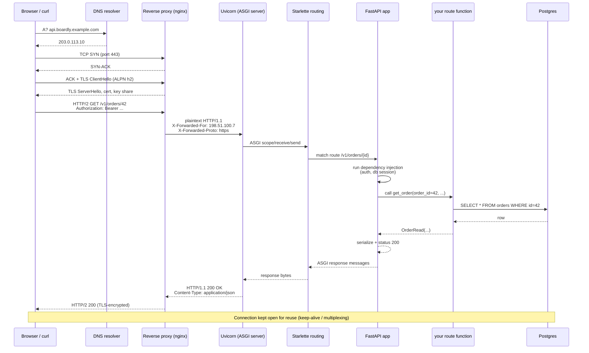
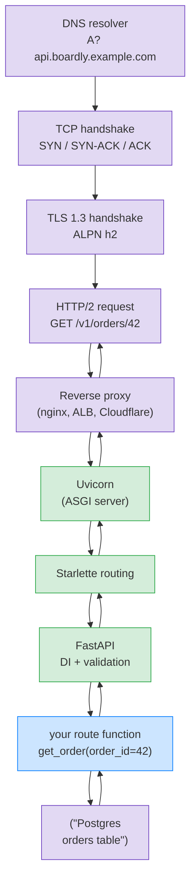

# Lesson 01: The HTTP Request Lifecycle

*From the moment a URL is typed to the moment bytes are flushed back — DNS, TCP, TLS 1.3, the HTTP request, the reverse proxy, Uvicorn, Starlette, FastAPI, your route function, the database, and back. The whole chain, line by line.*

**You're at the very beginning of Section 02.**

Every FastAPI route you ever write sits at the end of a long chain of systems: a browser, a DNS resolver, a TCP handshake, a TLS negotiation, a reverse proxy, an ASGI server, a Starlette stack, and finally your route function. When something breaks — a `504` that "shouldn't" happen, a request that succeeds in curl but fails in the browser, a slow endpoint that the database says is fast — the bug is almost never in your route. It is somewhere along that chain. You need to be able to read the chain end-to-end. That is what this lesson teaches. Take your time. Read every line. Run the traces yourself. **This is how you learn.**


#http #networking #lifecycle

## Learning Objectives

By the end of this lesson you will be able to:

1. **Describe, in order, the stages a request goes through** from URL to response: DNS, TCP, TLS, HTTP request, reverse proxy, ASGI server, Starlette, FastAPI, route function, database, response back.
2. **Read a `curl -v` trace** and identify each line as belonging to DNS, TCP, TLS, the HTTP request, or the HTTP response.
3. **Explain what HTTP keep-alive, HTTP/2 multiplexing, and HTTP/3 over QUIC buy you** at a conceptual level — and what they do not buy you.
4. **Place the reverse proxy and the ASGI server in the right order** and explain what each is responsible for.
5. **Locate where FastAPI sits** in the layered architecture and articulate what it does and does not control.
6. **Diagnose three classic "works in curl, breaks in browser" failures** using only the mental model from this lesson.

## Prerequisites

Before starting, you need:

- **Comfortable reading Python.** We will reference `async def` only at the surface; the deep dive on async is in Section 10.
- **A passing familiarity with the idea of a TCP connection.** We will re-prime it briefly below — you do not need to have read TCP/IP Illustrated.
- **`curl` installed.** It ships with macOS and most Linux distros; on Windows 10+ use `curl.exe`. We will use `curl -v` (verbose) throughout.
- **About an hour and a half of focused time.** This lesson is short on code (it is mostly a trace and a Mermaid diagram) and long on explanation — read it slowly.

**The most common gap: TCP basics.**

If "three-way handshake" and "SYN-ACK" mean nothing to you, do not panic. We will draw the handshake as three lines on a diagram and explain what each line is for. You do not need to derive the state machine. You need to know that *one round-trip happens before any application data flows*, because that round-trip is the reason HTTP keep-alive and HTTP/2 multiplexing exist.


## The Problem

You write a FastAPI route. The route takes 12 ms in your local tests. In production, with the same database and the same code, the *client* sees 800 ms. Where did the other 788 ms go?

The honest answer is: somewhere along the chain we listed in the callout above. Maybe DNS. Maybe a TLS handshake the client is doing on every request because nobody turned on keep-alive. Maybe a reverse proxy buffering a slow upload. Maybe a CDN cache miss. Maybe the database. Maybe your route. You cannot diagnose which without a mental model of the chain.

This lesson builds that mental model. We are deliberately conceptual here: the wire-format details of HTTP/2 frames, for instance, are out of scope. What you will leave with is the model you need to debug — and the vocabulary to read a `curl -v` trace, an nginx access log, and a Uvicorn startup banner.

**Note — The HTTP RFC reorganization (2022).**

In 2022, the IETF obsoleted RFC 7230–7235 (the previous HTTP/1.1 specs) and replaced them with RFC 9110 (HTTP Semantics), 9111 (HTTP Caching), 9112 (HTTP/1.1 message syntax), 9113 (HTTP/2), and 9114 (HTTP/3). The semantics did not change; the document structure did. We use the post-2022 citations throughout this section. If you read a blog post that cites RFC 7230 for "the HTTP/1.1 spec", the same material now lives in RFC 9112.


## The Code

Real-code-first. Here is the actual `curl -v` trace you are going to learn to read. This is the wire, unmodified, copied from a real request to a real FastAPI service sitting behind a real reverse proxy. Read it slowly. Do not worry if half of it is unfamiliar — that is the point of this lesson.

```text
$ curl -v https://api.boardly.example.com/v1/orders/42 --http2
* Trying 203.0.113.10:443...
* Connected to api.boardly.example.com (203.0.113.10) port 443 (#0)
* ALPN: offers h2,http/1.1
* TLSv1.3 (OUT), TLS handshake, Client hello (1):
* TLSv1.3 (IN), TLS handshake, Server hello (2):
* TLSv1.3 (IN), TLS handshake, Encrypted Extensions (8):
* TLSv1.3 (IN), TLS handshake, Certificate (11):
* TLSv1.3 (IN), TLS handshake, CERT verify (15):
* TLSv1.3 (IN), TLS handshake, Finished (20):
* TLSv1.3 (OUT), TLS change cipher, Change cipher spec (1):
* TLSv1.3 (OUT), TLS handshake, Finished (20):
* SSL connection using TLSv1.3 / TLS_AES_128_GCM_SHA256
* Server certificate:
* subject: CN=api.boardly.example.com
* start date: Sep 19 00:00:00 2026 GMT
* expire date: Dec 19 23:59:59 2026 GMT
* issuer: C=US; O=Let's Encrypt; R=O; CN=R10
* SSL certificate verify ok.
* Servername: api.boardly.example.com
* Using HTTP2, server multiplexed connection
* Connection #0 to host api.boardly.example.com left intact
* TLSv1.3 (OUT), TLS app data, Request (5):
> GET /v1/orders/42 HTTP/2
> Host: api.boardly.example.com
> User-Agent: curl/8.7.1
> Accept: */*
> Authorization: Bearer eyJhbGciOi...
>
* TLSv1.3 (IN), TLS app data, Response (5):
< HTTP/2 200
< server: nginx/1.27.0
< date: Mon, 19 Oct 2026 10:30:01 GMT
< content-type: application/json
< content-length: 78
< x-request-id: 4f7b9c32-1a3e-4d2b-8f6f-9c0b7d3a1e2c
< strict-transport-security: max-age=63072000
<
{"id":42,"customer_id":7,"total_cents":4200,"status":"active"}
* Connection #0 to host api.boardly.example.com left intact
```

That is 30 lines of wire output. By the end of this lesson you will be able to label every one of them. The `*` lines are curl's connection-level diagnostics (DNS, TCP, TLS, ALPN). The `>` lines are the request curl sent. The `<` lines are the response the server sent back. The line in the middle with no prefix is the response body.



That sequence is the whole lesson in one picture. The rest of this lesson unpacks it, hop by hop. Read the diagram once, then come back to it after each section below — you will see more in it each time.



The flowchart uses the same colour legend we'll see throughout the vault: **purple** is anything outside your process (DNS, the browser, the reverse proxy, the database); **green** is the FastAPI/Starlette/Uvicorn stack; **blue** is *your* code — the one node you actually wrote. The DNS / TCP / TLS hops are all purple because, from FastAPI's perspective, they are preconditions delivered by external infrastructure. The decision to colour-code this way matters because once you can read the colour, you can predict which layer a debugging problem belongs to *before* opening a tool.

## Line-by-Line Deep Dive

This section is the heart of the lesson. We will walk the `curl -v` trace line by line and the Mermaid sequence hop by hop. Read it twice. Do not skip.

**Tip — Think like a senior web engineer: latency is round-trips, not bytes.**

The single mental model that survives every refactor and every layer of indirection: *the cost of a request is not bytes-on-the-wire, it is round-trips.* DNS is one round-trip (more if the resolver has to walk the hierarchy). TCP is one round-trip (the SYN/SYN-ACK/ACK). TLS 1.3 is one round-trip (ClientHello / ServerHello+Finished / Finished+app-data). HTTP is one round-trip (request/response). The first request to a cold origin pays four round-trips before the application's first byte; warm connections pay one. Every "the latency went from 12 ms to 800 ms" production ticket is, when you read it carefully, "we added round-trips we did not notice" — a per-request TLS handshake, a per-request DNS resolve, a proxy that closes the upstream connection, a client that does not pool. Senior engineers reach for `curl -v` first because it labels each round-trip in the trace; they reach for the network-protocol books second, only when the round-trip count cannot be explained. The corollary they carry into capacity planning: *throughput is connections × concurrency per connection*, and every "we ran out of file descriptors" incident is a connection-per-request pattern that someone forgot to amortise.


### Lines 1–3: The DNS hop

```text
$ curl -v https://api.boardly.example.com/v1/orders/42 --http2
* Trying 203.0.113.10:443...
* Connected to api.boardly.example.com (203.0.113.10) port 443 (#0)
```

**What it does:** curl parses the URL, extracts the hostname `api.boardly.example.com`, asks the operating system's DNS resolver for the IPv4 address (an `A` record) of that hostname, gets `203.0.113.10` back, and opens a TCP connection to port `443` on that IP.

**Why this matters:** Before a single byte of HTTP is sent, the client needs an IP address. The DNS lookup is the slowest "free" step on a cold call — tens of milliseconds to a recursive resolver, then a query up the DNS hierarchy from the root servers through `.com` to the authoritative server for `boardly.example.com`. Clients cache aggressively, and so should you; never resolve a hostname on every request in a hot path. If you write a service-to-service client in Python with `httpx.AsyncClient`, the underlying transport caches DNS for the lifetime of the client instance — which is why you should reuse a single client instance for the lifetime of your app, not construct one per request.

**Tip — Two practical points about DNS for APIs you control.**

First, DNS is almost always behind a CDN or load balancer. The visible hostname `api.boardly.example.com` is typically a `CNAME` to a CDN's edge hostname, and the CDN resolves to whichever edge POP is closest to the client. The IP the client connects to is not "your server" — it is the CDN. Second, TTLs matter. A short TTL (60 seconds) lets you re-point DNS quickly in an incident; a long TTL (3600 seconds or more) reduces resolver load but means a DNS change takes an hour to propagate. Most teams pick 300 seconds as a compromise.


**What happens inside: the recursive resolver's walk.**

When the client hands the hostname to the OS resolver, the OS asks its configured recursive resolver (typically the ISP's, or `1.1.1.1` / `8.8.8.8` / the corporate DNS appliance). The recursive resolver does *not* know the answer; it walks the DNS hierarchy. It picks a root server (one of the 13 logical root-server identifiers, anycast across hundreds of physical instances), asks "where is `.com`?", receives a referral to the `.com` TLD nameservers, asks them "where is `boardly.example.com`?", receives a referral to the authoritative nameservers for `boardly.example.com`, asks them for the `A` record, and returns the IP to the client. The recursive resolver caches every referral and every answer for the TTL in the record; the OS resolver caches the recursive resolver's answer; the browser caches the OS resolver's answer. On a warm hit the DNS hop is sub-millisecond; on a cold recursive walk with no caches, it is the round-trip time to the root, plus to the TLD, plus to the authoritative — often 30–80 ms from a residential connection, more on a mobile network. The four-layer cache (browser → OS → recursive → authoritative) is what makes DNS *feel* free; the cache miss is what makes it expensive.


**Warning — When this breaks: the DNS timeout.**

**Symptom:** `curl` prints `* Could not resolve host: api.boardly.example.com` after 5–30 seconds, or — worse — every request to your service is intermittently 10 seconds slow.
**Diagnosis:** Isolate the layer first. Run `dig api.boardly.example.com` against your system resolver, then `dig @1.1.1.1 api.boardly.example.com` against a public resolver, then `dig @8.8.8.8 NS boardly.example.com +trace` to walk the hierarchy yourself. If the public resolvers work but your system one does not, the problem is the local network or the corporate DNS appliance; if all of them fail, the problem is upstream — your authoritative, your registrar, or your CDN. Distinguish the answer codes: `NOERROR` (the name exists but the `A` record is empty — typically a misconfigured record); `NXDOMAIN` (the name does not exist — typically a missing record or a typo); `SERVFAIL` (the resolver could not complete the lookup — typically a DNSSEC validation failure or an unreachable authoritative); and a bare timeout (the authoritative is not responding at all). Each one has a different runbook.
**Don't panic:** A 5-minute DNS outage is survivable if you have not also shortened your TTL to 60 seconds. The four-layer cache keeps serving stale answers for the duration of the TTL; clients whose resolvers cached your record before the outage keep working.
**Fix:** For an authoritative outage, fail over to a secondary DNS provider (most production setups use Route 53 + Cloudflare DNS as primary/secondary). For a DNSSEC breakage, roll the `DS` record at the registrar. For a TTL-related "stale answer stuck in a caching resolver" issue, lower the TTL *before* the next change so the resolver cache flushes in advance — the canonical pattern is to drop the TTL to 300 two days before a planned DNS change, make the change, then raise it back.


**Danger — How an attacker thinks: DNS cache poisoning and subdomain takeover.**

DNS is the first trust boundary on the wire, and it has been attacked for as long as it has existed. The classic Kaminsky attack (2008) exploited the fact that a recursive resolver accepts the *first* answer that matches its outstanding query — so an attacker who can race the real authoritative response with a forged one (guessing the 16-bit transaction ID and the source port) can poison the cache. DNSSEC (RFC 4033–4035) signs records cryptographically and is the modern defence; unsigned zones are still poisonable by the same race. The other persistent threat is *subdomain takeover*: you create a `CNAME` from `app.boardly.example.com` to `boardly.herokuapp.com`, you later delete the Heroku app but forget the `CNAME`, and an attacker registers a new Heroku app under the same name — your `CNAME` now resolves to their app, served from your domain, with your TLS certificate (if you used HTTP-01 with the same hostname). The defence is to delete the DNS record when you delete the resource, plus `CAA` records (RFC 8659) to constrain which CAs may issue for your zone. The senior engineer's checklist on any DNS change is: *did I delete the orphaned records? did I set a `CAA` record? is the zone signed with DNSSEC?*


**Production reality: the CDN edge hides DNS.**

In a typical production deployment, the hostname the client resolves is not your server — it is a CDN's edge hostname. `api.boardly.example.com` is typically a `CNAME` to `boardly.example.com.cdn.cloudflare.net` or `boardly-alb.elb.amazonaws.com`, and the `A` record the client ultimately receives points at an anycast IP that routes to whichever CDN POP is geographically closest. Cloudflare operates 300+ POPs; AWS CloudFront operates 600+; Fastly 80+. From the client's perspective, the DNS hop returns one IP; from the operator's perspective, that IP is anycast across hundreds of physical sites. The implication for backend engineering is that *the client never connects to your origin* — it connects to the CDN, which connects to your origin. The CDN's connection-reuse, TLS-session-resumption, and HTTP/2-pooling policies dominate the latency your origin sees; your Uvicorn's tuning barely matters. The corollary is that DNS changes are infrastructural events: a `TTL=300` change takes 5 minutes to propagate to most resolvers, but a `TTL=86400` change takes 24 hours to flush out of every caching resolver on Earth, and you cannot speed that up except by waiting.


### Lines 4–5: ALPN and the TCP handshake

```text
* ALPN: offers h2,http/1.1
* Connected to api.boardly.example.com (203.0.113.10) port 443 (#0)
```

**What it does:** The TCP handshake has already happened by the time we see `Connected`. The TCP three-way handshake is, in order:

1. Client → Server: `SYN` ("I want to talk, here is my initial sequence number.")
2. Server → Client: `SYN-ACK` ("Acknowledged, I want to talk too, here is mine.")
3. Client → Server: `ACK` ("Acknowledged.")

That is one round-trip before any application data flows. Then curl advertises, via ALPN (Application-Layer Protocol Negotiation, RFC 7301), that it can speak either HTTP/2 (`h2`) or HTTP/1.1 (`http/1.1`). The server picks one during the TLS handshake.

**Why ALPN lives inside TLS.**

ALPN is an extension to the TLS handshake. The client offers its supported protocols in the `ClientHello`; the server picks one in its `ServerHello`. This is how a server on port 443 can serve both HTTP/1.1 and HTTP/2 over the same port without an extra round-trip. Without ALPN, the client would have to guess, or do a separate upgrade dance — which is how HTTP/2's predecessor, SPDY, worked, and which nobody misses.


**Warning — When this breaks: the SYN backlog overflow that masked itself as slow acceptance.**

**Symptom:** Intermittent `curl: (28) Connection timed out` against one origin while every other origin works, with no packet loss visible in `mtr` and a healthy origin CPU. New connections fail more than established ones; restarting Uvicorn "fixes" it for a few minutes.
**Diagnosis:** Capture the half-open handshakes with `tcpdump -i any -n 'tcp[tcpflags] & tcp-syn != 0' -c 100` on the origin and count SYN packets per source IP. The Linux kernel's SYN-cookie fallback (`net.ipv4.tcp_syncookies`, default `1`) keeps the origin serving under a SYN flood by encoding connection state in the Initial Sequence Number, but it also *masks* the flood — your origin looks healthy while the SYN backlog silently overflows. Check `netstat -s | grep -i 'listen'` for `times the listen queue of a socket overflowed`; a non-zero counter means real SYN backlog overflows, not slow acceptance.
**Don't panic:** A non-zero overflow counter on its own is not an incident — bursty legitimate traffic (a deploy that restarts 200 workers, all reconnecting at once) trips it. Correlate with the SYN-rate: `ss -n state syn-recv | wc -l` measures half-open connections in real time; > 1000 sustained is a flood.
**Fix:** If the flood is real, raise `net.ipv4.tcp_max_syn_backlog` (default 1024) and confirm the reverse proxy's `listen backlog` matches (`nginx: listen 443 backlog=65535;`). Place a SYN-flood-mitigating CDN or DDoS layer in front — Cloudflare's SYNPROXY mode absorbs the flood before it touches your origin. If the symptom is on one origin only, check whether the proxy's upstream keep-alive pool is exhausting — a SYN flood masquerades as slow acceptance because each new connection is a fresh SYN. The senior engineer's checklist: *is `tcp_syncookies` masking a real backlog overflow? Is the CDN the SYN sink? Is the proxy reusing upstream connections?*


### Lines 6–14: The TLS 1.3 handshake

```text
* TLSv1.3 (OUT), TLS handshake, Client hello (1):
* TLSv1.3 (IN), TLS handshake, Server hello (2):
* TLSv1.3 (IN), TLS handshake, Encrypted Extensions (8):
* TLSv1.3 (IN), TLS handshake, Certificate (11):
* TLSv1.3 (IN), TLS handshake, CERT verify (15):
* TLSv1.3 (IN), TLS handshake, Finished (20):
* TLSv1.3 (OUT), TLS change cipher, Change cipher spec (1):
* TLSv1.3 (OUT), TLS handshake, Finished (20):
* SSL connection using TLSv1.3 / TLS_AES_128_GCM_SHA256
```

**What it does:** Negotiates an encrypted, authenticated channel using TLS 1.3 (RFC 8446). The client sends its `ClientHello` (with its supported cipher suites, its ALPN preference, and — in TLS 1.3 — a key share for forward secrecy). The server replies with its `ServerHello`, the certificate, the certificate verify (a signature proving the server holds the private key matching the certificate), and a `Finished` message. The client then sends its own `Finished`. From that point on, application data can flow encrypted.

**Why TLS 1.3 specifically:** TLS 1.3 cut the handshake from two round-trips (TLS 1.2) to one round-trip. With TLS 1.3's `0-RTT` mode (not shown here; only used when the client and server have a previous session), the client can even send application data in its first flight — at the cost of replay-attack risk that most APIs do not accept. For first-connection HTTPS, one round-trip is the floor.

TLS does three things for you:

- **Confidentiality.** Bytes on the wire are unreadable to intermediaries.
- **Integrity.** A man-in-the-middle cannot alter bytes undetected — the AEAD cipher (here `TLS_AES_128_GCM_SHA256`) includes an authentication tag.
- **Authentication** (server side, by default). The server proves it holds the private key matching a certificate trusted by the client. Mutual TLS (mTLS) does the same for the client, and is what you would use for high-trust service-to-service traffic.

**Warning — The reverse proxy almost always terminates TLS.**

In a production deployment, the reverse proxy (nginx, Envoy, HAProxy, Traefik, AWS ALB, Cloudflare) terminates TLS and speaks plaintext HTTP to your ASGI server. This is called **TLS termination**. It is the right default: the proxy is better at TLS than Uvicorn (it can use hardware acceleration, session tickets, OCSP stapling), and the proxy needs to inspect the request to route it. The plaintext hop from proxy to Uvicorn should be on a private network or a Unix socket. We will see this in the proxy hop below.


**What happens inside: the TLS 1.3 flight and the transcript hash.**

The TLS 1.3 handshake (RFC 8446 §4) is two flights. The client's first flight carries the `ClientHello` — cipher-suite preferences, the list of supported signature algorithms, the ALPN list, and a `key_share` extension containing an ephemeral public key (X25519 by default). The server's flight carries the `ServerHello` (with its own `key_share`), the `EncryptedExtensions`, the `Certificate` (the chain, leaf first), the `CertificateVerify` (a signature by the leaf cert's private key over the transcript hash of every byte exchanged so far), and the `Finished` (a MAC over the same transcript hash, keyed with a handshake secret derived via HKDF). From the `ServerHello` on, every subsequent handshake message is encrypted. The client's final flight carries its own `Finished` (a MAC over the *full* transcript including the server's `Finished`), and the first application data can ride in the same flight. The load-bearing property — why a man-in-the-middle cannot undetectably modify any handshake byte — is the *transcript hash*: the `Finished` messages authenticate every byte exchanged before them, so an attacker who alters a single byte of the `ClientHello` (e.g., to strip an algorithm) causes the `Finished` MAC to fail on the other side. TLS 1.3 is the protocol where, for the first time, downgrade attacks became cryptographically impossible: a TLS 1.3 server signals "I am TLS 1.3" through a magic sentinel in the random field that a TLS 1.2 attacker cannot forge without breaking SHA-256.


**Warning — When this breaks: the TLS certificate that expired at midnight.**

**Symptom:** Every client connection to your service starts failing at exactly 00:00 UTC, with `curl` printing `* SSL certificate problem: certificate has expired` and browsers showing `NET::ERR_CERT_DATE_INVALID`. Your synthetic monitor may not have fired because it hits the origin over plaintext HTTP and never negotiated a cert at all.
**Diagnosis:** Run `echo | openssl s_client -connect api.boardly.example.com:443 -servername api.boardly.example.com 2>/dev/null | openssl x509 -noout -dates -issuer -subject`. The `notBefore` and `notAfter` lines tell you the validity window; the issuer tells you which CA. If `notAfter` is in the past, the certificate expired; if `notBefore` is in the future, the clock skew between the cert authority and the client is real (or the cert was mis-issued). For ACME-issued certs (Let's Encrypt, ZeroSSL), the renewal is automated by `cert-manager` (Kubernetes) or `certbot` (Linux); a failure to renew is typically a misconfigured HTTP-01 or DNS-01 challenge — the ACME directory URL is unreachable, the `/.well-known/acme-challenge/` path is blocked by a WAF, or the DNS-01 TXT record is being overwritten by another zone.
**Don't panic:** A 90-day Let's Encrypt cert expiring is a 90-day warning that the renewal failed silently; the grace period is real but the fix is the same — re-run the ACME flow (`certbot renew --dry-run` or `kubectl describe certificate`), fix the challenge, re-issue. Users will see browser errors until the new cert is issued and propagated.
**Fix:** The structural fix is an alert on `cert_manager_certificate_expiration_timestamp_seconds < 14 * 86400` (or the equivalent in your cert authority's metrics), plus a synthetic monitor that performs a real TLS handshake every 5 minutes (`openssl s_client` from outside your network, not from inside where the cert might still be cached). The cert expiry that takes down production is *never* the cert you knew was about to expire — it is the cert you forgot you had.


**Danger — How an attacker thinks: TLS downgrade and SSL strip.**

If the client is willing to speak TLS 1.2, an active man-in-the-middle can rewrite the server's `ServerHello` to announce TLS 1.2, then exploit a TLS 1.2 weakness (BEAST, POODLE, Lucky13, RC4-nominee). If the client is willing to fall back to plaintext HTTP entirely (because the user typed `boardly.example.com` without the `https://`), the same attacker can intercept the plaintext HTTP request and respond with a forged page — *SSL strip*. The TLS 1.3 sentinel in the random field closes the downgrade window *inside* TLS, but the SSL-strip attack on the *browser-protocol-choice* layer is closed only by HSTS (RFC 6797, covered above). The other downgrade-like attack is *CA mis-issuance* — an attacker who controls a CA, or who compromises one, could re-issue a cert for your domain and present it; the defence is Certificate Transparency (RFC 9162), which requires CAs to log every issued certificate to a publicly auditable append-only log. Clients can require SCT (Signed Certificate Timestamp) proofs, and you can monitor the CT logs for unexpected issuance against your domain. The senior engineer's stance is: *never serve HTTP for any auth-related path, set HSTS only when you are confident in HTTPS, monitor CT logs for unexpected certs against your apex.* The combination of TLS 1.3 (cryptographic anti-downgrade), HSTS (browser-level anti-downgrade), and CT monitoring (CA-misissuance detection) is the modern defence-in-depth on the TLS layer.


### Lines 15–21: The certificate and the HTTP/2 decision

```text
* Server certificate:
* subject: CN=api.boardly.example.com
* start date: Sep 19 00:00:00 2026 GMT
* expire date: Dec 19 23:59:59 2026 GMT
* issuer: C=US; O=Let's Encrypt; R=O; CN=R10
* SSL certificate verify ok.
* Servername: api.boardly.example.com
* Using HTTP2, server multiplexed connection
```

**What it does:** curl prints the certificate the server presented, verifies the chain (the certificate is signed by Let's Encrypt's `R10` intermediate, which is signed by a root your operating system trusts), checks the hostname (`CN=api.boardly.example.com` matches what you typed), checks the validity window (not expired, not yet-not-valid), and confirms that ALPN selected HTTP/2 (`h2`).

**Why this matters:** The TLS handshake is the moment the client decides whether the server is who it claims to be. If you ever see `* SSL certificate verify failed` in a curl trace, the server's certificate is either self-signed, expired, issued for the wrong hostname, or signed by a CA your system does not trust. In dev, you can override with `-k` (insecure); in production, you fix the certificate. Never `-k` in production — it disables the authentication property of TLS, leaving you with confidentiality against passive eavesdroppers but no protection against an active man-in-the-middle.

**Warning — When this breaks: the SAN mismatch that `-k` taught you to ignore.**

**Symptom:** `curl` against `https://api.boardly.example.com` returns `* SSL: no alternative certificate subject name matches target host name 'api.boardly.example.com'` (or `kCFStreamErrorDomainSSL, -9802` on macOS). `curl -k` "works" — and so does every other client where the engineer copied the `-k` flag from a Stack Overflow answer. The bug is now latent in production: clients using a strict TLS implementation (mobile apps with certificate pinning, `requests` with `verify=True`, browsers with HSTS preload) fail; clients using `-k` or `verify=False` succeed but are MITM-able.
**Diagnosis:** `echo | openssl s_client -connect api.boardly.example.com:443 -servername api.boardly.example.com 2>/dev/null | openssl x509 -noout -text | grep -A1 'Subject Alternative Name'` lists every name the cert is valid for. The hostname you connect to MUST be in that list — not just the `CN=`, which clients have ignored since the deprecation in RFC 6125. The classic mismatch is a cert issued for `*.boardly.example.com` matched against `api.boardly.example.com` (wildcards match exactly one label, so this works) but not against `api.v2.boardly.example.com` (two labels under the wildcard, this fails) and not against `boardly.example.com` itself (wildcards do not match the apex).
**Fix:** Re-issue the cert with the correct SAN list — modern CAs issue SAN-only certs (the `CN=` is decorative). ACME clients (`certbot`, `cert-manager`) put every Subject Alternative Name on the CSR; you must enumerate every hostname the cert should answer for, including the apex and the `www.` variant if you serve both. Audit your codebase for `-k` / `verify=False` / `InsecureRequestWarning` suppressions with `rg -- 'verify\s*=\s*False|-k|InsecureRequestWarning' --type py` — every match is a latent MITM bug. The senior engineer's rule: *`-k` is a debugging tool, never a deployment tool; every `-k` in a README is a bug waiting to page you.*


### Lines 22–23: The HTTP request

```text
> GET /v1/orders/42 HTTP/2
> Host: api.boardly.example.com
> User-Agent: curl/8.7.1
> Accept: */*
> Authorization: Bearer eyJhbGciOi...
>
```

**What it does:** curl sends the HTTP request. The `>` prefix is curl's way of telling you "these are bytes I sent." The first line is the request line: method (`GET`), path (`/v1/orders/42`), and protocol version (`HTTP/2`). The lines after are headers — `Host`, `User-Agent`, `Accept`, and the `Authorization` header carrying a bearer JWT. The blank line at the end (the `>` on its own) marks the end of headers. For `GET`, there is no body.

**Why the `Host` header matters:** The `Host` header disambiguates which virtual host the request is for. A single nginx on a single IP can serve hundreds of hostnames; the `Host` header is how it picks which one. Without `Host` (which was optional in HTTP/1.0 and mandatory in HTTP/1.1), the proxy would not know which `server` block to dispatch to. In HTTP/2, the `:authority` pseudo-header plays the same role.

**Example — What HTTP/2 looks like on the wire.**

HTTP/2 is binary-framed, not text. curl's `> GET /v1/orders/42 HTTP/2` is curl's *rendering* of the request, not the literal bytes. The literal bytes are HEADERS frames (compressed with HPACK) and DATA frames. You do not need to read the binary; you need to know that the conceptual request is the same — method, path, headers, body — even if the wire encoding changed. The semantics are defined by RFC 9110; the wire format for HTTP/2 is defined by RFC 9113.


**What happens inside: HTTP/2 stream multiplexing on one TCP connection.**

HTTP/2 (RFC 9113) is binary-framed. A single TCP connection carries up to 2^31 - 1 concurrent *streams*, each identified by a 31-bit stream ID. Client-initiated streams use odd IDs (`1`, `3`, `5`, ...); server-initiated *push* streams use even IDs (push is deprecated in practice and effectively removed by HTTP/3). Each frame on the wire carries a 9-byte header: a 24-bit length, an 8-bit type (`HEADERS`, `DATA`, `SETTINGS`, `WINDOW_UPDATE`, `RST_STREAM`, `PRIORITY`, `PING`, `GOAWAY`), flags, and a 32-bit stream ID. The `HEADERS` frame carries the compressed (HPACK, RFC 7541) representation of the request's pseudo-headers (`:method`, `:path`, `:scheme`, `:authority`) and ordinary headers; the `DATA` frame carries the body, fragmented across as many `DATA` frames as needed. The streams are interleaved at the frame level — the server can send stream `1`'s first `DATA` frame, then stream `3`'s `HEADERS`, then stream `5`'s first `DATA`, then stream `1`'s second `DATA`, and so on. The receiver reassembles per-stream. The big win is that a slow response on stream `1` does not block a fast response on stream `3` — the head-of-line blocking of HTTP/1.1's "one request per connection, in order" is gone at the HTTP layer. The cost is that head-of-line blocking moves *down* to TCP: a lost packet on the connection blocks all streams' frames from being delivered until retransmission succeeds (which is the problem HTTP/3 solves with QUIC's per-stream retransmission). HTTP/2 also has per-stream and per-connection flow control (each side advertises a window; the sender cannot exceed it without a `WINDOW_UPDATE` from the receiver), and a priority tree (deprecated in RFC 9113, retained for back-compat, ignored by most clients).


**Danger — How an attacker thinks: header injection via CRLF in header values.**

HTTP/1.1 uses `CR LF` (0x0D 0x0A) as the line separator between headers, and `CR LF CR LF` to mark end-of-headers. If your application ever lets an attacker control a *header value* (a `Location:` redirect URL, a `Set-Cookie` value, a custom `X-` header) and concatenates that value into the response without stripping `CR` and `LF`, the attacker can inject arbitrary response headers — and, if the body has not started yet, arbitrary response body content. The classic payload is a redirect URL of `https://boardly.example.com/\r\nSet-Cookie: session=admin` — the application intends one `Location` header, the wire sees two headers and a forged cookie. In HTTP/2 the wire is binary-framed, so `CR LF` is just two bytes of a header *value*, not a structural separator — header injection at the HTTP/2 layer is structurally impossible. The vulnerability persists because almost every production deployment terminates HTTP/2 at the proxy and forwards to the backend over HTTP/1.1 (or vice versa), so the boundary between "safe binary framing" and "vulnerable text framing" is exactly the proxy hop. The defence is structural: never construct header values by string concatenation of user input; use the framework's `Response(headers=...)` API which validates values; reject any header value containing `0x0D` or `0x0A` (or any control character, per RFC 9110 §5.5) at the validation layer. In Starlette/FastAPI, `Response` will raise `ValueError` on a header value containing a `CR` or `LF` — let it raise; do not catch and rewrite.


**Danger — How an attacker thinks: HTTP request smuggling at the proxy/backend boundary.**

HTTP/1.1 has two ways to determine a request body's length: `Content-Length` (a single integer) and `Transfer-Encoding: chunked` (a sequence of length-prefixed chunks terminated by a zero-length chunk). RFC 9112 says if both are present, `Content-Length` is ignored — but historically, different proxies and backends disagreed on which to honour. *HTTP request smuggling* (the canonical write-up is James Kettle's 2019 "HTTP Request Smuggling in the Wild") exploits that disagreement: the front-end (e.g., a load balancer) reads the request using one interpretation and forwards it; the back-end reads the forwarded bytes using the other interpretation; the back-end's leftover bytes are interpreted as the start of the *next* request on the same keep-alive connection — so an attacker who smuggles a request can have it executed as if it came from a different victim, bypassing the front-end's access controls. The two classic desync classes are `CL.TE` (front-end uses `Content-Length`, back-end uses `Transfer-Encoding`) and `TE.CL` (the reverse); there are also `CL.CL` variants and the newer "HTTP/2-to-HTTP/1.1 translation" classes where the proxy translates HTTP/2 to HTTP/1.1 and gets the body-length semantics wrong. The defence in 2026 is straightforward: *normalise to HTTP/2 end-to-end*, or use a backend that strictly follows RFC 9112's "`Content-Length` is ignored when `Transfer-Encoding` is present" rule, or — the belt-and-braces option — disable HTTP keep-alive between the proxy and the backend (every request gets a fresh TCP connection; the smuggling vector closes because there is no "next request on the same connection" to inject into). The defence that does *not* work is hoping your WAF catches it — smuggling is invisible to a WAF that reads the request the same way the front-end does.


### Lines 24–31: The HTTP response

```text
< HTTP/2 200
< server: nginx/1.27.0
< date: Mon, 19 Oct 2026 10:30:01 GMT
< content-type: application/json
< content-length: 78
< x-request-id: 4f7b9c32-1a3e-4d2b-8f6f-9c0b7d3a1e2c
< strict-transport-security: max-age=63072000
<
{"id":42,"customer_id":7,"total_cents":4200,"status":"active"}
```

**What it does:** The server responds. The `<` prefix is curl telling you "these are bytes I received." The first line is the status line: protocol (`HTTP/2`), status code (`200`), and (in HTTP/1.1) a reason phrase (`OK`). The lines after are response headers. The blank line marks the end of headers. Then comes the body — `78` bytes of JSON, exactly as advertised by `content-length`.

**Why each header is there:**

- `server: nginx/1.27.0` — the reverse proxy announces itself. (In production you would suppress this with `server_tokens off` to avoid leaking version information to attackers.)
- `date` — required by RFC 9110; used by caches for age calculations.
- `content-type: application/json` — tells the client how to parse the body. Without this, the client guesses, and guessing is how you get security bugs.
- `content-length: 78` — tells the client how many bytes to read. The client can keep the connection open for the next request because it knows when this response ends.
- `x-request-id` — a correlation ID. The reverse proxy generated this, your FastAPI middleware (see [[03-FastAPI-Core/Middleware-and-Request-Order|Lesson 5 of Section 03]]) read it, and the route function logged it. When the client reports a bug, you grep your logs for this ID and find every line that touched this request.
- `strict-transport-security: max-age=63072000` — HSTS. Tells the browser "for the next two years, only ever connect to me over HTTPS; if someone types `http://`, upgrade to `https://` automatically." We will see this again in Lesson 5.

**Student asks: who set these headers — the reverse proxy or FastAPI?**

Some of each. The `server`, `date`, and `strict-transport-security` headers are set by nginx. The `content-type`, `content-length`, and `x-request-id` headers are set by FastAPI (or, more precisely, by Starlette, which FastAPI inherits from). The `x-request-id` is the interesting one — the proxy generates it, passes it through to FastAPI via a request header, FastAPI's middleware reads that header and stamps it on the response, and the proxy passes the response header back to the client unchanged. That is the layered cooperation we will see in the next few hops.


**Production reality: `x-request-id` propagation across the proxy-to-Uvicorn hop.**

The `x-request-id` header in the trace was generated by the proxy and stamped back on the response by FastAPI — but only because FastAPI's middleware was written to read the incoming `X-Request-ID` header (or generate one if missing) and re-emit it on the outgoing response. The propagation is not automatic: if your middleware only sets `response.headers["X-Request-Id"] = ...` without first reading the incoming header, you break the chain at the Uvicorn hop — the client's reported ID will not match the ID your route function logged, and the on-call engineer grepping the logs by the client's reported ID will see nothing. The standard pattern: middleware reads `request.headers.get("x-request-id")`, generates a UUID if absent, stores it on `request.state.request_id`, and sets the same value on the response. Structured-log handlers (`structlog`, the stdlib `logging` module with a `LoggerAdapter`) pull from `request.state` so every log line — including those emitted by dependencies, route bodies, and downstream service calls — carries the same ID. The senior engineer's grep: `rg 'X-Request-Id|x-request-id|request_id' boardly/ --type py` should show one writer (the middleware) and many readers (every logger); if the writer is in a route body, the chain is broken. See [[03-FastAPI-Core/Middleware-and-Request-Order]] for the canonical middleware and [[13-Performance-and-Observability/Structured-Logging-and-Request-IDs]] for the log-handler side.


### The `strict-transport-security` (HSTS) header

```text
< strict-transport-security: max-age=63072000
```

This is HSTS — HTTP Strict Transport Security (RFC 6797). It tells the browser: "for the next `max-age` seconds (here, two years), if anyone asks for me over `http://`, automatically upgrade to `https://` without even attempting the insecure request."

HSTS exists to defend against the active man-in-the-middle who downgrades a victim's connection from HTTPS to HTTP. Without HSTS, the first time a user types `bank.example.com` into a browser, the browser tries `http://` first (because the user did not type `https://`), and an attacker on the same network can intercept that plaintext request and respond with a fake page. With HSTS, after the first visit (which the browser remembers), subsequent visits automatically use HTTPS.

The trade-off: HSTS is a commitment. If you set `max-age=63072000` and then need to take your HTTPS endpoint down for an extended period, every browser that has cached the HSTS directive will refuse to connect to your `http://` fallback for two years. Set HSTS only when you are confident in your HTTPS deployment. Start with `max-age=300` (5 minutes) for a week, then `max-age=86400` (a day) for a month, then ramp up.

**Warning — HSTS is one-way.**

Once a browser has cached your HSTS directive, there is no way to revoke it before `max-age` expires (short of the browser's HSTS-clearing UI, which most users do not know exists). Do not enable HSTS until your HTTPS setup is production-stable. The preload list (`https://hstspreload.org/`) is even more aggressive — once you are on it, every modern browser ships with your domain preloaded as HTTPS-only, and removal takes months.


### The body and keep-alive

```text
{"id":42,"customer_id":7,"total_cents":4200,"status":"active"}
* Connection #0 to host api.boardly.example.com left intact
```

The response body is `78` bytes of JSON, exactly as advertised by `content-length: 78`. The client reads exactly 78 bytes and knows the response is complete. The `Connection #0 ... left intact` line at the end is curl's way of saying "I am keeping this connection open for reuse." That is HTTP keep-alive (HTTP/1.1) or HTTP/2 multiplexing — the next request from this client to this origin reuses the warm TCP+TLS connection, skipping the handshake cost.

If the response had used chunked transfer encoding (`Transfer-Encoding: chunked` instead of `Content-Length`), the body would be terminated by a zero-length chunk rather than a byte count. This is how streaming responses work — the server does not know the total length when it starts sending, so it sends chunks with a length prefix until it sends a zero-length chunk to signal the end.

**Student asks: how does the client know whether to expect `Content-Length` or chunked encoding?**

The server's response headers tell it. If the response has `Content-Length: 78`, the client reads exactly 78 bytes and stops. If the response has `Transfer-Encoding: chunked`, the client reads chunks until it sees the zero-length terminator. The two are mutually exclusive — RFC 7230 forbids sending both on the same response. The server decides which to use based on whether it knows the body length when it starts sending: a JSON response from a Pydantic model has a known length (serialize, count bytes, set `Content-Length`, send); a streaming response from a generator does not (the next chunk's length is unknown until the generator yields it). FastAPI's `StreamingResponse` uses `Transfer-Encoding: chunked`; `JSONResponse` uses `Content-Length`. The client does not need to negotiate — it just reads the headers and follows whichever rule applies.


**Warning — When this breaks: chunked transfer-encoding with proxy buffering silently kills streaming.**

**Symptom:** A `StreamingResponse` that yields one line per second works locally (`curl -N` prints lines as they arrive) but in production every line appears at the end of the response — the client sees a 30-second pause, then a single burst. SSE event-streams silently fall back to long-poll.
**Diagnosis:** The reverse proxy is buffering the chunked response. nginx's `proxy_buffering on` (the default) accumulates the upstream response in memory (or a temp file on disk) and only flushes to the client when the buffer fills or the upstream closes the connection. For `text/event-stream`, this turns streaming into batched delivery. The smoking gun is the response headers: the client sees `Content-Length: 1234` instead of `Transfer-Encoding: chunked` — the proxy calculated the length after buffering and rewrote the response.
**Fix:** Per-route, disable buffering in nginx: `location /v1/events { proxy_buffering off; proxy_cache off; proxy_set_header X-Accel-Buffering no; }`. The `X-Accel-Buffering: no` response header (an nginx-specific convention) lets your application opt out of buffering from the response side — FastAPI's `StreamingResponse` should set it for SSE endpoints. Also set `proxy_read_timeout 3600s` so the proxy does not close the long-lived connection. The grep: `rg 'StreamingResponse|EventSourceResponse|text/event-stream' boardly/` should be paired with an nginx config that has `proxy_buffering off` on the matching location. See [[02b-Backend-Foundations/Real-Time-Transports-Compared]] for the SSE-vs-WebSocket-vs-HTTP/2-streaming trade-off.


### The reverse proxy hop (Mermaid arrows 9–10)

In the Mermaid sequence, this is the hop from Browser to Proxy and Proxy to Uvicorn. In production there is almost always a server in front of Uvicorn: nginx, Envoy, HAProxy, Traefik, an AWS ALB, Cloudflare. The reverse proxy:

- **Terminates TLS.** (We covered this above.)
- **Routes.** `/api/*` → ASGI server pool; `/static/*` → object storage; `/` → the marketing site.
- **Load balances** across multiple ASGI workers (Uvicorn processes) using round-robin, least-connections, or IP-hash.
- **Adds headers.** `X-Forwarded-For` (the original client IP), `X-Forwarded-Proto` (the original scheme — `https`), and the standardized `Forwarded` header from RFC 7239.
- **Buffers slow clients** so your ASGI server does not tie up an event loop waiting on a 28.8 kbps modem. A 1 MB upload from a mobile phone with a flaky connection takes 30+ seconds to arrive; the proxy buffers it and hands it to Uvicorn as a fast local transfer.
- **Optionally applies WAF, rate limiting, gzip/br compression, caching.**

The proxy forwards to Uvicorn as plaintext HTTP/1.1 (or HTTP/2 to its upstream — your choice). The critical thing is that the *original* client IP and scheme are lost in that forwarding — Uvicorn sees `127.0.0.1` and `http` unless the proxy adds the `X-Forwarded-*` headers and Uvicorn is configured to trust them with `--proxy-headers`.

**Warning — The most common "the client IP is wrong" bug.**

If your logs show `127.0.0.1` for every client, you forgot one of two things. Either the proxy is not setting `X-Forwarded-For`, or Uvicorn is not parsing it. The fix is `uvicorn boardly.main:app --proxy-headers --forwarded-allow-ips="10.0.0.0/8"`. The `--forwarded-allow-ips` flag is the security gate: Uvicorn only trusts `X-Forwarded-*` headers from clients in that CIDR. Without that gate, any client could forge `X-Forwarded-For: 1.2.3.4` and you would log whatever they wanted.


### The ASGI server hop (Mermaid arrows 11)

Uvicorn (or Hypercorn, Daphne, Granian — the alternatives) is the program that actually holds the socket, accepts the connection from the reverse proxy, parses HTTP bytes, and calls into your ASGI application. We devote a full lesson to this layer — [[ASGI-Starlette-Uvicorn|Lesson 6]] — so we will keep this short.

What you need to know for this lesson: Uvicorn does **not** route, does **not** validate, does **not** render. It accepts the bytes, parses them into a structured `scope` dict, and calls `await app(scope, receive, send)`. The `scope` is a Python dict describing the connection. The `receive` is an awaitable that yields more events (body chunks, disconnects). The `send` is an awaitable that accepts events you push (response start, response body chunks).

The boundary between Uvicorn and Starlette is **not bytes**. It is three Python callables. That is the ASGI spec. We will write a minimal ASGI app by hand in Lesson 6 so you can see the shape directly.

**Production reality: Uvicorn `--workers N` and the GIL ceiling.**

A single Uvicorn process is one event loop — and one Python interpreter holding the GIL. Async I/O wins on I/O-bound work (many open sockets, all waiting on bytes), but a CPU-bound route (a heavy Pydantic validation, a synchronous bcrypt hash, a CPU-bound JSON serialization of a 50-MB response) blocks the entire event loop for the duration. The fix is `uvicorn boardly.main:app --workers N` (or `gunicorn -k uvicorn.workers.UvicornWorker -w N`): N operating-system processes, each its own interpreter, each its own GIL, each its own event loop. The worker-count ceiling is the smaller of (CPU cores, available RAM per worker times N) — a worker that holds a 200 MB SQLAlchemy connection pool means 8 workers consume 1.6 GB just for pools. Uvicorn's `--workers` flag is a process-manager wrapper around its own async loop; it does not magically parallelise a single request across cores. The senior engineer's rule: *one worker per CPU core for I/O-bound work; if the route is CPU-bound, offload to a thread or process pool (`asyncio.to_thread` for short CPU work, a `concurrent.futures.ProcessPoolExecutor` for long CPU work) — never block the event loop with CPU work in a route handler.* See [[10-Async-Python/Concurrency-vs-Parallelism]] for the canonical I/O-vs-CPU split and [[ASGI-Starlette-Uvicorn]] for the worker-tuning details.


**Warning — When this breaks: the undrained request body that starves the connection pool.**

**Symptom:** Uvicorn's access log shows a `POST /v1/uploads` taking 30+ seconds on a 100 KB body, and the upstream `httpx` pool starts returning `PoolTimeout` on unrelated endpoints. The proxy reports `499 Client Closed Request` for unrelated clients who timed out waiting behind the leaked connection.
**Diagnosis:** The route handler returned early (a `return` after the first chunk, an exception in middleware, a `BaseHTTPMiddleware` that short-circuits) without consuming the rest of `request.body()` or iterating `request.stream()`. Uvicorn's ASGI `receive` callable buffers the unconsumed body bytes in the connection's read buffer; the connection cannot be returned to the keep-alive pool until the body is fully drained. Each leaked connection is one slot in the pool held open until the client's `Connection: close` or a TCP timeout — and at high request rates the pool saturates with half-read connections. The smoking gun in a `tcpdump` is `FIN` packets from the client followed by the server continuing to send `RST` minutes later.
**Fix:** Always drain the request body before returning — `await request.body()` reads to EOF even if you do not use the bytes. For streaming endpoints (`StreamingResponse`), the ASGI server drains on `http.disconnect`. The structural fix is a middleware that wraps the `receive` callable and asserts `body_eof` was received before the response completes — a defensive guard against any future route that forgets. The grep: `rg 'async def.*request.*Response' boardly/routers/` should be paired with a check that every route either reads the body or returns a `413` / `411` early. See [[03-FastAPI-Core/Background-Tasks-Streaming-Uploads]] for the upload-drainage pattern.


### The Starlette and FastAPI hop (Mermaid arrows 12–13)

Starlette is the ASGI toolkit: routing, request/response objects, middleware base classes, exceptions, test client. FastAPI builds on Starlette and adds: dependency injection, Pydantic validation, OpenAPI generation, and an ergonomic `@app.get(...)` decorator. You write route functions; FastAPI wires them to Starlette's routing; Starlette hands them to Uvicorn; Uvicorn hands them to the reverse proxy; the proxy hands them to the client.

In our trace, Starlette matches the path `/v1/orders/42` against the registered routes, runs middleware in the order they were added (the [[03-FastAPI-Core/Middleware-and-Request-Order|onion model]]), and dispatches to the FastAPI route. FastAPI resolves dependencies (`Depends`), validates the request with Pydantic, and calls your function. Your function does work (database call, external HTTP, etc.) and returns a Pydantic model. FastAPI serializes the model to JSON and emits ASGI response messages. Starlette runs middleware in reverse order, hands bytes to Uvicorn, Uvicorn writes HTTP response to the proxy, the proxy re-encrypts and writes to the client.

**Where FastAPI begins and ends.**

FastAPI does not see the TLS handshake. It does not see the TCP connection. It does not see the DNS lookup. It does not see the proxy. FastAPI's first moment of awareness is the `scope` dict Uvicorn hands it; its last moment is the `http.response.body` event it sends back. Everything outside that boundary is somebody else's problem — which is exactly why a "slow endpoint" measured from your laptop is not a FastAPI problem until you have ruled out the rest of the chain.


**Danger — How an attacker thinks: dependency-injection ordering as a TOCTOU window.**

FastAPI's `Depends` resolves dependencies in declared order before the route body runs. If a route declares `user: User = Depends(get_current_user)` and `order: Order = Depends(get_order_by_id)` and the route body checks `if user.id != order.owner_id: raise HTTPException(403)`, an attacker who races two requests can exploit the gap between `get_order_by_id` (which loads the order into memory) and the ownership check (which runs in the body). In a concurrent ASGI server, two requests for the same order can both pass the `get_order_by_id` step before either reaches the ownership check — and if the second request mutates the order (a `PATCH` that flips `owner_id` to the attacker's user ID via a different vulnerability), the first request's cached `order` object now references an `owner_id` that the body check would have rejected. The window is microseconds, but micro-burst attacks (thousands of concurrent requests) make it exploitable. The defence is structural: do the ownership check *inside* the dependency that loads the resource — `get_order_for_user(order_id, user)` raises `404` (not `403`, to avoid the existence oracle from Lesson 2) if the order does not exist or does not belong to the user. The route body never sees an `order` it is not allowed to see. The senior engineer's grep: `rg 'Depends\(get_.*_by_id\)' boardly/routers/` should return nothing — the dependency should always take the authenticated user and scope the query to them. See [[11-Authentication-and-Security/RBAC-and-Object-Level-Auth]] for the object-level-authorisation dependency pattern.


### The route function hop (Mermaid arrow 14–16)

This is where *your* code runs. In our trace, it is a `GET /v1/orders/42` route that selects a row from Postgres and returns it as JSON. The route function is the only part of the chain you control. Everything else is the runtime — and the runtime is the part most of this lesson is about.

Why does the chain matter if your route is the only part you control? Because your route's behavior is conditioned by the chain. The `request.client.host` you log is the proxy's IP unless you parse `X-Forwarded-For`. The `request.url.scheme` is `http` unless you read `X-Forwarded-Proto`. The `Authorization` header your route reads is what the proxy forwarded — and the proxy can rewrite, strip, or add headers. If your route uses `Idempotency-Key` (see [[Idempotency-Safe-Retries-Pagination|Lesson 4]]), the proxy had to forward that header — and if your proxy strips unknown headers, your idempotency is silently broken.

**Tip — The mental model to walk away with.**

Your route function is a leaf on a tree. The tree has roots in DNS, a trunk in TCP+TLS, branches in the proxy and Uvicorn and Starlette, and FastAPI is the bark. You can prune the leaf, but you cannot fix the trunk from the leaf. When something is wrong, walk *down* the tree first — from the leaf toward the roots — until you find the broken layer.


### The `Host` header and virtual hosting

In the trace, the `Host: api.boardly.example.com` header looks redundant — the client already connected to `api.boardly.example.com` to send the request. It is not redundant. A single IP can serve hundreds of hostnames — this is *virtual hosting*, and it is how a single nginx on a single IP serves `api.boardly.example.com`, `app.boardly.example.com`, and `static.boardly.example.com`. The `Host` header is how the proxy picks which `server` block to dispatch to.

In HTTP/2, the `:authority` pseudo-header plays the same role. In HTTP/1.1, the `Host` header is mandatory (RFC 9110 makes it required for HTTP/1.1). A request without `Host` is malformed.

**The classic "works in curl, breaks in browser" — sometimes it is `Host`.**

If you hand-build an HTTP request and forget the `Host` header, some servers respond with `400 Bad Request`. curl sets `Host` automatically from the URL you give it; some hand-built clients do not. If you see a `400` in your hand-built client that does not appear in curl, check whether you are sending `Host`.


### The proxy-to-Uvicorn plaintext hop

The hop from the reverse proxy to Uvicorn is plaintext HTTP/1.1 (or HTTP/2 to upstream, depending on your nginx `proxy_http_version` setting). The proxy adds two critical headers that your app needs to read to know the *original* context of the request:

- **`X-Forwarded-For: 198.51.100.7, 10.0.0.1`** — a comma-separated chain of client IPs. The leftmost is the original client; subsequent IPs are proxies that appended themselves. Your app reads the leftmost *after* Uvicorn's `--forwarded-allow-ips` gate confirms the request came from a trusted proxy.
- **`X-Forwarded-Proto: https`** — the original scheme. Without this, your app sees `http` for every request, which breaks `request.url` and any URL it constructs for redirects or `Location` headers.

RFC 7239 also standardizes a `Forwarded` header that packs all of this into one header: `Forwarded: for=198.51.100.7; proto=https`. It is more correct but less widely used; the `X-Forwarded-*` headers are the de-facto standard.

**Example — What `request.url` actually returns behind a proxy.**

Without `--proxy-headers`: `http://127.0.0.1:8000/v1/orders/42` — wrong scheme, wrong host, wrong port.
With `--proxy-headers --forwarded-allow-ips="10.0.0.0/8"`: `https://api.boardly.example.com/v1/orders/42` — the correct URL the client sees. This matters for any code that constructs absolute URLs (OpenAPI's `servers` field, `Location` headers, signed-URL generation).


**Production reality: multi-hop `X-Forwarded-For` chains.**

In a typical production deployment, a request traverses *multiple* proxies before reaching Uvicorn: the CDN edge → the cloud load balancer → the in-cluster reverse proxy → Uvicorn. Each one appends to `X-Forwarded-For`, so the header that reaches Uvicorn looks like `X-Forwarded-For: 198.51.100.7, 10.0.0.1, 10.0.0.2` — the original client IP is the *leftmost* entry, and every subsequent entry is a proxy that handled the request. The problem is that the leftmost entry is the *least trustworthy* — it came in from the public internet, and an attacker can set `X-Forwarded-For: 1.2.3.4` on their initial request to spoof any IP they want. The trustworthy entries are the ones appended by *your* proxies (the rightmost N entries). Uvicorn's `--forwarded-allow-ips` flag handles exactly this: Uvicorn trusts entries appended by proxies in the allowed CIDR, working from the right; the leftmost *untrusted* entry is the original client IP. The senior engineer's reading of `X-Forwarded-For` is: *read from the right until you cross a trusted boundary, then take the next-to-the-right entry as the client IP.* The same logic applies to `X-Forwarded-Proto` — an attacker can set it; only trust it if the immediate peer is your trusted proxy. The RFC 7239 `Forwarded` header is the standardised replacement and is preferred in new deployments, but `X-Forwarded-For` is the de-facto standard the entire industry still speaks.


**Danger — How an attacker thinks: the `X-Forwarded-For` trust boundary as the audit surface.**

The `--forwarded-allow-ips` flag on Uvicorn is the difference between a real client IP and a forged one — and it is the audit surface an attacker probes to learn whether your access logs are truthful. An attacker who can send a request through a path that bypasses your trusted CIDR (a misconfigured internal route, a forgotten staging environment that listens on `0.0.0.0:8000` without the proxy in front, a Kubernetes `NodePort` that exposes Uvicorn directly) can forge any `X-Forwarded-For` value — and your access logs will faithfully record the forged IP. The downstream consequences: rate-limit counters attribute the attacker's traffic to the forged victim IP (the victim gets rate-limited, not the attacker); geo-IP logging is poisoned; IP-based abuse detection (`fail2ban`, IP-reputation feeds) bans the wrong addresses. The defence is structural: bind Uvicorn to `127.0.0.1` or a private interface only — never `0.0.0.0` in production — so the only path to Uvicorn is through the proxy. The audit: `kubectl get svc -A | grep -E 'NodePort|LoadBalancer'` and `ss -tlnp | grep 8000` should show no public exposure. The senior engineer's checklist on every deployment: *is Uvicorn bound to a private address? Is `--forwarded-allow-ips` set to the proxy CIDR? Are there any "temporary" `kubectl port-forward` or debug paths that bypass the proxy?* See [[11-Authentication-and-Security/Threat-Model-First]] for the trust-boundary threat-model exercise.


## Execution Trace

For a single request, ordered, from URL typed to response rendered:

1. **Client resolves `api.boardly.example.com`** — DNS, cached or recursive.
2. **Client opens TCP to `:443`** and starts TLS 1.3.
3. **Client writes HTTP request** — `GET /v1/orders/42`, `Authorization` header, etc.
4. **Reverse proxy terminates TLS**, parses request, rewrites scheme/host headers, picks an upstream.
5. **Proxy forwards to Uvicorn** as plaintext HTTP/1.1 (or HTTP/2 to its upstream — your choice), adding `X-Forwarded-For` and `X-Forwarded-Proto`.
6. **Uvicorn parses the bytes**, builds an ASGI `scope` dict, and calls `app(scope, receive, send)`.
7. **Starlette matches the path** against routes, runs middleware in order, dispatches to the FastAPI route.
8. **FastAPI resolves dependencies** (`Depends`), validates the request with Pydantic, calls your function.
9. **Your function does work** (database call, external HTTP, etc.) and returns a Pydantic model.
10. **FastAPI serializes the model to JSON** and emits ASGI response messages.
11. **Starlette runs middleware in reverse order**, hands bytes to Uvicorn.
12. **Uvicorn writes HTTP response** to the proxy.
13. **Proxy re-encrypts** and writes to the client.
14. **The connection is held open** for keep-alive (or multiplexed for HTTP/2).

If you are skimming, slow down on steps 4, 5, and 11. Those are the steps where most production "weird" bugs live.

### What HTTP/2 and HTTP/3 buy you (and what they don't)

HTTP keep-alive (HTTP/1.1, RFC 9112) lets the client reuse the TCP+TLS connection across requests, so the second and later requests skip the handshake cost. That is one TCP+TLS amortised across many requests. The win is large on cold calls; trivial once the connection is warm.

HTTP/2 (RFC 9113) goes further. A single TCP connection is multiplexed across many concurrent streams, so a client can fire ten parallel requests over one connection and the server can interleave responses. Headers are compressed with HPACK. The big win is the multiplexing: no more head-of-line blocking at the HTTP layer — a slow response does not block a fast response behind it on the same connection.

**Note — HTTP/2 still has head-of-line blocking — at TCP, not HTTP.**

TCP is a reliable ordered stream. If packet 47 is lost, packets 48–100 sit in the receiver's buffer waiting for 47 to be retransmitted, even though they belong to an unrelated HTTP/2 stream. This is the problem HTTP/3 solves.


HTTP/3 (RFC 9114) runs over QUIC, which runs over UDP. QUIC folds the connection setup and TLS 1.3 into one round-trip, multiplexes streams independently so a lost packet does not block unrelated streams, and supports connection migration (you can switch from Wi-Fi to cellular without re-handshaking). Conceptually, HTTP/3 is "HTTP/2's semantics over a transport designed for it."

**Do you need to write code differently for HTTP/2 or HTTP/3?**

No. Your ASGI server and your reverse proxy negotiate with the client. Your FastAPI route is identical. You only need to know enough to read a load test report and to know that `--http h11` vs `--http httptools` in Uvicorn controls the parser, not the wire protocol the client sees. The client sees whatever the proxy negotiates.


**Production reality: W3C `traceparent` propagation across the CDN boundary.**

The `x-request-id` correlation ID in the trace is single-hop correlation — the proxy and your app share an ID, but the CDN in front of the proxy, the downstream service your route calls, and the database's query log each have their own correlation ID with no link between them. The W3C Trace Context spec (a W3C Recommendation, not an RFC; the header is `traceparent: 00-<trace-id>-<span-id>-<trace-flags>`) is the cross-system standard: a single trace ID propagates from the browser's `fetch()` through the CDN, the proxy, Uvicorn, FastAPI's middleware, the httpx call to the downstream service, that service's middleware, its database query — and back. OpenTelemetry generates the trace context; the `opentelemetry-instrumentation-fastapi` package auto-injects the trace headers; `opentelemetry-instrumentation-httpx` wraps `httpx.AsyncClient` to propagate the trace to the downstream. The CDN boundary is the hard one — most CDNs strip unknown request headers, so the trace ID generated by the browser is lost at the CDN edge unless you configure the CDN to forward `traceparent` and `tracestate`. The senior engineer's checklist: *does the CDN forward `traceparent`? Does the reverse proxy forward it to Uvicorn? Does the httpx client in the route propagate it to the downstream? Does the SQLAlchemy session attach the trace ID to `pg_stat_statements`?* A trace that breaks at any hop is a trace that cannot explain a 3 a.m. incident. See [[13-Performance-and-Observability/OpenTelemetry-Tracing]] for the canonical instrumentation.


## Common Mistakes

### Mistake 1: Trusting `request.client.host` as the real client IP

```python
# WRONG (behind a reverse proxy)
@app.get("/v1/orders")
async def list_orders(request: Request):
 client_ip = request.client.host # ← this is the proxy's IP, not the client's
```

**Symptom:** Every request in your logs shows `127.0.0.1` as the client. Your rate limiter is useless. Your geo-IP lookup returns the datacenter's location.

**Why:** Behind a reverse proxy, the TCP connection is from the proxy, not from the client. Uvicorn reports the peer of its TCP connection, which is the proxy.

**Fix:** Configure Uvicorn with `--proxy-headers --forwarded-allow-ips="<your proxy CIDR>"`, then read `request.headers["x-forwarded-for"].split(",")[0].strip()`. Or — better — use Starlette's `ProxyHeadersMiddleware` (the canonical lesson is [[03-FastAPI-Core/Middleware-and-Request-Order|Lesson 5 of Section 03]]).

### Mistake 2: Running plaintext HTTP in production "behind a proxy so it's fine"

**Symptom:** A network sniffing tool on the path between your proxy and Uvicorn can read every request body, including `Authorization: Bearer ...` headers.

**Why:** "Behind a proxy" only buys you confidentiality against clients connecting to the proxy. It does not buy you confidentiality on the segment between the proxy and Uvicorn. If that segment is on a network you do not fully control (a cloud VPC you share with other tenants, a Kubernetes overlay network with looser policy than you think), terminate TLS to Uvicorn too, use mTLS between the proxy and Uvicorn, or use a Unix socket.

**Fix:** Either run TLS all the way to Uvicorn (`uvicorn boardly.main:app --ssl-keyfile=... --ssl-certfile=...`), use mTLS between the proxy and Uvicorn, or bind a Unix socket on the same host (`--uds /tmp/uvicorn.sock`).

### Mistake 3: Assuming HTTP/2 fixes your backend

**Symptom:** You enable HTTP/2 at the proxy and the average response time barely moves.

**Why:** HTTP/2 fixes head-of-line blocking between client and proxy. It does nothing for a slow database call inside your route function. The 800 ms in your client's view is 780 ms in the database; the HTTP/2 multiplexing shaves microseconds off the HTTP layer.

**Fix:** Measure each layer. Use the proxy's `$upstream_response_time` for the Uvicorn round-trip; use Postgres's `pg_stat_statements` for the query. Then attack the actual bottleneck.

### Mistake 4: Confusing `Connection: close` with normal behavior

**Symptom:** Your client is slow on every request even though the server is fast.

**Why:** A client sending `Connection: close` is asking the server to tear down the connection after this response. That means the next request pays full handshake cost again — DNS, TCP, TLS, ALPN. If your HTTP client library is set to close the connection after each request, you are paying 200+ ms of handshake on every call instead of once.

**Fix:** Reuse a single `httpx.AsyncClient` instance for the lifetime of your app. The client maintains a connection pool; subsequent requests reuse the warm connection. See [[15-External-Integrations/HTTP-Clients-Timeouts-Retries]] for the canonical treatment.

### Mistake 5: Opening a new connection pool per request

```python
# WRONG
@app.get("/v1/orders/{order_id}")
async def get_order(order_id: int):
 async with httpx.AsyncClient() as client: # ← new client per request
 resp = await client.get(f"http://users/v1/users/{order_id}")
 return resp.json()
```

**Symptom:** Your service is slow; profiling shows TCP and TLS handshakes dominating the request budget.

**Why:** `httpx.AsyncClient()` constructs a new connection pool. The pool is empty, so the first request to each host opens a new TCP+TLS connection. With keep-alive, that is amortised across many requests — but only if the client *lives* across many requests.

**Fix:** Construct the client once in the lifespan, stash it on `app.state.client`, and reuse it. See [[03-FastAPI-Core/Application-and-Lifespan|Lesson 1 of Section 03]] for the lifespan pattern.

## Engineering Trade-Offs

### HTTP/2 vs HTTP/3 at the edge

HTTP/3 helps clients on lossy mobile networks. If your clients are servers in a datacenter on a stable network, HTTP/2 over TCP is enough. Don't chase HTTP/3 because the post said so. Cloudflare and the big CDNs support HTTP/3 widely; your reverse proxy may or may not. Measure the actual difference on your real clients before you commit.

### TLS termination at the proxy vs at Uvicorn

Proxy-terminated TLS is simpler and lets the proxy inspect and route. Uvicorn-terminated TLS removes one hop of plaintext. For most deployments, proxy-terminated is correct — nginx's TLS stack is faster than Python's, and the proxy needs to see the request to do its job. For high-security service-to-service traffic inside a cluster, mTLS between services is the right answer.

### Reverse proxy vs no reverse proxy

In dev, skip it. In prod, almost always have one — even if just a managed ALB. Uvicorn is not a feature-complete HTTP router; it is an ASGI server. It does not buffer slow clients, it does not compress responses, it does not do geo-IP routing, it does not speak HTTP/3. Use the right tool for each layer.

### Single connection vs many connections from the client

HTTP/2 and HTTP/3 are designed for *one* connection per origin with multiplexed streams. HTTP/1.1 browsers open 6 connections per origin. If your client is a browser, you get HTTP/2's single-connection behavior for free once the proxy negotiates it. If your client is `httpx`, you control this via the connection pool size.

**Tip — The single biggest win you can usually get.**

For service-to-service traffic, reuse a single `httpx.AsyncClient` instance for the lifetime of the app. That single change typically saves 100–300 ms per request by amortising the TLS handshake. It is the cheapest performance improvement in the whole stack.


**What happens inside: the connection pool under `httpx.AsyncClient`.**

When you construct an `httpx.AsyncClient`, you get an `httpcore.AsyncConnectionPool` with two bounds: `max_connections` (default 100, the hard cap on simultaneous TCP connections across all hosts) and `max_keepalive_connections` (default 20, the cap on *idle* warm connections kept in the pool). On `await client.get(url)`, the pool's transport asks for a connection to the host. If a warm `HTTPConnection` for that host exists in the pool's per-origin LRU, the pool dequeues it; otherwise it opens a new one — TCP `connect`, TLS handshake, HTTP/2 settings exchange — and stores it under the origin. The `httpcore` `ConnectionPool.stats()` method returns `{self.connections, idle_connections, active_connections}` so you can introspect the warm-pool state from middleware or a metrics endpoint. The keep-alive idle timer starts when the connection returns to the pool; on timeout (default 5 s in httpcore), the connection is closed and removed. The pool is shared across every coroutine in your process — that is what makes `httpx.AsyncClient` an amortised-cost resource. Constructing one per request (Mistake 5 above) defeats the amortisation: the pool is created empty, every request opens a new TCP+TLS, and the connection is closed when the `async with` block exits.


**Warning — When this breaks: connection pool exhaustion.**

**Symptom:** Intermittent `httpx.PoolTimeout: No available connections` (the pool is full and no connection freed within the timeout), or — slower — `httpx.ReadTimeout` on requests that should be fast, while the upstream service is idle.
**Diagnosis:** Inspect `client.is_closed` and `stats()` mid-incident — a pool with `active_connections == max_connections` and `idle_connections == 0` is saturated; the upstream is slow, not the pool. A pool with `idle_connections > 0` and `active_connections < max_connections` is *not* the bottleneck — the timeout is elsewhere (DNS, TLS handshake on a fresh connection, the upstream's accept queue). Distinguish the three timeouts: `ConnectTimeout` (TCP+TLS handshake slow), `PoolTimeout` (pool full), `ReadTimeout` (handshake done, response slow). Each one points at a different layer.
**Don't panic:** Resist the urge to raise `max_connections=1000`. The exhaustion is a *symptom* of a slow upstream or a fan-out pattern that opens more in-flight requests than the upstream can absorb; raising the cap moves the bottleneck to the upstream's accept backlog, where it manifests as SYN-ACK timeouts that are harder to diagnose.
**Fix:** First, find the slow upstream — the pool is full because requests are *not returning*. Check the upstream's `$upstream_response_time` (if it is nginx) or its own request logs. Second, bound the caller — a `asyncio.Semaphore(N)` around the call site caps concurrency at N, below the pool's `max_connections`, so the pool never saturates. Third, only if both are fine, raise the pool size — and raise it to the *concurrency* you measured, not to a round number.


**Danger — How an attacker thinks: HTTP/3 connection migration as a tracking vector.**

HTTP/3's connection-migration feature (RFC 9114 §9) is a privacy property: a client on Wi-Fi can hand off to cellular without re-handshaking, preserving the in-flight streams. The flip side is that the connection ID — a 4- to 18-byte identifier the server assigns — is stable across the migration, which means it is a tracking identifier that survives an IP-address change. An attacker who controls the QUIC server (or a man-in-the-middle with QUIC capability) can issue a connection ID and observe it migrating across the client's networks — the client's home IP and the client's mobile IP are now linkable to the same session, defeating the privacy properties of NAT, VPN, and rotating mobile IPs. The defence is on the client side: modern browsers reset the connection ID on a network change unless the user has explicitly opted into cross-network session continuity; mobile apps using `cronet` or low-level QUIC libraries must replicate that reset. The server-side mitigation is to issue short-lived connection IDs (QUIC permits rotating IDs; a server can issue new IDs in `NEW_CONNECTION_ID` frames and retire old ones) — a server that issues a fresh ID per request defeats the tracking at the cost of disabling migration. The senior engineer's question for every HTTP/3 deployment: *does my server issue a stable connection ID across the client's network changes? If yes, am I leaking a stronger tracking signal than the cookie I just spent six months deprecating?* See [[11-Authentication-and-Security/Threat-Model-First]] for the privacy-vs-traceability threat-model exercise.


## Exercises

**Tip — The 20-minute rule**

If you're stuck on an exercise for more than 20 minutes, re-read the relevant section above, then move on and come back. Learning isn't linear.


**Exercise 1 — Read a real trace.** Run `curl -v https://api.github.com/users/octocat` and identify each header in the response. Which header tells you the response is compressed? Which tells you the connection is keep-alive? Which tells you the server negotiated HTTP/2?

**Exercise 2 — Count the round-trips.** With the same `curl -v`, count the TLS flights (look for `Client hello`, `Server hello`, `Finished` messages). Confirm that the first application data flows on the second round-trip from the start of the TCP handshake.

**Exercise 3 — Stand up `uvicorn` behind `nginx` locally.** Use self-signed certs (or `mkcert` for trusted local certs). Configure nginx to terminate TLS and forward to Uvicorn on `127.0.0.1:8000`. Hit the app and confirm `X-Forwarded-For` reaches your route function. Print `request.client.host` with and without `--proxy-headers` and watch the difference.

**Exercise 4 — Capture the TLS 1.3 handshake.** Use `tcpdump` or Wireshark on the loopback interface and capture a single HTTPS request. Count the flights. Confirm that the first application data flows on the second round-trip from the start of the TCP handshake. (This is fiddly; don't spend more than 30 minutes.)

**Exercise 5 — Spot the bug.** This FastAPI snippet, deployed behind nginx without `--proxy-headers`, logs the wrong client IP. Why? What is the fix?

```python
@app.get("/v1/whoami")
async def whoami(request: Request) -> dict:
 return {"ip": request.client.host}
```

(Answer: `request.client.host` is the proxy's IP. Configure `--proxy-headers --forwarded-allow-ips="<proxy CIDR>"` on Uvicorn, then `request.client.host` will reflect the real client IP parsed from `X-Forwarded-For`.)

**Exercise 6 — Diagnose a 504.** Your client sees `504 Gateway Timeout` on a long-running endpoint. Where would you look first? (Hint: the gateway is the reverse proxy; the timeout is between the proxy and Uvicorn. Check the proxy's `proxy_read_timeout` and your endpoint's actual response time.)

### Exercises with verification (7–12)

**Exercise 7 — Verify the SYN backlog overflow counter.** Run `uv run python -c "import subprocess; print(subprocess.run(['sysctl', '-n', 'net.ipv4.tcp_syncookies'], capture_output=True, text=True).stdout.strip())"` to confirm SYN-cookies are enabled (expect `1`). Then run `netstat -s | rg 'listen'` and capture the `times the listen queue of a socket overflowed` counter; document the baseline in your runbook. Drive the counter above zero by sending a burst of half-open SYNs from a second host: `hping3 -S -p 8000 --flood <origin-ip>` for 5 seconds, then re-read the counter. A non-zero value under load (and zero at rest) confirms the overflow path is real; a non-zero value at rest is a SYN-flood signal your monitoring should alert on.

**Exercise 8 — Reproduce the SAN mismatch with `mkcert`.** Use `mkcert` to issue a cert for `api.boardly.test` only: `mkcert -install && mkcert api.boardly.test`. Configure Uvicorn with `uv run uvicorn boardly.main:app --ssl-keyfile ./api.boardly.test-key.pem --ssl-certfile ./api.boardly.test.pem` and verify `curl -v https://api.boardly.test --resolve api.boardly.test:443:127.0.0.1` succeeds, while `curl -v https://www.boardly.test --resolve www.boardly.test:443:127.0.0.1` fails with `no alternative certificate subject name matches`. Re-issue with `mkcert api.boardly.test www.boardly.test boardly.test` and confirm both hostnames now succeed. Verify the SAN list with `openssl x509 -in ./api.boardly.test.pem -noout -text | rg -A1 'Subject Alternative Name'`. Confirm there is no `-k` in your client code: `rg -- 'verify\s*=\s*False|-k|InsecureRequestWarning' boardly/ --type py` returns nothing.

**Exercise 9 — Generate and propagate `X-Request-Id`.** Write a FastAPI middleware that reads `request.headers.get("x-request-id")`, generates a UUID4 if missing (`uuid.uuid4().hex`), stores it on `request.state.request_id`, and sets the same value on the outgoing response. Verify end-to-end: `uv run uvicorn boardly.main:app --reload` in one terminal, then `curl -v -H 'X-Request-Id: test-123' http://127.0.0.1:8000/v1/whoami` — confirm the response carries `x-request-id: test-123` unchanged. Then `curl -v http://127.0.0.1:8000/v1/whoami` (no header) and confirm the response carries a freshly-generated 32-character hex UUID. Add a `print(request.state.request_id)` to the route body and confirm both IDs match the response header — if they do not, your middleware is writing the response header without storing on `state`, and the chain is broken.

**Exercise 10 — Reproduce the undrained-body connection starvation.** Write a `POST` route that reads `await request.body()` then `return {"ok": True}`, and a second `POST` route that returns `{"ok": True}` *without* draining the body. Run `uv run uvicorn boardly.main:app --workers 1 --limit-concurrency 10` and flood both endpoints with 50 concurrent 10-MB uploads: `for i in $(seq 1 50); do curl -s -X POST http://127.0.0.1:8000/leak -d "$(head -c 10000000 /dev/urandom | base64)" & done; wait`. Confirm via `uv run python -c "import asyncio, httpx; async def main(): r = await httpx.AsyncClient(timeout=2).get('http://127.0.0.1:8000/health'); print(r.status_code); asyncio.run(main())"` that the undrained endpoint eventually produces a timeout while the drained endpoint stays responsive. Inspect the leaked connections with `ss -tn state established '( sport = :8000 )' | wc -l` — the count stays high for the leaky route, returns to baseline for the drained route.

**Exercise 11 — Observe HTTP/2 stream multiplexing in a single connection.** With an HTTP/2-capable reverse proxy in front of Uvicorn (nginx with `listen 443 ssl http2;` and a self-signed cert), capture the wire with `tcpdump -i any -A 'tcp port 443' -w h2.pcap` while running two `curl` commands in parallel: `curl -s https://local.example/v1/orders/42 & curl -s https://local.example/v1/orders/43 & wait`. Open the pcap in Wireshark and confirm a single TCP 4-tuple (one client port, one server port) carries multiple HTTP/2 stream IDs interleaved at the frame level. Verify the stream count with `tshark -r h2.pcap -Y 'http2' -T fields -e http2.streamid 2>/dev/null | sort -u | wc -l` — the count is `> 1` if multiplexing occurred, `1` if each request opened its own connection (a sign your proxy is not pooling).

**Exercise 12 — Inspect `traceparent` propagation across a proxy.** Install the OpenTelemetry FastAPI and httpx instrumentation (`uv add opentelemetry-instrumentation-fastapi opentelemetry-instrumentation-httpx`) and configure auto-instrumentation in your app's lifespan. Call `curl -v -H 'traceparent: 00-0af7651916cd43dd8448eb211c80319c-b7ad6b7169203331-01' http://127.0.0.1:8000/v1/orders/42` and confirm the route logs the propagated `trace-id` (`0af7651916cd43dd8448eb211c80319c`) and `span-id` (`b7ad6b7169203331`). If the route also makes a downstream httpx call, capture the outgoing request with `mitmproxy -p 8080` and confirm the `traceparent` header is on the downstream request with the same trace ID but a new child span ID. Without the instrumentation, the trace ID is lost at the FastAPI boundary; with it, the ID flows end-to-end.

## Verification

Run the layered stack locally (dev mode, no proxy/TLS):

```bash
uv run uvicorn boardly.main:app --reload
# In another terminal:
curl -v http://127.0.0.1:8000/v1/orders/42
# Expected: HTTP/1.1 200 OK
# Content-Type: application/json
# body is your model serialized.
```

For the proxy-fronted stack:

```bash
uv run uvicorn boardly.main:app --host 127.0.0.1 --port 8000 --proxy-headers
# nginx config upstream points to 127.0.0.1:8000
curl -v https://local.example/health
# Expected: 200, X-Forwarded-For parsed by app, request.client.host shows the real client IP.
```

Expected `curl -v` lines you should be able to label after this lesson:

```text
* Trying 127.0.0.1:8000... ← TCP connect (no DNS, no TLS)
* Connected to 127.0.0.1 (127.0.0.1) port 8000
> GET /v1/orders/42 HTTP/1.1 ← request line
> Host: 127.0.0.1:8000
> User-Agent: curl/8.7.1
> Accept: */*
>
< HTTP/1.1 200 OK ← status line
< content-type: application/json
< content-length: 78
<
{"id":42,...} ← body
* Connection #0 to host 127.0.0.1 left intact ← keep-alive
```

If you can label every line above, you have the mental model. If not, re-read the section that covers the unlabeled line.

## Previously Learned Here

This is the first lesson of the section, so we have nothing to link back to. But several concepts introduced here are reused later:

- The `Authorization: Bearer ...` header shown in the trace is explained in [[11-Authentication-and-Security/OAuth2-JWT-Access-Refresh|Lesson 1 of Section 11]] — for now, treat it as an opaque bearer token.
- The `Idempotency-Key` header we mentioned is fully explained in [[Idempotency-Safe-Retries-Pagination|Lesson 4 of this section]].
- The `x-request-id` correlation header is generated by a middleware we build in [[03-FastAPI-Core/Middleware-and-Request-Order|Lesson 5 of Section 03]].
- The ASGI `scope/receive/send` triple we mentioned is explained from scratch in [[ASGI-Starlette-Uvicorn|Lesson 6 of this section]].

## What's Next

In [[Methods-Status-Headers-Content-Types|Lesson 2]] we zoom into the HTTP vocabulary. The `GET /v1/orders/42` request and the `200 OK` response in our trace above use three of HTTP's vocabularies — method, status, and headers. We will cover every method's safe/idempotent semantics, every status code family with the specific codes that matter for APIs, the headers you will actually set or read in FastAPI code, content types, and a practical table mapping FastAPI exceptions to status codes. By the end of Lesson 2 you will be able to read the `> GET` and `< HTTP/2 200` lines of the trace above and reason about every alternative that could have been there instead.

## Sources

- **RFC 9110 — HTTP Semantics** — <https://www.rfc-editor.org/rfc/rfc9110> — accessed 2026-10-19 — the canonical definition of methods, headers, status codes. The post-2022 reorganization of HTTP.
- **RFC 9111 — HTTP Caching** — <https://www.rfc-editor.org/rfc/rfc9111> — accessed 2026-10-19 — `Cache-Control`, `Vary`, conditional requests. Reused in Lesson 5.
- **RFC 9112 — HTTP/1.1** — <https://www.rfc-editor.org/rfc/rfc9112> — accessed 2026-10-19 — wire format and keep-alive. The post-2022 successor to RFC 7230.
- **RFC 9113 — HTTP/2** — <https://www.rfc-editor.org/rfc/rfc9113> — accessed 2026-10-19 — multiplexing and stream semantics.
- **RFC 9114 — HTTP/3** — <https://www.rfc-editor.org/rfc/rfc9114> — accessed 2026-10-19 — HTTP over QUIC.
- **RFC 8446 — TLS 1.3** — <https://www.rfc-editor.org/rfc/rfc8446> — accessed 2026-10-19 — modern TLS handshake.
- **RFC 7301 — ALPN** — <https://www.rfc-editor.org/rfc/rfc7301> — accessed 2026-10-19 — how the client and server negotiate HTTP/2 vs HTTP/1.1 during TLS.
- **RFC 7239 — Forwarded HTTP Extension** — <https://www.rfc-editor.org/rfc/rfc7239> — accessed 2026-10-19 — the standardized `Forwarded` header for proxy metadata. The `X-Forwarded-*` headers are the de-facto predecessor.
- **MDN — "An overview of HTTP"** — <https://developer.mozilla.org/en-US/docs/Web/HTTP/Overview> — accessed 2026-10-19 — accessible summary of the lifecycle.
- **Uvicorn documentation** — <https://www.uvicorn.org/> — accessed 2026-10-19 — `--proxy-headers`, `--forwarded-allow-ips`, workers, graceful shutdown. Cited in Lesson 6 too.
- **Starlette documentation** — <https://www.starlette.io/> — accessed 2026-10-19 — request/response objects, middleware order. Cited in Lesson 6 too.

## What We Learned

Let's recap. In this lesson you:

- **Built a mental model of the full HTTP request lifecycle** — DNS, TCP, TLS 1.3, the HTTP request, the reverse proxy, Uvicorn, Starlette, FastAPI, your route, the database, and back.
- **Read a real `curl -v` trace line by line** and labeled every line as DNS, TCP, TLS, ALPN, request, or response.
- **Saw the reverse proxy's responsibilities** — TLS termination, routing, load balancing, header rewriting, slow-client buffering — and why your ASGI server should not be doing any of them.
- **Placed Uvicorn, Starlette, and FastAPI in the right order** and articulated what each layer does and does not control.
- **Learned the conceptual wins of HTTP keep-alive, HTTP/2 multiplexing, and HTTP/3 over QUIC** — and what they do *not* buy you.
- **Hit and fixed five classic lifecycle mistakes** — trusting `request.client.host`, plaintext behind a proxy, HTTP/2-as-backend-fix, `Connection: close`, and per-request connection pools.

Here's the mental model to walk away with: *your FastAPI route is a leaf on a tree. The tree has roots in DNS, a trunk in TCP+TLS, branches in the proxy and Uvicorn and Starlette, and FastAPI is the bark. When something breaks, walk down the tree from leaf to root until you find the broken layer. Measure each layer independently — your route's response time is one number; the proxy's `$upstream_response_time` is another; the client's perceived time is a third. They are not the same number, and confusing them is the source of most "intermittent" production bugs.*

---

> A note from your teacher.
You just walked the entire HTTP chain, from a URL typed in a terminal to a row in Postgres and back. That chain is the same for a side project on your laptop and for a service at Netflix-scale. The difference is not the chain — it is the depth of instrumentation at each hop. As you move through the vault, every time you encounter a "weird" production bug, walk the chain. Walk it slowly. The bug is almost always at the layer you skipped.


---

**Tags:** #http #networking #lifecycle #review
**Previous:** [[00-Web-MOC]]
**Next:** [[Methods-Status-Headers-Content-Types]] ->
