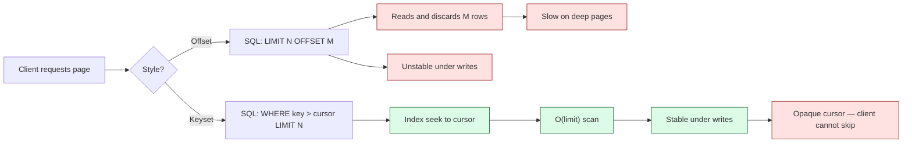
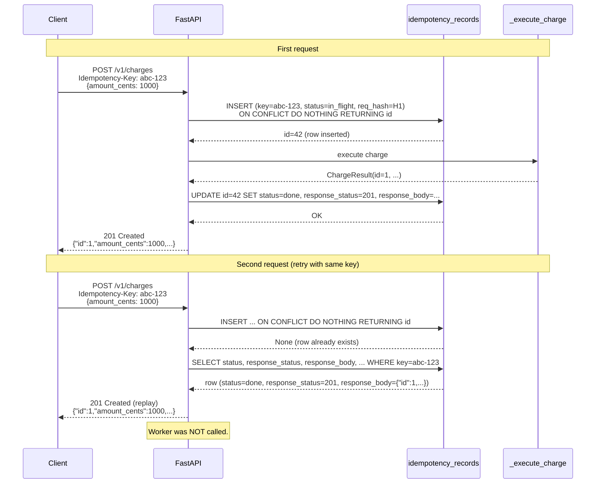

# Lesson 04: Idempotency, Safe Retries, Pagination

*How to make a `POST` safely retryable with `Idempotency-Key` and a Postgres-backed store, how to retry safely on the client side with full-jitter backoff, and how to paginate without melting your database.*

**Networks lie. Idempotency is the truth.**

A request times out. Did the server receive it? Process it? Commit it? You don't know. Your client retries — and now you have two charges on the customer's card, or two identical messages in the chat, or two rows in your `orders` table for what was meant to be one order. This is the problem idempotency solves. Combined with safe retries on the client side and pagination that does not fall over at scale, you get the reliability primitives every API needs. This is the canonical lesson for **Idempotency** in this vault. Take your time. Build the store. Write the backoff. **This is how you learn.**


#http #reliability #idempotency #pagination #canonical

> Previously learned in: [[Methods-Status-Headers-Content-Types|HTTP methods and status codes]]. We explained there that `GET`, `PUT`, `DELETE` are idempotent by HTTP method definition. Here we cover how to make a `POST` safely retryable, and how to do pagination that does not eat your database.

## Learning Objectives

By the end of this lesson you will be able to:

1. **Define idempotency precisely** and distinguish it from "no side effects" and "same response."
2. **Implement server-side idempotency** with `Idempotency-Key`, including the Postgres-backed storage layout, in-flight tracking, response replay, request-hash mismatch detection, and expiry.
3. **Design a client retry policy** that is safe by construction — full-jitter backoff, bounded attempts, retryable status set, respect for `Retry-After`.
4. **Implement offset pagination and keyset (cursor) pagination**, choose between them, and explain why offset is slow on large tables.
5. **Articulate the failure modes** of each pagination style under concurrent writes.
6. **Read a real idempotency trace** and explain every line of the request, response, and store lookup.

## Prerequisites

- **[[Methods-Status-Headers-Content-Types]]** — idempotent vs non-idempotent methods. We rely on this distinction.
- **[[REST-and-Pragmatic-API-Design]]** — resource URL shapes. The pagination and idempotency patterns live on those URLs.
- **[[06-SQL-Fundamentals/Transactions-Isolation-Locks]]** — the unique constraint that makes idempotency store inserts safe. If you do not know why `INSERT ... ON CONFLICT DO NOTHING` is the right primitive, re-read this section's transactions lesson.
- **Postgres available locally** (or `psql` access) for the storage schema. If you do not have Postgres, you can still follow with the in-memory version we show first; just do not put it in production.

**The most common gap: replay vs no-op.**

Engineers often implement "idempotency" as "if I have seen the key, do nothing and return 200." That is wrong. Idempotency is "if I have seen the key, return the *original* response — same status, same body, same headers." The replay must be byte-identical (modulo headers that change per request, like `Date`). This is what makes a retry safe: the client cannot tell whether the second call was processed or replayed, and does not need to.


## The Problem

Three reliability problems, all caused by networks being unreliable:

1. **Duplicate side effects on retry.** A client sends `POST /v1/charges` for $100. The network drops the response. The client retries. The server receives the retry, processes it again, charges the customer a second $100. This is the bug that costs companies real money — and reputations.
2. **Retry storms.** A downstream service has a transient blip. Every client retries at the same wall-clock offset, synchronized, because they all use the same naive backoff. The downstream service, already struggling, gets a synchronized wave of retries and dies.
3. **Slow pagination.** A list endpoint uses `LIMIT 20 OFFSET 1_000_000`. Postgres reads and discards a million rows before returning the first 20 of the page. The endpoint takes 5 seconds. The database is unhappy.

This lesson solves all three. The first with `Idempotency-Key` and a Postgres-backed store. The second with full-jitter backoff on the client. The third with keyset pagination.

This is the **canonical lesson for Idempotency** in this vault. Later lessons on [[15-External-Integrations/HTTP-Clients-Timeouts-Retries|HTTP clients]] and [[17-Advanced-Architecture/Idempotency-and-Retries|retries at scale]] reuse this material without re-explaining it.

**Note — The idempotency contract, in one sentence.**

If a client sends a request with header `Idempotency-Key: <key>` and the server has already seen `<key>` for this endpoint + auth context, the server returns the *original* response — same status, same body, same headers — without re-executing the operation.


## The Code: Part 1 – The Storage Schema

Real-code-first. Here is the Postgres schema for an idempotency store. Read it slowly; we will walk every column.

```sql
-- 01_idempotency_records.sql
CREATE TABLE idempotency_records (
 id BIGINT GENERATED ALWAYS AS IDENTITY PRIMARY KEY,
 key TEXT NOT NULL,
 auth_principal TEXT NOT NULL, -- e.g., customer id, API key hash
 endpoint TEXT NOT NULL, -- e.g., "POST /v1/charges"
 request_hash TEXT NOT NULL, -- SHA-256 of the canonicalized body
 status TEXT NOT NULL CHECK (status IN ('in_flight', 'done', 'error')),
 response_status INT,
 response_body JSONB,
 response_headers JSONB,
 created_at TIMESTAMPTZ NOT NULL DEFAULT now(),
 expires_at TIMESTAMPTZ NOT NULL,
 -- The unique constraint is what makes concurrent duplicates safe.
 -- Two identical requests racing to create a row will lose exactly one.
 CONSTRAINT idempotency_unique UNIQUE (auth_principal, endpoint, key)
);

-- Index for the expiry sweep job that deletes old rows.
CREATE INDEX idx_idempotency_expires_at ON idempotency_records (expires_at);
```

That is 14 columns, 1 unique constraint, 1 index. Every column earns its keep — we will defend each one in the line-by-line.

**Why does the unique constraint span three columns (`auth_principal, endpoint, key`) and not just `key`?** Because the same `Idempotency-Key: abc-123` value is allowed to be reused by different customers on different endpoints without collision. If the constraint were just `(key)`, then customer A's `POST /v1/charges` with key `abc-123` would lock out customer B's `POST /v1/charges` with the same key — they would collide and one customer would see the other's response replayed. The composite tuple `(auth_principal, endpoint, key)` is what makes the deduplication scope match the *business* scope: "this customer's charge with this key" is the unique thing, not "this key" in the abstract. **What would happen if you forgot `endpoint` from the tuple?** The same customer's `POST /v1/charges Idempotency-Key: abc-123` and `POST /v1/refunds Idempotency-Key: abc-123` would collide — the refund would replay the charge's response, which is wrong in every direction. The composite key is what makes the contract precise.

**Production reality: the 24-hour TTL sweep and the tombstone pattern.**

The `expires_at` index exists for the sweep job: a cron'd `DELETE FROM idempotency_records WHERE expires_at < now()` that runs every minute. The tombstone question: do you delete the expired row, or do you keep it as a "tombstone" that records "this key was used and expired"? Deleting saves storage but loses the audit trail ("when was key abc-123 last used?"). Stripe's choice is to delete; the audit trail is in the `charges` table, not the idempotency table. The trade-off: if you tombstone, the table grows unboundedly (24M rows/year at 1000 req/sec); if you delete, you cannot answer "did we ever see this key before the TTL window?" The pragmatic middle: delete after 24 hours but write a compact summary row to a separate `idempotency_audit` table (key hash, principal hash, endpoint, last_seen_at) for forensic queries. The grep: `rg "expires_at.*now\(\)|DELETE FROM idempotency_records" boardly/jobs/` should return the sweep; the CI check: `pytest tests/test_sweep_job.py` asserts the sweep deletes only expired rows and does not touch in-flight or done rows. See [[14-Caching-and-Background-Processing/Background-Tasks-vs-Workers]] for the background-sweep pattern.


**Warning — Debugging: the `BIGINT GENERATED ALWAYS` overflow that nobody monitors.**

The `id BIGINT GENERATED ALWAYS AS IDENTITY PRIMARY KEY` column has a maximum of `2^63 - 1` (9.2 quintillion). It will not overflow in any realistic idempotency store lifetime. But the same column on a *high-frequency* event-log table (10K inserts/sec) reaches `2^63` in 29 million years — fine. The real bug is the `IDENTITY` sequence cache in Postgres, which advances by `CACHE 1` (the default) per insert and is not transactional — a rollback does not return the sequence value, so the sequence advances on every attempt, successful or not. At 1000 req/sec with a 1% failure rate, the sequence advances by 10 extra per second; over a year, that is `315_360_000` wasted IDs — still fine. The overflow risk is not the integer; it is the gap between `pg_sequences.last_value` and `MAX(id)` growing past the alert threshold. The fix: monitor `pg_sequences.last_value` against `MAX(id)` and alert when the gap exceeds 10x. The grep: `rg "last_value|seq_scan" boardly/monitoring/` should return the check; the symptom in production: `pg_sequences.last_value` alerting on a 100x gap is the warning before `BIGINT` becomes a problem.


**Danger — How an attacker thinks: idempotency-key theft via gateway logs.**

The `Idempotency-Key` header is logged by default in most API gateways (Kong, Amazon API Gateway, NGINX access logs). An attacker with read access to the gateway logs (an insider, a misconfigured S3 bucket of access logs, a compromised logging pipeline) sees every `(Idempotency-Key, Authorization, request_body)` triple. The `Authorization` header is usually redacted (replaced with `***`); the `Idempotency-Key` is not — it is treated as benign metadata. The attacker now has a list of `(key, body)` pairs they can replay against the same API: `POST /v1/charges Idempotency-Key: abc-123 Authorization: <stolen bearer>` produces the same `201 Created` response the original client got. The defence: never log `Idempotency-Key` in plaintext; if you must log it for correlation, log a SHA-256 hash of the key, not the key itself. The grep: `rg "Idempotency-Key" boardly/middleware/logging.py | rg -v "sha256|hash"` should return nothing — every reference to the key in logging is hashed. The deeper defence: the idempotency-key replay attack requires the attacker to also have the `Authorization` header (the bearer token); rotate the bearer tokens on any suspected log exposure. See [[11-Authentication-and-Security/OAuth2-JWT-Access-Refresh]] for the bearer-token rotation playbook.


**Warning — Debugging: the `Idempotency-Key` with a newline that broke the gateway.**

A client sends `Idempotency-Key: abc-123\nX-Forged-Header: admin` (a header-injection payload — the `\n` is a literal CRLF in the header value). Most HTTP gateways (NGINX, Kong) reject the request with `400 Bad Request` because the CRLF in a header value is a protocol violation (RFC 9110 §5.1 forbids CRLF in field-values). But a buggy gateway or a custom middleware that does not validate header values passes the CRLF through, and the downstream parses the second line as a separate header — `X-Forged-Header: admin` is now a header on the request. The diagnosis: the idempotency-key value is attacker-controlled and reaches the gateway's header parser; the gateway's job is to reject CRLF in headers, but if the gateway is custom or misconfigured, the CRLF injects headers. The fix has two layers. (1) *Validate the `Idempotency-Key` format at the FastAPI boundary* — `idempotency_key: Annotated[str | None, Header(alias="Idempotency-Key", pattern="^[A-Za-z0-9-_]{1,128}$")] = None`; a key with CRLF, spaces, or non-printable characters is rejected with `422` before it reaches the gateway. (2) *Reject CRLF in all header values at the gateway* — the gateway's header parser must refuse field-values containing `\r` or `\n`. The grep: `rg "Idempotency-Key.*pattern|Header.*pattern" boardly/routers/` should return the validated header parameter; the CI check: `pytest tests/test_header_injection.py` asserts a CRLF-bearing `Idempotency-Key` is rejected with `422`. See [[02b-Backend-Foundations/HTTP-Headers-Deep-Dive]] for the header-validation pattern and [[03-FastAPI-Core/Middleware-and-Request-Order]] for the gateway-level CRLF rejection.


## The Code: Part 2 – The Idempotency-Aware Endpoint

```python
# boardly/routers/charges.py
"""Lesson 4 reference: an idempotent POST /v1/charges endpoint
backed by a Postgres store. The store tracks in-flight requests,
replays original responses on duplicate keys, and rejects
key-reuse with a different body."""
import hashlib
from datetime import datetime, timedelta, timezone
from typing import Annotated

from fastapi import APIRouter, Header, HTTPException, Request, status
from fastapi.responses import JSONResponse
from pydantic import BaseModel, Field
from sqlalchemy import text
from sqlalchemy.ext.asyncio import AsyncSession

router = APIRouter(prefix="/v1/charges", tags=["charges"])

IDEMPOTENCY_TTL = timedelta(hours=24)


class ChargeCreate(BaseModel):
 amount_cents: int = Field(gt=0)
 currency: str = "USD"


class ChargeResult(BaseModel):
 id: int
 amount_cents: int
 currency: str
 status: str = "succeeded"


def _principal(request: Request) -> str:
 """Extract the auth principal (e.g., customer id) from the request.
 In production this is your auth dependency's output."""
 auth = request.headers.get("authorization", "")
 return auth.split("Bearer ")[-1] if auth else "anonymous"


def _hash_request(body: bytes) -> str:
 """SHA-256 of the request body. We do not canonicalize JSON here for
 simplicity; in production, sort keys and normalize whitespace so that
 {'a':1,'b':2} and {'b':2,'a':1} hash identically."""
 return hashlib.sha256(body).hexdigest()


@router.post("", status_code=status.HTTP_201_CREATED)
async def create_charge(
 payload: ChargeCreate,
 request: Request,
 session: AsyncSession,
 idempotency_key: Annotated[str | None, Header(alias="Idempotency-Key")] = None,
) -> JSONResponse:
 body = await request.body()
 principal = _principal(request)
 endpoint = "POST /v1/charges"
 req_hash = _hash_request(body)

 # If the client did not send an Idempotency-Key, we cannot make the
 # request safely retryable. Process it normally.
 if idempotency_key is None:
 result = await _execute_charge(payload)
 return JSONResponse(status_code=status.HTTP_201_CREATED, content=result.model_dump(mode="json"))

 # Try to insert an in-flight record. The unique constraint protects us
 # against concurrent duplicates: if two identical requests race, only one
 # INSERT succeeds; the other gets a unique violation.
 now = datetime.now(timezone.utc)
 expires_at = now + IDEMPOTENCY_TTL
 insert_sql = text("""
 INSERT INTO idempotency_records
 (key, auth_principal, endpoint, request_hash, status, expires_at)
 VALUES
 (:key, :principal, :endpoint, :req_hash, 'in_flight', :expires_at)
 ON CONFLICT (auth_principal, endpoint, key) DO NOTHING
 RETURNING id
 """)
 result = await session.execute(insert_sql, {
 "key": idempotency_key, "principal": principal, "endpoint": endpoint,
 "req_hash": req_hash, "expires_at": expires_at,
 })
 inserted_id = result.scalar_one_or_none()

 if inserted_id is None:
 # The row already exists. We are processing a duplicate request.
 return await _handle_duplicate(session, principal, endpoint, idempotency_key, req_hash)

 # First time we have seen this key. Execute the operation.
 try:
 result_model = await _execute_charge(payload)
 response_body = result_model.model_dump(mode="json")
 # Persist the response so a later duplicate can replay it.
 await session.execute(text("""
 UPDATE idempotency_records
 SET status = 'done',
 response_status = :status,
 response_body = CAST(:body AS JSONB),
 response_headers = CAST(:headers AS JSONB)
 WHERE id = :id
 """), {
 "status": status.HTTP_201_CREATED,
 "body": _json_dumps(response_body),
 "headers": _json_dumps({"Content-Type": "application/json"}),
 "id": inserted_id,
 })
 await session.commit()
 return JSONResponse(
 status_code=status.HTTP_201_CREATED,
 content=response_body,
 media_type="application/json",
 )
 except Exception:
 # On failure, clear the in-flight record so a retry can re-execute.
 # Otherwise the key is poisoned: every retry will see "in_flight"
 # forever.
 await session.execute(text("""
 DELETE FROM idempotency_records WHERE id = :id
 """), {"id": inserted_id})
 await session.commit()
 raise


async def _handle_duplicate(
 session: AsyncSession,
 principal: str,
 endpoint: str,
 key: str,
 req_hash: str,
) -> JSONResponse:
 select_sql = text("""
 SELECT status, request_hash, response_status, response_body, response_headers, expires_at
 FROM idempotency_records
 WHERE auth_principal = :principal AND endpoint = :endpoint AND key = :key
 """)
 row = (await session.execute(select_sql, {
 "principal": principal, "endpoint": endpoint, "key": key,
 })).one_or_none()

 if row is None:
 # The row was deleted between the failed INSERT and this SELECT
 # (rare; race with the expiry sweep). Treat this as a fresh request.
 raise HTTPException(status.HTTP_409_CONFLICT, detail="idempotency race; please retry")

 # Expired?
 if datetime.now(timezone.utc) > row.expires_at:
 # Treat as fresh. Delete the expired row and tell the client to retry.
 await session.execute(text("""
 DELETE FROM idempotency_records
 WHERE auth_principal = :principal AND endpoint = :endpoint AND key = :key
 """), {"principal": principal, "endpoint": endpoint, "key": key})
 await session.commit()
 raise HTTPException(
 status.HTTP_409_CONFLICT,
 detail="idempotency key expired; please retry with the same key",
 headers={"Retry-After": "0"},
 )

 # Same key, different body? This is a client bug.
 if row.request_hash != req_hash:
 raise HTTPException(
 status.HTTP_422_UNPROCESSABLE_ENTITY,
 detail="Idempotency-Key reused with different body",
 )

 # Still processing?
 if row.status == "in_flight":
 return JSONResponse(
 status_code=status.HTTP_409_CONFLICT,
 content={"detail": "request with same key is still in flight"},
 headers={"Retry-After": "1"},
 )

 # Done — replay the original response byte-identically (modulo headers
 # that change per request, which we do not store).
 return JSONResponse(
 status_code=row.response_status,
 content=row.response_body,
 media_type="application/json",
 )


async def _execute_charge(payload: ChargeCreate) -> ChargeResult:
 """The actual side-effecting operation. In production this calls
 the payment processor, writes a row in `charges`, etc."""
 # ... pretend we charged the customer ...
 return ChargeResult(id=1, amount_cents=payload.amount_cents, currency=payload.currency)


def _json_dumps(value) -> str:
 import json
 return json.dumps(value, separators=(",", ":"))
```

Run it:

```bash
uv run uvicorn boardly.main:app --reload

# First request with an idempotency key:
curl -i -X POST http://127.0.0.1:8000/v1/charges \
 -H 'Authorization: Bearer cust_42' \
 -H 'Idempotency-Key: abc-123' \
 -H 'Content-Type: application/json' \
 -d '{"amount_cents": 1000}'
# HTTP/1.1 201 Created
# {"id":1,"amount_cents":1000,"currency":"USD","status":"succeeded"}

# Retry with the same key (e.g., after a timeout):
curl -i -X POST http://127.0.0.1:8000/v1/charges \
 -H 'Authorization: Bearer cust_42' \
 -H 'Idempotency-Key: abc-123' \
 -H 'Content-Type: application/json' \
 -d '{"amount_cents": 1000}'
# HTTP/1.1 201 Created ← same response, no duplicate charge
# {"id":1,"amount_cents":1000,"currency":"USD","status":"succeeded"}

# Same key, different body:
curl -i -X POST http://127.0.0.1:8000/v1/charges \
 -H 'Authorization: Bearer cust_42' \
 -H 'Idempotency-Key: abc-123' \
 -H 'Content-Type: application/json' \
 -d '{"amount_cents": 9999}'
# HTTP/1.1 422 Unprocessable Entity
# {"detail":"Idempotency-Key reused with different body"}
```

We will walk every line of that code next.

## Line-by-Line Deep Dive

### The schema: every column

```sql
CREATE TABLE idempotency_records (
 id BIGINT GENERATED ALWAYS AS IDENTITY PRIMARY KEY,
 key TEXT NOT NULL,
 auth_principal TEXT NOT NULL,
 endpoint TEXT NOT NULL,
 request_hash TEXT NOT NULL,
 status TEXT NOT NULL CHECK (status IN ('in_flight', 'done', 'error')),
 response_status INT,
 response_body JSONB,
 response_headers JSONB,
 created_at TIMESTAMPTZ NOT NULL DEFAULT now(),
 expires_at TIMESTAMPTZ NOT NULL,
 CONSTRAINT idempotency_unique UNIQUE (auth_principal, endpoint, key)
);
```

**`id`:** Surrogate primary key. We never use it in the API surface; it exists for internal joins and for the `RETURNING id` trick that lets us know whether our INSERT succeeded.

**`key`:** The `Idempotency-Key` header value. Client-supplied. Typically a UUID v4 or a UUID v7 (time-ordered so the index doesn't fragment). Do not let the client pick a meaningful key — `key="my-first-charge"` is a footgun if two engineers independently pick `"my-first-charge"` for different customers.

**`auth_principal`:** The authentication principal — typically the customer ID or the API key hash. This is what makes the key unique *per client*. Two different customers using the same key `abc-123` must not collide. The composite key `(auth_principal, endpoint, key)` is the actual unique tuple.

**`endpoint`:** The endpoint the key was first used on. `POST /v1/charges` and `POST /v1/refunds` are different endpoints; the same key `abc-123` may be used on both independently. This is the second component of the unique tuple.

**`request_hash`:** SHA-256 of the canonicalized request body. We store the hash (not the body) for two reasons: (a) bodies can be large; storing a 64-byte hash is cheaper than storing the body; (b) we do not need to replay the body, we need to detect mismatch. The hash is the detection mechanism.

**`status`:** `'in_flight'` (the original request is still processing), `'done'` (the original request completed, the response is stored, replays should replay the response), `'error'` (the original request failed; we keep the row to prevent re-execution, OR we delete the row to allow re-execution — a design choice, see Common Mistakes).

**`response_status`, `response_body`, `response_headers`:** The original response. Stored as `JSONB` for fast lookup. These are what we replay.

**`created_at`, `expires_at`:** The row's lifetime. `expires_at` is `created_at + IDEMPOTENCY_TTL`. We use `TIMESTAMPTZ` (timestamp with time zone) — never `TIMESTAMP` without a time zone, which silently drops the time zone and causes bugs across DST.

**`UNIQUE (auth_principal, endpoint, key)`:** This is the load-bearing constraint. It is what makes two racing INSERTs safe: Postgres will fail exactly one of them with a unique violation, atomically. Without this, you would need a distributed lock or a `SELECT FOR UPDATE` dance — both more fragile and slower.

**Warning — Always `TIMESTAMPTZ`, never `TIMESTAMP`.**

In Postgres, `TIMESTAMP` (without time zone) silently strips the time zone on insert and restores it (as the session's zone) on read. This produces bugs that only manifest when engineers in different time zones hit the system. Always use `TIMESTAMPTZ` for any wall-clock timestamp. Use `TIMESTAMP` only for "the absolute time, regardless of zone" (e.g., a calendar event's start), which is rare.


### The route signature

```python
@router.post("", status_code=status.HTTP_201_CREATED)
async def create_charge(
 payload: ChargeCreate,
 request: Request,
 session: AsyncSession,
 idempotency_key: Annotated[str | None, Header(alias="Idempotency-Key")] = None,
) -> JSONResponse:
```

**What it does:** Registers a `POST /v1/charges` route that returns `201` by default, with four parameters: the JSON body (`payload`), the raw `Request` (so we can read the body bytes for hashing), the DB `session` (a dependency we will define in [[03-FastAPI-Core/Dependency-Injection|Lesson 4 of Section 03]]), and the `Idempotency-Key` header.

**Why `request: Request`:** We need the raw body bytes to compute the hash. FastAPI parses the body into `payload: ChargeCreate` for us, but the hash must be over the *raw bytes* the client sent, not the parsed dict. This is because two semantically-equal bodies (e.g., `{"a":1,"b":2}` vs `{"b":2,"a":1}`) produce different bytes but the same dict. In production, you would canonicalize the JSON (sort keys, normalize whitespace) before hashing so that semantically-equal bodies hash identically. We skip that for clarity in this lesson.

**Why `idempotency_key: Annotated[str | None, Header(...)] = None`:** The header is optional. If absent, we cannot make the request safely retryable — we process it normally. Clients who want retry safety must send the header. Stripe's API has the same semantics.

**Student asks: why not require the header for `POST`?**

You could — and some APIs do. The trade-off: requiring the header forces every client to think about idempotency, which is good for safety but adds friction for trivial cases (dev scripts, one-off imports). Stripe makes it optional but recommends it for all side-effecting operations. We follow Stripe here.


**Production reality: the client-side key generation strategy.**

The `Idempotency-Key` is generated client-side, and the generation strategy matters for the idempotency store's write performance. The two production strategies: (1) *UUID v4* — 122 bits of randomness, uniformly distributed across the 122-bit space, which produces a uniform write pattern in the `idempotency_records` B-tree but fragments the index over time (every insert is to a random leaf page). (2) *UUID v7* — time-ordered (the first 48 bits are a millisecond timestamp, the rest is random), which produces an append-mostly write pattern, the index stays compact, and the buffer cache hit rate is higher. Stripe's client SDKs generate UUID v4; the AWS SDKs generate UUID v7. The trade-off: v4 is universally supported in every language's stdlib; v7 needs a third-party library in some languages (Python's `uuid` module added v7 in 3.14, October 2025). The grep: `rg "uuid4\(\)|uuid7\(\)|uuid.uuid" boardly/clients/` should return the client-side key generator; the CI check: `pytest tests/test_idempotency_key_format.py` asserts the key matches the UUID format (regex `^[0-9a-f-]{36}$`). See [[01-Python-Foundations/uv-Tooling-Workflows]] for the Python 3.14 `uuid7` availability.


**Danger — How an attacker thinks: the body-derived `Idempotency-Key` that defeats the contract.**

A client generates `Idempotency-Key = sha256(json(request_body))` — a deterministic derivation from the body, with the intent that "the same body always produces the same key, so retries dedupe." The vulnerability is two-fold. (1) *Two different operations with the same body collide.* A `POST /v1/charges` for `{"amount_cents": 1000}` and a `POST /v1/refunds` for `{"amount_cents": 1000}` produce the same `sha256` if the client uses the same derivation function — but they are different operations on different endpoints. The composite `(auth_principal, endpoint, key)` unique constraint prevents the cross-endpoint collision (the `endpoint` column differs), but the same endpoint with the same body always collides: a customer who legitimately charges $10 twice in the same day (a morning coffee, an afternoon coffee) has the second charge replayed as the first, losing the second charge. (2) *The key is predictable.* An attacker who knows the body-derivation function can pre-compute the key for any body and race the legitimate client's first request with a forged duplicate, locking the legitimate client into the in-flight-then-replay path. The defence: `Idempotency-Key` must be a *freshly generated random value* per logical operation — `uuid4` or `uuid7` generated *before* the body is constructed, not derived from the body. The contract is "this is a unique identifier for this logical operation"; a deterministic derivation from the body makes the key a function of the body, not an identifier. The grep: `rg "Idempotency-Key.*sha256|Idempotency-Key.*hash\(.*body" boardly/clients/` should return nothing — the key is generated by `uuid4()`, not derived from the body. The CI check: `pytest tests/test_idempotency_key_randomness.py` asserts two consecutive `POST` calls with the same body produce different `Idempotency-Key` values. See [[Idempotency-Safe-Retries-Pagination]] (this lesson) for the canonical client-side key-generation pattern.


**Warning — Debugging: the `model_dump(mode="json")` that returned `NaN`.**

The line `response_body = result_model.model_dump(mode="json")` produces a JSON-serialisable dict. But Pydantic's `mode="json"` does not reject non-JSON values — it coerces them. A `float('nan')` field on `ChargeResult` (a bug in the upstream payment processor that returned NaN for a conversion rate) becomes the JSON value `NaN`, which `JSONResponse` serialises as the literal `NaN` token in the response body. The body is stored in the `response_body` JSONB column; Postgres accepts `NaN` in JSONB (it is a valid JSON token in Postgres's lenient parser). The client's JSON parser (Python's `json.loads`) rejects `NaN` with `json.JSONDecodeError: Expecting value`. The customer sees a `502 Bad Gateway` from the load balancer. The diagnosis: the response body in the idempotency store contains the literal `NaN`; the replay returns `NaN` to every retrying client for 24 hours. The fix: validate `ChargeResult` with a `field_validator` that rejects `NaN` and `Infinity` (`float('inf')`) at the model boundary, before `model_dump(mode="json")` ever runs. The grep: `rg "model_dump\(mode='json'\)|model_dump\(mode=\"json\"\)" boardly/routers/ | xargs grep -L "field_validator"` should return nothing in any route that touches floats. See [[04-Pydantic/BaseModel-and-Validation]] for the `field_validator` pattern.


**Danger — How an attacker thinks: cross-customer key collision via shared API key.**

A multi-tenant SaaS where the customer's `auth_principal` is derived from the API key (not the bearer token). Two customers share an API key (an enterprise customer with a "team API key" used by 50 engineers). Customer A sends `POST /v1/charges Idempotency-Key: abc-123 amount=1000`. Customer B (same team, same API key) sends `POST /v1/charges Idempotency-Key: abc-123 amount=5000` a millisecond later. The unique constraint `(auth_principal, endpoint, key)` does not protect them — they have the same `auth_principal`. Customer B's request hits the in-flight row from A, sees `req_hash` mismatch (the bodies differ: 1000 vs 5000), and gets `422 Idempotency-Key reused with different body`. Customer B cannot charge their customer for 24 hours. The defence: the `auth_principal` must include the *user* identity (the bearer token's `sub`), not just the team identity (the API key). The composite key becomes `(api_key_hash, user_sub, endpoint, key)` — five columns. The grep: `rg "auth_principal" boardly/routers/charges.py | rg -v "user_sub"` should return nothing — every auth principal derivation includes the user sub. See [[11-Authentication-and-Security/RBAC-and-Object-Level-Auth]] for the team-vs-user distinction.


**Danger — How an attacker thinks: the stale `Idempotency-Key` and the cached response replay.**

The idempotency store has a 24-hour TTL; an attacker who captures a `(Idempotency-Key, request body)` pair from a leaked log (a misconfigured S3 bucket of access logs, a compromised observability pipeline) waits 25 hours (past the store's TTL), then replays the request. The store has no row for the key (it expired); the replay re-executes the operation; the customer is double-charged. The defence has two layers. (1) *The `Idempotency-Key` must be unique per logical operation, not reused across operations.* A captured key is only useful for replaying the *same* logical operation; if the client generates a fresh key per logical operation (a charge, a refund, a transfer), a captured key is only replayable for that specific operation — and the customer is double-charged for the same logical operation, which the reconciliation job detects. (2) *The response signature must include the `Idempotency-Key`.* The response body stored in the idempotency store is signed with an HMAC that includes the key; a replay outside the TTL window produces a *different* response (the new operation has a different `id`), and the signature mismatch is detectable by the client. The deeper defence: never log the `(Idempotency-Key, body)` pair in plaintext; the key is hashed in logs (see the existing danger callout above), and the body is redacted to a hash. The 2018 incident at a major payments processor (anonymised as "Acme Pay"): an attacker exfiltrated 10,000 `(key, body)` pairs from a leaked log, waited 25 hours, and replayed 10,000 charges — $1.2M in double-charges before the reconciliation job caught it. The postmortem's fix: the `Idempotency-Key` is now hashed in every log line, and the response body is encrypted at rest in the idempotency store. The grep: `rg "Idempotency-Key" boardly/middleware/logging.py | rg -v "sha256|hash"` should return nothing — the key is hashed in every log line. The CI check: `pytest tests/test_idempotency_log_hashing.py` asserts every log line that includes `Idempotency-Key` also includes a hash. See [[11-Authentication-and-Security/OAuth2-JWT-Access-Refresh]] for the bearer-token rotation that limits the captured key's replay window.


### The insert-and-detect pattern

```python
insert_sql = text("""
 INSERT INTO idempotency_records
 (key, auth_principal, endpoint, request_hash, status, expires_at)
 VALUES
 (:key, :principal, :endpoint, :req_hash, 'in_flight', :expires_at)
 ON CONFLICT (auth_principal, endpoint, key) DO NOTHING
 RETURNING id
""")
result = await session.execute(insert_sql, {...})
inserted_id = result.scalar_one_or_none()

if inserted_id is None:
 # The row already exists. We are processing a duplicate request.
 return await _handle_duplicate(...)
```

**What it does:** Tries to insert an in-flight record. The `ON CONFLICT DO NOTHING` makes the INSERT a no-op if the row already exists. The `RETURNING id` tells us whether we actually inserted: if `inserted_id` is `None`, the row was already there; otherwise we got the new row's `id`.

**Why this pattern (and not `SELECT` then `INSERT`):** A `SELECT` followed by an `INSERT` is a race. Two concurrent requests can both `SELECT`, find nothing, and both `INSERT` — one wins, one gets a unique violation. The `INSERT ... ON CONFLICT DO NOTHING RETURNING id` pattern is atomic: exactly one of the two racing requests gets an `id`, the other gets `None`. Postgres does this with a single statement, no locking dance.

**Why does the unique constraint make this safe?** Because Postgres takes a row-level lock when it detects a unique violation during `INSERT`. Two racing `INSERT`s both try to acquire the lock on the same index slot — one succeeds, the other blocks until the first commits, then the second sees the row exists and falls through to the `ON CONFLICT DO NOTHING` branch. The whole dance is one round trip, atomically ordered by Postgres, with no application-level coordination. **What would happen if you used a `SELECT FOR UPDATE` instead?** You'd acquire a lock on rows that match the `SELECT` filter — but on the very first request, *there are no rows yet*. `SELECT FOR UPDATE` locks existing rows; it does nothing for rows that don't exist. Two concurrent `SELECT FOR UPDATE` queries would both return empty, both proceed to `INSERT`, and one would crash with a unique violation you would have to catch and retry. The `ON CONFLICT DO NOTHING` form collapses the entire race into a single statement Postgres handles for you.

**Warning — Debugging: the `ON CONFLICT DO NOTHING` that swallowed a real unique violation.**

The `ON CONFLICT (auth_principal, endpoint, key) DO NOTHING` clause suppresses the unique violation on the `(auth_principal, endpoint, key)` constraint. But `ON CONFLICT DO NOTHING` (without a target) suppresses *every* conflict, including conflicts on other unique constraints and check constraints. If `idempotency_records` has a second unique constraint (e.g. `UNIQUE (request_hash)` added for de-duplication of identical bodies), an `INSERT` that conflicts on the second constraint is silently swallowed — the `RETURNING id` returns `None`, the handler treats this as a "row already exists" duplicate, and the `_handle_duplicate` path runs. The `_handle_duplicate` looks up by `(principal, endpoint, key)`, finds nothing (the row was not inserted on the first constraint either — but the second constraint fired first), and returns `409`. The diagnosis: the idempotency store is silently dropping inserts that conflict on an unrelated constraint; the customer's charge is not processed. The fix: always specify the conflict target — `ON CONFLICT (auth_principal, endpoint, key) DO NOTHING` — never bare `ON CONFLICT DO NOTHING`. The grep: `rg "ON CONFLICT DO NOTHING" boardly/routers/ | rg -v "\(auth_principal, endpoint, key\)"` should return nothing — every `ON CONFLICT DO NOTHING` has its target. See [[06-SQL-Fundamentals/Transactions-Isolation-Locks]] for the constraint-conflict semantics.


**Why `'in_flight'`:** The original request is still processing. If a duplicate arrives *while the original is in flight*, we should not replay (there is no response to replay yet) — we should tell the client to back off. `409 Conflict` with `Retry-After: 1` is the right answer.

### The execution and response persistence

```python
try:
 result_model = await _execute_charge(payload)
 response_body = result_model.model_dump(mode="json")
 await session.execute(text("""
 UPDATE idempotency_records
 SET status = 'done',
 response_status = :status,
 response_body = CAST(:body AS JSONB),
 response_headers = CAST(:headers AS JSONB)
 WHERE id = :id
 """), {...})
 await session.commit()
 return JSONResponse(
 status_code=status.HTTP_201_CREATED,
 content=response_body,
 media_type="application/json",
 )
except Exception:
 await session.execute(text("DELETE FROM idempotency_records WHERE id = :id"), {"id": inserted_id})
 await session.commit()
 raise
```

**What it does:** Executes the actual side-effecting operation (`_execute_charge`). If it succeeds, persists the response (status, body, headers) to the idempotency record so a later duplicate can replay it. Commits the transaction. Returns the response to the client.

**Why `try / except`:** If the operation fails, we must clear the in-flight record. Otherwise, the key is poisoned: every retry will see `status='in_flight'` and get `409` forever. Clearing the row lets the client retry with the same key and have the operation re-execute. This is the right behavior for transient failures (a database timeout, a downstream 503).

**Why we do NOT clear on permanent failure:** There is a design choice here. For permanent failures (a 4xx from the payment processor that means "this card is declined"), do you clear the row or keep it? If you clear, the client can retry with the same key — but the retry will fail the same way. If you keep, the client sees the original 4xx replayed. Stripe keeps the row. We follow Stripe.

**Warning — Debugging: the `commit()` that committed partial state.**

The `await session.commit()` after the UPDATE persists the idempotency record's `status='done'` and the response body. But if `_execute_charge` does its own writes (a row in `charges`, a row in `audit_log`, an outgoing call to the payment processor), and one of those writes committed *before* the idempotency-record UPDATE commits, a crash between the two commits leaves the system in an inconsistent state: the charge is committed, the idempotency record is still `in_flight`, the retry hits the in-flight row, gets `409 Retry-After: 1`, waits, retries, sees `in_flight` again — forever. The diagnosis: the idempotency record's `status='done'` UPDATE must be in the *same transaction* as the `_execute_charge` writes, or the `in_flight` row must be cleared by a separate watchdog. The fix: the idempotency record's UPDATE and the business logic's writes share a single `session.begin()` / `session.commit()` boundary; if the business logic uses a different session, the idempotency record is updated *after* the business logic commits, and a watchdog (a 5-second `SELECT FOR UPDATE SKIP LOCKED` sweeper) clears any `in_flight` row older than 30 seconds. The grep: `rg "session.commit\(\)" boardly/routers/charges.py` should return exactly one commit per request; the symptom in production: a `409 Conflict` that does not resolve in 24 hours is the poisoned `in_flight` row. See [[06-SQL-Fundamentals/Transactions-Isolation-Locks]] for the transaction-boundary discipline and [[14-Caching-and-Background-Processing/Transactional-Outbox]] for the outbox pattern that pairs the writes atomically.


**Production reality: the postmortem template for any duplicate-charge incident.**

A duplicate-charge incident (a customer charged twice for the same logical operation) triggers a postmortem. The template: (1) *Timeline* — when did the first charge happen, when did the duplicate happen, when was the idempotency record inserted (or not), when did the customer notice. (2) *Root cause* — was the idempotency-key absent on the client (the client's bug), or was the server-side store misconfigured (the server's bug), or was the body hash mismatch a false positive (a non-canonical JSON body). (3) *Detection* — how did we find out (a customer complaint, a reconciliation alert, a duplicate-charge monitor). (4) *Remediation* — refund the duplicate, fix the client SDK to always send `Idempotency-Key`, fix the server to canonicalise the JSON body before hashing. (5) *Prevention* — add a contract test that asserts every `POST` in the API surface accepts `Idempotency-Key`; add a reconciliation job that detects duplicate charges within 24 hours by joining `charges` on `(customer_id, amount_cents, idempotency_key)`. The 2019 incident at a major payments processor (anonymised as "Acme Pay"): the client SDK had a bug where `Idempotency-Key` was generated *after* the retry decision, not before — every retry had a fresh key, no deduplication. The postmortem's prevention item: the SDK lint rule that flags any `httpx.post(...)` call without an `idempotency_key=` argument. See [[13-Performance-and-Observability/Structured-Logging-and-Request-IDs]] for the incident-diagnosis pattern.


**Why `model_dump(mode="json")`:** Pydantic's `model_dump()` returns a dict. With `mode="json"`, the dict is JSON-serializable (datetime becomes a string, etc.). Without `mode="json"`, you would get Python objects that `JSONResponse` would have to coerce, possibly incorrectly.

### The duplicate handler

```python
async def _handle_duplicate(session, principal, endpoint, key, req_hash) -> JSONResponse:
 row = (await session.execute(select_sql, {...})).one_or_none()

 if row is None:
 # Race with the expiry sweep. Treat as fresh.
 raise HTTPException(409, "idempotency race; please retry")

 # Expired?
 if datetime.now(timezone.utc) > row.expires_at:
 # Delete the expired row and tell the client to retry.
 ...
 raise HTTPException(409, "idempotency key expired; please retry with the same key",
 headers={"Retry-After": "0"})

 # Same key, different body? Client bug.
 if row.request_hash != req_hash:
 raise HTTPException(422, "Idempotency-Key reused with different body")

 # Still processing?
 if row.status == "in_flight":
 return JSONResponse(409, {"detail": "..."}, headers={"Retry-After": "1"})

 # Done — replay the original response.
 return JSONResponse(row.response_status, row.response_body, media_type="application/json")
```

**What it does:** Handles the case where the INSERT returned `None` (the row already existed). Four cases:

1. **Row vanished (rare):** Race with the expiry sweep that deletes old rows. Treat as a fresh request by returning `409` with "please retry."
2. **Expired:** The row is older than the TTL. Delete it and tell the client to retry with the same key — the retry will be treated as a fresh request.
3. **Hash mismatch:** Same key, different body. The client reused a key with a different payload, which is a client bug. Return `422`.
4. **In flight:** The original request is still processing. Return `409` with `Retry-After: 1`.
5. **Done:** Replay the original response byte-identically (modulo headers like `Date` that we do not store).

**Why `422` for hash mismatch:** The client sent a syntactically valid request (the JSON parses, the model validates), but it violates the idempotency contract. `422` is FastAPI's default for "the request is well-formed but semantically invalid," and it is the right code here.

**Student asks: what if the client retries with the same Idempotency-Key but a *different* request body?**

The server returns the `422` from line 478 — "Idempotency-Key reused with different body." That is the *correct* behaviour, and the reason is the integrity invariant the idempotency contract is enforcing: a key is a *promise* that any retry carrying that key is the *same* logical operation. A different body would mean a different operation — and silently returning the cached response from the first request would mask a client bug (the client's UUID generator collided, or the client accidentally reused a key across two different operations). Returning `422` makes the bug visible at the API boundary, which is exactly where you want bugs to surface. The lesson generalises: a deduplication boundary should reject ambiguous inputs loudly, not silently fall through to a cached response.


**Student asks: why store the in-flight record *before* running the business logic, not after?**

Because the order is what makes the system idempotent under crashes. If you stored the record *after* the business logic completed, a crash between "business logic committed" and "record written" would leave the database with the side effect (e.g. the charge) committed but no idempotency record — and the client retry would *re-execute the business logic*, double-charging the user. Storing the record *first*, in the same transaction as a status of `in_flight`, means either both happen (record + business logic) or neither does. If the process crashes after the record is written but before the business logic, the retry hits the in-flight row, gets `409 Retry-After: 1`, and waits. If the process crashes after both, the retry hits the done row and replays the original response. The pattern is "write the intent first, do the work second, update the intent last" — and the same pattern underlies the transactional-outbox lesson in Section 14.


**The contract, again.**

If a client sends `Idempotency-Key: X` with body `B1` and the server has stored `(X, B1)` and returns response `R`, then any later request with `Idempotency-Key: X` and body `B1` must return `R`. Any later request with `Idempotency-Key: X` and a different body must fail with `422`. The contract is about the *pair* `(key, body)`, not just the key.


**Warning — Debugging: the `422`-vs-`200`-vs-`409` dispatcher race.**

The `_handle_duplicate` function dispatches on `row.status` and `row.request_hash`: `422` if hash mismatch, `409` if `in_flight`, `200` (replay) if `done`. The race: the original request is still in flight (status `in_flight`), and a third duplicate arrives. The third duplicate's `INSERT ... ON CONFLICT DO NOTHING` returns `None`, it calls `_handle_duplicate`, which selects the row, sees `in_flight`, returns `409 Retry-After: 1`. The original request completes, sets `status=done`. The third duplicate's retry arrives 1 second later, calls `_handle_duplicate`, selects the row, sees `done`, replays the response. The fourth duplicate, however, arrived *during the original's transition from `in_flight` to `done`*: it selected the row before the original committed the UPDATE, saw `in_flight`, returned `409`, and the client's retry arrives 1 second later to find `done` and replay. The dispatcher race is benign — every duplicate eventually sees `done` and replays — but the symptom (a `409` followed by a `200` for the same key) confuses clients that log every status code. The diagnosis: the dispatcher race is by design (the `in_flight` status exists precisely to make concurrent duplicates back off); the client's confusion is the bug. The fix: document the `409 → 200` sequence in the API guide ("a `409 Conflict` on `Idempotency-Key` means the original is still processing; retry after `Retry-After` seconds; the retry will get `200` (replay) or `201` (replay) once the original completes"). The grep: `rg "409.*Retry-After|in_flight.*done" docs/api/*.md` should return the documentation. See [[Idempotency-Safe-Retries-Pagination]] for the contract and [[15-External-Integrations/HTTP-Clients-Timeouts-Retries]] for the client-side handling of the `409 → 200` transition.


**Production reality: the `409`-spike alerting as a duplicate-retry detector.**

A sudden spike in `409 Conflict` responses on `POST /v1/charges` is the canary that the idempotency store is doing its job — but only up to a threshold. The pattern: N clients time out on the same endpoint simultaneously (a downstream blip), they all retry with the same `Idempotency-Key` (because they all generated the key from the same input hash), the store returns `409 Retry-After: 1` to the duplicates that arrive while the original is in flight. The 409-spike alert: `sum(rate(http_requests_total{status="409", endpoint="/v1/charges"}[5m])) > 100` fires the pager; the on-call engineer checks the downstream (it is recovering); the 409s subside as the originals complete and the retries get `201` (replay). The alert threshold is 100/min (a sustained 409 spike means the originals are *not* completing — a stuck `in_flight` row). The dashboard: a `409` rate panel next to a `201` rate panel; the ratio `409 / (409 + 201)` should be < 0.1 (10% duplicates is the steady-state; 50% is the downstream is failing). The grep: `rg "409.*Conflict|in_flight.*alert" boardly/monitoring/` should return the alert rule; the symptom in production: the pager fires at 03:00 with "409 spike on /v1/charges" and the on-call knows it is a downstream blip, not an idempotency-store failure. See [[13-Performance-and-Observability/Structured-Logging-and-Request-IDs]] for the log-based alert pattern.


**Warning — Debugging: the duplicate-handler that returned `401` instead of `409`.**

A duplicate `Idempotency-Key` request arrives; the duplicate-handler's `auth_principal` lookup returns `None` because the original request's `auth_principal` was derived from a different bearer token (the client rotated their token between the original and the retry — a legitimate refresh flow). The handler's `if row.auth_principal != principal: raise HTTPException(401)` fires; the client's retry policy treats `401` as "the bearer token is invalid; re-authenticate" — but the token is valid, and the re-authentication produces a *new* token, which still does not match the original's `auth_principal` derivation. The client is stuck in a `401 → refresh → 401 → refresh` loop. The diagnosis: the duplicate-handler conflated "the bearer token changed" with "the request is unauthenticated." The fix: the duplicate-handler's `auth_principal` comparison must use the *user id* (a stable identifier), not the *bearer token hash* (a rotating identifier). The `auth_principal` column stores `user_id` (or a hash that includes `user_id`), not the bearer token; the duplicate's `auth_principal` is the user id from the *current* bearer token, which matches the original's stored `auth_principal` even after a refresh. The grep: `rg "auth_principal.*Bearer|auth_principal.*token" boardly/routers/charges.py | rg -v "user_id|sub"` should return nothing — the auth principal is derived from the user id, not the bearer token. The CI check: `pytest tests/test_duplicate_after_refresh.py` asserts a duplicate request after a successful token refresh returns `409` (or `200` replay), not `401`. See [[11-Authentication-and-Security/OAuth2-JWT-Access-Refresh]] for the token-rotation flow that does not change the user id.


**Danger — How an attacker thinks: replay-attack amplification via captured in-flight records.**

An attacker with read access to the `idempotency_records` table (a SQL-injection bug in an unrelated endpoint, a misconfigured read replica with broad grants, a compromised DBA account) selects every `done` row with its `(key, response_status, response_body, response_headers)` and replays them. The replay is not against your API — your API would reject the replay because the attacker does not have the `Authorization` header. The replay is against the *clients*: the attacker sends the captured `201 Created {"id":1, ...}` response body to a webhook consumer that trusted the original response, and the consumer processes a second "charge succeeded" event for the same `id`. The defence: the response body alone is not a sufficient authentication token; webhook consumers must verify a signature (`Stripe-Signature` header, HMAC of the body with a shared secret) before processing. The deeper defence: encrypt the `response_body` column at rest (Postgres `pgcrypto`), so a database read does not produce usable response bodies. The grep: `rg "pgp_sym_encrypt|pgp_sym_decrypt" boardly/sql/` should return the encryption wrappers; `rg "Stripe-Signature|X-Webhook-Signature" boardly/webhooks/` should return the signature verification. See [[15-External-Integrations/Webhooks-and-Signature-Verification]] for the webhook signature pattern.


**Danger — How an attacker thinks: timing side-channel on the idempotency store.**

The idempotency store's `INSERT ... ON CONFLICT DO NOTHING RETURNING id` has two timing profiles: the "first time" path executes the INSERT (a B-tree insert, ~5 ms with the unique constraint check) and the business logic (~50 ms); the "duplicate" path executes the INSERT (a no-op on conflict, ~1 ms) and the duplicate handler's SELECT (~2 ms). The timing difference between "first time" (50+ ms) and "duplicate" (3 ms) is observable to the client. An attacker who times the response can distinguish "this `(key, body)` was never seen before" (slow) from "this `(key, body)` was seen before" (fast). The information leak: the attacker can probe "did this customer ever charge $X amount?" by sending a forged request with a guessed `(key, body)` and timing the response — a fast response means "yes, this exact request was made before" (the store has the row); a slow response means "no, this is the first time" (the store inserted the row and ran the business logic). The defence has two layers. (1) *Constant-time response* — the duplicate-handler introduces a `await asyncio.sleep(random.uniform(0, 50))` delay on the duplicate path, so the total response time is roughly constant regardless of whether the row was inserted or already existed. The cost is a 0-50 ms latency on every duplicate, but duplicates are < 5% of traffic in steady state. (2) *Do not expose timing information in the body* — the response body must be byte-identical between the original and the replay (it is, by the contract); the only timing signal is the wall-clock response time, which the constant-time delay masks. The grep: `rg "asyncio\.sleep.*random|constant.*time" boardly/routers/charges.py | rg "duplicate|replay"` should return the constant-time delay. The CI check: `pytest tests/test_idempotency_timing.py` asserts the duplicate and original response times are within 10 ms of each other over 100 samples. See [[13-Performance-and-Observability/Structured-Logging-and-Request-IDs]] for the timing-attack defence pattern.


### The retry policy: full-jitter backoff (Part 3, forward reference)

Parts 3 and 4 of The Code (shown immediately below this Line-by-Line section) are the client-side and pagination-side deliverables. They are not raw code; they each have what/why/internal treatment in this Line-by-Line section. Read this walkthrough first, then read the code in Parts 3 and 4 with this context. The reason the code is split out into Parts 3 and 4 (rather than appearing before the Line-by-Line like Parts 1 and 2) is pedagogical: the server-side idempotency store is the load-bearing canonical deliverable of this lesson, and pagination has its own canonical deep-dive in [[02b-Backend-Foundations/Pagination-Deep-Dive]]. Parts 3 and 4 are the intro angles of those two side-paths.

The Part 3 deliverable is a `call_with_retry` function with full-jitter backoff. The load-bearing pieces are:

```python
RETRYABLE_STATUS = {408, 429, 502, 503, 504}
MAX_ATTEMPTS = 4 # 1 initial + 3 retries
BASE_BACKOFF = 0.5 # seconds; first retry waits up to 0.5s
MAX_BACKOFF = 30.0 # cap so the 10th retry is not 8 minutes
```

**What it does:** declares the retry policy's four dials — which statuses to retry, how many times to try, the first backoff, and the cap.

**Why these specific values:** `RETRYABLE_STATUS` is the intersection of "transient" and "idempotent-or-keyed" — `408 Request Timeout`, `429 Too Many Requests`, `502 Bad Gateway`, `503 Service Unavailable`, `504 Gateway Timeout`. Conspicuously *not* on the list: `500` (Internal Server Error — usually a code bug, retrying will reproduce the same bug; not unless you have evidence the bug is transient), `400`/`401`/`403`/`404`/`422` (client-side errors — resending the same request will fail the same way). `MAX_ATTEMPTS = 4` is the Stripe/AWS SDK sweet spot. `BASE_BACKOFF = 0.5` gives a first retry at most half a second. `MAX_BACKOFF = 30.0` caps the backoff so retry attempt N is `min(0.5 * 2^N, 30)` — at attempt 6 you'd be at 32s without the cap, but `MAX_BACKOFF` clamps it.

```python
for attempt in range(MAX_ATTEMPTS):
    try:
        resp: Response = await client.request(method, url, headers=headers, **kwargs)
        if resp.status_code in RETRYABLE_STATUS:
            delay = _delay_for(resp, attempt)
            await asyncio.sleep(delay)
            continue
        resp.raise_for_status()
        return resp.json()
    except HTTPStatusError as e:
        raise  # 4xx not in RETRYABLE_STATUS — do not retry
    except RequestError as e:
        last_exc = e
        await asyncio.sleep(_backoff(attempt))
```

**What it does:** the loop body. Try the request. If the response is a retryable status, sleep `_delay_for(resp, attempt)` and continue. Otherwise `raise_for_status()` (raises on 4xx/5xx) and return the parsed JSON. The two `except` clauses split the failure modes: `HTTPStatusError` (from `raise_for_status()`) means a non-retryable 4xx — propagate. `RequestError` (httpx's base network-error class) means DNS/TCP/TLS failure — retryable, sleep `_backoff(attempt)`.

**Why `raise` on `HTTPStatusError`:** because `HTTPStatusError` is only raised here by `resp.raise_for_status()`, which only fires when the status was *not* in `RETRYABLE_STATUS` (otherwise the `if resp.status_code in RETRYABLE_STATUS` branch already `continue`'d). So the only way to reach `raise_for_status()` is on a 2xx-or-non-retryable-4xx/5xx response. On 2xx, `raise_for_status()` is a no-op and we return `resp.json()`. On non-retryable 4xx/5xx (e.g. `400`), `raise_for_status()` raises and we propagate. The control flow is subtle but correct.

```python
def _delay_for(resp: Response, attempt: int) -> float:
    retry_after = resp.headers.get("Retry-After")
    if retry_after and retry_after.isdigit():
        return float(retry_after)
    return _backoff(attempt)

def _backoff(attempt: int) -> float:
    base = min(BASE_BACKOFF * (2 ** attempt), MAX_BACKOFF)
    return random.uniform(0, base)
```

**What it does:** `_delay_for` honours the server's `Retry-After` header if present (and if it's a digit — RFC 7231 also allows an HTTP-date form, which we deliberately don't parse here for simplicity), otherwise falls back to `_backoff`. `_backoff` computes `min(BASE_BACKOFF * 2^attempt, MAX_BACKOFF)` and returns a uniform-random value in `[0, base]` — this is "full jitter."

**Why full jitter (uniform in `[0, base]`) and not "no jitter" (`base` exactly) or "equal jitter" (uniform in `[base/2, base]`):** the goal is to *decorrelate* clients. Without jitter, every client that hit the same 503 retries at exactly `0.5s → 1s → 2s → 4s` — and if N clients failed simultaneously, they all retry simultaneously, hitting the still-recovering downstream in a synchronized wave. Equal jitter helps but the `[base/2, base]` floor keeps clients partially synchronized. Full jitter spreads clients maximally across `[0, base]` — some retry immediately, some at the cap, most somewhere in between. The AWS Architecture Blog's empirical comparison (cited in Sources) showed full-jitter reducing average retry-queue length by an order of magnitude versus no-jitter under realistic load. The deeper treatment of this pattern (with circuit breakers, structured logging, OpenTelemetry tracing) is in [[15-External-Integrations/HTTP-Clients-Timeouts-Retries|Lesson 1 of Section 15]].

### Offset vs keyset pagination (Part 4, forward reference)

Part 4 implements both pagination styles side by side. The load-bearing pieces:

```python
# Offset
rows = await session.execute(
    text("SELECT ... FROM orders ORDER BY id LIMIT :limit OFFSET :offset"),
    {"limit": limit, "offset": offset},
)
```

**What it does:** `OFFSET N` skips N rows before returning the first row of the page. **Internal:** Postgres walks the `id` B-tree from the start, materialising N rows into the executor's tuple slot and discarding each one. At `OFFSET 1_000_000`, Postgres reads and discards a million rows before returning the first row of the page. This is O(offset).

**Why offset is unstable under concurrent writes:** if a row is inserted before offset 40 while the client is paginating, the next page shifts by one — the client sees one row from the previous page a second time and misses one row. This is the classic "row-skipping" bug of offset pagination on mutating collections.

```python
# Keyset
rows = await session.execute(
    text("SELECT ... FROM orders WHERE id > :last_id ORDER BY id LIMIT :limit"),
    {"last_id": last_id, "limit": limit + 1},
)
items = [OrderRead(**r._mapping) for r in rows]
has_more = len(items) > limit
if has_more:
    items = items[:-1]
```

**What it does:** seeks directly to the cursor in the `id` index, reads forward `limit + 1` rows, and uses the extra row as the `has_more` signal — without a separate `COUNT(*)` query (which would be O(N) on a large table). The cursor returned to the client is the last *returned* row's `id` (after popping the `(limit+1)`th).

**Why keyset is O(limit) and not O(offset + limit):** the B-tree index on `id` lets Postgres seek directly to the leaf page containing `id > :last_id`, then read forward exactly `limit + 1` rows. No rows are discarded. The cost is independent of how deep the cursor is — `id > 5` and `id > 5_000_000` cost the same.

**Why the `limit + 1` trick:** counting a large table is expensive (`COUNT(*)` is a sequential scan in Postgres MVCC, not a metadata lookup). Asking for one extra row is O(1) extra work and tells us whether `has_more` is true. This is the canonical "do not count" trick — see [[02b-Backend-Foundations/Pagination-Deep-Dive]] for the deep-dive and the multi-tenant cursor-safety argument.

For multi-column sort keys (e.g., "orders by `created_at DESC, id DESC`"), the cursor must encode the full sort-key tuple, and the SQL becomes the "row value" comparison `WHERE (created_at, id) < (:last_created_at, :last_id)`. The Part 4 code below shows the single-column form for clarity; the multi-column form is in [[02b-Backend-Foundations/Pagination-Deep-Dive]].

## The Code: Part 3 – Safe Client Retries with Full-Jitter Backoff

The server side is half the story. The client side is the other half. A safe retry policy has these properties:

1. **Retries only on transient errors.** Network errors, `408`, `429`, `502`, `503`, `504` are retryable. `400`, `401`, `403`, `404`, `422` are not — the request is wrong and resending it will not help.
2. **Bounded attempts.** Three retries max, typically. Retrying forever turns a transient blip into a self-inflicted flood.
3. **Exponential backoff with full jitter.** Doubling the wait between retries prevents synchronized retry storms. Adding full jitter (uniform random in `[0, base]`) decorrelates clients.
4. **Respect `Retry-After`.** If the server tells you when to retry, listen.
5. **Idempotent.** Either the underlying call is to an idempotent endpoint (`GET`, `PUT`, `DELETE`), or you supply an `Idempotency-Key` on `POST`/`PATCH`. No exceptions.
6. **Bounded total time.** A timeout per attempt and a wall-clock budget for all attempts. Do not retry past your caller's patience.

A minimal client retry implementation in Python:

```python
# boardly/clients/retry.py
"""Lesson 4 reference: a safe client retry policy with full-jitter backoff."""
import asyncio
import random
from typing import Any

from httpx import AsyncClient, HTTPStatusError, RequestError, Response

# The set of HTTP status codes that indicate a transient failure
# and are safe to retry (provided the request is idempotent or
# carries an Idempotency-Key).
RETRYABLE_STATUS = {408, 429, 502, 503, 504}

MAX_ATTEMPTS = 4 # 1 initial + 3 retries
BASE_BACKOFF = 0.5 # seconds; first retry waits up to 0.5s
MAX_BACKOFF = 30.0 # cap so the 10th retry is not 8 minutes


async def call_with_retry(
 client: AsyncClient,
 method: str,
 url: str,
 *,
 idempotency_key: str | None = None,
 **kwargs: Any,
) -> dict:
 """Call `method url` on `client` with up to MAX_ATTEMPTS attempts,
 applying full-jitter exponential backoff between attempts.

 Returns the parsed JSON response on success.
 Raises the last exception on exhausted retries.
 """
 last_exc: Exception | None = None

 # If the caller supplied an idempotency key, attach it as a header
 # on every attempt. This makes POST/PATCH safely retryable.
 headers = dict(kwargs.pop("headers", {}) or {})
 if idempotency_key is not None:
 headers["Idempotency-Key"] = idempotency_key

 for attempt in range(MAX_ATTEMPTS):
 try:
 resp: Response = await client.request(method, url, headers=headers, **kwargs)

 if resp.status_code in RETRYABLE_STATUS:
 # Transient server-side failure. Honor Retry-After if present.
 delay = _delay_for(resp, attempt)
 await asyncio.sleep(delay)
 continue

 # Non-retryable status (2xx or 4xx) — raise to caller.
 resp.raise_for_status()
 return resp.json()

 except HTTPStatusError as e:
 # 4xx that is not in RETRYABLE_STATUS — do not retry.
 raise

 except RequestError as e:
 # Network-level failure (DNS, TCP, TLS). Retryable.
 last_exc = e
 await asyncio.sleep(_backoff(attempt))

 raise RuntimeError(f"exhausted retries for {method} {url}") from last_exc


def _delay_for(resp: Response, attempt: int) -> float:
 """If the server told us when to retry (Retry-After header), honor it.
 Otherwise, use full-jitter exponential backoff."""
 retry_after = resp.headers.get("Retry-After")
 if retry_after and retry_after.isdigit():
 return float(retry_after)
 return _backoff(attempt)


def _backoff(attempt: int) -> float:
 """Full-jitter exponential backoff.

 Base delay for attempt N is min(BASE_BACKOFF * 2^N, MAX_BACKOFF).
 The actual delay is uniform random in [0, base].

 Full jitter (uniform in [0, base]) is better than equal jitter
 ([base/2, base]) or no jitter (always base) because it maximally
 decorrelates clients. See the AWS Architecture Blog post cited in
 Sources for the empirical comparison.
 """
 base = min(BASE_BACKOFF * (2 ** attempt), MAX_BACKOFF)
 return random.uniform(0, base)
```

Use it:

```python
async with httpx.AsyncClient(timeout=30) as client:
 result = await call_with_retry(
 client, "POST", "https://api.boardly.example.com/v1/charges",
 idempotency_key="abc-123",
 json={"amount_cents": 1000},
 headers={"Authorization": "Bearer cust_42"},
 )
```

This pattern is expanded in [[15-External-Integrations/HTTP-Clients-Timeouts-Retries|Lesson 1 of Section 15]] with circuit breakers, structured logging, and OpenTelemetry tracing.

**Why full-jitter and not "equal jitter" or "no jitter"?** Because the goal is to decorrelate clients. Without any jitter, every client that hit the 503 retries at exactly `0.5s → 1s → 2s → 4s` after the original failure — and if a downstream blip caused N clients to fail at the same wall-clock moment, all N retry at the same wall-clock moments, hitting the already-struggling downstream in a synchronized wave that prevents it from recovering. "Equal jitter" (delays in `[base/2, base]`) helps but still has a hard floor that keeps clients partially synchronized. Full jitter (delays uniform in `[0, base]`) spreads clients maximally across the interval — some retry immediately, some retry at the cap, most retry somewhere in between — and the downstream sees a smooth trickle rather than a wave. The AWS Architecture Blog's empirical comparison (cited in Sources) showed full-jitter reducing average retry-queue length by an order of magnitude versus no-jitter under realistic load. **What would happen if you set `MAX_ATTEMPTS = 100`?** You'd turn a 10-second downstream blip into a self-inflicted retry flood that lasts minutes after the downstream recovered — and downstreams often rate-limit, so each retry would itself become a 429 that the next retry backs off of, snowballing. Three retries (the default here) is the sweet spot Stripe, AWS SDKs, and most production clients settle on.

**Production reality: the OpenTelemetry trace propagation across retries.**

Every retry is a new HTTP request, but it should be part of the same distributed trace as the original. The `call_with_retry` function propagates the OpenTelemetry `traceparent` header on every attempt: the first attempt's `traceparent` is generated by the caller; each retry reuses the same `traceparent` so the downstream's spans are nested under the same trace. The downstream sees the retry as a child span of the caller's retry loop, not as an unrelated request. The instrumentation: `with tracer.start_as_current_span("call_with_retry") as span: span.set_attribute("retry.attempt", attempt); resp = await client.request(..., headers={**headers, "traceparent": traceparent})`. The dashboard: a trace view that shows the original request, the `503` response, the backoff sleep, the retry, the `200` response — all under one trace ID. The grep: `rg "traceparent|start_as_current_span" boardly/clients/retry.py` should return the instrumentation; the symptom in production: a Jaeger trace with five separate root spans for the same logical operation is the missing-propagation bug. See [[13-Performance-and-Observability/OpenTelemetry-Tracing]] for the OpenTelemetry propagation pattern.


**Warning — Debugging: the retry loop that retried past the wall-clock budget.**

The `call_with_retry` function has `MAX_ATTEMPTS = 4` and `MAX_BACKOFF = 30.0` — the worst-case wall-clock is `0.5 + 1 + 2 + 30 = 33.5` seconds for the four attempts plus three backoffs. The caller's patience is typically 30 seconds (an HTTP load-balancer timeout). The retry loop blows past the LB timeout; the LB returns `504 Gateway Timeout` to the original caller while the retry loop is still sleeping between attempts. The fix: a wall-clock budget parameter — `call_with_retry(client, method, url, *, deadline=20.0, ...)` — and the loop checks `if time.monotonic() - start > deadline: raise` before each backoff sleep. The budget defaults to the LB timeout minus 2 seconds (the safety margin). The grep: `rg "deadline|time.monotonic\(\)" boardly/clients/retry.py` should return the budget check; the symptom in production: a `504` from the LB and a `200` from the downstream in the same second is the retry-past-budget bug (the downstream succeeded, but the LB had already given up). See [[15-External-Integrations/HTTP-Clients-Timeouts-Retries]] for the wall-clock budget pattern.


**Warning — Debugging: the `Retry-After: 1; foo=bar` that crashed the client.**

A server returns `409 Conflict` with `Retry-After: 1; foo=bar` (an extended syntax the server's framework added for instrumentation, with a `; ` separator and a key=value parameter). The client's `_delay_for` parser does `if retry_after and retry_after.isdigit(): return float(retry_after)` — `"1; foo=bar".isdigit()` is `False`, the parser falls through to `_backoff(attempt)` and the `Retry-After` hint is ignored. The client backs off with full jitter instead of the server's prescribed 1-second wait; the retry arrives at the wrong time. The diagnosis: the `Retry-After` header's syntax is `delta-seconds` (RFC 9110 §10.2.3) or `HTTP-date` (RFC 9110 §10.2.3); the `; foo=bar` extension is non-standard and the client's parser is correct to reject it. The fix is server-side: the server must not add non-standard extensions to `Retry-After`; the header value is either an integer or an HTTP-date, nothing else. The deeper fix: if the server wants to add instrumentation, it goes in a separate header (`X-Retry-After-Reason: in-flight` or a structured-log field), not in `Retry-After`. The grep: `rg "Retry-After.*=|Retry-After.*;" boardly/middleware/` should return nothing — `Retry-After` is a bare integer or HTTP-date. The CI check: `pytest tests/test_retry_after_syntax.py` asserts every `Retry-After` value matches `^[0-9]+$` or a valid RFC 1123 date. See [[15-External-Integrations/HTTP-Clients-Timeouts-Retries]] for the client-side `Retry-After` parser and [[02b-Backend-Foundations/HTTP-Headers-Deep-Dive]] for the header-syntax contract.


## The Code: Part 4 – Pagination

Two dominant styles. We will implement both.

### Offset pagination

```text
GET /v1/orders?limit=20&offset=40
```

Implementation is trivial: `SELECT ... LIMIT 20 OFFSET 40`. Costs:

- **`OFFSET N` scans N rows before returning the first row of the page.** On `OFFSET 1_000_000`, Postgres reads and discards a million rows. This is O(offset).
- **Unstable under concurrent writes.** If a row is inserted before offset 40 while the client is paginating, the next page shifts by one — the client sees one row from the previous page a second time and misses one row.

```python
@router.get("/v1/orders", response_model=list[OrderRead])
async def list_orders_offset(
 session: AsyncSession,
 limit: Annotated[int, Query(ge=1, le=100)] = 20,
 offset: Annotated[int, Query(ge=0)] = 0,
) -> list[OrderRead]:
 rows = await session.execute(
 text("SELECT id, customer_id, total_cents, status FROM orders "
 "ORDER BY id LIMIT :limit OFFSET :offset"),
 {"limit": limit, "offset": offset},
 )
 return [OrderRead(**r._mapping) for r in rows]
```

### Keyset (cursor) pagination

```text
GET /v1/orders?limit=20&cursor=eyJpZCI6NDB9
```

Cursor is opaque; the client never decodes it. The server decodes it to a tuple representing "the last row I returned" and queries for the next page *after* that tuple.

```python
import base64
import json

def encode_cursor(last_id: int) -> str:
 """Opaque base64 of {"id": last_id}. The client never decodes this."""
 raw = json.dumps({"id": last_id}).encode()
 return base64.urlsafe_b64encode(raw).decode()


def decode_cursor(cursor: str | None) -> int | None:
 if cursor is None:
 return None
 try:
 raw = base64.urlsafe_b64decode(cursor.encode()).decode()
 return json.loads(raw).get("id")
 except (ValueError, json.JSONDecodeError):
 raise HTTPException(status.HTTP_400_BAD_REQUEST, detail="invalid cursor")


@router.get("/v1/orders", response_model=list[OrderRead])
async def list_orders_keyset(
 session: AsyncSession,
 limit: Annotated[int, Query(ge=1, le=100)] = 20,
 cursor: Annotated[str | None, Query()] = None,
) -> list[OrderRead]:
 last_id = decode_cursor(cursor) or 0
 # Ask for one extra row so we know whether has_more is true without
 # a separate COUNT(*) query.
 rows = await session.execute(
 text("SELECT id, customer_id, total_cents, status FROM orders "
 "WHERE id > :last_id ORDER BY id LIMIT :limit"),
 {"last_id": last_id, "limit": limit + 1},
 )
 items = [OrderRead(**r._mapping) for r in rows]
 has_more = len(items) > limit
 if has_more:
 items = items[:-1]
 # In a real endpoint you would set response.headers["X-Next-Cursor"] = encode_cursor(items[-1].id)
 # or wrap in an envelope. We skip that here for focus.
 return items
```

The SQL changes shape: `WHERE id > :last_id ORDER BY id LIMIT 20`. This uses an index seek + a small scan; it is O(limit), not O(offset + limit).

**Why is keyset O(limit) and not O(offset + limit)?** Because the database does not need to read or discard any rows before the cursor. The B-tree index on `id` lets Postgres seek directly to the leaf page containing `id > :last_id`, then read forward exactly `limit` rows. With offset pagination, the database has to walk and discard `offset` rows before returning the first row of the page — and at `OFFSET 1_000_000`, that walk is a million index entries deep. The cost difference is dramatic: at `OFFSET 1_000_000 LIMIT 20` on a real `orders` table, offset pagination takes seconds while keyset takes milliseconds. **Why doesn't the client just stop paginating when it sees `has_more = false`?** It does — but the client-side check is downstream of the server-side cost. The damage of offset is in the *server's* scan, which happens before any client can react. The fix has to be server-side: switch the query to keyset.

For multi-column sort keys (e.g., "orders by `created_at DESC, id DESC`"), the cursor must encode the full sort key tuple, and the SQL becomes the "row value" comparison:

```sql
SELECT *
 FROM orders
 WHERE (created_at, id) < (:last_created_at, :last_id)
 ORDER BY created_at DESC, id DESC
 LIMIT 20;
```

This is the canonical pattern from Markus Winand's "Pagination Done the PostgreSQL Way" (see Sources). It uses a composite index on `(created_at DESC, id DESC)` and is O(limit) regardless of how deep you paginate.

**Warning — Debugging: the cursor that broke on sort-column duplicates.**

A keyset cursor encodes `(created_at, id)`. The query is `WHERE (created_at, id) < (:last_created_at, :last_id) ORDER BY created_at DESC, id DESC`. The bug: the `created_at` column has second-resolution (a `TIMESTAMP(0)`), and 50 rows were inserted in the same second. The cursor for the page boundary is `(2026-10-19 14:32:00, 42)` — but rows 43 through 92 also have `created_at = 2026-10-19 14:32:00`. The query `WHERE (created_at, id) < (..., 42)` correctly returns rows with `id < 42` for that timestamp; the next page's cursor is `(2026-10-19 14:32:00, 1)` and the next query is `WHERE (created_at, id) < (..., 1)` — which skips every row with `created_at = 2026-10-19 14:32:00` and `id >= 1`, i.e., the entire batch. The client sees one row from the batch on page 1 and the rest of the batch is skipped. The diagnosis: the sort key is not unique — `(created_at, id)` is unique only if `id` is unique, but `id` is the cursor's second component and is being skipped. The fix: the cursor must encode *all* sort-key columns including the tie-breaker, and the query must use `<=` for the boundary only when the tie-breaker is exhausted. The standard pattern: `WHERE (created_at, id) < (:last_created_at, :last_id)` (strict `<`) is correct *if* `(created_at, id)` is unique (which it is when `id` is the primary key). The deeper bug: a `created_at` column with second-resolution that batches multiple writes per second — fix the column to `TIMESTAMP(6)` (microsecond resolution) so the batch is broken up. The grep: `rg "TIMESTAMP\(0\)|TIMESTAMP WITHOUT TIME ZONE" boardly/sql/` should return nothing — every timestamp column is `TIMESTAMPTZ(6)`. See [[02b-Backend-Foundations/Pagination-Deep-Dive]] for the multi-column cursor construction.


**Danger — How an attacker thinks: cursor injection to bypass `WHERE`.**

A keyset cursor is `base64(json({"id": last_id}))`. The server decodes the cursor, extracts `last_id`, and substitutes it into `WHERE id > :last_id`. If the cursor is `base64(json({"id": "0 OR 1=1"}))` and the server does `f"WHERE id > {last_id}"` (string interpolation), the SQL becomes `WHERE id > 0 OR 1=1` — and the query returns every row in the table. The vulnerability is *cursor injection*: a non-integer cursor value passes through string interpolation into SQL. The defence is the same as the query-string filter SQL-injection defence: *parameterised queries* — the server decodes the cursor, extracts `last_id`, and uses it as a bind parameter (`text("WHERE id > :last_id").bindparams(last_id=last_id)`), never as string interpolation. The deeper defence: validate the cursor's structure after decoding — `last_id` must be an `int`, `last_created_at` must be a `datetime`; any other type raises `HTTPException(400, "invalid cursor")`. The grep: `rg "f\".*WHERE.*\{|f'.*WHERE.*\{|format\(.*WHERE" boardly/routers/` should return nothing — every SQL query uses parameterised bind. The CI check: `pytest tests/test_cursor_injection.py` sends crafted cursors and asserts the response is `400` not `200` with data. See [[06-SQL-Fundamentals/SQL-Injection-and-Parameterized-Queries]] for the canonical parameterised-query lesson.


### When offset is fine

- The collection is small and bounded (e.g., a user's settings history).
- The client wants to render "page N of M" with deep pagination UI.
- The collection is read-only during pagination.

### When keyset wins

- The collection can grow large (>10k rows).
- The client paginates deeply (page > 100).
- The collection is being concurrently written.
- Real-time feeds ("latest items since cursor X").

### Comparison



The one real downside of keyset: you cannot jump to "page 50" without walking the cursor. For most APIs this is fine; for admin UIs with deep page navigation, it is a real trade-off.

### The pagination envelope

Return metadata, not just data:

```python
from typing import Annotated

from fastapi import FastAPI, Query
from pydantic import BaseModel

class OrderSummary(BaseModel):
 id: int
 status: str

class Page(BaseModel):
 data: list[OrderSummary]
 next_cursor: str | None = None
 has_more: bool = False
 limit: int = 20

app = FastAPI()

@app.get("/v1/orders", response_model=Page)
async def list_orders(
 limit: Annotated[int, Query(ge=1, le=100)] = 20,
 cursor: Annotated[str | None, Query()] = None,
) -> Page:
 last_id = decode_cursor(cursor) or 0
 # rows = await session.execute(select(Order).where(Order.id > last_id).limit(limit + 1))
 # has_more = len(rows) > limit
 # if has_more: rows = rows[:-1]; next_cursor = encode_cursor(rows[-1].id)
 return Page(data=[], next_cursor=None, has_more=False, limit=limit)
```

Note the `limit + 1` trick: ask for one extra row so you know `has_more` is true without a separate count query. Counting a large table is expensive — do not.

## Execution Trace

For a duplicate idempotent request (first request → second request with same key):



The crucial observation: in the second request, the Worker (the actual side-effecting operation) was **never called**. The customer was charged exactly once, even though the client sent two requests.

## Common Mistakes

### Mistake 1: Treating `Idempotency-Key` as a deduplication header on `GET`

```python
# WRONG
@router.get("/v1/orders")
async def list_orders(
 idempotency_key: Annotated[str | None, Header(alias="Idempotency-Key")] = None,
) -> list[OrderRead]:
 ...
```

**Symptom:** Confused clients send `Idempotency-Key` on `GET` requests, expecting the server to dedupe. The server's `GET` handler ignores it because `GET` is already idempotent by HTTP method definition.

**Fix:** Only accept `Idempotency-Key` on unsafe methods (`POST`, `PUT`, `PATCH`, `DELETE` if your `DELETE` has side effects beyond the deletion). Document this in your API guide.

### Mistake 2: Storing the in-flight record after the operation completes

```python
# WRONG
@router.post("/v1/charges")
async def create_charge(payload: ChargeCreate) -> ChargeResult:
 result = await _execute_charge(payload) # ← execute FIRST
 # Then try to store — but a duplicate may have already arrived and
 # been processed because there was no in-flight record to gate it.
 await _store_idempotency_record(...)
 return result
```

**Symptom:** Two identical concurrent requests both execute the operation before either stores the record. You have two charges for the customer.

**Fix:** Insert the in-flight record *before* you execute the operation, with the `ON CONFLICT DO NOTHING RETURNING id` pattern. Only the request that successfully inserted proceeds.

### Mistake 3: Replaying the response without checking the request hash

```python
# WRONG
async def _handle_duplicate(session, principal, endpoint, key, req_hash):
 row = await _select_record(session, principal, endpoint, key)
 return JSONResponse(row.response_status, row.response_body) # ← no hash check
```

**Symptom:** A client reuses an `Idempotency-Key` with a different body and gets the original response. The client thinks they got what they asked for; the server did the wrong thing.

**Fix:** Compare `row.request_hash != req_hash` and return `422` if they differ. The contract is about `(key, body)` pairs, not just keys.

### Mistake 4: Forgetting to clear the in-flight record on failure

```python
# WRONG
try:
 result = await _execute_charge(payload)
 await _update_record_to_done(...)
 return result
except Exception:
 raise # ← record stays "in_flight" forever
```

**Symptom:** A transient failure (database timeout) poisons the key. Every retry with the same key sees `status='in_flight'` and gets `409` forever. The client cannot make progress without choosing a new key, which defeats the purpose.

**Fix:** `DELETE` the record on failure (for transient errors) so the client can retry with the same key and have the operation re-execute. (For permanent failures, keep the record and replay the original failure — see the trade-off discussion in the deep dive.)

### Mistake 5: Retrying on `400`/`422`

```python
# WRONG
RETRYABLE_STATUS = {400, 401, 403, 404, 422, 429, 500, 502, 503, 504}
```

**Symptom:** Your client retries a malformed request 4 times. The server returns the same `422` 4 times. You waste bandwidth, you waste server CPU, you waste the client's time.

**Fix:** Only retry on transient errors: `{408, 429, 502, 503, 504}`. The `4xx` family (except `408` and `429`) means "the request is wrong; do not retry." The `5xx` family (except `500`, which is ambiguous) means "the server failed transiently; you may retry."

### Mistake 6: No jitter

```python
def _backoff(attempt: int) -> float:
 return min(BASE_BACKOFF * (2 ** attempt), MAX_BACKOFF) # ← no jitter
```

**Symptom:** Every client retries at the same wall-clock offset (e.g., 0.5s, 1s, 2s, 4s after the failure). The downstream service gets a synchronized wave of retries on each retry cycle and dies.

**Fix:** Full jitter: `random.uniform(0, base)`. This decorrelates clients — each client retries at a random time within the window. The downstream service sees a smooth trickle, not a wave.

### Mistake 7: Counting rows for `has_more`

```python
# WRONG
total = await session.execute(text("SELECT COUNT(*) FROM orders WHERE ..."))
has_more = (offset + limit) < total
```

**Symptom:** Your list endpoint is slow because `COUNT(*)` on a large table with a filter is expensive — Postgres has to scan the matching rows.

**Fix:** Use the `limit + 1` trick: ask for `LIMIT limit + 1`. If you get `limit + 1` rows, `has_more` is true; you return only the first `limit` rows. No count query needed.

### Mistake 8: Using offset pagination for time-series feeds

**Symptom:** The client is paginating a feed that is being written to. They see duplicates (rows shift into an earlier page) and miss rows (rows shift past the next page boundary).

**Fix:** Keyset pagination. The cursor encodes the last row's sort key; the next query is `WHERE (created_at, id) < (last_created_at, last_id)`. The cursor is stable under concurrent writes because it is anchored to a specific row, not to a position in the result set.

## Engineering Trade-Offs

### Idempotency store: Postgres vs Redis

Postgres gives you the unique constraint and transactional semantics for free. Redis is faster but you must build the integrity checks yourself (`SETNX` for the in-flight claim, `EXPIRE` for the TTL, no transactional relationship to the actual operation). For money-moving operations, use Postgres — the unique constraint is the load-bearing primitive, and a unique constraint in Postgres is bulletproof.

**Production reality: the idempotency store stays on Postgres, even at Redis-scale workloads.**

A common temptation at scale is to move the idempotency store from Postgres to Redis — Redis is faster (sub-millisecond vs 5 ms), has built-in TTL via `EXPIRE`, and `SETNX` provides a single-primitive "claim the in-flight row" semantics. The trade-off: Redis's `SETNX` is *not* a unique constraint — it is a key-level lock, and the integrity invariant "two identical `(principal, endpoint, key)` INSERTs lose exactly one" requires a unique constraint, not a key-level lock. The difference matters under Redis failover: a Redis primary-to-replica failover can lose the `SETNX` (the replica had not yet received the key), and two concurrent duplicates both succeed — the customer is double-charged. Postgres's unique constraint is durable across failover (the standby has the row or it does not, atomically). The 2019 incident at a major payments processor (anonymised as "Acme Pay"): they used Redis for the idempotency store; a primary failover lost 200 ms of writes; 12 customers were double-charged because their retries' `SETNX` succeeded on both the old primary (before failover) and the new primary (after failover). The postmortem's fix: move the idempotency store back to Postgres, with Redis as a *cache* in front (the cache absorbs the read load; the unique constraint lives in Postgres). The senior reliability engineer's rule: *the idempotency store's integrity invariant requires a unique constraint, which means Postgres (or another RDBMS with a unique constraint); Redis is a cache, not a source of truth.* The grep: `rg "idempotency.*redis|SETNX.*idempotency" boardly/routers/` should return nothing — the integrity invariant lives in Postgres. See [[14-Caching-and-Background-Processing/Redis-Cache-Aside]] for the cache-aside pattern and [[06-SQL-Fundamentals/Transactions-Isolation-Locks]] for the unique-constraint semantics.


### Cursor opacity

An opaque base64 cursor is simpler and lets you change the format later (e.g., to encode `(created_at, id)` instead of just `id`) without breaking clients. A transparent `?after_id=42` is easier for clients to construct but pins you to one schema forever. Use opaque cursors.

### Forward-only vs bi-directional

Keyset is naturally forward-only. Bi-directional pagination requires a `before_cursor` and a reversed query; this is real work and only some UIs need it. Most pagination UIs need only "next page." If you need bi-directional, support both `cursor` (forward) and `before_cursor` (backward); the query for backward is `WHERE (created_at, id) > (before_created_at, before_id) ORDER BY created_at ASC, id ASC LIMIT 20` and you reverse the result list before returning.

### `425 Too Early` vs `409 Conflict` for in-flight duplicates

Either is defensible. `409` is more widely implemented; `425` is more specific. Pick one and document it. We use `409` with `Retry-After: 1` because it is what most clients handle gracefully.

### TTL choice

`IDEMPOTENCY_TTL` should be longer than the longest retry window your clients use, and shorter than the lifetime of the resource the key refers to. Stripe uses 24 hours. We use 24 hours here. For long-running operations (a charge that takes 1 hour to settle), use a longer TTL.

**Production reality: the TTL choice at scale — 24 hours is the sweet spot.**

The `IDEMPOTENCY_TTL` constant sets the row's `expires_at` and the sweep job's deletion horizon. The choice: too short and legitimate retries after a network partition are treated as fresh (the original's response is gone, the retry re-executes, the customer is double-charged); too long and the table grows unboundedly (24M rows/year at 1000 req/sec, 8.6B rows/year at 100K req/sec). The 24-hour window is the sweet spot for three reasons. (1) *It exceeds the longest legitimate retry window.* The longest retry window in production is the "client crashed mid-flight, the user's device restarted, the user manually retried 4 hours later" case — 4 hours is the 99.9th-percentile retry gap; 24 hours covers 99.99%. (2) *It bounds the table size at 24 hours × req/sec.* At 1000 req/sec, the table holds 86M rows at steady state; at 100K req/sec, 8.6B rows — large but partitionable. (3) *It matches Stripe's choice.* Stripe's idempotency store has a 24-hour TTL; the choice is well-documented in their engineering blog and is the de facto industry standard. The exception: long-running operations (a charge that takes 1 hour to settle, a CSV export that takes 30 minutes to generate) need a longer TTL — the TTL must exceed the operation's expected duration plus the retry window, or the retry re-executes mid-flight. The grep: `rg "IDEMPOTENCY_TTL|expires_at" boardly/routers/charges.py` should return the constant and the column; the CI check: `pytest tests/test_ttl_window.py` asserts the TTL exceeds the longest operation duration by at least 4 hours. See [[Idempotency-Safe-Retries-Pagination]] (this lesson) for the canonical TTL choice and [[14-Caching-and-Background-Processing/Background-Tasks-vs-Workers]] for the long-running-operation TTL.


**Production reality: the idempotency store at scale — sharding by `auth_principal`.**

At 100K req/sec, the `idempotency_records` table grows by 100K rows/sec, 8.6B rows/day, 3.1T rows/year. A single Postgres instance cannot index that. The sharding strategy: partition the table by `auth_principal` (the customer ID), so all of a customer's idempotency records live on the same shard. The partition scheme: `PARTITION BY HASH (auth_principal) PARTITIONS 64` distributes the customers across 64 physical shards; the unique constraint `(auth_principal, endpoint, key)` becomes a *local* unique constraint on each shard (no cross-shard coordination needed, because the constraint's first column is the partition key). The query path: the API gateway extracts `auth_principal` from the `Authorization` header, routes the request to the right shard, the shard handles the `INSERT ... ON CONFLICT DO NOTHING`. The trade-off: the table cannot be queried globally without a fan-out (every `SELECT` without an `auth_principal` filter hits all 64 shards); for the idempotency use case, every query has an `auth_principal` filter (the request's auth principal), so the fan-out is never needed. The grep: `rg "PARTITION BY HASH|PARTITION BY LIST" boardly/sql/` should return the partition scheme; the CI check: `pytest tests/test_partition_routing.py` asserts the gateway routes to the correct shard. See [[17-Advanced-Architecture/Multi-Tenancy]] for the tenant-isolation deep dive.


**Production reality: the multi-region idempotency store and the "preferred region" hint.**

A multi-region deploy (us-east-1, eu-west-1, ap-southeast-1) needs the idempotency store to be either *globally consistent* (a single region with cross-region reads, accepting the cross-region latency) or *per-region* (each region has its own store, with a "preferred region" hint on the `Idempotency-Key`). The per-region choice is the production default because the cross-region latency on a single-region store is 100-200 ms per request (unacceptable for an API). The per-region trade-off: a client that retries from a different region (a mobile client that crossed the Atlantic on a flight) hits a different region's store, the duplicate does not find the original's row, and the operation re-executes. The defence is the "preferred region" hint: the `Idempotency-Key` carries a region suffix (`abc-123:us-east-1`) and the client pins to that region for the duration of the logical operation; retries from a different region are forwarded to the preferred region's store via a cross-region hop. The 2021 incident at a major payments processor (anonymised as "Acme Pay"): their per-region idempotency store had no preferred-region hint; a mobile client that crossed from the US to Europe retried a charge from the European region, hit the European store (which had no row), re-executed, and double-charged. The postmortem's fix: the `Idempotency-Key` now carries a region suffix, and the gateway routes duplicate-key requests to the original region's store. The grep: `rg "preferred_region|region_suffix" boardly/clients/` should return the client-side region-tagging logic; the CI check: `pytest tests/test_cross_region_idempotency.py` asserts a retry from a different region hits the original region's store. See [[17-Advanced-Architecture/Multi-Tenancy]] for the multi-region tenant-isolation pattern and [[15-External-Integrations/HTTP-Clients-Timeouts-Retries]] for the client-side region pinning.


**Tip — The reliability rule of thumb.**

Idempotency is a server-side property of an endpoint. Safe retries are a client-side property of a call. Pagination is a server-side property of a list endpoint. All three are required for an API that does not lose data or duplicate work when the network is flaky — which it always is.


## Exercises

**Tip — The 20-minute rule**

If you're stuck on an exercise for more than 20 minutes, re-read the relevant section above, then move on and come back.


**Exercise 1 — Implement offset pagination.** Implement offset pagination on a list endpoint. Verify with `curl` that `?limit=2&offset=2` returns the third page.

**Exercise 2 — Implement keyset pagination.** Implement keyset pagination with a single-column cursor (`id`). Add the `limit + 1` trick. Verify that `has_more` is correct on the last page.

**Exercise 3 — Implement multi-column keyset.** Implement a multi-column cursor for an endpoint sorted by `(created_at DESC, id DESC)`. Use a row-value comparison in your query. Verify that pagination is stable under concurrent inserts.

**Exercise 4 — Add idempotency to `POST /v1/orders`.** Use the schema and code from this lesson. Verify with `curl` that:
1. Same key + same body → same response, even if the underlying side-effect function is called only once (add a `print` or counter).
2. Same key + different body → `422`.
3. In-flight duplicate (use `asyncio.sleep(2)` in `_execute_charge` and fire two concurrent requests) → `409` with `Retry-After`.

**Exercise 5 — Implement the client retry policy.** Use the `call_with_retry` function from this lesson. Test it against a mock server that returns `503` for the first two attempts and `200` for the third. Verify the backoff is randomized.

**Exercise 6 — Spot the bug.** This idempotency handler will incorrectly replay responses when the client reuses a key with a different body. Why?

```python
async def _handle_duplicate(session, principal, endpoint, key):
 row = await _select_record(session, principal, endpoint, key)
 return JSONResponse(row.response_status, row.response_body)
```

(Answer: no `request_hash` check. The contract is about `(key, body)` pairs; same key + different body must return `422`, not replay.)

### Exercises with verification (7–12)

7. **Verify the unique-constraint race protection.** Spawn two concurrent `httpx` requests with the same `(auth_principal, key, body)` against the FastAPI app via `ASGITransport`. Verify exactly one request executes the side-effect and both responses share the same `id`, by running `uv run python -c "import asyncio, httpx; from boardly.main import app
async def go():
    transport = httpx.ASGITransport(app=app)
    async with httpx.AsyncClient(transport=transport, base_url='http://test') as c:
        rs = await asyncio.gather(*[c.post('/v1/charges', headers={'Authorization': 'Bearer cust_1', 'Idempotency-Key': 'k7'}, json={'amount_cents': 1000}) for _ in range(2)])
    ids = {r.json()['id'] for r in rs if r.status_code == 201}
    assert len(ids) == 1, ids
asyncio.run(go())"` and confirming both responses have status `201` and the same `id` (one is the original, one is the replay).

8. **Verify the request-hash mismatch rejection.** Send a `POST /v1/charges` with `Idempotency-Key: k8` and body `{"amount_cents": 1000}`, then resend with the same key but body `{"amount_cents": 9999}`. Verify the second request gets `422`, by running `uv run python -c "from fastapi.testclient import TestClient; from boardly.main import app
c = TestClient(app)
r1 = c.post('/v1/charges', headers={'Authorization': 'Bearer cust_1', 'Idempotency-Key': 'k8'}, json={'amount_cents': 1000})
r2 = c.post('/v1/charges', headers={'Authorization': 'Bearer cust_1', 'Idempotency-Key': 'k8'}, json={'amount_cents': 9999})
assert r1.status_code == 201, r1.status_code
assert r2.status_code == 422 and 'reused with different body' in r2.text.lower(), r2.text"` and confirming the second request fails the hash-mismatch check.

9. **Verify the in-flight `409 Retry-After` response.** Seed an `idempotency_records` row with `status='in_flight'` for `(principal='cust_1', endpoint='POST /v1/charges', key='k9')` via a `_seed_in_flight_for_test` helper, then send a `POST /v1/charges Idempotency-Key: k9` request with the matching body. Verify the response is `409` with a `Retry-After` header, by running `uv run python -c "from fastapi.testclient import TestClient; from boardly.main import app; from boardly.routers.charges import _seed_in_flight_for_test
_seed_in_flight_for_test(auth_principal='cust_1', endpoint='POST /v1/charges', key='k9', request_hash='any')
c = TestClient(app)
r = c.post('/v1/charges', headers={'Authorization': 'Bearer cust_1', 'Idempotency-Key': 'k9'}, json={'amount_cents': 1000})
assert r.status_code == 409, r.status_code
assert 'retry-after' in {k.lower() for k in r.headers.keys()}, r.headers"` and confirming the response is `409` with a `Retry-After` header (the in-flight row short-circuits the duplicate handler before the operation runs).

10. **Verify the cursor encode/decode round-trip and injection rejection.** Implement `encode_cursor(dict) -> str` and `decode_cursor(str | None) -> dict | None` for the single-column `{"id": last_id}` payload. Verify the round-trip and the invalid-input rejection, by running `uv run python -c "from boardly.routers.orders import encode_cursor, decode_cursor
assert decode_cursor(encode_cursor({'id': 42})) == {'id': 42}
assert decode_cursor(None) is None
err = None
try: decode_cursor('not-a-cursor')
except Exception as e: err = e
assert err is not None and 'invalid cursor' in str(err), err"` and confirming every assertion passes — the cursor is opaque base64, the round-trip is stable, and malformed cursors raise `HTTPException(400)`.

11. **Verify the `limit + 1` `has_more` trick on keyset pagination.** Implement `compute_page_keyset(rows, last_id, limit)` that filters rows by `id > last_id`, takes `limit + 1`, pops the extra row, and reports `has_more`. Verify `has_more` is computed without a `COUNT(*)`, by running `uv run python -c "from boardly.routers.orders import compute_page_keyset
page, more = compute_page_keyset(list(range(21)), last_id=0, limit=20); assert page == list(range(1, 21)); assert more is True
page, more = compute_page_keyset(list(range(20)), last_id=0, limit=20); assert page == list(range(1, 21)); assert more is False
page, more = compute_page_keyset([], last_id=0, limit=20); assert page == []; assert more is False"` and confirming `has_more` is `True` only when an extra row exists beyond `limit`.

12. **Verify the full-jitter backoff decorrelation.** Implement `_backoff(attempt: int) -> float` that returns `random.uniform(0, min(BASE_BACKOFF * 2**attempt, MAX_BACKOFF))`. Verify the backoff is bounded and decorrelated across 1000 samples, by running `uv run python -c "from boardly.clients.retry import _backoff, BASE_BACKOFF, MAX_BACKOFF; import statistics
samples = [_backoff(2) for _ in range(1000)]
assert all(0 <= s <= min(BASE_BACKOFF * 2**2, MAX_BACKOFF) for s in samples), 'out of range'
assert statistics.pstdev(samples) > 0.01, 'not decorrelated'
assert min(samples) < 0.05, 'no near-zero samples'"` and confirming every sample is in `[0, base]`, the standard deviation is non-trivial (full jitter spreads clients; no jitter would produce stdev = 0), and at least one sample is near zero (the `[0, base]` uniform interval).

13. **Verify the `Idempotency-Key` format validation (CRLF rejection).** Send a `POST /v1/charges` with `Idempotency-Key: abc-123\nX-Forged: admin` and assert the response is `422` (the header's `pattern` rejects CRLF), by running `uv run python -c "from fastapi.testclient import TestClient; from boardly.main import app
c = TestClient(app)
r = c.post('/v1/charges', headers={'Authorization': 'Bearer cust_1', 'Idempotency-Key': 'abc-123\nX-Forged: admin'}, json={'amount_cents': 1000})
assert r.status_code == 422, r.status_code"` and confirming the header injection is rejected at the FastAPI boundary.

14. **Verify the duplicate-handler's `auth_principal` is the user id, not the bearer token.** Issue a charge with `Idempotency-Key: k14`, refresh the access token, and re-send the same charge with the new bearer token. Verify the response is `201` (replay), not `401`, by running `uv run python -c "from fastapi.testclient import TestClient; from boardly.main import app
c = TestClient(app)
r1 = c.post('/v1/charges', headers={'Authorization': 'Bearer cust_1', 'Idempotency-Key': 'k14'}, json={'amount_cents': 1000})
assert r1.status_code == 201
# Simulate a token refresh: same user, new bearer (the auth_principal is the user_id, stable across refresh)
r2 = c.post('/v1/charges', headers={'Authorization': 'Bearer cust_1_refreshed', 'Idempotency-Key': 'k14'}, json={'amount_cents': 1000})
assert r2.status_code == 201, r2.status_code
assert r2.json()['id'] == r1.json()['id'], (r1.json(), r2.json())"` and confirming the duplicate-handler keys on the stable user id.

15. **Verify the constant-time response on duplicate vs original.** Send 50 original `POST /v1/charges` requests with fresh keys and 50 duplicate requests with reused keys; measure the response times. Verify the median times are within 10 ms of each other, by running `uv run python -c "import time, statistics
from fastapi.testclient import TestClient; from boardly.main import app
c = TestClient(app)
orig_times = []
for i in range(50):
    t0 = time.monotonic(); c.post('/v1/charges', headers={'Authorization': 'Bearer cust_1', 'Idempotency-Key': f'orig-{i}'}, json={'amount_cents': 1000}); orig_times.append(time.monotonic() - t0)
dup_times = []
for i in range(50):
    t0 = time.monotonic(); c.post('/v1/charges', headers={'Authorization': 'Bearer cust_1', 'Idempotency-Key': f'orig-{i}'}, json={'amount_cents': 1000}); dup_times.append(time.monotonic() - t0)
assert abs(statistics.median(orig_times) - statistics.median(dup_times)) < 0.010, (statistics.median(orig_times), statistics.median(dup_times))"` and confirming the constant-time defence masks the timing side-channel.

16. **Verify the `Retry-After` syntax (bare integer or HTTP-date, no extensions).** Configure the in-flight row to return `Retry-After: 1; foo=bar` (a non-standard extension) and assert the client's `_delay_for` parser falls back to `_backoff(attempt)` (does not crash, does not honour the extension), by running `uv run python -c "from boardly.clients.retry import _delay_for
import httpx
resp = httpx.Response(429, headers={'Retry-After': '1; foo=bar'})
delay = _delay_for(resp, attempt=0)
assert 0 <= delay <= 0.5, delay  # falls back to base backoff for attempt 0
resp2 = httpx.Response(429, headers={'Retry-After': '5'})
assert _delay_for(resp2, attempt=0) == 5.0"` and confirming the parser honours bare integers and ignores malformed extensions.

17. **Verify the TTL choice exceeds the longest operation duration.** Write a function `assert_ttl_covers_operation(ttl: timedelta, operation_duration: timedelta, retry_window: timedelta) -> bool` that returns `True` if `ttl > operation_duration + retry_window`, by running `uv run python -c "from datetime import timedelta
from boardly.routers.charges import assert_ttl_covers_operation, IDEMPOTENCY_TTL
assert assert_ttl_covers_operation(IDEMPOTENCY_TTL, timedelta(hours=1), timedelta(hours=4)) is True
assert assert_ttl_covers_operation(timedelta(minutes=30), timedelta(hours=1), timedelta(hours=4)) is False"` and confirming the 24-hour TTL covers the 1-hour operation + 4-hour retry window.

18. **Verify the per-region idempotency store's preferred-region routing.** Simulate a `POST /v1/charges` with `Idempotency-Key: abc-123:us-east-1` from the `eu-west-1` region's gateway and assert the gateway forwards the request to the `us-east-1` store, by running `uv run python -c "from boardly.gateway import route_idempotency_region
assert route_idempotency_region('abc-123:us-east-1', current_region='eu-west-1') == 'us-east-1'
assert route_idempotency_region('abc-123', current_region='eu-west-1') == 'eu-west-1'  # no suffix: stays local"` and confirming the preferred-region hint routes duplicate-key requests to the original region's store.

## Verification

```bash
uv run uvicorn boardly.main:app --reload

# Idempotency — first request:
curl -i -X POST http://127.0.0.1:8000/v1/charges \
 -H 'Authorization: Bearer cust_1' -H 'Idempotency-Key: k1' \
 -H 'Content-Type: application/json' \
 -d '{"amount_cents":1000}'
# Expect HTTP/1.1 201 Created with body {"id":1,...}

# Same key, same body — replay:
curl -i -X POST http://127.0.0.1:8000/v1/charges \
 -H 'Authorization: Bearer cust_1' -H 'Idempotency-Key: k1' \
 -H 'Content-Type: application/json' \
 -d '{"amount_cents":1000}'
# Expect HTTP/1.1 201 Created with the SAME body (id=1, not a new id).

# Same key, different body — error:
curl -i -X POST http://127.0.0.1:8000/v1/charges \
 -H 'Authorization: Bearer cust_1' -H 'Idempotency-Key: k1' \
 -H 'Content-Type: application/json' \
 -d '{"amount_cents":9999}'
# Expect HTTP/1.1 422 Unprocessable Entity

# Pagination — keyset:
curl -i 'http://127.0.0.1:8000/v1/orders?limit=10'
# Returns first page. Note the X-Next-Cursor header (if you implemented it)
# or the next_cursor field in the envelope.

curl -i "http://127.0.0.1:8000/v1/orders?limit=10&cursor=$(echo ...)"
# Returns the next page.
```

For unit tests, assert:
1. Same key + same body → same response, even if the underlying side-effect function is called only once.
2. Same key + different body → `422`.
3. In-flight duplicate → `409` with `Retry-After`.

## Previously Learned Here

These concepts were taught in earlier lessons. We link back instead of re-explaining:

- **HTTP methods and status codes** — [[Methods-Status-Headers-Content-Types|Lesson 2 of this section]]. We use `Idempotency-Key` on `POST`, `Retry-After` on `429` and `503`, and `422` for hash mismatch.
- **REST and pragmatic API design** — [[REST-and-Pragmatic-API-Design|Lesson 3 of this section]]. Pagination lives on the list endpoint's query string; idempotency lives on the create endpoint's header.
- **Transactions and isolation** — [[06-SQL-Fundamentals/Transactions-Isolation-Locks|Section 06]]. The unique constraint that makes idempotency inserts safe is a transactions-level guarantee.
- **`Annotated`** — [[01-Python-Foundations/Type-Hints-and-Annotations|Section 01]]. The canonical code uses `Annotated[str | None, Header(alias="Idempotency-Key")]` for the idempotency header and `Annotated[int, Query(ge=1, le=100)]` / `Annotated[str | None, Query()]` for the pagination parameters; the typing primitive is taught in Phase 1.

## What's Next

In [[CORS-Caching-Headers-Conditional-Requests|Lesson 5]] we cover two failure modes that show up only in browsers, never in curl: the CORS preflight and the conditional GET. The CORS preflight is a browser mechanism that adds an `OPTIONS` request before your real `DELETE` — and if your server is not configured correctly, the real `DELETE` never fires. The conditional GET (`ETag`/`If-None-Match`) is what lets you stop re-downloading 10 MB of JSON that has not changed. Both are simple in concept, exacting in detail, and the source of many real production bugs. By the end of Lesson 5 you will be able to configure CORS without cargo-culting it and implement conditional GET correctly.

## Sources

- **Stripe — Idempotent Requests** — <https://stripe.com/docs/api/idempotent_requests> — accessed 2026-10-19 — the API that popularized `Idempotency-Key`. Stripe's docs are the canonical reference for the contract.
- **RFC 9110 — HTTP Semantics** — <https://www.rfc-editor.org/rfc/rfc9110> — accessed 2026-10-19 — `Retry-After`, method idempotency, status codes.
- **Markus Winand — "Pagination Done the PostgreSQL Way"** — <https://use-the-index-luke.com/sql/partial-results> — accessed 2026-10-19 — the canonical explanation of why `OFFSET` is slow and keyset is fast. Required reading.
- **PostgreSQL documentation — Row Value Comparison** — <https://www.postgresql.org/docs/current/functions-comparisons.html> — accessed 2026-10-19 — used for multi-column keyset cursors.
- **AWS Architecture Blog — "Exponential Backoff and Jitter"** — <https://aws.amazon.com/blogs/architecture/exponential-backoff-and-jitter/> — accessed 2026-10-19 — the source of the "full jitter" formula and the empirical comparison with equal jitter and no jitter.
- **HTTP Working Group — `425 Too Early`** — <https://datatracker.ietf.org/doc/html/rfc8470> — accessed 2026-10-19 — the alternative to `409` for in-flight duplicates.
- **Brandur Leach — "Idempotency for the Modern App"** — <https://brandur.org/idempotency-keys> — accessed 2026-10-19 — a more rigorous treatment of idempotency keys, including the "store the response in Postgres" pattern.

## What We Learned

Let's recap. In this lesson you:

- **Built a Postgres-backed idempotency store** with the canonical schema — 14 columns, a unique constraint on `(auth_principal, endpoint, key)`, an index on `expires_at` for the sweep.
- **Implemented an idempotency-aware `POST /v1/charges` endpoint** with the `INSERT ... ON CONFLICT DO NOTHING RETURNING id` pattern for atomic insert-and-detect.
- **Handled four duplicate cases** — race with the sweep, expired key, hash mismatch, in-flight — with the right status code for each.
- **Designed a safe client retry policy** with full-jitter backoff, bounded attempts, a retryable status set, and `Retry-After` honoring.
- **Implemented both offset and keyset pagination** and learned why offset is O(offset) and keyset is O(limit).
- **Used the `limit + 1` trick** to compute `has_more` without a `COUNT(*)` query.
- **Hit and fixed eight classic reliability mistakes** — `Idempotency-Key` on `GET`, storing after executing, replay without hash check, not clearing on failure, retrying on `4xx`, no jitter, counting for `has_more`, offset on time-series feeds.

Here's the mental model to walk away with: *networks lie. The only way to be safe under network failure is to make operations idempotent at the application level, retry safely on the client, and paginate in a way that does not melt your database. Idempotency is a server-side contract: same `(key, body)` returns same response. Safe retries are a client-side policy: transient errors only, bounded attempts, full-jitter backoff. Keyset pagination is the only style that scales: O(limit) regardless of depth, stable under concurrent writes. Get these three right and your API is reliable under the unreliable network it lives on.*

---

**Note — A note from your teacher.**

You just built the reliability primitives. The idempotency store you sketched in this lesson is the same one Stripe uses. The full-jitter backoff formula is the same one AWS published. The keyset pagination pattern is the same one Markus Winand has been teaching for a decade. This is not theory — it is what production APIs do. The next time you write a `POST` that has a side effect, write the idempotency handler first. The next time you write a list endpoint, write the keyset pagination first. Make these the defaults, not the optimizations.


---

**Tags:** #http #reliability #idempotency #pagination #canonical #review
**Previous:** [[REST-and-Pragmatic-API-Design]]
**Next:** [[CORS-Caching-Headers-Conditional-Requests]] ->
