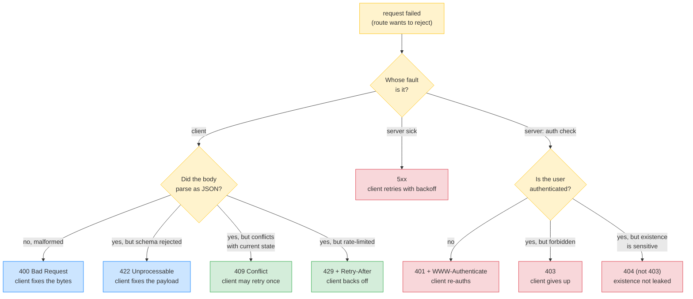
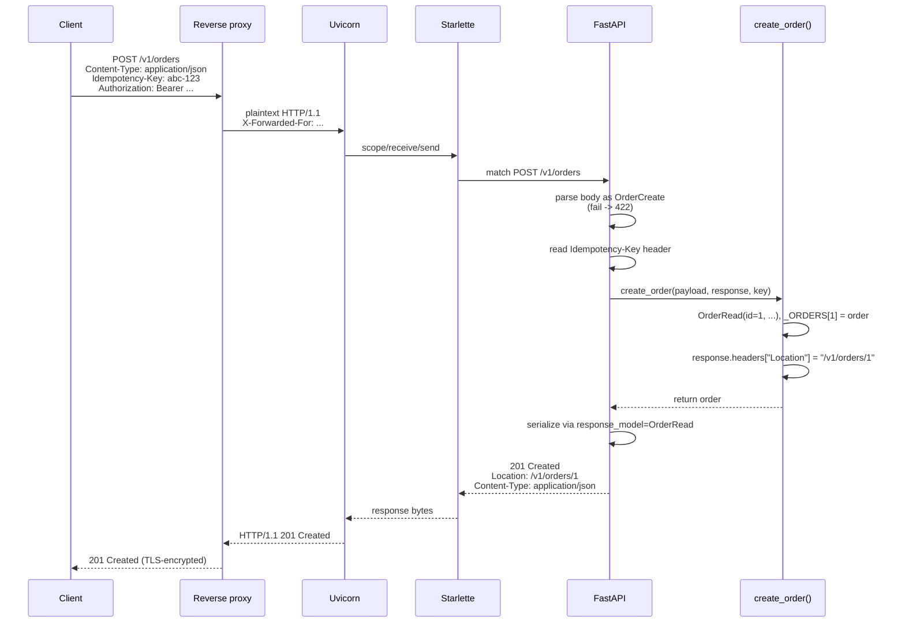
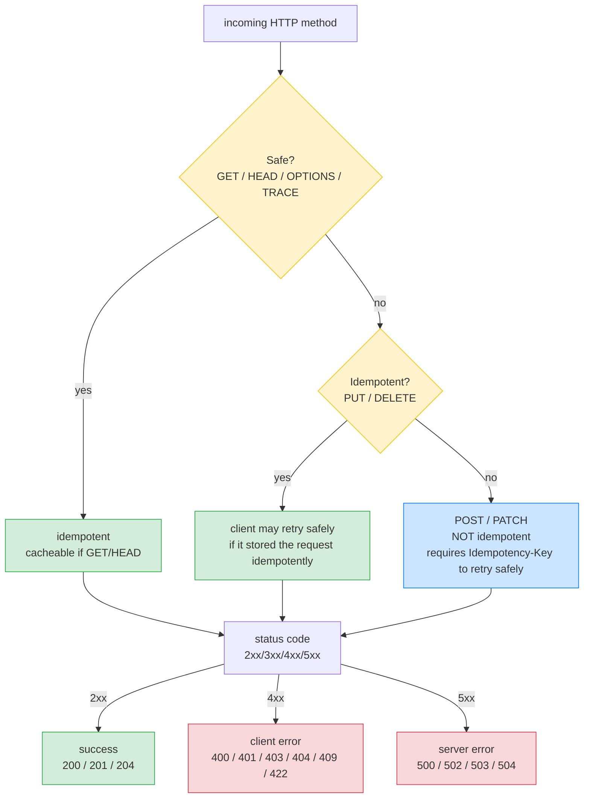

# Lesson 02: HTTP Methods, Status Codes, Headers, Content Types

*The three vocabularies every HTTP request carries — method, status, headers — and how they map to the FastAPI code you will write for the rest of the vault.*

**The vocabulary is small. That is the whole point.**

Most production API bugs that are not logic bugs are vocabulary bugs: a `POST` where a `PUT` belongs, a `200` where a `201` was correct, a `Content-Type` that lies about the body, an `Accept` the server ignored. The HTTP vocabulary is small, and it is exactly the smallness that makes it load-bearing — clients parse status codes by family, intermediaries (proxies, caches, browsers) make decisions based on headers. When you misuse the vocabulary, your API lies, and the lies cause real bugs in real systems. By the end of this lesson you will not lie. Read every line. Run every trace. **This is how you learn.**


#http #methods #status-codes #headers

## Learning Objectives

By the end of this lesson you will be able to:

1. **Classify every HTTP method** as safe/unsafe and idempotent/non-idempotent, and choose correctly in API design.
2. **Pick the right status code family** for each situation, and the specific code within it.
3. **Recognize and set the headers that actually matter for APIs** — `Authorization`, `Content-Type`, `Accept`, `Idempotency-Key`, `Retry-After`, `ETag`, `Location`, `Vary`, `Cache-Control`, `X-Forwarded-*`.
4. **Choose a content type** for a response, and validate the `Content-Type` of a request.
5. **Map a FastAPI exception** (`HTTPException`, Pydantic validation error, `IntegrityError`, etc.) to the correct status code without thinking.
6. **Read a real `httpie` / `curl` exchange** and explain every line of the request and the response.

## Prerequisites

- **[[HTTP-Request-Lifecycle]]** — you should already know what a request is, what a `> GET` line means, and what a `< HTTP/1.1 200` line means in a `curl -v` trace.
- **A passing familiarity with FastAPI's `HTTPException` and `Request`/`Response`.** We will use them in the code samples; the deep dive on exception handlers is in [[03-FastAPI-Core/Exception-Handlers|Lesson 6 of Section 03]].
- **`httpie` and `curl` installed.** `curl` ships everywhere; `httpie` is `apt install httpie` / `brew install httpie`. Either works for this lesson — we will show both.

**The most common gap: status code nuance.**

Most engineers know `200`, `404`, `500`. Most do not know that `401` and `403` mean different things, that `409` is for state conflicts (not validation failures), or that `422` is what FastAPI returns for validation errors by default (not `400`). The nuances are the lesson.


## Think Like a Senior Engineer

Before the table, the mental model. Read this section slowly — every status-code incident in production reduces to one of the three questions below answered badly, and every "the client retry loop is broken" bug reduces to a status code that lied about what happened.

### The reframe: a status code is a contract with the client, not a label for the engineer

A senior engineer reading a route handler does not ask "is `409` the right code here?" — that question treats the status code as documentation for the human reading the code. They ask "what will the *client's retry policy, cache layer, and parser* do when they see this number?" The status code is a contract with three downstream consumers, each of which branches on a different property of the code:

1. **The client SDK's retry policy.** Branches on the *family*: `5xx` is retryable (with backoff), `4xx` is not (the request is wrong, retrying the same bytes is futile). The client never reads the body to decide whether to retry — the family is enough.
2. **The intermediary cache (CDN, proxy, browser).** Branches on the *specific code*: `200` is cacheable per `Cache-Control`; `301` is cacheable by default; `302`/`307` are not; `404` is *negatively* cacheable (RFC 9111 permits caches to store a `404` for a short TTL, so the origin is not hammered on a missing resource). The wrong code on a missing resource either floods the origin (`200` was cached and now the CDN serves a stale body) or caches the error for hours (`404` was cached with a long TTL and the resource exists now).
3. **The client's parser.** Branches on the *family* to decide what to do with the body: `2xx` deserializes the body as the resource; `3xx` follows the `Location` and ignores the body; `4xx`/`5xx` parses the body as an error (ideally `application/problem+json`).

The status code is not "the right answer from a list." It is a three-way contract that determines whether the client retries, whether the CDN caches, and how the body is parsed. The "wrong" code does not just mislead the human — it changes the system's behaviour at three layers.

### The three questions on the sticky note

For every `response.status_code = ...` or `raise HTTPException(...)` you write, ask:

1. **What will the client *do* with this status?** (Retry with backoff? Re-authenticate? Display the error? Follow a redirect? Cache the body?) If you do not know, the client's behaviour is undefined — and "undefined" in a distributed system means "the client will do the wrong thing at the worst time."
2. **Which intermediary (proxy, CDN, browser, SDK) makes a decision based on the *family* — and is that decision right for this response?** (A `5xx` tells the CDN "the origin is sick, circuit-break"; a `4xx` tells the CDN "the request is bad, do not retry"; a `3xx` tells the CDN "follow the redirect." Get the family wrong and the intermediary's decision is wrong.)
3. **If I change this status in `v2`, which client retry policies break?** (Changing `409` to `422` for a duplicate-email conflict looks harmless — but a client that retried `409` as "maybe the conflict resolved itself" will now give up on `422` immediately, because `422` says "the request is wrong, do not retry" and the client's retry policy sees `4xx` and stops. The status code is part of the API contract; changing it is a breaking change.)

If you cannot answer all three, you are not ready to ship the status code. The default `200 OK` is the right answer until you can — and `200 OK` is almost never the right answer for anything other than a successful read.

### The four cardinal sins (the ones that break clients in production)

The four status-code mistakes that cause real production incidents are not "I picked the wrong 4xx" — they are "I picked a status code from the wrong *family*," which breaks the client's family-based branching. Memorise these four; they are the ones that page you at 3 a.m.

| Sin | What happens | Why the client breaks |
|-----|--------------|----------------------|
| **`401` for "not allowed"** | Authenticated user hits a forbidden resource; server returns `401` ("log in"). | The client SDK sees `401`, re-authenticates (refreshes the token), retries, gets `401` again. Infinite loop. The right code is `403`. |
| **`409` for "validation failed"** | A `POST` with a malformed body returns `409 Conflict`. | The client's retry policy treats `4xx` as "do not retry" — correct for `422`, wrong for the client that expected `409` to mean "the conflicting state may resolve, retry once." The status code told two different truths to two different consumers. |
| **`200` with `{"error": "..."}`** | The route returns `200 OK` for an error because "the request succeeded at the HTTP level." | The client SDK deserialises the body as the resource, gets a parse error, and reports "deserialisation failed" instead of "the request was rejected." The CDN caches the error body. The retry policy does not fire. Every layer is broken by one lie. |
| **`500` for "the client sent bad input"** | Validation fails inside the route (not in Pydantic); the handler raises `500`. | The client's retry policy sees `5xx`, retries with backoff, and the request never succeeds (because the request is wrong, not the server). The retry storm amplifies the bad input into a self-DoS. |

The pattern across all four: each sin is a *family* mistake (`4xx`-vs-`5xx`, `2xx`-vs-`4xx`), not a *specific code* mistake. The client branches on the family; the family is the load-bearing part of the contract.

**Danger — How an attacker thinks: the fifth cardinal sin — `200 OK` on partial failure.**

The four cardinal sins all lie about *whether* the request succeeded. The fifth lies about *how much* succeeded — returning `200 OK` when the route partially completed (wrote the order but failed to enqueue the invoice job, charged the card but failed to update the inventory, created the user but failed to send the welcome email). The client SDK deserialises the `200` body as the success response, displays "Order created" to the user, and the user is now in an inconsistent state — the order exists, the invoice does not, and the next time the user asks for the invoice the route returns `404`. The attacker exploitation is in the differential: a `200` with `{"status": "partial", "failed_step": "invoice"}` is a different response from a `200` with `{"status": "complete"}`, but the client SDK that branches on the status *family* sees `2xx` for both and cannot retry the failed step. The defence is structural: never return `200` for a partial success — return `207 Multi-Status` (WebDAV, RFC 4918 §11.1) with per-sub-operation statuses, or return `500`/`502` if the partial failure is unacceptable and the route should be retried as a unit, or use `202 Accepted` with a job-status URL if the operation is asynchronous. The senior engineer's question for every multi-step route: *if a downstream step fails after I have written side effects, can the client retry?* If you cannot answer `yes`, the route does not return `200`. See [[17-Advanced-Architecture/Event-Driven-Basics]] for the saga/outbox pattern that turns partial failures into eventual consistency.


### The decision tree: which 4xx should I return?

When the request failed, the question is not "which 4xx is technically correct per RFC 9110" — it is "which 4xx tells the client's retry policy and parser the truth about what went wrong." The tree:



Read the tree top-down. The first question — *whose fault is it* — is the family decision, and it is the one that breaks clients when answered wrong. The second question — *what kind of client fault* — is the specific-code decision, and it is the one that breaks clients when answered vaguely. Green codes (`409`, `429`) tell the client "you may retry"; blue codes (`400`, `422`) tell the client "fix the request and do not retry"; red codes (`401`, `403`, `404`, `5xx`) tell the client "stop, something is wrong at a different layer."

**Why is `409` green (retryable) but `422` blue (do not retry)?**

Because the conflict `409` describes is with *current state* — a uniquely-named resource that already exists. The conflict may resolve (the other resource may be deleted), so a single retry is rational. The validation failure `422` describes is with *the request itself* — a field is too long, an enum value is invalid. Retrying the same bytes will fail identically forever. The client's retry policy must distinguish these two: retrying `409` once is reasonable; retrying `422` is a bug. That distinction is the contract.


**Warning — The family is the contract; the specific code is the documentation.**

A client SDK that branches on the family (`if status >= 500: retry`) is correct. A client SDK that branches on the specific code (`if status == 429: retry; elif status == 503: retry; else: give up`) is fragile — it will not retry a `502` the SDK author did not enumerate. Design your status codes so the *family* tells the truth even if the client only reads the family. A `409` that should not be retried is a lie to the family-reader; a `422` that should be retried is a lie to the family-reader. Both are sins.


## The Problem

Three orthogonal vocabularies operate on every HTTP request:

- **Method** — the verb; what the client wants to do.
- **Status code** — the result; what happened.
- **Headers** — the metadata; how to interpret the body, who is calling, caching directives, etc.

Content type (the `Content-Type` header) is part of the third vocabulary but important enough to discuss separately because it controls how the body is parsed and serialized.

RFC 9110 (HTTP Semantics) is the canonical reference for all three. We are summarizing; when in doubt, read it. The full reference is in the Sources section at the end.

The problem is that the vocabularies look small enough that you can wing it. You cannot. The exact code you return tells the client whether to retry, whether to display the response, whether to cache it, whether to escalate. The exact method you accept tells caches and intermediaries whether the response is cacheable. The exact `Content-Type` you set tells the client's parser what to do. Get these wrong and your API is a confusing, unretryable, miscached, misparsed mess.

**Note — The HTTP standards reorganization (2022).**

RFC 9110 (HTTP Semantics) defines the meaning of methods, status codes, and headers. RFC 9111 (HTTP Caching) defines caching. RFC 9112 (HTTP/1.1) defines the wire format for HTTP/1.1. RFC 9113 (HTTP/2) and RFC 9114 (HTTP/3) define the wire formats for HTTP/2 and HTTP/3 respectively. The semantics are version-independent — a `GET` means the same thing in HTTP/1.1 and HTTP/3. The wire format is version-specific. We are concerned with semantics in this lesson.


## The Code

Real-code-first. Here is a real `httpie` / `curl` exchange you are going to learn to read. The server is a real FastAPI app (we will show the code after the trace). Read the trace slowly. The `>>>` lines are the request you send; the `<` lines are the response the server returns.

```text
$ http POST api.boardly.local/v1/orders Authorization:"Bearer eyJ..." Content-Type:application/json Idempotency-Key:abc-123 customer_id:=7 total_cents:=4200
HTTP/1.1 201 Created
Content-Length: 64
Content-Type: application/json
Date: Mon, 19 Oct 2026 10:30:01 GMT
Location: /v1/orders/1
Server: uvicorn 0.32.0
X-Request-Id: 4f7b9c32-1a3e-4d2b-8f6f-9c0b7d3a1e2c

{
 "customer_id": 7,
 "id": 1,
 "status": "active",
 "total_cents": 4200
}
```

That is one request, one response. Twenty-something lines. By the end of this lesson you will be able to label every one of them. The status line is `201 Created`. The `Location` header is `/v1/orders/1`. The `Content-Type` is `application/json`. The body is the JSON representation of the resource we just created. Each of those decisions is a vocabulary decision we are about to unpack.

Here is the FastAPI code that produced that response:

```python
# boardly/routers/orders.py
"""Lesson 2 reference: a small POST /v1/orders endpoint that uses the
full HTTP vocabulary — the right method, the right status, the right
headers, the right content type."""
from typing import Annotated

from fastapi import APIRouter, Header, HTTPException, Response, status
from pydantic import BaseModel, Field

router = APIRouter(prefix="/v1/orders", tags=["orders"])


class OrderCreate(BaseModel):
 customer_id: int = Field(gt=0)
 total_cents: int = Field(gt=0)


class OrderRead(BaseModel):
 id: int
 customer_id: int
 total_cents: int
 status: str


# An in-memory store for illustration. In production this is Postgres.
_ORDERS: dict[int, OrderRead] = {}
_next_id = 1


@router.post("", status_code=status.HTTP_201_CREATED, response_model=OrderRead)
async def create_order(
 payload: OrderCreate,
 response: Response,
 idempotency_key: Annotated[str | None, Header(alias="Idempotency-Key")] = None,
) -> OrderRead:
 global _next_id
 order = OrderRead(
 id=_next_id,
 customer_id=payload.customer_id,
 total_cents=payload.total_cents,
 status="active",
 )
 _ORDERS[order.id] = order
 _next_id += 1
 response.headers["Location"] = f"/v1/orders/{order.id}"
 return order
```

Run it:

```bash
uv run uvicorn boardly.main:app --reload
http POST http://127.0.0.1:8000/v1/orders \
 customer_id:=7 total_cents:=4200 \
 Content-Type:application/json \
 Idempotency-Key:abc-123
```

We will walk every line of that code and that trace next.

## Line-by-Line Deep Dive

### The trace: request side (`>>>` lines)

```text
POST /v1/orders HTTP/1.1
Authorization: Bearer eyJ...
Content-Type: application/json
Idempotency-Key: abc-123

{"customer_id": 7, "total_cents": 4200}
```

Five elements to the request. Each is a vocabulary decision.

**Method: `POST`.** `POST` is unsafe (it has side effects) and non-idempotent (sending it twice creates two resources — unless you also send the `Idempotency-Key` header, which is the topic of [[Idempotency-Safe-Retries-Pagination|Lesson 4]]). It is the right method here because we are *creating* a resource and the server is picking the ID. If the client were picking the ID, `PUT /v1/orders/42` would be the right verb. Most APIs use `POST` for create because client-chosen IDs are a footgun (collisions, predictability, enumeration attacks).

**Path: `/v1/orders`.** Plural noun, versioned with `/v1/`, no verb. This is the REST convention. We will defend it in [[REST-and-Pragmatic-API-Design|Lesson 3]].

**`Authorization: Bearer ...`** — credentials. The `Bearer` scheme (RFC 6750) carries a token; in our case the token is a JWT. We will cover JWTs in [[11-Authentication-and-Security/OAuth2-JWT-Access-Refresh|Section 11]]. For this lesson, treat it as an opaque bearer credential.

**`Content-Type: application/json`** — tells the server how to parse the body. FastAPI reads this header; if you declare a Pydantic model parameter on your route, FastAPI expects JSON and will return `422` if the body fails validation. Setting this header truthfully is the contract. Lying here (sending `text/plain` for a JSON body) is a real footgun — some servers will refuse to parse, some proxies will refuse to forward, and your client library will not know how to deserialize.

**`Idempotency-Key: abc-123`** — a client-supplied key that makes this `POST` safely retryable. We will explain the semantics in Lesson 4; for now, know that if the client retries this exact request (same key, same body), the server must return the *original* response, not create a second order. This header is the difference between "double charge the customer" and "stay correct under network failure."

**Student asks: Why is `Content-Type` on the request and not the response?**

It is on both. The request's `Content-Type` tells the server how to parse the request body. The response's `Content-Type` tells the client how to parse the response body. They are independent — a server can accept `application/json` requests and respond with `application/problem+json` (see below) without any inconsistency.


### The trace: response side (`<` lines)

```text
HTTP/1.1 201 Created
Content-Length: 64
Content-Type: application/json
Date: Mon, 19 Oct 2026 10:30:01 GMT
Location: /v1/orders/1
Server: uvicorn 0.32.0
X-Request-Id: 4f7b9c32-1a3e-4d2b-8f6f-9c0b7d3a1e2c

{"id": 1, "customer_id": 7, "total_cents": 4200, "status": "active"}
```

**Status line: `HTTP/1.1 201 Created`.** `201` says "I created the resource." It is more specific than `200 OK`. RFC 9110 reserves `201` for resource creation, and it expects a `Location` header pointing at the new URL. Returning `200` for a create is the most common status code lie — clients cannot tell from the status whether a resource was created or just returned.

**Why does `201` carry a `Location` header requirement and `200` does not?** Because `201` is the only status code whose semantic contract is "a new resource exists at a specific URL" — and a contract about a URL has to specify *which* URL. `200 OK` says "here is the thing you asked for" — the URL the client used is already known (they sent the request there); there is no new URL to declare. `201` says "I made a new thing" — the new thing's URL is news the client did not have before, and `Location` is how that news is communicated. **What would happen if you returned `201` without `Location`?** Some clients (and most well-written API libraries) would still accept the response — but the client would have to *guess* the new URL by inspecting the response body's `id` field and constructing `/v1/orders/{id}` themselves. That guess becomes an implicit contract: if you later change your routing to `/v2/orders/{id}`, every client that guessed breaks. The `Location` header is what makes the new URL explicit instead of guessed.

**`Location: /v1/orders/1`.** The URL of the newly-created resource. Without this, the client has to guess the URL of what was just created, which is the kind of guess that becomes an API contract that breaks when you change your routing.

**`Content-Type: application/json`.** The body is JSON. The client's parser will deserialize accordingly. (Modern APIs should specify the charset: `application/json; charset=utf-8`. The `charset` is technically unnecessary for JSON per RFC 8259 — JSON is UTF-8 by default — but many clients still key off it.)

**`Content-Length: 64`.** The body is 64 bytes. The client knows when to stop reading. The connection can be reused for the next request (keep-alive) because the boundary is unambiguous.

**`Server: uvicorn 0.32.0`.** Uvicorn announcing itself. (In production you would suppress this — `server_tokens off` in nginx, or set the `Server` header to a generic value — to avoid leaking version information to attackers.)

**`X-Request-Id: ...`.** A correlation ID. Generated either by the reverse proxy (see [[HTTP-Request-Lifecycle|Lesson 1]]) or by your request-id middleware (see [[03-FastAPI-Core/Middleware-and-Request-Order|Lesson 5 of Section 03]]). When the client reports a bug, you grep your logs for this ID and find every line that touched this request.

**Warning — Suppress version banners in production.**

`Server: uvicorn 0.32.0` and `server: nginx/1.27.0` are useful in dev and an attack-surface in prod. Attackers scan for known-vulnerable versions. Suppress these headers in your production config. The defense is not "obscurity" — it is reducing the surface for cheap automated scanning.


### The code: `OrderCreate` and `OrderRead` models

```python
class OrderCreate(BaseModel):
 customer_id: int = Field(gt=0)
 total_cents: int = Field(gt=0)
```

**What it does:** Declares a Pydantic model for the *request body* with two integer fields, each constrained to be strictly positive.

**Why two models (`OrderCreate` and `OrderRead`):** The shape of "what the client sends" and the shape of "what the server returns" are different. The client does not send `id` or `status` — the server assigns them. Using one model for both would force the client to send fields it does not know, or force the server to lie about which fields are required on the way in. Two models is the cleanest answer. We will see this pattern at scale in [[03-FastAPI-Core/Path-Query-Header-Cookie-Body|Lesson 3 of Section 03]].

**Why `Field(gt=0)`:** Validation belongs on the model, not in the route. Pydantic enforces `customer_id > 0` and `total_cents > 0` before your route function is called. If validation fails, FastAPI returns `422` automatically — your route never runs. That is the right behavior: malformed input is the client's fault, and the right status is `422`, not `500`.

**Why is validation on the *model* and not in the *route*?** Because the model is the type, and the type is the contract. A `OrderCreate` model with `Field(gt=0)` on `customer_id` is a reusable declaration — every route that accepts an `OrderCreate` body inherits the same validation, and you cannot forget to apply it to one of them. If validation lived in the route body (`if payload.customer_id <= 0: raise HTTPException(422)`), every endpoint that accepts the model would have to repeat the check, and forgetting one would be a 200-response-on-bad-input bug. **What would happen if you forgot `Field(gt=0)` on `customer_id`?** A request with `customer_id: -7` would parse, validation would pass, your route would execute, and you would persist an order with a negative customer ID. The bug would surface only when a downstream service (e.g., billing) tried to look up customer `-7` and crashed. Moving validation to the model catches the bug at the *edge* of your system, where the client's fault is — not deep inside your service where the source of the bad data has already been forgotten.

### The code: the route signature

```python
@router.post("", status_code=status.HTTP_201_CREATED, response_model=OrderRead)
async def create_order(
 payload: OrderCreate,
 response: Response,
 idempotency_key: Annotated[str | None, Header(alias="Idempotency-Key")] = None,
) -> OrderRead:
```

**What it does:** Registers a `POST` route on the router's prefix (`/v1/orders` + `""` = `/v1/orders`) with three pieces of HTTP-aware machinery: the success status code, the response model, and a header parameter.

**`status_code=status.HTTP_201_CREATED`:** Tells FastAPI to return `201` by default (you can still override per-call by setting `response.status_code`). The `status` module is a namespace of named constants — `status.HTTP_201_CREATED`, `status.HTTP_409_CONFLICT`, etc. — that read clearly and avoid magic numbers. This is the single most important vocabulary decision in this route: `201` says "created."

**`response_model=OrderRead`:** Tells FastAPI to filter the response through the `OrderRead` model. If your function returns a dict with extra fields, only the fields on `OrderRead` are serialized. This prevents accidentally leaking internal fields (like a `password_hash` on a `UserRead`) into the response.

**`payload: OrderCreate`:** A Pydantic model parameter. FastAPI sees this and knows to parse the request body as JSON and validate it against `OrderCreate`. If parsing fails, FastAPI returns `422` before your route runs. If parsing succeeds, `payload` is an `OrderCreate` instance.

**`response: Response`:** A Starlette `Response` object. Injecting this lets you set headers and the status code on the actual response. We use it to set the `Location` header. This is the canonical way to "add a header to the response" in FastAPI — alternative patterns (returning a `JSONResponse` directly) work but couple you to the response class.

**`idempotency_key: Annotated[str | None, Header(alias="Idempotency-Key")] = None`:** A header parameter. `Annotated[str | None, Header(alias="Idempotency-Key")]` is the modern FastAPI 0.95+ form for "read the `Idempotency-Key` header, treat it as an optional string." The `Header` import is from `fastapi`. The `alias` matters because HTTP headers are case-insensitive on the wire but Python is not — `alias="Idempotency-Key"` is what FastAPI matches against.

**Tip — Why `Annotated[..., Header(...)]` and not `Header(...)` as the default?**

The `Annotated` form is the modern preferred form (FastAPI 0.95+, PEP 593). It separates the *type* (`str | None`) from the *metadata* (`Header(alias=...)`). This matters when you compose dependencies — `Annotated[AsyncSession, Depends(get_db)]` reads cleanly, and your type checkers and IDEs can still see the underlying type. The bare `Header(...)` form still works but loses type information. Use `Annotated` for new code.


### The code: the route body

```python
async def create_order(...) -> OrderRead:
 global _next_id
 order = OrderRead(
 id=_next_id,
 customer_id=payload.customer_id,
 total_cents=payload.total_cents,
 status="active",
 )
 _ORDERS[order.id] = order
 _next_id += 1
 response.headers["Location"] = f"/v1/orders/{order.id}"
 return order
```

**What it does:** Constructs an `OrderRead`, stores it in an in-memory dict, advances a counter for the next ID, sets the `Location` header on the response, and returns the model. FastAPI serializes it to JSON.

**Why the in-memory dict:** This lesson is about HTTP vocabulary, not persistence. The dict is a stand-in for the database you will use in production. The interface mirrors what an `AsyncSession` would give you so the swap to SQLAlchemy (Section 07) is clean.

**Why `response.headers["Location"] = ...`:** This is the line that makes the `201 Created` response honest. RFC 9110 says `201` SHOULD be accompanied by a `Location` header pointing at the new resource. Without this line, you are returning `201` and silently lying about where the new resource lives.

**Example — What `response_model=OrderRead` actually does to the wire.**

If you returned a dict like `{"id": 1, "customer_id": 7, "total_cents": 4200, "status": "active", "internal_notes": "user is a VIP"}`, FastAPI would silently drop `internal_notes` because it is not on `OrderRead`. That is the safety property: you cannot accidentally leak fields the response model does not declare. Without `response_model`, every field you return hits the wire. Always use `response_model` for endpoints that return domain objects.


**Production reality: relative vs absolute `Location` behind a proxy.**

The route sets `response.headers["Location"] = f"/v1/orders/{order.id}"` — a *relative* URL. RFC 9110 §10.2.2 says `Location` "allows the recipient to express the URI reference" — both relative and absolute forms are permitted, but the choice has real consequences when the route sits behind a reverse proxy. The client receives the `Location` as `/v1/orders/1` and constructs the absolute URL by combining it with the request URL it used — which works *if the client used the public URL* (`https://api.boardly.example.com/v1/orders`) but breaks if the client used an internal URL (`http://internal.boardly.local:8000/v1/orders`) because Uvicorn's `request.url` reflects the hop from the proxy, not the client's original URL (see [[HTTP-Request-Lifecycle]] for the `X-Forwarded-Proto`/`Host`/`--proxy-headers` discussion). The pragmatic answer in FastAPI is to use `request.url_for("get_order", order_id=order.id)` (Starlette's `url_for` constructs the absolute URL from `request.url`, which honours `--proxy-headers`) for absolute URLs, or to leave `Location` relative and document that clients must resolve it against the request URL. The senior engineer's rule: *return absolute URLs when the client may consume the response through a different network path (a browser making a follow-up `fetch`, a downstream service calling a different cluster); return relative URLs when the client is the same caller.* Always test the `Location` from *outside* the proxy, not from `curl` against Uvicorn directly — the failure mode is invisible until you hit the public URL.


## Under the Hood: The Vocabularies

### Methods and their semantics

Two properties matter for each method:

- **Safe.** Does it have side effects? Safe methods are cacheable and prefetchable. `GET`, `HEAD`, `OPTIONS` are safe.
- **Idempotent.** If you send it twice with the same parameters, does the second call have the same observable effect as the first? `GET`, `HEAD`, `OPTIONS`, `PUT`, `DELETE` are idempotent. `POST` and `PATCH` are not.

| Method | Safe | Idempotent | Typical use |
|--------|------|------------|-------------|
| `GET` | yes | yes | Read a resource or collection. Body allowed but ignored by intermediaries; do not use it. |
| `HEAD` | yes | yes | Same as `GET` but no body — use for existence checks and to read `Content-Length`. |
| `OPTIONS` | yes | yes | Used by CORS preflight, and to advertise allowed methods. |
| `POST` | no | no | Create a resource (server picks the ID), or trigger an action. |
| `PUT` | no | yes | Replace a resource at a known URL with a known ID. |
| `PATCH` | no | no* | Partial update. *Can* be idempotent if defined as a JSON Patch (RFC 6902) of ops, but is not required to be. |
| `DELETE` | no | yes | Remove a resource. Idempotent: deleting the same resource twice has the same end state. |

The "idempotent" claim for `DELETE` deserves care: the *effect* is the same (resource is gone), but the second response might be `404` instead of `204`. Idempotency is about server state, not about identical responses.

`POST` is a catch-all for unsafe, non-idempotent actions. If your operation does not fit `PUT`/`PATCH`/`DELETE` cleanly, `POST` is the default. We will revisit this in [[REST-and-Pragmatic-API-Design|Lesson 3]] when we talk about RPC-style endpoints.

**`GET` with a body is a footgun.**

RFC 9110 permits a body on `GET` but says intermediaries MAY drop it. Many do. If you ever find yourself writing `GET /v1/orders` with a body, you almost certainly want `POST /v1/orders/search` with a JSON body instead. We will defend this in Lesson 3.


**Danger — How an attacker thinks: state-changing `GET` as the CSRF vector.**

The methods table says `GET` is safe — no side effects. A route that violates this (`GET /v1/orders/42/cancel` that mutates the order's `status` to `cancelled`) is not just a vocabulary mistake; it is a CSRF (Cross-Site Request Forgery) vulnerability. An attacker who can plant an `` on any page the victim visits (a comment, a forum post, an ad) triggers the victim's browser to send the request with the victim's cookies — and because `GET` is "safe", the browser does not prompt, does not preflight, and sends the request cross-origin without CORS enforcement. The mutation happens with the victim's credentials. The defence is the vocabulary itself: *every state-changing operation uses `POST`, `PUT`, `PATCH`, or `DELETE`* — never `GET`. Browsers enforce a CSRF-protection boundary on unsafe methods (the SameSite cookie attribute blocks them on cross-site requests, the `Origin`/`Referer` header lets the server verify the source, and tokens via `Form` bodies block forged requests). `GET` falls outside all of those protections because the vocabulary says `GET` does not mutate. The senior engineer's grep on every codebase: `rg 'app\.get|router\.get' boardly/routers/` should return only routes whose body reads — any route whose body writes to the database is a CSRF bug. See [[02b-Backend-Foundations/CSRF-Protection]] for the full SameSite/Origin/token defence-in-depth and [[11-Authentication-and-Security/OWASP-API-Top-10]] for the API8:2023 Security Misconfiguration entry's cross-origin-method corollary.


### Status code families

The first digit is the family. Clients branch on it.

| Family | Meaning | When to use |
|--------|---------|-------------|
| 1xx | Informational | Rare in REST APIs. `101 Switching Protocols` for WebSockets. |
| 2xx | Success | The request did what it was supposed to. |
| 3xx | Redirection | The client should look elsewhere — different URL, a cached copy, etc. |
| 4xx | Client error | The client did something wrong and must change the request before retrying. |
| 5xx | Server error | The server failed; the client may retry without changes. |

The branch logic is not just convention. A retry policy (see [[Idempotency-Safe-Retries-Pagination|Lesson 4]]) decides whether to retry based on the family: `5xx` is retryable, `4xx` is not. A cache decides whether to cache based on the status: `200` is cacheable per the response's `Cache-Control`; `4xx` and `5xx` have their own rules. A browser decides whether to display the response based on the status: `304 Not Modified` means "use your cached copy"; `200` means "here is a new copy."

**Production reality: the `5xx` family and the circuit breaker.**

The family-based retry rule (`5xx` retryable, `4xx` not) is not just a client convention — it is the input to the *circuit breaker* on the *server* side. A downstream service in front of your route (or the route itself calling a downstream service) opens its circuit breaker when the `5xx` error rate exceeds a threshold (typically 5–10% over a 1-minute window) and stops sending traffic to the sick origin for a cooldown (typically 30 seconds). The circuit-breaker logic operates on the *family*, not the specific code — a `503` and a `500` both count toward the threshold. The implication for route design: returning `5xx` for client-caused failures (the cardinal sin in the table above) does not just retry-storm the client; it also trips the circuit breaker on every load balancer, API gateway, and service mesh in the path, taking the route (and any other routes sharing the origin) offline for 30 seconds. The senior engineer's rule: *`5xx` is a load-shed signal — never emit it for a client-caused failure*. If the route is genuinely overloaded, return `503` with `Retry-After` and `Cache-Control: no-store` so the circuit-breaker opens gracefully and the client backs off. See [[15-External-Integrations/Circuit-Breakers]] for the canonical circuit-breaker pattern and the windowed-error-rate trip condition.


### The specific status codes that matter for APIs

The "common" `200/201/204/400/401/403/404/500` is a starting point. Real APIs use a few more.

#### 2xx Success

| Code | Name | Use |
|------|------|-----|
| `200 OK` | OK | Default success for responses with a body. |
| `201 Created` | Created | Returned by `POST` that creates a resource, with a `Location` header pointing at the new URL. |
| `202 Accepted` | Accepted | The request was queued and will be processed later. Use for async work where you cannot yet say it succeeded. |
| `204 No Content` | No Content | Success, no body. Typical for `DELETE`, for `PUT` that returns nothing, for `PATCH` that returns nothing. |
| `206 Partial Content` | Partial Content | Range request on a large resource (e.g., streaming uploads). |

#### 3xx Redirection

| Code | Name | Use |
|------|------|-----|
| `301 Moved Permanently` | Moved Permanently | URL change, cacheable. Use rarely — break links deliberately. |
| `302 Found` | Found | Temporary redirect. Common in OAuth2 flows. |
| `304 Not Modified` | Not Modified | Conditional GET returned no body — see [[CORS-Caching-Headers-Conditional-Requests|Lesson 5]]. |
| `307 Temporary Redirect` | Temporary Redirect | Like `302` but preserves the method (no `POST` to `GET` rewriting). |
| `308 Permanent Redirect` | Permanent Redirect | Like `301` but preserves the method. |

#### 4xx Client errors

| Code | Name | Use |
|------|------|-----|
| `400 Bad Request` | Bad Request | Malformed payload, validation failure. (FastAPI uses `422` instead for validation errors by default.) |
| `401 Unauthorized` | Unauthorized | No or invalid credentials. The header `WWW-Authenticate` should be set. |
| `403 Forbidden` | Forbidden | Authenticated, but not allowed. (Yes, the name is misleading.) |
| `404 Not Found` | Not Found | Resource does not exist, or the caller is not allowed to know it exists (return `404` not `403` to avoid leaking existence). |
| `405 Method Not Allowed` | Method Not Allowed | The URL exists, just not for this method. Set `Allow` header. |
| `406 Not Acceptable` | Not Acceptable | The server cannot produce any of the media types in the client's `Accept`. |
| `409 Conflict` | Conflict | The request conflicts with current state — e.g., creating a uniquely-named resource that already exists. |
| `410 Gone` | Gone | The resource used to exist and is now permanently gone. Use for tombstones. |
| `412 Precondition Failed` | Precondition Failed | An `If-Match`/`If-Unmodified-Since` precondition didn't hold. |
| `413 Payload Too Large` | Payload Too Large | Body too large. |
| `415 Unsupported Media Type` | Unsupported Media Type | Wrong `Content-Type` (e.g., server expects JSON, got XML). |
| `422 Unprocessable Entity` | Unprocessable Entity | Body is well-formed JSON but fails semantic validation. FastAPI uses this for validation errors by default. |
| `429 Too Many Requests` | Too Many Requests | Rate-limited. Set `Retry-After`. |

**Student asks: when do I return `400` versus `422`?**

Return `422` when the body is syntactically valid JSON but semantically rejected by your application logic — a required field is missing, a string is too long, an enum value is not in the allowed set, an idempotency key was reused with a different body. Return `400` when the request is *malformed* — JSON that does not parse, a body that is not JSON at all, a missing `Content-Type` header. FastAPI's `RequestValidationError` defaults to `422` because Pydantic validation is semantic, not syntactic — the body parsed fine, it just did not satisfy the schema. The rule of thumb: `400` is "the bytes were not what I expected"; `422` is "the bytes were a valid request but the request itself was rejected." Pick the code that matches where in the pipeline the failure happened.


**Production reality: `451 Unavailable For Legal Reasons` and the geopolitical edge case.**

The `451` status code (RFC 7725) is the only HTTP status that exists for *non-technical* reasons — it signals that the server is refusing the request for legal reasons (a government takedown, a regional content ban, a DMCA notice), and the body SHOULD include a `Link` header pointing at a page explaining which legal regime blocked the request. The 2012 RFC was written by Ray Bradbury's biographer, named after *Fahrenheit 451*, and is the one status code that intentionally leaks *why* the request was blocked — because the operator wants users to know which law or government caused the block. The production edge case is the geopolitical one: a global API serving multiple jurisdictions needs per-route geolocation, returning `451` for users in jurisdictions where the content is legally blocked and `200` everywhere else. The implementation is at the edge (a Cloudflare Worker, an AWS WAF rule, an nginx `geo` block) — never in the route function — because the route function never sees the request if the edge blocks it. The senior engineer's question for every globally-deployed API: *which jurisdictions legally require me to refuse some content, and does my edge return `451` with the explanatory `Link` header rather than a bare `403`?* The difference matters because a `451` is auditable (the user can appeal the block); a `403` is opaque. See [[11-Authentication-and-Security/Threat-Model-First]] for the jurisdiction-as-trust-boundary threat model.


**Warning — When this breaks: the `405 Method Not Allowed` without an `Allow` header.**

**Symptom:** A client SDK calls `DELETE /v1/orders/42` and gets `405 Method Not Allowed`. The client's retry policy treats `4xx` as "do not retry" and gives up. The integration engineer files a bug: "the spec says we can `DELETE`, the route exists, but the API says no."
**Diagnosis:** `curl -i -X DELETE http://127.0.0.1:8000/v1/orders/42` and inspect the response headers. RFC 9110 §15.5.5 says a `405` response MUST include an `Allow` header listing the methods the resource *does* support (`Allow: GET, HEAD, POST`). FastAPI's default `405` handler does set the `Allow` header — but a custom exception handler or a `BaseHTTPMiddleware` that returns its own `405` may not, leaving the client with no way to know which methods are actually accepted. The client SDK that tries `OPTIONS` next (RFC 7231's "what can I do here" probe) gets `405` again because the route does not register `OPTIONS` either.
**Fix:** Always include `Allow` on `405` responses — `Response(status_code=405, headers={"Allow": "GET, HEAD"})`. For routes that genuinely need to advertise capabilities, register an `OPTIONS` handler that returns `200 OK` with `Allow: GET, POST, HEAD, OPTIONS` and a `Content-Length: 0` (FastAPI does this automatically for CORS-preflighted routes; for non-CORS routes you must add it). The grep: `rg 'status_code=405|HTTP_405' boardly/` should be paired with a check that every match sets `Allow`. See [[03-FastAPI-Core/Path-Query-Header-Cookie-Body]] for the FastAPI method-registration pattern.


#### 5xx Server errors

| Code | Name | Use |
|------|------|-----|
| `500 Internal Server Error` | Internal Server Error | Generic. You did not handle this case. |
| `501 Not Implemented` | Not Implemented | The method is recognized but the server does not implement it. |
| `502 Bad Gateway` | Bad Gateway | The reverse proxy got an invalid response from upstream. |
| `503 Service Unavailable` | Service Unavailable | Temporarily down (maintenance, overload). Set `Retry-After`. |
| `504 Gateway Timeout` | Gateway Timeout | The reverse proxy timed out talking to upstream. |

**Warning — `401` vs `403` — the most-misused pair.**

`401 Unauthorized` actually means "unauthenticated" — the server does not know who you are. `403 Forbidden` means "authenticated but not allowed" — the server knows who you are and you cannot do that. The names are reversed from intuition; this is a historical accident. The rule: `401` = "log in", `403` = "you can't."


**Student asks: when do I return `404` versus `403` for a resource the user is not allowed to see?**

Return `404`, not `403`, when the existence of the resource itself is sensitive. The rule: if returning `403` would let the client infer that the resource *exists* (and therefore learn something they should not), return `404` instead. The classic case is a `/v1/users/{id}/invoices` endpoint where the requester is authenticated but is not the owner of `user_id=42`: returning `403 Forbidden` confirms to the requester that user 42 exists; returning `404 Not Found` makes user 42 indistinguishable from "no such user." The information-leak defence outweighs the precise-error-message benefit. The exception: if the resource is *expected* to be enumerable (a `/v1/projects/42` where the project list is public anyway), the existence is not sensitive and `403` is fine — the requester already knows project 42 exists. Use the rule where the existence itself is the secret.


### Headers that matter for APIs

Not all headers. The ones you will actually set or read in FastAPI code.

| Header | Direction | What it does |
|--------|-----------|--------------|
| `Authorization` | request | Credentials. Typical schemes: `Bearer <jwt>`, `Basic <base64>`. |
| `Content-Type` | both | Media type of the body. Request: what you sent. Response: what you got. |
| `Accept` | request | Media types the client will accept, with quality values (e.g., `application/json, application/xml;q=0.9`). |
| `Idempotency-Key` | request | Client-supplied key to make an unsafe request safely retryable. See [[Idempotency-Safe-Retries-Pagination|Lesson 4]]. |
| `Retry-After` | response | Seconds (or HTTP date) the client should wait before retrying. Set on `429` and `503`. |
| `ETag` | response | An opaque validator for the response body. Used by conditional requests. |
| `If-None-Match` | request | Send an `ETag`; server returns `304 Not Modified` if the resource is unchanged. |
| `Last-Modified` | response | HTTP date of last modification. |
| `If-Modified-Since` | request | Conditional `GET`. |
| `Location` | response | New resource URL on `201 Created`, or the redirect target on `3xx`. |
| `Allow` | response | Methods allowed on a resource; set on `405 Method Not Allowed`. |
| `Vary` | response | Which request headers affect the response. Caches key on this. See [[CORS-Caching-Headers-Conditional-Requests|Lesson 5]]. |
| `Cache-Control` | both | Caching directives. `no-store` for sensitive data; `max-age=N` for cacheable. |
| `X-Forwarded-For` | request | Original client IP, appended by proxies. Read with `--proxy-headers`. |
| `X-Forwarded-Proto` | request | Original scheme (`https`). Used to construct absolute URLs. |
| `Forwarded` | request | RFC 7239 standardized version of the above. |
| `Strict-Transport-Security` | response | HSTS — "only ever talk to me over HTTPS". |

**Danger — How an attacker thinks: `Referer` and `Origin` headers for CSRF defence — and their absence.**

The `Referer` (RFC 9110 §10.6) and `Origin` (RFC 6454) request headers tell the server which page initiated the request — and both are the load-bearing input to server-side CSRF defence. `Origin` is sent on cross-origin `POST`/`PUT`/`DELETE` requests (not on `GET`/`HEAD`); `Referer` is sent on most requests but can be stripped by a `Referrer-Policy` header. A route that does not check `Origin` (or `Referer` as a fallback) on every state-changing method is open to CSRF: an attacker who plants a form on `evil.example` that POSTs to `https://api.boardly.example.com/v1/orders` triggers the victim's browser to send the request with the victim's cookies, and the absence of an `Origin` check means the server cannot distinguish the forged request from a legitimate one. The defence is structural: middleware that checks `Origin` against an allowlist on every unsafe method, falling back to `Referer` if `Origin` is absent, and rejecting with `403` if neither matches. The `Sec-Fetch-Site` header (the Fetch Metadata Request Headers, part of the Fetch standard) is the modern complement — browsers send `Sec-Fetch-Site: cross-site` for cross-origin requests, and a route can reject any cross-site unsafe request without `Origin` inspection. The senior engineer's checklist on every `POST`/`PUT`/`PATCH`/`DELETE` route: *is `Origin` checked? Does the middleware fall back to `Referer` if `Origin` is absent? Is `Sec-Fetch-Site` enforced?* See [[02b-Backend-Foundations/CSRF-Protection]] for the full defence-in-depth pattern.


**Production reality: header size limits and `431 Request Header Fields Too Large`.**

HTTP servers and proxies enforce per-request header-size limits — and an API that lets clients send arbitrarily large headers will be DoSed by a single request with a 100-KB `Authorization` header (a JWT with a thousand scopes), a `Cookie` header with 200 cookies from a buggy SSO integration, or a custom `X-Trace-Context` header with a megabyte of OpenTelemetry spans. The defaults are conservative: nginx's `large_client_header_buffers 4 16K` (4 buffers of 16 KB each — any single header > 16 KB returns `400`); Uvicorn's h11 parser has a 16-KB per-header limit by default; AWS ALB has a 64-KB total-request-size limit including headers. The status code for exceeding the limit is `431 Request Header Fields Too Large` (RFC 6585 §5), but in practice many servers return `400` or close the connection without a response — so the client sees a connection reset and cannot tell whether the cause was size or auth. The production pattern: enforce your own limit *before* the server's limit (a middleware that rejects requests with `Authorization` > 8 KB or `Cookie` > 4 KB with a `431` and a clear `application/problem+json` body) so the client gets a useful error. The senior engineer's question for every per-user-token API: *what is the maximum size of an `Authorization` header I will accept, and do I reject before the server does?* See [[02b-Backend-Foundations/HTTP-Headers-Deep-Dive]] for the per-header-size-limit audit pattern.


### Content types and JSON

The `Content-Type` header tells the receiver how to parse the body. The most common in modern APIs is `application/json`, but there are variations worth knowing:

| Content-Type | What it is |
|--------------|------------|
| `application/json` | The default JSON media type. RFC 8259. |
| `application/json; charset=utf-8` | Same, with explicit charset. Default for modern APIs. |
| `application/problem+json` | RFC 7807 — a standardized error body shape (`type`, `title`, `status`, `detail`, `instance`). Strongly recommended for 4xx/5xx. |
| `application/x-www-form-urlencoded` | HTML form default. |
| `multipart/form-data` | HTML form with file uploads. |
| `text/plain` | Plain text. |
| `text/event-stream` | Server-sent events. Use for streaming pushes from server to client. |
| `application/octet-stream` | Arbitrary binary. |

FastAPI parses the request body based on the `Content-Type` and the parameter declaration (`Body(...)`, `Form(...)`, `File(...)`). If you declare a Pydantic model parameter, FastAPI expects JSON and will return `422` if the body fails validation.

```python
class OrderCreate(BaseModel):
 customer_id: int
 total_cents: int

@app.post("/v1/orders", status_code=201)
async def create_order(payload: OrderCreate) -> dict:
 # FastAPI has already parsed and validated the JSON body
 # and converted it to an OrderCreate instance by the time
 # we get here. If the body was malformed JSON, the client
 # got a 422 before this function was called.
 return {"id": 1, **payload.model_dump()}
```

```bash
curl -v -X POST http://127.0.0.1:8000/v1/orders \
 -H 'Content-Type: application/json' \
 -d '{"customer_id": 7, "total_cents": 4200}'
# HTTP/1.1 201 Created
# Content-Type: application/json
# {"id":1,"customer_id":7,"total_cents":4200}
```

**Warning — When this breaks: the `application/json; charset=utf-8` vs `application/json` strict-client rejection.**

**Symptom:** A client integration reports "your API returns `application/json` but our strict parser rejects it — we need `application/json; charset=utf-8`." The integration engineer's tests pass against their staging, fail against your production, and the diff is one header parameter.
**Diagnosis:** `curl -sI http://127.0.0.1:8000/v1/orders/42 | rg -i 'content-type'` shows the exact value. FastAPI's `JSONResponse` defaults to `application/json` (without `; charset=utf-8`) on modern versions; the older `JSONResponse` in FastAPI <0.100 set the charset explicitly. The strict client is technically wrong — RFC 8259 says JSON text MUST be UTF-8 by default, so `application/json` *means* UTF-8 — but the integration's parser (a C-based XML/JSON library, an older `requests` version, a hand-rolled parser) keys off the `charset` parameter and refuses to guess. The client sees a parse failure and reports it as a server bug.
**Fix:** Set `default_headers={"Content-Type": "application/json; charset=utf-8"}` on the FastAPI app, or per-response with `Response(media_type="application/json; charset=utf-8")`. The fix is harmless (the `charset` is technically redundant but never wrong); the risk is breaking other clients that *require* the bare `application/json` (rare, but the OAuth2 token-introspection spec at one point required exactly `application/json` without parameters). The pragmatic answer is to match the client's expectation; the defensive answer is to set the charset on every JSON response for the next decade. See [[02b-Backend-Foundations/Content-Negotiation]] for the `Accept`/`Content-Type` negotiation pattern.


### FastAPI exceptions to status codes: the practical table

This is the one to bookmark. When your FastAPI code raises an exception or returns an error, the right status code is determined by what kind of failure it is. Memorize this table.

| Situation in FastAPI | Resulting status | Notes |
|-----------------------|------------------|-------|
| `raise HTTPException(status_code=403)` | 403 | The standard escape hatch. |
| Pydantic validation failure on body/query/path | 422 | Default FastAPI behavior; can be overridden with an exception handler. |
| Missing or malformed auth dependency | 401 | You raise this; FastAPI doesn't auto. |
| Authenticated but not allowed | 403 | Raise `HTTPException(403)`. |
| Resource not found | 404 | Raise `HTTPException(404)`. For list endpoints where existence would leak, return `404` not `403`. |
| Method not allowed (path matches another method) | 405 | FastAPI returns this automatically. |
| Duplicate create (unique constraint) | 409 | Catch the `IntegrityError` and raise `HTTPException(409)`. |
| Rate limited | 429 | Set in middleware; include `Retry-After`. |
| Unhandled exception | 500 | Default. Log it, return a generic body, do not leak the traceback. |
| Request body too large | 413 | Configure max body size in proxy or middleware. |
| Wrong `Content-Type` | 415 | Raise `HTTPException(415)` or let FastAPI reject with `422` if it tries to parse as JSON and fails. |

```python
from fastapi import FastAPI, HTTPException, Request, status
from pydantic import BaseModel

app = FastAPI()

class OrderCreate(BaseModel):
 customer_id: int
 total_cents: int

@app.post("/v1/orders", status_code=status.HTTP_201_CREATED)
async def create_order(payload: OrderCreate) -> dict:
 # Pretend we hit the DB and got a unique violation
 try:
 await _insert_order(payload)
 except UniqueViolation:
 raise HTTPException(
 status_code=status.HTTP_409_CONFLICT,
 detail="Order already exists for this customer+cart",
 headers={"Retry-After": "5"}, # ignored on 409 by spec, but illustrative
 )
 return {"id": 1}

# A cleaner pattern: a custom exception + handler that emits
# application/problem+json.
class ConflictError(Exception):
 def __init__(self, detail: str):
 self.detail = detail

@app.exception_handler(ConflictError)
async def _conflict_handler(request: Request, exc: ConflictError):
 from fastapi.responses import JSONResponse
 return JSONResponse(
 status_code=409,
 content={
 "type": "about:blank",
 "title": "Conflict",
 "status": 409,
 "detail": exc.detail,
 "instance": str(request.url.path),
 },
 media_type="application/problem+json",
 )
```

This is the pattern we expand in [[03-FastAPI-Core/Exception-Handlers|Lesson 6 of Section 03]].

**Warning — When this breaks: SQLAlchemy `IntegrityError` wraps at least four different constraint classes.**

The practical table maps "Duplicate create (unique constraint)" to `409 Conflict` via "Catch the `IntegrityError` and raise `HTTPException(409)`." The footgun is that SQLAlchemy's `IntegrityError` (raised from psycopg's `IntegrityError`, which is raised from Postgres's error code) is the *same exception class* for at least four distinct database conditions: `unique_violation` (Postgres SQLSTATE 23505 — the one you want to map to `409`), `foreign_key_violation` (SQLSTATE 23503 — the *client's* fault but a different status: `422` if the referenced row does not exist), `not_null_violation` (SQLSTATE 23502 — the *client's* fault, `422`), and `check_violation` (SQLSTATE 23514 — the *client's* fault, `422`). A handler that catches `IntegrityError` and raises `409` for *all four* is lying to the client three times out of four: the client's retry policy sees `409` (retryable), retries the FK/NULL/CHECK failure, and gets the same `409` again. The fix is to inspect `exc.orig.diag.sqlstate` (psycopg 3) or `exc.orig.pgcode` (psycopg 2) inside the handler and map per-SQLSTATE: `23505` → `409`, `23503`/`23502`/`23514` → `422`. The grep: `rg 'IntegrityError' boardly/ --type py` should be paired with a check that every match inspects `sqlstate` before mapping to `409`. See [[07-SQLAlchemy/05-Session-and-Transaction-Management]] for the canonical exception-to-SQLSTATE mapping.


## Execution Trace

For one `POST /v1/orders` request:

1. Client sends `POST /v1/orders` with `Content-Type: application/json`, `Authorization: Bearer ...`, `Idempotency-Key: abc-123`, and a JSON body.
2. Reverse proxy terminates TLS, parses request, adds `X-Forwarded-For` and `X-Forwarded-Proto`, forwards to Uvicorn.
3. Uvicorn parses the bytes, builds an ASGI `scope` dict, calls `app(scope, receive, send)`.
4. Starlette matches `/v1/orders` to the route, runs middleware.
5. FastAPI sees `payload: OrderCreate` and parses the JSON body. If validation fails, FastAPI returns `422` without calling your function.
6. FastAPI sees `idempotency_key: Annotated[str | None, Header(...)]` and reads the `Idempotency-Key` header.
7. FastAPI calls `create_order(payload, response, idempotency_key)`.
8. Your function creates an `OrderRead`, stores it, advances the counter, sets `response.headers["Location"]`, and returns `order`.
9. FastAPI serializes `order` to JSON via `response_model=OrderRead`.
10. FastAPI emits `http.response.start` with status `201` and headers (`Content-Type: application/json`, `Location: /v1/orders/1`, `X-Request-Id: ...`).
11. FastAPI emits `http.response.body` with the JSON bytes.
12. Starlette runs middleware in reverse order.
13. Uvicorn writes the response to the proxy.
14. The proxy re-encrypts and writes to the client. The connection is held open for keep-alive.





Why a decision tree when the rules table already says it? Because a table tells you the *fact* (POST is not idempotent), but the decision tree tells you the *consequence* (POST needs an Idempotency-Key to be retried safely). When you can see the consequence colour-coded — green for the safe path, blue for the path you have to design, red for the error tier — the method table stops being a lookup and starts being a checklist you apply to every new route.

## Common Mistakes

### Mistake 1: `200 OK` for a created resource

```python
# WRONG
@app.post("/v1/orders")
async def create_order(payload: OrderCreate) -> dict:
 ...
 return {"id": 1, **payload.model_dump()} # ← default 200, no Location header
```

**Symptom:** Clients cannot tell from the status whether the order was created or just returned. The `Location` header is missing, so clients have to guess the URL of the new resource.

**Fix:** `status_code=status.HTTP_201_CREATED` and `response.headers["Location"] = f"/v1/orders/{order.id}"`.

### Mistake 2: `201` without a `Location` header

```python
# WRONG
@app.post("/v1/orders", status_code=status.HTTP_201_CREATED)
async def create_order(payload: OrderCreate) -> OrderRead:
 return OrderRead(id=1, ...) # ← no Location header
```

**Symptom:** The status says "created" but the URL of the new resource is missing. RFC 9110 says `201` SHOULD have a `Location`. Clients that follow the spec get confused.

**Fix:** Inject `response: Response` and set `response.headers["Location"] = f"/v1/orders/{order.id}"`.

### Mistake 3: `401` when you mean `403`

```python
# WRONG
@app.get("/v1/orders/{order_id}")
async def get_order(order_id: int, user: User = Depends(get_current_user)) -> OrderRead:
 if user.id != order.owner_id:
 raise HTTPException(401, "not allowed") # ← should be 403
```

**Symptom:** Clients see `401` and try to re-authenticate. They re-authenticate successfully. They get `401` again. Loop.

**Fix:** `403 Forbidden`. The user is authenticated; they are just not allowed. `401` is for "log in"; `403` is for "you can't."

### Mistake 4: `500` for input validation

```python
# WRONG
@app.post("/v1/orders")
async def create_order(payload: dict) -> dict:
 if "customer_id" not in payload:
 raise HTTPException(500, "missing customer_id") # ← 5xx for client's fault
```

**Symptom:** Retry policies blast the server with retries (because `5xx` is retryable). The request never succeeds because the request is wrong.

**Fix:** Use a Pydantic model (`payload: OrderCreate`) and let FastAPI return `422` for you. Or raise `HTTPException(400, ...)` if you must do it by hand. `4xx` is for the client's fault; `5xx` is for the server's fault.

### Mistake 5: Lying in `Content-Type`

```python
# WRONG
@app.get("/v1/orders/42")
async def get_order() -> Response:
 return Response(content=json.dumps(order), media_type="text/plain")
```

**Symptom:** Some clients (and some proxies) refuse to parse a JSON body declared as `text/plain`. CORS-protected APIs fail preflight because `text/plain` is a "simple" content type and bypasses preflight — but the body is not actually text.

**Fix:** `media_type="application/json"`. Always tell the truth about the body.

### Mistake 6: Returning `200` for an async job that just queued

```python
# WRONG
@app.post("/v1/orders/{order_id}/invoice")
async def generate_invoice(order_id: int) -> dict:
 enqueue_invoice_job(order_id)
 return {"status": "queued"} # ← 200 says "done"
```

**Symptom:** The client thinks the invoice is generated. It is not — it is queued. The client tries to download the invoice; it is not ready.

**Fix:** `status_code=status.HTTP_202_ACCEPTED` and a body that points to a status URL: `{"status": "queued", "status_url": f"/v1/orders/{order_id}/invoice/status"}`.

### Mistake 7: Setting `Retry-After` as a number when the spec allows a date

**Symptom:** Your `Retry-After` header is a number; some clients interpret it as seconds (correct), some as a Unix timestamp (wrong, but seen in the wild).

**Why:** RFC 9110 allows `Retry-After` to be either a number of seconds OR an HTTP date. A number is seconds. If you want to use a date, format it as `Wed, 21 Oct 2026 07:28:00 GMT`.

**Fix:** Pick one format and document it. Seconds is simpler.

**Warning — When this breaks: Mistake 8 — body validated but side-effect failed, route returns `200`.**

**Symptom:** A `POST /v1/orders` route validates the body with Pydantic (so `422` is handled correctly), persists the order (so the DB write succeeds), and then calls a downstream billing service to charge the card — which fails. The route catches the billing failure, logs it, and returns `200 OK {"id": 1, "status": "pending"}`. The client SDK sees `200`, displays "Order created", and the user waits for the confirmation email that never comes (the billing never ran). The user retries; the order is duplicated.
**Diagnosis:** The route treats "the request reached the database" as success and embeds the downstream failure in the response body. The client cannot tell from the `2xx` family that anything failed. The retry-storm consequence: each retry creates a new order in the DB and a new billing failure, multiplying the inconsistency N times.
**Fix:** Choose one of three structural patterns. (1) The *synchronous* pattern: if the billing call is fast, return `500` on failure and roll back the database write within a transaction — the client retries the whole request, the second attempt either succeeds completely or fails completely. (2) The *asynchronous* pattern: write the order to the DB with `status="pending"`, enqueue a billing job, return `202 Accepted` with a `Location` pointing at a status URL the client polls. (3) The *transactional-outbox* pattern: write the order and the "charge the card" message in the same DB transaction, return `201 Created`, and a separate worker processes the outbox. The pattern to *never* use is the one in the symptom — embedding a partial-failure in a `200` body. The grep: `rg 'return.*status.*pending|return.*status.*queued' boardly/routers/` should return only routes that also return `202`; any route returning `200` with a `pending`/`queued` body is a Mistake-8 candidate. See [[14-Caching-and-Background-Processing/Transactional-Outbox]] for the outbox pattern and [[17-Advanced-Architecture/Event-Driven-Basics]] for the saga pattern.


## Engineering Trade-Offs

### `PUT` vs `POST` for create

`PUT /items/42` requires the client to know the ID. `POST /items` lets the server assign. Most APIs use `POST` for create because client-chosen IDs are a footgun (collisions, predictability, enumeration attacks). Use `PUT` for create only when the client has a natural, unique identifier (e.g., `PUT /v1/users/{username}`).

### `PATCH` semantics

JSON Patch (RFC 6902) is standardized but verbose — `[{"op": "replace", "path": "/status", "value": "cancelled"}]`. Merge patch (RFC 7396) is what most APIs mean by "PATCH": send a partial object, fields present are replaced, fields absent are left alone, `null` deletes. Be explicit in your docs about which one you mean.

### `422` vs `400`

RFC 9110 says `400` for "the server cannot or will not process the request due to something perceived to be a client error". FastAPI uses `422` for validation errors by default, which is more specific. Either is defensible; pick one and document it. We use `422` throughout the vault because that is what FastAPI does by default and overriding it adds friction.

### Detail in error bodies

Returning the field path that failed validation helps clients. Returning the database error string helps attackers. Be careful what you put in `detail`. The `application/problem+json` shape (RFC 7807) gives you a `detail` field that is human-readable but not internal-leakage-prone.

### `204` vs `200` for `DELETE`

`204 No Content` is the canonical success for `DELETE` — there is nothing to return. `200` is acceptable if you want to return the deleted resource or a status object. Either is defensible; pick one and be consistent.

**Tip — The vocabulary rule of thumb.**

When in doubt, ask: "what would the *client* want to know?" The client wants to know whether the request succeeded, whether to retry, where the new resource is, and what was wrong if it failed. Status codes carry the first three. The error body carries the fourth. Headers carry the metadata that lets caches, proxies, and the client's own parser do their jobs. Get those four right and the rest is details.


## When This Breaks: A Senior Engineer's Debugging Guide

The Common Mistakes section catalogued the vocabulary errors; this section catalogues the *production failures* those errors produce when they meet a client SDK, a CDN, and a retry policy at 3 a.m. Each is symptom, diagnosis, fix — the way an on-call engineer sees them.

### Failure 1: The `401`-`403` auth-loop

**Warning — When this breaks: clients re-authenticate forever, tokens burn through, the auth service pages**

**Symptom.** The auth service's `POST /oauth/token` (refresh) endpoint sees a 50x spike in traffic from one client SDK. The application's error rate is 0% — every request "succeeds" at the HTTP level. Users report being logged out repeatedly. The token-rotation log shows the same `user_id` refreshing the token 200 times in 60 seconds.
**Diagnosis.** Grep the route handlers for `raise HTTPException(401, ...)`. The handler for `GET /v1/orders/{id}` returns `401` when the authenticated user is not the order's owner — but the user *is* authenticated; they are just not allowed. The client SDK sees `401`, refreshes the token, retries, gets `401` again, refreshes again. The SDK's circuit-breaker eventually trips, the user sees "logged out," and the auth service is on fire from the refresh storm.
**Fix.** `401` is for "I do not know who you are" (no token, invalid token, expired token). `403` is for "I know who you are and you cannot do this." The grep `rg "HTTPException\(401" boardly/routers/ | grep -v "not authenticated"` should return nothing — every `401` should be in the auth dependency (`get_current_user`), not in the route body. Add a CI lint rule that fails the build if a route handler (outside the auth dependency) raises `401`. The rule is structural: the auth dependency owns `401`; the route owns `403`.


### Failure 2: The `409`-where-`422`-was-needed retry storm

**Warning — When this breaks: a client retries a validation failure 5 times in 2 seconds**

**Symptom.** A client integration reports "your API is rejecting our `POST /v1/orders` 5 times per request." The server logs show 5 `422` responses per client request — no, wait, the logs say `409`. The client's retry policy is configured to retry `409` (because `409` "may resolve") but not `422`. The client retries the `409` 5 times, each with the same malformed body, each getting `409` back.
**Diagnosis.** The route handler catches a Pydantic validation error (a field is too long) and maps it to `409 Conflict` "because the field conflicts with the schema." The mapping is wrong: the conflict is with the *schema*, not with *current state*. The client's retry policy reads `409` as "the conflict may resolve" (a uniquely-named resource that already exists may be deleted) and retries. The retry is futile because the conflict is with the request itself, not the state — but the client has no way to know that from the status code alone.
**Fix.** `409` is for state conflicts (a uniquely-named resource that already exists, an optimistic-concurrency `If-Match` failure). `422` is for semantic validation failures (a field is too long, an enum value is invalid, a required field is missing). The grep: `rg "409.*validation\|409.*schema\|409.*invalid" boardly/` should return nothing. The fix is to map Pydantic's `ValidationError` to `422` (FastAPI's default — do not override it) and reserve `409` for `IntegrityError` on a unique constraint. The client's retry policy then correctly retries `409` (once) and gives up on `422` (immediately).


### Failure 3: The `200`-with-error-body CDN cache poisoning

**Warning — When this breaks: a 30-minute outage where the CDN serves stale errors even after the origin recovers**

**Symptom.** A traffic spike hits the API; the rate-limiter trips; the origin returns `200 OK {"error": "rate limit exceeded"}` for 30 minutes (because the handler "succeeded at the HTTP level"). The CDN caches the `200` response per `Cache-Control: max-age=300`. When the traffic spike subsides and the origin recovers, the CDN continues to serve the cached error for the full 5-minute TTL. Users see "rate limit exceeded" for 5 minutes after the origin is healthy. The recovery is delayed by the cache TTL.
**Diagnosis.** Grep for `return {"error":` in route handlers. The handler treats HTTP success (`200`) as "the function returned" and embeds the application error in the body. The CDN sees `200` and caches per `Cache-Control`; the client SDK sees `200` and deserialises the body as the resource, gets a parse error (because the body is `{"error": ...}` not `{"id": ...}`), and reports "deserialisation failed." Every layer is broken by one lie.
**Fix.** Return the right status code (`429 Too Many Requests` for rate-limit, `503 Service Unavailable` for overload), set `Retry-After`, and set `Cache-Control: no-store` on error responses. The CDN does not cache `4xx`/`5xx` by default (per RFC 9111, unless `Cache-Control` explicitly permits); the client SDK sees the right family and does not retry `429` without respecting `Retry-After`. The grep: `rg "return.*\"error\"" boardly/routers/` should return nothing. The 2014 outage at a major streaming platform (anonymised as "Acme Streaming") was exactly this pattern — `200 OK {"error": "rate limit exceeded"}` cached by every CDN edge, recovery delayed by the cache TTL.


### Failure 4: The `500`-for-validation self-DoS

**Warning — When this breaks: a misbehaving client amplifies its own bad input into a retry storm that takes down the origin**

**Symptom.** A client integration starts sending malformed payloads (a bug in their serialisation). The server's route handler does manual validation (`if "customer_id" not in payload: raise HTTPException(500, "missing customer_id")`) and returns `500`. The client's retry policy sees `5xx`, retries with exponential backoff (1s, 2s, 4s, 8s, 16s), and the same malformed payload fails identically each time. One client's bug becomes a 5x traffic spike on the origin. If 10 clients misbehave simultaneously, the origin is at 50x baseline traffic and the load shed trips, taking the API down for *all* clients — including the well-behaved ones.
**Diagnosis.** Grep for `HTTPException(500` in route handlers. The handler uses `500` for "the request was wrong" because the engineer thought "`500` means the server rejected the request." It does not. `500` means "the server failed unexpectedly" — and the client's retry policy treats `5xx` as "the server is sick, retry." The retry amplifies the bad input. The fix is the family: `4xx` is "your fault, do not retry"; `5xx` is "my fault, retry." Validation failures are `4xx` (`422` specifically, in FastAPI's idiom).
**Fix.** Use a Pydantic model parameter (`payload: OrderCreate`) and let FastAPI return `422` automatically — the route never runs on bad input. For validation that cannot be expressed in the schema (a cross-field rule, a database lookup), raise `HTTPException(422, ...)` explicitly. The grep: `rg "HTTPException\(500" boardly/routers/` should return nothing — `500` should be reserved for unhandled exceptions (which FastAPI's default handler produces) and never raised explicitly in route code. Add a CI lint that fails the build on `HTTPException(5\d\d` in route handlers.


### Failure 5: The `404`-on-second-`DELETE` idempotency break

**Warning — When this breaks: clients think the delete failed and retry, creating orphaned downstream cleanup**

**Symptom.** A client integration calls `DELETE /v1/orders/42`; the network is slow; the client's retry policy fires the same `DELETE` again after 2 seconds. The first call deleted the order and returned `204`. The second call hit a missing order and returned `404`. The client SDK sees `404`, reports "delete failed," and the client's cleanup workflow (which expected `204`) marks the order as "delete failed, manual intervention required." The order is, in fact, deleted — but the client's state machine is now inconsistent with the server's.
**Diagnosis.** The `DELETE` handler returns `404` for a missing resource, which is *honest* (the resource is gone) but breaks the idempotency contract. RFC 9110 says `DELETE` is idempotent — "the effect of N>0 identical requests is the same as a single request." The *effect* (resource is gone) is the same, but the *response* (`204` then `404`) is not, and clients that branch on the response (rather than the effect) see the second `DELETE` as a failure.
**Fix.** Return `204` for both the first and second `DELETE` of the same resource. The first call deletes and returns `204`; the second call sees the resource is already gone and returns `204` (the end state is the same — the resource does not exist). Document the choice in the API spec. The alternative — `404` on the second delete — is defensible (it is "honest" about the resource's non-existence) but breaks clients that retry `DELETE` on network timeout. The academy's convention is `204` for idempotency; document your deviation if you choose `404`. The grep: `rg "delete.*404\|404.*delete" boardly/routers/ -i` should match the documented choice, not an accidental one.


## How an Attacker Thinks

A senior security engineer reading your status-code surface looks for four things attackers love: *existence oracles via `401`/`403`/`404` distinctions*, *timing oracles on auth endpoints*, *verbose error bodies in `5xx` responses*, and *rate-limit threshold probing via `429`/`503`*.

**Danger — How an attacker thinks: the `401`-vs-`403`-vs-`404` existence oracle**

An attacker probing `GET /v1/users/{id}/invoices` for `id=42` receives `403 Forbidden`. For `id=43`, they receive `404 Not Found`. The attacker now knows that user `42` exists (the server authenticated them and checked ownership — `403` means "you cannot see this user's invoices, but the user exists") and that user `43` does not (the server returned `404`, which means "this user does not exist"). The attacker enumerates user IDs by status code: `403` = exists, `404` = does not exist. The defence is to return `404` for both "does not exist" and "exists but you cannot see it" when the resource's existence is sensitive (per the rule in the Line-by-Line Deep Dive above). The senior question for every `403` on a resource lookup: *does the `403` leak that the resource exists?* If yes, return `404` instead. The exception is when the resource is enumerable anyway (a public project list) — then the existence is not a secret and `403` is fine. See [[11-Authentication-and-Security/OWASP-API-Top-10]] for the API1:2023 Broken Object Level Authorization entry.


**Danger — How an attacker thinks: the timing oracle on `401` for existing vs nonexistent accounts**

An attacker probing a login endpoint measures the response time for an existing-user-with-wrong-password versus a nonexistent-user. The existing-user path runs bcrypt (`~250ms` at cost 12); the nonexistent-user path returns `401` immediately (`~5ms`) because there is no hash to compare. The timing difference is the oracle: `~250ms` = user exists, `~5ms` = user does not. The attacker enumerates valid usernames by timing. The defence is *constant-time responses*: always run the bcrypt comparison, even against a dummy hash for nonexistent accounts (`_DUMMY_HASH = bcrypt.hashpw(b"dummy", bcrypt.gensalt(12))`); return `401` with the same body and the same approximate latency regardless. The senior question for every auth endpoint: *does the response time depend on whether the account exists?* If yes, the timing channel leaks existence. See [[11-Authentication-and-Security/Password-Hashing]] for the constant-time-comparison pattern.


**Danger — How an attacker thinks: the verbose `500` body that leaks the stack**

An attacker sends a deliberately malformed payload (`{"customer_id": {"$gt": ""}}` — a NoSQL injection probe) to a route that does not validate input with Pydantic. The handler crashes with `KeyError: 'customer_id'`; the default FastAPI exception handler returns `500` with a JSON body containing the traceback (if `debug=True`) or a generic `"Internal Server Error"` (if `debug=False`). The traceback leaks the file path (`/app/boardly/routers/orders.py`), the line number, the function name, and the variable that caused the crash — information the attacker uses to craft a more targeted next probe. The defence is structural: never run FastAPI with `debug=True` in production (the `FastAPI(debug=True)` flag is dev-only); install a custom `@app.exception_handler(Exception)` that returns a generic `500` body with a correlation ID and logs the traceback server-side only. The senior question for every `500` response: *does the body contain anything other than a correlation ID?* If yes, the body leaks. See [[03-FastAPI-Core/Exception-Handlers]] for the production exception-handler pattern.


**Danger — How an attacker thinks: the `429`/`503` rate-limit threshold probe**

An attacker wants to enumerate the rate-limit threshold to stay just under it (for a low-and-slow credential-stuffing attack). They send requests at increasing rates: 10 r/s sees `200`; 20 r/s sees `200`; 30 r/s sees `429` with `Retry-After: 1`. The attacker now knows the threshold is ~25 r/s and throttles to 24 r/s — under the limit, undetected by rate-limit alerts. The `429` response is the oracle; the `Retry-After` header tells the attacker exactly how long to wait. The defence is *opaque rate-limiting*: return `429` without `Retry-After` (or with a fixed, slightly randomised `Retry-After`), and do not return a `X-RateLimit-Limit` header that reveals the threshold. The trade-off: omitting `Retry-After` breaks well-behaved clients that respect it (they retry too aggressively). The pragmatic answer: return `Retry-After` (for the well-behaved clients) but do not return `X-RateLimit-Remaining` (which reveals the exact threshold). The senior question for every rate-limited endpoint: *does the response tell the attacker exactly where the limit is?* If yes, the attacker stays under it. See [[11-Authentication-and-Security/Threat-Model-First]] for the rate-limit-as-defence-in-depth pattern.


**Danger — How an attacker thinks: error-body field-name enumeration via differential responses.**

An attacker probing a `POST /v1/users` route with a too-short username receives `422` with `{"detail": [{"loc": ["body", "username"], "msg": "string too short"}]}`. With a too-short password: `422` with `{"detail": [{"loc": ["body", "password"], "msg": "string too short"}]}`. With a duplicate email: `409 Conflict` with `{"detail": "email already registered"}`. The attacker has now enumerated three field names that *exist* on the user model (`username`, `password`, `email`) and one business rule (the email is checked for duplicates against a real store) — all from public `4xx` responses that the API returns without authentication. The attacker's next probe is the field names that are *not* enumerated (`admin`, `role`, `is_staff`) — if those names produce `422` with `unknown field`, the attacker has confirmed the schema rejects them (defence); if they produce `422` with a different message, the attacker has found an internal field the schema accepts (vulnerability). The defence is to return *uniform* error bodies that do not vary by field: a generic `{"detail": "validation failed"}` for all `422`s, with the per-field detail available only through an authenticated debugging endpoint. The trade-off is developer ergonomics — a uniform body is harder for the client to render a per-field error UI from. The pragmatic answer is to vary the body in *staging* and dev (per-field detail for the client's UI) but return a uniform body in *production* (per-field detail hidden). The senior engineer's question for every public route: *does the `4xx` body vary by field name in a way that lets an attacker enumerate the schema?* See [[03-FastAPI-Core/Exception-Handlers]] for the per-environment exception-handler pattern.


## Production Reality

The status-code vocabulary is taught as a per-route decision; in production it is also an *API-surface-consistency* and *observability* decision. The four points below are what changes when the lesson's one-route example meets a 200-route API, a CDN, and a metrics pipeline.

**Production reality: status-code consistency across a 200-route API surface**

A single route returning `409` for a validation failure is a bug. 50 routes returning `409` for validation failures (because 12 engineers each made the same mistake independently) is a *contract* — clients learn to retry `409` on your API, and when you fix one route to `422`, the client's retry policy breaks for that route only. The consistency is the contract. The defence is structural: a centralised exception-to-status mapping (`DomainError` to status code, in `core/exceptions.py`) that every route uses. The grep: `rg "HTTPException\(\d+" boardly/routers/` should return only the auth dependency's `401` and the not-found's `404` — every other status is produced by the central handler translating a `DomainError`. The lint rule: a CI check that fails the build if a route handler raises `HTTPException` with a status code outside a small allowlist (`404`, `403`, `401`-auth-only). The rule is the same one the Repository lesson uses for "repositories never commit": structural enforcement of a convention that code review alone cannot catch at scale.


**Production reality: the CDN negative-cache footgun**

RFC 9111 permits caches to store `404`, `5xx`, and other "negative" responses for a TTL, to protect the origin from a flood of requests for missing resources. The default behaviour varies by CDN: Cloudflare's default is to *not* cache `404` unless `Cache-Control` explicitly permits; some older CDN configurations cache `404` for 5 minutes by default. The consequence: a deploy that briefly returns `404` for a popular resource (a bad routing change, a missing migration) is cached by the CDN for 5 minutes — and even after you fix the deploy, the CDN serves the stale `404` for the full TTL. The defence: set `Cache-Control: no-store` on `404` responses for resources that should exist (so the CDN does not cache the absence); set a short `Cache-Control: max-age=5` on `404` for resources that legitimately might be missing (a deleted user). The senior question for every `404` response: *if the CDN caches this for 5 minutes, does the user see "not found" after the resource is recreated?* If yes, set `no-store`. See Cache Invalidation Strategies for the negative-cache pattern.


**Production reality: the deprecation timeline when you change a status code**

Changing a status code is a breaking change — even if the URL, the method, and the body shape are identical. The 2018 deprecation at a major payments API (anonymised as "Acme Pay"): they returned `402 Payment Required` for a declined card (a historical accident — `402` was never widely adopted and most clients did not handle it). They migrated to `409 Conflict` with a `decline_code` in the body. The deprecation timeline: 6 months of dual-returning (both `402` and `409` with a `Deprecation` header), 12 months of `409`-only with a `Sunset` header announcing the `402` removal, then `402` removed. Clients that did not read the `Deprecation`/`Sunset` headers broke on the removal. The lesson: status codes are part of the API contract; changing them requires the same deprecation timeline as changing a field. The `Deprecation` (RFC 9745, "The Deprecation-Response HTTP Header Field") and `Sunset` (RFC 8594) headers are the contract for announcing the timeline. The academy's convention: never change a status code without a 6-month `Deprecation` header and a 12-month `Sunset` header. See [[02b-Backend-Foundations/API-Versioning-Strategies]] for the full deprecation timeline.


**Production reality: the status code as a metric label — cardinality explosion**

The natural observability pattern is to label the `http_requests_total` Prometheus metric with `status_code` — `http_requests_total{method="POST", path="/v1/orders", status_code="201"}`. This is correct and useful. The footgun is labelling with the *full* status code when you have 200 routes and 50 distinct status codes: the cardinality of the metric is `routes * status_codes * methods`, which is `200 * 50 * 5 = 50,000` series per metric — and Prometheus's memory and query latency scale with cardinality. The fix is to label with the *family* (`status_class="2xx"`, `status_class="4xx"`, `status_class="5xx"`) for the high-cardinality dashboards and reserve the full `status_code` label for the low-cardinality alerting rules (where you want to alert on "5xx error rate > 1%" not "500 error rate > 0.5% and 502 > 0.3% and 503 > 0.2%"). The senior question for every Prometheus label: *what is the cardinality of this label, and is the cardinality worth the resolution?* See [[13-Performance-and-Observability/Structured-Logging-and-Request-IDs]] for the label-cardinality discussion and the `http_requests_total` pattern.


## Exercises

**Tip — The 20-minute rule**

If you're stuck on an exercise for more than 20 minutes, re-read the relevant section above, then move on and come back. Learning isn't linear.


**Exercise 1 — Read a real response.** Use `httpie` or `curl -i` against `https://httpbin.org/status/201` and observe the `Location` header (httpbin sets one). Then against `https://httpbin.org/status/418` — what status family is that? (Hint: it is a joke code, not a real error.)

**Exercise 2 — Implement the right statuses.** Write a FastAPI app with one `POST` that returns `201` with `Location`, one `GET` that returns `404` on missing, one `DELETE` that returns `204`. Verify with `curl -i`.

**Exercise 3 — Add an `Idempotency-Key` header.** Add the `idempotency_key` parameter to your `POST`; on duplicate key, return the original `201` response, not a duplicate create. (Hint: store the key and response in a dict keyed by the idempotency key. We do this properly in Lesson 4.)

**Exercise 4 — Emit `application/problem+json`.** Add a `ConflictError` exception and a handler that emits `application/problem+json` for `409` responses with the RFC 7807 fields (`type`, `title`, `status`, `detail`, `instance`).

**Exercise 5 — Spot the bug.** This endpoint will confuse clients. Why?

```python
@app.post("/v1/orders/{order_id}/cancel")
async def cancel_order(order_id: int) -> dict:
 order = await get_order(order_id)
 if order is None:
 raise HTTPException(401, "not allowed")
 return {"status": "cancelled"}
```

(Answer: `401` should be `404` for a missing order, or `403` for "not allowed." `401` says "log in" — the client is already logged in; the resource just does not exist or they can't see it.)

### Exercises with verification (6–11)

**Exercise 6 — Reproduce the `401`-vs-`403` auth loop.** Write a route that returns `401` for "user not owner" (the bug): `raise HTTPException(401, "not allowed")`. Configure a mock client that refreshes its token on `401` and retries once. Verify with `uv run python -c "import httpx; r = httpx.get('http://127.0.0.1:8000/v1/orders/42', headers={'Authorization': 'Bearer wrong-user'}); print(r.status_code, r.headers.get('www-authenticate'))"` — confirm the second call also returns `401` (the loop). Fix to `403` and verify the same client gives up after one call: `uv run python -c "import httpx; r = httpx.get('http://127.0.0.1:8000/v1/orders/42', headers={'Authorization': 'Bearer wrong-user'}); print('gives up after:', r.status_code)"`. The fix is `raise HTTPException(403, "not allowed")`, not `401`.

**Exercise 7 — Reproduce the `409`-vs-`422` retry storm.** Write a route that catches a Pydantic `ValidationError` and maps it to `409` (the bug). Configure a client that retries `409` (with backoff) but not `422`. Verify with `uv run python -c "import httpx, time; t0=time.time(); [httpx.post('http://127.0.0.1:8000/v1/orders', json={'customer_id': -7, 'total_cents': 4200}) for _ in range(5)]; print(f'{time.time()-t0:.1f}s, retried 5 times')"` — confirm the client retried 5 times. Fix to `422` (let FastAPI's default handler return the validation error) and verify the same client gives up immediately: `uv run python -c "import httpx, time; t0=time.time(); r = httpx.post('http://127.0.0.1:8000/v1/orders', json={'customer_id': -7, 'total_cents': 4200}); print(f'{time.time()-t0:.1f}s, status={r.status_code}, did not retry')"`. The contract is `409` for state conflicts, `422` for validation failures.

**Exercise 8 — Demonstrate the `200`-with-error CDN cache poison.** Write a rate-limit route that returns `200 OK {"error": "rate limited"}` (the bug) with `Cache-Control: max-age=300`. Send a burst: `for i in $(seq 1 100); do curl -s http://127.0.0.1:8000/v1/orders > /dev/null & done; wait`. Then verify the next request is cached: `curl -sI http://127.0.0.1:8000/v1/orders | rg -i 'cache-control'` returns `max-age=300` (the cache would serve the error for 5 minutes). Fix to `429 Too Many Requests` with `Retry-After: 5` and `Cache-Control: no-store`, and verify with `curl -sI http://127.0.0.1:8000/v1/orders | rg -i 'cache-control'` that the response now carries `no-store` (the cache will not persist the error).

**Exercise 9 — Audit a `Retry-After` header for correctness.** Write a `429`-returning route that sets `Retry-After` as a Unix timestamp (the bug, e.g., `Retry-After: 1763366400`). Verify with `curl -sI http://127.0.0.1:8000/v1/orders | rg -i 'retry-after'` — confirm the value is a 10-digit number (a Unix timestamp), not a small number of seconds. Fix to `Retry-After: 5` (a number of seconds per RFC 9110) and verify with `uv run python -c "import httpx; r = httpx.get('http://127.0.0.1:8000/v1/orders'); ra = r.headers.get('retry-after', '0'); print(f'retry-after={ra}, value-as-int < 60: {int(ra) < 60}')"` — the script prints `True` only when `Retry-After` is a small number of seconds, not a Unix timestamp.

**Exercise 10 — Reproduce the `415`-vs-`422` ambiguity.** Write a `POST /v1/orders` route that accepts an `OrderCreate` body. Send a request with the wrong `Content-Type: text/plain` and a JSON body: `curl -i -X POST http://127.0.0.1:8000/v1/orders -H 'Content-Type: text/plain' -d '{"customer_id": 7, "total_cents": 4200}' | head -1`. Confirm FastAPI returns `422` (it tried to parse as JSON and the body happened to parse) — the response tells the client the *body* was the problem, not the *Content-Type*. Add a custom middleware that checks `Content-Type` first and returns `415` for `text/plain`, then verify with the same `curl` — the response now reads `HTTP/1.1 415 Unsupported Media Type`. The `415` correctly tells the client the *media type* is wrong, not the body content.

**Exercise 11 — Verify the constant-time auth endpoint.** Write a login route that runs bcrypt on a real user but returns immediately for a nonexistent user (the timing-oracle bug). Measure the response time: `uv run python -c "import httpx, time; t0=time.time(); httpx.post('http://127.0.0.1:8000/v1/login', json={'username': 'real', 'password': 'wrong'}); t1=time.time(); httpx.post('http://127.0.0.1:8000/v1/login', json={'username': 'nope', 'password': 'wrong'}); t2=time.time(); print(f'real user: {(t1-t0)*1000:.0f}ms, nonexistent: {(t2-t1)*1000:.0f}ms')"`. Confirm the gap is hundreds of milliseconds (the oracle). Fix by always running bcrypt against a dummy hash for nonexistent users: `_DUMMY_HASH = bcrypt.hashpw(b'real', bcrypt.gensalt(12))` compared with `bcrypt.checkpw(password.encode(), _DUMMY_HASH)`. Re-measure with the same script and confirm the gap is now < 50 ms.

## Verification

```bash
uv run uvicorn boardly.main:app --reload
curl -i -X POST http://127.0.0.1:8000/v1/orders \
 -H 'Content-Type: application/json' \
 -H 'Authorization: Bearer cust_42' \
 -H 'Idempotency-Key: abc-123' \
 -d '{"customer_id": 7, "total_cents": 4200}'
# Expect HTTP/1.1 201 Created
# Expect a Location header pointing at /v1/orders/1
# Expect Content-Type: application/json

curl -i http://127.0.0.1:8000/v1/orders/9999
# Expect HTTP/1.1 404 Not Found (if your get_order raises HTTPException(404))
```

If you see `201` with a `Location` header and a JSON body matching `OrderRead`, your vocabulary is correct. If you see `200` without a `Location`, fix Mistake 1 and Mistake 2.

## Previously Learned Here

These concepts were taught in earlier lessons. We link back instead of re-explaining:

- **The HTTP request lifecycle** — [[HTTP-Request-Lifecycle|Lesson 1 of this section]]. We assumed you can read a `curl -v` trace and identify the request line and the status line.
- **`Annotated`** — [[01-Python-Foundations/Type-Hints-and-Annotations|Section 01]]. The `Annotated[str | None, Header(alias="Idempotency-Key")]` form is the modern FastAPI 0.95+ idiom.
- **Python exceptions** — [[01-Python-Foundations/Exceptions-Done-Right|Section 01]]. The "swallowing exceptions in shutdown" anti-pattern from Lesson 1's sibling lesson is the same family of bug as "raising `500` for input validation" — both hide the real cause.

## What's Next

In [[REST-and-Pragmatic-API-Design|Lesson 3]] we apply this vocabulary to API design. You have the words — methods, status codes, headers, content types. Now we will talk about how to arrange them into a coherent API surface: resource modeling, plural nouns, sub-resources, filtering/sorting/pagination as query parameters, when to deviate with RPC-style endpoints (`POST /v1/orders/{id}/cancel`), versioning (`/v1/`), and a brief honest word on HATEOAS. By the end of Lesson 3 you will be able to design a small REST API and defend every URL shape and method choice.

## Sources

- **RFC 9110 — HTTP Semantics** — <https://www.rfc-editor.org/rfc/rfc9110> — accessed 2026-10-19 — methods, status codes, headers. The canonical reference for this entire lesson.
- **RFC 9111 — HTTP Caching** — <https://www.rfc-editor.org/rfc/rfc9111> — accessed 2026-10-19 — `Cache-Control`, `Vary`, conditional requests. Reused in Lesson 5.
- **RFC 7807 — Problem Details for HTTP APIs** — <https://www.rfc-editor.org/rfc/rfc7807> — accessed 2026-10-19 — `application/problem+json` and the error body shape.
- **RFC 7396 — JSON Merge Patch** — <https://www.rfc-editor.org/rfc/rfc7396> — accessed 2026-10-19 — `PATCH` merge semantics.
- **RFC 6902 — JSON Patch** — <https://www.rfc-editor.org/rfc/rfc6902> — accessed 2026-10-19 — operation-based patch.
- **RFC 6750 — Bearer Token** — <https://www.rfc-editor.org/rfc/rfc6750> — accessed 2026-10-19 — the `Authorization: Bearer ...` scheme.
- **MDN — HTTP Status** — <https://developer.mozilla.org/en-US/docs/Web/HTTP/Status> — accessed 2026-10-19 — accessible descriptions of every status code.
- **FastAPI documentation — Response Status Code** — <https://fastapi.tiangolo.com/advanced/response-change-status-code/> — accessed 2026-10-19 — `status_code` parameter and `Response` patterns.
- **FastAPI documentation — Header Parameters** — <https://fastapi.tiangolo.com/tutorial/header-params/> — accessed 2026-10-19 — `Header(alias=...)` and the `Annotated[T, Header(...)]` form.
- **httpie documentation** — <https://httpie.io/docs> — accessed 2026-10-19 — the `http` command used in this lesson.

## What We Learned

Let's recap. In this lesson you:

- **Read a real `httpie` exchange** and labeled every line of the request (method, path, `Authorization`, `Content-Type`, `Idempotency-Key`, body) and every line of the response (status line, `Location`, `Content-Type`, `Content-Length`, `Server`, `X-Request-Id`).
- **Built a small FastAPI endpoint** (`POST /v1/orders` returning `201 Created` with a `Location` header) that uses the full HTTP vocabulary correctly.
- **Learned the methods table** — safe/unsafe and idempotent/non-idempotent for every verb, with the nuance that `DELETE`'s idempotency is about server state, not identical responses.
- **Memorized the status code families** — `2xx`/`3xx`/`4xx`/`5xx` — and the specific codes that matter for APIs, including the `401` vs `403` distinction that catches almost everyone.
- **Learned the headers that matter** — `Authorization`, `Content-Type`, `Accept`, `Idempotency-Key`, `Retry-After`, `ETag`, `If-None-Match`, `Location`, `Allow`, `Vary`, `Cache-Control`, `X-Forwarded-*`, `Strict-Transport-Security`.
- **Mapped FastAPI exceptions to status codes** in a practical table — validation errors → `422`, not found → `404`, conflict → `409`, unhandled → `500`.
- **Hit and fixed seven classic vocabulary mistakes** — `200` for create, `201` without `Location`, `401` vs `403`, `500` for input validation, lying `Content-Type`, `200` for queued work, `Retry-After` ambiguity.

Here's the mental model to walk away with: *HTTP is a small vocabulary, used precisely. Methods carry intent (`GET` reads, `POST` creates, `DELETE` removes). Status codes carry the result, and the *family* of the code (`2xx`/`4xx`/`5xx`) tells clients and intermediaries what to do next — retry, give up, cache, redirect. Headers carry the metadata that lets the body be parsed, the response be cached, and the request be traced. Content types carry the body's grammar. Get those four right, and your API is honest, retryable, cacheable, and debuggable. Get any of them wrong, and the rest of the system has to compensate for your lie.*

---

**Note — A note from your teacher.**

You just learned the HTTP vocabulary. There is no shortcut here — you have to memorize the table. Print the methods table and the status code family table, stick them on your monitor, and refer to them every time you write a route. After six months you will not need the printout. After a year, the vocabulary will be instinct. That is the goal: not "knowing the answer" but "not having to think about the answer."


---

**Tags:** #http #methods #status-codes #headers #review
**Previous:** [[HTTP-Request-Lifecycle]]
**Next:** [[REST-and-Pragmatic-API-Design]] ->
