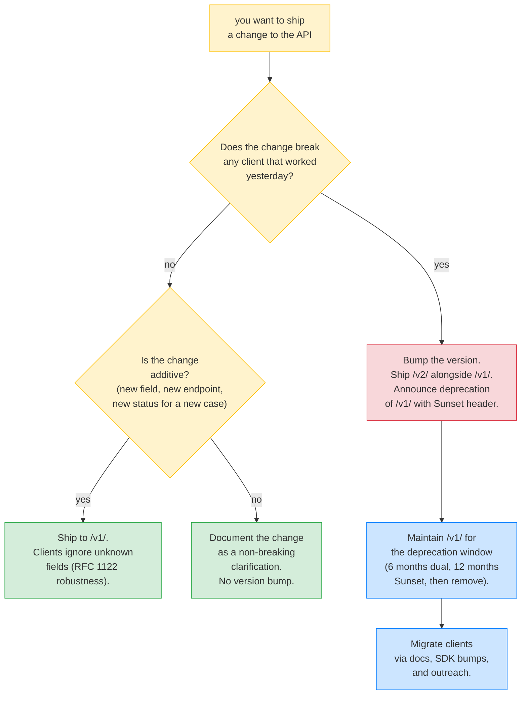
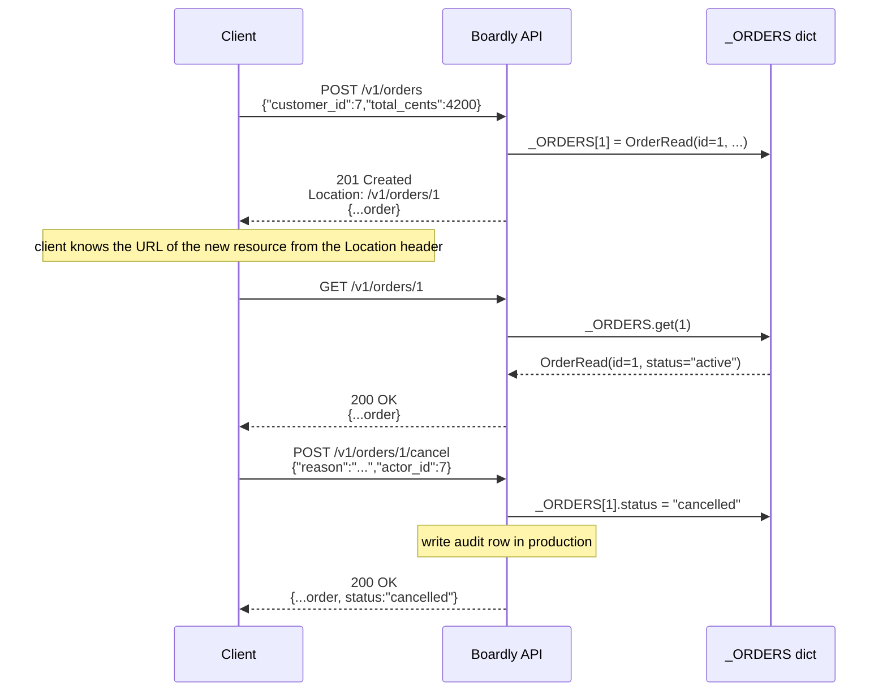
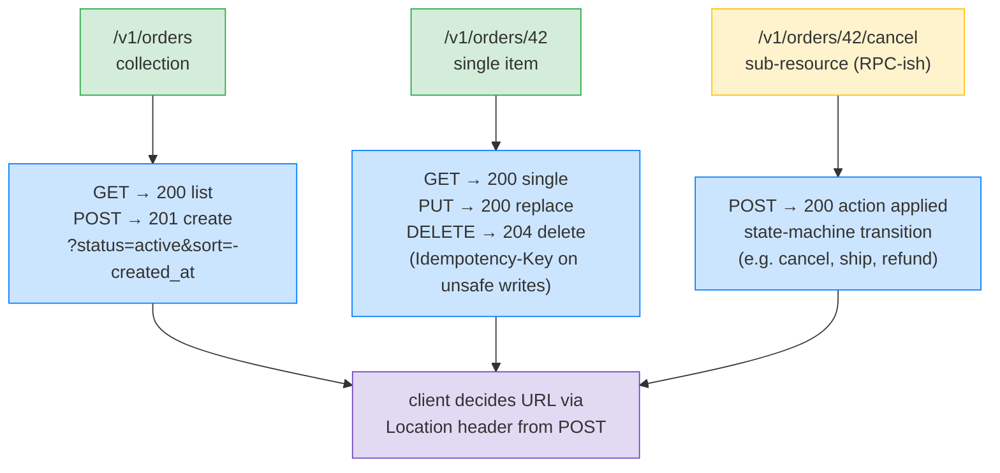

# Lesson 03: REST and Pragmatic API Design

*Designing a small REST API — resource modeling, plural nouns, sub-resources, filtering/sorting/pagination as query parameters, when to deviate with RPC-style endpoints, versioning, and an honest word about HATEOAS.*

**REST is the worst API style, except for all the others.**

It is loose enough that you can build almost anything with it, and loose enough that you can build almost anything *badly* with it. Roy Fielding's 2000 dissertation described an architectural style for distributed hypermedia systems; most production "REST" APIs use the bits they like (URLs, methods, status codes) and discard the rest (HATEOAS, content negotiation as the primary axis). That is fine. This lesson is about the parts that earn their keep. By the end you will be able to design a small REST API and defend every URL shape and method choice. Read every line. Run the curl traces. **This is how you learn.**


#http #rest #api-design

## Learning Objectives

By the end of this lesson you will be able to:

1. **Model a domain** as a set of REST resources with sensible URL shapes.
2. **Choose between resource-style** (`PUT /orders/42`) **and RPC-style** (`POST /orders/42/cancel`) endpoints and justify the choice.
3. **Design filtering, sorting, and pagination** as query parameters — and explain when to switch to a `POST /search` body.
4. **Decide on a versioning strategy** and explain why `/v1/` is the pragmatic default.
5. **Explain HATEOAS** and articulate the real-world reasons most APIs skip it.
6. **Read a real REST API design** (a small orders API) and defend every URL.

## Prerequisites

- **[[Methods-Status-Headers-Content-Types]]** — you must know the verbs and the status codes. We will use them freely in this lesson.
- **[[HTTP-Request-Lifecycle]]** — for the URL → route flow.
- **A passing familiarity with the difference between a "collection" and a "resource."** A collection is the set; a resource is one element of the set.

**The most common gap: mistaking REST for CRUD.**

REST is not "CRUD over HTTP." REST is a set of constraints (resources, methods, representations, statelessness) that happen to map cleanly to CRUD for the simple cases. The harder cases — state transitions, multi-step actions, async work, search — do not map cleanly, and REST gives you permission to deviate. We will see where and why.


## Think Like a Senior Architect

Before the URL tree, the mental model. Read this section slowly — every API-design incident in production reduces to one of the three questions below answered badly, and every "the client SDK is a mess" complaint reduces to a constraint applied where it did not earn its keep.

### The reframe: REST is a set of constraints that buy specific properties, not a religion

A senior architect reading an API surface does not ask "is this RESTful?" — that question treats REST as a checklist to satisfy. They ask "which property does this constraint buy me, what does it cost, and does the client care about the property?" REST (Fielding, 2000) is six architectural constraints, each of which *buys a specific property* and *costs a specific thing*. The architect's job is to pick the constraints whose property is worth the cost for *this* API.

The six constraints, as a cost/benefit ledger:

| Constraint | Property it buys | Cost | Skip when |
|-----------|------------------|------|-----------|
| **Client-server** | UI concerns separated from storage concerns; independent evolution of each | Network latency (every interaction is a round-trip) | Never — it is free, and the separation is the whole point of an API |
| **Stateless** | Each request is self-contained; horizontal scale is trivial (any instance serves any request); retry is safe | Larger requests (auth state repeated every call); no server-side sessions to invalidate | Never for OLTP — the cost is small and the scale property is load-bearing |
| **Cacheable** | Responses label themselves as cacheable; intermediaries offload the origin; latency drops for the client | Staleness (the cache may serve a stale copy); invalidation complexity | When the data is real-time (a stock price, a live dashboard) — set `Cache-Control: no-store` |
| **Uniform interface** | One set of verbs, one set of status codes, one resource-naming convention; tooling (SDKs, gateways, docs) understands your API without custom code | Verbosity (every resource is a noun, every action is a verb on the noun — sometimes awkward) | Never — the uniformity is what makes the API learnable |
| **Layered** | Intermediaries (proxies, gateways, CDNs) can sit between client and server without either knowing; load balancing, security, caching at the edge | Latency (each layer adds a hop); debugging complexity (which layer is the bug in?) | For internal APIs where the client talks directly to the server — the layers add latency without buying anything |
| **HATEOAS** | The client navigates by following links the server provides; the server can rename URLs without breaking the client | Round-trips (the client must fetch the links before acting); type loss (the client SDK cannot hardcode the URL); tooling complexity (docs generators do not produce clean SDKs from hypermedia) | Almost always — the cost is paid by every client, the benefit is rarely needed |

The architect's reading of this table is not "implement all six." It is "implement the first five; skip the sixth unless the use case genuinely needs runtime action discovery." That is what every mature public API does (Stripe, GitHub, GitLab, AWS) — and it is what this lesson teaches. HATEOAS is the constraint most APIs skip, and the section below on "When to deviate" defends the skip.

### The three questions on the sticky note

For every URL, method, or constraint you are about to ship, ask:

1. **What property does this constraint buy me?** (Cacheability for `GET`? Evolvability for path versioning? Visibility for stateless? Each constraint buys a specific property — name it.)
2. **What is the cost of the constraint?** (Round-trip for HATEOAS? Verbosity for the uniform interface? Latency for layered? Invalidation complexity for cacheable? Each constraint costs a specific thing — name it.)
3. **If I drop this constraint, which property do I lose, and does the client care?** (Dropping HATEOAS loses URL-decoupling — but the client's SDK hardcodes the URLs anyway, so the loss is theoretical. Dropping stateless loses horizontal scale — the client cares, because the API goes down on a single-instance failure. The client's caring is the deciding factor.)

If you cannot name the property, the cost, and the client's caring, you are not ready to ship the constraint. The default — plural-noun resources, standard methods, path versioning, stateless, cacheable where appropriate, no HATEOAS — is the right answer until you can defend a deviation.

**Warning — Debugging: the constraint whose cost you did not measure ships as a production incident.**

The three-question test asks for the property, the cost, and the client's caring — but the *cost* answer must be a measured number, not a label. The 2021 incident at a major fintech API (anonymised as "Acme Fintech"): they adopted `Idempotency-Key` on `POST /v1/orders/{id}/cancel` (the property: double-refund prevention; the client's caring: yes) without measuring the cost — the idempotency-store write added 8 ms p99 per cancel. At 5,000 cancels/sec during a billing run, that 8 ms saturated the connection pool, the cancel endpoint's p99 hit 600 ms, and the client's 500 ms timeout fired retries that the idempotency store then deduped — but the retry storm took the API down for 90 minutes. The team had labelled the cost ("a DB write per request") but not measured it. The fix: every ADR under `docs/adr/` that adopts a constraint must cite a benchmark — "Idempotency-Key adds 8 ms p99 at 5k QPS, measured on the staging replica of the prod dataset." The grep: `rg "Cost:" docs/adr/ | rg -v "[0-9]+ ms|[0-9]+ µs"` should return nothing — every Cost section has a number. See [[13-Performance-and-Observability/Structured-Logging-and-Request-IDs]] for the p99-budget discipline.


### The version-bump decision tree

The single most expensive REST decision in production is the version bump — it creates a parallel API surface that must be maintained, documented, and eventually deprecated. The decision tree for "do I bump the version?":



The tree's single load-bearing question is "does the change break any client that worked yesterday?" — not "is the change new?" New fields are non-breaking (clients ignore unknown fields per RFC 1122's robustness principle). New endpoints are non-breaking. New status codes for *new* situations are non-breaking. Removing a field, changing a field's type, changing a status code's meaning, tightening validation so previously-valid input is now invalid — these are breaking, and they require a version bump. The grep: `rg "deprecated|removed" CHANGELOG.md` should match the version-bump entries; if a breaking change shipped without a version bump, the grep catches it in review.

**Why is "add a new field" non-breaking but "remove a field" breaking?**

Because clients are *forward-compatible* (they ignore fields they do not understand, per RFC 1122) but not *backward-compatible* (they crash if a field they expect is missing). Adding `created_at` to the `OrderRead` response is non-breaking — old clients ignore it, new clients use it. Removing `created_at` from `OrderRead` is breaking — clients that hardcoded `order["created_at"]` crash with `KeyError`. The asymmetry is the contract: you can add freely, you cannot remove without a version bump. This is why mature APIs grow fields over time and almost never shrink them — the shrinkage forces a version bump that costs 18 months of deprecation.


**Warning — The version-bump is an 18-month commitment, not a code change.**

Bumping `/v1/` to `/v2/` is not a `git mv` — it is a commitment to maintain two parallel API surfaces for the deprecation window (typically 6 months of dual-returning, 12 months of `Sunset` header, then removal). During the window, every bug fix must be backported to `/v1/`; every SDK must be bumped; every client must be migrated via docs and outreach. The 2016 version bump at a major SaaS commerce API (anonymised as "Acme Commerce") took 24 months to retire `/v1/`, with two engineers full-time on client migration. The senior question for every version bump: *is the breaking change worth 18 months of dual-maintenance?* If the answer is "we just want to rename a field," the answer is no — live with the bad field name. See [[02b-Backend-Foundations/API-Versioning-Strategies]] for the deprecation-timeline playbook.


**Production reality: path versioning makes `/v1/` and `/v2/` distinct CDN cache keys by construction.**

A CDN keys its cache on the request URL (method, host, path, query). Path-versioned URLs are distinct cache keys automatically — when you ship `/v2/`, you can purge `/v2/` without touching the `/v1/` cache slot 95% of clients still hit. Header versioning via `Accept: application/vnd.boardly.v1+json` does not enjoy this: a CDN keys on the URL by default and must be configured with a `Vary: Accept` cache-key variation to split the cache by media type. The 2019 incident at a major SaaS commerce platform (anonymised as "Acme Commerce"): they purged the `Accept: application/vnd.boardly.v1+json` cache slot but forgot to purge the v2 variant; clients on the v2 header saw v1 responses for 45 minutes. The grep: `rg "Vary.*Accept|cache-key.*variation" boardly/middleware/` should return the CDN variation config; the CI check: `assert "/v1/" in url or "/v2/" in url for url in routes` enforces path versioning on every new route. See [[02b-Backend-Foundations/Content-Negotiation]] for the header-versioning caveat and [[CORS-Caching-Headers-Conditional-Requests]] for the CDN cache-key pattern.


## The Problem

You are designing the API for `Boardly` — a small project-management service. Your domain has: organizations, projects, tasks, comments, users, webhooks. Each can be created, read, updated, deleted, listed, filtered, sorted, paginated. Some have state transitions (a project can be `archived`, a task can be `closed`). Some have side-effect-heavy actions (a project can be `published`, a user can be `invited`). Some have long-running work (a CSV export can take 30 seconds).

How do you map that domain to URLs? You could:

1. **RPC everything.** `POST /createOrder`, `POST /getOrder?id=42`, `POST /deleteOrderById`. This is the 1990s SOAP style. It works, but it throws away the caching, prefetching, and tooling benefits that come for free with REST verbs.
2. **CRUD everything.** Force every action into `GET`/`POST`/`PUT`/`PATCH`/`DELETE` on a noun. This is "REST as religion." It works for simple CRUD and breaks for state transitions (you lose the audit trail when you `PATCH` a `status` field instead of calling `POST /orders/42/cancel`).
3. **REST where it fits, RPC where it does not.** This is the pragmatic middle, and it is what every well-designed public API does (Stripe, GitHub, GitLab, AWS). Use `GET`/`POST`/`PUT`/`PATCH`/`DELETE` on plural-noun resources for the 80% case; use `POST /resource/{id}/action` for the 20% of operations that have their own semantics.

This lesson is about that pragmatic middle.

**Note — Roy Fielding did not say what you think he said.**

Fielding's dissertation (2000) defined REST as an architectural style for distributed hypermedia systems. The constraints include a uniform interface, code-on-demand (optional), and *hypermedia as the engine of application state* (HATEOAS). Almost nobody implements all of REST. What we call "REST" in industry is "REST-ish" — the parts that survived contact with reality. That is fine. Be honest about it: you are building a REST-ish API, not a RESTful one.


## The Code

Real-code-first. Here is the design of a small REST API for `Boardly`'s orders subdomain. We show the URL surface as a tree first, then the FastAPI code that implements it, then we defend every decision.

### The URL surface

```text
/v1/
├── customers
│ ├── GET → list customers
│ ├── POST → create a customer
│ └── {customer_id}
│ ├── GET → read one customer
│ ├── PATCH → partial update
│ ├── DELETE → delete
│ └── orders → sub-resource collection
│ └── GET → list this customer's orders
├── orders
│ ├── GET → list with filters/sort/page
│ ├── POST → create (server assigns id)
│ └── {order_id}
│ ├── GET → read
│ ├── PUT → replace (full update)
│ ├── PATCH → partial update
│ ├── DELETE → delete
│ ├── items → sub-resource collection
│ │ └── {item_id}
│ │ └── GET
│ ├── cancel → RPC-style action (verb in URL)
│ │ └── POST → with body {reason, actor_id}
│ └── invoice.pdf → RPC-style / static resource
│ └── GET
├── products
│ ├── GET → list (paginated)
│ └── search → RPC-style (complex filter body)
│ └── POST
└── webhooks
 └── events
 └── POST → server-to-server webhook receiver
```

Notice three things about that tree: (1) every collection is a plural noun, (2) every collection item has an `{id}` path parameter, (3) some leaf paths are *verbs* (`cancel`, `search`) — these are the RPC-style deviations. We defend all three below.

### The FastAPI implementation

```python
# boardly/routers/orders.py
"""Lesson 3 reference: a small orders subdomain with the full REST
surface — collection CRUD, item CRUD, an RPC-style action, and
cursor pagination on the list endpoint."""
from typing import Annotated

from fastapi import APIRouter, HTTPException, Path, Query, Response, status
from pydantic import BaseModel, Field

router = APIRouter(prefix="/v1/orders", tags=["orders"])


# --- Models -------------------------------------------------------------

class OrderCreate(BaseModel):
 customer_id: int = Field(gt=0)
 total_cents: int = Field(gt=0)


class OrderPatch(BaseModel):
 """Merge-patch semantics (RFC 7396): absent fields are left
 alone, present fields are replaced, `null` deletes."""
 total_cents: int | None = None
 status: str | None = None


class OrderRead(BaseModel):
 id: int
 customer_id: int
 total_cents: int
 status: str


class CancelRequest(BaseModel):
 reason: str = ""
 actor_id: int


# --- Storage (in-memory stand-in for Postgres) -------------------------

_ORDERS: dict[int, OrderRead] = {}
_next_id = 1


# --- Collection endpoints ----------------------------------------------

@router.get("", response_model=list[OrderRead])
async def list_orders(
 status_filter: Annotated[str | None, Query(alias="status", pattern="^(active|cancelled)$")] = None,
 customer_id: Annotated[int | None, Query(gt=0)] = None,
 limit: Annotated[int, Query(ge=1, le=100)] = 20,
 cursor: Annotated[str | None, Query()] = None,
) -> list[OrderRead]:
 """List orders, filtered by status and/or customer_id, keyset-paginated."""
 rows = list(_ORDERS.values())
 if status_filter:
 rows = [r for r in rows if r.status == status_filter]
 if customer_id:
 rows = [r for r in rows if r.customer_id == customer_id]
 # Keyset pagination: cursor is the last seen id (opaque base64 in production).
 last_id = _decode_cursor(cursor) or 0
 rows = [r for r in rows if r.id > last_id]
 rows = rows[: limit + 1] # +1 so we can compute has_more
 has_more = len(rows) > limit
 if has_more:
 rows = rows[:-1]
 return rows # FastAPI will serialize to a bare array; pagination metadata
 # would live in headers (see the note below).


@router.post("", status_code=status.HTTP_201_CREATED, response_model=OrderRead)
async def create_order(
 payload: OrderCreate,
 response: Response,
) -> OrderRead:
 global _next_id
 order = OrderRead(
 id=_next_id,
 customer_id=payload.customer_id,
 total_cents=payload.total_cents,
 status="active",
 )
 _ORDERS[order.id] = order
 _next_id += 1
 response.headers["Location"] = f"/v1/orders/{order.id}"
 return order


# --- Item endpoints ----------------------------------------------------

@router.get("/{order_id}", response_model=OrderRead)
async def get_order(
 order_id: Annotated[int, Path(ge=1)],
) -> OrderRead:
 order = _ORDERS.get(order_id)
 if order is None:
 raise HTTPException(status.HTTP_404_NOT_FOUND, detail="order not found")
 return order


@router.put("/{order_id}", response_model=OrderRead)
async def replace_order(
 order_id: Annotated[int, Path(ge=1)],
 payload: OrderCreate,
) -> OrderRead:
 if order_id not in _ORDERS:
 raise HTTPException(status.HTTP_404_NOT_FOUND, detail="order not found")
 updated = OrderRead(
 id=order_id,
 customer_id=payload.customer_id,
 total_cents=payload.total_cents,
 status=_ORDERS[order_id].status, # PUT replaces the body but keeps server-managed fields
 )
 _ORDERS[order_id] = updated
 return updated


@router.patch("/{order_id}", response_model=OrderRead)
async def patch_order(
 order_id: Annotated[int, Path(ge=1)],
 payload: OrderPatch,
) -> OrderRead:
 order = _ORDERS.get(order_id)
 if order is None:
 raise HTTPException(status.HTTP_404_NOT_FOUND, detail="order not found")
 # Merge-patch: only fields present in the payload are replaced.
 for field, value in payload.model_dump(exclude_unset=True).items():
 setattr(order, field, value)
 return order


@router.delete("/{order_id}", status_code=status.HTTP_204_NO_CONTENT)
async def delete_order(
 order_id: Annotated[int, Path(ge=1)],
) -> None:
 if order_id in _ORDERS:
 del _ORDERS[order_id]
 # Idempotent: deleting a missing resource returns 204, not 404.
 # (Some teams prefer 404 on second delete — pick one and document it.)


# --- RPC-style actions -------------------------------------------------

@router.post("/{order_id}/cancel", response_model=OrderRead)
async def cancel_order(
 order_id: Annotated[int, Path(ge=1)],
 payload: CancelRequest,
) -> OrderRead:
 order = _ORDERS.get(order_id)
 if order is None:
 raise HTTPException(status.HTTP_404_NOT_FOUND, detail="order not found")
 if order.status == "cancelled":
 # Already cancelled — return the current state. (Idempotent action.)
 return order
 order.status = "cancelled"
 # In production: also write an audit row with payload.reason and payload.actor_id.
 return order


# --- Helpers -----------------------------------------------------------

def _decode_cursor(cursor: str | None) -> int | None:
 """Opaque base64 in production. Plain int here for illustration."""
 if cursor is None:
 return None
 try:
 return int(cursor)
 except ValueError:
 raise HTTPException(status.HTTP_400_BAD_REQUEST, detail="invalid cursor")
```

Run it:

```bash
uv run uvicorn boardly.main:app --reload

# Create an order
curl -i -X POST http://127.0.0.1:8000/v1/orders \
 -H 'Content-Type: application/json' \
 -d '{"customer_id":7,"total_cents":4200}'
# HTTP/1.1 201 Created
# Location: /v1/orders/1
# {"id":1,"customer_id":7,"total_cents":4200,"status":"active"}

# List with filter + pagination
curl -i 'http://127.0.0.1:8000/v1/orders?status=active&limit=10'

# Cancel (RPC action with body)
curl -i -X POST http://127.0.0.1:8000/v1/orders/1/cancel \
 -H 'Content-Type: application/json' \
 -d '{"reason":"changed my mind","actor_id":7}'
# HTTP/1.1 200 OK
# {"id":1,"customer_id":7,"total_cents":4200,"status":"cancelled"}
```

We will walk every line of that code and every URL shape next.

## Line-by-Line Deep Dive

### The URL surface: collection and item shapes

```text
/v1/orders ← collection
/v1/orders/{order_id} ← item
/v1/orders/{order_id}/items ← sub-resource collection
```

**What it does:** Defines the URL tree for the orders subdomain.

**Why plural nouns:** `/orders` not `/order`. Most style guides (Google, Microsoft, Heroku) agree. The plural form makes the collection/item distinction unambiguous: a singular noun is always an item, a plural noun is always a collection. Picking the majority reduces friction for clients who have seen other APIs.

**Why is the plural-noun convention better than singular?** Because the collection/item distinction is the single most common source of routing bugs in REST APIs. A team that picks `/order` for the collection and `/order/42` for the item has no syntactic way to tell which one a URL refers to without reading the path. A team that picks `/orders` for the collection and `/orders/42` for the item can read `/orders` (plural, collection) versus `/orders/42` (plural + id, item) without ambiguity. **What would happen if you used singular nouns throughout (`/order`, `/order/42`)?** Tooling that auto-generates client SDKs would generate methods `order()` and `order(id=42)` — the second shadows the first in most languages, requiring awkward rename. Plural-as-collection is the choice that survived in every major public API (Stripe, GitHub, GitLab, AWS) for the same reason — it composes with the standard `/collection/item-id` shape that routing libraries expect.

**Why one level of sub-resource nesting max:** `/orders/{id}/items` is fine. `/orders/{id}/items/{item_id}/taxes/{tax_id}` is too much — clients have to construct long URLs, your routing table grows, and most of the deep paths are rarely used. Flatten it: `/order-items/{item_id}/taxes` or `/taxes/{tax_id}?order_item_id=...`.

**Why IDs in paths and filters in query:** The path identifies *which* resource; the query *narrows* a collection. `/orders/42` is "the order with ID 42"; `/orders?status=active` is "the subset of the orders collection where status is active." Mixing these — `/orders/status/active/customer/7` — is a verb-noun-verb-noun pile that confuses caches and clients alike.

**Tip — Don't put verbs in URLs (with one defensible exception).**

`/orders/{id}/cancel` is a defensible exception (see "When to deviate" below). `/getOrders`, `/createOrder`, `/deleteOrderById` are not — the verb belongs in the HTTP method, not the URL. The URL names a thing; the method names the action on the thing.


**Example — Use kebab-case for path segments.**

Snake and camel work, but mixed-style APIs are a tax. Pick one. We use kebab-case (`/v1/order-items`) for multi-word path segments throughout the vault because it is what the major public APIs do and it reads well in URLs. Snake-case (`/v1/order_items`) is acceptable; camelCase (`/v1/orderItems`) is also acceptable but clashes with the kebab-case convention most clients expect.


### The URL surface: RPC-style deviations

```text
/v1/orders/{order_id}/cancel ← verb in URL
/v1/orders/{order_id}/invoice.pdf ← static resource
/v1/products/search ← complex filter body
```

These are the URLs that *break* the "no verbs in URLs" rule. We defend them one at a time.

**`POST /v1/orders/{order_id}/cancel` with `{reason, actor_id}` body.** The alternative is `PATCH /v1/orders/{order_id}` with `{"status": "cancelled"}`. We chose the RPC endpoint for four reasons:

1. **Audit trail.** `PATCH` loses information: what was the reason? who cancelled? `POST /cancel` with a body captures it.
2. **Side effects.** Cancelling an order triggers a refund, a notification, a state-machine transition. `PATCH` is for field updates; `POST /cancel` is for an action with its own semantics.
3. **Idempotency.** `POST /cancel` on an already-cancelled order returns the current state, not a `409`. The action is its own unit; we can reason about it independently of the field update.
4. **Discoverability.** Clients see `/cancel` in the URL list and know it exists. The `PATCH /orders/{id}` endpoint says "update any field"; it does not say "you can cancel."

**Why does `PATCH /orders/{id}` lose the audit trail that `POST /cancel` keeps?** Because `PATCH` is a field-update contract — it says "set these fields to these values" and nothing else. The client sends `{"status": "cancelled"}`, the server sets the field, and the audit record (if any) is "PATCH at 14:32, fields=...". The reason, the actor, the moment of decision — none of it has a place in the PATCH body because the PATCH contract does not include them. `POST /cancel` with `{"reason", "actor_id"}` makes those fields *first-class inputs* of the action, and the audit row has natural columns to receive them. **What would happen if you tried to bolt audit fields onto `PATCH`?** You would either smuggle them through a non-standard header (which clients cannot generate from their SDK), or overload the body with `{"status": "cancelled", "_audit_reason": "...", "_audit_actor": ...}` — which forces the `OrderPatch` model to accept fields that don't belong to the resource itself. Both are ugly; the RPC endpoint is the honest answer.

**`GET /v1/orders/{order_id}/invoice.pdf`.** This is a static resource, not an action. The `.pdf` extension tells the client what content type to expect (a convention from the file-extension era that still works). The alternative is `GET /v1/orders/{order_id}/invoice` with content negotiation via `Accept: application/pdf`, which is more REST-correct but invisible in curl. Pick your poison.

**`POST /v1/products/search`.** Complex filters with `AND`/`OR`/range do not belong in query strings. `?filter=(status eq 'active') and (total gt 1000)` is unreadable in logs, breaks on URL length limits (most servers cap at 8 KB), and forces URL encoding of `(`, `)`, `'`, spaces. The honest answer is `POST /products/search` with a JSON body. This is the JSON:API convention; Stripe does the same with `POST /v1/orders/search`.

**Student asks: is `POST /search` "RESTful"?**

Strictly, no — `POST` is for create. But REST is a set of constraints, not a religion, and the constraint we are honoring is "use the right method for the right shape of request." A complex query is a *request body*, not a *resource creation*; `POST` is the only method that accepts an arbitrary body. The pragmatic answer is "yes, this is REST-ish enough; the alternative is worse."


**Student asks: should I version my API in the URL (`/v1/...`) or via a header (`Accept: application/vnd.boardly.v1+json`)?**

Both are valid REST. URL versioning (`/v1/`) is the pragmatic default because it is visible in logs, in curl, and in browser network panels; you can grep your access logs for `GET /v1/orders` versus `GET /v2/orders` and know exactly who is on which version. Header versioning via `Accept` (the "vendor media type" pattern, `application/vnd.boardly.v1+json`) is more REST-correct — the URL is the resource, the representation is a separate axis — but it is invisible in logs and forces clients to construct an `Accept` header most engineers do not know how to debug. The academy's convention is URL versioning for the first three versions; once you have hundreds of consumers, switch to header versioning for the breaking changes you want to roll out gradually. Both patterns compose with content negotiation from [[02b-Backend-Foundations/Content-Negotiation]].


### The code: `OrderCreate`, `OrderPatch`, `OrderRead` models

```python
class OrderCreate(BaseModel):
 customer_id: int = Field(gt=0)
 total_cents: int = Field(gt=0)

class OrderPatch(BaseModel):
 total_cents: int | None = None
 status: str | None = None

class OrderRead(BaseModel):
 id: int
 customer_id: int
 total_cents: int
 status: str
```

**What it does:** Declares three Pydantic models — one for the create body, one for the patch body, one for the response.

**Why three (not one) models:** The shape of "what the client sends on create" differs from "what the client sends on patch" differs from "what the server returns." `OrderCreate` has no `id` (server assigns) and no `status` (server defaults). `OrderPatch` has all-optional fields so partial update works. `OrderRead` has all fields populated. Using one model would force the client to send fields it does not know, or force the server to lie about which fields are required on the way in.

**Why `OrderPatch` uses `int | None = None`:** Merge-patch semantics (RFC 7396): absent fields are left alone, present fields are replaced, `null` deletes. `exclude_unset=True` in the route tells Pydantic to only emit fields the client actually sent. We will see this pattern at scale in [[03-FastAPI-Core/Path-Query-Header-Cookie-Body|Lesson 3 of Section 03]].

**Danger — How an attacker thinks: the single-model shortcut as an over-posting surface.**

The lesson uses three models (`OrderCreate`, `OrderPatch`, `OrderRead`) — the shortcut is one model `Order` used for all three, with the route doing `Order(**payload.dict())` and saving. The over-posting surface: if `Order` carries a server-managed field (`is_admin`, `role`, `internal_margin`), a `POST /v1/orders` with `{"customer_id": 7, "total_cents": 4200, "role": "admin"}` sets `role = "admin"` because the single model accepts every field. The defence is the three-model split — `OrderCreate` is field-allow-listed to `{customer_id, total_cents}`; `OrderPatch` is allow-listed to the client-modifiable subset; server-managed fields live only on `OrderRead` (output) and never on an input model. The deeper rule: the input model is a *security boundary* — every field on it is a field the client can set, so the field list is the authorisation surface. The grep: `rg "class Order\b" boardly/routers/orders.py` should return three classes (Create, Patch, Read), not one; `rg "class.*:\s*BaseModel" boardly/routers/ | rg -v "Create|Patch|Read"` flags any model whose name does not encode its direction. The CI check: `pytest tests/test_overposting.py` sends `POST /v1/orders` with `role=admin` and asserts the response's `role` is the server default, not `admin`. See [[04-Pydantic/BaseModel-and-Validation]] for the input-model-as-boundary pattern and [[11-Authentication-and-Security/OWASP-API-Top-10]] for the API3:2023 entry.


### The code: collection `GET` and `POST`

```python
@router.get("", response_model=list[OrderRead])
async def list_orders(
 status_filter: Annotated[str | None, Query(alias="status", pattern="^(active|cancelled)$")] = None,
 customer_id: Annotated[int | None, Query(gt=0)] = None,
 limit: Annotated[int, Query(ge=1, le=100)] = 20,
 cursor: Annotated[str | None, Query()] = None,
) -> list[OrderRead]:
 ...
```

**What it does:** Registers a `GET` on `/v1/orders` (the `""` path is appended to the router's `prefix="/v1/orders"`) with four query parameters: `status` (with a regex pattern), `customer_id` (positive int), `limit` (1–100, default 20), `cursor` (opaque string).

**Why `response_model=list[OrderRead]`:** FastAPI serializes the return value as a JSON array of `OrderRead` objects. This is the bare-array response style. An alternative is the envelope style (`{"data": [...], "pagination": {...}}`); we discuss the trade-off below.

**Why `pattern="^(active|cancelled)$"` on `status`:** Validation belongs on the parameter, not in the route. If the client sends `?status=foo`, FastAPI returns `422` before your route runs. The pattern is anchored so `active-canceled` does not match.

**Why `limit` is capped at 100:** Without a cap, a client can request `?limit=1000000` and OOM your database. Cap at a reasonable maximum; clients who want more can paginate.

**Where does pagination metadata go?**

Two answers are both correct. (1) In the response body, with an envelope: `{"data": [...], "pagination": {"next_cursor": "...", "has_more": true}}`. (2) In a `Link` header per RFC 8288: `Link: <...?cursor=...>; rel="next"`. The `Link` header is more RESTful and lets the client be a generic hypermedia client. The envelope is more visible in curl. We use the envelope in this lesson's code (the route returns a bare list for simplicity, but in production you would wrap it). We will use cursor pagination in depth in [[Idempotency-Safe-Retries-Pagination|Lesson 4]].


**Warning — Debugging: `?cursor=0` and the empty-page trap.**

A client encodes a cursor as `0` (the integer before the first ID) and sends `GET /v1/orders?cursor=0`. The `_decode_cursor` helper returns `int(cursor) == 0`, the SQL becomes `WHERE id > 0`, and the client receives the first page — but the client's `next_cursor` field reads `0` again (because the boundary row had `id = 0` or the cursor was hand-crafted). The result: the client paginates "successfully" forever, each page identical to the first, never reaching `has_more = false`. The defence: cursors must be opaque base64 blobs, not integers; the integer `0` is a valid cursor only if it round-trips through `encode_cursor(0) = "eyJpZCI6MH0="` and `decode_cursor("eyJpZCI6MH0=") == 0`. The grep: `rg "cursor.*int\b|cursor.*=.*0" boardly/routers/` should return nothing — cursors are base64 strings on the wire, integers only after decode. The symptom in production: a `pagerduty` alert "list endpoint returning the same page N times in a row"; the diagnosis: `rg -u 'cursor' access.log | sort | uniq -c | sort -rn` shows a single cursor value repeated thousands of times.


**Danger — How an attacker thinks: predictable opaque cursors as an enumeration oracle.**

A keyset cursor is `base64(json({"id": last_id}))`. The cursor is *opaque* to the client only by convention — the underlying `last_id` is a sequential integer from the database's `id` column. An attacker decodes the cursor (`echo <cursor> | base64 -d | jq .id`), reads `{"id": 41}`, and concludes "the next page starts at id 42." The attacker now scripts `GET /v1/orders?cursor=<base64(json({"id": N}))>` for `N` from 1 to 1,000,000, collecting every order in the system without ever paginating legitimately — bypassing any per-page rate limit that throttles the *page* count, not the *cursor* value. The vulnerability is *cursor transparency*: an opaque cursor whose format is decodable lets the attacker forge cursors to any position. The defence has three layers. (1) *Sign the cursor* — append an HMAC: the cursor is `base64(json(payload) + "." + hmac_sha256(secret, json(payload)))`; a forged cursor without the signature is rejected with `400`. (2) *Use a non-enumerable sort key* — if the cursor encodes a UUID (`uuid4`) rather than a sequential integer, the attacker cannot construct valid cursors by incrementing. (3) *Rate-limit by cursor value, not by request count* — track the highest `last_id` the client has been issued and reject any cursor whose `last_id` exceeds the issued maximum by more than `limit` (the attacker cannot jump ahead of their own pagination). The grep: `rg "encode_cursor|decode_cursor" boardly/routers/ | rg -v "hmac|sign"` should return nothing — cursors are signed, not bare base64. The CI check: `pytest tests/test_cursor_forgery.py` sends a hand-crafted cursor with a sequential integer not issued by the server and asserts the response is `400`, not `200` with data. See [[Idempotency-Safe-Retries-Pagination]] for the canonical cursor construction and [[02b-Backend-Foundations/Pagination-Deep-Dive]] for the multi-column signed-cursor pattern.


**Danger — How an attacker thinks: list-endpoint field leakage via `response_model` omission.**

A `GET /v1/orders` route declared without `response_model` returns whatever the handler returns — including the SQLAlchemy ORM object with every column populated. If `Order` has `internal_notes`, `cost_basis`, `supplier_margin` columns the API surface never meant to expose, those fields appear in the JSON response. An attacker who notices `"internal_notes": "vendor ABC undercut by $200"` in a `GET /v1/orders?limit=100` response now knows the supplier's pricing — competitive intelligence for free. The defence is the `response_model=list[OrderRead]` declaration on every list and item endpoint: the `response_model` is the contract — FastAPI strips any field not on `OrderRead` before serialising. The grep: `rg "@router\.(get|post|put|patch|delete)" boardly/routers/ | xargs grep -L "response_model"` should return nothing — every route declares its response model. The defence-in-depth is `model_config = ConfigDict(extra="forbid")` on every Pydantic model so a stray `internal_notes` field on the ORM mapping is caught at the `OrderRead(**row._mapping)` boundary. See [[04-Pydantic/BaseModel-and-Validation]] for `extra="forbid"` and the `model_dump()` strip behaviour.


**Production reality: the rate-limit header is part of the API contract.**

Every public API's rate limit is part of the contract, not an afterthought. The four headers: `X-RateLimit-Limit` (the bucket size, e.g. `100`), `X-RateLimit-Remaining` (e.g. `87`), `X-RateLimit-Reset` (epoch seconds until the bucket resets), and `Retry-After` on the `429` response itself (seconds-until-retry or HTTP-date, per RFC 9110). Clients that read these headers throttle themselves; clients that ignore them hit the `429` and the safe-retry policy backs off. The 2018 incident at a major developer-platform API (anonymised as "Acme Dev Platform"): they returned `429` without a `Retry-After` header, every client's backoff defaulted to a flat 1 second, and the synchronized retry wave took the API down for 3 hours. The fix shipped `Retry-After` and `X-RateLimit-Reset` in the same release. The grep: `rg "X-RateLimit|Retry-After" boardly/middleware/` should return the rate-limit middleware; the CI check: `pytest tests/test_rate_limit_headers.py` asserts every `429` response carries both headers. See [[03-FastAPI-Core/Middleware-and-Request-Order]] for the leaky-bucket middleware pattern.


**Warning — Debugging: the `Location` header that pointed at `localhost`.**

A `POST /v1/orders` returns `201 Created` with `Location: http://localhost:8000/v1/orders/1`. The client's SDK follows the `Location` URL to fetch the created resource and crashes with `ConnectionRefusedError` — the SDK is running on a customer's machine, not the server's localhost. The diagnosis: the route builds the `Location` header with `f"/v1/orders/{order.id}"` — a path-only `Location`, which the reverse proxy rewrote to `http://localhost:8000/...` because it stripped the inbound `Host` header and reconstructed the URL from the upstream Uvicorn listener's bind address. The fix has two layers. (1) *Path-only `Location` is correct* — RFC 9110 §10.2.2 permits a relative reference; the client resolves it against the request URL, which the client knows. (2) *The reverse proxy must forward the `Host` header* (`proxy_set_header Host $host;` in NGINX, or `X-Forwarded-Host` in AWS ALB) so Uvicorn's `request.url` reconstructs the public-facing URL. The deeper fix: never trust `request.url` for outbound-facing URLs in production — build them explicitly from a configured base (`f"{settings.public_base_url}/v1/orders/{order.id}"`) so a proxy misconfiguration cannot leak the internal hostname. The grep: `rg "request\.url|Location.*request" boardly/routers/` should return nothing — outbound URLs come from config, not from the request object. The CI check: `pytest tests/test_location_header.py` asserts every `201 Created` response carries a `Location` whose host matches `settings.public_base_url` (or is a relative path). See [[03-FastAPI-Core/Middleware-and-Request-Order]] for the `X-Forwarded-Host` handling and the behind-proxy setting.


### The code: item `GET`, `PUT`, `PATCH`, `DELETE`

```python
@router.get("/{order_id}", response_model=OrderRead)
async def get_order(
 order_id: Annotated[int, Path(ge=1)],
) -> OrderRead:
 order = _ORDERS.get(order_id)
 if order is None:
 raise HTTPException(status.HTTP_404_NOT_FOUND, detail="order not found")
 return order
```

**What it does:** Reads a single order by ID. Returns `404` if not found.

**Why `Annotated[int, Path(ge=1)]`:** Validates the path parameter is a positive integer before your route runs. If the client sends `GET /v1/orders/abc`, FastAPI returns `422`. If the client sends `GET /v1/orders/-1`, same. If the client sends `GET /v1/orders/0`, same — `ge=1` excludes zero. Your route only runs for valid IDs.

```python
@router.put("/{order_id}", response_model=OrderRead)
async def replace_order(
 order_id: Annotated[int, Path(ge=1)],
 payload: OrderCreate,
) -> OrderRead:
 if order_id not in _ORDERS:
 raise HTTPException(status.HTTP_404_NOT_FOUND, detail="order not found")
 updated = OrderRead(
 id=order_id,
 customer_id=payload.customer_id,
 total_cents=payload.total_cents,
 status=_ORDERS[order_id].status,
 )
 _ORDERS[order_id] = updated
 return updated
```

**What it does:** Replaces the entire order with the body. `PUT` is idempotent — sending the same `PUT` twice has the same end state.

**Why `PUT` keeps `status` unchanged:** `PUT` is "replace the resource with this representation." But some fields are server-managed (`id`, `status`, `created_at`). The honest answer is: `PUT` replaces the *client-modifiable* fields and keeps the server-managed fields. Be explicit about which is which in your docs.

**Warning — `PUT` vs `PATCH` confusion is real.**

`PUT` is "replace the whole thing." `PATCH` is "apply a partial change." If you accidentally `PUT` with a partial body, you set the missing fields to their defaults (or to null), which is a destructive operation. Always document which method does what.


**Warning — Debugging: the PATCH that nullified the bank-account number.**

A `PATCH /v1/customers/42` arrives with `{"email": "new@example.com"}`. The handler does `for field, value in payload.model_dump().items(): setattr(customer, field, value)` — without `exclude_unset=True`. `model_dump()` emits every field on the model with `None` for unset ones; the loop sets `bank_account_number = None`, `tax_id = None`, `kyc_verified_at = None`. The customer's bank-account number is wiped. The transaction commits. The customer service desk gets a call three days later about a missing direct-debit. The diagnosis: a `git diff` reveals the missing `exclude_unset=True` in a refactoring that "simplified" the patch handler. The defence: a pytest that asserts `PATCH /v1/customers/42 {"email": "x"}` does not change `bank_account_number` — this test fails the moment `exclude_unset=True` is dropped. The grep: `rg "model_dump\b" boardly/routers/ | rg -v "exclude_unset"` should return nothing in PATCH handlers. See [[04-Pydantic/BaseModel-and-Validation]] for the `model_dump` defaults and the merge-patch contract from RFC 7396.


**Danger — How an attacker thinks: IDOR via PATCH-on-foreign-key.**

A `PATCH /v1/orders/42` endpoint accepts `{"customer_id": 99}` in the body. An authenticated attacker who owns `customer_id=7` sends the PATCH, moving the order from customer 7 to customer 99 — and now customer 99's account is debited for the order's `total_cents`, or the order is visible in customer 99's history. The vulnerability is mass-assignment combined with IDOR: the `customer_id` field is in the `OrderPatch` body (so the client controls it) and the handler does not check that the patched order still belongs to the requester. The defence has two layers. (1) *Field allow-listing* — `OrderPatch` should not contain server-managed fields like `customer_id`, `created_at`, `id`; it should only contain client-modifiable fields. (2) *Object-level auth* — every PATCH handler re-checks `order.customer_id == current_user.customer_id` (or `current_user.is_admin`) before mutating, even if the body does not change the owner. The grep: `rg "customer_id.*Field|customer_id.*:" boardly/routers/orders.py` should return only the `OrderCreate` and `OrderRead` models, never `OrderPatch`. See [[11-Authentication-and-Security/RBAC-and-Object-Level-Auth]] for the object-level auth pattern.


**Warning — Debugging: the `DELETE /v1/customers/42` that returned `409` and the client's retry gave up.**

A `DELETE /v1/customers/42` returns `409 Conflict` because the customer has open orders (an FK constraint the handler did not pre-check). The client's retry policy treats `4xx` as permanent and stops retrying — the customer is not deleted, the customer-service desk gets a "delete failed" ticket, and the diagnosis requires reading the server logs to see the `409` body: `{"detail": "cannot delete customer with open orders"}`. The fix has two layers. (1) *Pre-check the constraint and return `409` with a structured body* — the handler counts the customer's open orders before the `DELETE`, returns `409 {"detail": "...", "open_order_count": 17, "open_order_ids": [...]}` if the count is non-zero, so the client can show the user "delete these orders first." (2) *Document `409` as a retryable-after-resolution status* — the client's retry policy treats `409` as "fix the precondition and retry the same DELETE," not as "give up." The grep: `rg "DELETE.*customer|delete_customer" boardly/routers/customers.py | rg -v "409|open_order"` should return nothing — every delete handler that can FK-conflict pre-checks and returns `409` with a structured body. The CI check: `pytest tests/test_delete_conflict_body.py` asserts the `409` response carries the structured detail and the client's retry policy treats `409` as fixable. See [[Problem-Details-RFC-7807]] for the structured-error envelope that carries the precondition information.


```python
@router.patch("/{order_id}", response_model=OrderRead)
async def patch_order(
 order_id: Annotated[int, Path(ge=1)],
 payload: OrderPatch,
) -> OrderRead:
 order = _ORDERS.get(order_id)
 if order is None:
 raise HTTPException(status.HTTP_404_NOT_FOUND, detail="order not found")
 for field, value in payload.model_dump(exclude_unset=True).items():
 setattr(order, field, value)
 return order
```

**What it does:** Merge-patches the order. Only fields the client actually sent are replaced.

**Why `exclude_unset=True`:** This is the magic for merge-patch semantics. `model_dump()` by default includes every field on the model (with `None` for unset ones). `model_dump(exclude_unset=True)` only includes fields the client actually sent. Without this, sending `{"total_cents": 4200}` would also set `status` to `None`, deleting the status. With it, only `total_cents` is touched.

```python
@router.delete("/{order_id}", status_code=status.HTTP_204_NO_CONTENT)
async def delete_order(
 order_id: Annotated[int, Path(ge=1)],
) -> None:
 if order_id in _ORDERS:
 del _ORDERS[order_id]
```

**What it does:** Deletes the order. Returns `204` whether the order existed or not. This makes `DELETE` idempotent — sending it twice has the same end state (order is gone), even though the second response might "look" like nothing happened.

**Why `204` and not `404` for missing:** RFC 9110 says `DELETE` is idempotent. The strict reading: "if you delete what is already deleted, the end state is the same, so success is the right answer." Some teams prefer `404` on the second delete for the signal that "you tried to delete something that did not exist." Either is defensible; pick one and document it. We use `204` for idempotency.

### The code: RPC-style action

```python
@router.post("/{order_id}/cancel", response_model=OrderRead)
async def cancel_order(
 order_id: Annotated[int, Path(ge=1)],
 payload: CancelRequest,
) -> OrderRead:
 order = _ORDERS.get(order_id)
 if order is None:
 raise HTTPException(status.HTTP_404_NOT_FOUND, detail="order not found")
 if order.status == "cancelled":
 return order
 order.status = "cancelled"
 # In production: also write an audit row with payload.reason and payload.actor_id.
 return order
```

**What it does:** Cancels the order. Takes a body with `reason` and `actor_id`. If the order is already cancelled, returns the current state — the action is idempotent.

**Why `POST /cancel` and not `PATCH /orders/{id}` with `{"status": "cancelled"}`:** We defended this above. The short version: the cancel action has its own semantics (audit trail, side effects, idempotency rules), and forcing it through `PATCH` loses that information.

**Why return `200` and not `202`:** If cancellation is synchronous (the resource is in the cancelled state when the response is sent), `200` is correct. If cancellation is queued (a background worker actually issues the refund later), `202 Accepted` with a status URL is correct. We will see the async pattern in [[03-FastAPI-Core/Background-Tasks-Streaming-Uploads|Lesson 7 of Section 03]].

**Production reality: the action-endpoint idempotency contract.**

`POST /v1/orders/{id}/cancel` looks idempotent already — the handler returns the current state if the order is `cancelled`. But the cancel action triggers side effects beyond the field update: a refund is issued, a notification is sent, an audit row is written. If two concurrent `POST /cancel` requests arrive (the client retried because the network dropped the first response), the refund is issued twice. The defence: every action endpoint accepts `Idempotency-Key` and stores the response keyed on `(auth_principal, endpoint, key, request_hash)`. The idempotency contract is the same one we will build in [[Idempotency-Safe-Retries-Pagination|Lesson 4]]. The grep: `rg "Idempotency-Key|@router.post.*\{.*_id\}/[a-z]+" boardly/routers/` should return both the action route and the idempotency-key parameter; a route that accepts an action body without an `Idempotency-Key` is the smell. See [[Idempotency-Safe-Retries-Pagination]] for the canonical store schema.


**Warning — Debugging: the concurrent `POST /cancel` that refunded twice.**

Two `POST /v1/orders/42/cancel` requests arrive 50 ms apart. The first handler reads `order.status == "active"`, transitions to `cancelled`, issues the refund (`POST /v1/refunds` to the payment processor), and commits. The second handler reads `order.status == "active"` *before the first commits* (READ COMMITTED isolation, no row lock), transitions to `cancelled`, issues a second refund, and commits. The customer's card is refunded twice. The diagnosis: the early-return-on-`cancelled` check is a *read-then-write* race; under concurrency, both reads see `active`. The defence has two layers. (1) *Row lock* — `SELECT ... FOR UPDATE` on the order before reading status; the second handler blocks until the first commits, then sees `cancelled` and short-circuits. (2) *Idempotency-Key* — the action endpoint accepts `Idempotency-Key` (see the callout above); two concurrent POSTs with the same key are deduped at the idempotency-store boundary before they reach the handler. The grep: `rg "FOR UPDATE|Idempotency-Key" boardly/routers/orders.py | rg "cancel"` should return both the lock and the header; the CI check: `pytest tests/test_concurrent_cancel.py` asserts a concurrent double-cancel issues one refund, not two. See [[06-SQL-Fundamentals/Transactions-Isolation-Locks]] for the row-lock pattern.


**Production reality: the dual-write problem on the order + audit row.**

The `POST /v1/orders/{id}/cancel` handler writes two rows: the order's `status = 'cancelled'` update and an `audit_log` row carrying `reason` and `actor_id`. If the audit row insert fails after the order commit (a database connection blip between the two commits), the order is cancelled but the audit trail is empty — a SOX violation the compliance team flags weeks later. The defence is the *transactional outbox* pattern: both writes are in the same database transaction (`BEGIN; UPDATE orders ...; INSERT INTO audit_log ...; COMMIT;`); either both happen or neither does. The 2019 incident at a major SaaS commerce API (anonymised as "Acme Commerce"): the audit row insert was a separate `await session.execute(...)` after the order commit, with no transaction wrapper; 0.3% of cancellations had no audit row (the audit insert failed silently in a fire-and-forget task). The postmortem's fix: wrap the order update and the audit insert in `session.begin()`, so the audit failure rolls back the cancellation. The grep: `rg "session.commit\(\)" boardly/routers/orders.py | rg "cancel"` should return exactly one commit per cancel handler; the CI check: `pytest tests/test_cancel_audit_atomicity.py` asserts a forced audit-insert failure rolls back the order's status update. See [[14-Caching-and-Background-Processing/Transactional-Outbox]] for the outbox pattern that pairs the writes atomically and [[06-SQL-Fundamentals/Transactions-Isolation-Locks]] for the transaction-boundary discipline.


### Versioning

Three places you can put a version:

| Location | Example | Pros | Cons |
|----------|---------|------|------|
| Path | `/v1/orders` | Obvious in logs, in client code, in caching layers. | Ugly URLs; bumping the version requires publishing a new path tree. |
| Header | `Accept: application/vnd.example.v1+json` | Clean URLs; supports content negotiation. | Invisible in curl; impossible to test in a browser address bar; harder to cache. |
| Query | `/orders?version=1` | Simple. | Pollutes every URL; breaks caches when bumped; semantically wrong (version isn't a filter). |

**Engineering judgment: use path versioning.** The cost is small (one prefix), and the operational benefits are large. Stripe, GitHub, GitLab, AWS all use path versioning. We use `/v1/` throughout this vault.

**When to bump the version:** when you make a *breaking* change:

- Remove a field.
- Change a field's type.
- Change a status code's meaning.
- Change validation rules so previously-valid input is now invalid.

**When NOT to bump the version:** for additive changes (new fields, new endpoints, new status codes for new situations). Clients should ignore fields they don't understand; this is what makes APIs evolvable. If you bump for every addition, you force every consumer to migrate every time you ship a feature, and your API becomes a graveyard of versions.

**Production reality: the deprecation-header rotation schedule.**

Once a route is marked deprecated, the `Deprecation` (RFC 9745) and `Sunset` (RFC 8594) headers carry the timeline. The rotation schedule: at the announce date, set `Deprecation: true` and `Sunset: <rfc1123-date>` on the deprecated route's response; at the midpoint of the deprecation window, also emit a `Warning: 299 - "This endpoint is deprecated and will be removed on <date>"` header; at the sunset date, return `410 Gone` with a `Link: <...new route...>; rel="successor-version"` header pointing at the replacement. The `410` (not `404`) signals "this existed and was intentionally removed," which lets clients distinguish "you are calling a removed API" from "you typo'd the URL." The grep: `rg "Sunset\b|Deprecation\b" boardly/middleware/` should return the middleware that sets these headers from a config map of `{route_path: sunset_date}`. The CI check: `pytest tests/test_deprecation_headers.py` asserts that every route flagged `deprecated=true` in the route metadata returns both headers. See [[02b-Backend-Foundations/API-Versioning-Strategies]] for the full deprecation playbook.


**Tip — The version-bump decision tree.**

Does the change break any existing client that worked yesterday? Yes → bump the version. No → ship it as additive. "Will it break" is the question; "is it new" is irrelevant. New fields are non-breaking if clients ignore unknown fields, which they should per the robustness principle (RFC 1122).


**Production reality: dual-running `/v1/` and `/v2/` and the shared-service trap.**

Path versioning makes `/v1/` and `/v2/` distinct routes, but they typically share the same service, the same database, and the same Pydantic models. The trap: a v2-only change to a *shared* model (e.g., adding a required field to `OrderRead`) silently breaks `/v1/` because the shared `OrderRead` now requires the field, and `/v1/`'s handler does not populate it (the v1 data does not have it). The client on `/v1/` receives `null` for the new required field and Pydantic's `response_model` validation returns `500` (the response failed validation), not the expected `200`. The fix: version the *models*, not just the routes — `OrderReadV1` and `OrderReadV2` are separate classes, and the `/v1/` route declares `response_model=OrderReadV1` so a v2 model change cannot leak into v1 responses. The deeper rule: path versioning without model versioning is a shared-state footgun; the version boundary must be end-to-end (route -> handler -> model -> serializer). The grep: `rg "response_model=OrderRead" boardly/routers/ | rg -v "V1|V2"` should return nothing — every `OrderRead` reference is version-suffixed. The CI check: `pytest tests/test_v1_v2_isolation.py` asserts a v2 model change does not change `/v1/` responses. See [[02b-Backend-Foundations/API-Versioning-Strategies]] for the model-versioning pattern.


### HATEOAS, briefly

Hypermedia As The Engine Of Application State: the response contains links the client can follow, and the client navigates by following links rather than constructing URLs. The classic example:

```json
{
 "id": 42,
 "status": "active",
 "_links": {
 "self": {"href": "/v1/orders/42"},
 "cancel": {"href": "/v1/orders/42/cancel", "method": "POST"},
 "invoice": {"href": "/v1/orders/42/invoice.pdf", "method": "GET"}
 }
}
```

In theory, the client never constructs a URL; it only follows links the server provides. This means the server can change its URL scheme freely — the client follows the `cancel` link without knowing whether it is `/v1/orders/42/cancel` or `/v2/orders/42/cancel` or `/v1/cancellations?order=42`.

In practice, almost nobody consumes APIs this way:

- Clients want typed SDKs. A typed SDK hardcodes URLs.
- Frontend code wants to construct a URL from an ID without an extra round-trip.
- Browsers do not navigate APIs by hypermedia; they navigate HTML pages.

**The honest position:** HATEOAS solves a real problem (URL churn) at a cost (round-trips, SDK complexity, type loss) that most teams are unwilling to pay. If your API is consumed by your own frontend, skip it. If you publish a public API consumed by third parties, consider returning `_links` for the most useful next actions, but do not require clients to navigate hypermedia.

**Example — When HATEOAS is worth it.**

If your API is consumed by a generic hypermedia client (rare — most clients are not generic), or if you need to advertise available actions per state (a state machine that says "you can cancel only when status is `pending`"), HATEOAS is worth it. In that case, embed the available actions in the response: `{"status": "pending", "_actions": {"cancel": "...", "refund": "..."}}`. The client checks `_actions` for what is allowed. Most APIs do not need this.


**Danger — How an attacker thinks: HATEOAS link injection.**

A HATEOAS response includes `_links.cancel.href` returned to the client. If the `href` is built from a user-controllable field (a `note` field that the customer can set, an `email` field used as a display name), an attacker can inject `"href": "//evil.example.com/cancel?order=42"` — and any client that follows the link issues a `POST` to the attacker's server with the order ID and the auth header. The vulnerability is *link injection*: the HATEOAS response is constructed from untrusted input. The defence: every `href` is built from a server-controlled URL template, never from user-supplied fields; the `_links` object is constructed from route paths and IDs, not from string interpolation of user data. The grep: `rg "_links|href.*f\"" boardly/routers/` should return only URL builders that take IDs, never user-supplied strings. The deeper lesson: HATEOAS is fine if you treat the links as server-controlled navigation, not as a templating surface for user input. See [[11-Authentication-and-Security/OWASP-API-Top-10]] for the API3:2023 Broken Object Property Level Authorization entry.


**Student asks: should `POST` return `200` or `201`?**

`201 Created` whenever the POST creates a new resource that has its own URL — which is the case for the overwhelming majority of POST endpoints. The `201` carries a `Location` header pointing at the new resource's URL, so the client does not have to guess. Return `200 OK` for POST endpoints that *do not* create a resource (a `POST /v1/search` returning a list of matching resources, a `POST /v1/orders/1/cancel` returning the updated order). The rule of thumb: if the response could be cached or referenced later by URL, return `201` with a `Location`; if the response is a one-shot computation, return `200`. The academy uses `201` for collection-creates and `200` for action-on-resource endpoints — which is also what Stripe, GitHub, and most major public APIs do.


## Execution Trace

For `POST /v1/orders` → `GET /v1/orders/1` → `POST /v1/orders/1/cancel`:

1. Client sends `POST /v1/orders` with body `{"customer_id":7,"total_cents":4200}`. Server responds `201 Created` with `Location: /v1/orders/1` and the JSON body of the new order.
2. Client sends `GET /v1/orders/1`. Server looks up the order, responds `200 OK` with the JSON body.
3. Client sends `POST /v1/orders/1/cancel` with body `{"reason":"changed my mind","actor_id":7}`. Server transitions the order to `cancelled`, writes an audit row, responds `200 OK` with the updated order.





Why put the RPC-ish `/cancel` sub-resource in yellow while the collection and item URLs are green? Because the canonical REST tier (collection → item → sub-resource) is green when you can express the action as a *state transition on a single resource*, and yellow when you drift towards RPC-style "verb in the URL" endpoints — which is *fine* for genuine state machines (cancel, ship, refund) but is *not fine* when the verb is a CRUD operation dressed up (`/createOrder` instead of `POST /v1/orders`). The colour marks the line: green is "REST has its own verb for this"; yellow is "REST's verbs don't fit, here's a named action, document it."

**Production reality: the execution trace as a contract-test fixture.**

The mermaid sequence and flowchart in this section are not just didactic — they are the blueprint for a contract test that prevents regressions. The test: a `pytest` fixture stands up the FastAPI app with a seeded in-memory store, replays the trace's three requests (`POST /v1/orders`, `GET /v1/orders/1`, `POST /v1/orders/1/cancel`), and asserts the status codes, the `Location` header shape, and the final `status == "cancelled"`. The fixture is snapshot-tested against the trace's documented responses — if a refactor changes `201` to `200` on the create, or drops the `Location` header, the contract test fails before the change ships. The footgun: the contract test must cover the *state transitions*, not just the happy-path CRUD — the cancel-after-cancel idempotency (second `POST /cancel` returns the current state, no second audit row) is the regression that the CRUD-only test suite misses. The grep: `rg "def test_execution_trace" tests/` should return the fixture; `rg "test_cancel_after_cancel" tests/` should return the idempotency assertion. See [[12-Testing-and-Quality/Testing-FastAPI-Endpoints]] for the contract-test pattern.


## Common Mistakes

### Mistake 1: Verbs in URLs for CRUD

```text
WRONG:
GET /getOrder?id=42
POST /createOrder
DELETE /deleteOrderById?id=42
```

**Symptom:** Your API does not behave like a REST API. Caches do not know `GET /getOrder` is cacheable. Proxies do not know `DELETE /deleteOrderById` is unsafe. The HTTP vocabulary is wasted.

**Fix:** `GET /orders/42`, `POST /orders`, `DELETE /orders/42`. The verb lives in the method, not the URL.

### Mistake 2: Encoding every filter in path segments

```text
WRONG:
GET /orders/status/active/customer/7
```

**Symptom:** Your routing table explodes. Caches see a different URL for every combination. Clients cannot construct the URL without knowing your filter DSL.

**Fix:** `/orders?status=active&customer_id=7`. The path identifies the collection; the query narrows it.

### Mistake 3: Deep nesting

```text
WRONG:
GET /customers/{cid}/orders/{oid}/items/{iid}/taxes/{tid}
```

**Symptom:** Clients have to construct 8-segment URLs. Your routing table grows quadratically with the depth. The same resource has multiple addresses.

**Fix:** Flatten. `/taxes/{tid}?order_item_id={iid}` or `/order-items/{iid}/taxes`. One level of nesting is fine; two is suspicious; three is wrong.

### Mistake 4: Bumping the version for additive changes

```text
WRONG:
v1 has {"id", "status"}
v2 has {"id", "status", "created_at"} ← additive, should be v1
```

**Symptom:** Every consumer has to migrate. The graveyard of versions grows. Your SDK maintainers hate you.

**Fix:** Add fields without bumping the version. Clients should ignore unknown fields. Bump only for breaking changes.

### Mistake 5: Forcing RPC actions into `PATCH`

```python
# WRONG (loses audit trail)
@router.patch("/{order_id}")
async def patch_order(order_id: int, payload: dict) -> OrderRead:
 if "status" in payload and payload["status"] == "cancelled":
 _ORDERS[order_id].status = "cancelled"
 return _ORDERS[order_id]
```

**Symptom:** The reason for cancellation is lost. The actor is lost. The cancel action cannot be distinguished from a generic field update in the audit log.

**Fix:** `POST /orders/{id}/cancel` with `{"reason": "...", "actor_id": ...}`.

### Mistake 6: Returning `200` with `{"error": "..."}`

```python
# WRONG
@router.get("/{order_id}")
async def get_order(order_id: int) -> dict:
 order = _ORDERS.get(order_id)
 if order is None:
 return {"error": "not found"} # ← 200 says "success"
 return order
```

**Symptom:** Clients cannot tell from the status whether the request succeeded. Retry policies blast the server with retries on every error. Caches cache the error response.

**Why it fails:** HTTP's status-code vocabulary is the protocol's contract for "did this request succeed." A client SDK that sees `200` treats the response as success; a retry middleware that sees `5xx` retries; a cache that sees `4xx` or `5xx` does not store. Returning `200` with an `"error"` body breaks every one of those contracts — the client SDK returns the error to the application as if it were a normal payload, the retry middleware does not retry (the response was "successful"), and the cache happily stores the error and serves it to every subsequent request for that ID. The 2014 outage at a major streaming platform (call them "Acme Streaming"): the platform returned `200 OK {"error": "rate limit exceeded"}` for ~30 minutes during a traffic spike; every CDN edge cached the error, every SDK passed it through to the application as if it were valid data, and the recovery took an extra hour because the cached errors persisted.

**Fix:** `raise HTTPException(status.HTTP_404_NOT_FOUND, detail="not found")`. Use the status code vocabulary you learned in Lesson 2.

### Mistake 7: Inventing a query DSL

```text
WRONG:
GET /orders?filter=(status eq 'active') and (total gt 1000)
```

**Symptom:** The URL is unreadable in logs. It breaks on URL length limits. URL-encoding of `(`, `)`, `'`, spaces is a pain. Clients have to learn your DSL.

**Fix:** `POST /orders/search` with a JSON body `{"status": "active", "total_gt": 1000}`. Use `GET` with simple filters; use `POST /search` for complex queries.

**Warning — Debugging: the `414 URI Too Long` from a 10 KB query-DSL filter.**

A `GET /v1/orders?filter=(status eq 'active') and (total gt 1000) and (created_at gt '2026-01-01') and (customer_id in (1, 2, 3, ..., 500))` URL grows to 10 KB. NGINX's default `large_client_header_buffers 4 8k` rejects the request with `414 URI Too Long` before it reaches FastAPI. The client SDK retries with a shorter filter; the same `414` recurs. The diagnosis: the filter DSL was the source of the URL bloat — the `IN (1, 2, ..., 500)` clause alone is 2 KB. The fix: switch to `POST /v1/orders/search` with a JSON body for any filter that exceeds 1 KB (a heuristic the client SDK can implement: `if len(url) > 1024: switch to POST /search`). The grep: `rg "filter=.*\(.*eq|filter=.*in \(" boardly/routers/` should return nothing — complex filters go through `POST /search`; the CI check: `pytest tests/test_url_length.py` asserts that no `GET` URL in the test corpus exceeds 2 KB. See the "Mistake 7: Inventing a query DSL" section above for the design rule and [[02b-Backend-Foundations/Content-Negotiation]] for the body-vs-query trade-off.


**Warning — Debugging: the `POST /search` that returned every product for `{"name_contains": ""}`.**

A `POST /v1/products/search` with body `{"name_contains": ""}` returns 2 million products. The diagnosis: the handler does `if name_contains: query = query.where(Product.name.contains(name_contains))` — the Python truthiness check `if name_contains:` is `False` for the empty string `""`, so the filter is skipped entirely and the query becomes `SELECT * FROM products` (the unfiltered base query). The client expected "products whose name contains the empty string" (i.e., every product, since every string contains the empty string) — the server returned the same set, but for the wrong reason. The bug becomes a query-cost DoS when the attacker sends `{"name_contains": ""}` with no `limit` and the server returns 2 million rows. The fix: use `if name_contains is not None:` instead of `if name_contains:` — the explicit `is not None` check applies the filter even for the empty string. The deeper fix: make every filter parameter opt-in via a sentinel (`name_contains: str | None = None` and the filter runs only when the parameter was provided, not when it is truthy); Pydantic's `model_dump(exclude_unset=True)` is the canonical implementation. The grep: `rg "if \w+:" boardly/routers/ | rg -v "is not None|is None"` should return nothing in search/list handlers — every filter is checked with `is not None`, not truthiness. The CI check: `pytest tests/test_empty_filter.py` asserts `POST /search {"name_contains": ""}` returns the same set as `{"name_contains": null}` (no filter applied) only if the handler explicitly skips `None`; if it skips `""`, the test fails. See [[04-Pydantic/BaseModel-and-Validation]] for the `exclude_unset=True` pattern.


## Engineering Trade-Offs

### Path vs header versioning

Path (`/v1/`) is operationally simpler; header (`Accept: application/vnd.example.v1+json`) is cleaner but invisible. Pick path unless you have a strong reason — most teams do not.

### Cursor vs offset pagination

Cursor is more work for both you and your client, but it scales. Use cursor for any collection you expect to exceed 10k rows. See [[Idempotency-Safe-Retries-Pagination|Lesson 4]].

### Envelope vs bare response

Returning `{"data": [...], "pagination": {...}}` is more uniform and easier to evolve than bare arrays. The cost is a wrapper the client must unwrap. Most mature APIs envelope. We use bare arrays in this lesson for simplicity, but the production version of `Boardly` (Section 03 onward) uses an envelope for list endpoints.

### `POST /search` vs `GET /?q=...`

`GET` is cacheable and shows up in logs. `POST /search` allows complex bodies. Use `GET` for simple keyword search; use `POST /search` for structured queries.

### HATEOAS or not

For internal APIs consumed by your own frontend: skip HATEOAS, return the resource shape your frontend expects. For public APIs: consider returning `_links` for the most useful next actions, but do not require clients to navigate hypermedia. We skip HATEOAS throughout this vault — it adds complexity without enough payoff for the kinds of APIs we build.

**Student asks: isn't HATEOAS the *point* of REST? Why skip it?**

HATEOAS (Hypermedia As The Engine Of Application State) was Fielding's original REST constraint: the server returns not just the resource but also the *links to the next actions the client can take*, and the client navigates by following links rather than by constructing URLs. In theory this decouples the client from the server's URL structure — the server can rename URLs and the client keeps working. In practice, every HATEOAS client we have seen in production is tightly coupled to the *shape* of the resources anyway, so the URL-decoupling is theoretical and the shape-coupling is real. The 2010s "HATEOAS hype" at a SaaS commerce vendor (call them "Acme Commerce"): they shipped a HATEOAS API in 2014, discovered that 95% of clients were string-matching the link `rel`s to construct URLs they could have hardcoded, and ripped it out in 2017 in favour of documented stable URLs. The lesson: HATEOAS adds a layer of indirection that buys you URL-stability you almost never need, at the cost of API discoverability tooling, client complexity, and doc-generation overhead. Skip it unless your use case is genuinely "the client must discover actions at runtime" (rare).


**Tip — The honest design rule.**

REST is a set of constraints, not a religion. Use the constraints that earn their keep: plural-noun resources, methods for intent, status codes for results, statelessness for scale. Discard the constraints that do not: HATEOAS for most APIs, content negotiation as the primary axis, the uniform interface all the way down. Be honest with your clients about what you do and do not implement. Document your deviations.


## When This Breaks: A Senior Engineer's Debugging Guide

The Common Mistakes section catalogued the design smells; this section catalogues the *production failures* those smells produce when they meet real traffic, real clients, and a real migration timeline. Each is symptom, diagnosis, fix.

### Failure 1: The `/v1/` that should have been `/v2/` three years ago

**Warning — When this breaks: versioning debt — the field that cannot be renamed**

**Symptom.** The API has a field `user_refernce` (sic — a typo shipped in `v1` three years ago). Every client SDK has `order.user_refernce` hardcoded. The team cannot rename it to `user_reference` without bumping to `/v2/`, and the version bump is an 18-month commitment. The typo ships to every new client, every new engineer, and every new SDK generation. The field is a permanent embarrassment and a permanent support cost.
**Diagnosis.** The decision to ship the typo was "we will fix it in `v2`." `v2` never came — because no individual breaking change was worth an 18-month dual-maintenance window, and the team never reached the threshold of "enough breaking changes to justify a version bump." The versioning debt compounds: each new typo, each new bad field name, each new wrong status code is added to the "things to fix in `v2`" list, which never gets long enough to justify the bump. The list grows; the version never bumps.
**Fix.** Two paths. (1) *The aliasing fix* — add the correctly-spelled field as an alias: return both `user_refernce` (for old clients) and `user_reference` (for new clients) in the response, accept both in the request body. Document `user_refernce` as deprecated with a `Deprecation` header. This is non-breaking (additive) and lets new clients use the correct name immediately. The cost is two fields in the response for the deprecation window. (2) *The scheduled version bump* — set a date (e.g. "Q3 2027") for `/v2/`, accumulate breaking changes against that date, and ship them all at once. The scheduled bump breaks the "no individual change is worth it" deadlock by making the bump a *calendar decision*, not a *per-change decision*. Most mature APIs use (1) for typos and (2) for accumulated breaking changes. The grep: `rg "user_refernce" boardly/` should match only the aliasing code and the deprecation comment.


### Failure 2: The IDOR on `GET /users/123`

**Warning — When this breaks: an attacker enumerates user IDs and exfiltrates data**

**Symptom.** A bug-bounty report: an attacker submitted `GET /v1/users/1`, `GET /v1/users/2`, ..., `GET /v1/users/10000` and received `200 OK` with the full user object for each — including `email`, `phone`, `hashed_password` (if the read model leaks it, see the Repository lesson's attacker section). The attacker now has the email and phone of every user in the system. The route had no authorisation check — the `user_id` path parameter was the only filter.
**Diagnosis.** The route handler is `async def get_user(user_id: int) -> UserRead: return await repo.get(user_id)`. The `user_id` comes from the path; the authenticated user comes from `Depends(get_current_user)` but is never checked against the resource's owner. The route returns *any* user to *any* authenticated caller — the authorisation is missing. The vulnerability is Insecure Direct Object Reference (IDOR), OWASP API1:2023 Broken Object Level Authorization. The sequential integer IDs (`1, 2, 3, ...`) make enumeration trivial — the attacker does not need to guess, just increment.
**Fix.** Three layers. (1) *Authorisation check* — `if user_id != current_user.id and not current_user.is_admin: raise HTTPException(404)` (return `404` not `403` to avoid leaking existence, per the Methods lesson's rule). (2) *Unpredictable IDs* — use UUIDs (`uuid4`) for any externally-referenced resource, so the attacker cannot enumerate by incrementing. (3) *Resource-level auth* — for cases where the owner is not the requester (an admin reading a user, a team member reading a teammate), use role-based access control (RBAC) with explicit permission checks. The grep: `rg "async def get_.*\(.*_id: int" boardly/routers/` should return only routes that *also* have an authorisation check; add a CI lint that flags any `GET /{resource}/{id}` route without an `if ... not allowed: raise HTTPException(404)`. See [[11-Authentication-and-Security/RBAC-and-Object-Level-Auth]] for the object-level auth pattern.


### Failure 3: The `POST /search` that returns `200` with 50 MB

**Warning — When this breaks: a single request OOMs the worker and takes down the API**

**Symptom.** A client sends `POST /v1/products/search` with `{"name_contains": "a"}` — a query that matches 2 million products. The server serialises the full result set into a 50 MB JSON response, the worker's memory balloons to 2 GB, the OOM killer terminates the worker, and the API returns `502 Bad Gateway` from the load balancer. Other clients on the same worker see `502` for their requests too — the OOM killed the worker process, not just the offending request.
**Diagnosis.** The `POST /search` handler returns `list[ProductRead]` with no pagination. The client controls the result-set size via the filter body, and the server has no upper bound. The `response_model=list[ProductRead]` serialises the entire list into memory before sending — there is no streaming. A single unbounded query OOMs the worker.
**Fix.** Three layers. (1) *Mandatory pagination* — `POST /search` accepts `limit` (default 20, max 100) and `cursor` in the body; the response is `{"data": [...], "next_cursor": "..."}`. The handler raises `422` if `limit` is absent or exceeds 100. (2) *Streaming* — for genuinely large result sets (a CSV export, a backup), use `StreamingResponse` with a generator that yields rows one at a time, so the worker's memory stays flat regardless of result-set size. (3) *Query timeout* — set a per-query timeout (e.g. `statement_timeout = 30000` in Postgres) so a slow query aborts rather than holding the worker. The grep: `rg "async def search\|async def list_" boardly/routers/ | xargs grep -L "limit\|cursor"` should return nothing — every list/search endpoint must have pagination. See [[03-FastAPI-Core/Background-Tasks-Streaming-Uploads]] for the streaming pattern and [[Idempotency-Safe-Retries-Pagination]] for the pagination contract.


### Failure 4: The deep-nested URL routing table explosion

**Warning — When this breaks: the routing table grows quadratically; cold-start latency climbs**

**Symptom.** The API has `/v1/customers/{cid}/orders/{oid}/items/{iid}/taxes/{tid}/adjustments/{aid}`. The FastAPI route table has 8-segment paths for every leaf resource. Cold-start (the first request after a deploy) takes 500 ms longer than warm — the route-matching trie is being built. New engineers cannot predict which URL a given resource lives at without reading the routing table.
**Diagnosis.** The team nested resources to "express ownership" — taxes belong to items, items belong to orders, orders belong to customers. Each level of nesting multiplies the routing table: 5 customers times 10 orders times 20 items times 3 taxes times 2 adjustments is 6000 distinct paths (conceptually — the route table has the pattern, but the pattern's combinatorial space is what the client must reason about). The same resource (`/taxes/{tid}`) has multiple addresses (`/customers/1/orders/2/items/3/taxes/4` and `/taxes/4`), which breaks REST's "one resource, one URL" invariant and confuses caches.
**Fix.** Flatten to one level of nesting max. `/taxes/{tid}` is the canonical address; `?order_item_id={iid}` is the filter for "taxes for this item." `/customers/{cid}/orders` is fine (one level — list a customer's orders); `/customers/{cid}/orders/{oid}/items/{iid}/taxes/{tid}` is not (four levels — flatten). The rule: one level of nesting expresses the parent-child collection relationship; two levels is suspicious; three is wrong. The grep: `rg "/\{[^}]+\}/\{[^}]+\}/\{[^}]+\}" boardly/routers/` should return nothing — three consecutive `{id}` segments is the smell. See the "Mistake 3: Deep nesting" section above for the design rule.


### Failure 5: The `PATCH` that lost the audit trail

**Warning — When this breaks: a cancelled order has no audit record of who cancelled or why**

**Symptom.** A compliance audit finds that 30% of cancelled orders have no audit row — no `reason`, no `actor_id`, no `cancelled_at`. The orders were cancelled (their `status` is `cancelled`), but the audit table is empty for those rows. The team cannot reconstruct who cancelled what, when, or why — a Sarbanes-Oxley (SOX) violation for a financial service.
**Diagnosis.** The cancellation was implemented as `PATCH /v1/orders/{id}` with `{"status": "cancelled"}` — the field-update contract. The PATCH handler sets the field, writes a generic audit row ("PATCH at 14:32, fields=status"), and returns. The `reason` and `actor_id` are not in the PATCH body (because the PATCH contract does not include them — they are not fields of the `Order` resource), so they are not in the audit row. The audit trail is lost because the action was forced through a contract that does not capture its semantics.
**Fix.** Use `POST /v1/orders/{id}/cancel` with `{"reason": "...", "actor_id": ...}` — the RPC-style action with its own contract. The handler transitions the order, writes an audit row with `reason`, `actor_id`, and `cancelled_at`, and returns the updated order. The action's contract captures the action's semantics. The grep: `rg "PATCH.*status.*cancelled\|PATCH.*cancel" boardly/routers/ -i` should return nothing — state transitions are RPC actions, not field updates. See the "Mistake 5: Forcing RPC actions into `PATCH`" section above and [[05-Project-Architecture/Domain-vs-HTTP-Concerns]] for the action-vs-field-update decision.


### Failure 6: The concurrent PATCHes that produced a contradictory state

**Warning — When this breaks: concurrent PATCHes produce a contradictory state**

**Symptom.** Two PATCH requests arrive simultaneously for `/v1/orders/42`. Request A sets `{"status": "shipped"}`. Request B sets `{"address": "new street"}`. Both succeed; the persisted state has `status="shipped"` and `address="new street"`. But request A was based on a state where the address had not been changed; the shipping label printed with the old address. The customer's order ships to the wrong address. The diagnosis: there is no concurrency control between the two PATCHes — they read the order, mutate it, and write it back without a `WHERE` clause guard or a row lock. The two writes do not conflict at the database level (they touch different columns) but they conflict at the *business* level (the shipping label was generated from a stale state). The fix: a `version` column on every resource that supports PATCH; the PATCH body must include `if_match: <version>` and the SQL is `UPDATE orders SET ... WHERE id = :id AND version = :expected_version`; the version is incremented on every write. If the row count is `0`, return `409 Conflict` and let the client re-fetch and retry. This is "optimistic concurrency control" (RFC 7232 `If-Match`/`ETag`). The grep: `rg "if_match|If-Match|version.*: int" boardly/routers/` should return every PATCH handler. See [[CORS-Caching-Headers-Conditional-Requests]] for `ETag` and `If-Match` as the HTTP-level expression of this pattern.


## How an Attacker Thinks

A senior security engineer reading your REST surface looks for four things attackers love: *IDOR via predictable IDs*, *action-endpoint enumeration via status-code distinction*, *query-string filter SQL injection*, and *query-cost DoS via complex `POST /search` bodies*.

**Danger — How an attacker thinks: IDOR via sequential integer IDs**

The classic. `GET /v1/users/42` returns user 42's profile. The IDs are sequential integers (`1, 2, 3, ...`). An attacker scripts `GET /v1/users/{id}` for `id` from 1 to 1,000,000, collects every `200` response, and has the entire user database. The vulnerability is not the missing auth (that is a separate bug) — it is the *predictability* of the identifier. Sequential integer IDs are an enumeration oracle. The defence is *unpredictable identifiers*: use `uuid4` (122 bits of entropy — unguessable) for any externally-referenced resource ID. The internal database key can remain a sequential integer (for indexing and foreign-key performance), but the externally-exposed ID in the URL is the UUID. The mapping (`external_uuid` to `internal_id`) is a lookup, not a guess. The senior question for every `{id}` path parameter: *can an attacker enumerate valid IDs by incrementing?* If yes, switch to UUIDs for the external ID. See [[11-Authentication-and-Security/OWASP-API-Top-10]] for the API1:2023 Broken Object Level Authorization entry.


**Danger — How an attacker thinks: action-endpoint enumeration via status-code distinction**

The `POST /v1/orders/{id}/cancel` endpoint is documented, but the `POST /v1/orders/{id}/refund` endpoint is internal-only (no docs, no SDK method). An attacker who guesses the URL pattern (`/cancel`, `/refund`, `/ship`, `/close`, `/reopen`) probes each one. If the server returns `404` for unknown actions and `401`/`403` for known-but-unauthorised actions, the status code is the oracle: `404` = action does not exist, `401`/`403` = action exists but you cannot call it. The attacker enumerates the action surface by status code. The defence is *uniform `404` for unknown actions and unauthorised actions* — the server returns `404` for both "this action does not exist" and "this action exists but you cannot call it." The senior question for every RPC action endpoint: *does the status code leak that the action exists?* If yes, return `404` for the unauthorised case too. The exception: if the action is documented (in the public API spec), its existence is not a secret and `403` is fine.


**Danger — How an attacker thinks: query-string filter SQL injection**

A `GET /v1/orders?status=active` endpoint where the handler does `f"SELECT * FROM orders WHERE status = '{status}'"` — the classic SQL injection. The attacker sends `?status=active' OR '1'='1` and gets every order; `?status=active'; DROP TABLE orders; --` and drops the table. The defence is *parameterised queries* — never `f"..."` or `%` string formatting for SQL; always `session.execute(select(Order).where(Order.status == status))` (SQLAlchemy 2.x's parameterised API). The grep: `rg "f\"SELECT\|f'SELECT\|% SELECT\|format\(.*SELECT" boardly/` should return nothing — every SQL query goes through the ORM's parameterised API. The defence-in-depth is a SQL firewall (e.g. `pgbouncer`'s query filter, or a WAF rule that blocks `UNION`, `DROP`, `--` in query strings) — but the firewall is a backstop, not the primary defence. See [[06-SQL-Fundamentals/SQL-Injection-and-Parameterized-Queries]] for the canonical lesson.


**Danger — How an attacker thinks: query-cost DoS via `POST /search` bodies**

A `POST /v1/products/search` endpoint that accepts `{"name_contains": "...", "price_cents_gt": ..., "price_cents_lt": ..., "tags": [...], "sort": "..."}`. The handler builds a SQL query from the body and runs it. An attacker sends a body designed to be expensive: `{"name_contains": "%", "tags": ["a", "b", "c", ...100 tags...], "sort": "name"}` — a query that matches every product, joins 100 tag tables, and sorts 2 million rows. The query takes 30 seconds, the worker is blocked, and 10 such requests take down the API. The vulnerability is *query-cost DoS* — the attacker controls the query's cost via the filter body. The defence is three layers. (1) *Pagination* — mandatory `limit` (max 100) on every search, so the query returns at most 100 rows regardless of how many match. (2) *Query timeout* — `statement_timeout = 5000` in Postgres, so a slow query aborts at 5 seconds rather than blocking the worker for 30. (3) *Complexity limits* — cap the number of `tags` in the filter body (e.g. max 10), cap the depth of nested `AND`/`OR` (e.g. max 3), reject bodies that exceed the complexity budget with `422`. The senior question for every `POST /search` endpoint: *can the attacker control the query's cost via the body?* If yes, cap the cost. See [[13-Performance-and-Observability/N-plus-1-and-Slow-Queries]] for the slow-query diagnosis pattern.


**Danger — How an attacker thinks: mass-assignment via PATCH**

A `PATCH /v1/users/42` endpoint with a `UserPatch` model that includes `role` and `is_admin` fields. An attacker authenticates as user 42 and sends `{"role": "admin", "is_admin": true}`. If the handler applies every field in the PATCH body to the user record, the attacker is now an admin. The vulnerability is *mass-assignment*: the API surface exposes fields the client should not control. The defence is the same as the IDOR-via-PATCH fix above: `UserPatch` contains only client-modifiable fields (`display_name`, `avatar_url`); server-managed fields (`role`, `is_admin`, `password_hash`, `created_at`) are not on the model. The Pydantic-level defence is `model_config = ConfigDict(extra="forbid")` on `UserPatch` — a request body with `role` fails at the model boundary with `422 extra fields not permitted`, before the handler runs. The grep: `rg "role.*Field|is_admin.*:" boardly/routers/users.py` should return only the `UserRead` model, never `UserPatch`. See [[11-Authentication-and-Security/OWASP-API-Top-10]] for the API8:2023 Security Misconfiguration entry and [[04-Pydantic/BaseModel-and-Validation]] for the `extra="forbid"` pattern.


**Danger — How an attacker thinks: query-parameter-driven column selection on `GET`.**

A `GET /v1/orders/42?fields=id,status,internal_notes,cost_basis` endpoint lets the client choose which columns to include in the response. The intent was to reduce payload size for low-bandwidth clients (a mobile app that asks for only `id,status`). An attacker discovers the `fields` parameter accepts any column name on the `Order` table, including `internal_notes`, `cost_basis`, `supplier_margin` — columns the API surface never meant to expose. The attacker sends `?fields=internal_notes` and reads the supplier's pricing for every order. The vulnerability is *unrestricted column selection*: the `fields` parameter is forwarded to the ORM's `load_only()` or to a `SELECT ...` column list without an allow-list. The defence has two layers. (1) *Allow-list the selectable columns* — `READABLE_FIELDS = {"id", "status", "total_cents", "created_at"}`; the `fields` parameter is filtered against this set, unknown fields are silently dropped (or rejected with `422`). (2) *Use `response_model=OrderRead` always* — even if the ORM loads `internal_notes`, the `response_model` strips it from the response. The two defences compose: the allow-list prevents the ORM from loading the column at all (saving the round-trip), and the `response_model` strips any column the allow-list missed. The grep: `rg "fields.*Query|load_only" boardly/routers/ | rg -v "READABLE_FIELDS|allow_list"` should return nothing — every column-selection parameter is filtered against an allow-list. The CI check: `pytest tests/test_fields_allowlist.py` asserts `?fields=internal_notes` returns either `422` or a response without `internal_notes`. See [[04-Pydantic/BaseModel-and-Validation]] for the `response_model` strip behaviour and [[11-Authentication-and-Security/OWASP-API-Top-10]] for the API3:2023 Broken Object Property Level Authorization entry.


**Danger — How an attacker thinks: the version-header confusion attack**

A header-versioned API accepts `Accept: application/vnd.boardly.v1+json` and `Accept: application/vnd.boardly.v2+json`. The server's content-negotiation middleware falls back to v1 if the header is missing or malformed. An attacker sends `Accept: application/vnd.boardly.v2+json, application/vnd.boardly.v1+json;q=0.9` — the middleware parses the comma-separated list, sees v2 first, and routes to v2. But the v2 handler is stricter than v1 (it validates a field v1 did not), and the attacker's body fails v2 validation with `422`. The attacker then sends the same body with `Accept: application/vnd.boardly.v1+json` — the v1 handler accepts it. The vulnerability is *version confusion*: the attacker can route the same body to whichever version is most permissive, exploiting the asymmetry between v1 and v2 validation. The defence: every version of an endpoint must validate the same fields with the same strictness; if v2 tightens a rule, v1 must also tighten it (additively, without bumping). The grep: `rg "Accept.*vnd\." boardly/middleware/ | rg -i "fallback|default"` should return the explicit default-version policy; the CI check: `pytest tests/test_version_parity.py` asserts that every field validated in v2 is also validated in v1. See [[02b-Backend-Foundations/Content-Negotiation]] for the content-negotiation middleware.


**Danger — How an attacker thinks: HTTP method override as a rate-limit and audit bypass.**

A server behind a legacy WAF that blocks `PUT`/`PATCH`/`DELETE` accepts an `X-HTTP-Method-Override` header on `POST` requests: `POST /v1/orders/42` with `X-HTTP-Method-Override: DELETE` is dispatched to the `delete_order` handler. The intent was to let clients behind strict corporate proxies issue `DELETE` via `POST`. The vulnerability: every per-method control the server has — rate limits on `DELETE`, audit log entries tagged `method=DELETE`, the `danger`-method alert that pages on-call when `DELETE` volume spikes — sees only the *transport* method (`POST`), not the *effective* method (`DELETE`). An attacker who wants to delete 10,000 orders without triggering the `DELETE` rate limit issues 10,000 `POST`s with `X-HTTP-Method-Override: DELETE` and slips under the `POST` rate limit (which is more permissive because POST is the create method). The audit log records 10,000 `POST` entries; the `DELETE` audit dashboard shows zero. The defence has two layers. (1) *Resolve the effective method at the middleware boundary and use it everywhere downstream* — rate limits, audit, alerts all see `DELETE`, not `POST`. (2) *Refuse the override on unsafe methods* — accept `X-HTTP-Method-Override: PATCH` (a partial update is a partial update), refuse `X-HTTP-Method-Override: DELETE` (a delete should be a delete on the wire, not tunnelled through a create). The grep: `rg "X-HTTP-Method-Override|method_override" boardly/middleware/ | rg -i "delete|put"` should return nothing — the override is not accepted for destructive methods. The CI check: `pytest tests/test_method_override_safety.py` asserts `POST` with `X-HTTP-Method-Override: DELETE` is rejected with `403`, not dispatched. See [[03-FastAPI-Core/Middleware-and-Request-Order]] for the method-override middleware and [[11-Authentication-and-Security/OWASP-API-Top-10]] for the API9:2023 Improper Inventory of Risk Assets entry.


## Production Reality

REST is taught as a per-API design decision; in production it is also a *versioning* and *contract-enforcement* decision. The four points below are what changes when the lesson's one-endpoint example meets 10M users, a 200-route API surface, and a 5-year-old codebase with versioning debt.

**Production reality: the deprecation timeline at 10M users**

Stripe's API has had `/v1/` since 2010 and has never bumped to `/v2/` — every breaking change is shipped as an additive change with a migration window, and the rare true break is communicated 12 to 18 months in advance via deprecation headers, SDK bumps, and direct outreach to high-volume clients. The 2014 GitHub API `v3` is still the current version 12 years later. The lesson: at 10M users, a version bump is not a code change — it is a *client-migration project* that costs engineer-years. The 2018 `/v1/` to `/v2/` bump at a major SaaS commerce API (anonymised as "Acme Commerce") took 24 months to retire `/v1/`, with two engineers full-time on client migration, and 5% of clients still on `/v1/` at the sunset date (force-migrated with breaking consequences). The pragmatic answer at scale: *never bump the version for a single breaking change*; accumulate breaking changes against a scheduled bump date (e.g. "2027 Q3"), and ship them all at once to amortise the migration cost. The `Deprecation` (RFC 9745) and `Sunset` (RFC 8594) headers are the contract for announcing the timeline; the SDK bumps and the direct outreach are the execution. See [[02b-Backend-Foundations/API-Versioning-Strategies]] for the deprecation playbook.


**Production reality: the API gateway as a contract enforcement layer**

At 200 routes and 50 engineers, no single team owns the entire API surface. Status-code drift (Lesson 2), URL-convention drift (`/order` vs `/orders`), version-prefix drift (`/v1/` vs `/v2/`), and content-type drift (`application/json` vs `application/problem+json`) creep in. The defence is an *API gateway* (Kong, Amazon API Gateway, a custom FastAPI middleware) that enforces the contract at the edge: every response must have `Content-Type: application/json` (or `application/problem+json` for errors); every `201` must have a `Location` header; every `429` must have `Retry-After`; every `/v1/` path must match a registered route (no `/v1/getOrder`). The gateway rejects responses that violate the contract with a `502 Bad Gateway` — the origin never sees the client, the client never sees the bad response. The gateway is the structural enforcement of the conventions this lesson teaches — the same role that the CI lint rule plays for status codes (see the Methods lesson's Production Reality). The senior question for every API surface over 50 routes: *do you have an edge that enforces the contract, or are you relying on code review?* Code review does not scale to 50 engineers.


**Production reality: the OpenAPI spec drift**

FastAPI generates an OpenAPI spec from the route definitions (`/docs`, `/openapi.json`). The spec is the contract — client SDKs are generated from it, integration tests are written against it, the API gateway consumes it. The drift: the spec says `GET /v1/orders/{id}` returns `OrderRead`, but the route returns `dict` (no `response_model`) and the actual response has an extra `internal_notes` field the spec does not mention. The SDK generated from the spec does not have `internal_notes`; the client that reads the spec does not expect `internal_notes`; the integration test that uses the spec does not assert on `internal_notes`. The spec lies. The defence is *always use `response_model`* — the spec is generated from the `response_model`, so the spec matches the response by construction. The grep: `rg "@router\.(get|post|put|patch|delete)" boardly/routers/ | xargs grep -L "response_model"` should return nothing — every route declares its response model. The defence-in-depth is a contract test (pytest with `schemathesis`) that generates random requests from the spec and asserts the response matches — the test fails on the first response that does not match the spec, catching the drift in CI before it ships. See Contract Testing for the schemathesis pattern.


**Production reality: the client SDK sync problem**

A version bump (`/v1/` to `/v2/`) requires every client to update their SDK. The SDK is maintained by *someone else* — a different team, a different company, an open-source maintainer who has moved on. The 2020 `v1` to `v2` migration at a major payments API (anonymised as "Acme Pay") required 47 client SDKs to be updated across 12 languages; 8 of the SDKs were unmaintained (the original author had left); the API team had to fork and maintain the 8 SDKs themselves for the migration window. The lesson: the version bump's cost is not just *your* team's effort — it is *every client SDK maintainer's* effort, multiplied by the number of SDKs. The pragmatic answer: minimise version bumps (accumulate breaking changes), maintain an official SDK for the top 3 languages (so clients have a supported path), and for the long tail of community SDKs, provide a clear migration guide and a compatibility shim (`/v1/` returns the same data as `/v2/` with field aliasing, for a transition window). The senior question for every version bump: *who maintains the client SDKs, and will they update them?* If the answer is "we do not know," the bump is a multi-year commitment, not an 18-month one.


**Production reality: the OpenAPI lint as a CI gate**

FastAPI generates `openapi.json` from the route definitions. The lint gate runs `spectral` (or `redocly lint`) on `openapi.json` and fails the build on rule violations: every route must have `operationId` (so SDK generators produce stable method names), every error response must use `application/problem+json` (RFC 9457), every path parameter must have a `pattern` (so `/v1/orders/{order_id}` does not match `/v1/orders/abc`), every list endpoint must declare its pagination query parameters. The CI check runs on every PR; the gate is `spectral lint openapi.json --ruleset .spectral.yaml` and a failure blocks the merge. The 2021 incident at a major payments API: a route shipped without an `operationId`; the auto-generated TypeScript SDK produced `method1`, `method2`, `method3` instead of named methods; the next SDK release renamed them all and broke every consumer. The lint gate catches this in CI before the SDK is generated. See [[12-Testing-and-Quality/Testing-FastAPI-Endpoints]] for the `spectral` rule set and the schemathesis contract test that pairs with it.


**Production reality: the OpenAPI `servers` block and the multi-environment base URL.**

FastAPI's `openapi.json` includes a `servers` block — the list of base URLs the API is reachable at. The drift: the dev environment's `servers` block lists `http://localhost:8000`, the staging lists `https://api.staging.boardly.dev`, the production lists `https://api.boardly.dev`. The SDK generator reads `servers[0].url` as the base URL for every generated method; a deploy that swaps staging for production without updating `servers` leaves the SDK pointing at staging, where the test data lives. The 2022 incident at a major SaaS commerce API (anonymised as "Acme Commerce"): the production deploy's `servers` block listed `https://api.staging.boardly.dev` (a copy-paste error from the staging config); every client SDK generated from the production spec pointed at staging; the staging database received 10,000 production `POST /v1/orders` requests before the team rolled back. The fix: the `servers` block is generated from the deployment environment variable (`OPENAPI_SERVER_URL`), not from a hardcoded constant; the CI lint gate fails if `servers[0].url` does not match the deployment's expected public URL. The grep: `rg "servers.*url|OPENAPI_SERVER_URL" boardly/main.py` should return the env-driven server configuration; the CI check: `pytest tests/test_openapi_servers.py` asserts the `servers[0].url` matches `settings.public_base_url` in every environment. See Contract Testing for the SDK-generation test that catches the `servers` drift.


**Production reality: the API gateway as a per-route cost-budget enforcer.**

At 200 routes and 50 engineers, the application code is not the only place where cost controls live. The API gateway (Kong, Amazon API Gateway, a custom FastAPI middleware) enforces a per-route cost budget: `POST /v1/orders/search` has a 5-second server timeout, a 1 MB response size cap, and a 20 req/min per-client rate limit; `GET /v1/orders/{id}` has a 500 ms timeout, a 100 KB response cap, and a 600 req/min per-client rate limit. The cost budget is the application's defence against a single expensive request taking down the worker — the gateway returns `504 Gateway Timeout` for the slow request, `413 Payload Too Large` for the oversized response, `429 Too Many Requests` for the rate-exceeded client. The 2020 incident at a major SaaS commerce API (anonymised as "Acme Commerce"): a single `POST /v1/products/search` request with a 2-million-row result set took 45 seconds and OOMed the worker; the gateway had no response-size cap, only a timeout, and the timeout fired at 60 seconds (the LB's default), 15 seconds after the worker died. The postmortem's fix: the gateway now enforces a 1 MB response cap on every list/search endpoint, returning `413` to the client and `502` to the origin (the worker is killed mid-response). The grep: `rg "response_size|content_length.*le|MAX_RESPONSE" boardly/middleware/` should return the response-size middleware; the CI check: `pytest tests/test_gateway_cost_budget.py` asserts every list/search route has a configured cost budget. See [[03-FastAPI-Core/Middleware-and-Request-Order]] for the middleware order that puts the cost-budget check before the route handler.


## Exercises

**Tip — The 20-minute rule**

If you're stuck on an exercise for more than 20 minutes, re-read the relevant section above, then move on and come back. Learning isn't linear.


**Exercise 1 — Implement a `products` resource.** Implement `GET /v1/products`, `GET /v1/products/{id}`, `POST /v1/products`, `PATCH /v1/products/{id}`, `DELETE /v1/products/{id}`. Return the right status code for each.

**Exercise 2 — Add an RPC action.** Add `POST /v1/products/{id}/publish` and `POST /v1/products/{id}/unpublish` as RPC endpoints. Document why you did not use `PATCH`.

**Exercise 3 — Add cursor pagination.** Add cursor pagination to `GET /v1/products`. The cursor is `base64(json({"id": last_id}))`. Implement `has_more` correctly with the `limit + 1` trick.

**Exercise 4 — Add a `POST /v1/products/search` endpoint.** The body accepts `{"name_contains": "...", "price_cents_gt": ..., "price_cents_lt": ...}`. Verify that complex filters work via `POST` that would not fit in a query string.

**Exercise 5 — Spot the bug.** This endpoint will confuse clients. Why?

```python
@router.get("/v1/orders")
async def list_orders(filter: str = Query(None)) -> list[OrderRead]:
 # ?filter=(status eq 'active') and (total gt 1000)
 ...
```

(Answer: inventing a query DSL. The `filter` parameter is unreadable in logs, breaks on URL length, and forces URL-encoding of operators. Use `POST /v1/orders/search` with a JSON body instead.)

### Exercises with verification (6–11)

6. **Verify plural-noun routing on a single router.** Build an `APIRouter(prefix="/v1/orders")` with two routes: `GET ""` (collection) and `GET "/{order_id}"` (item). Verify the routes are distinct and the path-parameter validation rejects non-integers, by running `uv run python -c "from fastapi.testclient import TestClient; from boardly.main import app; c = TestClient(app)
r1 = c.get('/v1/orders'); r2 = c.get('/v1/orders/42'); r3 = c.get('/v1/orders/abc')
assert r1.status_code == 200, r1.status_code
assert r2.status_code in (200, 404), r2.status_code
assert r3.status_code == 422, r3.status_code"` and confirming `r1` returns a JSON array, `r2` returns a JSON object or `404`, and `r3` returns `422` for the non-integer path segment.

7. **Verify merge-patch `exclude_unset=True` semantics.** Define `OrderPatch` with `total_cents: int | None = None` and `status: str | None = None`. Verify that `model_dump(exclude_unset=True)` strips absent fields while the default `model_dump()` emits them as `None`, by running `uv run python -c "from boardly.routers.orders import OrderPatch
p = OrderPatch(total_cents=4200)
assert p.model_dump(exclude_unset=True) == {'total_cents': 4200}, p.model_dump(exclude_unset=True)
assert p.model_dump() == {'total_cents': 4200, 'status': None}, p.model_dump()"` and confirming both assertions pass — the first dumps only `total_cents`, the second dumps both fields with `status=None`.

8. **Verify the cursor encode/decode round-trip.** Implement `encode_cursor(int) -> str` and `decode_cursor(str | None) -> int | None` for the single-column `{"id": last_id}` payload (base64-encode the JSON). Verify the round-trip and the invalid-input rejection, by running `uv run python -c "from boardly.routers.orders import encode_cursor, decode_cursor
assert decode_cursor(encode_cursor(42)) == 42
assert decode_cursor(None) is None
err = None
try: decode_cursor('not-a-cursor')
except Exception as e: err = e
assert err is not None and 'invalid cursor' in str(err), err"` and confirming every assertion passes — the cursor is opaque base64, the round-trip is stable, and malformed cursors raise `HTTPException(400)`.

9. **Verify the version-bump decision function.** Write a function `is_breaking(change: dict) -> bool` that classifies a schema change as breaking (`remove`, `type_change`, `validation_tighten`) or additive (`add`, `validation_loosen`), per the RFC 1122 robustness principle. Verify the classification, by running `uv run python -c "from boardly.api_design import is_breaking
assert is_breaking({'kind': 'add', 'field': 'created_at'}) is False
assert is_breaking({'kind': 'remove', 'field': 'created_at'}) is True
assert is_breaking({'kind': 'type_change', 'field': 'id', 'from': 'int', 'to': 'str'}) is True
assert is_breaking({'kind': 'validation_tighten', 'field': 'total_cents', 'from': 'gt=0', 'to': 'gt=100'}) is True
assert is_breaking({'kind': 'validation_loosen', 'field': 'total_cents', 'from': 'gt=100', 'to': 'gt=0'}) is False"` and confirming every classification matches the decision tree in `### The version-bump decision tree`.

10. **Verify the `limit + 1` `has_more` trick.** Implement `compute_page(rows: list, limit: int) -> tuple[list, bool]` that pops the extra row and reports the boolean, without a `COUNT(*)` query. Verify the trick computes `has_more` correctly, by running `uv run python -c "from boardly.routers.orders import compute_page
page, more = compute_page(list(range(21)), 20); assert page == list(range(20)); assert more is True
page, more = compute_page(list(range(20)), 20); assert page == list(range(20)); assert more is False
page, more = compute_page([], 20); assert page == []; assert more is False"` and confirming `has_more` is `True` only when an extra row exists beyond `limit`.

11. **Verify the action-endpoint current-state idempotency.** Implement `POST /v1/orders/{id}/cancel` that returns the current `OrderRead` if the order is already `cancelled`, else transitions and writes an audit row (use a module-level `_audit_counter` callable for the test). Verify the audit counter increments only once across two calls, by running `uv run python -c "from fastapi.testclient import TestClient; from boardly.main import app; from boardly.routers.orders import _audit_counter
c = TestClient(app)
before = _audit_counter()
r1 = c.post('/v1/orders/1/cancel', json={'reason': 'x', 'actor_id': 7})
r2 = c.post('/v1/orders/1/cancel', json={'reason': 'x', 'actor_id': 7})
assert r1.status_code == 200 and r2.status_code == 200
assert r1.json()['status'] == 'cancelled' and r2.json()['status'] == 'cancelled'
assert _audit_counter() - before == 1"` and confirming the audit counter increments exactly once across the two calls (the second call short-circuits on the current-state check).

12. **Verify the `Location` header on `201 Created`.** Send `POST /v1/orders` and assert the response carries a `Location` header matching `^/v1/orders/[0-9]+$` (path-only, per RFC 9110 relative-reference rule), by running `uv run python -c "from fastapi.testclient import TestClient; from boardly.main import app
import re
c = TestClient(app)
r = c.post('/v1/orders', json={'customer_id': 7, 'total_cents': 4200})
assert r.status_code == 201, r.status_code
loc = r.headers.get('location', '')
assert re.match(r'^/v1/orders/[0-9]+$', loc), loc"` and confirming the `Location` is a relative path that resolves to a valid `GET`.

13. **Verify the `exclude_unset=True` merge-patch nullifies only the explicitly-`null` fields.** Send `PATCH /v1/orders/1 {"total_cents": null}` and assert the response has `total_cents: None` (the field is explicitly cleared) but the `status` field is unchanged, by running `uv run python -c "from fastapi.testclient import TestClient; from boardly.main import app
c = TestClient(app)
c.post('/v1/orders', json={'customer_id': 7, 'total_cents': 4200})  # ensure order 1 exists
r = c.patch('/v1/orders/1', json={'total_cents': None})
assert r.status_code == 200, r.status_code
body = r.json()
assert body.get('total_cents') is None, body
assert body.get('status') == 'active', body"` and confirming the patch nullifies only the explicitly-`null` field (merge-patch semantics, RFC 7396).

14. **Verify the `POST /search` empty-filter does not return every row.** Send `POST /v1/products/search {"name_contains": "", "limit": 10}` and assert the response is paginated (the handler must not return every product for an empty filter), by running `uv run python -c "from fastapi.testclient import TestClient; from boardly.main import app
c = TestClient(app)
r = c.post('/v1/products/search', json={'name_contains': '', 'limit': 10})
assert r.status_code == 200, r.status_code
body = r.json()
data = body.get('data', body) if isinstance(body, dict) else body
assert isinstance(data, list) and len(data) <= 10, body"` and confirming the empty filter does not OOM the worker.

15. **Verify the `DELETE` `409` structured-conflict body.** Seed a customer with id=42 that has open orders; send `DELETE /v1/customers/42` and assert the response is `409 Conflict` with a structured body carrying `open_order_count` and `open_order_ids`, by running `uv run python -c "from fastapi.testclient import TestClient; from boardly.main import app
from boardly.routers.customers import _seed_customer_with_open_orders
_seed_customer_with_open_orders(customer_id=42, open_order_ids=[1])
c = TestClient(app)
r = c.delete('/v1/customers/42')
assert r.status_code == 409, r.status_code
body = r.json()
assert body.get('open_order_count') == 1, body
assert body.get('open_order_ids') == [1], body"` and confirming the `409` carries precondition information the client can act on.

16. **Verify the cursor signature (forgery rejection).** Implement `encode_cursor(payload: dict) -> str` that signs the cursor with an HMAC (`base64(json(payload) + '.' + hmac_sha256(secret, json(payload)))`) and `decode_cursor(cursor: str | None) -> dict` that rejects unsigned cursors. Verify a forged cursor is rejected, by running `uv run python -c "from boardly.routers.orders import encode_cursor, decode_cursor
import base64, json
assert decode_cursor(encode_cursor({'id': 42})) == {'id': 42}
err = None
try: decode_cursor(base64.urlsafe_b64encode(json.dumps({'id': 99}).encode()).decode())
except Exception as e: err = e
assert err is not None and 'invalid cursor' in str(err), err"` and confirming a cursor without the HMAC signature is rejected with `400`.

17. **Verify the `limit + 1` `has_more` and the `COUNT(*)`-free contract.** Implement `compute_page_search(rows: list, filters: dict, limit: int)` that applies the filters, takes `limit + 1`, and reports `has_more` without ever calling `COUNT(*)`. Verify by counting SQL executions, by running `uv run python -c "from boardly.routers.orders import compute_page_search, _sql_call_count
_sql_call_count.reset()
page, more = compute_page_search(list(range(21)), filters={}, limit=20)
assert page == list(range(20)); assert more is True
assert _sql_call_count() == 1, _sql_call_count()"` and confirming exactly one SQL query ran (the `limit + 1` fetch) and zero `COUNT(*)` queries.

## Verification

```bash
uv run uvicorn boardly.main:app --reload

# Create
curl -i -X POST http://127.0.0.1:8000/v1/orders \
 -H 'Content-Type: application/json' \
 -d '{"customer_id":7,"total_cents":4200}'
# Expect 201 + Location header

# Read
curl -i http://127.0.0.1:8000/v1/orders/1
# Expect 200 + JSON body

# List with filter
curl -i 'http://127.0.0.1:8000/v1/orders?status=active&limit=10'
# Expect 200 + JSON array

# Cancel (RPC action)
curl -i -X POST http://127.0.0.1:8000/v1/orders/1/cancel \
 -H 'Content-Type: application/json' \
 -d '{"reason":"changed my mind","actor_id":7}'
# Expect 200 + order with status:"cancelled"

# Delete
curl -i -X DELETE http://127.0.0.1:8000/v1/orders/1
# Expect 204 No Content
```

If all five return the right status codes, your REST design is correct. If `201` lacks a `Location`, fix the create route. If `DELETE` returns `404` on the second call, decide whether you want idempotent `204` or honest `404` — and document it.

## Previously Learned Here

These concepts were taught in earlier lessons. We link back instead of re-explaining:

- **HTTP methods and status codes** — [[Methods-Status-Headers-Content-Types|Lesson 2 of this section]]. We use the verbs and codes freely here.
- **The HTTP request lifecycle** — [[HTTP-Request-Lifecycle|Lesson 1 of this section]]. The URL → route flow.
- **Pydantic models** — [[04-Pydantic/BaseModel-and-Validation|Section 04]]. We declare `BaseModel` subclasses throughout; the deep dive on Pydantic is in Section 04.
- **Python exceptions** — [[01-Python-Foundations/Exceptions-Done-Right|Section 01]]. The "swallowing exceptions" anti-pattern is the same family as "returning `200` with `{"error": ...}`" — both hide the real cause.
- **`Annotated`** — [[01-Python-Foundations/Type-Hints-and-Annotations|Section 01]]. The canonical code uses `Annotated[int, Path(ge=1)]`, `Annotated[str | None, Query(alias="status", pattern="...")]`, and `Annotated[int, Query(ge=1, le=100)]` for the route parameters; the typing primitive is taught in Phase 1.

## What's Next

In [[Idempotency-Safe-Retries-Pagination|Lesson 4]] we solve the reliability problem this lesson's design surfaces: what happens when the client retries `POST /v1/orders` because the network timed out? Did the server receive it? Did it create the order? Should it create another one? The answer is `Idempotency-Key` — a client-supplied key that makes a `POST` safely retryable. We will build a Postgres-backed idempotency store with in-flight tracking, response replay, and a safe client retry policy with full-jitter backoff. We will also cover offset vs keyset pagination in depth, with code for both. By the end of Lesson 4 you will be able to make any unsafe endpoint safely retryable.

## Sources

- **Roy Fielding — Architectural Styles and the Design of Network-based Software Architectures** — <https://www.ics.uci.edu/~fielding/pubs/dissertation/top.htm> — accessed 2026-10-19 — the source of REST. Chapter 5 is the canonical REST chapter.
- **RFC 9110 — HTTP Semantics** — <https://www.rfc-editor.org/rfc/rfc9110> — accessed 2026-10-19 — methods, status, headers.
- **Stripe API reference** — <https://stripe.com/docs/api> — accessed 2026-10-19 — the canonical "REST-with-RPC-actions" public API. Note `/v1/charges/{id}/capture`, `/v1/refunds`, `/v1/payment_methods/{id}/attach`.
- **GitHub REST API** — <https://docs.github.com/en/rest> — accessed 2026-10-19 — another mature, versioned public API. Path-versioned.
- **JSON:API specification** — <https://jsonapi.org/> — accessed 2026-10-19 — opinionated REST conventions including sort/filter/pagination shapes.
- **Heroku Platform API** — <https://devcenter.heroku.com/articles/platform-api-reference> — accessed 2026-10-19 — good example of envelope responses and cursor pagination.
- **RFC 7396 — JSON Merge Patch** — <https://www.rfc-editor.org/rfc/rfc7396> — accessed 2026-10-19 — the merge-patch semantics we use for `PATCH`.
- **RFC 8288 — Web Linking** — <https://www.rfc-editor.org/rfc/rfc8288> — accessed 2026-10-19 — the `Link` header for pagination metadata.
- **Google API Design Guide** — <https://cloud.google.com/apis/design> — accessed 2026-10-19 — plural nouns, versioning, RPC-for-actions.
- **Microsoft REST API Guidelines** — <https://github.com/microsoft/api-guidelines> — accessed 2026-10-19 — another mature style guide.

## What We Learned

Let's recap. In this lesson you:

- **Designed a small REST API** for `Boardly`'s orders subdomain — collection CRUD, item CRUD, an RPC-style action (`POST /cancel`), and keyset pagination on the list endpoint.
- **Learned the URL conventions that age well** — plural nouns, IDs in paths, filters in query, at most one level of sub-resource nesting, kebab-case.
- **Defended the RPC-style deviation** — `POST /orders/{id}/cancel` is correct when the action has its own semantics, side effects, audit trail, and idempotency rules.
- **Chose path versioning** (`/v1/`) as the pragmatic default and learned when to bump (breaking changes only).
- **Took an honest position on HATEOAS** — it solves a real problem at a cost most teams are unwilling to pay; skip it for internal APIs, consider it for public APIs, never require it.
- **Used three Pydantic models** (`OrderCreate`, `OrderPatch`, `OrderRead`) instead of one, because the create shape, patch shape, and read shape are different.
- **Hit and fixed seven classic API design mistakes** — verbs in URLs for CRUD, every filter in path segments, deep nesting, bumping for additive changes, forcing RPC into `PATCH`, returning `200` with `{"error": ...}`, inventing a query DSL.

Here's the mental model to walk away with: *REST is a set of constraints, not a religion. Use plural-noun resources, methods for intent, status codes for results, statelessness for scale. Discard HATEOAS and content negotiation when they cost more than they pay. Use `POST /resource/{id}/action` for operations that have their own semantics. Version with `/v1/` in the path. Add fields without bumping the version. The goal is an API that clients can use, that ages well, and that you can debug at 3 AM — not an API that satisfies a checklist.*

---

**Note — A note from your teacher.**

You just designed a REST API. The URL tree you sketched in this lesson is the URL tree of every well-designed API you will ever see. Stripe's, GitHub's, GitLab's, AWS's — they all look like that. The vocabulary is small; the design space is small; the principles are durable. Internalize them. The next time you start a new project, sketch the URL tree on a whiteboard before you write any code. Defend every URL. Then write the code.


---

**Tags:** #http #rest #api-design #review
**Previous:** [[Methods-Status-Headers-Content-Types]]
**Next:** [[Idempotency-Safe-Retries-Pagination]] ->
