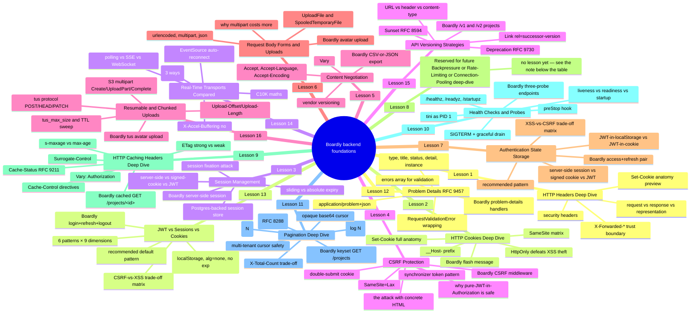
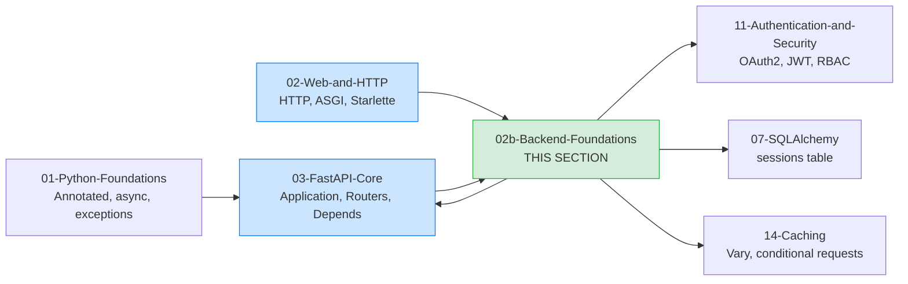

# Backend Foundations: Map of Content

**Bookmark this page.**

This is the **home base** for Section 02b — Backend Foundations. Every lesson in this folder, every concept, every reference back to the rest of the vault — all reachable from here. When you get lost, come back to the MOC.

Hello, friend. Pull up a chair.

You have, *or you are about to*, build the skeleton of a FastAPI service in [[03-FastAPI-Core/Application-and-Lifespan|Section 03]]: a `FastAPI()` instance, a `lifespan`, a `/healthz` endpoint, routers, dependencies, middleware, exception handlers, background tasks. You can ship a working API. The thing is — when you ship it to real users on real browsers, the cracks start at the boundary between "your Python code" and "the HTTP that travels over the wire." That boundary is *backend primitives*: cookies, headers, sessions, CSRF tokens, content negotiation, form parsing, file uploads, and where to store the user's logged-in state.

Other sections treat these as background. Section 02 sketches HTTP headers in one table. Section 11 uses cookies for OAuth2 flows without explaining what a `Set-Cookie` header actually contains. Section 03 mounts an `UploadFile` for an avatar without explaining why `multipart/form-data` has the overhead it does. That works, until it doesn't — and "until it doesn't" usually arrives at 2 a.m. on a Saturday when your support engineer messages you: "users on Safari can't log in, the cookie just disappears."

That message is what this section exists to prevent.

In the next fifteen lessons we go *deep* on the fifteen backend primitives that bite production services — seven foundational primitives (cookies, headers, sessions, CSRF, content negotiation, form parsing, file uploads, where to store the user's logged-in state), four production primitives (caching headers, health probes, pagination, problem-details), three "when to use what" comparisons (real-time transports, API versioning, JWT vs sessions vs cookies), and one resumability primitive (the tus protocol and S3 multipart). Each lesson is one concept. Each lesson is one real `Boardly` endpoint that uses that concept. Each lesson is line-by-line — every header byte, every cookie attribute, every `multipart` boundary, every signed-token field — explained. By the end you'll be the engineer on the team who actually understands what `SameSite=Lax` means, why `__Host-` prefixes exist, why `s-maxage` beats `max-age` once a CDN is in front, why keyset pagination is O(log N) where offset is O(N), why `application/problem+json` is the standardised error shape, why "JWT in localStorage" is the most common and most attacked pattern on the web, when to use SSE vs WebSocket for a notification stream, how to ship v2 without breaking every v1 client at once, and how to resume a 4 GB upload that dropped at 80%.

**Two equally valid reading orders for this section.**

This section sits *between* Section 02 (HTTP/ASGI groundwork) and Section 11 (auth deep-dive), but it can be read **either before or after** Section 03 (FastAPI Core).

- **Read 02b *before* Section 03** if you want to understand the web platform first (cookies, sessions, CSRF, content negotiation) and *then* learn how FastAPI exposes them. The lesson code uses a `boardly/` package as a working example, but every code block is readable on its own; you do **not** need to have built the Section 03 skeleton first. Each lesson tells you what files to create from scratch if you are reading 02b standalone.
- **Read 02b *after* Section 03** if you have already shipped a `boardly/` skeleton and want to deepen the backend primitives on top of it. The lesson code then composes directly with the routers, dependencies, and middleware you already wrote in Section 03.

The Phase 2 position in the [[Complete-Learning-Roadmap]] reflects the *conceptual* prerequisite (HTTP, ASGI, headers — the Section 02 groundwork). The "Previous: Section 03" footer below reflects the *code-composition* relationship (the lessons extend the Boardly skeleton). Both readings are first-class.

**You're in the right place.**

If you've shipped a FastAPI app, but never read RFC 6265bis, never written a CSRF middleware by hand, and never had to debug why Safari drops your session cookie — this section was written for you. We'll go slow. We'll explain every byte. You'll come out the other side knowing exactly what the browser is doing.

---

## The Boardly Progression

This section adds backend-foundation pieces to the same `Boardly` API you started in Section 03. The code in each lesson is a superset of the previous lesson's code; same filenames (`boardly/main.py`, `boardly/routers/projects.py`, `boardly/routers/auth.py`) evolve across lessons, so by Lesson 16 your `Boardly` API has a cookie-based flash message, a server-side session store, a CSRF middleware, a content-negotiated CSV export, a multipart project-avatar upload, a properly-scoped access/refresh token pair, a caching-aware `/projects/{id}` endpoint, three Kubernetes health probes, a keyset-paginated `/projects` endpoint, an RFC 9457 Problem Details error envelope, a notification stream over polling/SSE/WebSocket, a `/v1`+`/v2` versioned projects endpoint with `Sunset`/`Deprecation` headers, and a tus-compatible resumable avatar upload that survives a network drop at any byte offset.

Fifteen lessons. One growing application. By Lesson 16 your `Boardly` API has:

- A typed set of HTTP response headers — `Cache-Control`, `Content-Security-Policy`, `Strict-Transport-Security`, `Referrer-Policy`, `X-Content-Type-Options` — applied via a security-headers middleware.
- A `flash_message` cookie (`HttpOnly`, `SameSite=Lax`, `__Host-` prefix) that survives exactly one redirect and is consumed by the next page render.
- A server-side session store backed by a `sessions` table in Postgres, with a signed session ID, sliding expiry, and a per-startup expiry sweep.
- A CSRF middleware that uses the synchronizer-token pattern for state-changing requests, with the token stored in the session.
- A `GET /projects.csv|json` endpoint that uses `Accept` to negotiate between JSON and CSV output, with `Vary: Accept` so caches key correctly.
- A `POST /projects/{id}/avatar` endpoint that accepts `multipart/form-data` with one image file, streams it through `UploadFile`, and stores it on disk.
- An access-token-in-`Authorization` + refresh-token-in-`httpOnly`-cookie pair that survives XSS without losing the "no-shared-DB-state" property of JWT.
- A `GET /projects/{id}` endpoint that emits `Cache-Control`, `Surrogate-Control`, `ETag`, `Vary: Authorization`, and `Cache-Status` (RFC 9211), and handles `If-None-Match`.
- Three Kubernetes health endpoints — `/healthz`, `/readyz`, `/startupz` — with a SIGTERM-aware lifespan that drains in-flight requests before exit.
- A `GET /projects` endpoint with keyset pagination, an opaque base64 cursor, a `Link: rel="next"` (RFC 8288) header, and an opt-in `X-Total-Count`.
- A `boardly/problems.py` module that wraps every error response — domain exceptions, `RequestValidationError`, `HTTPException`, and unhandled `Exception` — in an RFC 9457 `application/problem+json` envelope.
- A `boardly/routers/auth.py` module implementing the recommended auth pattern — short-lived access JWT in `Authorization`, long-lived opaque refresh token in an `httpOnly` + `Secure` + `SameSite=Strict` + `__Host-` cookie, with refresh-token rotation.
- A `boardly/notifications/` package exposing the same notification stream over three transports — `GET /notifications/poll` (polling), `GET /notifications/stream` (SSE), `WS /notifications/ws` (WebSocket) — sharing one Redis pub/sub fan-out, with the `Sec-WebSocket-Protocol` subprotocol auth trick and the `X-Accel-Buffering: no` SSE-buffering fix.
- A `boardly/projects/` package exposing the same `GET /projects` endpoint versioned three ways — URL path (`/v1/projects`, `/v2/projects`), header (`X-API-Version` with `Vary: X-API-Version`), content-type (`application/vnd.boardly.v2+json` with `Vary: Accept`) — with `Sunset` (RFC 8594) and `Deprecation` (RFC 9730) headers announcing v1's retirement.
- A `boardly/uploads/` package exposing a tus-compatible resumable avatar upload — `POST /uploads` to create, `HEAD /uploads/{id}` to query offset, `PATCH /uploads/{id}` to send chunks — with Redis-backed metadata, `fsync`-before-offset-update file writes, and a 24-hour TTL expiry sweep, plus the S3 multipart alternative (`POST /uploads/s3` → presigned part URLs → `POST /uploads/s3/{id}/complete`).

And you'll know *why* every line, every byte, every attribute is there.

---

## Lessons in Order

| # | Lesson | What you add to `Boardly` | Time |
|---|--------|---------------------------|------|
| 1 | [[HTTP-Headers-Deep-Dive]] | A `security_headers` middleware that sets `Strict-Transport-Security`, `Content-Security-Policy`, `X-Content-Type-Options`, `Referrer-Policy` on every response, plus a `/whoami` endpoint that echoes back request headers — and a hard look at why `X-Forwarded-For` is a trust boundary | 75–100 min |
| 2 | [[HTTP-Cookies-Deep-Dive]] | A `flash_message` cookie that carries a one-shot user-facing message across a redirect, set with `__Host-` prefix, `HttpOnly`, `Secure`, `SameSite=Lax` — and the full anatomy of the `Set-Cookie` header byte by byte | 75–100 min |
| 3 | [[Session-Management]] | A `sessions` table in Postgres, a signed session ID, sliding + absolute expiry, a session-fixation rotate on login, and a `get_session` dependency that yields the loaded session | 90–120 min |
| 4 | [[CSRF-Protection]] | A `csrf_middleware` that implements the synchronizer-token pattern, rejects state-changing requests without a valid token, and explains why your pure-JWT-in-`Authorization` API is (mostly) immune | 75–100 min |
| 5 | [[Content-Negotiation]] | A `GET /projects` endpoint that serves JSON by default and CSV when the client sends `Accept: text/csv`, with a correct `Vary: Accept` header so shared caches don't poison each other | 60–90 min |
| 6 | [[Request-Body-Forms-and-Uploads]] | A `POST /projects/{id}/avatar` endpoint that accepts `multipart/form-data` with an image file, streams it to disk via `UploadFile`, and explains why multipart costs more per request than JSON | 75–100 min |
| 7 | [[Authentication-State-Storage]] | The recommended access/refresh token pair — short-lived access token in `Authorization`, long-lived refresh token in an `httpOnly` + `Secure` + `SameSite=Strict` cookie — and the full XSS-vs-CSRF trade-off matrix | 90–120 min |
| 8 | (reserved) | _No lesson yet — see the R5-A note below._ | — |
| 9 | [[HTTP-Caching-Headers-Deep-Dive]] | A `GET /projects/{id}` endpoint that emits CDN-friendly cache headers (`Cache-Control`, `Surrogate-Control`, `ETag`, `Vary: Authorization`, `Cache-Status` per RFC 9211), handles `If-None-Match`, and avoids the cross-user cache-poisoning attack | 75–100 min |
| 10 | [[Health-Checks-and-Probes]] | Three Kubernetes probe endpoints (`/healthz`, `/readyz`, `/startupz`), a SIGTERM-aware lifespan that drains in-flight requests, the `tini` PID-1 pattern, and the `preStop` hook | 75–100 min |
| 11 | [[Pagination-Deep-Dive]] | A `GET /projects` endpoint with keyset pagination, an opaque base64 cursor, a `Link: rel="next"` header (RFC 8288), an opt-in `X-Total-Count`, and a multi-tenant-safe cursor | 75–100 min |
| 12 | [[Problem-Details-RFC-7807]] | A `boardly/problems.py` module that wraps every error response — domain, validation, framework, unhandled — in an RFC 9457 `application/problem+json` envelope; closes the dangling cross-reference from [[03-FastAPI-Core/Exception-Handlers]] Lesson 6 | 75–100 min |
| 13 | [[JWT-vs-Sessions-vs-Cookies]] | The decision tree, the 6-pattern × 9-dimension matrix, and the recommended default for browser SPA + backend API — plus the full `POST /auth/login`, `/auth/refresh`, `/auth/logout` implementation with refresh-token rotation | 90–120 min |
| 14 | [[Real-Time-Transports-Compared]] | The same notification stream implemented three ways — `GET /notifications/poll` (polling), `GET /notifications/stream` (SSE with `X-Accel-Buffering: no`), `WS /notifications/ws` (WebSocket with the `Sec-WebSocket-Protocol` auth trick) — plus the C10K maths and the decision tree | 75–100 min |
| 15 | [[API-Versioning-Strategies]] | The same `GET /projects` endpoint versioned three ways — URL path (`/v1`, `/v2`), header (`X-API-Version` with `Vary`), content-type (`application/vnd.boardly.v2+json` with `Vary: Accept`) — plus the `Sunset` (RFC 8594) and `Deprecation` (RFC 9730) headers announcing v1's retirement | 75–100 min |
| 16 | [[Resumable-and-Chunked-Uploads]] | A tus-compatible resumable avatar upload — `POST /uploads` to create, `HEAD` to query offset, `PATCH` to send chunks — with Redis-backed metadata, `fsync`-before-offset-update file writes, the `tus_max_size` limit, the TTL expiry sweep, and the S3 multipart alternative for direct-to-S3 uploads | 75–100 min |

**Note — Why Lesson 8 is skipped.**

The lesson numbering jumps from 7 to 9 because Lesson 8 is reserved for a future addition to the section. The R5-A review flagged several high-priority gaps (Backpressure, Rate-Limiting-Deep-Dive, Cron-and-Scheduled-Jobs, HTTP-Connection-Pooling-Deep-Dive); the numbering reservation prevents renumbering when one of those lessons is added.

**Tip — How to read this section**

Read the lessons **in order**. Each lesson's code is a strict superset of the previous one — same filenames evolve across lessons, so by Lesson 16 you have one coherent application, not fifteen disconnected snippets. If you skip ahead, you'll bring in dependencies you haven't built yet (e.g. CSRF needs the session from Lesson 3; the tus upload needs the auth from Lesson 13) and the code won't run.

Each lesson follows the same shape: **Learning Objectives → Prerequisites → The Problem → The Code → Line-by-Line Deep Dive → Execution Trace → Common Mistakes → Engineering Trade-Offs → Exercises → Verification → Previously Learned Here → What's Next → Sources → What We Learned**. Open the lesson in one pane and the `boardly/` source in another, side by side. Type the code yourself. Don't copy-paste. Typing is what makes it stick.

---

## How This Section Fits in the Vault

This section sits *between* the HTTP/ASGI groundwork in [[02-Web-and-HTTP/ASGI-Starlette-Uvicorn|Section 02]] and the authentication deep-dive in [[11-Authentication-and-Security/OAuth2-JWT-Access-Refresh|Section 11]]. We assume you can read an ASGI app, an `Annotated` type hint, and a Pydantic `BaseModel` — all taught in Section 01 and Section 02. We do *not* require that you have already built the `Boardly` skeleton from Section 03; each lesson's code is presented in a way that you can read it standalone, and if you *have* worked through Section 03 the `boardly/` files compose directly with what you already wrote. We do *not* assume you know what `__Host-` means, what the synchronizer-token pattern is, or why `Partitioned` cookies exist — that's what we're here for.

---

## Concepts First Taught Here

Recurring concepts first taught in this section. They each have a canonical lesson and will be reused by later sections (especially Section 11 on authentication):

- **`Cookies`** — first taught in [[HTTP-Cookies-Deep-Dive]]. The `Set-Cookie` response header anatomy, the `SameSite` matrix, `HttpOnly` and `Secure`, `__Host-` prefixes, partitioned cookies (CHIPS).
- **`Sessions`** — first taught in [[Session-Management]]. Server-side vs signed-cookie vs JWT, the session-fixation attack, sliding vs absolute expiry, concurrent session limits.
- **`CSRF`** — first taught in [[CSRF-Protection]]. The attack, the synchronizer-token pattern, the double-submit cookie, `SameSite=Lax` as a defense, the JWT-in-`Authorization` exception.
- **`HTTP Caching`** — first taught in [[HTTP-Caching-Headers-Deep-Dive]]. The `Cache-Control` directives, `s-maxage` vs `max-age`, `ETag` strong vs weak, `Vary: Authorization` poisoning, `Surrogate-Control`, `Cache-Status` (RFC 9211).
- **`Health checks`** — first taught in [[Health-Checks-and-Probes]]. Liveness vs readiness vs startup, the `/healthz`/`/readyz`/`/startupz` endpoints, graceful shutdown, `tini` PID 1, `preStop` hook.
- **`Pagination`** — first taught in [[Pagination-Deep-Dive]]. Keyset vs offset, opaque base64 cursor, `Link: rel="next"` (RFC 8288), `X-Total-Count` trade-off, multi-tenant cursor safety.
- **`Problem Details (RFC 9457)`** — first taught in [[Problem-Details-RFC-7807]]. The `application/problem+json` media type, the five required fields, the `errors` array, the `RequestValidationError` wrapping.
- **`Real-time transports (polling / SSE / WebSocket)`** — first taught in [[Real-Time-Transports-Compared]]. The four transports, the C10K maths, the `EventSource` auto-reconnect, the `Sec-WebSocket-Protocol` auth trick, the `X-Accel-Buffering: no` SSE-buffering fix. (Comparison lesson; no `first_taught_in` in frontmatter — the concept's canonical introduction lives in this comparison lesson.)
- **`API versioning (URL / header / content-type, Sunset, Deprecation)`** — first taught in [[API-Versioning-Strategies]]. URL path vs header (`X-API-Version`) vs content-type (`application/vnd.boardly.v2+json`) versioning, the `Sunset` (RFC 8594) and `Deprecation` (RFC 9730) headers, the `Link: rel="successor-version"` migration pattern. (Comparison lesson; no `first_taught_in` in frontmatter.)
- **`Resumable uploads (tus, S3 multipart)`** — first taught in [[Resumable-and-Chunked-Uploads]]. The tus protocol (POST/HEAD/PATCH, `Upload-Offset`/`Upload-Length`/`Upload-Metadata`), the S3 multipart pattern (`CreateMultipartUpload` → `UploadPart` × N → `CompleteMultipartUpload`), the `fsync`-before-offset-update file-write ordering, the TTL expiry sweep.

If a later section touches one of these, it links back here instead of re-explaining. That's the rule from [[00-Start-Here/Concept-Registry]]. After you finish this section, the canonical record for `Cookies`, `Sessions`, `CSRF`, `HTTP Caching`, `Health checks`, `Pagination`, `Problem Details`, `Real-time transports`, `API versioning`, and `Resumable uploads` will point here.

---

## Concepts Reused Here (not re-explained)

These were taught in earlier sections. We link back instead of repeating:

- `ASGI` — [[02-Web-and-HTTP/ASGI-Starlette-Uvicorn]]. The `(scope, receive, send)` triple underlies every header read and every `Set-Cookie` write.
- `Annotated` — [[01-Python-Foundations/Type-Hints-and-Annotations]]. We use `Annotated[str, Cookie(...)]` and `Annotated[str, Header(...)]` throughout.
- `BaseModel` — [[04-Pydantic/BaseModel-and-Validation]]. Pydantic models back our form parsers and our session payloads.
- `Dependency injection (FastAPI Depends)` — [[03-FastAPI-Core/Dependency-Injection]]. `get_session` and `get_current_user` are dependencies.
- `Middleware` — [[03-FastAPI-Core/Middleware-and-Request-Order]]. The security-headers middleware and the CSRF middleware both follow the onion model from that lesson.
- `FastAPI lifespan` — [[03-FastAPI-Core/Application-and-Lifespan]]. The session-expiry sweep runs in the lifespan.
- `CORS` — [[02-Web-and-HTTP/CORS-Caching-Headers-Conditional-Requests]]. Cookies + CORS interact subtly; we cover the interaction in Lesson 2.
- HTTP methods, status codes, headers (sketch level) — [[02-Web-and-HTTP/Methods-Status-Headers-Content-Types]]. Lesson 1 goes *deep* on the headers this lesson only sketches.
- Conditional requests, `ETag`, `If-None-Match` — [[02-Web-and-HTTP/CORS-Caching-Headers-Conditional-Requests]]. Lesson 1 deepens the bits this lesson introduces.

---

## Reading Paths

Not everyone has eight hours in one block. Pick a path:

### The "I just shipped v1 and got bitten" path (2 hours)

You shipped a FastAPI app, and something on the boundary broke — Safari drops a cookie, a user gets CSRF'd, a CSV export doesn't quite work. Read the lesson for the specific primitive that bit you. Each lesson is self-contained enough to read alone if you've already built a FastAPI app.

### The "I want to actually understand the web platform" path (8–10 hours)

Linear. The lessons deliberately build on each other: cookies are the substrate sessions sit on; sessions are the substrate CSRF tokens live in; CSRF tokens are what makes the recommended authentication-state pattern in Lesson 7 work without forcing you into the JWT-in-localStorage trap. Skip none of it.

**Which path are you on?**

Open a daily note and write down: which path, when you'll study each lesson, and a target completion date. If you got bitten by a specific bug in production, write down what the bug was — then read the matching lesson first, and come back for the rest. Committing to a schedule beats willpower every time.

---

## Verified Versions (October 2026)

This section targets the following versions, all verified current as of 2026-10-19:

| Package | Version | Notes |
|---------|---------|-------|
| FastAPI | 0.148.0 | Released 2026-10-19. |
| Starlette | 1.9.0 | Pinned by FastAPI. `BaseHTTPMiddleware`, `Request.cookies`, `Response.set_cookie` all live here. |
| Pydantic | v2.14.1 | Pydantic v2 only — no v1 idioms. |
| `itsdangerous` | latest (2.2.x) | Used in Lesson 3 for signing session IDs. |
| `httpx` | latest (0.28.x) | Used for the test clients in every Execution Trace. |
| Python | 3.12 | The canonical learner version (3.13 also works). |

**Warning — The browser landscape shifts.**

Cookie behavior in particular has been changing fast: Chrome's enforcement of `SameSite=None` requiring `Secure` (2020+), the gradual rollout of CHIPS / `Partitioned` cookies (2022–2024), and the third-party cookie deprecation that has been pushed back repeatedly. We cite the *current* (October 2026) behavior in each lesson. If you're reading this in 2027, double-check Chrome's status page before shipping.

---

## Reference Links

- RFC 9110 — HTTP semantics — <https://www.rfc-editor.org/rfc/rfc9110> — the canonical reference for headers, status codes, methods.
- RFC 6265bis — HTTP State Management (Cookies) — <https://httpwg.org/http-extensions/draft-ietf-httpbis-rfc6265bis.html> — the canonical cookie spec.
- RFC 7239 — `Forwarded` HTTP extension — <https://www.rfc-editor.org/rfc/rfc7239>.
- OWASP Cheat Sheet Series — <https://cheatsheetseries.owasp.org/> — CSRF, Session Management, Authentication cheat sheets.
- MDN HTTP headers reference — <https://developer.mozilla.org/en-US/docs/Web/HTTP/Headers> — readable, current, browser-tested.
- See [[21-Reference-Library/Source-Register]] for the full source list with dates accessed.

---

**Your map is ready.**

Fifteen lessons, one growing `Boardly` application, all reachable from this page. Pick a starting point and go. We'll see you on the other side.

---

**Tags:** #moc #backend #http #cookies #sessions #csrf #index #home
**Previous:** [[02-Web-and-HTTP/ASGI-Starlette-Uvicorn]] (conceptual prerequisite — HTTP/ASGI groundwork)
**Next (optional):** [[03-FastAPI-Core/Application-and-Lifespan]] — if you read 02b standalone, you may want to read Section 03 next to see how the `boardly/` skeleton is built from scratch; the lessons in 02b compose with that skeleton.
**Start:** [[HTTP-Headers-Deep-Dive]] ->
