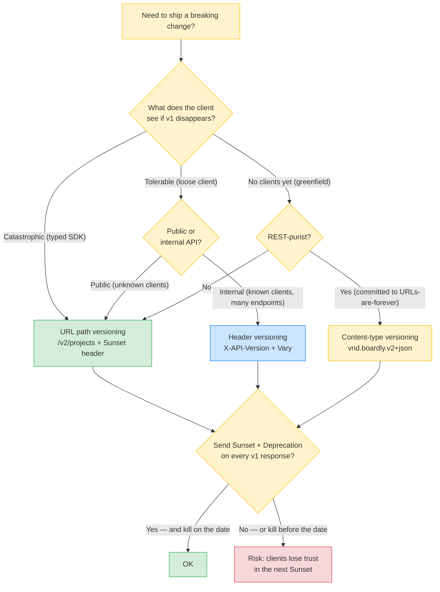
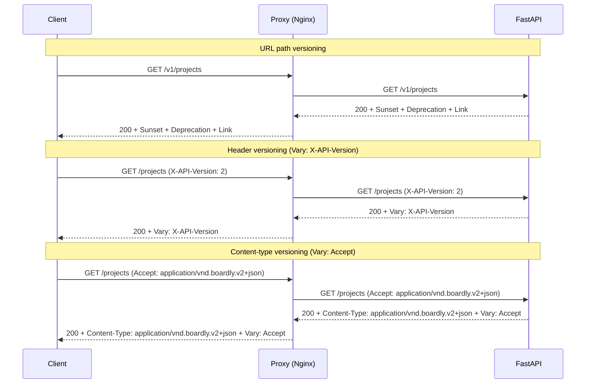
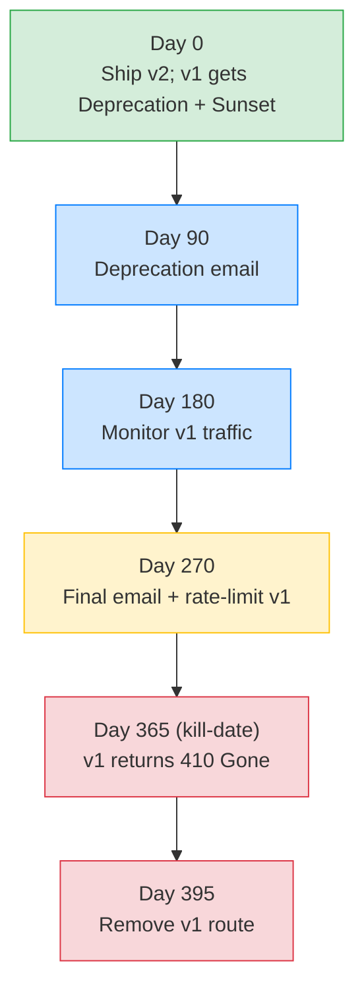
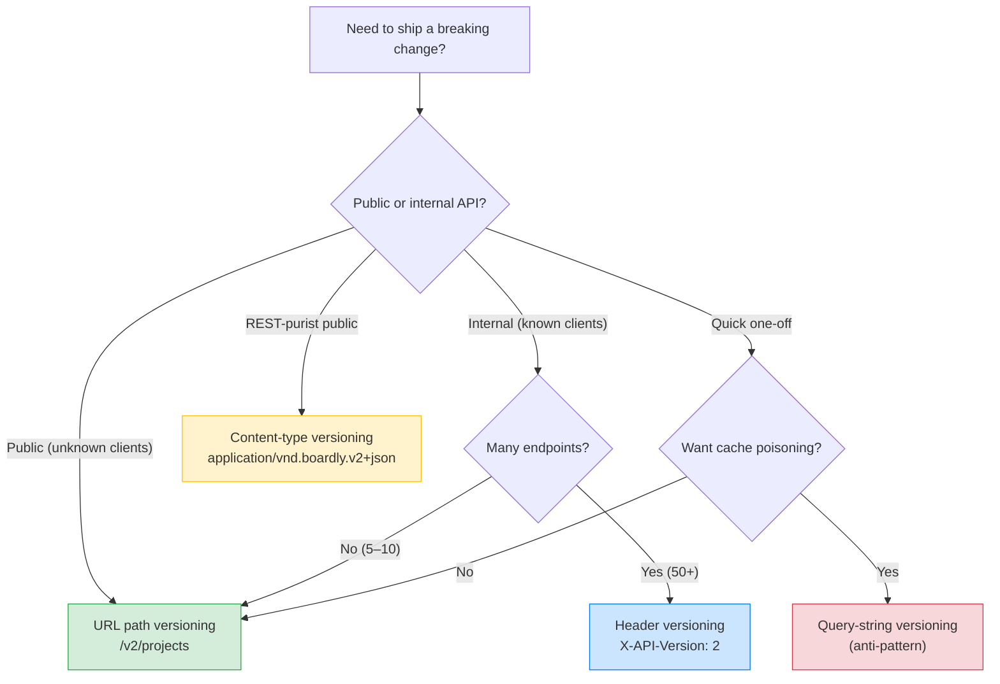

# Lesson 15: API Versioning Strategies – URL vs Header vs Content-Type

*The decision tree, the four strategies (URL path, header, content-type, query-string), the `Sunset` and `Deprecation` headers (RFC 8594 / RFC 9730), the migration patterns for running v1 and v2 side by side, and the same `Boardly` `GET /projects` endpoint versioned three ways.*

**This is the lesson your support engineer wishes you had read before shipping v2.**

Every API breaks eventually. A field changes type. A response key is renamed. A behaviour switches default. The question is never "do we break clients?" — it's "when we do, how do we minimise the pain?" The answer is the versioning strategy you pick *before* you ship v1, plus the `Sunset` and `Deprecation` headers you send before you kill v1. Today we go through the four strategies — URL path versioning, header versioning, content-type versioning, query-string versioning — the trade-off matrix (explicitness, cache-friendliness, browser-testability, log-grep-ability), the Sunset/Deprecation contract (RFC 8594 / RFC 9730), and the migration pattern (run v1 and v2 side by side for N months, announce the kill-date in headers, then sunset). By the end you'll know exactly which strategy to pick and exactly how to retire v1 without breaking every client at once.


#http #versioning #api #comparison

## Learning Objectives

By the end of this lesson you will be able to:

1. **Name the four API versioning strategies** — URL path versioning (`/v1/`, `/v2/`), header versioning (`Accept: application/vnd.boardly.v2+json` or `X-API-Version: 2`), content-type versioning (`Content-Type: application/vnd.boardly.v2+json`), query-string versioning (`?version=2`) — and explain what each one is.
2. **State the trade-off matrix** for each strategy across explicitness, cache-friendliness, browser-testability, log-grep-ability, and URL-ideal-preservation.
3. **Implement the same `GET /projects` endpoint versioned three ways** in FastAPI — URL, header, content-type.
4. **State why URL versioning is the most common despite breaking the "URLs are forever" ideal** — grep-ability in logs, testability from a browser, cache-key correctness.
5. **State when header versioning actually pays off** — internal APIs with a small number of known clients, where the URL surface stays clean.
6. **Send the `Sunset` (RFC 8594 / RFC 9730) and `Deprecation` (RFC 9730) response headers** to announce the v1 kill-date in advance.
7. **Run the migration pattern** — v1 and v2 side by side for N months, Sunset on every v1 response, 410 Gone after the kill-date, with a `Link: rel="successor-version"` pointing to v2.
8. **Classify changes as breaking or non-breaking** — adding a field is non-breaking; changing a field's type, removing a field, or changing semantics are breaking.

## Prerequisites

Before starting, you need:

- **REST and pragmatic API design** — [[02-Web-and-HTTP/REST-and-Pragmatic-API-Design]]. The lesson on URL shape, resource naming, and the "URLs are forever" ideal. This lesson deepens the versioning subsection that lesson introduces.
- **Content negotiation** — [[Content-Negotiation]]. The `Accept` header and `Vary` are the negotiation primitives header versioning and content-type versioning build on.
- **HTTP headers (general)** — [[HTTP-Headers-Deep-Dive]]. You should know what a request header is, what a response header is, and how Starlette reads them.
- **About an hour and a half.** The four strategies are simple; the migration pattern is not.
- **FastAPI 0.148.0, Starlette 1.9.0, Pydantic v2.14.1, Python 3.12** — verified October 2026.

**The three RFCs that govern this lesson.**

- **RFC 9110** — HTTP Semantics — the canonical reference for `Accept`, `Content-Type`, `Vary`, the `Link` header (RFC 8288).
- **RFC 8594 (2021)** — The Sunset HTTP Header Field — the canonical reference for announcing that a resource will be retired on a specific date. The header carries an HTTP-date.
- **RFC 9730 (2024)** — The Deprecation HTTP Header Field — the canonical reference for announcing that a resource is deprecated (may still work, but new clients should not depend on it). The header carries an HTTP-date. Sunset is "this will go away"; Deprecation is "this is already obsolete but still here." The two compose.


## Think Like a Senior Engineer

Before the four-strategy matrix, the reframe. Read this section slowly — every versioning incident in production reduces to one of the four client-contract misuses below, and every "we shipped v2 and 30% of clients broke" post-mortem reduces to a senior who skipped the questions in this section.

### The reframe: API versioning is a contract with your clients, not with your codebase

A senior engineer reading `app.include_router(v1_router)` does not ask "is URL versioning the cleanest pattern?" — that question treats the version as a code-organisation choice for the engineer. They ask "if we kill v1 tomorrow, what breaks for the client?" The version is a contract with three downstream consumers, each of which has a different migration tolerance:

1. **The client's typed SDK.** A generated SDK (from the per-version OpenAPI schema) pins the client's types to the response shape; a v1→v2 migration is a code change in the client's codebase. The senior asks: how many client-codebases will this version bump touch, and how many of them are NOT in our org?
2. **The client's retry/circuit-breaker policy.** A client that retried v1's `409 Conflict` on a uniquely-named-resource conflict may not retry v2's `422 Unprocessable` (because `422` says "the request is wrong, do not retry"). The version bump can change the status codes; the client's retry policy branches on the family. The senior asks: does v2 change any status code that v1 returned, and if yes, does the client's retry policy still do the right thing?
3. **The intermediary cache (CDN, proxy).** A v1 response cached under `GET /v1/projects` is not the same cache entry as a v2 response under `GET /v2/projects` — different URLs, different cache keys. But if the version is in a header (`X-API-Version: 2`), the cache key must include the header (`Vary: X-API-Version`), or a v2 response cached from Alice's request is served to Bob's v1 request. The senior asks: does the versioning strategy put the version in the cache key, or does it require `Vary` to do so?

The version is not "a label for the engineer." It is a three-way contract that determines what the client's SDK does on a breaking change, what the client's retry policy does on a status change, and what the CDN does on a per-version response. The "wrong" versioning strategy does not just confuse the engineer — it changes the system's behaviour at three layers.

### The three questions on the sticky note

For every `@router.get("/v2/...")` or `sunset_headers(...)` you write, ask:

1. **If we kill v1 tomorrow, what breaks?** The honest answer is "every client that hasn't read the `Sunset` header." The operational answer is "monitor v1 traffic; kill when it's < 1% of total traffic." If you do not know what fraction of your traffic is still on v1, you are not ready to kill v1.
2. **If we add v3 in six months, does v2's contract still hold?** The honest answer is "only if v2 and v3 differ in ONE breaking change, not many." The structural answer is a centralised version router with per-version Pydantic models; v3 cannot silently change v2's shape because v2's model class is frozen in the v2 router. If the answer is "I don't know, the team will figure it out then," you are not ready to ship v2.
3. **If a client sends no version identifier, what do they get?** The honest answer is "the legacy default, with a `Deprecation` header." The trap is "default to latest" — a client that hasn't been updated silently gets v2 behaviour, their parser crashes, they think the API broke. Default to the legacy version (v1) with a deprecation header; never default to the latest version (v2).

If you cannot answer all three, you are not ready to ship the version bump. The default URL-versioning + 6-month-`Sunset` pattern is the right answer until you can — and that pattern is almost always the right answer.

### The four cardinal sins (the ones that break clients in production)

The four versioning mistakes that cause real production incidents are not "I picked header versioning instead of URL" — they are "I picked a versioning strategy that broke the client's contract." Memorise these four; they are the ones that page you at 3 a.m.

| Sin | What happens | Why the client breaks |
|-----|--------------|----------------------|
| **Defaulting to the latest version when no version is specified** | A header-versioned endpoint defaults to v2 when `X-API-Version` is absent. | A client that hasn't been updated (and therefore doesn't send the header) silently gets v2 behaviour. Their parser, written for v1's `owner_id: str`, crashes on v2's `owner_ids: list[str]`. The client's error is "the API broke" — they don't know the version is their responsibility. The right default is the legacy version (v1) with a `Deprecation` header announcing the migration. |
| **Killing v1 on the v2 launch date** | v1 is replaced with `410 Gone` the moment v2 ships. | Every client that hasn't migrated breaks at the moment of the v2 launch. The migration window should be 6 months minimum (12-24 months for enterprise clients), not 0 days. The `Sunset` header is supposed to announce the kill-date in advance — not to be set to today. |
| **Forgetting `Vary` on header/content-type versioning** | A header-versioned endpoint returns `Vary: X-API-Version` on every response. | Without `Vary`, a CDN caches a v2 response (from Alice's `X-API-Version: 2` request) under the cache key `GET /projects` (no header). Bob's v1 request hits the cache, gets v2, his client crashes on `owner_ids`. The cache-poisoning is intermittent (it disappears the moment you reproduce it without the cache in front) — the worst kind of bug. |
| **Treating the `Sunset` header as documentation rather than contract** | The team sets `Sunset: Sun, 31 Mar 2026 00:00:00 GMT` on every v1 response, then forgets to kill v1 on that date. | Clients that respected the `Sunset` header migrated before the announced date; they now see v1 still running and conclude "the `Sunset` was a suggestion, not a contract." The next time you announce a `Sunset`, no one migrates — because last time the `Sunset` didn't actually mean kill. The contract is broken by your own non-enforcement. The fix is to kill on the announced date, every time, even if v1 traffic is non-zero (with a documented exception process for critical clients). |

**Warning — When this breaks: `Deprecation` without `Sunset` — the unactionable deprecation**

The team ships v2 and adds `Deprecation: <today>` to every v1 response, but no `Sunset` header (because "we don't know the kill-date yet"). The client's SDK reads the `Deprecation` header, surfaces a "v1 is deprecated" warning in the client's logs, and... does nothing — the client cannot schedule the migration because the deprecation is not actionable without a kill-date. The team has shipped a de-facto permanent v1 (no kill-date = no migration pressure), and the deprecation header is documentation theatre. The contract is "deprecate today, announce the kill-date as soon as you have one, kill on the date." Sending `Deprecation` alone is the half-step that lets the team feel good about announcing the migration without committing to it. The senior question for every v1 response with `Deprecation`: *does it also have a `Sunset` header?* If not, the deprecation is theatre. The fix: never ship `Deprecation` without a `Sunset`; if you don't know the kill-date yet, hold the deprecation until you do. See [[11-Authentication-and-Security/Threat-Model-First]] for the "what does the client do with this information" pattern.


The pattern across all four: each sin is a *client-contract* mistake (default behaviour, kill-date, cache key, header enforcement), not a *URL-shape* mistake. The client branches on the contract; the contract is the load-bearing part of the versioning strategy.

### The decision tree, rephrased: the senior lens

The decision tree at the end of this lesson asks "public or internal? many endpoints? REST-purist?" — three technology questions. The senior-lens tree asks three contract questions first, then maps to the same technology answers.



Read the tree top-down. The first question — *what does the client see if v1 disappears* — is the contract decision, and it is the one that breaks clients when answered wrong. The middle questions are the technology decisions (URL vs header vs content-type), already covered by the existing decision tree. The last question — *did you send the `Sunset` header and kill on the date* — is the operational decision, and it is the one that loses client trust in your future `Sunset`s when answered wrong.

**Why is "default to latest" a sin but "default to legacy with Deprecation" not?**

Because "default to latest" silently changes the client's behaviour without the client opting in. The client's SDK was written for v1; defaulting to v2 makes the SDK's parser crash on a response it didn't expect, and the client's error is "the API broke" (because from the client's perspective, it did — they sent the same request as yesterday and got a different response). "Default to legacy with `Deprecation`" keeps the client's existing behaviour intact and adds a header announcing the migration — the client can read the header (if their SDK supports it) and migrate on their own schedule. The default is the legacy behaviour; the new behaviour requires opt-in (the client sends `X-API-Version: 2` or `Accept: application/vnd.boardly.v2+json`). The contract is "the client controls the version," not "the server surprises the client."


**Warning — The contract is the version; the URL is the implementation.**

A client SDK that branches on the contract ("send the `Sunset` header, read the `Sunset` header, migrate on the announced date") is correct. A client SDK that branches on the URL pattern ("if URL contains `/v2/`, use the new parser") is fragile — it will not handle header-versioned endpoints, content-type-versioned endpoints, or future strategies. Design your versioning so the *contract* (`Sunset` header + 6-month migration window + 410 on kill-date) holds even if the URL strategy changes. A URL-versioned v1 that is killed without a `Sunset` header is a lie to the contract-reader; a header-versioned v1 with a `Sunset` header that is killed on the announced date is honest to the contract-reader. Both are sins in different ways.


## The Problem

`Boardly` shipped `GET /v1/projects` six months ago. The endpoint returns:

```json
{
  "projects": [
    {"id": "p_01", "name": "Project Alpha", "owner_id": "u_01"}
  ]
}
```

A new requirement arrives: projects can now have multiple owners (a team, not a single user). The `owner_id` field needs to become `owner_ids: []`. That's a breaking change — clients parsing `owner_id` as a string will break when it becomes an array, and clients reading `owner_id` won't find the new `owner_ids` field. Three options:

1. **Don't version.** Just change the response. Every client breaks at the same moment. You ship at midnight and hope.
2. **Version the endpoint.** Ship `/v2/projects` with `owner_ids`. Keep `/v1/projects` with `owner_id` running in parallel for N months. Announce the kill-date of v1 in the response headers. Kill v1 on the kill-date.
3. **Use the GraphQL approach.** Don't version; make the change additive only. Keep `owner_id` as the first element of the owners array; add `owner_ids` as the new field; never break a field. This is Stripe's contract — backwards compat forever, only deprecate, never break. It's a valid approach but it's not what most teams can sustain operationally; it requires discipline and a contract with clients that says "we will never break."

For most teams, option 2 is the right answer — version the endpoint, run v1 and v2 side by side, sunset v1 with headers, kill it on the kill-date. The question is: which versioning *strategy* — URL path, header, content-type, or query-string?

The four strategies differ on five axes:

- **Explicitness.** Is the version visible in the request URL/headers, or is it implicit (a default)?
- **Cache-friendliness.** Does the version affect the cache key? (URL path: yes, naturally. Header: yes, if `Vary` is set correctly. Query-string: yes. Content-type: yes, if `Vary: Content-Type` is set.)
- **Browser-testability.** Can you paste the URL in a browser to test it? (URL: yes. Header: no — needs `curl` or a browser extension. Content-type: no — same. Query-string: yes.)
- **Log-grep-ability.** Can you `grep "GET /v2/" access.log` to see all v2 traffic? (URL: yes. Header: no — the version is in a header, not the URL; most log formats don't include headers. Query-string: yes. Content-type: no.)
- **URL-ideal-preservation.** The REST ideal is "URLs are forever" — the URL for a resource should not change. URL versioning breaks this ideal (`/v1/projects` and `/v2/projects` are the same resource at different URLs). Header versioning preserves it. Content-type versioning preserves it.

**Why is URL versioning the most common despite breaking URL ideals?**

Because it wins on every other axis. **Explicitness:** the version is in the URL, visible to every client, every proxy, every log line. **Cache-friendliness:** the version is naturally part of the cache key — different versions are different URLs are different cache entries, no `Vary` needed. **Browser-testability:** paste `https://api.boardly.dev/v2/projects` in a browser, see the response. **Log-grep-ability:** `grep "GET /v2/" access.log` shows all v2 traffic in one command. The cost is the URL-ideal break — `/v1/projects` and `/v2/projects` are the same resource at different URLs, which offends REST purists. The operational reality is that grep-ability and testability win. Most public APIs in 2026 use URL versioning — GitHub, Stripe, Twitter, AWS — because the operational benefits outweigh the URL-ideal cost. Header versioning is more common for internal APIs where the URL surface is small and the clients are known.


## The Code

The same `GET /projects` endpoint is built three ways here — once with URL path versioning, once with header versioning, once with content-type versioning. Each implementation lives in a separate router module so you can compare them side by side. The shared infrastructure — the projects service, the v1 and v2 response models, the `Sunset`/`Deprecation` helper — is identical across all three.

```python
# boardly/projects/__init__.py
"""Boardly projects API — three versioning strategies.

Lesson 15: URL path, header, content-type. Same projects service; two
response shapes (v1 with owner_id, v2 with owner_ids); three routers
that expose the same endpoint three different ways.
"""
from .url import router as url_router        # GET /v1/projects, /v2/projects
from .header import router as header_router   # GET /projects with X-API-Version
from .content_type import router as ct_router  # GET /projects with Accept negotiation

__all__ = ["url_router", "header_router", "ct_router"]
```

```python
# boardly/projects/models.py
"""Shared v1/v2 response models and the Sunset/Deprecation helpers."""
from __future__ import annotations

from datetime import date, datetime, timezone
from typing import Literal

from pydantic import BaseModel, Field


class ProjectV1(BaseModel):
    """v1 response shape — single owner_id field."""
    id: str
    name: str
    owner_id: str


class ProjectV2(BaseModel):
    """v2 response shape — owner_ids array (multi-owner support)."""
    id: str
    name: str
    owner_ids: list[str] = Field(default_factory=list)


class ProjectsListV1(BaseModel):
    projects: list[ProjectV1]


class ProjectsListV2(BaseModel):
    projects: list[ProjectV2]


def sunset_headers(
    *,
    sunset_date: date | None = None,
    deprecation_date: date | None = None,
    successor: str | None = None,
    link_rel: str = "successor-version",
) -> dict[str, str]:
    """Build the Sunset/Deprecation/Link headers announcing v1's retirement.

    Per RFC 8594 (Sunset) and RFC 9730 (Deprecation):

      Sunset: Sun, 30 Mar 2026 00:00:00 GMT
      Deprecation: Sun, 01 Dec 2025 00:00:00 GMT
      Link: <https://api.boardly.dev/v2/projects>; rel="successor-version"

    `Sunset` says "this resource will be unavailable on or after this date."
    `Deprecation` says "this resource is deprecated; avoid using it in new code."
    The two compose — Deprecation goes up first (months before Sunset),
    then Sunset announces the kill-date, then the resource is removed.
    """
    headers: dict[str, str] = {}
    if sunset_date is not None:
        # RFC 8594: the header is an HTTP-date in the IMF-fixdate format.
        sunset_dt = datetime.combine(sunset_date, datetime.min.time(), tzinfo=timezone.utc)
        headers["Sunset"] = sunset_dt.strftime("%a, %d %b %Y %H:%M:%S GMT")
    if deprecation_date is not None:
        deprecation_dt = datetime.combine(deprecation_date, datetime.min.time(), tzinfo=timezone.utc)
        headers["Deprecation"] = deprecation_dt.strftime("%a, %d %b %Y %H:%M:%S GMT")
    if successor is not None:
        headers["Link"] = f'<{successor}>; rel="{link_rel}"'
    return headers


# The date v1 is being retired — announced in every v1 response via Sunset.
V1_SUNSET_DATE = date(2026, 3, 31)
V1_DEPRECATION_DATE = date(2025, 12, 1)
```

That's the shared layer. Now the three strategies.

### Strategy 1: URL path versioning

```python
# boardly/projects/url.py
"""URL path versioning — GET /v1/projects, GET /v2/projects.

Most common strategy. The version is in the URL path. Different versions are
different URLs are different cache keys. Grep-able in logs. Testable from a
browser. The cost: the REST "URLs are forever" ideal — /v1/projects and
/v2/projects are the same resource at different URLs.
"""
from __future__ import annotations

from fastapi import APIRouter, Depends, Request
from fastapi.responses import JSONResponse

from ..auth import get_current_user
from .models import (
    ProjectsListV1,
    ProjectsListV2,
    V1_DEPRECATION_DATE,
    V1_SUNSET_DATE,
    sunset_headers,
)

router = APIRouter(tags=["projects-url"])


def _fetch_projects_v1(user_id: str) -> ProjectsListV1:
    """Stub — real Boardly would query the projects table."""
    return ProjectsListV1(projects=[])


def _fetch_projects_v2(user_id: str) -> ProjectsListV2:
    """Stub — same data, v2 shape (owner_ids instead of owner_id)."""
    return ProjectsListV2(projects=[])


@router.get("/v1/projects", response_model=ProjectsListV1)
async def list_projects_v1(
    request: Request,
    user: Annotated[dict, Depends(get_current_user)],
) -> JSONResponse:
    """v1 endpoint — returns the legacy owner_id shape.

    Announces the deprecation (Deprecation header) and the kill-date (Sunset
    header) on every response. Clients that respect RFC 8594 / RFC 9730 can
    surface warnings to their users and migrate before the kill-date.
    """
    body = _fetch_projects_v1(user["sub"])
    headers = sunset_headers(
        sunset_date=V1_SUNSET_DATE,
        deprecation_date=V1_DEPRECATION_DATE,
        successor=str(request.url.replace(path="/v2/projects", query="")),
    )
    return JSONResponse(content=body.model_dump(mode="json"), headers=headers)


@router.get("/v2/projects", response_model=ProjectsListV2)
async def list_projects_v2(
    user: Annotated[dict, Depends(get_current_user)],
) -> ProjectsListV2:
    """v2 endpoint — returns the new owner_ids shape.

    No Sunset/Deprecation headers — this is the current version.
    """
    return _fetch_projects_v2(user["sub"])
```

**The `user` dict shape is canonical across this vault.**

`get_current_user` returns `{"sub": str, "id": int, "email": str}` — see
[[11-Authentication-and-Security/OAuth2-JWT-Access-Refresh]] for the
claim shape. The `user["sub"]` accesses above are the canonical access
pattern (a string per RFC 7519, used as the per-user cache key here).


That's 50 lines. The v1 endpoint at `/v1/projects` returns the legacy `owner_id` shape and announces its retirement in the response headers. The v2 endpoint at `/v2/projects` returns the new `owner_ids` shape. Different URLs, different cache keys, grep-able in logs.

### Strategy 2: Header versioning

```python
# boardly/projects/header.py
"""Header versioning — GET /projects with X-API-Version: 1|2.

Clean URLs — the version is in a custom request header. The cost: the version
is invisible in the URL (so you can't paste it in a browser to test it), and
the version is invisible in the access log (so observability depends on the
log format including headers — most don't). Best for internal APIs with a
small number of known clients.
"""
from __future__ import annotations

from typing import Annotated

from fastapi import APIRouter, Depends, Header, HTTPException, Request, status
from fastapi.responses import JSONResponse

from ..auth import get_current_user
from .models import (
    ProjectsListV1,
    ProjectsListV2,
    V1_DEPRECATION_DATE,
    V1_SUNSET_DATE,
    sunset_headers,
)

router = APIRouter(tags=["projects-header"])


@router.get("/projects", response_model=None)  # response_model=None so we can return either
async def list_projects(
    request: Request,
    user: Annotated[dict, Depends(get_current_user)],
    x_api_version: Annotated[int | None, Header(alias="X-API-Version")] = None,
) -> JSONResponse:
    """Single endpoint; version chosen by the X-API-Version request header.

    Defaults to v1 (the legacy default) if the header is absent. This is the
    key trade-off of header versioning — the URL is the same for both versions,
    so the cache key must include the header. We set `Vary: X-API-Version` so
    intermediate caches do not serve a v1 response to a v2 client (or vice
    versa).
    """
    version = x_api_version or 1  # default to v1 for legacy clients

    if version == 1:
        body = _fetch_projects_v1(user["sub"])
        headers = sunset_headers(
            sunset_date=V1_SUNSET_DATE,
            deprecation_date=V1_DEPRECATION_DATE,
            # The successor is the same URL with a different header — clients
            # must already understand header versioning to use this.
            successor=str(request.url),
        )
        headers["Vary"] = "X-API-Version"
        return JSONResponse(content=body.model_dump(mode="json"), headers=headers)

    if version == 2:
        body = _fetch_projects_v2(user["sub"])
        return JSONResponse(
            content=body.model_dump(mode="json"),
            headers={"Vary": "X-API-Version"},
        )

    raise HTTPException(
        status_code=status.HTTP_400_BAD_REQUEST,
        detail=f"Unsupported API version: {version}. Supported: 1, 2.",
    )


def _fetch_projects_v1(user_id: str) -> ProjectsListV1:
    return ProjectsListV1(projects=[])


def _fetch_projects_v2(user_id: str) -> ProjectsListV2:
    return ProjectsListV2(projects=[])
```

That's 60 lines. The single `/projects` endpoint inspects the `X-API-Version` request header to pick the version. The `Vary: X-API-Version` response header tells caches to key the response by that header — otherwise a v2 response cached for Alice would be served to Bob's v1 request (a per-version cache-poisoning analog of the `Vary: Authorization` attack from [[HTTP-Caching-Headers-Deep-Dive]]).

### Strategy 3: Content-type versioning

```python
# boardly/projects/content_type.py
"""Content-type versioning — GET /projects with Accept negotiation.

The version is encoded in the media type — `application/vnd.boardly.v1+json`
or `application/vnd.boardly.v2+json`. Same URL, same `Accept` header slot, but
the value carries the version. The vendor-media-type pattern (`vnd.` prefix)
is the IANA-registered way to register a custom media type for your API.
"""
from __future__ import annotations

from typing import Annotated

from fastapi import APIRouter, Depends, HTTPException, Header, Request, status
from fastapi.responses import JSONResponse

from ..auth import get_current_user
from ..content_negotiation import pick_media_type
from .models import (
    ProjectsListV1,
    ProjectsListV2,
    V1_DEPRECATION_DATE,
    V1_SUNSET_DATE,
    sunset_headers,
)

router = APIRouter(tags=["projects-content-type"])


V1_MEDIA_TYPE = "application/vnd.boardly.v1+json"
V2_MEDIA_TYPE = "application/vnd.boardly.v2+json"


@router.get("/projects", response_model=None)
async def list_projects(
    request: Request,
    user: Annotated[dict, Depends(get_current_user)],
    accept: Annotated[str | None, Header(alias="Accept")] = None,
) -> JSONResponse:
    """Single endpoint; version chosen by the Accept request header.

    The client sends `Accept: application/vnd.boardly.v2+json` and gets the
    v2 response back with `Content-Type: application/vnd.boardly.v2+json`.
    If the client sends no Accept header (or a generic `application/json`),
    we default to v1 for backward compatibility.
    """
    # Use the typed `Header(alias="Accept")` form so FastAPI validates and
    # injects the header for us — pulling it from `request.headers` directly
    # bypasses FastAPI's typed-header mechanism and is a footgun for learners
    # (see [[HTTP-Headers-Deep-Dive]] for the canonical pattern).
    accept = accept or ""

    picked = pick_media_type(accept, [V2_MEDIA_TYPE, V1_MEDIA_TYPE, "application/json", "*/*"])
    if picked == V2_MEDIA_TYPE:
        body = _fetch_projects_v2(user["sub"])
        return JSONResponse(
            content=body.model_dump(mode="json"),
            headers={
                "Content-Type": V2_MEDIA_TYPE,
                # `Vary: Accept` so caches key by the negotiated representation.
                # See [[HTTP-Caching-Headers-Deep-Dive]] for the Vary reasoning.
                "Vary": "Accept",
            },
        )

    if picked in (V1_MEDIA_TYPE, "application/json", "*/*"):
        body = _fetch_projects_v1(user["sub"])
        headers = sunset_headers(
            sunset_date=V1_SUNSET_DATE,
            deprecation_date=V1_DEPRECATION_DATE,
            successor=str(request.url),
        )
        headers["Content-Type"] = V1_MEDIA_TYPE
        headers["Vary"] = "Accept"
        return JSONResponse(content=body.model_dump(mode="json"), headers=headers)

    # The client asked for a media type we don't support — return 406 Not
    # Acceptable, ideally as a Problem Details response (RFC 9457).
    raise HTTPException(
        status_code=status.HTTP_406_NOT_ACCEPTABLE,
        detail=(
            f"Unsupported media type in Accept header. "
            f"Supported: {V1_MEDIA_TYPE}, {V2_MEDIA_TYPE}, application/json."
        ),
    )


def _fetch_projects_v1(user_id: str) -> ProjectsListV1:
    return ProjectsListV1(projects=[])


def _fetch_projects_v2(user_id: str) -> ProjectsListV2:
    return ProjectsListV2(projects=[])
```

That's 70 lines. The `/projects` endpoint negotiates the version from the `Accept` request header. The client sends `Accept: application/vnd.boardly.v2+json`; the server responds with `Content-Type: application/vnd.boardly.v2+json`. The `Vary: Accept` header tells caches to key by the negotiated representation — the standard content-negotiation pattern from [[Content-Negotiation]].

```python
# boardly/main.py — wiring the three routers
"""Boardly main app — Lesson 15 wires the three versioning strategies."""
from collections.abc import AsyncIterator
from contextlib import asynccontextmanager

from fastapi import FastAPI

from .auth import auth_router
from .projects import ct_router, header_router, url_router


@asynccontextmanager
async def lifespan(app: FastAPI) -> AsyncIterator[None]:
    yield


app = FastAPI(title="Boardly", version="0.15.0", lifespan=lifespan)
app.include_router(auth_router)
app.include_router(url_router)
app.include_router(header_router)
app.include_router(ct_router)
```

That's the full skeleton. The three routers expose the same `GET /projects` endpoint three ways. Run it, then in one terminal `curl http://127.0.0.1:8000/v1/projects`, in another `curl -H "X-API-Version: 2" http://127.0.0.1:8000/projects`, in a third `curl -H "Accept: application/vnd.boardly.v2+json" http://127.0.0.1:8000/projects`. Same data, three strategies.

## Line-by-Line Deep Dive

We'll go through each strategy's load-bearing pieces — the parts where the choice between URL, header, and content-type shows up.

### URL path versioning: the explicit URL

```python
@router.get("/v1/projects", response_model=ProjectsListV1)
async def list_projects_v1(...) -> JSONResponse:
    body = _fetch_projects_v1(user["sub"])
    headers = sunset_headers(
        sunset_date=V1_SUNSET_DATE,
        ...
        successor=str(request.url.replace(path="/v2/projects", query="")),
    )
    return JSONResponse(content=body.model_dump(mode="json"), headers=headers)
```

**What it does:** registers `/v1/projects` as a route, returns the v1 response shape with Sunset/Deprecation/Link headers announcing the retirement.

**Why the URL path is the load-bearing piece:** the version is in the URL. Different versions are different routes. Different routes are different cache keys (no `Vary` needed). Different routes are different log lines (`grep "GET /v1/" access.log` shows all v1 traffic). Different routes are different URLs you can paste in a browser to test. The explicitness is the value.

**Why the `successor` field uses URL replacement:** the v1 response includes a `Link: <https://api.boardly.dev/v2/projects>; rel="successor-version"` header pointing to the v2 URL. The client's SDK can read this header and warn the developer "v1 is deprecated; migrate to v2 at <URL>." The `request.url.replace(path="/v2/projects", ...)` builds the v2 URL from the v1 URL — preserving the host, scheme, and query params.

**Tip — The `rel="successor-version"` and `rel="latest-version"` link relations.**

RFC 9730 mentions two relevant link relations: `successor-version` (the immediate next version) and `latest-version` (the newest version available). Use both — `successor-version` lets the client walk the version chain one step at a time; `latest-version` lets them jump to the current version directly. The `Link` header can carry both: `Link: <https://api.boardly.dev/v2/projects>; rel="successor-version", <https://api.boardly.dev/v2/projects>; rel="latest-version"`.


**Danger — How an attacker thinks: the `request.url.replace` host-header injection in the `Link` successor**

The v1 endpoint builds the v2 successor URL via `str(request.url.replace(path="/v2/projects", query=""))`. The `request.url` is derived from the incoming HTTP request's `Host` header (Starlette trusts the `Host` header unless Uvicorn is started with `--proxy-headers` behind a trusted upstream that overwrites `Host`). An attacker who reaches the app directly (bypassing the proxy, e.g., via the cloud provider's metadata network or a misconfigured `NodePort` that exposes the pod's port to the public internet) sends `Host: attacker.com` against `GET /v1/projects`; the response's `Link: <http://attacker.com/v2/projects>; rel="successor-version"` header points to the attacker's domain. A client SDK that reads the `Link` header to "auto-migrate" follows the link and sends its credentials (the `Authorization: Bearer <token>`) to the attacker. The defence is structural: (1) build the successor URL from a server-side configuration constant, not from `request.url` — `BOARDLY_PUBLIC_BASE_URL = "https://api.boardly.dev"` read from environment, with the v2 URL built as `f"{BOARDLY_PUBLIC_BASE_URL}/v2/projects"`; (2) configure Uvicorn with `--proxy-headers` only behind a trusted proxy that overwrites `Host` (the proxy sets the canonical `X-Forwarded-Host` and Uvicorn trusts it); (3) unit-test that a request with `Host: attacker.com` produces a `Link` header pointing to the configured canonical host, not to `attacker.com`. The senior question for every endpoint that builds a URL from `request.url`: *is the request's `Host` attacker-controlled, and does the response leak that URL?* If yes, the endpoint is a host-header-injection primitive. See [[03-FastAPI-Core/Middleware-and-Request-Order]] for the `--proxy-headers` trust boundary and [[HTTP-Headers-Deep-Dive]] for the `Host` header's role in URL reconstruction.


### Header versioning: the `Vary` requirement

```python
headers["Vary"] = "X-API-Version"
return JSONResponse(content=body.model_dump(mode="json"), headers=headers)
```

**What it does:** sets `Vary: X-API-Version` on every response.

**Why this matters:** without `Vary: X-API-Version`, a CDN can serve a v2 response (cached from Alice's `X-API-Version: 2` request) to Bob's v1 request — the cache key is just `GET /projects`, and the cached response is whatever the most recent requestor got. The result: Bob asks for v1, gets v2, his client crashes on `owner_ids` not being there. The `Vary: X-API-Version` tells the cache "the response depends on the `X-API-Version` request header; include it in the cache key."

This is the same `Vary` pattern from [[HTTP-Caching-Headers-Deep-Dive]] — `Vary: Authorization` for per-user responses, `Vary: Accept` for content-negotiated responses, `Vary: X-API-Version` for header-versioned responses. The cost is request coalescing: the CDN cannot serve one cached response to multiple concurrent identical requests, because each `X-API-Version` is a separate cache key. For low-volume internal APIs that's fine; for high-volume public APIs the per-version cache duplication is a real cost.

**Warning — The hidden cost of header versioning: cache coalescing.**

With URL versioning, 1 000 clients hitting `GET /v2/projects` is one cache entry. With header versioning, 1 000 clients hitting `GET /projects` with `X-API-Version: 2` is one cache entry per unique header value — typically 2 (v1 and v2) — but the cache cannot coalesce concurrent identical requests because each `X-API-Version` is a separate cache key. For most workloads this is invisible; for very-high-volume public APIs the cost is real. Prefer URL versioning for public APIs where the CDN cost matters; header versioning for internal APIs where it doesn't.


**Production reality: the CDN coalescing collapse at high QPS — when `Vary`-multiplied cache entries exceed the edge's memory budget**

The "two cache entries per URL" math (v1 and v2 under `Vary: X-API-Version`) assumes the cache has memory for both entries. At scale, the cache has a fixed memory budget (Cloudflare's edge cache is per-colo, sized per-edge-server; AWS CloudFront's edge cache is per-PoP, sized per-cache-node). A high-volume API with 500 endpoints x 2 versions = 1 000 cache entries per URL x N query-parameter variants x M `Vary` headers (`Authorization`, `Accept-Encoding`, `X-API-Version`) = O(billions) of cache entries — exceeds any edge's memory budget, and the cache starts evicting entries under LRU. The eviction is the failure mode: a v2 entry cached 1 s ago gets evicted by a flood of v1 requests (each `Vary: X-API-Version` variant is a separate entry, so a flood of v1 misses evicts the v2 entry). The client sees a v2 cache-miss rate of 50%+ (every other request goes to origin), and the origin load doubles compared to URL versioning (where v1 and v2 are different URLs with independent cache entries that don't compete). The senior question for every header-versioned API at high QPS: *does the CDN's per-edge memory budget cover the `Vary`-multiplied cache entry count, or does LRU eviction collapse the hit rate?* If the latter, switch to URL versioning — the per-version URL is a separate cache key that doesn't compete with other versions. See [[HTTP-Caching-Headers-Deep-Dive]] for the `Vary`-memory interaction and [[13-Performance-and-Observability/N-plus-1-and-Slow-Queries]] for the cache-hit-rate collapse pattern.


### Content-type versioning: the vendor media type

```python
V1_MEDIA_TYPE = "application/vnd.boardly.v1+json"
V2_MEDIA_TYPE = "application/vnd.boardly.v2+json"
```

**What it does:** defines two vendor media types — `application/vnd.boardly.v1+json` and `application/vnd.boardly.v2+json`. The `vnd.` prefix is the IANA-registered prefix for vendor-specific media types (per RFC 6838). The `+json` suffix is the structured syntax suffix — it tells clients "this is JSON, but with vendor semantics on top."

**Why this strategy exists:** it's the REST-purist position. The URL identifies the resource (`/projects`); the `Accept` header negotiates the representation; the version is part of the representation, not the resource. The same URL `/projects` serves both v1 and v2 representations; the client requests the one it wants via `Accept`. This preserves the "URLs are forever" ideal — the resource's URL never changes, only its representations evolve.

**The operational cost:** the version is invisible in the URL. You cannot `grep` access logs for "all v1 traffic" unless the log format includes the `Accept` header. You cannot paste `https://api.boardly.dev/projects` in a browser and test v2 — the browser sends `Accept: text/html` and gets a 406. The `curl` invocation is `curl -H "Accept: application/vnd.boardly.v2+json" ...` — explicit, but harder than `curl /v2/projects`.

**When does header versioning actually pay off?**

Three situations. (a) **Internal APIs with known clients.** When the clients are your own mobile app, your own SPA, your own backend service — not third-party developers — the version is part of the client-server contract, and the URL surface stays clean. `X-API-Version: 2` in the request is fine because you control both ends. (b) **APIs where the URL surface is small.** If you have 5 endpoints, URL versioning (`/v1/projects`, `/v1/users`, `/v1/orgs`) is fine. If you have 500 endpoints, URL versioning pollutes the URL space with v1/v2 prefixes on every one — header versioning keeps the URLs clean. (c) **APIs where the version is per-client, not per-endpoint.** Some APIs let each client pin a version globally (configured at the account level, not per-request). In that model, the version lives in the client's configuration, not the URL or the per-request header. Header versioning is the request-level face of that model. For most public APIs, URL versioning still wins on grep-ability and browser-testability. For internal APIs, header versioning is the cleaner choice.


**Warning — When this breaks: the `q=0` parsing edge case that silently rejects a vendor media type**

RFC 9110 section 12.5.1 says the `q` parameter is a quality value in the range `[0.001, 1.0]`, with `q=0` meaning "not acceptable." A client sending `Accept: application/vnd.boardly.v2+json;q=0.9, application/vnd.boardly.v1+json;q=0.1` is telling the server "I prefer v2, but accept v1." A naive `pick_media_type` implementation that parses `q` as a float and compares numerically will pick v2 (q=0.9 > q=0.1) — correct. But a client sending `Accept: application/vnd.boardly.v2+json;q=0, application/vnd.boardly.v1+json` is telling the server "I do NOT accept v2; send me v1." The same naive parser parses `q=0` as `0.0`, compares `0.0 > 0.1` (false), and falls through to v1 — correct. The trap is `q=0.001` (the minimum non-zero `q`): the same parser parses it as `0.001` and treats it as "grudgingly acceptable" — correct. But a parser that rounds `q` to one decimal place (a common shortcut to avoid the `q`-weighting math) treats `q=0.001` as `q=0` and rejects the media type — the client's `v2;q=0.001` is silently rejected and the response is `406 Not Acceptable`. The fix: parse `q` per RFC 9110 section 12.5.1 with three decimal places (the spec caps `q` granularity at 0.001), reject media types with `q=0` explicitly, and do not round. The grep: `rg "round.*q\\|q.*round" boardly/projects/` returns the rounding site; every match is a candidate for the `q=0.001`-treated-as-`q=0` bug. The senior question for every content-type negotiation: *does the `q` parser preserve three decimal places, or does it round?* If the latter, the negotiation is non-RFC-compliant and rejects `q=0.001` media types. See [[Content-Negotiation]] for the negotiation primitives and [[HTTP-Headers-Deep-Dive]] for the `Accept` header's `q`-weighting grammar.


### Query-string versioning: the anti-pattern

```python
# WRONG — query-string versioning
@router.get("/projects")
async def list_projects(version: int = 1) -> ...:
    ...
```

**Why it's discouraged:** query strings are *parameters of the request*, not *identifiers of the resource*. The URL `?version=2` says "give me version 2 of this resource" — but the version is not a parameter of the request; it's a property of the resource being requested. The semantic mismatch shows up in caches: `?version=1` and `?version=2` are different cache keys, but caches do not always treat query strings as part of the cache key (some strip them, some normalise them). The result is intermittent cross-version cache poisoning.

**When query-string versioning is OK:** only for *truly optional* versioning — e.g., `?legacy=true` to opt into a legacy behaviour that the server can also serve without the flag. Not for required versioning where v1 and v2 are different responses in kind.

The 02-Web-and-HTTP/REST-and-Pragmatic-API-Design lesson already flags query-string versioning as Mistake 5. This lesson deepens that: it's not just stylistically wrong, it has a concrete cache-poisoning failure mode.

## Execution Trace

Three terminals. In the first, run the server:

```bash
uv run uvicorn boardly.main:app --reload
```

Expected output:

```
INFO: Will watch for changes in these directories: ['/.../boardly']
INFO: Uvicorn running on http://127.0.0.1:8000 (Press CTRL+C to quit)
INFO: Started reloader process [1234] using StatReload
INFO: Started server process [1235]
INFO: Waiting for application startup.
INFO: Application startup complete.
```

In the second terminal, hit the v1 endpoint (URL path versioning) and inspect the headers:

```bash
ACCESS_JWT=$(curl -s -X POST http://127.0.0.1:8000/auth/login \
  -H "Content-Type: application/json" \
  -d '{"email":"bob@boardly.dev","password":"hunter2"}' | python -c "import sys, json; print(json.load(sys.stdin)['access_token'])")

curl -i -H "Authorization: Bearer $ACCESS_JWT" http://127.0.0.1:8000/v1/projects
```

Expected response (note the `Sunset`, `Deprecation`, and `Link` headers announcing v1's retirement):

```
HTTP/1.1 200 OK
content-type: application/json
sunset: Tue, 31 Mar 2026 00:00:00 GMT
deprecation: Mon, 01 Dec 2025 00:00:00 GMT
link: <http://127.0.0.1:8000/v2/projects>; rel="successor-version"
content-length: 24

{"projects":[]}
```

Hit the v2 endpoint (same strategy, no Sunset headers):

```bash
curl -i -H "Authorization: Bearer $ACCESS_JWT" http://127.0.0.1:8000/v2/projects
```

```
HTTP/1.1 200 OK
content-type: application/json
content-length: 24

{"projects":[]}
```

In the third terminal, hit the header-versioned endpoint:

```bash
curl -i -H "Authorization: Bearer $ACCESS_JWT" -H "X-API-Version: 2" http://127.0.0.1:8000/projects
```

```
HTTP/1.1 200 OK
content-type: application/json
vary: X-API-Version
content-length: 24

{"projects":[]}
```

And the content-type-versioned endpoint:

```bash
curl -i -H "Authorization: Bearer $ACCESS_JWT" -H "Accept: application/vnd.boardly.v2+json" http://127.0.0.1:8000/projects
```

```
HTTP/1.1 200 OK
content-type: application/vnd.boardly.v2+json
vary: Accept
content-length: 24

{"projects":[]}
```

Same data, three strategies, three different header shapes.



**The three strategies all work.**

Same `GET /projects`, three strategies, three header shapes. The difference is explicitness (URL > header > content-type), cache-friendliness (URL > content-type ≈ header), browser-testability (URL > header ≈ content-type), and URL-ideal-preservation (header ≈ content-type > URL). Pick based on what your operational reality needs.


## Common Mistakes

### Mistake 1: Killing v1 before clients migrate

```python
# WRONG — kill v1 immediately on v2 launch
@router.get("/v1/projects")
async def list_projects_v1() -> ...:
    raise HTTPException(status_code=410, detail="v1 is gone; use v2")
```

**Symptom:** every client that hasn't migrated yet breaks at the moment of the v2 launch. Your support inbox fills with "my integration broke."

**Why:** clients need time to migrate. Even with the Sunset header announcing the kill-date, some clients will not have read it, some will have read it but not had time to migrate, some will have migrated but have a fallback path that hits v1.

**Fix:** run v1 and v2 in parallel for at least 3–6 months. Announce the kill-date in the `Sunset` header on every v1 response. Send a deprecation email to registered API consumers 90 days before the kill-date. Kill v1 on the kill-date with `410 Gone` and a `Link: rel="successor-version"` pointing to v2.

### Mistake 2: Forgetting `Vary` on header or content-type versioning

```python
# WRONG — header versioning without Vary
@router.get("/projects")
async def list_projects(x_api_version: int = 1) -> ...:
    if x_api_version == 1:
        return _v1_response()
    return _v2_response()
```

**Symptom:** a CDN caches a v2 response (from Alice's `X-API-Version: 2` request) under the cache key `GET /projects` (no header). Bob's v1 request hits the cache and gets the v2 response — his client crashes on `owner_ids`.

**Why:** the cache key is `GET /projects` (just the URL). The version is in the request header, which is not part of the cache key by default. The CDN serves whatever was cached last.

**Fix:** set `Vary: X-API-Version` on every response. The CDN then includes the header in the cache key — `GET /projects X-API-Version: 1` and `GET /projects X-API-Version: 2` are separate cache entries.

**Warning — `Vary` is the cache-poisoning defence.**

Every versioning strategy that does not put the version in the URL requires `Vary` to make the version part of the cache key. URL versioning: no `Vary` needed (different URLs are different cache keys). Header versioning: `Vary: X-API-Version`. Content-type versioning: `Vary: Accept`. Query-string versioning: `Vary: version` (and pray the cache respects it). Forgetting `Vary` causes intermittent cross-version cache poisoning — the worst kind of bug, because it disappears the moment you reproduce it without the cache in front. See [[HTTP-Caching-Headers-Deep-Dive]] for the `Vary: Authorization` analog.


### Mistake 3: Backward-incompatible change in a non-breaking disguise

```python
# v2 endpoint that "just adds" a field, but also renames one
class ProjectV2(BaseModel):
    id: str
    name: str
    owner_ids: list[str]  # NEW
    # ... wait, we also removed owner_id
```

**Symptom:** you shipped v2 thinking it was non-breaking (you only added fields), but you also renamed `owner_id` to `owner_ids`. Clients that parsed `owner_id` as a string now find the field missing — they crash on `KeyError: 'owner_id'`.

**Why:** "adding a field is non-breaking" is only true if you *only add* — you do not also rename, remove, or change the type of existing fields. The classification is strict: any field that disappears, changes type, or changes semantics is a breaking change.

**Fix:** if you want to be truly non-breaking, add `owner_ids` as a new field and keep `owner_id` (returning the first element of `owner_ids` for backward compat). If you want to remove `owner_id`, ship it as v2 — that's exactly what versioning is for. Don't dress a breaking change as a non-breaking addition.

### Mistake 4: Sending `Sunset` after the kill-date

```python
# WRONG — Sunset date is in the past
V1_SUNSET_DATE = date(2025, 6, 1)  # but it's already 2026-10-19
```

**Symptom:** the `Sunset` header has a date in the past. Clients that respect RFC 8594 see the header and treat v1 as already sunset — they may stop calling it immediately, breaking integrations that haven't migrated.

**Why:** the `Sunset` header is supposed to announce a *future* kill-date. A past date says "this is already gone," which is not what you want while v1 is still running.

**Fix:** set the `Sunset` date 3–6 months in the future from the moment you ship the deprecation. Update it if the date slips — but never set it to a past date while v1 is still running. After the kill-date, replace v1 with `410 Gone` and a `Link: rel="successor-version"`.

**Danger — How an attacker thinks: the cached stale-`Sunset` response as a premature-migration primitive**

An attacker who can poison a CDN cache entry (via the missing-`Vary` vulnerability covered in Mistake 2, or via a cache-key-injection vulnerability that lets them overwrite a cache entry) plants a v1 response with `Sunset: <date-in-the-past>` (or `Sunset: <today>`). The client SDK that respects RFC 8594 reads the `Sunset` header, sees "v1 is sunset today," and triggers the auto-migration to v2 prematurely — possibly before the team has rolled out the v2 security patch (the v1 patch was a CVE fix applied last week; the v2 fix is still in the pipeline). The downgrade is the attack: v1 is patched, v2 is not, and the cached stale-`Sunset` header forces the client to v2 where the CVE is still exploitable. The defence is layered: (1) the client SDK treats the `Sunset` header as a hint, not a trigger — it warns the developer but does not auto-migrate (the developer's release cadence is the migration gate); (2) the server never caches the `Sunset` header past the kill-date — when the kill-date passes, v1 returns `410 Gone` (no `Sunset` header on a 410), so the cached stale-`Sunset` entry is a cache-miss; (3) the CDN is configured to evict cache entries when the `Sunset` date passes (a Cloudflare Worker that inspects the `Sunset` header and sets a TTL accordingly). The senior question for every versioned API with auto-migrating client SDKs: *does the client auto-migrate on `Sunset`, or warn the developer?* Auto-migration is a downgrade primitive when the cache is poisoned. See [[HTTP-Caching-Headers-Deep-Dive]] for the cache-poisoning-as-attack-vector pattern and [[11-Authentication-and-Security/OWASP-API-Top-10]] for the API8:2023 Security Misconfiguration entry on stale cache entries.


### Mistake 5: Letting v1 and v2 drift in behaviour

```python
# WRONG — v1 and v2 have subtly different pagination defaults
@router.get("/v1/projects")
async def list_v1(limit: int = 100) -> ...:  # default 100
    ...

@router.get("/v2/projects")
async def list_v2(limit: int = 50) -> ...:  # default 50
    ...
```

**Symptom:** a client migrating from v1 to v2 sends the same requests and gets different responses (different page size, different default sort, different error messages). The migration breaks in subtle ways.

**Why:** v1 and v2 should differ only in the *breaking* change that justified the version bump. Everything else — pagination defaults, error formats, status codes, header conventions — should be identical. If v2 changes pagination too, it's two breaking changes disguised as one.

**Fix:** keep v1 and v2 behaviourally identical except for the specific breaking change. If you need to change pagination too, ship that as v3 (or as a non-breaking addition: a new `page_size` query param that defaults to the old behaviour).

### Mistake 6: Using query-string versioning

```python
# WRONG — query-string versioning
@router.get("/projects")
async def list_projects(version: int = 1) -> ...:
    ...
```

**Symptom:** intermittent cross-version cache poisoning. Some CDNs strip the query string from the cache key; some normalise it; some respect it. The result: depending on which CDN edge a client hits, they may get v1 cached from a v2 request or vice versa.

**Why:** query strings are parameters of the request, not identifiers of the resource. The version is a property of the resource, not a parameter. The semantic mismatch shows up in caches that don't treat query strings as part of the cache key.

**Fix:** use URL path versioning (`/v1/projects`, `/v2/projects`), header versioning (`X-API-Version` with `Vary`), or content-type versioning (`application/vnd.boardly.v2+json` with `Vary`). Avoid query-string versioning — it's the anti-pattern already flagged in [[02-Web-and-HTTP/REST-and-Pragmatic-API-Design]].

## Engineering Trade-Offs

### URL versioning vs header versioning vs content-type versioning: the matrix

| Axis | URL path | Header | Content-type | Query-string |
|---|---|---|---|---|
| Explicitness | High (version in URL) | Medium (version in header) | Medium (version in media type) | High (version in URL) |
| Cache-friendliness | High (URL is naturally the cache key) | Medium (requires `Vary: X-API-Version`) | Medium (requires `Vary: Accept`) | Low (caches handle query strings inconsistently) |
| Browser-testability | High (paste URL in browser) | Low (needs `curl` or extension) | Low (needs `curl` with `Accept`) | High (paste URL in browser) |
| Log-grep-ability | High (`grep "GET /v2/"`) | Low (version not in URL) | Low (version not in URL) | High (`grep "version=2"`) |
| URL-ideal-preservation | Low (different URLs for same resource) | High (same URL, different headers) | High (same URL, different representations) | High (same URL) |
| Operational simplicity | High | Medium | Low | Low |
| **Typical use** | Public APIs (GitHub, Stripe, Twitter) | Internal APIs with known clients | REST-purist public APIs (rare) | Anti-pattern — avoid |

**Why is URL versioning the most common despite breaking URL ideals?**

Because the operational benefits (grep-ability, browser-testability, cache-key correctness without `Vary`) outweigh the URL-ideal cost. The REST "URLs are forever" ideal is a 2008-era position (Roy Fielding's blog post "Don't version your APIs, evolve them") that argues versions are an admission of design failure. The operational reality is that breaking changes happen, and when they do, you need a way to run both versions in parallel — URL versioning is the simplest, most observable way to do that. Stripe, GitHub, Twitter, AWS all use URL versioning for their public APIs. Internal APIs with known clients can afford header versioning for the cleaner URL surface. Public APIs with unknown clients need the grep-ability and testability of URL versioning.


### The migration timeline

The migration from v1 to v2 is a multi-month process. The timeline:

1. **Day 0.** Ship v2 alongside v1. Both work. v1 responses start including `Deprecation: <today>` and `Sunset: <kill-date>` headers. The `Deprecation` date is today (it's deprecated as of now); the `Sunset` date is the kill-date (typically 6 months in the future).
2. **Day 0 + 90 days.** Send a deprecation email to all registered API consumers. Include the Sunset date, the successor URL, and migration documentation.
3. **Day 0 + 180 days (3 months before kill).** Start logging v1 traffic. Alert if traffic is more than X% of total traffic — clients have not migrated yet.
4. **Day 0 + 270 days (1 month before kill).** Send a final deprecation email. Increase log level on v1 traffic. Consider rate-limiting v1 to nudge stragglers.
5. **Day 0 + 365 days (kill-date).** Replace v1 with `410 Gone` and a `Link: rel="successor-version"` pointing to v2. The `Sunset` header on the 410 response confirms the date.
6. **Day 0 + 395 days (30 days after kill).** Remove the v1 route entirely. The 410 response is no longer needed; v1 is just gone.



**Tip — The 6-month minimum.**

Six months is the floor, not the ceiling. For APIs with slow-moving enterprise clients (banks, government, healthcare), the migration window is 12–24 months. For APIs with fast-moving startups, 3 months is enough. The right number is "however long it takes for v1 traffic to drop below 1% of total traffic" — monitor, don't guess. Send the Sunset header with a date 3 months *after* that point, to give stragglers a final warning.


**Production reality: the v1 traffic-metric pipeline that gates the kill decision**

The migration timeline above says "Day 180: monitor v1 traffic; alert if more than X% of total traffic." In production, that monitoring is a metrics pipeline: every v1 request increments `redis.incr("v1:requests:{date_hour}")` and every v2 request increments `redis.incr("v2:requests:{date_hour}")`; a Celery worker (or an `arq` task, or a cron) runs hourly, computes `v1_traffic_percentage = v1_requests / (v1_requests + v2_requests)`, and writes it to `redis.set("v1:traffic:percentage", value, ex=86400)`. The kill handler (Exercise 7) reads this key and only returns `410 Gone` if the value is `< 1%`. The trap is the metric's denominator: if you compute `v1_traffic_percentage = v1_requests / total_requests` where `total_requests` includes v3, v4, and unauthenticated 401 traffic, the v1 percentage is artificially deflated (a flood of unauthenticated bot traffic drops v1% to 0.1% even though every legitimate user is still on v1). The fix is to compute `v1_traffic_percentage = v1_requests / (v1_requests + v2_requests)` — only authenticated traffic to versioned endpoints is the denominator. The senior question for every v1-traffic-gated kill: *what is the denominator of the percentage, and does it exclude noise?* If the denominator includes unauthenticated traffic, the kill fires prematurely. See [[13-Performance-and-Observability/Structured-Logging-and-Request-IDs]] for the per-route metrics pipeline pattern and [[14-Caching-and-Background-Processing/Background-Tasks-vs-Workers]] for the hourly-Celery-task scheduling.


### The decision tree



Walk it. **Public or internal?** Public APIs (unknown clients, third-party developers) — go URL versioning. The grep-ability and browser-testability are worth more than the URL-ideal cost. Internal APIs (your own clients) — go to the next question. **Many endpoints?** If you have 50+ endpoints, header versioning keeps the URL surface clean. If you have 5–10, URL versioning is fine — the `/v2/` prefix on 5 URLs is not polluting. **REST-purist public?** If you are committed to the REST "URLs are forever" ideal and your clients can be expected to set custom `Accept` headers, content-type versioning is the purist choice (rare in practice). **Quick one-off?** Query-string versioning is the anti-pattern — avoid it.

**When does header versioning actually pay off?**

When you control both ends of the wire AND the URL surface is large. The first condition (control both ends) means you can rely on every client sending the right header — the version is part of the client-server contract. The second condition (large URL surface) means URL versioning's `/v2/` prefix on every endpoint pollutes the URL space more than is worth it. For a 5-endpoint internal API, URL versioning is fine. For a 500-endpoint internal API, header versioning is cleaner. The trade-off is the cache-poisoning `Vary` requirement and the loss of browser-testability — but for internal APIs the cache layer is usually under your control, and clients are not browsers.


## When This Breaks: A Senior Engineer's Debugging Guide

The Common Mistakes section catalogued the versioning errors; this section catalogues the *production failures* those errors produce when they meet a CDN, a client SDK, and a retry policy at 3 a.m. Each is symptom, diagnosis, fix — the way an on-call engineer sees them.

### Failure 1: The breaking change shipped without a version bump

**Warning — When this breaks: clients that parsed `owner_id` as a string start crashing on `owner_ids: []`**

**Symptom.** The team ships a "minor" release that renames `owner_id` to `owner_ids` on `GET /v1/projects` — the team classified it as non-breaking because "we only renamed a field." Within an hour, the support inbox fills with "my integration broke." The clients' parsers crash on `KeyError: 'owner_id'` — the field they were reading is gone.
**Diagnosis.** The breaking-change classification was not applied. The rule (from the Line-by-Line above) is: any field that disappears, changes type, or changes semantics is a breaking change. A rename is a disappearance + an addition — it is breaking. The team shipped the rename on the existing `/v1/` endpoint without bumping to `/v2/`. The pre-merge contract test (a schema diff against the previous release's OpenAPI) would have caught it; the test was missing.
**Fix.** Add a pre-merge contract test that diffs the OpenAPI schema against the previous release and fails the build if any field's type changes, any field is removed, or any field's name changes. The grep: `rg "owner_id" boardly/projects/` should return only the v1 router (where `owner_id` is the legacy field); `rg "owner_ids" boardly/projects/` should return only the v2 router. The structural fix: ship the rename as `/v2/projects` with the new `owner_ids` shape; keep `/v1/projects` with the old `owner_id` shape for the 6-month migration window; add the `Sunset` and `Deprecation` headers to every v1 response; kill v1 with `410 Gone` on the announced date. The CI lint: a check that fails the build if a route handler's response-model Pydantic class changes field types or removes fields compared to the previous release's git tag.


### Failure 2: The `Sunset` date that slipped but v1 is already returning 410

**Warning — When this breaks: clients that migrated before the announced date now see "v1 is gone"**

**Symptom.** The team announced `Sunset: Sun, 31 Mar 2026 00:00:00 GMT` on every v1 response. Engineering extended the migration by 3 months (because v1 traffic was still 5% of total at day 270). On 31 March, the kill handler unconditionally returns `410 Gone` — but the migration timeline was extended. Clients that read the `Sunset` header and migrated before 31 March are now seeing "v1 is gone" — except for the 5% of clients who didn't migrate, who are now getting 410 too. The support inbox fills with "we migrated on time, why are we seeing 410?"
**Diagnosis.** The `Sunset` date was hardcoded as a constant (`V1_SUNSET_DATE = date(2026, 3, 31)`) and the kill handler (`@router.get("/v1/projects")` returning 410) unconditionally returns 410 after that date. The actual kill decision should be driven off observed traffic, not a hardcoded date. The `Sunset` header announces the *intended* date; the actual kill is gated on `v1_traffic < 1%`.
**Fix.** Drive the kill decision off observed traffic. The `Sunset` header still announces the intended date (31 March); the kill handler checks `redis.get("v1:traffic:percentage")` (updated hourly from the metrics pipeline) and returns 410 only if the traffic is < 1%. Otherwise, the kill handler keeps returning the v1 response with the (now-stale) `Sunset` header and updates the `Sunset` header to a new date 3 months in the future. The grep: `rg "V1_SUNSET_DATE" boardly/` should return both the header-set site (the v1 router) and the kill-handler site (the 410 handler) — and the kill-handler site should be conditional on traffic. The structural fix: the `Sunset` date is a *target*, not a *trigger*; the kill is gated on observed behaviour.


### Failure 3: The header-versioned endpoint missing `Vary` — cross-version cache poisoning

**Warning — When this breaks: a CDN-cached v2 response is served to a v1 client**

**Symptom.** A header-versioned `/projects` endpoint returns the v1 shape with `X-API-Version: 1` and the v2 shape with `X-API-Version: 2`. In dev, both work. In production (behind a CDN), a v1 client request hits the CDN, gets a v2 response cached from Alice's earlier `X-API-Version: 2` request, and the client's parser crashes on `owner_ids`. The reproduction is intermittent: the bug appears at one CDN edge (the one Alice's request primed) and not at another; the bug disappears the moment you reproduce it without the CDN in front.
**Diagnosis.** The cache key is `GET /projects` (just the URL) — the version is in the request header, which is not part of the cache key by default. The CDN serves whatever was cached last (Alice's v2 response) to every subsequent request to the same URL, regardless of the request's `X-API-Version` header. The fix is `Vary: X-API-Version` on every response — the CDN then includes the header in the cache key, and `GET /projects X-API-Version: 1` and `GET /projects X-API-Version: 2` are separate cache entries.
**Fix.** Set `Vary: X-API-Version` on every response from the header-versioned endpoint. The grep: `rg "Vary.*X-API-Version\|X-API-Version.*Vary" boardly/` should return every response site for the header-versioned router. The CI lint: a check that fails the build if a header-versioned route handler returns a response without `Vary: X-API-Version`. The structural fix: a middleware that inspects every response from a versioned router and injects `Vary` automatically — the developer cannot forget it. See the existing Mistake 2 in the Common Mistakes section for the code-snippet-level fix.


### Failure 4: The content-type negotiation that silently defaults to v1 on malformed `Accept`

**Warning — When this breaks: a client sending `Accept: application/vnd.boardly.v2+json, application/json;q=0.1` gets v1**

**Symptom.** A client sends `Accept: application/vnd.boardly.v2+json, application/json;q=0.1` (intending: "I prefer v2 but accept plain JSON as a fallback"). The server returns the v1 shape, not v2. The client's parser, written for v2's `owner_ids`, crashes on v1's `owner_id`. The client's error is "the server ignored my `Accept` header."
**Diagnosis.** The `pick_media_type` function fell back to `application/json` (the lower-quality but still-acceptable option per RFC 9110 §12.5.1) and the server treats `application/json` as v1 (the default). The negotiation logic preferred the wildcard over the vendor type when both are acceptable — but the client's `q=0.1` on `application/json` was supposed to mean "only if v2 is not available," not "use this as the default." The server's `application/json = v1` mapping is the silent-default trap.
**Fix.** Parse `Accept` per RFC 9110 §12.5.1: weight by `q`, then by specificity (a vendor type is more specific than a wildcard). Vendor types take precedence over wildcards when both are acceptable AND the `q` of the vendor type is higher than the `q` of the wildcard. If the client's `Accept` cannot be satisfied (no acceptable media type is supported), reject with `406 Not Acceptable` rather than silently defaulting — the silent default is the trap. The grep: `rg "pick_media_type\|application/json" boardly/` should return the negotiation site, and `application/json` should NOT appear as a fallback default in the v1 branch. The structural fix: a unit test that asserts `Accept: application/vnd.boardly.v2+json, application/json;q=0.1` returns v2, not v1; and that `Accept: application/vnd.boardly.v3+json` returns 406 (no silent default to v1).


### Failure 5: The v1/v2 schema drift discovered by the client's parser

**Warning — When this breaks: a client migrates from v1 to v2 and their typed SDK silently truncates IDs**

**Symptom.** A client migrates from `/v1/projects` to `/v2/projects`. Their parser is happy with the response shape (the field names are the same). But the `id` field changed from `int` to `str` (Snowflake IDs, which exceed `int64` range) and the client's typed SDK silently truncates the ID to `int64`, causing ID collisions downstream. The bug is silent — no error, no exception — until the collisions manifest as "two different resources seem to be the same one."
**Diagnosis.** v2 changed a field's type but the v1 and v2 response-model Pydantic classes shared the same field name (`id`) with different types (`int` in v1, `str` in v2). The client's typed SDK was generated from the per-version OpenAPI schema, but the SDK consumer (the application code) imported `Project` from the v1 SDK and silently used it with v2 responses — the type change was not caught at compile time because the SDK consumer's code didn't pin the version explicitly.
**Fix.** Version the response-model Pydantic class strictly: `ProjectV1.id: int` and `ProjectV2.id: str`. Publish the OpenAPI schema per-version (`/v1/openapi.json` and `/v2/openapi.json`); generate the client SDK from the per-version schema; the SDK consumer imports `from boardly_v2_sdk import Project` and the type change shows up at compile time when they migrate. The grep: `rg "class ProjectV" boardly/projects/` should return both `ProjectV1` and `ProjectV2` with different `id` types. The CI test: a contract test that diffs the per-version OpenAPI schemas and fails the build if a field's type changes between versions without an explicit version bump.


## How an Attacker Thinks

A senior security engineer reading your API versioning surface looks for three things attackers love: *version enumeration via status-code distinction*, *downgrading to a vulnerable version after a CVE*, and *content-type negotiation as a downgrade attack*.

**Danger — How an attacker thinks: version enumeration via 404-vs-401**

An attacker probes `/v0/projects`, `/v1/projects`, `/v2/projects`, `/v3/projects`, `/internal/projects`, `/staging/projects`, `/beta/projects` to find undocumented versions. The server returns 404 for `/v0/` and `/v3/` (no such route), 200 for `/v1/` and `/v2/` (known routes), and 401 for `/internal/`, `/staging/`, `/beta/` (routes exist but require auth). The attacker now knows: v1 and v2 are public; v3 does not exist (yet); `/internal/`, `/staging/`, `/beta/` exist but are auth-gated. The status code is the oracle: 404 = no such route, 401 = route exists. The defence is to return 401 for every `/v\d+/*` path (and every internal path pattern) when the request is unauthenticated, regardless of whether the route exists. The 404 should be returned only after authentication, so the existence of internal versions is hidden from unauthenticated attackers. The senior question for every versioned endpoint: *does the unauthenticated response leak which versions exist?* If the unauthenticated response is 404 for some paths and 401 for others, the version set leaks. See [[11-Authentication-and-Security/OWASP-API-Top-10]] for the API8:2023 Security Misconfiguration entry on enumeration.


**Danger — How an attacker thinks: downgrading to a vulnerable version after a CVE**

An attacker knows (via a CVE disclosure) that v1 has a SQL injection in the `?filter=` parameter; v2 fixed it. The attacker's client calls `/v1/projects?filter=' OR 1=1;--` after authentication. The v1 endpoint is still running (the team kept it alive for the 6-month migration window per the contract); the v2 endpoint is patched. The attacker uses the version strategy to bypass the fix — the v1 endpoint is a "shadow" API surface that the patch did not reach. The defence is a fast-sunset runbook: when a CVE is disclosed against a version, kill that version within 24 hours, regardless of the announced `Sunset` date. The `Sunset` date is for *behavioural* deprecation (a rename, a type change); a CVE bypasses the timeline. The fast-sunset runbook: CVE disclosed → v1 returns `410 Gone` within 24 hours → clients forced to v2 → the `Sunset` header on the 410 response explains the accelerated timeline. The senior question for every version kept alive past its successor: *is there a CVE-driven fast-sunset runbook, or does every kill wait 6 months?* If the latter, a CVE in v1 is unfixable until the announced date.


**Danger — How an attacker thinks: content-type negotiation as a downgrade attack**

An attacker authenticates as a legitimate user and sends `Accept: application/vnd.boardly.v1+json` against the content-type-versioned `/projects` endpoint. The server returns v1's response shape — including a deprecated field `legacy_token` that the v2 response no longer includes (the v2 team removed it because it returned a plaintext token; v1 still returns it because the legacy behaviour is preserved). The attacker uses the legacy field to bypass a v2 security fix — the legacy field is a "shadow" API surface that the fix did not reach. The defence is to audit every field in v1's response against v2's response: any field that was removed for *security reasons* must also be removed from v1 immediately (with a fast-sunset on v1 if needed), regardless of the behavioural-deprecation timeline. The senior question for every v1 endpoint kept alive past v2: *does v1's response include any field that v2 removed for security reasons?* If yes, v1 is a security-downgrade primitive. The structural fix: a CI check that diffs the v1 and v2 response models and flags any field present in v1 but absent in v2 — every flagged field must be either (a) a documented breaking change (the migration path is documented), or (b) a security-driven removal that was backported to v1.


## Production Reality

The versioning strategy is taught as a per-route decision; in production it is also a *client-communication*, *API-gateway-routing*, and *client-SDK-sync* decision. The three points below are what changes when the lesson's one-endpoint example meets a 10 M-user API, a Kong/Envoy gateway, and a generated client SDK.

**Production reality: the deprecation timeline at 10 M users — the 18-month reality**

At 10 M users, the v1→v2 migration timeline is 12-24 months, not 6. The long-tail of enterprise clients (banks, government, healthcare) takes 18-24 months to schedule the migration through their own change-management process — the client's "release cadence" is quarterly at best, annual at worst, and the v1→v2 migration competes with their own product roadmap. The 6-month minimum from this lesson is the floor for a startup-to-startup API; the real-world public-API number is 18-24 months for a v1 with enterprise adoption. Segment v1 traffic by client-tier: startup clients migrate in weeks; SMB clients in months; enterprise clients in 12-24 months. The `Sunset` date should be set based on the slowest tier's realistic migration window, not the average client's. The senior question for every v1→v2 migration: *have you segmented your v1 traffic by client-tier and set the `Sunset` date based on the slowest tier?* If the answer is "no, we set it to 6 months because that's the textbook number," you will break enterprise clients. See [[11-Authentication-and-Security/Threat-Model-First]] for the threat-model-as-client-impact-analysis pattern.


**Production reality: API gateway versioning — routing by path prefix**

The API gateway (Kong, AWS API Gateway, Envoy, Cloudflare Gateway) routes by URL path prefix — `/v1/*` to the v1 service, `/v2/*` to the v2 service. This lets v1 and v2 run as separate services (separate deployments, separate scaling, separate teams) while the gateway presents a unified API surface to clients. The gateway is also the right place to inject the `Sunset`/`Deprecation`/`Link` headers centrally — one gateway config change, all v1 responses get the header, regardless of which v1 service served the response. Per-route header injection in the application is the alternative (and the canonical code in this lesson does that), but at scale the central-gateway pattern is more maintainable: the deprecation timeline is a one-line gateway config change, not a code deploy across every v1 service. The gateway is also the right place to enforce the "unauthenticated 401 not 404" rule from the attacker section — a gateway-level filter that returns 401 for every `/v\d+/*` path when the request is unauthenticated, regardless of whether the route exists. The senior question for every versioned API at scale: *are the versioning headers injected at the gateway (central) or per-route (distributed)?* The central pattern is more maintainable; the per-route pattern is what the lesson teaches for clarity. At 10 M users, the central pattern wins.


**Production reality: client SDK sync — version negotiation in the SDK**

The client SDK (generated from the per-version OpenAPI schema) should expose a `client.version` field and warn at runtime if the server's response includes a `Sunset` header — surfacing the migration deadline in the client's logs (not silently swallowing it). The "pin a version globally" pattern: the client configures `client = BoardlyClient(version=2)` once at app startup; every call uses v2 unless overridden per-call. The migration is "flip the version in one config" — not "find every call site and update the URL." The SDK should also expose a `client.latest_supported_version()` method that calls a `GET /versions` endpoint (or reads the `latest-version` `Link` header from any response) and returns the newest version the server supports — clients use this to decide whether to migrate. The senior question for every versioned API with a client SDK: *does your SDK make migration a one-line change or a thousand-line change?* If the latter, your versioning strategy is wrong at the contract layer, not the SDK layer. The fix is at the contract: the version is a property of the client, not of the call site. See [[02-Web-and-HTTP/REST-and-Pragmatic-API-Design]] for the SDK-as-contract-layer pattern.


## Exercises

**Tip — The 20-minute rule**

If you are stuck on an exercise for more than 20 minutes, re-read the relevant section above, then move on and come back.


**Exercise 1 — Add a v3 endpoint with a new `archived_at` field.** Extend the URL-versioned router to add `/v3/projects` that returns a v3 response shape with a new `archived_at: datetime | None` field. Add v3 to the v1 response's `Link: rel="latest-version"` header. Verify with `curl` that v1's response now points to v3 as the latest version.

**Exercise 2 — Add a 410 Gone handler for killed v1.** Change the v1 endpoint to return `410 Gone` with a Problem Details body and a `Link: rel="successor-version"` pointing to v2. Verify that the response is a valid RFC 9457 Problem Details document with `status: 410` and `type: "https://boardly.dev/problems/v1-sunset"`.

**Exercise 3 — Test the `Vary` requirement.** Hit the header-versioned endpoint with `X-API-Version: 1` from two different clients (simulated by sending two requests in quick succession). Then hit with `X-API-Version: 2`. Inspect the `Vary` header on each response. Confirm that the cache key includes the header (in a real CDN you'd see separate cache entries).

**Exercise 4 — Implement the migration timeline in tests.** Write a test that simulates the migration: day 0 (ship v2, v1 has Sunset), day 90 (email sent — just log), day 180 (monitor v1 traffic — count requests), day 365 (v1 returns 410). Use `freezegun` to control the date.

**Exercise 5 — Classify the changes.** For each of the following changes, classify as breaking or non-breaking and decide whether it needs a version bump: (a) adding a `description` field to `ProjectV1`. (b) changing `owner_id` from `str` to `list[str]`. (c) removing the `legacy_id` field. (d) changing the default pagination from 100 to 50. (e) changing the error format from `{"error": "..."}` to RFC 9457 Problem Details. (Answers: a non-breaking; b breaking; c breaking; d breaking; e breaking — clients parsing the old error format break.)

**Exercise 6 — Implement the OpenAPI schema-diff contract test.** Write a pytest test that loads the current branch's `/openapi.json` (via `TestClient` + `app.openapi()`) and the previous release's git-tagged `openapi.json` (via `git show v1.0.0:openapi.json`), diffs every component schema, and fails the build if any field's type changes, any field is removed, or any field's name changes. The diff is the pre-merge contract test that prevents the "shipped a rename on `/v1/` without bumping to `/v2/`" failure (Failure 1 in When This Breaks).
Verify: `uv run pytest tests/projects/test_openapi_diff.py -k contract_test_blocks_breaking_change` — on a feature branch, modify `ProjectV1.owner_id: str` to `owner_ids: list[str]`, run the test, assert it fails with a diff output that names the changed field; revert the change, assert the test passes.

**Exercise 7 — Implement the v1 traffic-gated kill handler.** Change the v1 endpoint so that on and after the `Sunset` date, it checks `redis.get("v1:traffic:percentage")` (updated hourly by a metrics pipeline that counts v1 requests as a percentage of authenticated v1+v2 traffic) and returns `410 Gone` only if the value is `< 1%`. Otherwise, the endpoint keeps returning the v1 response with the (now-stale) `Sunset` header updated to a new date 3 months in the future. This fixes the "Sunset date that slipped but v1 is already returning 410" failure (Failure 2).
Verify: `uv run pytest tests/projects/test_v1_kill_gated.py -k traffic_gated_kill` — set `redis.set("v1:traffic:percentage", "0.5")`, send `GET /v1/projects`, assert `410 Gone` with `Link: rel="successor-version"`; set `redis.set("v1:traffic:percentage", "5.0")`, assert the response is `200` with `Sunset` updated to a date 3 months in the future.

**Exercise 8 — Test the cross-version cache-poisoning failure.** Build a `FakeCDN` stub that caches responses by URL only (ignoring `Vary` headers). Send `GET /projects` with `X-API-Version: 2` to prime the cache with a v2 response. Then send `GET /projects` with `X-API-Version: 1` — assert the fake CDN serves the cached v2 response (cache poisoning — the response has `owner_ids`, the v2 field). Add `Vary: X-API-Version` to the response headers, repeat the test, assert the fake CDN now serves the correct v1 response (the response has `owner_id`, the v1 field). This is the Failure 3 reproduction.
Verify: `uv run pytest tests/projects/test_cache_poisoning.py -k missing_vary_poisons_cache` — prime with v2, request v1, assert the served response has `owner_ids` (the v2 field — cache poisoned); add `Vary: X-API-Version` to the response headers, repeat, assert the served response has `owner_id` (the v1 field — separate cache entries).

**Exercise 9 — Implement the fast-sunset runbook for CVE.** Add an admin endpoint `POST /admin/fast-sunset` that immediately switches v1 to `410 Gone` (regardless of the announced `Sunset` date) and emits a `Sunset: <today>` header on the 410 response explaining the accelerated timeline. The endpoint requires admin auth and writes to an audit log (`fast-sunset: triggered by {admin} for v1 at {timestamp}, reason: {cve-2026-XXXX}`). The runbook is the "CVE bypasses the 6-month timeline" pattern from the How an Attacker Thinks section.
Verify: `uv run pytest tests/projects/test_fast_sunset.py -k cve_driven_fast_sunset` — call the admin endpoint with a valid admin token and a `reason: "CVE-2026-1234"` body, assert v1 returns `410 Gone` with `Sunset: <today>` and an audit-log entry; assert v2 still returns `200` (only the vulnerable version is killed).

**Exercise 10 — Implement the unauthenticated 401-not-404 rule.** Add a middleware that intercepts every request to `/v\d+/*` and `/internal/*` paths and returns `401 Unauthorized` if the request lacks a valid auth token, regardless of whether the route exists. The `404 Not Found` is only returned after authentication, so the existence of internal versions is hidden from anonymous attackers (closes the version-enumeration attack from the How an Attacker Thinks section).
Verify: `uv run pytest tests/projects/test_version_enumeration.py -k anonymous_401_not_404` — send `GET /v0/projects` (no such route), `GET /v1/projects` (real route), `GET /v3/projects` (no such route), `GET /internal/projects` (real route) without auth, assert all four return `401` (not a mix of `401` and `404`); repeat with a valid auth token, assert `GET /v0/projects` returns `404` and `GET /v1/projects` returns `200`.

**Exercise 11 — Test the `Accept` q-weighting downgrade attack.** Add a test that proves the content-type-versioned endpoint does NOT silently default to v1 on malformed `Accept` (the Failure 4 case). Send `Accept: application/vnd.boardly.v2+json, application/json;q=0.1`, assert the response is v2 (not v1) — the parser must respect the `q=0.1` fallback only if v2 is unavailable, not as a default. Send `Accept: application/vnd.boardly.v3+json` (an unsupported version), assert `406 Not Acceptable` (not a silent default to v1). Send `Accept: application/vnd.boardly.v2+json;q=0.001` (the minimum non-zero q), assert the response is v2 — the parser must not round `q=0.001` to `q=0`.
Verify: `uv run pytest tests/projects/test_accept_q_weighting.py -k no_silent_v1_default` — send the `q=0.1` `Accept` header, assert v2 is returned; send the unsupported `v3` `Accept`, assert `406`; send `Accept: */*` (wildcard), assert v1 (the legacy default with `Deprecation` header); send `Accept: application/vnd.boardly.v2+json;q=0.001`, assert v2 (no rounding).

## Verification

Run the app and verify the three strategies behave correctly:

```bash
uv run uvicorn boardly.main:app --reload
```

1. **URL path versioning — v1:** `curl -i -H "Authorization: Bearer $ACCESS_JWT" http://127.0.0.1:8000/v1/projects` returns 200 with `Sunset`, `Deprecation`, and `Link: rel="successor-version"` headers pointing to `/v2/projects`.
2. **URL path versioning — v2:** `curl -i -H "Authorization: Bearer $ACCESS_JWT" http://127.0.0.1:8000/v2/projects` returns 200 with no `Sunset`/`Deprecation` headers (it's the current version).
3. **Header versioning — v1:** `curl -i -H "Authorization: Bearer $ACCESS_JWT" -H "X-API-Version: 1" http://127.0.0.1:8000/projects` returns 200 with `Vary: X-API-Version` and `Sunset` headers.
4. **Header versioning — v2:** `curl -i -H "Authorization: Bearer $ACCESS_JWT" -H "X-API-Version: 2" http://127.0.0.1:8000/projects` returns 200 with `Vary: X-API-Version`, no `Sunset`.
5. **Content-type versioning — v2:** `curl -i -H "Authorization: Bearer $ACCESS_JWT" -H "Accept: application/vnd.boardly.v2+json" http://127.0.0.1:8000/projects` returns 200 with `Content-Type: application/vnd.boardly.v2+json` and `Vary: Accept`.
6. **Default version (no header):** `curl -i -H "Authorization: Bearer $ACCESS_JWT" http://127.0.0.1:8000/projects` returns 200 (defaults to v1 in both header and content-type routers).

If any of those fail, re-read the relevant section. The versioning strategy is the contract; getting it wrong manifests as either cache poisoning (missing `Vary`) or premature client breakage (killing v1 too early).

## Previously Learned Here

These concepts were taught in earlier lessons. We link back instead of re-explaining:

- **REST and pragmatic API design** — [[02-Web-and-HTTP/REST-and-Pragmatic-API-Design]]. That lesson's "Versioning" subsection is the introduction; this lesson is the deep-dive.
- **Content negotiation** — [[Content-Negotiation]]. The `Accept` header and `Vary` are the negotiation primitives this lesson's content-type strategy builds on.
- **HTTP headers (general)** — [[HTTP-Headers-Deep-Dive]]. The `Sunset`, `Deprecation`, and `Link` response headers come from there.
- **Cache headers and `Vary`** — [[HTTP-Caching-Headers-Deep-Dive]]. The `Vary: X-API-Version` and `Vary: Accept` patterns are direct applications of the `Vary` reasoning from that lesson.
- **Problem Details (RFC 9457)** — [[Problem-Details-RFC-7807]]. The 410 Gone response for killed v1 endpoints should be a Problem Details response; this lesson assumes the format from that one.
- **`Annotated`** — [[01-Python-Foundations/Type-Hints-and-Annotations]]. The canonical code uses `Annotated[dict, Depends(get_current_user)]`, `Annotated[int | None, Header(alias="X-API-Version")]`, and `Annotated[str | None, Header(alias="Accept")]`; the typing primitive is taught in Phase 1.

## What's Next

In [[Resumable-and-Chunked-Uploads]] (Lesson 16), we cover the `tus` protocol and S3 multipart upload — the resumability story for large file uploads. Versioning is about evolving the API over time; resumable uploads are about completing a single large transfer across network failures.

### Forward references (taught later, but visible from here)

- **API gateways** — not yet a canonical lesson. The versioning strategy you pick affects how an API gateway routes requests — URL versioning routes naturally by path prefix (`/v1/*` to v1 service, `/v2/*` to v2 service), header versioning requires the gateway to inspect headers, content-type versioning requires content negotiation at the gateway. For now, the routing patterns are implicit in the per-strategy routers above.
- **OpenAPI schema versioning** — not yet a canonical lesson. The OpenAPI schema you publish for your API should document the available versions, the `Sunset`/`Deprecation` status, and the successor link. For now, the OpenAPI section in [[02-Web-and-HTTP/REST-and-Pragmatic-API-Design]] is the introduction.

## Sources

- **RFC 9110 — HTTP Semantics** — <https://www.rfc-editor.org/rfc/rfc9110> — accessed 2026-10-19 — the canonical reference for `Accept`, `Content-Type`, `Vary`, the `Link` header.
- **RFC 8288 — Web Linking** — <https://www.rfc-editor.org/rfc/rfc8288> — accessed 2026-10-19 — the `Link` header and the `rel="successor-version"` / `rel="latest-version"` link relations.
- **RFC 8594 — The Sunset HTTP Header Field** — <https://www.rfc-editor.org/rfc/rfc8594> — accessed 2026-10-19 — the canonical reference for announcing a resource's retirement date.
- **RFC 9730 — The Deprecation HTTP Header Field** — <https://www.rfc-editor.org/rfc/rfc9730> — accessed 2026-10-19 — the canonical reference for marking a resource as deprecated.
- **RFC 6838 — Media Type Specifications and Registration Procedures** — <https://www.rfc-editor.org/rfc/rfc6838> — accessed 2026-10-19 — the `vnd.` vendor prefix and `+json` structured syntax suffix.
- **Stripe API versioning** — <https://docs.stripe.com/api/versioning> — accessed 2026-10-19 — the canonical "no versioning, additive-only" reference.
- **GitHub API versioning** — <https://docs.github.com/en/rest/overview/api-versions> — accessed 2026-10-19 — URL + `Accept` header combination.
- **AWS API versioning** — <https://docs.aws.amazon.com/general/latest/gr/api-protocol.html> — accessed 2026-10-19 — date-based URL versioning (`/2012-10-17/`).
- **Roy Fielding — "Don't version your APIs, evolve them"** — <https://www.slideshare.net/royfielding/the-RESTless-REST-api> — accessed 2026-10-19 — the REST-purist position on versioning.
- **FastAPI — Release Notes** — <https://fastapi.tiangolo.com/release-notes/> — verified 0.148.0 released 2026-10-19.

## What We Learned

Recap. In this lesson you:

- **Named the four API versioning strategies** — URL path, header, content-type, query-string — and explained what each is.
- **Stated the trade-off matrix** across explicitness, cache-friendliness, browser-testability, log-grep-ability, and URL-ideal-preservation.
- **Implemented the same `GET /projects` endpoint versioned three ways** — URL path (`/v1/projects`, `/v2/projects`), header (`X-API-Version` with `Vary`), content-type (`application/vnd.boardly.v2+json` with `Vary: Accept`).
- **Sent the `Sunset` (RFC 8594) and `Deprecation` (RFC 9730) response headers** announcing v1's retirement.
- **Walked the migration timeline** — 6-month minimum, deprecation email at day 90, traffic monitoring at day 180, final email at day 270, 410 Gone at day 365.
- **Classified changes as breaking or non-breaking** — adding a field is non-breaking; renaming, removing, or changing types are breaking.
- **Hit and fixed the six classic versioning bugs** — killing v1 early, missing `Vary`, breaking-change-in-disguise, past `Sunset` date, v1/v2 drift, query-string versioning.

The mental model to walk away with: *the question is never "do we break clients?" — it's "how do we minimise the pain when we do?" Pick URL versioning for public APIs (grep-able, browser-testable, cache-friendly); header versioning for internal APIs with many endpoints (clean URL surface); content-type versioning for the REST-purist position (rare); avoid query-string versioning (cache-poisoning). Announce the retirement in `Sunset`/`Deprecation` headers; run v1 and v2 side by side for 6+ months; kill v1 with 410 Gone on the announced date.*

---

> A note from your teacher
You just learned the lesson your support engineer wishes you had read before shipping v2. Sit with that. The versioning strategy you pick *before* v1 ships determines how much pain the v2 migration causes six months later. URL versioning is not the REST-purist position, but it's the operationally right one for most public APIs. The Sunset/Deprecation headers are the contract with your clients — send them early, send them on every response, honour them on the announced date. Now go and pick the strategy that matches your operational reality. We'll see you in Lesson 16 — the one where we ask "how do you upload a 4 GB file when the network drops at 80%?" and teach the `tus` protocol and S3 multipart.


---

**Tags:** #http #versioning #api #comparison #review
**Previous:** [[Real-Time-Transports-Compared]]
**Next:** [[Resumable-and-Chunked-Uploads]] ->
