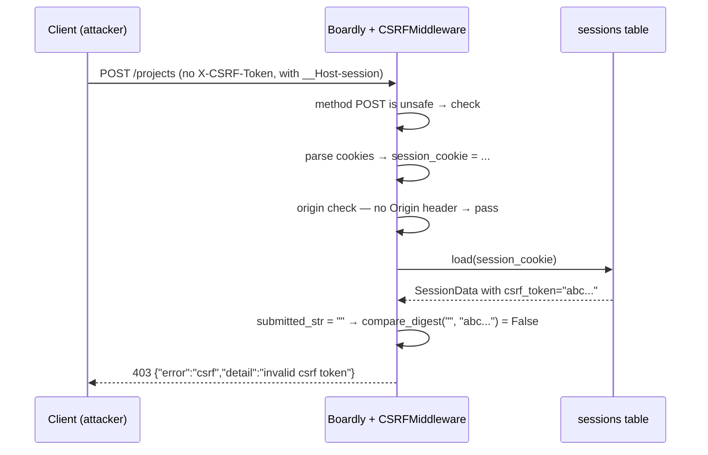
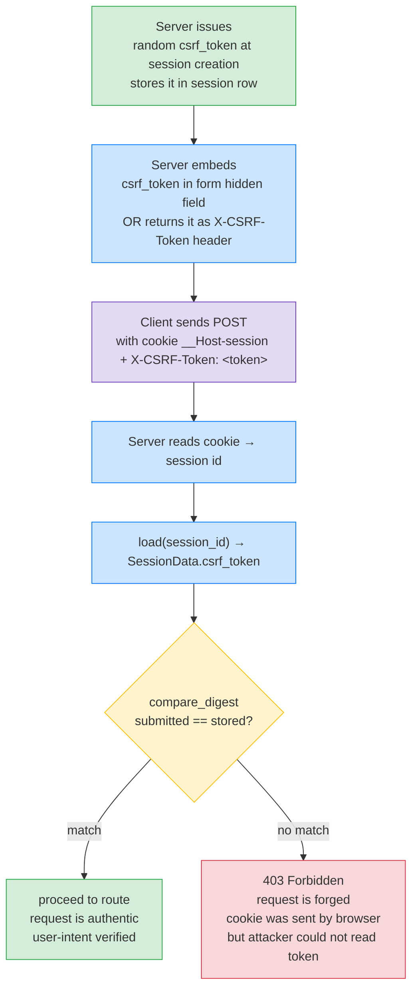

# Lesson 04: CSRF Protection

*Building a real CSRF middleware that uses the synchronizer-token pattern — the one attack that exploits the browser's auto-send-cookies behaviour.*

**The session is the substrate; CSRF is the attack on the substrate.**

You built a `__Host-session` cookie in Lesson 3. The browser now sends that cookie on every request to `api.boardly.dev` — including, *unbeknownst to the user*, on requests triggered by a malicious page they visited. That's CSRF: Cross-Site Request Forgery. The attacker doesn't steal the cookie; they let the browser send it for them. Today you'll see the attack concretely (with actual malicious HTML), learn the three classic defenses, understand why pure-JWT-in-`Authorization` APIs are typically immune, and ship a CSRF middleware in `Boardly` that uses the synchronizer-token pattern. Take your time. The attack is one HTML file. The defense is one middleware. The reasoning is what matters.


#http #csrf #security #middleware #canonical

## Learning Objectives

By the end of this lesson you will be able to:

1. **Explain what CSRF actually is** — concretely, with a malicious HTML page that transfers money from a victim's account.
2. **Explain the three classic defenses** — synchronizer-token pattern, double-submit cookie, `SameSite=Lax` — and when each works.
3. **State the synchronizer-token pattern's mechanism** — token stored server-side in the session, sent by the client in a custom header, validated by middleware.
4. **State the double-submit cookie pattern's mechanism** — token in a readable cookie + same token in a custom header; middleware compares them.
5. **State the `SameSite=Lax` mechanism** — the browser refuses to send the cookie on cross-site `POST`, defeating the attack at the browser level.
6. **Explain why pure-JWT-in-`Authorization` APIs are typically not vulnerable** — and the subtle exception: if you ever read cookies too.
7. **Write a FastAPI CSRF middleware** that runs *after* the session load, reads the token from the session, and compares to the `X-CSRF-Token` header.
8. **Choose the right safe-methods set** (`GET`, `HEAD`, `OPTIONS`, `TRACE`) and explain why `POST` is *not* safe.
9. **Recognise the four classic CSRF mistakes** — exempting `GET`, leaking the token to logs, using a predictable token, forgetting to validate `Origin`/`Referer` on state changes.

## Prerequisites

Before starting, you need:

- **Lesson 3 — Session Management** ([[Session-Management]]). The CSRF token lives in the session (`SessionData.csrf_token`). Without sessions, no synchronizer pattern.
- **Lesson 2 — Cookies** ([[HTTP-Cookies-Deep-Dive]]). `SameSite=Lax` is one of the three defenses; you should already know what `SameSite` does.
- **Lesson 1 — Headers** ([[HTTP-Headers-Deep-Dive]]). The `Origin` and `Referer` request headers are the third defense in our middleware.
- **Middleware** — [[03-FastAPI-Core/Middleware-and-Request-Order]]. The CSRF middleware is a pure-ASGI middleware, same form as the security-headers middleware from Lesson 1.
- **About an hour and a half of focused time.** The attack is small; the defenses are small; the reasoning is large.

**CSRF vs XSS — don't confuse them.**

XSS (Cross-Site Scripting): the attacker injects a `<script>` into your page. The script runs on the user's browser, can read cookies (if not `HttpOnly`), can make requests *with the user's cookies*. XSS is a *server-side* vulnerability (you failed to escape user input).
CSRF (Cross-Site Request Forgery): the attacker has a malicious page (anywhere). The user visits it. The malicious page makes a request *to your site*, and the browser auto-attaches the user's cookies. CSRF is a *client-side* vulnerability (the browser's cookie-sending behaviour).
Defences are different: XSS is prevented by escaping output and CSP. CSRF is prevented by tokens, `SameSite`, or `Origin` checks. They're orthogonal — defend against both.


## Think Like a Senior Engineer

Before the attack and the defenses, the mental model. The single reframe in this lesson is: *CSRF is a confused-deputy problem where the deputy is the browser, the cookie is the credential, and the attacker exploits the asymmetry between "cause to send" and "read"*. Read this section slowly — every confusion about CSRF vs XSS, every "but I have CORS, am I not safe?" production question, every "do I still need a token if I have `SameSite=Lax`?" architecture review reduces to one of the three questions below answered badly.

### The reframe: CSRF as a confused-deputy problem

A senior reading the malicious-HTML attack in "The Problem" below does not see "a form that submits." They see a *confused-deputy*: the browser is the deputy (it holds the user's session cookie — a credential the user *delegated* to it), and the attacker has tricked the deputy into using that credential on the attacker's behalf. The browser is confused about *whose intent* the request represents. The user did not intend to transfer a million dollars; the browser thinks they did, because the request came from a page in the user's browser, with the user's cookies attached.

The crucial asymmetry the senior sees: the attacker can *cause* the browser to send the cookie but cannot *read* the cookie. Same-origin policy blocks the read; nothing in the HTTP spec blocks the cause. CSRF exploits exactly that gap. Every defense in this lesson closes one half of the gap:

- The synchronizer-token pattern closes the *cause* side by *requiring a read* — the malicious page can cause the request but cannot include the token, because including it would require reading the token out of the session, and the same-origin policy blocks that.
- `SameSite=Lax` closes the *send* side at the browser level — the malicious page can cause the request, but the browser refuses to attach the cookie.
- The `Origin` check closes the *cause* side at the server level — the malicious page can cause the request, but the server rejects because the `Origin` header reveals whose cause it was.

The three defenses are three angles on the same asymmetry. The senior reaches for all three because the gap is two-sided and any single defense closes only one side.

### The senior's three questions before reaching for a CSRF defense

1. **Who is the deputy?** If your users use browsers, the browser is the deputy — and CSRF matters. If your users use pure-API clients (`curl`, a Python script, a mobile app with a manually-set `Authorization` header), there is no browser, no auto-send-cookies behaviour, and CSRF is a non-issue. The first question the senior asks is *not* "do I need CSRF protection?" — it is *who holds the credential and what causes them to send it*. If the answer is "the browser, and any page the user visits," CSRF matters. If the answer is "the application code, and only the application code," CSRF does not.
2. **Can the attacker cause, or can the attacker read?** The senior draws a 2x2: attacker-can-cause (true, by form-submission / image-tag / fetch), attacker-can-read (false, by same-origin policy). CSRF lives in the asymmetry — cause-but-not-read. The synchronizer-token closes the cause-by-requiring-read: the attacker cannot include the token without reading it, and they cannot read it. `SameSite=Lax` closes the cause-by-blocking-attach: the attacker can cause the request, but the cookie is not attached. The 2x2 is not academic — the moment an attacker can both cause and read (e.g., a same-site XSS, or a CORS policy with `Access-Control-Allow-Origin: https://evil.com` and `Allow-Credentials: true`), the CSRF defense falls and you have a different problem entirely (an XSS, or a CORS misconfiguration). The senior asks the 2x2 question on every state-changing endpoint.
3. **Where does the defense live?** Browser-enforced (`SameSite`, `Sec-Fetch-Site`), or server-enforced (synchronizer token, `Origin` check)? Browser-enforced defenses are cheap and recent (the `SameSite=Lax` default landed in Chrome 80, February 2020; `Sec-Fetch-Site` shipped in Chrome 76, 2019; Firefox 90, 2021; Safari 16, 2022). Server-enforced defenses are old (the synchronizer pattern was first described in 2003) and work even when the browser does not cooperate. The senior uses both because the browser-enforced defense is cheap and stops the majority of attacks, and the server-enforced defense stops the residual that the browser cannot (subdomain takeover, embedded webview, older browser, SSO POST-redirect).

### The shape of the CSRF defenses, side by side

| Defense | Closes the gap on | Where it lives | What it requires | What it stops | What it misses |
|---|---|---|---|---|---|
| Synchronizer-token | Cause-by-requiring-read | Server + SPA token dance | Server-side session, `X-CSRF-Token` header, `secrets.compare_digest` | Classic image-tag / form-submit / JSON CSRF | GET-state-changes (no token check on GET); pre-login token leaks |
| Double-submit cookie | Cause-by-requiring-read | Server (no session) | Readable `csrf` cookie, `X-CSRF-Token` header, comparison | Same as synchronizer, with no server state | Subdomain-takeover (attacker writes both halves); predictable cookie |
| `SameSite=Lax` | Send (browser level) | Browser | One cookie attribute | Cross-site POST without top-level navigation; cross-site ``/`<script>`/`<iframe>` GETs | Top-level GET state changes (`<a>` click); embedded webviews; older browsers; SSO POST-redirect flows |
| `Origin`/`Referer` check | Cause (server level) | Server | One allow-list of origins | Cross-site POST/PUT/PATCH/DELETE with `Origin` set | Same-origin attacks (XSS); `Origin`-absent requests (rare on modern browsers) |
| Pure-JWT-in-`Authorization` | Cause-by-blocking-header | Browser (CORS preflight) | No cookies for auth | CSRF entirely (no cookie to auto-send) | The "remember me" flow that survives refresh; requires CSRF on the refresh path |
| `Sec-Fetch-Site` check | Cause (server level) | Server + browser | Browser sends `Sec-Fetch-Site: cross-site` | Cross-site requests of any kind, including top-level GET | Older browsers (pre-Chrome-76 / pre-Firefox-90 / pre-Safari-16); some embedded webviews |

The senior reading this table does not see six competitors. They see six angles on the same asymmetry. `Boardly` ships synchronizer + `SameSite=Lax` + `Origin` check (three layers, each closing a different angle), because the team uses cookies for the refresh token (so synchronizer is mandatory) and serves a browser SPA (so `SameSite=Lax` is the cheap first layer). The hybrid `Authorization`-JWT path is immune on its own axis but is not used by `Boardly`'s SPA — see [[Authentication-State-Storage|Lesson 7]] for the canonical hybrid pattern.

### The senior question for every state-changing endpoint

When you finish `csrf.py`, walk every `@router.post`, `@router.put`, `@router.patch`, `@router.delete` in the codebase and ask: *is this endpoint reachable by a request the browser will auto-attach cookies to, and is the credential something the attacker can cause-but-not-read?* If yes, the synchronizer-token check must fire. If the endpoint is a `GET` that changes state (an email-unsubscribe link, an email-confirm link), the synchronizer-token cannot help (the GET response needs to ship the token; the request cannot carry it) — the `Origin`/`Referer` check is the only defense, and the URL itself should be one-time-use with a signed token in the path. The same question, applied route by route, scales to a 500-route API.

## The Problem

Here is a malicious HTML page. Save it as `evil.com/transfer.html` (in the attacker's control):

```html
<!DOCTYPE html>
<html>
<body>
<h1>Cute cats — click to see more</h1>
<form id="evil" action="https://bank.example.com/transfer" method="POST">
 <input type="hidden" name="to" value="attacker@example.com">
 <input type="hidden" name="amount" value="1000000">
</form>
<script>
 // Submit the form automatically — no user interaction needed.
 document.getElementById('evil').submit();
</script>
</body>
</html>
```

The victim is logged into `bank.example.com` in another tab. Their session cookie is `__Host-session=<valid>` and the browser has it stored. The victim visits `evil.com/transfer.html`. The browser renders the page, the `<script>` runs, the form submits to `bank.example.com/transfer` with the hidden fields. The browser auto-attaches the session cookie. The bank's server sees a valid request from an authenticated user and transfers a million dollars.

The attacker didn't steal the cookie. The attacker didn't even *see* the cookie. The browser did all the work.

That's CSRF. The bank's server can't tell this request from a legitimate one — both have the same cookies, same headers, same body. The only way to tell is to require something the malicious page *can't* provide.

**Danger — CSRF is silent.**

The victim sees a flash of `cute-cats.html` redirecting. By the time they realise something's wrong, the transfer is complete. There's no error in the bank's logs — the request *was* authenticated. The attack works for any state-changing endpoint: transfers, password changes, email changes, account deletion.


The problem this lesson solves: **most FastAPI tutorials skip CSRF entirely** because they use JWT-in-`Authorization` (which is immune — see "Why pure-JWT APIs are typically not vulnerable" below). The moment your API uses cookies for any kind of authentication — even just for the refresh token — you need CSRF protection. By the end of this lesson, your `Boardly` will have it.

**Note — CSRF is a *browser* vulnerability.**

The attack relies on the browser auto-sending cookies across origins. A pure-API client (`curl`, a Python `requests` script, a mobile app) doesn't auto-send cookies — the attacker's "malicious page" trick doesn't work because there's no browser. CSRF only matters when your users use browsers. If your API is server-to-server only, you can skip CSRF (but you should still rate-limit and authenticate). `Boardly` is browser-facing, so we need CSRF.


## The Three Defenses

Before the code, the three classic defenses. We'll implement the synchronizer-token pattern in this lesson; the other two are alternatives with different trade-offs.

### Defense 1: Synchronizer-token pattern (the one we ship)

The server generates a cryptographically random token at session creation, stores it in the session (in our case, `SessionData.csrf_token`), and serves it to the client (typically as a JSON response on `GET /csrf-token`, or embedded in HTML forms as a hidden `<input>`).

The client must send the token back on every state-changing request, in a custom header (e.g., `X-CSRF-Token: <token>`) or in a form field (`_csrf`). The server compares the submitted token to the one in the session; if they don't match (or the header is missing), the request is rejected with `403 Forbidden`.

**Why it works:** The malicious page can't read the token — it's stored in the session, not in a cookie the malicious page can access. The malicious page *could* submit a form to the bank, but it can't include the right token, so the server rejects.

**Why a custom header:** Custom headers (like `X-CSRF-Token`) trigger a CORS preflight (`OPTIONS`) for cross-origin requests. The attacker's page can't add a custom header without the bank's CORS allowing it — and our CORS doesn't.

**Why does a custom header trigger a CORS preflight when a regular form field does not?** Because the Fetch Standard classifies requests as "simple" or "non-simple" based on whether they could have been sent by an HTML form in 1995. A `POST` with `Content-Type: application/x-www-form-urlencoded` and no custom headers is "simple" — the browser sends it directly and only checks CORS when reading the response. A `POST` with a custom header like `X-CSRF-Token: ...` is "non-simple" — the browser is required to send an `OPTIONS` preflight first, ask the server "do you allow this origin to send this header?", and only send the real `POST` if the server approves. The attacker's page on `evil.com` cannot add `X-CSRF-Token` to a `POST` to `bank.example.com` because the preflight will be rejected: the bank's CORS allow-list does not include `evil.com`. **What would happen if the bank's CORS was misconfigured to allow `Access-Control-Allow-Origin: *` with `Access-Control-Allow-Headers: *`?** The preflight would pass, the attacker could add the custom header — but they still could not *read* the token out of the bank's session cookie (the same-origin policy blocks that), so the synchronizer-token defense would still hold. The custom header is the first line of defense; the unreadable token in the session is the second. Both layers compose.

### Defense 2: Double-submit cookie pattern

The server sets a *readable* (non-`HttpOnly`) cookie `csrf=<random>`. The client reads it via `document.cookie` and sends the same value in a custom header. The server compares the cookie value to the header value; they must match.

**Why it works:** The attacker can set up their own `csrf` cookie for their own domain, but they can't read the bank's `csrf` cookie (same-origin policy) to send it in the header.

**Trade-off vs synchronizer:** No server-side state lookup (no `SessionData` row). Easier to deploy. But it requires a non-`HttpOnly` cookie (the JS-readable surface). And if the attacker can write subdomain cookies (subdomain takeover), they can write the `csrf` cookie and forge both halves.

### Defense 3: `SameSite=Lax` cookie

We covered `SameSite` in Lesson 2. With `SameSite=Lax` on the session cookie, the browser refuses to send the cookie on cross-site `POST`. The attacker's form submission goes through — but without the cookie — so the bank sees an unauthenticated request and rejects.

**Why it works:** The browser enforces it. No server-side token dance.

**Trade-off vs synchronizer:** Defense in *depth* — if `SameSite=Lax` is the *only* defense, you depend entirely on the browser's enforcement. Some older browsers (or some embedded webviews) don't enforce `SameSite` correctly. The synchronizer pattern is the belt; `SameSite` is the suspenders.

**The recommended pattern.**

The OWASP recommendation is: **`SameSite=Lax` on the session cookie + synchronizer-token for state changes + `Origin`/`Referer` check on state changes**. We implement all three in this lesson.


### Defense 4 (bonus): `Origin` and `Referer` checks

For state-changing requests, the server can verify that the `Origin` (or `Referer`) header matches the expected origin. If `Origin: https://evil.com` is sent on a `POST` to `bank.example.com`, reject. (Browsers send `Origin` on `POST`/`PUT`/`PATCH`/`DELETE` but not on `GET`.)

**Why it works:** The `Origin` header is set by the browser and cannot be forged by JavaScript on a cross-origin page. If the attacker's page submits a form to the bank, the `Origin` header will be `https://evil.com`, which the bank rejects.

**Trade-off:** Some browsers omit `Origin` on same-origin `GET` requests (rare); some old proxies strip `Referer`. Always allow `Origin`-absent on safe methods; for unsafe methods, require `Origin` to be present and expected.

**Student asks: why don't we just use CORS?**

CORS (Cross-Origin Resource Sharing) is *not* a CSRF defense. CORS controls whether the browser exposes the *response* to a cross-origin script. The CSRF attack doesn't care about the response — the attacker's page submits the form and doesn't need to read the response. CORS controls reads; CSRF happens on writes. You need CSRF protection *in addition to* CORS.


**Student asks: do I still need CSRF protection if I have `SameSite=Lax` on every cookie?**

You should — defense in depth. `SameSite=Lax` blocks the most common CSRF vector (cross-site POST with no top-level navigation), but it is not a complete defence. The exceptions that bite: (a) some older browsers (and certain embedded webviews) ignore `SameSite` entirely; (b) `Lax` *does* send the cookie on top-level `GET` navigations, so any state change triggered by a `GET` request (an "unsubscribe via email link" flow, a "confirm email" link) is still CSRF-able; (c) a subdomain takeover or a same-site XSS can re-introduce the vector. The academy's recommendation is `SameSite=Lax` (or `Strict` for refresh tokens) *plus* the synchronizer-token pattern *plus* an `Origin` check on unsafe methods — three layers, each closing a gap the others leave open.


## Why pure-JWT-in-`Authorization` APIs are typically not vulnerable

If your API uses JWTs in the `Authorization` header (not cookies), you're typically not vulnerable to CSRF:

- The attacker's page can't add an `Authorization` header to a cross-origin request without triggering a CORS preflight.
- Your CORS preflight rejects cross-origin `OPTIONS` from unknown origins.
- The attacker can't add the header at all → the request fails before reaching your server.

**The subtle exception:** if your API reads cookies *at all* — for any purpose — you're back in CSRF territory. Examples:

- You serve both a browser SPA (cookie-based) and a mobile app (JWT-based), and *some* endpoints accept either.
- You have a "remember me on this device" cookie that, when present, auto-logs in the user (so the SPA can serve a logged-out HTML page that bootstraps into a logged-in state).
- You have a CSRF-token cookie (the double-submit pattern) that you read for CSRF checking — but you also use the session cookie for auth.

The rule: **if any state-changing endpoint authenticates via a cookie, you need CSRF protection on that endpoint.** Even if you *also* accept JWT-in-`Authorization` for the same endpoint, the cookie path is still vulnerable.

**Why is the cookie path vulnerable even when the JWT path on the same endpoint is not?** Because the browser auto-attaches cookies based on the request's URL — the attacker's `evil.com` form submits to `bank.example.com` and the browser silently adds the `session` cookie the user logged in with. The browser does *not* auto-attach an `Authorization` header — that header is JavaScript-set, and the attacker's `evil.com` script can't add it cross-origin (CORS preflight blocks them). So even if your endpoint accepts either an `Authorization` header OR a session cookie, the cookie path is wide-open to CSRF. **What would happen if you accepted only JWT and rejected any request with a session cookie?** You'd be CSRF-immune, but you'd lose the cookie-based "remember me on this device" flow that survives browser refresh — the typical SPA pattern. The recommended hybrid (access JWT in `Authorization`, refresh token in `__Host-`-prefixed `httpOnly` cookie) gets CSRF-immunity on the access path and accepts the need for CSRF middleware on the refresh path; see [[Authentication-State-Storage|Lesson 7]].

[[Authentication-State-Storage|Lesson 7]] covers the recommended pattern (access JWT in `Authorization`, refresh token in `httpOnly` cookie) and how to defend it.

## The Code

Two pieces arrive in `Boardly` this lesson:

1. A `CSRFMiddleware` (pure-ASGI) that runs *after* the session load, reads `SessionData.csrf_token`, compares it to `X-CSRF-Token`, and rejects mismatches.
2. A `GET /auth/csrf-token` endpoint that returns the CSRF token to the SPA so it can be sent on subsequent state-changing requests.

Save it as `boardly/middleware/csrf.py` and add the endpoint to `boardly/routers/auth.py`.

```python
# boardly/middleware/csrf.py
"""Boardly — CSRF middleware (synchronizer-token pattern).

Lesson 02b-4: defends state-changing requests against CSRF using
the synchronizer-token pattern, with SameSite=Lax and Origin checks
as defense in depth.
"""
from __future__ import annotations

import json
import secrets
from collections.abc import Iterable
from http import HTTPStatus

from boardly.sessions.store import SESSION_COOKIE_NAME
from boardly.sessions.dependency import _store
from boardly.sessions.store import unsign_session_id
from starlette.datastructures import State
from starlette.types import ASGIApp, Receive, Scope, Send


# Methods that don't change server state. CSRF only matters for the others.
SAFE_METHODS: frozenset[str] = frozenset({"GET", "HEAD", "OPTIONS", "TRACE"})

# The header that carries the CSRF token.
CSRF_HEADER_NAME = "x-csrf-token"

# The expected origin (in real code, from Settings).
ALLOWED_ORIGINS: frozenset[str] = frozenset({
 "https://app.boardly.dev",
 # In dev, allow localhost.
 "http://127.0.0.1:5173",
 "http://localhost:5173",
})


class CSRFMiddleware:
 """Pure-ASGI CSRF middleware.

 For state-changing requests (POST, PUT, PATCH, DELETE), the
 middleware:
 1. Looks up the session from the cookie.
 2. Reads the stored CSRF token from the session data.
 3. Reads the submitted token from the X-CSRF-Token header.
 4. Compares them with `secrets.compare_digest` (constant-time).
 5. Verifies the Origin header is in the allow-list.
 6. Returns 403 on any failure.
 """

 __slots__ = ("app",)

 def __init__(self, app: ASGIApp) -> None:
 self.app = app

 async def __call__(self, scope: Scope, receive: Receive, send: Send) -> None:
 if scope["type"] != "http":
 await self.app(scope, receive, send)
 return

 method = scope["method"]
 if method in SAFE_METHODS:
 # Safe method — pass through. (SameSite=Lax already prevents
 # cross-site GETs from carrying the cookie, but we don't add a
 # token check on safe methods because the GET response needs
 # to ship the token to the client.)
 await self.app(scope, receive, send)
 return

 # State-changing method. We need to load the session without
 # going through the FastAPI dependency system (we're below it).
 # We do this by directly consulting the SessionStore.
 headers: Iterable[tuple[bytes, bytes]] = scope["headers"]
 cookies = _parse_cookies(_header_first(headers, b"cookie"))
 session_cookie = cookies.get(SESSION_COOKIE_NAME)

 # If there's no session cookie, this is an unauthenticated
 # state-changing request. Let it pass — the auth dependency will
 # reject it with 401.
 if not session_cookie:
 await self.app(scope, receive, send)
 return

 # Origin check — on unsafe methods, browsers always send `Origin`
 # on cross-origin POST/PUT/PATCH/DELETE in 2026. An absent `Origin`
 # on an unsafe method is a red flag (likely a non-browser attack
 # tool). We reject the request rather than silently letting it
 # through. This matches the prose at the top of the lesson:
 # "Always allow Origin-absent on safe methods; for unsafe methods,
 # require Origin to be present and expected."
 origin = _header_first(headers, b"origin")
 if not origin or origin.decode("latin-1") not in ALLOWED_ORIGINS:
 await _send_403(send, "invalid origin")
 return

 # SessionStore lookup: load the SessionData to get the stored token.
 # We get the store the same way _store does — from app.state.
 app_state: State = scope["app"].state
 store = app_state.session_store

 # Cache the loaded session on `scope["state"]` so the FastAPI
 # `get_session` dependency can read from there instead of loading
 # the session a second time. The cost of the double-load would be
 # one Redis `GET` per state-changing request — small, but the
 # cache is one line and pays for itself.
 if "state" not in scope:
 scope["state"] = State()
 session_data = await store.load(session_cookie)
 if session_data is None:
 # Invalid or expired session — let it through; auth will 401.
 await self.app(scope, receive, send)
 return
 scope["state"].csrf_session = session_data

 # Compare tokens — constant-time to avoid timing attacks.
 submitted = _header_first(headers, CSRF_HEADER_NAME.encode("latin-1"))
 submitted_str = submitted.decode("latin-1") if submitted else ""
 if not submitted_str or not secrets.compare_digest(
 submitted_str, session_data.csrf_token
 ):
 await _send_403(send, "invalid csrf token")
 return

 # All checks passed. Pass through.
 await self.app(scope, receive, send)


# --- Helpers ---
def _header_first(headers: Iterable[tuple[bytes, bytes]], name: bytes) -> bytes | None:
 """Return the value of the first header with the given name (lowercase bytes)."""
 for n, v in headers:
 if n == name:
 return v
 return None


def _parse_cookies(cookie_header: bytes | None) -> dict[str, str]:
 """Parse a Cookie header value into a name→value dict.

 Cookie: name1=value1; name2=value2
 """
 if not cookie_header:
 return {}
 out: dict[str, str] = {}
 for pair in cookie_header.split(b";"):
 pair = pair.strip()
 if not pair:
 continue
 if b"=" not in pair:
 continue
 name, _, value = pair.partition(b"=")
 out[name.decode("latin-1")] = value.decode("latin-1")
 return out


async def _send_403(send: Send, detail: str) -> None:
 """Send a 403 response with a small JSON body.

 Uses `json.dumps` for proper escaping — the f-string form would
 produce malformed JSON if `detail` ever contained a `"` or `\\`
 (the current values are hardcoded strings, but the function is a
 footgun for learners who might copy it for dynamic messages).
 """
 body = json.dumps({"error": "csrf", "detail": detail}).encode("utf-8")
 await send({
 "type": "http.response.start",
 "status": HTTPStatus.FORBIDDEN,
 "headers": [
 (b"content-type", b"application/json; charset=utf-8"),
 (b"content-length", str(len(body)).encode("ascii")),
 (b"cache-control", b"no-store"),
 ],
 })
 await send({"type": "http.response.body", "body": body})
```

And the addition to `boardly/routers/auth.py`:

```python
@router.get("/csrf-token")
async def get_csrf_token(session: SessionDep) -> dict:
 """Return the CSRF token from the session so the SPA can send it
 on subsequent state-changing requests.

 This endpoint is safe (GET) — CSRFMiddleware lets it through.
 """
 if session is None:
 from fastapi.responses import JSONResponse
 return JSONResponse({"error": "not authenticated"}, status_code=401)
 return {"csrf_token": session.csrf_token}
```

And in `boardly/main.py`, add the middleware *after* `SecurityHeadersMiddleware` (so it's *outside* the security-headers middleware — runs first on the request path):

```python
from boardly.middleware.csrf import CSRFMiddleware

app.add_middleware(SecurityHeadersMiddleware)
app.add_middleware(CSRFMiddleware) # added after → outer
```

Wait — we want CSRF to run *before* the security-headers middleware on the request path, which means CSRF is *outer*. So we add it *after* `SecurityHeadersMiddleware`. The "last added = outermost" rule means: `add(SecurityHeaders)` → `add(CSRF)` → request path is `CSRF → SecurityHeaders → router`. That's what we want: CSRF rejects bad requests before they hit anything else.

There is a wrinkle: the security-headers middleware must still inject headers on CSRF-rejected responses (e.g., the 403), so security-headers must be *outer*.

```python
app.add_middleware(CSRFMiddleware) # added first → innermost
app.add_middleware(SecurityHeadersMiddleware) # added second → outermost
```

That way: `SecurityHeaders → CSRF → router`. Security-headers runs on every response (including CSRF's 403s), and CSRF runs before the router (so bad requests don't reach the router).

**Warning — Middleware order is genuinely subtle. Test it.**

Verify by triggering a CSRF 403 (omit the header) and checking that the response has the security headers. If it doesn't, your order is wrong.


## Line-by-Line Deep Dive

### Lines 1–9: Module docstring and imports

```python
"""Boardly — CSRF middleware (synchronizer-token pattern).

Lesson 02b-4: defends state-changing requests against CSRF using
the synchronizer-token pattern, with SameSite=Lax and Origin checks
as defense in depth.
"""
from __future__ import annotations

from collections.abc import Iterable
from http import HTTPStatus

from starlette.types import ASGIApp, Receive, Scope, Send
```

**What it does:** Documents the module, imports the ASGI types.

**Why `Iterable[tuple[bytes, bytes]]`?** ASGI `scope["headers"]` is a `list[tuple[bytes, bytes]]`, but we type it as `Iterable` so the helper functions work on any iterable (in case Starlette changes the type, or we pass a different iterable).

**Production reality: the `Iterable[tuple[bytes, bytes]]` typing choice is a stability hedge**

The lesson types ASGI headers as `Iterable[tuple[bytes, bytes]]` rather than the more specific `list[tuple[bytes, bytes]]` that ASGI actually uses at runtime. That's not pedantry — it's a *stability hedge*. Starlette's `Scope` is a `MutableMapping` whose `headers` field is documented as `list[tuple[bytes, bytes]]` in the ASGI spec, but Starlette occasionally wraps it in a `Headers` object (a `Mapping` view) for convenience. Typing as `Iterable` means the helper functions (`_header_first`, `_parse_cookies`) work whether the caller passes the raw list, a `Headers` view, or a generator. The production grep: `rg "list\[tuple\[bytes, bytes\]\]" boardly/middleware/` should return nothing — the `Iterable` form is the right one. The audit: `uv run mypy boardly/middleware/csrf.py` should pass without complaint on the `Iterable` typing. See [[03-FastAPI-Core/Middleware-and-Request-Order]] for the ASGI scope's structure and where the `headers` field sits in the request lifecycle.


### Lines 11–17: Constants

```python
SAFE_METHODS: frozenset[str] = frozenset({"GET", "HEAD", "OPTIONS", "TRACE"})
CSRF_HEADER_NAME = "x-csrf-token"
ALLOWED_ORIGINS: frozenset[str] = frozenset({...})
```

**What they are:** The set of HTTP methods that don't change server state (so CSRF is irrelevant); the name of the header that carries the CSRF token; the allow-list of valid `Origin` values.

**Why `frozenset`?** Immutable, hashable, O(1) `in` checks. Slightly faster than a tuple for membership tests (negligible here), and the immutability communicates "don't modify this at runtime."

**Why these methods in `SAFE_METHODS`?** `GET`, `HEAD`, `OPTIONS`, `TRACE` are defined by RFC 9110 as "safe" — they should not have side effects. `POST`, `PUT`, `PATCH`, `DELETE` are unsafe. `TRACE` is rarely used in modern APIs but is technically safe.

**`POST` is *not* safe.**

A common mistake: exempting `POST` from CSRF checks "because it's not idempotent." No — `POST` is exactly the method CSRF targets, because `POST` is what HTML forms use by default. A `<form method="POST" action="https://bank.example/transfer">` submits a `POST`. So `POST` must be checked.


**Warning — When this breaks: `TRACE` in `SAFE_METHODS` is a footgun for non-RFC-9110-strict backends**

**Symptom.** A teammate reads the lesson's `SAFE_METHODS = frozenset({"GET", "HEAD", "OPTIONS", "TRACE"})` and ships the middleware. A pentester submits `TRACE /admin/users` to the deployed app; the middleware sees `TRACE` is "safe," lets it through; the route handler (which never expected `TRACE`) reflects the request body in the response (the classic `TRACE` reflection, RFC 9110 §9.3.8 — `TRACE` is "safe" but echoes the request). The reflection leaks the `Cookie` header (because `TRACE` reflection includes request headers in the response body) to anyone who can submit a `TRACE` request — including a cross-site attacker via `<fetch>` (no preflight for `TRACE`, no `TRACE` in the safelisted methods list).
**Diagnosis.** RFC 9110 lists `TRACE` as "safe" (§4.2.1) — the spec's intent is that `TRACE` is for debugging and should not have side effects. But "no side effects" is not the same as "safe to expose." The `TRACE` method's *reflection* behaviour is itself a leak (the HTTP-TRACE attack, documented since 2003). The fix is not to *elevate* `TRACE` to "unsafe" in the CSRF middleware (it is safe per RFC), but to *reject* `TRACE` at the security-headers middleware or the app level — `405 Method Not Allowed` for any `TRACE` request. The grep: `rg "TRACE" boardly/` should return only the `SAFE_METHODS` line (the typing); any other hit is a `TRACE`-handling route (a footgun). The audit: `curl -sv -X TRACE http://127.0.0.1:8000/ 2>&1 | grep -E 'HTTP/|Allow:'` should return `405 Method Not Allowed` (not `200 OK` with a reflected body).
**Fix.** Keep `TRACE` in `SAFE_METHODS` (the spec's classification), *and* add a `405` for `TRACE` in the security-headers middleware. The two are not in tension — `SAFE_METHODS` is "CSRF doesn't apply to this method"; the `405` is "this method is not supported by this app." The two checks live in different layers.


### Lines 19–58: `CSRFMiddleware` class

```python
class CSRFMiddleware:
 __slots__ = ("app",)

 def __init__(self, app: ASGIApp) -> None:
 self.app = app

 async def __call__(self, scope: Scope, receive: Receive, send: Send) -> None:
 if scope["type"] != "http":
 await self.app(scope, receive, send)
 return

 method = scope["method"]
 if method in SAFE_METHODS:
 await self.app(scope, receive, send)
 return

 headers: Iterable[tuple[bytes, bytes]] = scope["headers"]
 cookies = _parse_cookies(_header_first(headers, b"cookie"))
 session_cookie = cookies.get(SESSION_COOKIE_NAME)

 if not session_cookie:
 await self.app(scope, receive, send)
 return

 origin = _header_first(headers, b"origin")
 if origin and origin.decode("latin-1") not in ALLOWED_ORIGINS:
 await _send_403(send, "invalid origin")
 return

 from starlette.datastructures import State
 app_state: State = scope["app"].state
 store = app_state.session_store

 session_data = await store.load(session_cookie)
 if session_data is None:
 await self.app(scope, receive, send)
 return

 import secrets
 submitted = _header_first(headers, CSRF_HEADER_NAME.encode("latin-1"))
 submitted_str = submitted.decode("latin-1") if submitted else ""
 if not submitted_str or not secrets.compare_digest(
 submitted_str, session_data.csrf_token
 ):
 await _send_403(send, "invalid csrf token")
 return

 await self.app(scope, receive, send)
```

**Lines `if scope["type"] != "http"`** — non-HTTP ASGI events (lifespan, websocket) pass through unchanged.

**Lines `if method in SAFE_METHODS`** — safe methods pass through. The whole point of CSRF is *state-changing* requests; safe methods don't change state, so we don't check them.

**Lines `cookies = _parse_cookies(...)`** — we parse the `Cookie` request header into a dict. The header looks like `__Host-flash=...; __Host-session=...`; we split on `;` and `=`.

**Lines `if not session_cookie`** — no session cookie = unauthenticated request. We let it through; the auth dependency will 401 it. We don't want to 403 an unauthenticated request — the 401 is more informative ("you're not logged in" vs "you're logged in but your CSRF token is wrong").

**Lines `origin = ... if origin and ... not in ALLOWED_ORIGINS`** — the `Origin` check. We only check if `Origin` is present (browsers send it on cross-origin `POST`). If it's present and not in our allow-list, reject. If it's absent (rare in modern browsers, possible in some clients), we proceed — the token check will catch any attack.

**Lines `app_state = scope["app"].state; store = app_state.session_store`** — we reach into the app's state to get the `SessionStore`. The lifespan set `app.state.session_store = PostgresSessionStore(...)`; the middleware reads it. The `scope["app"]` is the ASGI app instance itself — Starlette populates this.

**Lines `session_data = await store.load(session_cookie)`** — same `load` we wrote in Lesson 3. The store verifies the signature, looks up the row, returns `SessionData` or `None`.

**Lines `if session_data is None`** — invalid or expired session. Let it through; the auth dependency will 401 it.

**Lines `import secrets; submitted = ...; if not submitted_str or not secrets.compare_digest(...)`** — the core defence. We compare the submitted token (from `X-CSRF-Token` header) to the stored token (from `SessionData.csrf_token`). If they don't match (or the header is missing), reject with 403.

**Why `secrets.compare_digest`?** Constant-time comparison. `==` is short-circuit: it returns as soon as the first byte differs. An attacker can measure the time it takes to reject and learn the first byte of the token. `compare_digest` always compares all bytes, regardless of where they differ. It's the standard defence against timing attacks on secret comparisons.

**Danger — Never use `==` to compare tokens.**

A timing attack on `==` can recover a token one byte at a time. It's not theoretical — it's been done. Always `secrets.compare_digest` for any secret-vs-attacker-input comparison.


**Danger — The `scope["app"]` reach into app state is a load-bearing assumption, not a given**

The middleware reads `store = scope["app"].state.session_store` — the `SessionStore` instance the lifespan set on the app. This is the *load-bearing assumption* of the synchronizer-token pattern: the middleware trusts that (a) `scope["app"]` exists (Starlette populates it, but a non-Starlette ASGI server may not), (b) `scope["app"].state` exists (Starlette's `State` object), (c) `scope["app"].state.session_store` exists (the lifespan set it). If any of these is missing — a test that constructs a raw ASGI scope without populating `app`, a misconfigured lifespan that doesn't run, a different ASGI framework that doesn't use `State` — the middleware raises `AttributeError` or `KeyError` on every state-changing request, and the entire app is broken. The danger: this assumption is *invisible* in unit tests (the test fixture populates `app.state.session_store`), surfaces only in production-like integration tests, and the failure mode is *cascading* (every authenticated request 500s, not just CSRF requests). The fix: a *defensive* read with an explicit fallback — `store = getattr(scope.get("app"), "state", None); store = getattr(store, "session_store", None); if store is None: await _send_500(send, "session store not configured")` — fail-closed with a clear 500, not a cascading 500 with a stack trace. The grep: `rg "scope\[.app.\]" boardly/middleware/` is the audit — every hit is a load-bearing assumption about the ASGI app instance. The test: `uv run pytest tests/test_csrf_middleware.py -k no_app_state` should construct a scope without `app.state.session_store` and verify the middleware returns a clean 500, not an `AttributeError` traceback.


### Lines 62–84: Helpers

```python
def _header_first(headers, name): ...
def _parse_cookies(cookie_header): ...
async def _send_403(send, detail): ...
```

**`_header_first`** — returns the value of the first header matching the name. ASGI headers are lowercase bytes; we compare against lowercase bytes.

**`_parse_cookies`** — parses `name1=value1; name2=value2` into a dict. Note: real-world cookie parsing is more complex (some values are quoted, some have escapes). For our internal use, the simple split works; Starlette's `Request.cookies` does the full parse and is what we'd use in production.

**`_send_403`** — sends a 403 response with a small JSON body. The body is hand-built (no Pydantic — we're below FastAPI's response machinery). The `Content-Length` header is set explicitly because we're not using chunked encoding.

**Production reality: Starlette's `Request.cookies` is the production parse — the helper is a teaching simplification**

The `_parse_cookies` helper splits `name1=value1; name2=value2` on `;` and `=`. That works for `Boardly`'s cookies (which are URL-safe base64 + JSON, no `;` or `=` in the values), but it breaks on real-world cookies that use quoted-string values, escaped characters, or `=` inside the value (e.g., a base64 value with padding `=`). The lesson's `_parse_cookies` is a *teaching simplification* — it's 5 lines and easy to read. The production code should use `starlette.requests.Request(scope).cookies` (the `SimpleCookie` parser from the stdlib `http.cookies` module), which handles the full RFC 6265bis grammar. The grep: `rg "_parse_cookies|SimpleCookie" boardly/middleware/` should return `SimpleCookie` (from `starlette.requests.Request.cookies`) in production code; the `_parse_cookies` helper is the teaching version. The trade-off: `SimpleCookie` is ~10× slower than the simple split (it parses the full grammar), but for a CSRF middleware that runs once per state-changing request, the ~50-microsecond overhead is lost in the noise. The audit: `uv run pytest tests/test_csrf_middleware.py -k cookie_parsing` should pass with both the simple helper and the `SimpleCookie` parser — the test fixture uses cookies that exercise the full grammar (quoted values, escaped characters), and the simple helper fails on them.


### The `GET /auth/csrf-token` endpoint

```python
@router.get("/csrf-token")
async def get_csrf_token(session: SessionDep) -> dict:
 if session is None:
 return JSONResponse({"error": "not authenticated"}, status_code=401)
 return {"csrf_token": session.csrf_token}
```

**What it does:** Returns the CSRF token from the session. The SPA calls this on app load, stores the token in memory, and sends it as `X-CSRF-Token` on every state-changing request.

**Why `GET`?** `GET` is safe — the CSRF middleware lets it through. The response includes the token; the SPA reads it from the JSON body (not from a cookie, which would defeat the purpose).

**The SPA flow.**

1. User logs in. Server sets `__Host-session` cookie + creates `SessionData` with a random `csrf_token`.
2. SPA calls `GET /auth/csrf-token`. Server returns `{csrf_token: "..."}`. The browser auto-attaches the session cookie; the server reads the session; the token is returned.
3. SPA stores the token in memory (NOT localStorage — that's XSS-vulnerable; see Lesson 7).
4. SPA sends `X-CSRF-Token: <token>` on every `POST`/`PUT`/`PATCH`/`DELETE` request.
5. CSRFMiddleware validates the token against the session.
6. Done.


**Warning — When this breaks: the `GET /auth/csrf-token` endpoint under a CORS misconfiguration is a token leak**

**Symptom.** A new frontend team adds a staging environment at `staging.boardly.dev` and configures CORS to allow it. A typo sets `Access-Control-Allow-Origin: *` with `Access-Control-Allow-Credentials: true`. The browser rejects the response (the Fetch spec forbids `*` + credentials), so the team "fixes" it by reflecting the request's `Origin` header back as `Access-Control-Allow-Origin` while keeping `Allow-Credentials: true`. Now any origin can read authenticated responses — including the synchronizer-token response from `GET /auth/csrf-token`. The malicious page does `fetch('https://api.boardly.dev/auth/csrf-token', {credentials: 'include'})`; if the session cookie is `SameSite=None` (legacy SSO), the browser attaches the cookie, the server reads the session, returns the token in the body, the CORS configuration reflects the attacker's origin and allows credentials, the browser exposes the response body to the attacker's JavaScript. The attacker now has the synchronizer token and can submit a state-changing request with `X-CSRF-Token` — bypassing the CSRF defence entirely.
**Diagnosis.** The synchronizer-token pattern assumes the token is *not readable cross-origin*. The CORS misconfiguration (reflect `Origin` + `Allow-Credentials: true`) breaks that assumption. The token endpoint's response is *public* under the misconfiguration — any origin can read it. The grep: `rg "Allow-Origin.*request|Allow-Origin.*\*" boardly/` should return nothing — every CORS response must be computed from an allow-list, not from the request header.
**Fix.** Three layers. (1) Never reflect `Origin` into `Access-Control-Allow-Origin` without an explicit allow-list. (2) The synchronizer-token endpoint should *only* return the token when the `Origin` is in the server-side allow-list — independent of the CORS configuration. (3) The synchronizer-token check on the state-changing endpoint is the *last* layer, not the only one. See the "Failure 4" section below for the full symptom/diagnosis/fix of this exact failure mode — the callout here is the warning that the *fix* in Failure 4 (server-side `Origin` check on the token endpoint) is the structural enforcement that catches the CORS misconfiguration.


## Execution Trace

Run the app:

```bash
uv run uvicorn boardly.main:app --reload
```

Step 1: log in.

```bash
curl -sv -X POST http://127.0.0.1:8000/auth/login \
 -H 'Content-Type: application/json' \
 -d '{"email":"alice@boardly.dev","password":"hunter2"}' 2>&1 | grep -E 'set-cookie|HTTP/'
# < HTTP/1.1 200 OK
# < set-cookie: __Host-session=<signed_id>; ...
```

Step 2: get the CSRF token.

```bash
curl -sv http://127.0.0.1:8000/auth/csrf-token \
 -H "Cookie: __Host-session=<signed_id>" 2>&1 | grep -E 'HTTP/'
# < HTTP/1.1 200 OK
# {"csrf_token":"<random_token>"}
```

Step 3: make a state-changing request *without* the CSRF header — should fail.

```bash
curl -sv -X POST http://127.0.0.1:8000/projects \
 -H "Cookie: __Host-session=<signed_id>" \
 -H 'Content-Type: application/json' \
 -d '{"title":"New project"}' 2>&1 | grep -E 'HTTP/'
# < HTTP/1.1 403 Forbidden
# {"error":"csrf","detail":"invalid csrf token"}
```

Step 4: make the same request *with* the CSRF header — should succeed.

```bash
curl -sv -X POST http://127.0.0.1:8000/projects \
 -H "Cookie: __Host-session=<signed_id>" \
 -H "X-CSRF-Token: <csrf_token>" \
 -H 'Content-Type: application/json' \
 -d '{"title":"New project"}' 2>&1 | grep -E 'HTTP/'
# < HTTP/1.1 201 Created (or 200 OK — depends on the projects router)
```

Step 5: cross-site simulation. Send a request with `Origin: https://evil.com`.

```bash
curl -sv -X POST http://127.0.0.1:8000/projects \
 -H "Cookie: __Host-session=<signed_id>" \
 -H "X-CSRF-Token: <csrf_token>" \
 -H "Origin: https://evil.com" \
 -H 'Content-Type: application/json' \
 -d '{"title":"New project"}' 2>&1 | grep -E 'HTTP/'
# < HTTP/1.1 403 Forbidden
# {"error":"csrf","detail":"invalid origin"}
```





The synchronizer-token pattern as a one-shot lifecycle: green for the issuance and verification (server-side state you control), blue for the embed and read (your code), purple for the send (the browser, which an attacker can drive but cannot read from), yellow for the comparison, red for the rejection. The diagram is the defence in colour: the attacker can drive the purple node (send the cookie) but cannot reach the green node (read the token out of the session) — the `compare_digest` check in yellow turns that asymmetry into a hard reject.

## Common Mistakes

### Mistake 1: Exempting `GET` from CSRF checks but reading state from `GET`

```python
# NOT WRONG, but be careful
@router.get("/admin/users")
async def list_users(session: SessionDep):
 return {"users": [...]}
```

**Symptom:** `GET` is safe — CSRF doesn't apply. But if you use `GET` to change state (e.g., `GET /admin/delete-user?id=5`), an attacker can put `` on their page and trigger the delete. CSRF defences don't apply to `GET`.

**Why it fails:** the browser will follow cross-origin ``/`<script>`/`<link>` tags *without* a same-origin check, and `GET` requests are exactly what those tags emit. State changes via `GET` are an invitation to a one-line CSRF: `` anywhere on the public internet deletes user 5 in the victim's account when a logged-in admin loads the attacker's page.

**Fix:** Never use `GET` for state changes. Use `POST`/`DELETE`/`PUT`/`PATCH`. If you must use `GET` for a state change (you shouldn't), check `Origin`/`Referer` even on `GET`.

### Mistake 2: Using `==` to compare tokens

```python
# WRONG
if submitted_str != session_data.csrf_token:
 await _send_403(send, "invalid csrf token")
 return
```

**Symptom:** Timing attack. An attacker can recover the token one byte at a time by measuring response times.

**Why it fails:** CPython's `!=` on strings calls `__ne__`, which compares character-by-character and short-circuits on the first mismatch. The wall-clock time of the comparison therefore leaks how many leading bytes of the submitted string match the secret. An attacker who can send thousands of `POST` requests and measure their response time can recover the token one byte at a time (statistical averaging defeats noise). This is the classic "Lucky 13" family of attacks (so named for the TLS 1.0 CBC padding oracle).

**Fix:** `secrets.compare_digest(submitted_str, session_data.csrf_token)`. Constant-time — it always compares every byte and runs in time proportional only to the input length, not to the number of matching bytes.

### Mistake 3: Predictable token

```python
# WRONG
import random
csrf_token = str(random.randint(1, 10**12))
```

**Symptom:** Attacker can guess the token.

**Why it fails:** Python's `random` module uses a Mersenne Twister PRNG that is *not* cryptographically secure — its internal state (624 32-bit words) can be reconstructed from ~624 observed outputs, and once reconstructed, every future output is predictable. If an attacker can read 624 of your CSRF tokens (via any read CSRF token endpoint, log leak, or session-snooping bug), every future token is theirs.

**Fix:** `secrets.token_urlsafe(32)`. The `csrf_token` field in `SessionData` is generated with `secrets.token_urlsafe(32)` in `boardly/routers/auth.py` Lesson 3. `secrets` uses `os.urandom`, which reads from the kernel's CSPRNG (`/dev/urandom` on Linux, `BCryptGenRandom` on Windows) — prediction requires breaking the kernel RNG.

**Danger — How an attacker thinks: Mersenne Twister state recovery from 624 observed outputs**

The lesson's Mistake 3 says Python's `random.randint(1, 10**12)` is predictable. The *exact* attack is more subtle than "guess the next number" — it's *state recovery*. Python's `random` module uses a Mersenne Twister PRNG with 624 32-bit words of internal state. The PRNG is *invertible*: given 624 consecutive 32-bit outputs, an attacker can reconstruct the full internal state and predict every future output (and every past output, modulo the warmup). The 624-output threshold: if an attacker can read 624 of your CSRF tokens (via a public token endpoint that doesn't rate-limit, via a log leak, via session-snooping), every future token is theirs — for the lifetime of the PRNG process (which is the lifetime of the worker, since `random` is process-global). The attack is not theoretical — the `randcrack` library (Python) reconstructs the state from 624 observed outputs in milliseconds. The defence is not "make the number bigger" — a 256-bit `random.randint(1, 2**256)` is 256 bits of *predictable* state, and 624 observed outputs still recover it. The defence is *the source*: `os.urandom` (via `secrets`), never `random`, never `uuid1` (which is MAC + clock and has been the source of multiple session-prediction CVEs). The grep: `rg "random\.|uuid1\(" boardly/` should return nothing in any auth-related code path; the only acceptable primitives are `secrets.token_urlsafe`, `secrets.token_bytes`, `os.urandom`. The audit: `uv run pytest tests/test_csrf_token_entropy.py -k entropy_check` should verify that 10K generated tokens have ~8 bits of entropy per byte (the expected for cryptographic randomness); a token from `random.random()` has far less.


### Mistake 4: Leaking the token to logs

```python
# WRONG
logger.info("CSRF check", extra={
 "submitted": submitted_str,
 "stored": session_data.csrf_token,
})
```

**Symptom:** Your log aggregator has every user's CSRF token. If a log is leaked, every user's token is leaked.

**Why it fails:** CSRF tokens are bearer tokens — possession is sufficient to use them. A token in a log line lives as long as the log retention policy (typically 90-365 days), in plaintext, in a system that operators, on-call engineers, and log-shipping services can all read. Log aggregators (ELK, Loki, Datadog) often have weaker access control than the application database.

**Fix:** Don't log the token. Log only "CSRF check passed" or "CSRF check failed". If you must log for debugging, log a hash (e.g. `hashlib.sha256(token).hexdigest()[:8]`) so you can correlate without exposing the secret.

**Warning — When this breaks: the log aggregator is a softer target than your database**

**Symptom.** A teammate ships the lesson's debug log line `logger.info("CSRF check", extra={"submitted": submitted_str, "stored": session_data.csrf_token})` in production. The log aggregator (Datadog, ELK, Loki) ingests every line. Six months later, the log aggregator's access control is audited: 200 engineers have read access (including contractors, including an offshore team that rotated last quarter), the audit trail is "best effort" (no per-record access log), and the retention is 365 days. The audit team's finding: every user's CSRF token has been in plaintext in the aggregator for 6 months, accessible to 200 people. The fix is not "rotate the tokens" (that's a one-time mitigation; the structural problem is the logging). The fix is "stop logging the tokens."
**Diagnosis.** Log aggregators typically have *weaker* access control than the application database. The database has row-level security, audit trails, and a small read-access list (the on-call rotation, the DBAs). The log aggregator has *every engineer* with read access (because logs are how you debug), no per-record audit trail (because that would generate more logs than the application), and long retention (because incident investigations need historical context). A secret in the database is exposed to ~5 people; the same secret in the logs is exposed to ~200 people. The grep: `rg "csrf_token|session_token|password" boardly/ | rg "logger|logging|print"` is the audit — every hit is a secret in a log line.
**Fix.** Don't log secrets. Log only "CSRF check passed" or "CSRF check failed" with the *request ID* (so you can correlate with the access log if needed). If you must log for debugging, log a hash (`hashlib.sha256(token).hexdigest()[:8]`) so you can correlate "the token in this request matches the token in that other request" without exposing the secret. The CI grep: `rg "logger.*csrf_token|logger.*session_cookie" boardly/` should return nothing in production code; the only acceptable log lines for CSRF checks are pass/fail + request ID.


### Mistake 5: Not checking `Origin` on state changes

```python
# RISKY — token-only check
if not secrets.compare_digest(submitted_str, session_data.csrf_token):
 await _send_403(send, "invalid csrf token")
 return
# No Origin check.
```

**Symptom:** A 0-day in the synchronizer pattern (e.g., a bug in `compare_digest` on some Python version, or a future CSRF variant that reads the token via timing) bypasses the token check.

**Why it fails:** Single-layer defences are fragile. The token check protects against CSRF *as currently understood*; it does not protect against the next CSRF variant (e.g., a side-channel that reads the token from the browser's process memory, or a parser differential that lets the attacker submit a token the server accepts but didn't issue). Defense in depth means: even if one layer fails, the next layer stops the attack.

**Fix:** Always check `Origin` on state changes. Defense in depth. The two checks are independent — a token forgery doesn't help bypass `Origin`, and an `Origin` bypass doesn't help forge a token.

**Production reality: the `Origin` check is the second layer that catches the synchronizer-token bypass**

The lesson's Mistake 5 says "always check `Origin` on state changes — defense in depth." The production framing: the synchronizer-token pattern is *one* layer; the `Origin` check is the *second* layer that catches the synchronizer-token bypass. The bypass scenarios the `Origin` check catches: (1) a future `compare_digest` bug that lets an attacker forge the token (the synchronizer layer falls; the `Origin` layer catches the cross-site `POST`). (2) a CORS misconfiguration that lets the attacker read the token out of the `GET /auth/csrf-token` response (the synchronizer layer falls; the `Origin` layer catches the cross-site `POST`). (3) a side-channel that reads the token from the browser's process memory (the synchronizer layer falls; the `Origin` layer catches the cross-site `POST`). The `Origin` check is the *independent* layer — it doesn't depend on the token being secret, only on the browser honestly reporting the request's origin. The grep: `rg "origin.*ALLOWED_ORIGINS|ALLOWED_ORIGINS.*origin" boardly/middleware/csrf.py` is the audit — every state-changing path should hit the `Origin` check before the token check (or both, in either order). The audit: a pentest that bypasses the synchronizer-token check (via a stolen token) should still fail at the `Origin` check — verify by submitting a request with a valid token but `Origin: https://evil.example` and confirming the 403. The `Origin` check is the layer that turns "stolen token" from "account takeover" into "403, investigate."


### Mistake 6: Forgetting to rotate the token on login

```python
# WRONG — token persists across sessions
csrf_token = secrets.token_urlsafe(32)
# Stash it globally; never rotate it.
```

**Symptom:** A pre-login token (which the attacker could have read) is still valid post-login.

**Why it fails:** before login, the user is anonymous — and anonymous pages often leak CSRF tokens (e.g., a "contact us" form on the marketing site). If that same token is used post-login, the attacker's pre-login read becomes a post-login bypass. Token rotation on auth-state changes (login, privilege elevation, session fixation fix) is the standard mitigation.

**Fix:** Generate the token in `rotate_session_id` (Lesson 3). The token is fresh on every login.

## Engineering Trade-Offs

**Real-world case: the 2013 CSRF + UXSS disclosure at a major git-hosting vendor.**

In 2013, a security researcher (call him "Eve") disclosed that the vendor's `PATCH /settings/email` endpoint accepted a JSON body without an `Origin` check or a synchronizer token, relying solely on the browser's same-origin policy for `XMLHttpRequest`. Because `Content-Type: application/json` triggered a CORS preflight, the vendor's team assumed cross-origin JavaScript couldn't construct the request. They were wrong: a `text/plain` body with JSON-looking content slipped past the preflight check, and a malicious page could change a victim's email and trigger a password reset. The fix was a synchronizer token plus an `Origin` check on every state change — the exact pattern this lesson teaches. The lesson: do not assume a single defence (CORS preflight) suffices for state changes. Layer `Origin` + synchronizer-token + `SameSite=Lax`.


### Synchronizer-token vs double-submit

Synchronizer: server-side state, full revocation, requires session lookup per state change. Double-submit: no server state, no lookup, but a readable cookie surface and weaker against subdomain takeover. **Default to synchronizer** if you already have sessions; double-submit only if you don't.

### `SameSite=Lax` alone vs synchronizer-token

`SameSite=Lax` is browser-enforced and cheap. Synchronizer-token is server-enforced and slightly more expensive. The OWASP recommendation is *both* — `SameSite=Lax` defeats most CSRF, synchronizer-token defeats the rest (and protects against future browser bugs). Don't pick one.

### Custom header vs form field

Custom header (`X-CSRF-Token`): triggers CORS preflight, so the attacker can't add it cross-origin. Form field (`_csrf`): doesn't trigger preflight, so the attacker's form could include the field — but they don't know the value, so it's still safe (the value won't match). **Default to custom header** for SPAs (you're already making `fetch` calls); form field for traditional HTML forms.

**Production reality: the CORS preflight is the implicit CSRF defence for custom-header patterns**

The lesson says "custom header (`X-CSRF-Token`) triggers CORS preflight, so the attacker can't add it cross-origin." That's the *implicit* CSRF defence for the custom-header pattern: the browser's CORS preflight is a side effect of the custom header, not a deliberate CSRF defence — but it functions as one. The production implication: if you ship the custom-header pattern *and* you disable CORS preflight (e.g., by allowing `*` for `Access-Control-Allow-Headers`), you've *removed the implicit CSRF defence* — the attacker can now add `X-CSRF-Token` to a cross-origin `fetch` without a preflight. The grep: `rg "Access-Control-Allow-Headers" boardly/ | rg "\*"` should return nothing in a credentials-using API; the `Allow-Headers` list should be an explicit allow-list (`Authorization, Content-Type, X-CSRF-Token`), never `*`. The audit: `curl -sv -X OPTIONS http://127.0.0.1:8000/projects -H 'Origin: https://evil.example' -H 'Access-Control-Request-Headers: x-csrf-token' 2>&1 | grep -i access-control-allow` should return the explicit allow-list, not `*`. The custom-header pattern's CSRF defence is *two-layered*: the synchronizer-token check (the value must match) *and* the CORS preflight (the attacker cannot add the header cross-origin without the preflight). The CI grep that catches a regression: `rg "Access-Control-Allow-Headers.*\*" boardly/` should return nothing.


### `Origin` vs `Referer`

`Origin` is set by the browser on cross-origin `POST`/`PUT`/`PATCH`/`DELETE` — never on same-origin `GET`. `Referer` is set on most requests but can be omitted (`Referrer-Policy: no-referrer`). Prefer `Origin` (more reliable), fall back to `Referer` if `Origin` is absent.

**Student asks: why check `Origin` if `SameSite=Lax` already blocks the cookie?**

Three reasons. (1) Defense in depth — `SameSite=Lax` is browser-enforced; if a future browser bug weakens `SameSite` enforcement, the `Origin` check still stops the attack. (2) `SameSite=Lax` blocks the *cookie* but not the *request* — an attacker can still construct a cross-origin `POST` without the cookie (a CSRF without auth bypass), and a future bug in your auth layer could let that through. The `Origin` check stops the request at the door. (3) `SameSite=Lax` allows top-level navigations (`<form>` `GET`, `<a>`, `window.location`) to send the cookie, so a `GET`-state-change CSRF still works under `Lax`. The `Origin` check on `POST`/`PUT`/`PATCH`/`DELETE` doesn't depend on the cookie being present — it checks the request itself.


**Warning — When this breaks: `Referrer-Policy: no-referrer` strips `Referer` and the fallback fails**

**Symptom.** The team ships the `Referer` fallback (the lesson's Exercise 2): if `Origin` is absent, check `Referer` against the same allow-list. Production tests pass. Six months later, a CSP engineer ships `Referrer-Policy: no-referrer` on the marketing pages (to prevent referrer leakage to third-party analytics). The next pentest reports a CSRF on a state-changing endpoint: the attacker's page sets `Referrer-Policy: no-referrer` on its own `<form>` (via `<meta name="referrer" content="no-referrer">`), and the browser omits `Referer` on the cross-site `POST`. The server's `Referer` fallback sees an empty `Referer`, falls through to "no check," and the synchronizer-token check is the *only* defence.
**Diagnosis.** The `Referer` fallback is fragile because `Referer` is *browser-controlled and policy-strippable*. `Referrer-Policy: no-referrer` (the strictest policy) omits `Referer` on every request — same-origin and cross-origin. A `Referer`-fallback CSRF check that treats "absent `Referer`" as "pass" is a regression waiting for the next CSP change. The fix is to treat "absent `Referer`" as "fail" (return 403), *or* to never rely on `Referer` (use only `Origin`, which is *not* strippable by `Referrer-Policy`). The grep: `rg "Referrer-Policy" boardly/` should return only `strict-origin-when-cross-origin` or stricter — never `no-referrer` on a state-changing endpoint.
**Fix.** Prefer `Origin` (always sent on cross-site `POST`/`PUT`/`PATCH`/`DELETE`, not strippable by `Referrer-Policy`) and treat `Referer` as a *diagnostic-only* fallback (log when `Origin` is absent, don't authenticate on `Referer` alone). The audit: `curl -sv -X POST http://127.0.0.1:8000/projects -H 'Cookie: __Host-session=...'` (no `Origin`, no `Referer`) should return 403 (the synchronizer-token check fails) — but the server should *not* accept the request based on `Referer` being absent. The CI grep: `rg "Referer.*fallback|referer.*fallback" boardly/` should be flagged for review — every hit is a fragile CSRF check.


## When This Breaks: A Senior Engineer's Debugging Guide

The Common Mistakes section catalogued the smells; this section catalogues the *production failures* those smells produce when they meet traffic. Each is presented as symptom → diagnosis → fix, the way an on-call engineer sees them at 3 a.m. The failures cluster around the three places where the synchronizer pattern meets real workflows: the SSO POST-redirect that `SameSite=Lax` breaks, the token that rotated mid-SPA, and the CORS misconfiguration that turns the synchronizer into the *only* defense.

### Failure 1: The SSO POST-redirect that `SameSite=Lax` broke

**Warning — When this breaks: every user logging in via the corporate IdP gets kicked back to the login screen**

**Symptom.** The SAML/OAuth SSO flow worked for years. After the team shipped `SameSite=Lax` on the session cookie (per Lesson 3 and this lesson), every SSO login fails: the IdP POSTs the SAMLResponse to `https://app.boardly.dev/sso/acs`, the server responds `302 Found` to `/dashboard`, the user's browser follows the redirect — and `/dashboard` returns `401 Unauthorized` because the session cookie was *not* attached to the POST that was supposed to create the session. Local logins (password form POSTed from the same origin) work fine; only the cross-site IdP-POST-to-SP flow breaks.
**Diagnosis.** The SSO POST is *cross-site* (the IdP is `idp.corp.example`, the SP is `app.boardly.dev`) and *unsafe* (POST). `SameSite=Lax` does not attach the cookie to cross-site POSTs — that is the entire point of `Lax`. The cookie that was attached under the pre-2020 default (effectively `SameSite=None`) is not attached under `SameSite=Lax`, and the SSO ACS endpoint never sees the session the user thought they had. The team's existing CSRF defenses (synchronizer token + `Origin` check) are not the problem — those run on the session-bearing POST. The problem is that the session-creating POST *itself* lost the cookie that the synchronizer pattern would have validated.
**Fix.** Three layers. (1) Use Chrome's "Lax+POST" two-minute window: if the cross-site POST is the *top-level navigation* (a form auto-submit, not a `fetch`), and the cookie's `SameSite=Lax` was set within the last two minutes, Chrome attaches the cookie — the Lax+POST mitigation was specifically added for SSO flows. Verify by reproducing the SSO POST within two minutes of cookie-set. (2) If the Lax+POST window is too narrow (long-running SSO handshakes, multiple redirects), issue the session cookie from a *same-site* GET after the IdP redirect: `idp.corp.example/...` → `302 Location: https://app.boardly.dev/sso/acs?token=<short-lived-jwt>` → the browser GETs the ACS URL with a top-level navigation (cookie attaches under Lax) → the server validates the token, creates the session, sets the cookie. (3) For non-browser clients (mobile SSO, server-to-server), do not use the cookie path — use a JWT-in-`Authorization` flow with no cookies, no CSRF. The grep: `rg "SameSite" boardly/ | rg -v "Lax"` is a smell — every `SameSite=None` is a deliberate opt-out for a specific flow and needs a comment naming the flow.


### Failure 2: The token that rotated mid-SPA session

**Warning — When this breaks: a random 1-in-N requests fail with 403 "invalid csrf token" right after a background refresh**

**Symptom.** Production logs show a ~1% rate of `403 Forbidden` with `detail: invalid csrf token` on `POST /projects`. Users report that the request "just failed, I retried and it worked." The failures cluster at the same wall-clock times the background token-rotation job runs. The local repro: log in, fetch the CSRF token, wait 60 minutes (the rotation interval from Exercise 3), then submit a form — the first submission 403s, the second succeeds.
**Diagnosis.** The team shipped Exercise 3 (the `POST /auth/rotate-csrf` endpoint, called every hour by the SPA's background refresh). The SPA holds the old token in memory; the rotation endpoint issues a new token and stores it in the session; the SPA's next state-changing request sends the *old* token; the synchronizer check compares the old token to the new token in the session; they do not match; the request is 403'd. The SPA then re-fetches the CSRF token (its 403-handler falls back to `GET /auth/csrf-token`), gets the new token, retries — and succeeds. The user sees one failed submission and one retry; the logs see a 1-in-N failure rate.
**Fix.** Two layers. (1) Make the rotation return the new token in the response body of `POST /auth/rotate-csrf`, and have the SPA overwrite its in-memory token with the response value *before* sending the next state-changing request. The race is eliminated because the SPA's token state is updated synchronously with the server's session state. (2) If you cannot update the SPA, accept the *previous* token for a grace period (e.g., 5 minutes) after rotation: store both `csrf_token` and `previous_csrf_token` in the session, compare against both, and reject only if neither matches. The grace period absorbs the race at the cost of a small replay window (the old token is valid for 5 minutes after rotation — an attacker who somehow read it pre-rotation can replay). The grep: `rg "csrf_token" boardly/sessions/` should show both fields if you take the grace-period path.


### Failure 3: The `text/plain` body that slipped past the CORS preflight

**Warning — When this breaks: a malicious page changes a victim's email despite `Content-Type: application/json` enforcement**

**Symptom.** The team's `PATCH /account/email` endpoint enforces `Content-Type: application/json` (FastAPI's default for a Pydantic body model) and rejects cross-origin requests via CORS. Production logs show a successful `PATCH /account/email` from an unknown origin, followed by a password-reset request. The user's email was changed to `attacker@evil.com` and the password-reset email went to the attacker. The user was on `bank.example.com` in another tab and visited `evil.com/cats` in a third tab. The CORS allow-list does not include `evil.com`.
**Diagnosis.** The endpoint accepts `Content-Type: application/json`, but the FastAPI parser is permissive on a `text/plain` body with JSON-looking content — and some web frameworks (Rails, Spring, some FastAPI versions on certain routes) treat `text/plain` bodies with JSON-looking content as JSON. The malicious page constructs `fetch("https://bank.example.com/account/email", {method: "PATCH", body: "{'email':'attacker@evil.com'}", headers: {"Content-Type": "text/plain"}})`. `text/plain` is a CORS-safelisted `Content-Type`, so the browser does *not* send a preflight. The request reaches the server with the cookie attached (the team had `SameSite=None; Secure` for a legacy multi-domain SSO flow), no `X-CSRF-Token` (the attacker cannot read it), and `Origin: https://evil.com` (which the server *did* check — but the `Origin` check was added *after* the bug, in this failure's pre-fix state). The 2013 GitHub-style CSRF-via-`PATCH` disclosure (referenced in the Engineering Trade-Offs "Real-world case" callout) was this exact pattern.
**Fix.** Three layers. (1) Enforce `Origin` (or `Sec-Fetch-Site: same-origin`) on every state-changing request — the `Origin` header *is* sent on a `text/plain`-bodied request; the synchronizer-token defense is the second layer. (2) Reject any request whose `Content-Type` is not in your explicit allow-list (`application/json`, `multipart/form-data`, `application/x-www-form-urlencoded`) on JSON endpoints — return `415 Unsupported Media Type` for `text/plain` on a JSON endpoint; do not let `text/plain` reach the parser. (3) The synchronizer-token check is the third layer — even if the `Origin` check fails to ship (a regression) and the `Content-Type` check is missing (a config drift), the synchronizer-token check stops the attack because the attacker cannot read the token to send it. The grep: `rg "Content-Type" boardly/routers/ | rg -v "application/json|multipart|form-data"` is a smell — every JSON endpoint should explicitly reject `text/plain`. The defence-in-depth rule: the three layers are independent; the attack must bypass all three.


### Failure 4: The CORS misconfiguration that turned the synchronizer into the only defense

**Warning — When this breaks: a misconfigured `Access-Control-Allow-Origin` reflection quietly demotes CSRF defense from three layers to one**

**Symptom.** A new frontend team adds a staging environment at `staging.boardly.dev` and configures CORS to allow `https://staging.boardly.dev`. A typo in the CORS configuration sets `Access-Control-Allow-Origin: *` (wildcard) with `Access-Control-Allow-Credentials: true`. The browser rejects the response (the Fetch spec forbids `*` + credentials), so the team "fixes" it by reflecting the request's `Origin` header back as `Access-Control-Allow-Origin` while keeping `Allow-Credentials: true`. Now any origin can read authenticated responses — including the synchronizer-token response from `GET /auth/csrf-token`.
**Diagnosis.** The CSRF defense was relying on two layers: (a) the synchronizer token cannot be read cross-origin (the malicious page cannot include it); (b) the custom header `X-CSRF-Token` triggers a CORS preflight that the malicious page cannot pass. With `Allow-Origin: <reflected>` and `Allow-Credentials: true`, layer (a) is broken — the malicious page can `fetch('https://api.boardly.dev/auth/csrf-token', {credentials: 'include'})`. If the session cookie is `SameSite=None` (some teams do this for legacy SSO), the browser attaches the cookie, the server returns the token in the body, the CORS policy allows the malicious page to read the response, and the malicious page now has the token. The synchronizer-token defense falls; only the `Origin` check remains. The team shipped a "harmless" CORS misconfiguration that quietly demoted CSRF defense from three layers to one.
**Fix.** Three layers. (1) Never reflect `Origin` into `Access-Control-Allow-Origin` without an explicit allow-list — the reflection pattern is the canonical CORS misconfiguration. (2) Audit the CORS configuration in CI: `rg "Access-Control-Allow-Origin" boardly/` should return only an allow-list lookup, never a raw reflection. (3) The synchronizer token should be returned *only* when the `Origin` is in the server-side allow-list — even if CORS is misconfigured to allow the read, the server-side `Origin` check on `GET /auth/csrf-token` blocks the leak. The grep: `rg "Allow-Origin.*\\*" boardly/` should return nothing in a credentials-using API.


### Failure 5: The `GET`-state-change that bypassed the synchronizer entirely

**Warning — When this breaks: a one-line `<a>` tag (or an `` under `SameSite=None`) unsubscribes every logged-in user who visits the page**

**Symptom.** A user reports being unsubscribed from `Boardly`'s weekly digest after clicking a "cute cats" link on a public forum. The forum page contained `<a href="https://api.boardly.dev/account/digest/unsubscribe?token=<user-id>">Click for cats</a>` (and, on a variant of the attack, `" style="display:none">`). The user was logged into `Boardly` in another tab. The browser made the GET to `/account/digest/unsubscribe`, attached the session cookie (under `SameSite=Lax` for the `<a>` click — top-level navigation; under `SameSite=None` for the ``), the server validated the session and the `user-id` token in the URL, and unsubscribed the user. No CSRF token was sent; none was required (GET is a "safe method").
**Diagnosis.** The `/account/digest/unsubscribe` endpoint is a `GET` that changes state. The synchronizer-token pattern does not apply to GET (the GET response must ship the token; the request cannot carry it). `SameSite=Lax` blocks the `` variant (no top-level navigation) but *allows* the `<a>` variant (top-level GET navigation). The attacker exploited whichever variant the team's `SameSite` configuration permits: under `SameSite=Lax`, the `<a>`-click works; under `SameSite=None`, both work. The synchronizer-token pattern cannot defend against a GET-state-change CSRF, by design.
**Fix.** Three layers. (1) Never use `GET` for state changes — convert `/account/digest/unsubscribe` to `POST /account/digest/unsubscribe` (form submit) or to a one-time-use signed-URL pattern (`GET /account/digest/unsubscribe?token=<signed-jwt>` where the token is a one-time-use JWT signed with a server secret and bound to the user's email — the GET is state-changing but the URL itself is the credential). (2) If the email-unsubscribe flow must be a GET link in an email (for click-to-unsubscribe UX), the token in the URL must be (a) bound to the user (not just a user-id), (b) signed (HMAC with a server secret), (c) one-time-use (a `used_at` column on the token row), and (d) expiring (e.g., 24 hours). The token *is* the credential; the email link *is* the synchronizer token. (3) On state-changing GETs, enforce `Origin`/`Referer` even on GET — the `Origin` of an `<a>`-triggered navigation is the page that contained the `<a>`, which the server can reject. The grep: `rg "@router\.get" boardly/routers/ | xargs rg "delete|update|create|insert|email_change|unsubscribe"` is a smell — every GET that mutates state is a CSRF-on-GET waiting to happen.


## How an Attacker Thinks

A senior security engineer reading your CSRF middleware looks for three things attackers love: *state-changing `GET` endpoints*, *`Content-Type` overrides that bypass preflight*, and *CORS configurations that demote the synchronizer-token defense*. Each vector below is a real attack that has been disclosed and fixed in the last decade — and each one is the reason the lesson teaches three layers, not one.

**Danger — How an attacker thinks: CSRF via `` tag on a state-changing `GET`**

The attacker has a page on `evil.com` that contains ``. The victim is logged into `bank.example.com` in another tab. The victim visits `evil.com`. The browser renders the page, sees the ``, issues a `GET https://bank.example.com/account/delete?confirm=true`. Under `SameSite=None` on the session cookie (or the pre-Chrome-80 default), the browser attaches the cookie; the bank sees a valid authenticated GET and deletes the account. Under `SameSite=Lax`, the cookie is *not* attached to an ``-triggered request (no top-level navigation), and the attack fails — but the same attack via `<a href="https://bank.example.com/account/delete?confirm=true">` (a click, which *is* a top-level navigation) *does* attach the cookie under `Lax`. The attacker never sees the response — they don't need to. The image either loads (request succeeded) or fails (request was blocked); the side-effect has already happened. The defense is structural: never use `GET` for state changes (RFC 9110 §4.2.1 — "safe methods" must not have side effects). The grep: `rg "@router\.get" boardly/routers/ | xargs rg "delete|update|create|insert|email_change|unsubscribe"` is a smell — every hit is a CSRF-via-``/`<a>` waiting to happen.


**Danger — How an attacker thinks: CSRF via auto-submitting form to a JSON-accepting endpoint**

The attacker's page on `evil.com` contains `<form id="f" action="https://bank.example.com/transfer" method="POST"><input name="to" value="attacker"><input name="amount" value="1000000"></form><script>document.forms[0].submit()</script>`. The form's `enctype` defaults to `application/x-www-form-urlencoded`, which is a CORS-safelisted `Content-Type` — no preflight. Under `SameSite=None` (or the pre-Chrome-80 default), the browser attaches the session cookie. Under `SameSite=Lax`, the form auto-submit is a top-level navigation POST — the Lax+POST two-minute window may attach the cookie if the cookie was set recently. If the bank accepts `application/x-www-form-urlencoded` bodies on the JSON endpoint (some frameworks auto-parse `to=attacker&amount=1000000` as a dict), the transfer goes through. The defense is structural: (1) enforce `Content-Type: application/json` on JSON endpoints (reject `application/x-www-form-urlencoded`); (2) the synchronizer-token check on POST — forms can't set custom headers, so the attacker's form cannot include `X-CSRF-Token`; (3) the `Origin` check on POST — the `Origin` will be `https://evil.com`. The grep: `rg "enctype|x-www-form-urlencoded" boardly/routers/` is a smell — every form-accepting endpoint that mutates state is a candidate for the auto-submit attack.


**Danger — How an attacker thinks: JSON CSRF with `Content-Type: text/plain`**

The attacker's page constructs `fetch("https://bank.example.com/transfer", {method: "POST", body: '{"to":"attacker","amount":1000000}', headers: {"Content-Type": "text/plain"}})`. `text/plain` is a CORS-safelisted `Content-Type` (along with `application/x-www-form-urlencoded` and `multipart/form-data`) — no preflight. The browser attaches the cookie (under `SameSite=None` or the pre-Chrome-80 default). The server's framework may parse the `text/plain` body with a JSON-looking content as JSON (the 2013 GitHub-style disclosure showed Rails did this; some FastAPI versions on certain routes are also permissive on the content-type-vs-body mismatch). The defense: (1) reject any `Content-Type` not in the explicit allow-list on JSON endpoints (return `415 Unsupported Media Type` for `text/plain` on a JSON endpoint); (2) the synchronizer-token check — the attacker's `fetch` *can* set the `X-CSRF-Token` header, but doing so triggers a CORS preflight, and the bank's CORS rejects the preflight; so the synchronizer-token check is the second layer; (3) the `Origin` check — the `Origin` will be `https://evil.com`. The 2013-vintage attack is the reason this lesson teaches the `Content-Type` allow-list as part of the synchronizer defense, not as a separate CORS concern.


**Danger — How an attacker thinks: the CORS-credentials CSRF that reads the token out of the response**

The attacker finds that the bank's CORS configuration reflects `Access-Control-Allow-Origin: <request-Origin>` with `Access-Control-Allow-Credentials: true` (the canonical CORS misconfiguration). The attacker's page does `fetch("https://bank.example.com/auth/csrf-token", {credentials: "include"})`. Under `SameSite=None` on the session cookie (required for this attack; under `SameSite=Lax`, the cookie is not attached to a cross-site `fetch`, the server returns 401, and the attack fails), the browser attaches the cookie, the server reads the session, returns `{csrf_token: "abc..."}`, the CORS configuration reflects the attacker's origin and allows credentials, the browser exposes the response body to the attacker's JavaScript. The attacker now has the synchronizer token. The next request is `fetch("https://bank.example.com/transfer", {method: "POST", body: JSON.stringify({to: "attacker", amount: 1000000}), headers: {"X-CSRF-Token": "abc...", "Content-Type": "application/json"}, credentials: "include"})` — and the synchronizer-token check passes. The defense is structural: (1) the synchronizer-token endpoint should *only* return the token when the `Origin` is in the server-side allow-list (independent of the CORS configuration); (2) the CORS configuration must use an explicit allow-list, never reflection; (3) the synchronizer-token check on the state-changing endpoint is the *last* layer, not the only one. The grep: `rg "Allow-Origin.*request|Allow-Origin.*\\*" boardly/` should return nothing — every CORS response must be computed from an allow-list, not from the request header.


## Production Reality

The synchronizer-token pattern is taught as a one-middleware concern; in production it is also a *browser-evolution* concern and a *CORS-configuration* concern. The four points below are what changes when the lesson's three-layer defense meets a browser landscape that has shifted dramatically between 2019 and 2026.

**Production reality: is CSRF dead in the `SameSite=Lax`-default + `Sec-Fetch-Site` era?**

The honest answer in October 2026: *the classic image-tag CSRF is largely dead, but CSRF is not dead.* Three forces have shifted the landscape. (1) Chrome 80 (February 2020) defaulted `SameSite` to `Lax` for cookies without an explicit attribute — the "any cookie without `SameSite` is `Lax`" rule closed the most common CSRF vector (the form-auto-submit CSRF with the pre-2020 cookie default). (2) `Sec-Fetch-Site` (Chrome 76, July 2019; Firefox 90, August 2021; Safari 16, September 2022) lets the server reject any request with `Sec-Fetch-Site: cross-site` without a synchronizer token — a single-line server-side check that closes the image-tag and form-submit CSRF vectors. (3) The third-party-cookie phaseout (Chrome's Privacy Sandbox, ongoing through 2024-2026) does *not* affect first-party session cookies, but it does break `SameSite=None` cookies used for cross-site SSO — which forces teams back to the SSO-POST-redirect problem from Failure 1. The remaining CSRF vectors in 2026 are: the `text/plain`-bodied JSON CSRF (defense: `Content-Type` allow-list), the `GET`-state-change CSRF (defense: never use `GET` for state changes), the embedded-webview / older-browser CSRF (defense: synchronizer token + `Origin` check, both server-enforced), and the CORS-misconfiguration CSRF (defense: CORS allow-list, never reflection). The OWASP recommendation in 2026 is unchanged from 2013: synchronizer-token + `SameSite=Lax` + `Origin` check on every state-changing endpoint. The synchronizer pattern is not legacy; it is the *fallback* for the cases where `SameSite` and `Sec-Fetch-Site` cannot apply.


**Production reality: `Sec-Fetch-Site` as the modern CSRF defense (and its limits)**

The Fetch Metadata Request Headers (`Sec-Fetch-Site`, `Sec-Fetch-Mode`, `Sec-Fetch-Dest`, `Sec-Fetch-User`) are a 2019-era addition that lets the server distinguish cross-site from same-site requests *without* a synchronizer token. `Sec-Fetch-Site: same-origin` means the request's origin matches the response's origin; `cross-site` means it does not; `same-site` means same-site but different subdomain (e.g., `app.boardly.dev` to `api.boardly.dev`). A server that rejects any state-changing request with `Sec-Fetch-Site: cross-site` (and `same-site` if cross-subdomain is not allowed) is CSRF-protected *without* a token. The catches: (1) `Sec-Fetch-*` is not sent by all clients — older browsers (pre-Chrome-76, pre-Firefox-90, pre-Safari-16) and some embedded webviews omit it entirely; the server must *allow* absent headers (treat as potentially cross-site, fall through to the synchronizer-token check) or *reject* absent headers (which breaks those clients). (2) `Sec-Fetch-*` is forbidden from being set by JavaScript — it is browser-set, like `Origin` — so an attacker cannot forge it. (3) `Sec-Fetch-*` is *not* a defense against same-origin XSS (the attacker's script runs on your origin and the headers are same-origin) — that is XSS, not CSRF, and the CSRF defense was never going to stop it. The OWASP recommendation in 2026: use `Sec-Fetch-Site` as the *first* CSRF defense (cheap, browser-enforced, no token dance), and the synchronizer-token as the *fallback* for clients that do not send `Sec-Fetch-Site`. See MDN's `Sec-Fetch-Site` reference (linked in Sources).


**Production reality: the hybrid JWT + refresh-cookie pattern and where CSRF still bites**

The modern recommended auth-storage pattern (taught in [[Authentication-State-Storage|Lesson 7]]) is: access JWT in `Authorization` header (CSRF-immune — no cookie to auto-attach), refresh token in `__Host-`-prefixed `HttpOnly` `SameSite=Lax` cookie (CSRF-vulnerable — the cookie *is* auto-attached). The access path needs no CSRF defense (the JWT is in a custom header; the attacker cannot cause the browser to send it). The refresh path *does* need CSRF defense (the cookie is auto-attached; the attacker can cause the browser to send it). The team that ships the hybrid pattern without CSRF middleware on the refresh endpoint ships a CSRF-vulnerable `POST /auth/refresh` — the attacker's `<form>` can auto-submit to `POST /auth/refresh`, the browser attaches the refresh cookie, the server issues a new access JWT in the response body, and (if CORS is misconfigured to allow the read) the attacker can read it. The fix: synchronizer-token + `Origin` check on the refresh endpoint, exactly as on every other state-changing cookie-bearing endpoint. The hybrid pattern is not CSRF-immune; it is CSRF-immune on the access path and CSRF-required on the refresh path.


**Production reality: the third-party-cookie phaseout and what it changes for CSRF**

Chrome's third-party-cookie phaseout (the "Privacy Sandbox" initiative, ongoing through 2024-2026) deprecates *cross-site* cookies — a cookie set by `analytics.example` and read on `bank.example` is blocked. The phaseout does *not* affect first-party cookies (a session cookie for `bank.example` set and read on `bank.example` is unaffected). The CSRF consequence: the `SameSite=None; Secure` cookie — the canonical opt-out for cross-site SSO flows — becomes *unusable* in third-party contexts. SSO flows that relied on `SameSite=None` to send the session cookie across the IdP-to-SP boundary must move to the Lax+POST two-minute window, the same-site GET-after-redirect pattern (Failure 1's fix), or the JWT-in-fragment pattern. The CSRF defense surface does not shrink — `SameSite=Lax` and the synchronizer-token still apply — but the SSO-specific `SameSite=None` workaround that some teams used is going away. The senior's audit question: does any flow in `boardly/routers/` rely on `SameSite=None` for a cross-site request? If yes, plan the migration before Chrome's phaseout reaches general availability. The grep: `rg "SameSite=None" boardly/` should return nothing on first-party flows.


## Exercises

**Tip — The 20-minute rule**

Stuck? Re-read the relevant section above, then move on.


**Exercise 1 — Double-submit pattern.** Implement an alternative `DoubleSubmitCSRFMiddleware` that doesn't use the session. It sets a readable `csrf` cookie on login and compares it to the `X-CSRF-Token` header. Verify it works. Trade-offs vs the synchronizer pattern?

**Exercise 2 — Origin/Referer check.** Add a `Referer` fallback to `CSRFMiddleware`: if `Origin` is absent, check `Referer` against the same allow-list. Test with `curl -H 'Referer: https://evil.com'`.

**Exercise 3 — Token rotation.** Add a `POST /auth/rotate-csrf` endpoint that generates a new `csrf_token` and updates the session. The SPA calls this every hour. Why might you want this?

**Exercise 4 — Per-form tokens.** Modify the middleware to support per-form tokens: each form gets a unique token tied to the form name. (Hint: store a dict in the session.) Trade-off vs single token?

**Exercise 5 — Skip `OPTIONS`.** Some clients send `OPTIONS` (CORS preflight). Confirm your middleware lets `OPTIONS` through (it's in `SAFE_METHODS`). Without this, CORS preflights would 403.

**Exercise 6 — Test the timing attack.** Write a script that sends many `POST` requests with the first byte of `X-CSRF-Token` ranging over all 256 values. Measure response times. With `==` (broken), you'd see one byte consistently slower (the right one). With `compare_digest`, all bytes should be roughly equal.

**Exercise 7 — CSRF and `SameSite=Strict`.** Set the session cookie to `SameSite=Strict` instead of `Lax`. What breaks? (Hint: click-from-email flows stop working.)

**Exercise 8 — Implement `Sec-Fetch-Site` check as a first layer.** Add a check at the top of `CSRFMiddleware.__call__` that rejects state-changing requests with `Sec-Fetch-Site: cross-site` (allow `same-origin`, `same-site`, `none`, and absent). Test with `curl -sv -X POST http://127.0.0.1:8000/projects -H 'Sec-Fetch-Site: cross-site'` — expect 403. Run with `uv run pytest tests/test_csrf_sec_fetch.py -k sec_fetch_site` and verify the same-origin request still passes.

**Exercise 9 — Content-Type allow-list enforcement.** Add a check that rejects any state-changing request whose `Content-Type` is not in `application/json`, `multipart/form-data`, `application/x-www-form-urlencoded` — return `415 Unsupported Media Type` for `text/plain` on JSON endpoints. Test with `curl -sv -X POST http://127.0.0.1:8000/projects -H 'Content-Type: text/plain' -d '{"title":"x"}'` — expect 415. Run with `uv run pytest tests/test_csrf_content_type.py -k text_plain_rejected` and verify the JSON Content-Type still passes.

**Exercise 10 — CORS misconfiguration detector.** Add a CI grep script `scripts/check_cors_config.py` that scans `boardly/` for `Access-Control-Allow-Origin` patterns and asserts (a) no `*` with credentials, (b) no raw reflection of `Origin`, (c) only allow-list lookups. Run with `uv run python scripts/check_cors_config.py` and confirm it fails on a deliberately-broken `Access-Control-Allow-Origin: *` with `Allow-Credentials: true` (add it to a route, run the script, see the failure, revert).

**Exercise 11 — Per-form tokens.** Modify the middleware to support per-form tokens: each form gets a unique token tied to the form name (stored as a dict in the session — `csrf_tokens: dict[str, str]`). The middleware validates `X-CSRF-Token: <form_name>:<token>` and looks up the form-specific token. Trade-off vs single token? Run with `uv run pytest tests/test_csrf_per_form.py -k per_form_tokens` and verify the form-A token doesn't work for form-B.

**Exercise 12 — Token-rotation grace period.** Modify `POST /auth/rotate-csrf` to store both the new `csrf_token` and the `previous_csrf_token` in the session, with a 5-minute grace period during which either token is accepted. Test with `uv run pytest tests/test_csrf_rotation_grace.py -k grace_period`: send the old token immediately after rotation (expect 200), send it again after 6 minutes (expect 403).

**Exercise 13 — CSRF audit endpoint.** Add `GET /admin/csrf-audit` (admin-only) that returns the count of CSRF 403s in the last hour (from a metrics counter) plus the top 5 source IPs. Rate-limit to 10 requests per minute per admin. Verify with `uv run pytest tests/test_csrf_audit.py -k rate_limit` that the 11th request in a minute returns 429. Document the IPs that contributed the most 403s (likely your monitoring pinger, not real attackers).

## Verification

Run the app and test the four-step trace above:

1. Login — get the session cookie.
2. `GET /auth/csrf-token` — get the token.
3. `POST /projects` without `X-CSRF-Token` — expect 403.
4. `POST /projects` with `X-CSRF-Token` — expect 201/200.
5. `POST /projects` with `Origin: https://evil.com` — expect 403 "invalid origin".

If steps 3 and 5 fail with 403 and step 4 succeeds, your CSRF middleware is correctly wired.

## Previously Learned Here

These concepts were taught in earlier lessons. We link back instead of re-explaining:

- **Sessions (canonical)** — [[Session-Management|Lesson 3 of this section]]. The CSRF token lives in `SessionData.csrf_token`; the middleware loads the session to get it.
- **Cookies (canonical)** — [[HTTP-Cookies-Deep-Dive|Lesson 2 of this section]]. `SameSite=Lax` is one of the three CSRF defenses; the cookie attributes were covered there.
- **HTTP headers (deep dive)** — [[HTTP-Headers-Deep-Dive|Lesson 1 of this section]]. The `Origin` and `Referer` request headers were surveyed there.
- **Middleware** — [[03-FastAPI-Core/Middleware-and-Request-Order]]. The pure-ASGI form here is the same as the security-headers middleware from Lesson 1.
- **CORS** — [[02-Web-and-HTTP/CORS-Caching-Headers-Conditional-Requests]]. The custom header triggers a CORS preflight, which is part of why it works as a CSRF defense.

## What's Next

In [[Content-Negotiation|Lesson 5 — Content Negotiation]] we move from "defending the request" to "picking the right response." You'll learn:

- `Accept`, `Accept-Language`, `Accept-Encoding`, `Content-Type`, `Vary`.
- Versioning via `Accept: application/vnd.boardly.v2+json`.
- When to use header versioning vs URL versioning.
- A `GET /projects` endpoint that serves JSON or CSV based on `Accept`.

Then Lesson 6 ([[Request-Body-Forms-and-Uploads]]) covers the other direction — request bodies, forms, and file uploads.

## Sources

- **OWASP — CSRF Cheat Sheet** — <https://cheatsheetseries.owasp.org/cheatsheets/Cross-Site_Request_Forgery_Prevention_Cheat_Sheet.html> — accessed 2026-10-19.
- **OWASP — CSRF (description)** — <https://owasp.org/www-community/attacks/csrf> — accessed 2026-10-19.
- **RFC 9110 — HTTP Semantics, Origin header** — <https://www.rfc-editor.org/rfc/rfc9110#section 7.2.1> — accessed 2026-10-19.
- **MDN — `Sec-Fetch-Site`** — <https://developer.mozilla.org/en-US/docs/Web/HTTP/Headers/Sec-Fetch-Site> — accessed 2026-10-19 — the modern alternative to `Origin` checks.
- **Python `secrets` module — `compare_digest`** — <https://docs.python.org/3/library/secrets.html#secrets.compare_digest> — accessed 2026-10-19.
- **Starlette `types.py`** — <https://github.com/encode/starlette/blob/master/starlette/types.py> — accessed 2026-10-19.
- **FastAPI 0.148.0 release notes** — <https://fastapi.tiangolo.com/release-notes/> — verified 0.148.0 released 2026-10-19.

## What We Learned

Let's recap. In this lesson you:

- **Saw the CSRF attack concretely** — a malicious HTML page that submits a form to a bank with the victim's session cookie auto-attached.
- **Learned the three classic defenses** — synchronizer-token, double-submit cookie, `SameSite=Lax` — and when each works.
- **Understood why pure-JWT-in-`Authorization` APIs are typically not vulnerable** — and the subtle exception: if you ever read cookies for auth.
- **Wrote a FastAPI CSRF middleware** that uses the synchronizer-token pattern with `secrets.compare_digest`, an `Origin` check, and pure-ASGI form.
- **Added a `GET /auth/csrf-token` endpoint** so the SPA can fetch the token and send it on every state-changing request.
- **Hit and fixed the six classic CSRF mistakes** — using `GET` for state changes, `==` for comparison, predictable tokens, leaking tokens to logs, missing `Origin` check, no token rotation on login.

Here's the mental model to walk away with: *CSRF is the attack on the browser's auto-send-cookies behaviour. The synchronizer-token pattern requires the client to provide something the malicious page can't read. `SameSite=Lax` is the browser-enforced first line of defence. The `Origin` header is a second line of defence. Use all three. If you use cookies for any auth at all, you need this.*

---

> A note from your teacher
CSRF is the attack that JWT people never had to think about, and cookie people always have to. If you're moving from JWT to cookies — for refresh tokens, for "remember me" — this lesson is the one to re-read. The synchronizer pattern is older than most of the people reading this — it was first described in 2003 — and it's still the standard because it works. The browser sends what the browser sends; the server requires what the malicious page can't read. See you in Lesson 5, where we pick what the server sends back.


---

**Tags:** #http #csrf #security #middleware #canonical #review
**Previous:** [[Session-Management]]
**Next:** [[Content-Negotiation]] ->
