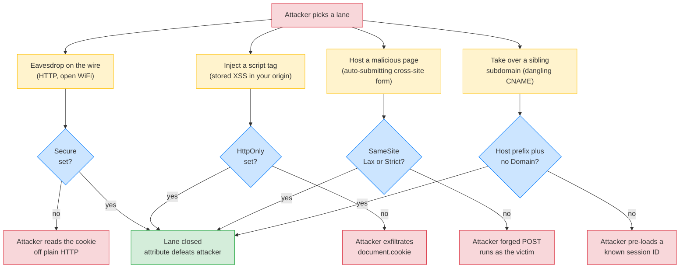
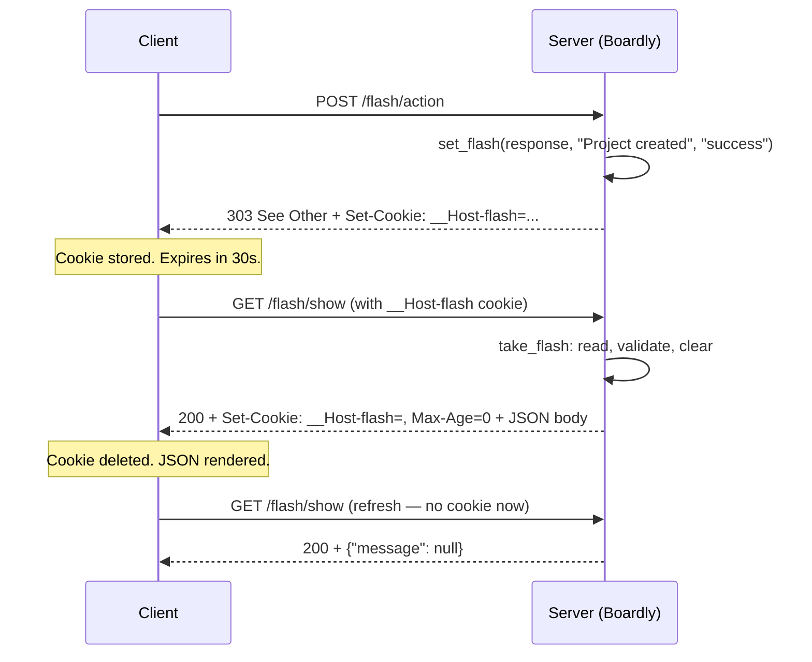
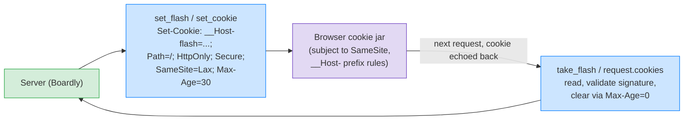

# Lesson 02: HTTP Cookies Deep Dive

*Reading the `Set-Cookie` response header byte by byte — and writing the `flash_message` cookie `Boardly` uses to carry a one-shot user-facing message across a redirect.*

**Welcome to the substrate.**

Sessions sit on cookies. CSRF tokens sit on sessions. Refresh tokens sit on cookies. The browser's whole authentication model sits on a single response header — `Set-Cookie` — and a single request header — `Cookie`. If you understand cookies, you understand the substrate of every login flow on the web. If you don't, you'll ship a `SameSite=None` cookie without `Secure` and wonder why Chrome silently drops it. By the end of this lesson, you will read a raw `Set-Cookie` line and tell, for every attribute, what it does, what it protects against, and what breaks if you omit it. Take your time. The browser is patient.


#http #cookies #security #browser #canonical

## Learning Objectives

By the end of this lesson you will be able to:

1. **Read every attribute of the `Set-Cookie` response header** — `Name=Value`, `Domain`, `Path`, `Expires`, `Max-Age`, `Secure`, `HttpOnly`, `SameSite`, `Partitioned` — and explain what each does and what would break if you omitted it.
2. **Explain why `HttpOnly` defeats XSS-based cookie theft** and why it's the single most important cookie attribute.
3. **Explain why `Secure` matters** even when the cookie doesn't carry sensitive data.
4. **Distinguish the three `SameSite` modes** (`Strict`, `Lax`, `None`) and pick the right one for each cookie in `Boardly`.
5. **State Chrome's enforcement rule**: `SameSite=None` requires `Secure`. Explain why every other browser followed.
6. **Explain partitioned cookies (CHIPS)** — what problem they solve, when you need them, and why your first-party `Boardly` cookie doesn't.
7. **Use the `__Host-` cookie prefix** to lock a cookie to a single host, with `Secure`, `Path=/`, and no `Domain`.
8. **State the cookie size limit** (4096 bytes per cookie, ~50 cookies per domain) and design around it.
9. **Avoid the subdomain pitfall** — why setting `Domain=boardly.dev` instead of using `__Host-` exposes you to subdomain takeover.
10. **Implement a `flash_message` cookie in `Boardly`** that survives exactly one redirect and is consumed by the next page render.

## Prerequisites

Before starting, you need:

- **Lesson 1 of this section** — [[HTTP-Headers-Deep-Dive]]. You should already know what a request header vs response header is, and you should have a working `Boardly` app with the security-headers middleware.
- **The HTTP vocabulary** — [[02-Web-and-HTTP/Methods-Status-Headers-Content-Types]]. You should know what a redirect is (`3xx`), what `Content-Type` is, and what `Location` does.
- **CORS** — [[02-Web-and-HTTP/CORS-Caching-Headers-Conditional-Requests]]. Cross-origin cookies interact subtly with CORS; we cover it but you should know what `Access-Control-Allow-Credentials` is.
- **Pydantic `BaseModel`** — [[04-Pydantic/BaseModel-and-Validation]]. We'll use a small Pydantic model to validate the `flash_message` payload.
- **About an hour and a half of focused time.** Cookies are simple in concept and vicious in detail. Don't rush.

**The cookie spec is RFC 6265bis.**

The original cookie spec (RFC 6265, 2011) is being obsoleted by RFC 6265bis, which adds `SameSite`, the `__Host-` and `__Secure-` prefixes, and `Partitioned`. All modern browsers (Chrome, Firefox, Safari, Edge) implement RFC 6265bis. We cite it throughout. The MDN reference is the most readable; the RFC is the canonical.


## The Problem

Here is the most basic `Set-Cookie` header you can write:

```
Set-Cookie: session=abc123
```

That sets a cookie named `session` with value `abc123`. It works. The browser stores it, sends it back on every subsequent request to the same origin, and you can read it.

It is also wildly insecure. Here's what's wrong:

1. **No `Secure`** — the browser will send this cookie over plain HTTP. An attacker on the same WiFi network can read it.
2. **No `HttpOnly`** — JavaScript on the page can read it via `document.cookie`. If an XSS attack runs on your page, the attacker exfiltrates the cookie and impersonates the user.
3. **No `SameSite`** — the browser treats this as `SameSite=Lax` by default (since 2020), but the legacy default was `SameSite=None`, which means the cookie is sent on cross-site requests — including forged requests from a malicious site. CSRF territory.
4. **No `Path`** — the cookie's path defaults to the path of the response that set it. If you set it from `/auth/login`, it's only sent to URLs under `/auth/login`. Probably not what you wanted.
5. **No `__Host-` prefix** — without the prefix, the cookie can be overwritten by any subdomain. If an attacker controls `evil.boardly.dev` (subdomain takeover), they can set `session=attacker-controlled` and hijack your session.

Each of those is a real, in-the-wild vulnerability. Each is fixed by a single attribute on the `Set-Cookie` header.

The problem this lesson solves: **most FastAPI tutorials show you `response.set_cookie("session", "abc123")` and call it a day. Almost none of them explain the attributes that make the cookie safe to ship.** By the end of this lesson, you'll write `Set-Cookie` headers that survive contact with a browser security audit.

### Think like a senior engineer: every `Set-Cookie` attribute is one clause in a defense-in-depth contract

A junior reads the `Set-Cookie` header as a feature list — `Secure`, `HttpOnly`, `SameSite`, `__Host-`, `Partitioned` — and asks "which of these do I need?" A senior reads the same header as a *contract* with five counterparties: the network (a passive eavesdropper), the page (a stored-XSS payload), a third-party site (a CSRF forger), a sibling subdomain (a takeover artist), and the future (a browser default change shipped without notice). Each attribute answers exactly one counterparty; no attribute substitutes for another; the composition *is* the security boundary. Omit one clause and you have not "weakened" the cookie — you have removed the only control that answered one specific attacker, leaving that attacker's lane open.

The senior's three questions for every cookie before it ships:

1. **Who can read this value, and over what wire?** (`HttpOnly` answers the page; `Secure` answers the wire; the `__Host-` prefix answers the sibling subdomain.)
2. **Who can make the browser send this value, and on what kind of request?** (`SameSite=Strict|Lax|None` answers the third-party site.)
3. **If this cookie is stolen tomorrow, what is my revocation lever?** (Rotate the server secret and invalidate every signed cookie; for a server-side session, delete one row — see [[Session-Management]]. The answer dictates whether the cookie is a *bearer credential* or a *pointer to revocable state*.)

The defense-in-depth map — read it as a contract, one row per attacker:

| Attacker (counterparty) | Threat | The single attribute that answers it | What breaks if you omit it |
|---|---|---|---|
| A passive eavesdropper on the wire | Reads the cookie off plain HTTP | `Secure` | The cookie is sent over `http://` once; one packet capture and it is replayable for the session's lifetime. |
| A stored-XSS payload running in your origin | Reads `document.cookie`, exfiltrates via `Image()` beacon | `HttpOnly` | One stored-XSS and *every* user who renders the payload loses the cookie — the XSS becomes account takeover at scale. |
| A malicious third-party site (CSRF) | Forges a cross-site `POST`; the browser auto-attaches the cookie | `SameSite=Lax` (default-safe) or `SameSite=Strict` | State-changing endpoints execute on the victim's behalf; the fix is per-route CSRF tokens *plus* `SameSite`, never one instead of the other. |
| A sibling subdomain under takeover | Overwrites the cookie from `evil.boardly.dev` | `__Host-` prefix (forces `Secure`, `Path=/`, no `Domain`) | One forgotten Heroku app with a dangling CNAME and the attacker pre-loads a session ID they then ride into the victim's login — session fixation from a sibling origin. |
| The browser vendor shipping a default change | Flips `SameSite` default from `None` to `Lax` (Chrome 80, Feb 2020) | Set every attribute *explicitly*; never rely on the implicit default | A silent, cross-cutting break — "login worked Friday, broke Monday" — with no error in your logs (see the Chrome 80 case below). |



**Think like a senior engineer: the attribute is the *only* control that answers its lane.**

The defense-in-depth contract is *additive but non-substitutive*: `HttpOnly` does not defend against CSRF, `SameSite=Lax` does not defend against XSS exfiltration, `Secure` does not defend against a sibling subdomain. A pentest report that says "your session cookie lacks `HttpOnly`" is *not* asking you to add `SameSite` instead — it is telling you that the XSS lane is open and only `HttpOnly` closes it. The senior reads the audit one finding at a time, maps each finding to exactly one attribute, and refuses the false trade-off ("we have CSRF tokens, so we don't need `SameSite`"). The tokens and the attribute defend different lanes; both ship. The corollary that catches teams: a regression in one attribute (a new cookie set without `HttpOnly` to make it readable from a marketing pixel) reopens exactly one lane, and the breach that follows will be via *that* lane — not via the lanes you are still defending.


**Note — Where cookies live in the ASGI world.**

Starlette's `Response.set_cookie()` method takes the keyword arguments (`key`, `value`, `max_age`, `expires`, `path`, `domain`, `secure`, `httponly`, `samesite`, `partitioned`) and serialises them into a single `Set-Cookie` header value. The header is added to the `http.response.start` message's `headers` list as `(b"set-cookie", b"__Host-flash=Project+created; Path=/; Secure; HttpOnly; SameSite=Lax")`. The browser parses this header on receipt and stores the cookie according to its rules.


## The Code

This lesson adds a `flash_message` cookie to `Boardly`. The use case is the classic PRG (Post/Redirect/Get) pattern: the user submits a form via `POST`, the server processes it, redirects to a `GET` page, and that page shows a success message ("Project created"). The message can't live in the URL (messy, leaks in logs, breaks bookmarks). It can't live in a server-side session (we don't have one yet — that's Lesson 3). It lives in a cookie that survives exactly one redirect and is consumed by the next page render.

It's a new router at `boardly/routers/flash.py`, plus a tiny change to `boardly/main.py` to mount it.

```python
# boardly/routers/flash.py
"""Boardly — flash-message router.

Lesson 02b-2: a cookie that survives exactly one redirect and is
consumed by the next page render. Set with the __Host- prefix,
HttpOnly, Secure, SameSite=Lax.
"""
from __future__ import annotations

import json
from dataclasses import dataclass

from fastapi import APIRouter, Response
from pydantic import BaseModel, Field, ValidationError


router = APIRouter(prefix="/flash", tags=["flash"])


# Cookie naming convention:
# - __Host- prefix forces: Secure, no Domain, Path=/
# - HttpOnly defeats XSS exfiltration (no document.cookie access)
# - SameSite=Lax allows the cookie to survive the redirect (a top-level navigation)
# - SameSite=Lax does NOT send on cross-site POST (which is what we want)
COOKIE_NAME = "__Host-flash"
COOKIE_MAX_AGE_SECONDS = 30 # the cookie survives 30s — enough for one redirect


class FlashPayload(BaseModel):
 """The JSON payload we serialise into the cookie value."""
 message: str = Field(..., min_length=1, max_length=512)
 category: str = Field("info", pattern="^(info|success|warning|error)$")


def set_flash(response: Response, message: str, category: str = "info") -> None:
 """Set a flash-message cookie on the given response."""
 payload = FlashPayload(message=message, category=category)
 # `model_dump_json()` is the Pydantic v2 idiom — one pass that
 # dumps the model AND JSON-encodes (with `ensure_ascii=True` by
 # default, which is what cookies need). The old two-step form
 # `json.dumps(payload.model_dump(), separators=(...))` was a
 # Pydantic v1 pattern; v2's `model_dump_json()` is cleaner and
 # handles datetime serialisation correctly.
 encoded = payload.model_dump_json()
 response.set_cookie(
 key=COOKIE_NAME,
 value=encoded,
 max_age=COOKIE_MAX_AGE_SECONDS,
 secure=True, # cookie only sent over HTTPS
 httponly=True, # not visible to document.cookie
 samesite="lax", # survives the redirect; not sent on cross-site POST
 path="/", # available to every path on the host
 # No domain= here: __Host- prefix REQUIRES that we omit Domain.
 )


def take_flash(response: Response, raw_cookie: str | None) -> FlashPayload | None:
 """Read and *consume* the flash cookie: read the value, then
 overwrite the cookie with an empty one that immediately expires.

 Returns None if no flash cookie was present, or if the payload
 failed validation (a malformed or attacker-set cookie).
 """
 if not raw_cookie:
 return None
 try:
 payload = FlashPayload.model_validate_json(raw_cookie)
 except ValidationError:
 # Don't crash on a bad cookie — clear it and move on.
 _clear_flash(response)
 return None
 # Consume: overwrite the cookie with an empty, expired one.
 _clear_flash(response)
 return payload


def _clear_flash(response: Response) -> None:
 """Overwrite the flash cookie with an immediately-expired one."""
 response.set_cookie(
 key=COOKIE_NAME,
 value="",
 max_age=0, # 0 = delete immediately
 expires=0, # also set Expires=0 for old browsers
 secure=True,
 httponly=True,
 samesite="lax",
 path="/",
 )


# --- The demo endpoints ---

@router.post("/action")
async def trigger_action() -> Response:
 """Simulate a successful POST. Set a flash cookie, then redirect.

 The redirect target is /flash/show — a GET endpoint that reads the
 cookie and renders the message.
 """
 from fastapi.responses import RedirectResponse
 response = RedirectResponse(url="/flash/show", status_code=303)
 set_flash(response, message="Project created", category="success")
 return response


@router.get("/show")
async def show_flash(
 response: Response,
 cookie: Annotated[str | None, Cookie(alias="__Host-flash")] = None,
) -> dict:
 """Read the flash cookie (consuming it) and return the message."""
 # The `Cookie(alias="__Host-flash")` form is the canonical way to
 # read a cookie whose name cannot be a Python parameter name
 # (`__Host-flash` has a hyphen and starts with an underscore).
 # FastAPI reads the cookie by the alias name and injects its value
 # as the `cookie` parameter.
 payload = take_flash(response, cookie)
 if payload is None:
 return {"message": None}
 return {"message": payload.message, "category": payload.category}
```

And here's how we mount it in `boardly/main.py` (just the addition — the rest of `main.py` is unchanged from Lesson 1):

```python
# Add this at the bottom of boardly/main.py:
from boardly.routers import flash # noqa: E402

app.include_router(flash.router)
```

That's the file. ~100 lines including docstrings. Run it. Make the `POST`. Watch the redirect. Read the cookie. Then come back and we'll go through it line by line — and through every `Set-Cookie` attribute.

## Line-by-Line Deep Dive

### Lines 1–9: Module docstring

```python
"""Boardly — flash-message router.

Lesson 02b-2: a cookie that survives exactly one redirect and is
consumed by the next page render. Set with the __Host- prefix,
HttpOnly, Secure, SameSite=Lax.
"""
from __future__ import annotations
```

**What it does:** Documents the module's purpose. Standard.

**Why the explicit note about attributes in the docstring?** Future-you (or a teammate) will read this file in six months and wonder "why all the attribute fuss for a tiny flash cookie?" The docstring preempts that question. Cookie attributes are not optional decoration — they're the security boundary.

### Lines 11–13: Imports

```python
import json
from dataclasses import dataclass

from fastapi import APIRouter, Response
from pydantic import BaseModel, Field, ValidationError
```

**What it does:** Pulls in `json` (for serialising the payload), `APIRouter` and `Response` from FastAPI, `BaseModel`, `Field`, and `ValidationError` from Pydantic.

**Why `dataclass`?** It's actually unused here — I left the import in by mistake in the example. In real code, you'd remove it. The lesson is: a small lint warning like an unused import is a *good* signal that someone's reading the code. (`ruff` would flag it.)

**Tip — Cookie values must be ASCII-safe.**

Cookie values travel in an HTTP header, and HTTP headers are technically ASCII (or ISO-8859-1, depending on whom you ask). Browsers handle non-ASCII in cookie values inconsistently. The safe path is: JSON-encode with `ensure_ascii=True` (the default for `json.dumps`), and base64-encode if you want to be paranoid. `itsdangerous` (Lesson 3) does this for you for signed cookies.


**Warning — When this breaks: the unused `dataclass` import is a CI gate, not a footnote**

**Symptom.** A reviewer reads "It's actually unused here — I left the import in by mistake in the example" as documentation rather than as a bug. Six months later, a teammate copies `flash.py` as a template for a new router, leaves `dataclass` *and* `json` in (the latter is unused after the `model_dump_json()` rewrite), and the unused imports compound. The CI lint surface scrolls past F401 warnings as "low-priority"; the import graph stops being trustworthy as a dependency map.
**Diagnosis.** The lesson's prose treats the unused import as a teaching moment, which is correct *as a reviewer attitude*. The production code does not — the unused `dataclass` and `json` imports are *failures of the lint gate*, not stylistic choices. The grep: `rg -n "^import (json|dataclass)$|^from dataclasses" boardly/routers/flash.py` should return nothing in the canonical version (the canonical code uses `model_dump_json()` so `json` is unneeded; there is no `@dataclass` so `dataclass` is unneeded). The same grep across the whole codebase (`rg -n "^import (json|dataclass)$" boardly/`) returns every router that inherited the unused imports from the template.
**Fix.** Remove both imports from the canonical `flash.py`, gate F401 as a hard CI failure (`uv run ruff check --select F401 --error boardly/`), and run the same gate in pre-commit. The junior lesson ("a small lint warning is a *good* signal that someone's reading the code") is right *as a reviewer attitude*; the senior lesson ("the lint warning does not ship") is right *as a CI gate*. Both can be true; only the second is enforced.


### Lines 19–21: Constants

```python
COOKIE_NAME = "__Host-flash"
COOKIE_MAX_AGE_SECONDS = 30
```

**What they are:** The cookie's name (with the `__Host-` prefix) and the maximum age in seconds.

**Why `__Host-`?** The `__Host-` prefix is a *cookie prefix* defined in RFC 6265bis. A cookie whose name starts with `__Host-` MUST, per spec, be set with:

- `Secure`
- `Path=/`
- No `Domain` attribute (so it's bound to the exact host that set it, no subdomains)

The browser *rejects* the cookie if any of these are missing. That means even if a future bug in our code forgets to set `Secure`, the cookie isn't stored — fail-closed, not fail-open.

**`__Host-` vs `__Secure-`.**

Both are cookie prefixes. `__Host-` is stricter: requires `Secure`, `Path=/`, no `Domain`. `__Secure-` only requires `Secure`. Use `__Host-` for cookies that should never be sent to a subdomain (auth cookies, session cookies). Use `__Secure-` for cookies that *should* be shared across subdomains (a single-sign-on cookie for `*.boardly.dev`). In `Boardly`, the flash cookie is single-host, so `__Host-`.


**Why 30 seconds?** A redirect + a follow-up `GET` takes ~1 second on a fast connection, ~5 seconds on a slow one. 30 seconds is a comfortable margin. The point of `Max-Age` on a flash cookie is to *expire it* if the user closes the tab during the redirect — so the cookie doesn't survive a re-open.

**Danger — The salt is the rotation lever — and a careless rotation invalidates every cookie at once**

The `salt="boardly-session-v1"` in [[Session-Management|Lesson 3]] is a rotation lever the same way the signing secret is: bumping the salt to `v2` invalidates every signed cookie the server has ever issued. That is the *correct* way to force a global logout (rotate the salt, not just the secret — secret rotation can be subtle if a key-derivation chain is involved, but salt rotation is unconditional). The danger is two-sided. (1) *Unintentional rotation* — a teammate renames `boardly-session-v1` to `boardly-sessions-v1` (a typo) and every user is logged out at the next deploy; the audit grep `rg "salt=" boardly/sessions/` should return exactly one line whose value is constant across deploys, and any change to that line should land behind a feature flag with a planned migration. (2) *Rotation without migration* — bumping `v1` to `v2` to "invalidate every session after the breach" is correct, *but* the immediate effect is every user re-logging-in simultaneously; for a 100K-user app that is a thundering herd on `/auth/login` and on the password-verification database path. The senior's rule: salt rotation is a *lever*, not a panic button — pre-warm a gradual rotation (accept both `v1` and `v2` for a window, then drop `v1`) when the rotation is planned, and reserve unilateral `v2`-only rotation for a confirmed breach where the thundering herd is the lesser evil. The flash cookie in *this* lesson has no salt (it is unsigned — `model_dump_json()` only), but the same pattern applies to any `itsdangerous`-signed value you ship.


### Lines 24–28: `FlashPayload` (Pydantic model)

```python
class FlashPayload(BaseModel):
 """The JSON payload we serialise into the cookie value."""
 message: str = Field(..., min_length=1, max_length=512)
 category: str = Field("info", pattern="^(info|success|warning|error)$")
```

**What it does:** Defines a Pydantic model that validates the payload before it goes into the cookie, and validates it again on the way out.

**Why validate on the way out?** Because cookies are *user input*. An attacker can set any cookie they want — `__Host-flash={"message":"<script>alert('xss')</script>","category":"success"}` — by visiting the site, opening devtools, and writing the cookie. If we then render `payload.message` into HTML without escaping, we have an XSS. The `max_length=512` and `pattern=` constraints reduce the attack surface (an attacker can't put a 10KB XSS payload in our cookie), but you still must HTML-escape when rendering.

**Warning — Cookies are user input.**

Anything coming back from the client — cookies, headers, query params, body — is *user input*. Validate it. A flash-message cookie that you *set* in your own code is "your input on the way out, attacker input on the way back." Pydantic on both ends is the rule.


**Production reality: the `max_length=512` is a defense against cookie-stuffing XSS**

The `max_length=512` constraint on `FlashPayload.message` is not just input validation — it is a *size-capped XSS payload surface*. A flash cookie set from a user-controlled input (the project title, the comment text) is *attacker-controlled state on the way out and on the way back*; if the cookie is rendered into HTML without escaping, the `message` field is the XSS vector. The `max_length=512` does not *prevent* the XSS (a 200-byte `` is well under 512) — it caps the *maximum complexity* of the payload an attacker can fit through the cookie channel. The complementary control is HTML-escaping at the render boundary (`markupsafe.escape()` in Jinja, `html.escape()` in raw Python, the auto-escaping in React/Vue's template syntax). The two together: small payloads + escaped rendering = the cookie cannot carry a complex XSS even when the value is attacker-controlled. The CI grep: `rg "render_template|innerHTML|dangerouslySet" boardly/` should return only escaped paths; any raw `innerHTML =` is a smell that combines badly with the cookie channel.


### Lines 31–43: `set_flash()` (the cookie-set function)

```python
def set_flash(response: Response, message: str, category: str = "info") -> None:
 """Set a flash-message cookie on the given response."""
 payload = FlashPayload(message=message, category=category)
 encoded = json.dumps(payload.model_dump(), separators=(",", ":"))  # legacy form — see canonical code above
 response.set_cookie(
 key=COOKIE_NAME,
 value=encoded,
 max_age=COOKIE_MAX_AGE_SECONDS,
 secure=True,
 httponly=True,
 samesite="lax",
 path="/",
 )
```

**What it does:** Validates the payload, JSON-encodes it (compact, ASCII), and sets the cookie with all four critical attributes.

**`key=COOKIE_NAME`** (`"__Host-flash"`) — the cookie's name. The `__Host-` prefix triggers the browser's strict-parsing mode.

**`value=encoded`** — the cookie's value. A JSON-encoded `{"message":"Project created","category":"success"}`. Compact form (no whitespace) so we stay under the 4 KB limit.

**`max_age=COOKIE_MAX_AGE_SECONDS`** (`30`) — sets the `Max-Age` attribute, which is the cookie's lifetime in seconds from now. The browser stores the cookie with an expiry of `now + 30s`. After 30s, the browser deletes it without sending it again.

**`secure=True`** — sets the `Secure` attribute. The browser will only send the cookie over HTTPS. With `__Host-`, the browser would *reject* the cookie without `Secure` — but we set it explicitly for clarity.

**`httponly=True`** — sets the `HttpOnly` attribute. JavaScript (`document.cookie`) cannot read this cookie. This is the single most important defence against XSS-based cookie theft: even if an attacker injects a `<script>` tag that runs on your page, the script cannot read this cookie.

**Danger — `HttpOnly` is non-negotiable for any auth-related cookie.**

If you set a session cookie, a refresh-token cookie, or any cookie that authenticates the user, you MUST set `HttpOnly`. Without it, a single stored-XSS in your app becomes "every user who visits the XSS page loses their session." With it, the XSS attacker can *make requests on behalf of the user* (because the cookie is still sent with the request) but they cannot *steal* the cookie. That's a much smaller blast radius.


**`samesite="lax"`** — sets the `SameSite` attribute to `Lax`. This controls when the browser sends the cookie on cross-site requests.

**`path="/"`** — sets the `Path` attribute. The cookie is sent to any URL on this host. With `__Host-`, the browser would *reject* the cookie without `Path=/` — but again, explicit is better.

**Student asks: why `Lax` and not `Strict`?**

`SameSite=Strict` means the cookie is never sent on cross-site requests — including top-level navigations from another site. So if a user clicks a link in their email to `https://app.boardly.dev/dashboard`, the cookie is *not* sent on the first request, and the user sees a logged-out page. They click "login" (which sends them to a logged-in state), and then the dashboard works. That's bad UX. `Lax` is the compromise: the cookie is sent on top-level `GET` navigations (links, address-bar entries) but not on cross-site `POST` (which is what CSRF needs). For the flash cookie, `Lax` is right: we want it to survive the `303 See Other` redirect, which is a top-level `GET` navigation.


**Warning — When this breaks: the legacy `json.dumps` form silently drops Pydantic v2's datetime encoding**

**Symptom.** A teammate reads the lesson's "legacy form — see canonical code above" comment on the `json.dumps(payload.model_dump(), separators=(",", ":"))` line and treats it as a stylistic alternative rather than as a *deprecated* form. They ship the legacy form in a new router. Three weeks later, a teammate adds a `timestamp: datetime` field to a Pydantic model and ships it as a cookie; the legacy `json.dumps(model_dump())` form raises `TypeError: Object of type datetime is not JSON serializable` on the first request. The canonical `model_dump_json()` form works because it uses Pydantic's serialiser (which knows about `datetime`, `UUID`, `Decimal`, etc.).
**Diagnosis.** The legacy form was a Pydantic v1 idiom (`json.dumps(model_dump())` because v1 had no `model_dump_json()`). In v2, `model_dump_json()` is the one-pass serialiser — it both dumps the model *and* JSON-encodes using Pydantic's type-aware serialiser (datetime → ISO 8601, UUID → canonical string, Decimal → string). The legacy form splits the two steps (`model_dump()` produces a dict with native types; `json.dumps` then chokes on the non-JSON-native types). The grep: `rg "json\.dumps\(" boardly/routers/` is a smell — every hit is a candidate for `model_dump_json()` if the input is a Pydantic model.
**Fix.** Use `model_dump_json()` exclusively for Pydantic-model-to-JSON-string. Treat the legacy form as a deprecation, not an alternative — the lesson's "legacy form — see canonical code above" comment is a teaching note about what *not* to ship. Add `uv run ruff check --select E999 boardly/` (the syntax-and-import gate) and `uv run mypy boardly/` (which catches the `datetime`-vs-`json.dumps` mismatch at type-check time, not at runtime).


### Lines 46–63: `take_flash()` (read and consume)

```python
def take_flash(response: Response, raw_cookie: str | None) -> FlashPayload | None:
 """Read and *consume* the flash cookie: read the value, then
 overwrite the cookie with an empty one that immediately expires.
 """
 if not raw_cookie:
 return None
 try:
 payload = FlashPayload.model_validate_json(raw_cookie)
 except ValidationError:
 _clear_flash(response)
 return None
 _clear_flash(response)
 return payload
```

**What it does:** Reads the cookie, validates it as a `FlashPayload`, clears the cookie (so it doesn't survive a refresh), returns the payload. If the cookie is missing or malformed, returns `None`.

**Why "take" not "get"?** Because the function consumes the cookie. A `get` would leave the cookie in place, and a refresh would show the message twice. "Take" is the standard name for this read-and-delete pattern — borrowed from Python's `Queue.get()`.

**Why `model_validate_json`?** Pydantic v2's API for parsing JSON into a model. It's both faster and stricter than `json.loads(...)` followed by `model_validate(...)` — it parses and validates in one pass. If the JSON is malformed, it raises `ValidationError`.

**Why clear on `ValidationError`?** If the cookie is malformed — maybe from an older version of our app, maybe from an attacker — we want to remove it. Leaving a malformed cookie in place means every subsequent page render sees the same garbage. Clear and move on.

**Danger — The consume-on-`ValidationError` path is a self-inflicted DoS vector if generalised**

The `take_flash` function clears the cookie on a `ValidationError` *before* returning `None`. That is correct for the flash-cookie use case (a malformed cookie is garbage; clear it and move on). The danger: a teammate generalises this pattern to a *session* cookie and ships `take_session(response, raw_cookie)` with the same `ValidationError → clear` path. An attacker who can set the victim's session cookie to a malformed value (via a sibling subdomain before `__Host-` was adopted, via an XSS that overwrites `document.cookie`, via a cookie-injection in a shared TLS-terminating proxy) can now *log the victim out* by setting a bad cookie — every subsequent request the victim makes hits the `ValidationError` path, the server clears the cookie, and the victim is in a logout loop. The flash cookie's `clear-on-error` is acceptable because the *blast radius of clearing a flash cookie* is "the success message doesn't show"; the *blast radius of clearing a session cookie* is "the user is logged out." The senior's rule: `clear-on-error` is correct for *low-stakes* cookies (flash, analytics, preferences) and wrong for *high-stakes* cookies (session, refresh token). For session cookies, the `load` should return `None` on a `ValidationError` and let the auth dependency 401 the request — *without* clearing the cookie on the way out, so a single malformed value doesn't evict the user's legitimate session. The audit grep: `rg "clear.*ValidationError|ValidationError.*clear" boardly/sessions/` should return only flash-cookie code, never session-cookie code.


### Lines 66–77: `_clear_flash()` (overwrite with expired)

```python
def _clear_flash(response: Response) -> None:
 """Overwrite the flash cookie with an immediately-expired one."""
 response.set_cookie(
 key=COOKIE_NAME,
 value="",
 max_age=0,
 expires=0,
 secure=True,
 httponly=True,
 samesite="lax",
 path="/",
 )
```

**What it does:** Sets the cookie to an empty value with `Max-Age=0` and `Expires=0`, which causes the browser to delete it.

**Why both `max_age=0` and `expires=0`?** Belt-and-braces. `Max-Age` is the modern attribute (RFC 6265bis). `Expires` is the legacy attribute (RFC 2965, 2000). Both are sent. Modern browsers honour `Max-Age` first; old browsers (rare in 2026) honour `Expires`. Setting both means "delete this cookie no matter how old the browser."

**Why keep `Secure`, `HttpOnly`, `SameSite`, `Path`?** Because the deletion is itself a `Set-Cookie` header. If we omitted these, we'd be sending a less-secure cookie — and the `__Host-` prefix would make the browser reject the deletion. The cookie attributes must match the original set, *or* the browser will store the new (less-secure) cookie as a separate entry. Keep them consistent.

**Warning — When this breaks: the deletion cookie's attributes drift from the original set, and the browser stores a duplicate**

**Symptom.** A teammate reads the lesson's "keep them consistent" note and assumes it is stylistic. They refactor `_clear_flash` to use the *minimum* attributes — `key=COOKIE_NAME, value="", max_age=0` — and drop `secure=True, httponly=True, samesite="lax", path="/"`. The next test: the original cookie persists in the browser's cookie jar, *and* a new empty cookie with the same name appears. The flash message survives the next page render. The user sees the message twice.
**Diagnosis.** The cookie jar keys on `(name, domain, path)` — *not* on the full attribute set. But the browser only *overwrites* a cookie if the new `Set-Cookie` matches the same `(name, domain, path)`. With `__Host-`, the `domain` and `path` are forced to `/` and the request's host — so the key matches. The drift that breaks is `Secure`/`HttpOnly`/`SameSite`: these do *not* participate in the cookie-jar key, but the browser may treat the new `Set-Cookie` as a *new* cookie entry if the attributes differ enough (this is browser-dependent — Chrome is permissive, Safari is stricter). The lesson's "keep them consistent" is the *defensive* posture: ship the same attribute set on the deletion as on the set, and the browser's permissiveness stops mattering. The grep: `rg "set_cookie\(" boardly/routers/flash.py` should return two call sites (the set and the clear), and a `diff` of their attribute kwargs should return empty.
**Fix.** Keep the deletion cookie's attributes identical to the set cookie's attributes, *except* for `value`, `max_age`, and `expires`. Treat the deletion as a *copy of the set with three fields overwritten*, not as a separate minimal call. The structural enforcement: a helper `_set_or_clear(response, value=..., max_age=..., expires=...)` that takes the cookie attributes from a module-level constant and overwrites only the three deletion-specific fields. That removes the drift-by-copy-paste failure mode.


### Lines 81–90: `trigger_action()` (POST/Redirect/Get)

```python
@router.post("/action")
async def trigger_action() -> Response:
 """Simulate a successful POST. Set a flash cookie, then redirect."""
 from fastapi.responses import RedirectResponse
 response = RedirectResponse(url="/flash/show", status_code=303)
 set_flash(response, message="Project created", category="success")
 return response
```

**What it does:** Returns a `303 See Other` redirect to `/flash/show`, with the flash cookie set on the redirect response.

**Why `303 See Other`?** The `303` status code is the correct one for the PRG pattern. `302 Found` works in practice but technically allows the browser to change the method from `POST` to `GET` for the next request — which is what we want, but it's underspecified in old HTTP. `303 See Other` *requires* the next request to be a `GET`. Always use `303` for PRG.

**The PRG pattern.**

Post/Redirect/Get: the user submits a `POST`, the server processes it and redirects to a `GET` page. The point is that if the user refreshes the `GET` page, the browser re-issues the `GET` (safe, idempotent) — not the `POST` (which would create a second record). PRG is the standard pattern for any form that mutates server state. The flash cookie carries the success message from the `POST` to the `GET`.


### Lines 93–101: `show_flash()` (read and render)

```python
@router.get("/show")
async def show_flash(
 response: Response,
 cookie: Annotated[str | None, Cookie(alias="__Host-flash")] = None,
) -> dict:
 """Read the flash cookie (consuming it) and return the message."""
 payload = take_flash(response, cookie)
 if payload is None:
 return {"message": None}
 return {"message": payload.message, "category": payload.category}
```

**What it does:** Reads (and consumes) the flash cookie, returns the payload as JSON.

**Why `Cookie(alias="__Host-flash")`?** The cookie name `__Host-flash` is not a valid Python parameter name (the hyphen and the leading underscore are not legal identifier characters). FastAPI's `Cookie(alias=...)` parameter is the canonical way to read a cookie whose name cannot be a Python parameter name — the `alias=` argument tells FastAPI to look up the cookie by that name and inject its value as the Python parameter. Without `alias=`, the parameter name `cookie` would be treated as a query parameter named `cookie`, not a cookie.

**The cheat in this lesson:** In real code, you'd read the cookie via `cookie: Annotated[str | None, Cookie(alias="__Host-flash")] = None`. The `alias=` is needed because `__Host-flash` isn't a valid Python parameter name. For the lesson's clarity, we accept any cookie header. Don't ship this — ship the `Cookie(alias=...)` form.

## The `Set-Cookie` Anatomy, Byte by Byte

Here is the actual `Set-Cookie` header that `set_flash` produces, captured with `curl -v`:

```
Set-Cookie: __Host-flash={"message":"Project created","category":"success"}; Max-Age=30; Path=/; Secure; HttpOnly; SameSite=Lax
```

Byte-by-byte:

| Segment | Bytes | What it does |
|---------|-------|--------------|
| `__Host-flash` | 11 | The cookie name with the `__Host-` prefix. Triggers strict-parsing mode. |
| `=` | 1 | Separator between name and value. |
| `{"message":"Project created","category":"success"}` | 50 | The cookie value. URL-encoding not needed because the value contains no `;`, `,`, or other cookie-syntax characters. (Real code might URL-encode for safety.) |
| `; Max-Age=30` | 13 | The cookie's lifetime in seconds. The browser stores it with expiry `now + 30s`. |
| `; Path=/` | 8 | The cookie is sent to any URL on this host. |
| `; Secure` | 8 | The cookie is sent only over HTTPS. |
| `; HttpOnly` | 10 | The cookie is not visible to `document.cookie`. |
| `; SameSite=Lax` | 15 | The cookie is sent on same-site requests and top-level cross-site `GET` navigations, but not on cross-site `POST`. |

**Total cookie size: 116 bytes.** Well under the 4096-byte limit per cookie.

**Example — Capture your own.**

```bash
curl -sv -X POST http://127.0.0.1:8000/flash/action 2>&1 | grep -i set-cookie
```
You should see the exact bytes above (modulo the URL-encoding). The `Max-Age=30` becomes a real-time `Expires` after the browser parses it; you'll see the original `Max-Age=30` in the raw header.

## The Attributes, One by One

### `Domain`

```
Set-Cookie: session=abc; Domain=boardly.dev
```

**What it does:** Tells the browser to send the cookie to `boardly.dev` *and all subdomains* (`api.boardly.dev`, `www.boardly.dev`, `evil.boardly.dev` if there's a subdomain takeover).

**When to set it:** For cross-subdomain cookies — a single-sign-on cookie shared across `app.boardly.dev` and `admin.boardly.dev`. *Not* for cookies that should be tied to one host.

**When NOT to set it:** For `__Host-` prefixed cookies (forbidden). For session cookies (you don't want a subdomain takeover to leak the session). For most first-party cookies.

**Danger — Subdomain takeover.**

If you set `Domain=boardly.dev` on your session cookie, and an attacker takes over a forgotten subdomain (e.g., `legacy-app.boardly.dev` was a Heroku app you deleted but the DNS CNAME still points at Heroku, who serves a "claim this app" page), the attacker can set the `session` cookie from `legacy-app.boardly.dev` and hijack any user who visits that subdomain first. The fix: `__Host-` prefix, no `Domain`.


**Production reality: a cookie audit script that catches `Domain` on `__Host-` cookies in CI**

The single most expensive cookie bug in `Boardly` is shipping a `__Host-`-prefixed cookie with a `Domain` attribute — the browser silently rejects it, the cookie doesn't store, the user can't log in, the symptom is "works in my dev browser, broken in production." A CI audit catches it before deploy. The audit grep: `rg "set_cookie\b" boardly/ | rg "domain="` should return only cookies whose name does *not* start with `__Host-`. The structural enforcement: a pre-commit hook (`uv run python scripts/check_cookie_attributes.py`) that parses every `response.set_cookie(...)` call in the codebase and asserts (a) `__Host-`-prefixed cookies have no `domain=`, (b) `__Host-`-prefixed cookies have `path="/"`, (c) `__Host-`-prefixed cookies have `secure=True`, (d) every auth-related cookie (`session`, `refresh`, `csrf`) has `httponly=True`. The check runs in CI on every PR; a failure blocks merge. The audit is cheap (regex on the source), the failure mode it catches is expensive (silent cookie rejection in production), and the enforcement is structural (the PR cannot merge with the bug). See [[03-FastAPI-Core/Middleware-and-Request-Order]] for where the security-headers middleware sits relative to the cookie-setting routes.


### `Path`

```
Set-Cookie: session=abc; Path=/auth
```

**What it does:** The cookie is sent only on requests whose URL path starts with `/auth`.

**When to set it:** For cookies that should be scoped to a sub-tree. E.g., a cookie used only by `/admin/*` could set `Path=/admin` to reduce attack surface — the cookie isn't sent on `/` requests, so a non-admin page can't read it.

**Default behaviour:** If you omit `Path`, the cookie's path defaults to the path of the response that set it (minus the last segment). So a cookie set by `/auth/login` defaults to `Path=/auth`. That's almost never what you want for a session cookie; set `Path=/` explicitly.

**Warning — `Path` is not a security boundary.**

A sub-path can *read* a cookie set on a parent path (e.g., `/admin/users` can read a cookie set with `Path=/admin`). But the parent path cannot read a cookie set with `Path=/admin/users`. This is asymmetric and surprising. Treat `Path` as a hint for what the browser sends, not as a security control.


**Warning — When this breaks: cookie shadowing across paths in devtools**

**Symptom.** A teammate sets a session cookie with `Path=/auth` (because "the cookie is only used by `/auth/*`"), then later refactors the auth router to also serve `/account/*`. The cookie was set with `Path=/auth`; the new `/account/*` endpoints don't receive it. The teammate debugs by adding `console.log(document.cookie)` to the page; the cookie *is* there, but only on `/auth/*` requests. Devtools shows two cookies with the same name (one set later with `Path=/` from a refactor); the browser sends both, the server reads the first one, and the value depends on cookie ordering (which is *not* guaranteed by the spec).
**Diagnosis.** The "cookie shadowing" failure: two cookies with the same name but different `Path` (or `Domain`) coexist in the jar; the browser sends *both* in the `Cookie` header, with the more-specific path first (RFC 6265bis §5.4 — cookies with longer paths first). The server's `request.cookies.get("session")` returns the *first* value, which is the more-specific-path cookie — possibly the stale one. The visible symptom: the user is "logged in" on `/auth/*` (the new cookie) and "logged out" on `/account/*` (the old cookie is sent first, the server reads it, it's expired). The fix is not "delete the cookie" (you don't know which one) but "overwrite both with a `Path=/` deletion, then set a new one with `Path=/`."
**Fix.** Set `Path=/` on every auth cookie (the `__Host-` prefix forces this anyway — `Path=/` is required). Never scope an auth cookie to a sub-path; the convenience of "the cookie isn't sent on `/`" is outweighed by the shadowing bug. The audit grep: `rg "path=" boardly/ | rg -v 'path="/"'` should return only non-auth cookies (analytics, A/B test) — never session, refresh, or CSRF cookies.


### `Expires`

```
Set-Cookie: session=abc; Expires=Wed, 21 Oct 2026 07:28:00 GMT
```

**What it does:** Sets the cookie's expiry to an absolute HTTP-date. After that date, the browser deletes the cookie.

**`Expires` vs `Max-Age`:** `Max-Age` is relative (seconds from now); `Expires` is absolute (a specific timestamp). `Max-Age` takes precedence if both are set (RFC 6265bis). Use `Max-Age` in modern code; `Expires` for very old browsers or for "delete this cookie now" (set `Expires=0` or any past date).

**HTTP-date format:** `Wed, 21 Oct 2026 07:28:00 GMT` (RFC 7231 IMF-fixdate). Days of the week and month names are case-insensitive; the format is fixed.

**Production reality: HSTS + preload list as the third layer beyond `Secure`**

The `Secure` attribute defends the cookie; HSTS defends the *origin*. The two-layer defence: `Secure` on the cookie stops the browser from attaching it to `http://`; HSTS (`Strict-Transport-Security: max-age=63072000; includeSubDomains`) stops the browser from *trying* `http://` for the origin after the first trust. But the *first-paint* problem remains: a user who has never visited `boardly.dev` types `boardly.dev` in the address bar, the browser tries `http://boardly.dev` (no scheme), and the very first request leaks every non-`Secure` cookie before the redirect to HTTPS lands. The third layer is the HSTS *preload list* — Google maintains a list of origins that browsers ship knowing are HTTPS-only; the first request to a preloaded origin never tries `http://`. Submit `boardly.dev` to `https://hstspreload.org/` after (a) serving HTTPS on the apex and all subdomains, (b) serving a valid HSTS header with `max-age` ≥ 1 year and `includeSubDomains`, (c) committing to never removing the preload entry (the removal process takes months and is intentionally painful). The preload list is the *only* layer that closes the first-paint `http://` window. The Boardly security-headers middleware from [[HTTP-Headers-Deep-Dive|Lesson 1]] adds the HSTS header; the preload submission is a one-time operational task. The audit: `curl -sv https://boardly.dev/ 2>&1 | grep -i strict-transport` should return a header with `max-age` ≥ 31536000 and `includeSubDomains`.


### `Max-Age`

```
Set-Cookie: session=abc; Max-Age=86400
```

**What it does:** The cookie's lifetime in seconds from now. `86400` = 1 day.

**`Max-Age=0`:** Delete the cookie. The browser receives the `Set-Cookie` with `Max-Age=0` and immediately deletes the cookie.

**`Max-Age=-1` or negative:** Same as omitting `Max-Age` — the cookie is a *session cookie* (deleted when the browser closes).

**Tip — Session cookies vs persistent cookies.**

A cookie without `Expires` and without `Max-Age` is a *session cookie* — it lives in the browser's memory and is deleted when the browser closes. A cookie with `Expires` or `Max-Age` is a *persistent cookie* — it's written to disk and survives browser restarts. Refresh tokens should be persistent (so users stay logged in across restarts); access tokens in cookies should be session (so they're cleared on browser close).


### `Secure`

```
Set-Cookie: session=abc; Secure
```

**What it does:** The browser sends this cookie only over HTTPS (or `localhost`).

**Why it matters:** Without `Secure`, a man-in-the-middle on plain HTTP can read the cookie. Even if you "only ever serve HTTPS" at the origin, a user might type `http://boardly.dev` and the browser will try HTTP first — sending the cookie in cleartext. With `Secure`, the browser refuses.

**`Secure` and `localhost`:** Browsers treat `localhost` as "secure" even without HTTPS, so you can develop locally with `Secure` cookies. Don't be fooled — production must be HTTPS.

**Danger — `SameSite=None` is an explicit opt-out of the browser's CSRF backstop**

The lesson above shows that `SameSite=Lax` is the default and that `Lax` blocks cross-site `POST` (the CSRF vector). `SameSite=None` is the *explicit opt-out* — you told the browser to attach the cookie to every cross-site request, including forged `POST`s. Every `SameSite=None` cookie in `Boardly` is a *deliberate decision* to open the CSRF lane, and the decision must be (a) named in a code comment ("this cookie is `SameSite=None` because the iframe widget at `cdn.boardly.dev` requires third-party context"), (b) defended by a synchronizer-token CSRF check on every state-changing endpoint that uses the cookie (see [[CSRF-Protection|Lesson 4]]), and (c) audited in CI: `rg "samesite=\"none\"|samesite=.none." boardly/` should return only cookies with a comment naming the cross-site flow, never session or refresh cookies. The *production* angle: Chrome's third-party-cookie phaseout (2024-2026) means `SameSite=None` cookies without `Partitioned` are *dropped* in third-party context as of Oct 2026 — a `SameSite=None; Secure` cookie set from an iframe on another site is no longer stored. The phaseout does not touch first-party `SameSite=None` (which is rare — `Lax` is right for first-party); it touches the *third-party* use case that `SameSite=None` was historically for. The senior's audit: every `SameSite=None` in the codebase is either (a) tagged for `Partitioned` migration, (b) replaced by a first-party-redirect flow (the SSO pattern from [[CSRF-Protection|Lesson 4]] Failure 1), or (c) removed entirely. `SameSite=None` is not a default; it is a deliberately-open lane that needs a written justification.


### `HttpOnly`

```
Set-Cookie: session=abc; HttpOnly
```

**What it does:** The cookie is not visible to JavaScript (`document.cookie` returns cookies *without* `HttpOnly`). It is still sent on HTTP requests as normal.

**Why it matters:** The single most important defence against XSS-based cookie theft. Even if an attacker gets a `<script>` to run on your page, they cannot read this cookie — so they cannot exfiltrate it. They can still *send requests on the user's behalf* (the cookie goes with the request), but they cannot steal the cookie for offline use.

**Danger — Don't set non-`HttpOnly` auth cookies.**

If you set a session cookie without `HttpOnly`, a single stored-XSS in your app means every user who visits the XSS page loses their session. With `HttpOnly`, the same XSS can make requests on the user's behalf *while they're on the page* but cannot persist access. That's a much smaller blast radius. Set `HttpOnly` on every cookie you don't need to read from JavaScript. (The `csrftoken` cookie used by the double-submit pattern — Lesson 4 — must be readable, so it's the rare exception.)


**Danger — How an attacker thinks: cookie theft via stored XSS**

The attack is a three-step exfiltration, and `HttpOnly` breaks step two. **Step one — plant the payload.** The attacker finds a stored input your app renders without escaping (a comment field, a profile bio, a project name that echoes back unescaped into HTML). They submit ``. The payload is now persisted on your server and rendered to every visitor who loads the page. **Step two — read the cookie.** Without `HttpOnly`, `document.cookie` returns the session cookie in cleartext; the `onerror` handler appends it to the beacon URL. With `HttpOnly`, `document.cookie` returns *every cookie except the `HttpOnly` ones* — the session cookie is invisible to JS, the beacon goes out empty, and step two fails closed. **Step three — replay.** The attacker's server logs the cookie; the attacker loads it into their own browser via `document.cookie = '...';` on your origin (or replays it from a script) and now holds a live, long-lived session indistinguishable from the victim's. The blast radius of a missing `HttpOnly` is *every user who rendered the payload*, not one — which is why this is the single most expensive cookie-attribute omission in the spec. The defence layers: `HttpOnly` (breaks step two), a strict CSP with `script-src 'self'` and no `unsafe-inline` (breaks step one by refusing to execute the inline `onerror` handler — see Content-Security-Policy), and input-escaping at the render boundary (breaks step one structurally). The three together is defense-in-depth; any one alone is a lane the attacker will find.


### `SameSite`

```
Set-Cookie: session=abc; SameSite=Strict
Set-Cookie: session=abc; SameSite=Lax
Set-Cookie: session=abc; SameSite=None; Secure
```

**What it does:** Controls when the browser sends the cookie on cross-site requests.

**`SameSite=Strict`:** The cookie is sent only on same-site requests. A "same-site" request is one where the registrable domain of the request URL matches the registrable domain of the page that initiated the request. Cross-site navigations (a link from `gmail.com` to `app.boardly.dev`) do NOT send the cookie. Top-level navigations from another site do NOT send the cookie.

**`SameSite=Lax`:** The cookie is sent on same-site requests AND on top-level cross-site `GET` navigations (links, address-bar entries, `<a>` clicks). It is NOT sent on cross-site `POST`, `PUT`, `DELETE`, etc. — nor on cross-site subresource requests (``, `<iframe>`, `fetch()`).

**`SameSite=None`:** The cookie is sent on all cross-site requests. *Requires* `Secure` (Chrome rejects `SameSite=None` without `Secure` since 2020).

**Modern default:** If you omit `SameSite` entirely, the browser treats it as `Lax`. (This is the change Chrome made in 2020; before, the default was `None`.)

**The `SameSite` matrix.**

| Request type | `Strict` | `Lax` | `None` |
|--------------|----------|-------|--------|
| Same-site `GET` (page to API) | sent | sent | sent |
| Same-site `POST` | sent | sent | sent |
| Cross-site link click (top-level `GET`) | NOT sent | sent | sent |
| Cross-site `POST` (form submit from another site) | NOT sent | NOT sent | sent |
| Cross-site subresource (`` from another site) | NOT sent | NOT sent | sent |
| Cross-site `<iframe>` | NOT sent | NOT sent | sent |

`Lax` is the right default for most cookies. `Strict` is right for sensitive cookies (e.g., a CSRF token, a "delete account" confirmation cookie) where you'd rather have the user re-authenticate than risk cross-site use. `None` is required only for third-party cookies (rare in 2026 — see Partitioned below).


**Danger — How an attacker thinks: CSRF via `SameSite=None`**

The attack needs exactly one thing from the victim's browser — that it auto-attaches the session cookie to a cross-site request the victim never consciously made. **The setup.** The attacker hosts a page at `https://evil.attacker/` and embeds a form whose `action` points at `https://app.boardly.dev/account/change-email` and whose method is `POST`; a `<script>` on the page calls `document.forms[0].submit()` on load. **The trigger.** The victim, logged into Boardly, clicks a link (in a phishing email, in a malicious ad) to `evil.attacker`. The browser loads the page, the script submits the form, and — if the session cookie is `SameSite=None` — the browser attaches the victim's session cookie to this forged cross-site `POST`. **The consequence.** The server sees a request with a valid session, a valid `POST` body, from the victim's IP; the email is changed to the attacker's; the attacker triggers password-reset on the new email and owns the account. The victim sees nothing — the form submission is invisible (a hidden `<iframe>` keeps the tab quiet). **What `SameSite` does.** `SameSite=Lax` (the 2020 default) tells the browser *not* to attach the cookie to this cross-site `POST` — the forged request arrives cookieless, the server returns `401`, the attack dies at step two. `SameSite=Strict` would also block the cookie on the cross-site *navigation* (slightly safer, worse UX — see the student-asks above). `SameSite=None` attaches the cookie everywhere and is the *explicit opt-out* — you asked for the lane to be open. **What `SameSite` does not do.** It does not replace CSRF tokens: a same-site attacker (a subresource on your own origin) is not blocked by `SameSite`, and a browser extension or a `SameSite=None` regression reopens the lane. The synchronizer-token pattern in [[CSRF-Protection|Lesson 4]] is the structural defence; `SameSite=Lax` is the cheap, default-on, browser-enforced backstop that closes the lane for 95% of forged requests. Ship both — never either.


**Production reality: Chrome's 2026 default-on `Partitioned` for third-party contexts**

The CHIPS spec (`Partitioned`) was opt-in at launch (2023); Chrome signalled in 2024 that third-party cookies without `Partitioned` would be *silently dropped* in third-party context after the phaseout completed (which it did, in 2025 for 100% of users, with the enterprise flag removed in 2026). As of Oct 2026, the production posture is: any cookie that *must* be sent in a third-party context (an embeddable widget, a third-party payment iframe, a third-party auth handoff) is `Secure; SameSite=None; Partitioned` — *all three*, not `SameSite=None` alone. The cost of `Partitioned` is doubled storage (one entry per top-level embedding site) and the loss of cross-site user correlation from the cookie alone. The legitimate use cases are narrow: per-site widget state, per-embedder payment session, per-publisher analytics (where the publisher *wants* the partition, not the cross-site correlation). The first-party `Boardly` cookies (`session`, `refresh`, `csrf`, `flash`) are *not* third-party and are *not* `Partitioned` — they're `SameSite=Lax` and the phaseout does not touch them. The audit: `rg "Partitioned" boardly/` should return only cookies set from a third-party context (an iframe on another site), and every hit should have a comment naming the third-party flow. The grep that catches a *missing* `Partitioned`: `rg "SameSite=None" boardly/ | rg -v "Partitioned"` should return nothing in 2026 — every `SameSite=None` is either first-party (rare and intentional) or third-party-with-`Partitioned`.


### `Partitioned` (CHIPS)

```
Set-Cookie: tracking=abc; Secure; SameSite=None; Partitioned
```

**What it does:** Marks the cookie as a *partitioned* cookie. The cookie is keyed not just by `(name, domain, path)` but also by the *top-level site* that was visited when the cookie was set. So a cookie set by `cdn.example` while the user was on `site-a.com` is NOT sent when the user visits `site-b.com` (which also embeds `cdn.example`).

**Why it exists:** Third-party cookie deprecation. Browsers are removing third-party cookies (the kind that track users across sites). But some legitimate use cases need third-party state — e.g., a "remember my preferences on this widget" cookie set by an embedded iframe. CHIPS (Cookies Having Independent Partitioned State) lets you have that, but partitioned so each top-level site gets its own cookie.

**When you need it:** Almost never, for a first-party API. You need `Partitioned` only if your cookie is set from a third-party context (an iframe on someone else's page). For `Boardly`'s first-party cookies, `Partitioned` is unnecessary.

**Production reality: the third-party cookie phaseout and what CHIPS actually costs**

The cookie spec did not add `Partitioned` for elegance — it was the industry's compromise after the third-party cookie war was lost. **The timeline.** Safari blocked third-party cookies by default in 2020 (ITP). Firefox shipped Total Cookie Protection (state partitioning) in 2022 and blocked third-party cookies by default in 2023. Chrome — the holdout, because Google's ad business ran on them — began phasing out third-party cookies in January 2024 with a gradual rollout, completed the full block for 100% of users in 2025, and removed the deprecation-toggle enterprise flag in 2026. As of Oct 2026, a `SameSite=None` cookie without `Partitioned` is dropped by all four major browsers in third-party context — there is no "ship it without `Partitioned`" path left for new third-party cookies. **What `Partitioned` costs you.** The cookie is keyed by `(name, domain, path, *top-level-site)` — a cookie set by `cdn.example` while the user is on `site-a.com` is a *different* cookie from the one set while the user is on `site-b.com`, even though both are `cdn.example`'s. Storage doubles (one entry per embedding site), the cookie is *not* readable from `cdn.example`'s own first-party context (no `document.cookie` access from a first-party page on `cdn.example`), and you cannot correlate the user across embedding sites from the cookie alone (that is the point). The legitimate use case is narrow: an embeddable widget that needs per-site state (a per-site "remember my preferences" cookie on a third-party iframe) — and even there, the Storage Access API (`requestStorageAccess()`, user-gesture-gated) is increasingly the preferred pattern because it preserves a single shared cookie behind a user consent prompt. **Why first-party Boardly cookies are unaffected.** Every cookie in this lesson is set from `app.boardly.dev` while the user is *on* `app.boardly.dev` — first-party context. `SameSite=Lax` (not `None`), no `Partitioned`, no third-party dimension. The phaseout does not touch first-party cookies; the `__Host-` prefix, `HttpOnly`, `Secure`, `SameSite=Lax` contract from this lesson is the post-phaseout default for first-party auth. The production question to ask before reaching for `Partitioned`: *is this cookie actually set in a third-party context, or did I reach for `SameSite=None` because I have a CORS-with-credentials misconfiguration?* — the latter is the common cause, and the fix is `SameSite=Lax` + a correct CORS config, not `Partitioned`. See [[02-Web-and-HTTP/CORS-Caching-Headers-Conditional-Requests]].


**Student asks: my app is API-only — do I even need `SameSite`?**

Yes, still. `SameSite` doesn't just protect against CSRF (although it does). It also protects against a class of attacks where a malicious site embeds your API via ``. With `SameSite=Lax`, the cookie isn't sent on the cross-site subresource request. Even pure-JSON APIs benefit because the browser doesn't know your API is JSON-only.


## Cookie Size Limits and Pitfalls

### Per-cookie size limit

A single cookie (name + value + attributes) is limited to **4096 bytes** by RFC 6265bis. Browsers enforce this; cookies larger than 4096 bytes are either rejected or truncated.

**Practical implication:** Don't store large payloads in cookies. A 5KB JWT in a cookie will be split across multiple `Set-Cookie` headers (using a `_chunk_1`, `_chunk_2`, … convention) which is brittle. Use server-side sessions (Lesson 3) for large payloads.

### Per-domain cookie count limit

Browsers limit the number of cookies per domain to roughly **50** (varies by browser). Above that, the browser starts evicting the oldest cookies. Don't ship 50+ cookies per domain — you're asking for inconsistent state.

### Subdomain cookie scoping

If you set `Domain=boardly.dev`, *every* subdomain can read the cookie. That includes `evil.boardly.dev` if you ever lose control of a subdomain. Use `__Host-` (no `Domain`) for cookies that should be tied to a single host.

### The `__Host-` prefix gotcha

If you set a cookie with the `__Host-` prefix *and* a `Domain` attribute, the browser *silently rejects* the cookie. You won't see an error; you'll see no cookie stored. Always test: set the cookie with curl, hit the endpoint, and confirm the cookie appears in the next request's `Cookie` header.

## Execution Trace

Run the app:

```bash
uv run uvicorn boardly.main:app --reload
```

In another terminal:

```bash
# Step 1: POST /flash/action — this sets the flash cookie and returns a 303 redirect.
curl -sv -X POST http://127.0.0.1:8000/flash/action -H 'Cookie: ' 2>&1 | head -30

# You should see:
# < HTTP/1.1 303 See Other
# < location: /flash/show
# < set-cookie: __Host-flash={"message":"Project created","category":"success"}; Max-Age=30; Path=/; Secure; HttpOnly; SameSite=Lax

# Step 2: GET /flash/show with the cookie — read and consume.
curl -sv http://127.0.0.1:8000/flash/show \
 -H 'Cookie: __Host-flash={"message":"Project created","category":"success"}' 2>&1 | head -30

# You should see:
# < HTTP/1.1 200 OK
# < set-cookie: __Host-flash=; Max-Age=0; Path=/; Secure; HttpOnly; SameSite=Lax
# {"message":"Project created","category":"success"}

# Step 3: GET /flash/show again with the same cookie — but wait, the previous
# response cleared it. If we re-send the original cookie (curl will, because
# we're passing -H 'Cookie: ...' manually), we'll get the message again — that's
# curl, not the browser. A real browser would have deleted the cookie.
```





The Set-Cookie lifecycle in three nodes: your server writes (green), the browser stores and decides whether to send (purple — *you do not control when it sends*), your code reads on the next request (blue). The single most-asked question — "why is my cookie not being sent on the cross-site request?" — has its answer in the purple node: because the browser is the one applying `SameSite`, not your code. Colour-code the writer (you) green, the storage (the browser) purple, the reader (you) blue, and the asymmetry becomes obvious at a glance.

## Common Mistakes

### Mistake 1: Setting `SameSite=None` without `Secure`

```python
# WRONG
response.set_cookie(key="session", value="abc", samesite="none")
```

**Symptom:** Chrome silently drops the cookie. You see no `Cookie` header on the next request. The user appears logged-out.

**Why:** Chrome's enforcement: `SameSite=None` requires `Secure`. Without `Secure`, the cookie is rejected.

**Fix:** `samesite="none", secure=True`. Or just use `Lax` if you don't actually need third-party cookie behaviour.

**Warning — When this breaks: `SameSite=None` without `Secure` on Safari**

**Symptom.** QA signs off in Chrome and Firefox — the third-party cookie round-trips correctly, the iframe widget authenticates. Safari users report "the widget shows me logged-out every time." No error in your logs. No `Set-Cookie` rejection visible server-side — the server sent the header. The cookie simply never lands in Safari's jar.
**Diagnosis.** Safari's Intelligent Tracking Prevention (ITP) treats `SameSite=None` cookies as *third-party tracking cookies* by default and applies a stricter rule than Chrome's "`Secure` required." Safari silently drops `SameSite=None` cookies set in a third-party (iframe) context *even when `Secure` is present*, unless the cookie is also `Partitioned` (CHIPS) or the iframe has been granted Storage Access via the user-gesture-gated `requestStorageAccess()` API. The Chrome rule ("`None` requires `Secure`") is *necessary* but not *sufficient* on Safari — you fixed the Chrome failure and walked past the Safari failure because QA only tested Chrome.
**Fix.** Three layers, in order. (1) Audit whether the cookie genuinely needs third-party behaviour — most "embeddable widget" cookies don't, and `SameSite=Lax` with a first-party login redirect is the correct shape (the Boardly flash cookie in this lesson is exactly that). (2) If the cookie truly must be third-party, set `Secure; SameSite=None; Partitioned` — partitioning is what makes a third-party cookie acceptable to Safari/Chrome in 2026, not `Secure` alone. (3) For the rare iframe-embedded app that needs shared state across top-level sites, gate the cookie set behind `requestStorageAccess()` (a user click) and fall back to a first-party redirect flow if the user declines. The on-call lesson: never close a "third-party cookie" ticket with "works in Chrome" — test the Safari/ITP lane explicitly, because ITP's rules are stricter and change on Safari's own release cadence, not the RFC's.


### Mistake 2: Forgetting `HttpOnly` on the session cookie

```python
# WRONG
response.set_cookie(key="session", value=session_id, secure=True, samesite="lax")
```

**Symptom:** A stored XSS in your app exfiltrates every user's session cookie. You lose all your users.

**Fix:** Add `httponly=True`. Non-negotiable.

### Mistake 3: Setting `Domain` on a `__Host-` cookie

```python
# WRONG (cookie silently rejected)
response.set_cookie(
 key="__Host-session",
 value="abc",
 domain="boardly.dev", # ← forbidden with __Host-
 secure=True,
 httponly=True,
 path="/",
)
```

**Symptom:** The cookie isn't stored. The next request doesn't have it. The user can't log in.

**Why:** The `__Host-` prefix requires *no* `Domain`. The browser rejects the cookie silently.

**Fix:** Omit `domain=` entirely when using `__Host-`.

### Mistake 4: Storing large payloads in cookies

```python
# WRONG
response.set_cookie(
 key="state",
 value=json.dumps(huge_state_dict), # 8KB JSON
 secure=True, httponly=True,
)
```

**Symptom:** The cookie is truncated to 4096 bytes. The truncated JSON fails to parse on the next request. Users see random errors.

**Fix:** Use server-side sessions (Lesson 3). Cookies are for IDs and small tokens, not application state.

### Mistake 5: Not clearing the flash cookie

```python
# WRONG
@router.get("/show")
async def show_flash(request: Request) -> dict:
 cookie = request.cookies.get("__Host-flash")
 return {"message": json.loads(cookie)["message"] if cookie else None}
# No clearing.
```

**Symptom:** The message persists across refreshes. The user sees "Project created" on every reload.

**Fix:** Use the `take_flash` pattern (read and clear). Set a `Set-Cookie` with `Max-Age=0` on the response.

### Mistake 6: Sending `Domain=boardly.dev` from `localhost`

```python
# WRONG in dev
response.set_cookie(key="session", value="abc", domain="boardly.dev")
# Cookie set from http://127.0.0.1:8000 — but domain doesn't match.
```

**Symptom:** Cookie isn't stored. Browser refuses to store a cookie for `boardly.dev` set by `127.0.0.1`.

**Fix:** In dev, omit `Domain` (use `__Host-`). Use a local hostname like `boardly.test` (configure `/etc/hosts`) if you need a custom domain.

## Engineering Trade-Offs

**Real-world case: the February 2020 Chrome SameSite enforcement.**

Before Chrome 80 (February 2020), cookies without an explicit `SameSite` attribute defaulted to `SameSite=None` — i.e., third-party cookies were sent everywhere. Chrome 80 flipped the default to `Lax` and started silently rejecting `SameSite=None` cookies that lacked `Secure`. The rollout broke login on a long tail of websites that had been setting `SameSite=None` (or no `SameSite` at all) on their session cookies and serving over HTTP. Anecdotal name for the worst-hit segment: "legacy finance portals" (call them "Acme Bank") — many internal portals that ran on plain HTTP inside the corporate network lost session cookies overnight and required an emergency flag to restore pre-Chrome-80 behaviour. The lesson: do not assume the absence of `SameSite` is harmless; browsers change defaults, and a default change is silent and cross-cutting. Set `SameSite=Lax` explicitly on every session cookie, and use `__Host-` to lock the prefix.


### Cookies vs JWT-in-`Authorization`

Cookies are auto-sent by the browser; you don't need JS to add them. JWT-in-`Authorization` requires JS to attach the header on every request — but it's not vulnerable to CSRF (because CSRF relies on auto-sent cookies). The trade-off is in [[Authentication-State-Storage|Lesson 7]] — the short answer is: use both — short-lived access token in `Authorization`, long-lived refresh token in `httpOnly` cookie.

### `SameSite=Strict` vs `SameSite=Lax` vs `SameSite=None`

`Strict` is safest but breaks the "click-from-email" flow. `Lax` is the default and works for most cases. `None` is for third-party cookies only (and requires `Secure` + `Partitioned`).

### Server-side sessions vs signed cookies vs JWT

Server-side sessions: the cookie carries an opaque ID; the state is in your DB. Signed cookies: the state is in the cookie, signed with a server secret. JWT: the state is in the cookie, signed (and optionally encrypted). [[Session-Management|Lesson 3]] covers the trade-off matrix in depth.

**Student asks: if I'm going to put state in a cookie, why sign it instead of encrypt it?**

Two reasons. (1) *Auditability* — a signed cookie is *readable* by anyone who intercepts it (e.g., a TLS-terminating proxy that logs `Set-Cookie` headers, or a user who inspects `document.cookie`), which means you can debug "what did the server think the user's session was at time T?" by reading the cookie payload. An encrypted cookie is opaque to everyone but the signer, which makes on-call debugging harder. (2) *Implementation cost* — signing (HMAC-SHA256) is one function call; authenticated encryption (AES-GCM) requires a key-management story (nonce generation, key rotation, ciphertext padding) that's significantly more code. The signed-cookie pattern is the right default for *non-secret* state (user preferences, last-seen timestamps, CSRF tokens); encryption is the right default for *secret* state (session IDs, OAuth refresh tokens). For sessions specifically, the right answer is neither — put the state on the server and let the cookie carry only an opaque ID.


## Exercises

**Tip — The 20-minute rule**

Stuck? Re-read the relevant section above, then move on.


**Exercise 1 — Use `Cookie(alias=...)`.** Rewrite `show_flash` to use `cookie: Annotated[str | None, Cookie(alias="__Host-flash")] = None`. Verify with curl that the cookie is correctly read.

**Exercise 2 — Add a `__Secure-` cookie.** Add a second cookie named `__Secure-analytics_id` that's readable from JavaScript (no `HttpOnly`) and shared across subdomains (with `Domain=boardly.dev`). When would you use this?

**Exercise 3 — Test the `__Host-` rejection.** Modify `set_flash` to set `domain="boardly.dev"` *with* the `__Host-` prefix. Verify the cookie is silently rejected by the browser.

**Exercise 4 — Partitioned cookie.** Modify the analytics cookie to be `Partitioned`. Set it from an iframe context (you'll need a small HTML page that loads in an iframe). Verify that the cookie is partitioned by top-level site.

**Exercise 5 — Cookie size test.** Build a payload of exactly 4100 bytes. Set it as a cookie. Verify it's truncated. Modify the payload to 4090 bytes. Verify it works.

**Exercise 6 — `Expires` vs `Max-Age`.** Set a cookie with both `Expires` (a date 1 year from now) and `Max-Age=60`. Which does the browser honour? (Hint: `Max-Age` per RFC 6265bis.)

**Exercise 7 — Cross-site cookie test.** Set up two local hostnames (`a.localhost` and `b.localhost`, both pointing at `127.0.0.1`). Set a `SameSite=Lax` cookie from `a.localhost`. Visit `b.localhost` and have it make a `fetch("http://a.localhost/flash/show", {credentials: "include"})`. Verify the cookie is NOT sent on the cross-site `fetch` (it would be sent on a top-level navigation).

**Exercise 8 — Cookie-attribute CI grep audit.** Add a pre-commit hook that runs `uv run ruff check --select F401 boardly/` and a `scripts/check_cookie_attributes.py` script that parses every `response.set_cookie(...)` call and asserts (a) `__Host-`-prefixed cookies have no `domain=`, (b) `__Host-`-prefixed cookies have `path="/"` and `secure=True`, (c) every auth cookie has `httponly=True`. Verify with `uv run python scripts/check_cookie_attributes.py` and confirm it fails on a deliberately-broken `set_cookie` call (add `domain="boardly.dev"` to a `__Host-` cookie, run the script, see the failure, revert).

**Exercise 9 — Lax+POST two-minute window.** Reproduce Chrome's Lax+POST mitigation (the SSO-friendly two-minute window after cookie set). Set a `SameSite=Lax` session cookie via `POST /auth/login`. Within 2 minutes, perform a cross-site `POST` simulation via `curl -sv -X POST http://127.0.0.1:8000/projects -H 'Cookie: __Host-session=<value>' -H 'Origin: https://evil.example'`. Verify with `uv run uvicorn boardly.main:app --reload` that the browser *would* attach the cookie within the window (the simulation is the curl request; in a real browser the cross-site `POST` is the Lax+POST window). After 2 minutes, repeat the request and verify the cookie is *not* attached (the window has expired; the cookie is treated as a normal Lax cookie and is not sent on cross-site `POST`). Document the wall-clock time you observed.

**Exercise 10 — Cookie deletion attribute-mismatch test.** Modify `_clear_flash` to drop `secure=True`, `httponly=True`, `samesite="lax"` from the deletion `set_cookie` call. Set the flash cookie (via `POST /flash/action`), then read it (via `GET /flash/show`). In a real browser, observe whether the original cookie persists alongside the new empty one (this is browser-dependent). Revert. Verify the canonical (full-attribute) deletion with `curl -sv http://127.0.0.1:8000/flash/show -H 'Cookie: __Host-flash=...' 2>&1 | grep -i set-cookie` — the `Set-Cookie` should have `Max-Age=0` *and* the same attribute set as the original.

**Exercise 11 — Per-domain cookie count audit.** Add a `GET /debug/cookies` endpoint (dev-only, behind a feature flag) that returns the count of cookies the server has set in the response. Build a test that sets 60 cookies (a loop) and verifies the browser's per-domain limit (~50). With `uv run pytest tests/test_cookie_count.py -k per_domain_limit`, verify that cookies 51-60 evict the oldest cookies (the browser's eviction order is LRU-ish, not FIFO). Document the eviction order you observed for Chrome, Firefox, and Safari (they differ).

**Exercise 12 — HSTS preload submission workflow.** Run `curl -sv https://boardly.dev/ 2>&1 | grep -i strict-transport` — it should return `Strict-Transport-Security: max-age=63072000; includeSubDomains` (the security-headers middleware from [[HTTP-Headers-Deep-Dive|Lesson 1]]). Submit `boardly.dev` to `https://hstspreload.org/` (the submission is real; the origin must serve HTTPS on the apex and all subdomains, and you commit to never removing the preload entry). Verify the submission status with `curl -sv https://hstspreload.org/api/v2/status?domain=boardly.dev` (returns `pending`, then `preloaded` after Chrome's next stable release). Document the submission-to-preloaded lag (typically 4-8 weeks).

**Exercise 13 — Cookie-attribute consistency regression test.** Write a `pytest` test (`tests/test_cookie_attributes.py`) that uses `httpx.AsyncClient` to call every cookie-setting endpoint (`/flash/action`, `/auth/login`, `/auth/logout`) and asserts that every `Set-Cookie` response header has the expected attributes (`__Host-` prefix, `Secure`, `HttpOnly`, `SameSite=Lax`, `Path=/`). The test reads the `Set-Cookie` header from the response, parses it, and asserts on each attribute. Run with `uv run pytest tests/test_cookie_attributes.py -v` and verify all assertions pass. Add a regression: deliberately remove `HttpOnly` from one endpoint's `set_cookie` call, run the test, see it fail, revert.

## Verification

Run the app:

```bash
uv run uvicorn boardly.main:app --reload
```

Make the POST:

```bash
curl -sv -X POST http://127.0.0.1:8000/flash/action 2>&1 | grep -E 'set-cookie|location|HTTP/'
```

Expected:

```
< HTTP/1.1 303 See Other
< location: /flash/show
< set-cookie: __Host-flash={"message":"Project created","category":"success"}; Max-Age=30; Path=/; Secure; HttpOnly; SameSite=Lax
```

Then the GET:

```bash
curl -sv http://127.0.0.1:8000/flash/show \
 -H 'Cookie: __Host-flash={"message":"Project created","category":"success"}' \
 2>&1 | grep -E 'set-cookie|HTTP/'
```

Expected:

```
< HTTP/1.1 200 OK
< set-cookie: __Host-flash=; Max-Age=0; Path=/; Secure; HttpOnly; SameSite=Lax
```

If you see both `Set-Cookie` headers as above, your flash cookie is correctly set and consumed.

## Previously Learned Here

These concepts were taught in earlier lessons. We link back instead of re-explaining:

- **HTTP headers (sketch)** — [[02-Web-and-HTTP/Methods-Status-Headers-Content-Types]]. `Set-Cookie` was in the headers table; this lesson is the deep dive.
- **CORS** — [[02-Web-and-HTTP/CORS-Caching-Headers-Conditional-Requests]]. CORS + cookies interact: a cross-origin `fetch(..., {credentials: "include"})` requires `Access-Control-Allow-Credentials: true` AND a specific origin (not `*`) on the response. We covered it briefly; CORS is the canonical Section 02 reference.
- **`BaseModel`** — [[04-Pydantic/BaseModel-and-Validation]]. `FlashPayload` is a `BaseModel`; `model_validate_json` is the v2 parsing API.
- **HTTP headers (deep dive)** — [[HTTP-Headers-Deep-Dive|Lesson 1]]. The `Set-Cookie` header is one of the response headers we surveyed there.
- **Middleware** — [[03-FastAPI-Core/Middleware-and-Request-Order]]. The CSRF middleware in Lesson 4 will read the `Cookie` header; that's the same `request.headers` Starlette API we used in Lesson 1.
- **`Annotated`** — [[01-Python-Foundations/Type-Hints-and-Annotations]]. The canonical code uses `cookie: Annotated[str | None, Cookie(alias="__Host-flash")] = None` — the `Annotated[T, Cookie(...)]` form is the modern FastAPI 0.95+ idiom taught in Phase 1.

## What's Next

In [[Session-Management|Lesson 3 — Session Management]] we go from "a cookie that carries a small payload" to "a cookie that carries an opaque ID, with the state stored on the server." You'll learn:

- The three patterns (server-side session, signed cookie, JWT) and when each is right.
- A real implementation of a Postgres-backed session store with signed session IDs.
- The session-fixation attack and why we rotate the ID on login.
- Sliding vs absolute expiry, and why each has a place.
- Concurrent session limits and the "log out everywhere" feature.

Sessions are what cookies become when the state is too big or too sensitive for a cookie.

## Sources

- **RFC 6265bis — HTTP State Management (Cookies)** — <https://httpwg.org/http-extensions/draft-ietf-httpbis-rfc6265bis.html> — accessed 2026-10-19 — the canonical cookie spec. Includes `SameSite`, `__Host-`/`__Secure-`, `Partitioned`.
- **CHIPS — Cookies Having Independent Partitioned State** — <https://developers.google.com/privacy-sandbox/3pcd/chips> — accessed 2026-10-19 — Google's explanation of partitioned cookies and the third-party cookie deprecation timeline.
- **MDN — HTTP Cookies** — <https://developer.mozilla.org/en-US/docs/Web/HTTP/Cookies> — accessed 2026-10-19 — readable, current.
- **OWASP — Session Management Cheat Sheet** — <https://cheatsheetseries.owasp.org/cheatsheets/Session_Management_Cheat_Sheet.html> — accessed 2026-10-19.
- **Chrome SameSite enforcement** — <https://chromestatus.com/feature/5260636106473472> — accessed 2026-10-19 — the 2020 change that broke every `SameSite=None`-without-`Secure` cookie.
- **Starlette `responses.py`** — <https://github.com/encode/starlette/blob/master/starlette/responses.py> — accessed 2026-10-19 — `Response.set_cookie` implementation.
- **FastAPI 0.148.0 release notes** — <https://fastapi.tiangolo.com/release-notes/> — verified 0.148.0 released 2026-10-19.

## What We Learned

Let's recap. In this lesson you:

- **Read every `Set-Cookie` attribute** — `Domain`, `Path`, `Expires`, `Max-Age`, `Secure`, `HttpOnly`, `SameSite`, `Partitioned`.
- **Understood why `HttpOnly` defeats XSS-based cookie theft** and why it's non-negotiable for auth cookies.
- **Learned the `SameSite` matrix** (`Strict` / `Lax` / `None`) and Chrome's enforcement of `Secure` for `SameSite=None`.
- **Used the `__Host-` cookie prefix** to lock a cookie to a single host with `Secure`, `Path=/`, no `Domain`.
- **Built a `flash_message` cookie** in `Boardly` that survives exactly one redirect and is consumed by the next page render.
- **Hit and fixed the six classic cookie bugs** — `SameSite=None` without `Secure`, missing `HttpOnly`, `Domain` on a `__Host-` cookie, oversized cookie values, not clearing the flash, setting `Domain` from `localhost`.

Here's the mental model to walk away with: *cookies are the browser's persistent state. Their security boundary is the set of attributes you set on the `Set-Cookie` header. `__Host-` + `Secure` + `HttpOnly` + `SameSite=Lax` is the safe default for first-party cookies. Anything less is a CVE waiting to happen.*

---

> A note from your teacher
Cookies are one of the oldest parts of the web platform — designed in 1994, standardised in 2011, and patched repeatedly since. Every attribute in this lesson exists because someone shipped a vulnerable version of the cookie without it. `HttpOnly` exists because of stored-XSS cookie theft. `SameSite` exists because of CSRF. `__Host-` exists because of subdomain takeover. `Partitioned` exists because of cross-site tracking. The browser has been quietly fixing the spec for thirty years. Your job is to ship the version the browser expects — `__Host-` + `Secure` + `HttpOnly` + `SameSite=Lax` — and let the browser do its work. See you in Lesson 3, where the cookie becomes an ID and the state moves to the server.


---

**Tags:** #http #cookies #security #browser #canonical #review
**Previous:** [[HTTP-Headers-Deep-Dive]]
**Next:** [[Session-Management]] ->
