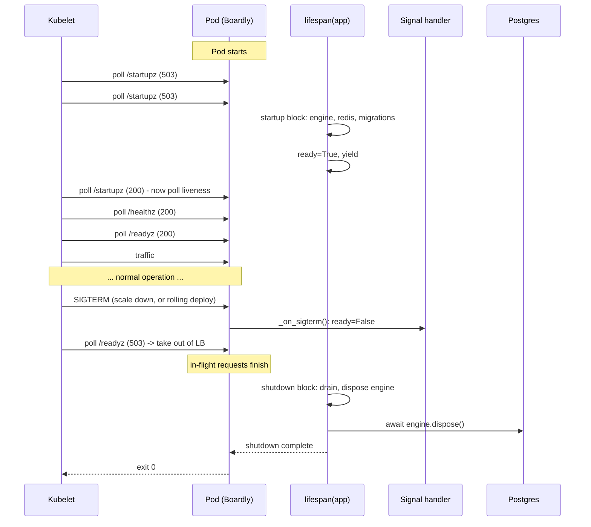
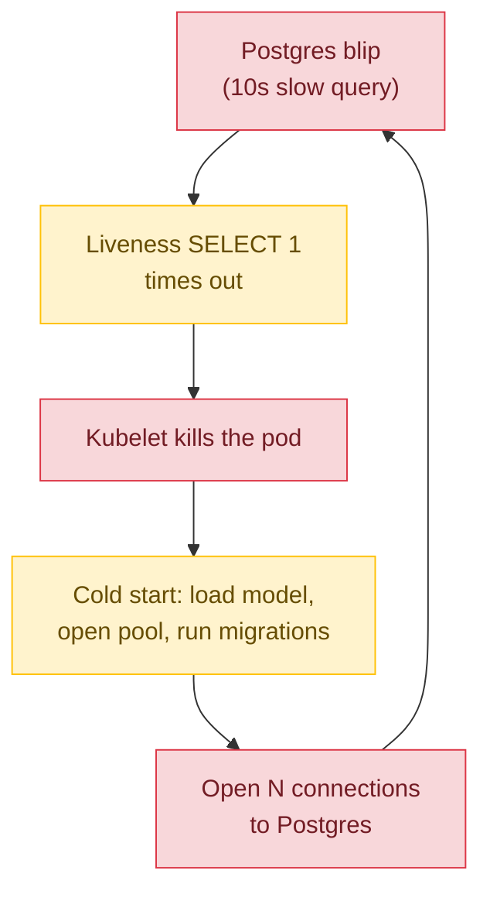

# Lesson 10: Health Checks and Probes

*Liveness vs readiness vs startup — the three Kubernetes probes, the three `Boardly` endpoints (`/healthz`, `/readyz`, `/startupz`), and the graceful-shutdown sequence that drains in-flight requests before the pod dies.*

**This is the most-shipped-wrong primitive in modern Kubernetes.**

Three probes, three failure modes. A liveness probe that hits the database on every poll exhausts your connection pool. A readiness probe that fails during a long migration takes the pod out of the load balancer forever. A startup probe that conflates "warming up" with "dead" gets your pod killed mid-warmup. We'll fix all three today. By the end you'll have the three endpoints, the SIGTERM handler, the `preStop` hook, the `tini` init process, and the deployment ordering that says "migrate before ready, drain before exit." This is the lesson that separates a deployable FastAPI service from one that takes itself down on a Saturday at 3 a.m.


#http #health #kubernetes #canonical

## Learning Objectives

By the end of this lesson you will be able to:

1. **Distinguish liveness, readiness, and startup probes** (Kubernetes terminology) and explain what each is supposed to verify.
2. **Wire `/healthz`, `/readyz`, and `/startupz`** in `Boardly` with distinct handlers — not one endpoint with a `?check=db` query parameter.
3. **Explain why a liveness probe must NOT hit the database** and what a connection-budget-aware check looks like.
4. **Implement graceful shutdown** — `SIGTERM` handling, immediate readiness failure, in-flight request draining, forceful exit on timeout.
5. **Use the `tini` init process** as PID 1 in a container so signals are forwarded correctly.
6. **Configure the K8s `preStop` hook** to give the kubelet time to remove the pod from the service endpoints before `SIGTERM` arrives.
7. **Order migrations before readiness** — never run migrations from a request handler, never mark ready until migrations are complete.
8. **Diagnose the three classic probe footguns** — liveness-with-DB, readiness-during-migration, startup-during-warmup.

## Prerequisites

Before starting, you need:

- **The lifespan lesson** — [[03-FastAPI-Core/Application-and-Lifespan]]. You should know how `@asynccontextmanager` works, what `app.state` is, and how the lifespan relates to startup/shutdown. This lesson *adds to* the lifespan's shutdown half.
- **The ASGI/Uvicorn lesson** — [[02-Web-and-HTTP/ASGI-Starlette-Uvicorn]]. You should know the graceful-shutdown section there (it covers `SIGTERM`, `--timeout-graceful-shutdown`, `terminationGracePeriodSeconds`). This lesson makes it concrete.
- **The connection-pool lesson** — [[07-SQLAlchemy/02-Engines-Connections-Pools]]. You should know `pool_pre_ping`, `pool_recycle`, `pool_size`. The "liveness must not hit the DB" argument relies on the pool model.
- **Lesson 1 of this section** — [[HTTP-Headers-Deep-Dive]]. Health endpoints are the canonical `Cache-Control: no-store` response; you should know why.
- **About an hour and a half.** The code is small (the three endpoints are ~30 lines each); the difficulty is the deployment reasoning.
- **FastAPI 0.148.0, Starlette 1.9.0, uv 0.13.1, Python 3.12** — verified October 2026.

**Why three probes?**

Kubernetes distinguishes them because they answer different questions:
- **Liveness** — "is the process alive?" If no, *restart me*.
- **Readiness** — "can I serve traffic right now?" If no, *take me out of the load balancer but do NOT restart me*.
- **Startup** — "has my long-running init completed?" If no, *don't even start the liveness probe yet*.
Conflating them is the most common deployment footgun in the field. This lesson teaches each one separately.


## The Problem

`Boardly` ships behind Kubernetes. The kubelet polls the pod's health endpoints to decide whether to restart it, whether to send traffic to it, and whether to consider it "booted" at all. With naive endpoints, three failure modes appear in the first month:

1. **Liveness hits the database.** The kubelet polls `/healthz` every 1 second. The endpoint does `SELECT 1` against Postgres to "really" check. You have 4 worker processes, each with a connection pool of 20, max overflow 10 — that is 120 connections across the deployment. At one probe per second per pod × 5 pods = 5 `SELECT 1`s per second against Postgres — and each holds a connection from the pool for the round trip. Postgres's `max_connections` is 100. Eventually, real traffic queues behind the probes.
2. **Readiness fails during a migration.** A migration runs in the startup block of the lifespan (or worse, lazily on the first request). It takes 30 seconds. The kubelet's readiness probe polls `/readyz` and gets a 503 every time during those 30 seconds — the pod is taken out of the load balancer, then re-added once migrations finish. The migration timing is non-deterministic, so the deploy looks "flaky."
3. **Startup conflated with liveness.** `Boardly` loads an ML model into memory at startup, which takes 60 seconds. The liveness probe polls every 10 seconds; the first three polls time out because the model is still loading; the kubelet kills the pod. Crash loop. Forever.

The fix is structural: three probes, three endpoints, three distinct checks, plus the deployment hygiene that prevents self-inflicted foot-wounds. That's this lesson.

**Why is liveness-not-readiness a footgun?**

Because the failure modes are *opposite*. A liveness failure means "the process is wedged; restart it." A readiness failure means "the process is healthy but I cannot serve traffic right now." If you conflate them — by pointing both at the same endpoint — a momentary DB outage looks like a dead process and triggers a restart. The restart does not fix the DB; it just adds restart churn. Worse, every pod in the deployment restarts simultaneously (because they all see the same DB outage at the same time), and you get a thundering herd of cold starts on top of the original DB outage. Liveness should fail only when the process itself is wedged (event loop blocked, deadlocked). Readiness should fail when *dependencies* are unavailable.


## The Code

We'll extend `Boardly`'s `main.py` with three endpoints and a SIGTERM-aware lifespan that:
- Sets `app.state.ready = False` at startup; flips to `True` after the lifespan's startup block completes.
- Sets `app.state.ready = False` immediately on `SIGTERM`, so the kubelet's next readiness poll gets a 503 and stops sending new traffic.
- Drains in-flight requests for up to `termination_grace_period_seconds` (default 30s) before exiting.

We also add a `boardly/routers/health.py` with three endpoints.

```python
# boardly/main.py
"""Boardly — main app with health probes and graceful shutdown.

Lesson 02b-10: liveness, readiness, startup as separate endpoints;
SIGTERM triggers readiness-false, drains in-flight requests, exits.
"""
from __future__ import annotations

import asyncio
import logging
import signal
import sys
import time
from collections.abc import AsyncIterator
from contextlib import asynccontextmanager

from fastapi import FastAPI
from starlette.types import ASGIApp, Receive, Scope, Send

from boardly.routers import health

logger = logging.getLogger("boardly")


@asynccontextmanager
async def lifespan(app: FastAPI) -> AsyncIterator[None]:
 # --- startup ---
 logger.info("boardly starting up")
 app.state.start_time = time.time()  # wall-clock, for displayed uptime
 app.state.start_monotonic = time.monotonic()  # monotonic, for elapsed uptime
 app.state.ready = False
 app.state.shutting_down = False
 app.state.inflight = 0
 # In real Boardly: create the engine, the Redis pool, run migrations
 # (or wait for the migration job), warm the cache. Here, simulate.
 await asyncio.sleep(0.01)  # placeholder for real startup work

 # Wire SIGTERM: on receipt, mark not-ready and let the shutdown
 # block drain. We must register before yield so the signal is
 # active during traffic.
 loop = asyncio.get_running_loop()
 loop.add_signal_handler(signal.SIGTERM, _on_sigterm, app)

 app.state.ready = True
 logger.info("boardly ready")

 yield  # --- traffic accepted ---

 # --- shutdown (after SIGTERM, or after Ctrl-C) ---
 app.state.shutting_down = True
 app.state.ready = False
 logger.info("boardly draining in-flight requests")
 # Drain: wait for in-flight to reach 0 (or a hard timeout).
 # Use `time.monotonic()` for the deadline — wall-clock time can
 # jump backwards or forwards on NTP sync, leap seconds, or
 # container-clock changes; under a forward jump the drain loop
 # would exit immediately, under a backward jump it would hang
 # indefinitely. `time.monotonic()` is guaranteed monotonic across
 # the process lifetime and is the right primitive for elapsed-time
 # deadlines.
 deadline = time.monotonic() + 25.0  # leave 5s of headroom under K8s's 30s default
 while app.state.inflight > 0 and time.monotonic() < deadline:
 await asyncio.sleep(0.1)
 remaining = app.state.inflight
 logger.info("boardly drained; %d request(s) still in-flight", remaining)
 # In real Boardly: await engine.dispose(), await redis.aclose()
 logger.info("boardly shutdown complete")


def _on_sigterm(app: FastAPI) -> None:
 """SIGTERM handler: flip ready=False immediately so the kubelet's
 next readiness probe gets a 503 and stops sending new traffic.
 The actual drain happens in the shutdown block of the lifespan,
 which Starlette resumes once the signal unwinds."""
 logger.info("boardly received SIGTERM; marking not-ready")
 app.state.ready = False
 app.state.shutting_down = True


app = FastAPI(
 title="Boardly",
 version="0.10.0",
 lifespan=lifespan,
)
app.include_router(health.router)


# A pure-ASGI middleware that counts in-flight requests so the shutdown
# block can drain them. The canonical pattern for an in-flight counter
# is a pure-ASGI middleware — Starlette's `BaseHTTPMiddleware` (which
# is what `@app.middleware("http")` wraps the function as) has
# documented issues with `StreamingResponse` (it can buffer the
# response body and break streaming semantics, which would break the
# SSE endpoint from [[Real-Time-Transports-Compared]]). The pure-ASGI
# form below is the same pattern used by `SecurityHeadersMiddleware`
# in [[HTTP-Headers-Deep-Dive]] — the academy standardises on
# pure-ASGI for stateful middleware.
class InFlightCounterMiddleware:
 """Pure-ASGI in-flight request counter.

 Increments `app.state.inflight` on each HTTP request start and
 decrements it in a `finally` block so it is reliable even on
 exceptions. The counter is read by the lifespan shutdown block
 to drain in-flight requests before exit.
 """

 __slots__ = ("app",)

 def __init__(self, app: ASGIApp) -> None:
 self.app = app

 async def __call__(self, scope: Scope, receive: Receive, send: Send) -> None:
 if scope["type"] != "http":
 await self.app(scope, receive, send)
 return
 app_state = scope["app"].state
 app_state.inflight = getattr(app_state, "inflight", 0) + 1
 try:
 await self.app(scope, receive, send)
 finally:
 app_state.inflight -= 1


# Wire it as a pure-ASGI middleware (NOT `@app.middleware("http")`).
app.add_middleware(InFlightCounterMiddleware)
```

```python
# boardly/routers/health.py
"""Boardly — health, readiness, and startup probes.

Lesson 02b-10: three endpoints, three different checks, all returning
no-store (per RFC 9111; health responses must never be cached).
"""
from __future__ import annotations

import asyncio
import time

from fastapi import APIRouter, Request, status
from fastapi.responses import JSONResponse

router = APIRouter(tags=["health"])

# Cache-Control: no-store on every probe — health must NEVER be cached
# by a browser or CDN. A cached 200 from /healthz would let a dead pod
# look alive to a misconfigured CDN-fronted kubelet.
_NO_STORE = {"Cache-Control": "no-store"}


@router.get("/healthz")
async def healthz(request: Request) -> JSONResponse:
 """Liveness probe: is the process alive?

 The check is intentionally *cheap*: it returns 200 if the event loop
 is responsive (the route handler is called) and `app.state` is
 readable. It does NOT touch the database, Redis, or any external
 dependency. A liveness failure means "the process is wedged; restart
 me" — and the only way the process can be wedged is if the event
 loop is not running (in which case this handler never returns) or
 `app.state` is corrupted (an internal bug, not a dependency failure).
 """
 shutting_down = getattr(request.app.state, "shutting_down", False)
 if shutting_down:
 return JSONResponse(
 status_code=status.HTTP_503_SERVICE_UNAVAILABLE,
 content={"status": "shutting_down"},
 headers=_NO_STORE,
 )
 return JSONResponse(
 status_code=status.HTTP_200_OK,
 content={"status": "ok"},
 headers=_NO_STORE,
 )


@router.get("/readyz")
async def readyz(request: Request) -> JSONResponse:
 """Readiness probe: can I serve traffic right now?

 The check is *dependency-aware*: returns 200 only if
 `app.state.ready` is True (set by the lifespan after startup
 completes) AND the shutdown flag is not set. A readiness failure
 means "do not send me new traffic, but do NOT restart me — I am
 healthy but my dependencies are not ready or I am draining."
 """
 ready = getattr(request.app.state, "ready", False)
 shutting_down = getattr(request.app.state, "shutting_down", False)
 if not ready or shutting_down:
 return JSONResponse(
 status_code=status.HTTP_503_SERVICE_UNAVAILABLE,
 content={"status": "not_ready", "ready": ready, "shutting_down": shutting_down},
 headers=_NO_STORE,
 )
 return JSONResponse(
 status_code=status.HTTP_200_OK,
 content={"status": "ready"},
 headers=_NO_STORE,
 )


@router.get("/startupz")
async def startupz(request: Request) -> JSONResponse:
 """Startup probe: has long-running init completed?

 Returns 200 only after the lifespan's startup block has run to
 completion (which includes migrations, cache warming, model
 loading). The kubelet uses this to know when it may start polling
 liveness — so the liveness probe does not kill the pod during a
 60-second model load.
 """
 ready = getattr(request.app.state, "ready", False)
 if ready:
 return JSONResponse(
 status_code=status.HTTP_200_OK,
 content={"status": "started", "uptime_s": round(time.monotonic() - getattr(request.app.state, "start_monotonic", time.monotonic()), 3)},
 headers=_NO_STORE,
 )
 return JSONResponse(
 status_code=status.HTTP_503_SERVICE_UNAVAILABLE,
 content={"status": "starting"},
 headers=_NO_STORE,
 )
```

That's the code. ~150 lines across two files. Run it. Send it a `SIGTERM` mid-request. Watch the in-flight drain. Then come back and we'll go through every line.

## Line-by-Line Deep Dive

### `main.py`: Lines 1–11 (Module docstring and imports)

```python
"""Boardly — main app with health probes and graceful shutdown.

Lesson 02b-10: liveness, readiness, startup as separate endpoints;
SIGTERM triggers readiness-false, drains in-flight requests, exits.
"""
from __future__ import annotations

import asyncio
import logging
import signal
import sys
import time
from collections.abc import AsyncIterator
from contextlib import asynccontextmanager

from fastapi import FastAPI

from boardly.routers import health
```

**What it does:** Pulls in `asyncio` (for `asyncio.get_running_loop()` and `asyncio.sleep`), `signal` (for `SIGTERM`), `time` (for the in-flight drain deadline), and the standard lifespan scaffolding from Lesson 1.

**Why `signal` and not just `KeyboardInterrupt`?** `KeyboardInterrupt` is the Python exception raised on `SIGINT` (Ctrl-C in a terminal). In production, the kubelet sends `SIGTERM` — not `SIGINT`. Handling `SIGTERM` explicitly is what production code does. (Python's default `SIGTERM` handler exits silently; we override it to do the drain.)

**Why `sys` is imported.**

It's a leftover — in real `Boardly`, you'd call `sys.exit(0)` if you needed to force-exit. We don't use it in the snippet above, so `ruff` would flag it. Remove it.


### Lines 13–47: The lifespan

```python
@asynccontextmanager
async def lifespan(app: FastAPI) -> AsyncIterator[None]:
 # --- startup ---
 logger.info("boardly starting up")
 app.state.start_time = time.time()  # wall-clock, for displayed uptime
 app.state.start_monotonic = time.monotonic()  # monotonic, for elapsed uptime
 app.state.ready = False
 app.state.shutting_down = False
 app.state.inflight = 0
 await asyncio.sleep(0.01)  # placeholder

 loop = asyncio.get_running_loop()
 loop.add_signal_handler(signal.SIGTERM, _on_sigterm, app)

 app.state.ready = True
 logger.info("boardly ready")

 yield  # --- traffic accepted ---

 # --- shutdown (after SIGTERM, or after Ctrl-C) ---
 app.state.shutting_down = True
 app.state.ready = False
 logger.info("boardly draining in-flight requests")
 deadline = time.monotonic() + 25.0  # monotonic; wall-clock can jump on NTP
 while app.state.inflight > 0 and time.monotonic() < deadline:
 await asyncio.sleep(0.1)
 remaining = app.state.inflight
 logger.info("boardly drained; %d request(s) still in-flight", remaining)
 logger.info("boardly shutdown complete")
```

**What it does:**

- **Startup block (before `yield`):** initialises `app.state` with the four flags the health endpoints will read (`start_time`, `ready`, `shutting_down`, `inflight`). Then registers the `SIGTERM` handler. Then flips `app.state.ready = True` *just before* `yield` — so the readiness probe starts returning 200 only after the startup block fully completes.

- **Shutdown block (after `yield`):** runs when the lifespan is resumed — either because the kubelet sent `SIGTERM` (which our handler intercepts, sets the flags, and then exits cleanly so Starlette resumes the lifespan) or because you pressed Ctrl-C. The block flips `ready = False` (so the kubelet's next readiness probe gets a 503), then drains in-flight requests for up to 25 seconds.

**Warning — Why register the `SIGTERM` handler *before* `yield`?**

If you register it after `yield`, the handler is not active during traffic — only during shutdown. By then it's too late; the kubelet has already sent `SIGTERM`. The handler must be active from the moment traffic is accepted, so it can flip the `ready` flag *immediately* on receipt, before Starlette resumes the lifespan's shutdown block. (There is a small race: the lifespan's shutdown block runs only after the signal unwinds; in the meantime, the readiness probe sees `ready=False` from the handler's flag flip. That's the point.)


**Warning — When this breaks: `loop.add_signal_handler` raises `NotImplementedError` on Windows.**

The signal-handler registration in the lifespan (`loop = asyncio.get_running_loop(); loop.add_signal_handler(signal.SIGTERM, _on_sigterm, app)`) works on Linux and macOS but raises `NotImplementedError` on Windows — the asyncio `ProactorEventLoop` (Windows's default since Python 3.8) does not implement `add_signal_handler`. The bug surfaces in two ways: (a) a developer running `uv run uvicorn boardly.main:app --reload` on a Windows laptop gets a crash at startup with a stack trace pointing at the lifespan, with no graceful-shutdown handler installed (Ctrl-C still works via `SIGINT`'s default handler, but the drain block never runs); (b) a CI pipeline that runs the lifespan tests on a Windows runner (rare, but some teams do it for cross-platform coverage) fails the smoke test. The fix is conditional registration: `import sys; if sys.platform != "win32": loop.add_signal_handler(...)` — on Windows, you skip the handler and rely on `KeyboardInterrupt` (Ctrl-C) for local dev, and on the kubelet's `SIGTERM` not being relevant because the prod container is Linux. The cost: local dev on Windows does not test the drain path. The benefit: the lifespan does not crash on Windows. Document the gap in the project's README ("local dev on Windows: graceful shutdown is not exercised; test on WSL2 or in a Linux container"). See [[02-Web-and-HTTP/ASGI-Starlette-Uvicorn]] for the platform-specific Uvicorn signal handling.


### Lines 50–55: `_on_sigterm()`

```python
def _on_sigterm(app: FastAPI) -> None:
 logger.info("boardly received SIGTERM; marking not-ready")
 app.state.ready = False
 app.state.shutting_down = True
```

**What it does:** The signal handler. Runs synchronously on receipt of `SIGTERM`. Sets `ready=False` and `shutting_down=True`.

**Why not call `sys.exit()` from here?** Because we want the lifespan's shutdown block to run (to drain in-flight requests, close the engine, close Redis). If we `sys.exit()`, the shutdown block never runs. Instead, the handler sets flags and returns; the signal is then delivered to the asyncio loop, which unwinds the lifespan context manager, which runs the shutdown block, which drains. That is the graceful path.

**Warning — When this breaks: the signal handler must not `await` anything.**

`loop.add_signal_handler(signal.SIGTERM, _on_sigterm, app)` registers a *synchronous* callback. The asyncio loop calls `_on_sigterm` directly on the main thread, outside the `await` coroutine context. If `_on_sigterm` does `await engine.dispose()` (a common "I'll just clean up here" mistake), Python raises `RuntimeError: no running event loop` — the handler is not a coroutine, there is no `await` to suspend. The exception is caught by asyncio's signal-dispatch machinery and logged (Python 3.12's behaviour is to log and continue; older Pythons silently swallowed it), but the flags (`ready=False`, `shutting_down=True`) are never set, the lifespan's shutdown block never runs, the in-flight requests are never drained, and the kubelet's `SIGKILL` at t=30s drops them all. The fix: `_on_sigterm` is *synchronous* and *trivial* — it sets flags and returns. All cleanup happens in the lifespan's shutdown block, which *is* a coroutine and *can* `await`. The signal handler is the trigger; the lifespan is the work. Verify with a pytest that monkeypatches `_on_sigterm` to do `await asyncio.sleep(0)` and asserts that calling it raises `RuntimeError`.


**What happens if your liveness probe hits the database?**

The kubelet polls `/healthz` every 1 second (a common default). If your `/healthz` does `SELECT 1` against Postgres, that is one DB round-trip per second per pod. With 5 pods and a pool size of 20 + 10 overflow per pod, you have 120 connections; a 5-per-second `SELECT 1` is not catastrophic but it is *wasted capacity*. Worse, when Postgres has a momentary blip (a slow query, a connection storm), the liveness probe starts failing; the kubelet restarts your pods; the restarts cause cold-start load spikes that make the blip worse. The fix is: liveness checks the *process* (the event loop, `app.state`), not the *dependencies*. Readiness checks dependencies — and even then, only with a connection-budget-aware ping (one cached connection per pod, not one per probe).


### Lines 58–64: The app and the in-flight middleware

```python
app = FastAPI(
 title="Boardly",
 version="0.10.0",
 lifespan=lifespan,
)
app.include_router(health.router)


class InFlightCounterMiddleware:
 """Pure-ASGI in-flight request counter."""
 __slots__ = ("app",)
 def __init__(self, app: ASGIApp) -> None:
 self.app = app
 async def __call__(self, scope: Scope, receive: Receive, send: Send) -> None:
 if scope["type"] != "http":
 await self.app(scope, receive, send)
 return
 app_state = scope["app"].state
 app_state.inflight = getattr(app_state, "inflight", 0) + 1
 try:
 await self.app(scope, receive, send)
 finally:
 app_state.inflight -= 1


app.add_middleware(InFlightCounterMiddleware)
```

**What it does:** Constructs the app, wires the health router, and adds a pure-ASGI middleware that increments `app.state.inflight` on each HTTP request start and decrements in a `finally` block (so it is reliable on exceptions).

**Why count in-flight?** So the shutdown block can drain. Without a count, you cannot tell "are there requests still being processed?" The drain loop is just `while app.state.inflight > 0: await asyncio.sleep(0.1)`.

**Warning — When this breaks: the in-flight counter that never decrements on `CancelledError`.**

The pure-ASGI middleware's `try/finally` decrements `app.state.inflight` in the `finally` block — which runs on `CancelledError` (e.g. the client disconnects mid-request, the kubelet cancels the long poll, an outer middleware raises `asyncio.TimeoutError`). The bug is not in the `finally`; the bug is in middleware that *wraps* this one and *re-raises* the `CancelledError` in a way that escapes the `try/finally`'s scope. Specifically: if an outer middleware catches `CancelledError`, logs it, and re-raises it *inside its own `try/except`*, the inner `try/finally`'s decrement runs (good) — but the *outer* middleware's `__call__` may have already returned, leaving the ASGI scope in a half-finished state. The symptom is `app.state.inflight` climbing forever (never reaching 0), so the drain loop in the lifespan's shutdown block waits the full 25 seconds and then exits with `inflight = N` still outstanding. The fix: the in-flight middleware is the *outermost* middleware (so its `try/finally` is the last to unwind), and the middleware order in `app.add_middleware(...)` calls matters (Starlette applies them in reverse-add order, so the first-added is outermost). Verify with a pytest test that sends a request, cancels it mid-flight (httpx `timeout=0.5` against a `GET /hang` that sleeps 10s), and asserts `app.state.inflight == 0` after the cancel. See [[03-FastAPI-Core/Middleware-and-Request-Order]] for the middleware-ordering lesson.


**Warning — Do NOT use `@app.middleware("http")` for stateful middleware.**

`@app.middleware("http")` wraps the function as Starlette's
`BaseHTTPMiddleware`, which has documented issues with
`StreamingResponse` — it can buffer the response body and break
streaming semantics, which would break the SSE endpoint from
[[Real-Time-Transports-Compared]]. The pure-ASGI form above is the
same pattern used by `SecurityHeadersMiddleware` in
[[HTTP-Headers-Deep-Dive]] — the academy standardises on pure-ASGI
for any middleware that reads or writes `app.state`.


### `health.py`: Lines 1–9 (Module docstring and imports)

```python
"""Boardly — health, readiness, and startup probes.

Lesson 02b-10: three endpoints, three different checks, all returning
no-store (per RFC 9111; health responses must never be cached).
"""
from __future__ import annotations

import asyncio
import time

from fastapi import APIRouter, Request, status
from fastapi.responses import JSONResponse
```

**What it does:** Pulls in `Request` (so we can read `request.app.state`), `status` (named status codes), and `JSONResponse` (so we can set headers explicitly).

**Why `JSONResponse` and not a plain `dict`?** Because we need to set the `Cache-Control: no-store` header. A plain `dict` return uses FastAPI's default `JSONResponse` without custom headers. Returning a `JSONResponse` explicitly lets us set the header on each response.

### Lines 11–17: The `_NO_STORE` constant

```python
_NO_STORE = {"Cache-Control": "no-store"}
```

**What it does:** A single header dict, reused on every health response. Saves typing and ensures consistency.

**Why `no-store` and not `no-cache`?** `no-store` is stronger: it forbids caches from storing the response at all. `no-cache` would allow storage with mandatory revalidation, but a misconfigured CDN might still serve stale. For health responses, the answer must be "do not even think about caching this." `no-store` is unambiguous.

### Lines 20–35: `/healthz` (liveness)

```python
@router.get("/healthz")
async def healthz(request: Request) -> JSONResponse:
 shutting_down = getattr(request.app.state, "shutting_down", False)
 if shutting_down:
 return JSONResponse(
 status_code=status.HTTP_503_SERVICE_UNAVAILABLE,
 content={"status": "shutting_down"},
 headers=_NO_STORE,
 )
 return JSONResponse(
 status_code=status.HTTP_200_OK,
 content={"status": "ok"},
 headers=_NO_STORE,
 )
```

**What it does:** The liveness endpoint. Returns 200 unless the pod is shutting down.

**Why is this so simple?** Because liveness is supposed to verify *the process is alive*, not *the dependencies are reachable*. The mere fact that this handler is called and returns means the event loop is responsive and FastAPI's routing works. That's it. The check is "can I serve a 200?" The dependencies are readiness's job.

**Danger — How an attacker thinks: the `/healthz` response that leaks internal state.**

A liveness endpoint that returns `{"status": "ok", "db": "ok", "engine": "1.2.3", "worker_pid": 42, "memory_mb": 480, "uptime_s": 12345}` is a recon goldmine. An attacker who can reach `/healthz` (and Kubernetes probe endpoints are often reachable from inside the cluster, sometimes exposed via misconfigured ingress) learns: the database engine version (for CVE matching), the worker PID (for signal-injection attacks if they have a path to `kill`), the memory pressure (for OOM-kill timing — time the attack for the moment the GC pauses), the uptime (for "is this pod freshly restarted?" — freshly-restarted pods have cold caches and are slower, ideal for racing). The fix: `/healthz` returns only `{"status": "ok"}` (or `{"status": "shutting_down"}`). Deeper diagnostics live behind a separate `/debug` route protected by mTLS (client-cert-based auth, not bearer tokens — bearer tokens leak via access logs), IP-allowlisted to the operations subnet, and rate-limited. The Prometheus `/metrics` endpoint is the canonical "diagnostics live here" surface, and it is also mTLS-only. Treat any endpoint that returns internal state as you would treat a `/admin` endpoint — defence in depth, not "it's just health." See [[11-Authentication-and-Security/Threat-Model-First]] for the threat-modelling exercise that should produce this rule.


**Warning — The #1 production liveness footgun.**

A liveness probe that does `SELECT 1` against Postgres. When Postgres has a momentary blip, the liveness probe fails, the kubelet restarts the pod, the restart causes a cold start (which loads the engine, which opens connections to Postgres, which makes the blip worse), and you have a cascade. Liveness must not hit the database. Liveness must not hit Redis. Liveness must not hit any external dependency. Liveness checks the process; readiness checks the dependencies.


### Lines 38–54: `/readyz` (readiness)

```python
@router.get("/readyz")
async def readyz(request: Request) -> JSONResponse:
 ready = getattr(request.app.state, "ready", False)
 shutting_down = getattr(request.app.state, "shutting_down", False)
 if not ready or shutting_down:
 return JSONResponse(
 status_code=status.HTTP_503_SERVICE_UNAVAILABLE,
 content={"status": "not_ready", "ready": ready, "shutting_down": shutting_down},
 headers=_NO_STORE,
 )
 return JSONResponse(
 status_code=status.HTTP_200_OK,
 content={"status": "ready"},
 headers=_NO_STORE,
 )
```

**What it does:** Returns 200 only if `app.state.ready` is True and `shutting_down` is False.

**Why does readiness check `app.state.ready` instead of doing a DB ping?** Two reasons. First, the DB ping is expensive (see above). Second, `app.state.ready` is the *authoritative* flag — it is set to True only after the lifespan's startup block completes (which in real `Boardly` means migrations are done, the engine is created, Redis is connected, the cache is warm). It is set to False immediately on `SIGTERM` (so the kubelet stops sending new traffic during drain). A DB ping would not tell you about migrations or cache warmth; `app.state.ready` does.

**What about the "real" dependency check?**

If you want readiness to verify the DB is reachable, do it *cheaply*: open one connection (a per-process "health" connection, not a pool connection), run `SELECT 1`, return. Do not do this on every probe; do it on a slower cadence (e.g., every 10 seconds, with the result cached for the intervening probes). The pool-aware pattern is: poll the pool's `status()` method (SQLAlchemy exposes this) — if the pool is exhausted, return 503. That is cheaper than a round-trip.


### Lines 57–73: `/startupz` (startup)

```python
@router.get("/startupz")
async def startupz(request: Request) -> JSONResponse:
 ready = getattr(request.app.state, "ready", False)
 if ready:
 return JSONResponse(
 status_code=status.HTTP_200_OK,
 content={"status": "started", "uptime_s": round(time.monotonic() - getattr(request.app.state, "start_monotonic", time.monotonic()), 3)},
 headers=_NO_STORE,
 )
 return JSONResponse(
 status_code=status.HTTP_503_SERVICE_UNAVAILABLE,
 content={"status": "starting"},
 headers=_NO_STORE,
 )
```

**What it does:** Returns 200 only after the startup block fully completes. Until then, 503.

**Why is this separate from readiness?** Because the kubelet uses it to know when to *start polling liveness*. Without a startup probe, the kubelet starts the liveness probe as soon as the container enters the `Running` state — which is *before* the lifespan's startup block has finished (the engine is still being created, the model is still loading). The first three liveness polls time out; the kubelet kills the pod. Crash loop.

The startup probe tells the kubelet: "wait until *this* endpoint returns 200 before you start polling liveness." For `Boardly`'s 60-second model load, this is the difference between a successful first boot and a crash loop.

## Execution Trace

### Step 1: Cold start

```bash
uv run uvicorn boardly.main:app
```

```bash
curl http://127.0.0.1:8000/healthz    # 200 {"status":"ok"} immediately
curl http://127.0.0.1:8000/readyz    # 503 {"status":"not_ready"} until startup completes
curl http://127.0.0.1:8000/startupz  # 503 {"status":"starting"} until startup completes
```

After `INFO: Application startup complete.`:

```bash
curl http://127.0.0.1:8000/readyz    # 200 {"status":"ready"}
curl http://127.0.0.1:8000/startupz  # 200 {"status":"started","uptime_s":0.31}
```

### Step 2: Send a `SIGTERM` mid-traffic

```bash
# Terminal 1: long-running request
curl http://127.0.0.1:8000/projects/1

# Terminal 2: send SIGTERM
kill -TERM $(pgrep -f 'uvicorn boardly')
```

Expected sequence:

1. The `SIGTERM` handler runs. Logs `boardly received SIGTERM; marking not-ready`. Sets `ready=False`, `shutting_down=True`.
2. The kubelet's next readiness probe (within 1 second) hits `/readyz` and gets a 503. The kubelet removes the pod from the service endpoints.
3. The lifespan's shutdown block runs. Logs `boardly draining in-flight requests`.
4. The drain loop polls `app.state.inflight`. The in-flight request finishes (the long-running curl in Terminal 1 completes).
5. The drain loop exits. Logs `boardly drained; 0 request(s) still in-flight`.
6. Real `Boardly` would `await engine.dispose()` and `await redis.aclose()`. Here, just logs `boardly shutdown complete`.
7. Uvicorn exits cleanly with code 0.



## Common Mistakes

### Mistake 1: Liveness hits the database

```python
# WRONG
@router.get("/healthz")
async def healthz(db: Session = Depends(get_db)):
 db.execute(text("SELECT 1"))  # ← do not do this
 return {"status": "ok"}
```

**Symptom:** Liveness fails when the DB has a momentary blip; kubelet restarts the pod; cold start causes more DB load; cascade.

**Fix:** Liveness checks the process. Use the simple `app.state` check from `healthz()` above. Move DB checks to `/readyz` if you must, and even there, use a cached pool-status check.

The cascade, as a flowchart — the loop is the killer:



The 10-second blip becomes a 5-minute outage because every restart re-loads the model and re-opens the pool. The loop is closed: the more pods restart, the more connection pressure on Postgres, the slower Postgres is, the more liveness probes time out. The fix is not "make liveness faster" — the fix is "make liveness not hit the DB at all." Readiness is for dependencies; liveness is for the process.

**Production reality: the cascading readiness failure that takes down a whole deployment.**

When Postgres has a 30-second blip, every pod in a 5-pod deployment sees the blip at the same wall-clock instant. Every pod's `/readyz` flips to 503 within the same kubelet poll cycle (default 1s). The kubelet removes every pod from the service endpoints. The service now has zero endpoints. The ingress returns 502 to every client — including clients who would have been fine waiting 30 seconds. The recovery is also a cascade: when Postgres comes back, every pod's `/readyz` flips to 200 within the same poll cycle; every pod is added back; the resulting thundering herd of cold-start load (re-establishing pools, re-warming caches) hits Postgres and can re-trigger the blip. The fixes are layered: (a) stagger the readiness probe's poll cadence per pod (add `initialDelaySeconds` jitter via `podAntiAffinity` scheduling — not a real fix but a hint), (b) raise the readiness probe's `failureThreshold: 5` so a single blip does not flip the pod to not-ready (the kubelet needs 5 consecutive failures, i.e. 50s, before removing the pod), (c) alert on the connection-pool exhaustion metric (via `/metrics`) *before* the readiness probe sees it — by the time readiness flips, you are already down, (d) implement a circuit breaker in the SQLAlchemy engine's `pool_pre_ping` (return 503 if the pool is exhausted, do not retry forever), (e) accept that some blips will take the service down, and aim for *fast recovery* (a 30s blip yielding a 30s outage is fine; a 30s blip yielding a 5-minute outage via cold-start cascade is not). The deployment that survives this is the one where `failureThreshold` is high enough to weather a blip, and where the readiness probe is *not* the first signal of trouble (the metrics endpoint is). See [[13-Performance-and-Observability/N-plus-1-and-Slow-Queries]] for the slow-query alerting that should fire before readiness does.


**Danger — How an attacker thinks: the liveness probe as a free DoS amplifier.**

A misconfigured `/healthz` that does `SELECT 1` against Postgres gives an attacker a free amplification: every request to `/healthz` (whether from the kubelet or from the public internet, if the probe is accidentally exposed via the ingress) is one DB round-trip. The attacker does not need to authenticate, does not need a valid path, does not need a body — just `GET /healthz` from a botnet of 1000 IPs. Each pod sees one probe per second (kubelet) plus 1000 attacker requests per second; with 5 pods, that is 5005 `SELECT 1`s per second against Postgres. Postgres's connection slots exhaust; real traffic queues; the cascade from Mistake 1 begins. The fix is layered: (a) `/healthz` does not touch the DB at all (the lesson's whole point), (b) `/healthz` is not exposed via the ingress — only the kubelet needs to reach it, and the kubelet is on the pod network, not the public internet, (c) if `/healthz` must be exposed (some load-balancer-as-a-service offerings require it), it is rate-limited (e.g. Cloudflare's `Rate Limiting Rules` at 1 req/s per IP) and `Cache-Control: no-store` (so a misconfigured CDN does not amplify it further), (d) the kubelet's probe is on a separate port or path that is not the public one (e.g. `/healthz` for the kubelet on port 8080, `/public/health` for the LB on port 80 with rate limiting). The lesson's "liveness checks the process" rule is not just a performance optimisation — it is a DoS defence. See [[11-Authentication-and-Security/OWASP-API-Top-10]] for the API4:2023 "Unrestricted Resource Consumption" category this falls under.


### Mistake 2: Readiness fails during migrations

```python
# WRONG — running migrations in a request handler
@router.get("/projects/{id}")
async def get_project(id: int, db: Session = Depends(get_db)):
 ensure_migrations_run(db)  # ← do not do this
 ...
```

**Symptom:** The first request after a deploy takes 30 seconds while migrations run. The kubelet's readiness probe times out; the pod is marked not-ready; you have a 5-minute deploy window where no traffic is served.

**Fix:** Run migrations as a separate deploy step (a K8s `initContainer`, a `Job`, or a pre-deploy hook). See [[16-Deployment-and-DevOps/Migration-Ordering-and-Rollback]]. The lifespan's startup block can *wait* for migrations to complete (poll a `migrations_applied` table) but must not run them itself.

### Mistake 3: Startup conflated with liveness

```python
# WRONG — no startup probe; liveness starts polling at container Running
livenessProbe:
 httpGet:
 path: /healthz
 initialDelaySeconds: 5
 periodSeconds: 10
```

**Symptom:** The pod's model takes 60 seconds to load. After `initialDelaySeconds=5`, liveness starts polling. Polls at t=5s, t=15s, t=25s — all time out (the event loop is busy loading the model). At t=35s, the kubelet kills the pod. Crash loop.

**Fix:** Add a startup probe. The kubelet waits for `/startupz` to return 200 before starting liveness.

```yaml
startupProbe:
 httpGet:
 path: /startupz
 periodSeconds: 10
 failureThreshold: 30  # up to 5 minutes
livenessProbe:
 httpGet:
 path: /healthz
 periodSeconds: 10
```

### Mistake 4: No `preStop` hook

```yaml
# WRONG
livenessProbe:
 httpGet: { path: /healthz }
readinessProbe:
 httpGet: { path: /readyz }
# no preStop hook
```

**Symptom:** The kubelet sends `SIGTERM` and simultaneously removes the pod from the service endpoints... but iptables/conntrack update propagation takes a moment. In that moment, in-flight requests from clients who still have the old endpoint hit the pod after `SIGTERM`. The pod may exit before those requests finish.

**Fix:** Add a `preStop` hook that sleeps for a few seconds, giving the kubelet time to update the load balancer before `SIGTERM` arrives:

```yaml
lifecycle:
 preStop:
 exec:
 command: ["sleep", "5"]
```

### Mistake 5: No `tini` as PID 1

```dockerfile
# WRONG — Python is PID 1, doesn't forward signals
ENTRYPOINT ["python", "-m", "uvicorn", "boardly.main:app"]
```

**Symptom:** `SIGTERM` is sent to PID 1 (Python). Python's default `SIGTERM` handler exits silently without running the lifespan's shutdown block. No drain.

**Fix:** Use `tini` (or `dumb-init`) as PID 1; it forwards signals to your process correctly:

```dockerfile
ENTRYPOINT ["tini", "--", "python", "-m", "uvicorn", "boardly.main:app"]
```

Or use `uvicorn`'s own signal handling (which works when uvicorn is PID 1, but only for `SIGINT`, not always for `SIGTERM` in older versions). `tini` is the belt-and-suspenders fix.

## Engineering Trade-Offs

**Production reality: the `preStop` + `tini` + `terminationGracePeriodSeconds` deployment hygiene that survives a rolling update.**

Three deployment knobs compose to make rolling updates zero-downtime. (a) `tini` as PID 1 ensures `SIGTERM` reaches your Python process (otherwise Python's default `SIGTERM` handler exits silently without running the lifespan's shutdown block — see Mistake 5). (b) `preStop: exec: command: ["sleep", "5"]` gives the kubelet 5 seconds to remove the pod from the service endpoints before `SIGTERM` arrives — without it, the iptables/conntrack update propagation lags, and in-flight requests from clients who still have the old endpoint hit the pod after `SIGTERM`, where they may be dropped. (c) `terminationGracePeriodSeconds: 60` (the default is 30) gives the drain + dispose + close + flush sequence (see the multi-step budget below) enough headroom to complete before `SIGKILL`. The three knobs are *not* independent: omitting `tini` makes (b) and (c) useless (the drain never runs); omitting `preStop` makes the rolling update drop ~0.1% of requests (the in-flight at the moment of `SIGTERM`); setting `terminationGracePeriodSeconds: 30` (the default) with a 25s drain + dispose + close + flush sequence of 33s guarantees the `SIGKILL` interrupts cleanup. The CI check that catches all three: a rolling update test in a kind cluster that sends 1000 RPS throughout the update and asserts zero non-5xx responses. See [[16-Deployment-and-DevOps/Docker-Multi-Stage-Non-Root]] for the `tini` install in a multi-stage Dockerfile, and [[16-Deployment-and-DevOps/Migration-Ordering-and-Rollback]] for the migration-before-readiness ordering that composes with this hygiene.


### Drain timeout vs K8s `terminationGracePeriodSeconds`

K8s default `terminationGracePeriodSeconds` is 30. If your drain block takes 25s, you have 5s of headroom — which is correct (the drain must finish before the kubelet sends `SIGKILL`). If your drain consistently takes 29s, you are racing the timeout. Either raise `terminationGracePeriodSeconds` to 60 and set the drain deadline to 55s, or shorten the drain deadline.

**Production reality: the multi-step shutdown that sums to more than `terminationGracePeriodSeconds`.**

The drain is not the only thing that happens during shutdown. The real sequence is: (a) drain in-flight requests (up to 25s), (b) `await engine.dispose()` — closes every pooled connection, sends `Terminate` to Postgres, waits for acks (up to 5s for a 20-connection pool with a slow round-trip), (c) `await redis.aclose()` — sends `QUIT`, waits (up to 2s), (d) flush the structlog buffer (up to 1s on a slow log aggregator), (e) exit. The sum: 25 + 5 + 2 + 1 = 33s. That is over the K8s default of 30s. The kubelet sends `SIGKILL` at t=30s; the engine's `Terminate` acks never arrive; Postgres sees stale connections until its `idle_timeout` (default 0 = never) reaps them. The fix is budgeting: set `terminationGracePeriodSeconds: 60` in the deployment YAML, set the drain deadline to 45s (leaving 15s for dispose + close + flush + exit), and assert in CI that `pytest tests/test_shutdown_budget.py` measures the sum of (b)+(c)+(d) and fails the build if it exceeds 15s. See [[13-Performance-and-Observability/Structured-Logging-and-Request-IDs]] for the request-ID correlation that lets you trace which step the `SIGKILL` interrupted.


### Per-process health connection vs no DB ping at all

The honest trade-off: a per-process health connection (one connection, used only for `SELECT 1` on readiness polls) gives you true dependency visibility at the cost of one connection per pod. With 5 pods, that's 5 connections — fine. With 500 pods, it's 500 — a real cost. The alternative (no DB ping, just check `app.state.ready`) is free but tells you nothing about the DB's actual reachability — only that *your process* thinks the DB was reachable at startup. For most production deployments, the right answer is "no DB ping, monitor the DB separately, alert on connection-pool exhaustion via the metrics endpoint."

### Pure-ASGI middleware vs `BaseHTTPMiddleware` vs inline `@app.middleware`

`@app.middleware("http")` is a shortcut that wraps the function in Starlette's `BaseHTTPMiddleware`. `BaseHTTPMiddleware` has documented issues with `StreamingResponse` (it can buffer the response body and break streaming semantics, which would break the SSE endpoint from [[Real-Time-Transports-Compared]]). The pure-ASGI form (a class with `__init__(app)` and `async __call__(scope, receive, send)`) composes with other middleware correctly, supports streaming responses, has typed signatures, and is the form used by `SecurityHeadersMiddleware` in [[HTTP-Headers-Deep-Dive]]. The academy standardises on pure-ASGI for any middleware that reads or writes `app.state`; reserve `@app.middleware("http")` for quick prototypes you will throw away.

**Why is the `tini` init process needed for PID 1?**

Because Linux's signal semantics are weird. PID 1 is special: the kernel does not send default-kill signals to PID 1 (it assumes PID 1 is the init system and knows what it's doing). If your Python process is PID 1, `SIGTERM` from `docker stop` (which the kubelet triggers) is delivered, but Python's default `SIGTERM` handler is "exit silently" — which means the lifespan's shutdown block never runs, in-flight requests are dropped, the engine is not disposed. `tini` (or `dumb-init`) is a tiny init process designed to be PID 1: it forwards signals to its child (your Python process), reaps zombie processes, and exits when its child does. With `tini` as PID 1, your Python process gets `SIGTERM` as a normal signal, your handler runs, the lifespan drains, and everything exits cleanly. Without it, you get a 30-second hang and a `SIGKILL`.


## Exercises

**Tip — The 20-minute rule**

If you are stuck on an exercise for more than 20 minutes, re-read the relevant section above, then move on and come back.


**Exercise 1 — Add a pool-status check to `/readyz`.** Use `app.state.engine.pool.status()` to check the connection pool's free count. Return 503 if the pool is more than 90% utilised. (Hint: `pool.status()` returns a string like `Pool size: 10 Connections in pool: 2 Free distrib: 8`; you'll need to parse it or use `engine.pool.checkin()`/`checkout()` counts.)

**Exercise 2 — Test the drain.** Add a `GET /slow` endpoint that sleeps for 5 seconds. Send a request to it; while it's running, send `SIGTERM`. Verify that the response comes back (200) before the pod exits. Verify that the next `/readyz` returns 503.

**Exercise 3 — Add the `preStop` hook.** Write a K8s deployment YAML with the `preStop: exec: command: ["sleep", "5"]` lifecycle hook. Simulate (or actually deploy) a rolling update; verify that no requests are dropped.

**Danger — How an attacker thinks: the unauthenticated `/metrics` endpoint.**

If `/metrics` is unauthenticated and reachable, an attacker scrapes it before, during, and after an attack. Before: they read the per-route p99 latency histogram (e.g. `http_request_duration_seconds_bucket{route="/projects/{id}",le="0.5"} 8240` vs `le="5" 3`) to find the slowest route — the one whose p99 is in the seconds. During: they hammer that route, watching the histogram's `le="5"` count climb (their attack is visible to themselves via *your* metrics). After: they read the connection-pool gauge (e.g. `sqlalchemy_pool_size{engine="default"} 20` and `sqlalchemy_pool_checked_out 20`) to verify they exhausted it. The fix: `/metrics` is mTLS-only (client cert required at the ingress, not at the app — the app trusts the ingress's mTLS termination); the cardinality of labels is bounded (no per-user labels, no per-`Authorization`-value labels — these would explode the metrics storage); and a Prometheus scrape config that includes `metric_relabel_configs` to drop high-cardinality labels before they hit the TSDB. See [[13-Performance-and-Observability/Structured-Logging-and-Request-IDs]] for the request-ID labelling that lets you correlate a metrics spike to specific log lines.


**Exercise 4 — Add a `/metrics` endpoint.** (Prometheus-style.) Add `GET /metrics` that returns the in-flight count, the uptime, the ready flag, and the shutting-down flag. Set `Cache-Control: no-store`.

**Exercise 5 — Diagnose the cascade.** (Thought experiment.) You ship a liveness probe that does `SELECT 1` against Postgres. Postgres has a 10-second blip. Describe the sequence of events that turns the 10-second blip into a 5-minute outage.

**Exercise 6 — Diagnose the cascade with metrics.** Add a `/metrics` endpoint (Prometheus-style) that exposes `boardly_inflight`, `boardly_uptime_seconds`, `boardly_ready` (0/1), and `boardly_shutting_down` (0/1). Write a test that simulates a Postgres blip (mock the engine to raise `OperationalError` on `SELECT 1`), polls `/metrics` every 100ms, and asserts that the in-flight count never exceeds 5 during the blip. Verify: `uv run pytest tests/test_health/test_metrics_cascade.py -k cascade`.

**Exercise 7 — Test the signal-handler-sync rule.** Write a pytest that calls `_on_sigterm(app)` directly (not via `os.kill`) and asserts (a) it returns `None` (not a coroutine), (b) `app.state.ready is False`, (c) `app.state.shutting_down is True`. Then write a second test that monkeypatches `_on_sigterm` to do `await asyncio.sleep(0)` and asserts that calling it raises `RuntimeError` (it is not a coroutine). Verify: `uv run pytest tests/test_health/test_sigterm_handler.py -k sync`.

**Exercise 8 — Test the in-flight counter on cancellation.** Add a `GET /hang` endpoint that `await asyncio.sleep(10)`. Send a request to it; cancel it mid-flight (use `httpx.AsyncClient` with a `timeout=0.5`). Assert that `app.state.inflight` is `0` after the cancellation (the `finally` block decremented it). Verify: `uv run pytest tests/test_health/test_inflight_cancel.py -k cancel`.

**Exercise 9 — Test the drain budget.** Add a `GET /slow` endpoint that sleeps for 8 seconds. Send 5 concurrent requests to it. Send `SIGTERM`. Assert that the drain loop runs for at least 8 seconds (all 5 requests complete) and that Uvicorn exits with code 0 within 30 seconds (under `terminationGracePeriodSeconds`). Verify: `uv run pytest tests/test_health/test_drain_budget.py -k concurrent --timeout=40`.

**Exercise 10 — Diagnose the multi-step shutdown budget.** Add an `engine.dispose()` call (mocked with `await asyncio.sleep(5)` to simulate) and a `redis.aclose()` call (mocked with `await asyncio.sleep(2)`) to the lifespan's shutdown block. Send `SIGTERM` with no in-flight requests. Assert that the total shutdown time is at least 7 seconds (drain=0 + dispose=5 + close=2) and less than 25 seconds (the drain deadline). Refactor: raise the drain deadline to 20s, set `terminationGracePeriodSeconds: 60` in the deployment YAML, and assert the shutdown time is less than 30 seconds (drain=20 + dispose=5 + close=2 + flush=1 = 28). Verify: `uv run pytest tests/test_health/test_shutdown_budget.py -k multistep --timeout=35`.

## Verification

Run the app and verify the three endpoints behave correctly:

```bash
uv run uvicorn boardly.main:app
```

1. **Cold start:** `/healthz` returns 200 immediately; `/readyz` and `/startupz` return 503 until `Application startup complete.` is logged, then 200.
2. **Steady state:** All three return 200.
3. **SIGTERM mid-traffic:** Send a request to `/slow`, then `kill -TERM` the Uvicorn process. Verify:
 - The slow request completes with a 200.
 - The next `/readyz` (before exit) returns 503.
 - The logs show `boardly draining in-flight requests` and `boardly drained; 0 request(s) still in-flight`.
 - Uvicorn exits with code 0.

If any of those fail, re-read the relevant section. The drain is the load-bearing piece; if it does not work, you will drop requests on every deploy.

## Previously Learned Here

These concepts were taught in earlier lessons. We link back instead of re-explaining:

- **FastAPI lifespan** — [[03-FastAPI-Core/Application-and-Lifespan]]. This lesson's `lifespan` extends that lesson's pattern with `SIGTERM` handling and in-flight draining.
- **Graceful shutdown (sketch)** — [[02-Web-and-HTTP/ASGI-Starlette-Uvicorn]]. The ASGI/Uvicorn lesson covers `SIGTERM`, `--timeout-graceful-shutdown`, `terminationGracePeriodSeconds`. This lesson makes it concrete with the three endpoints and the drain loop.
- **Connection pools** — [[07-SQLAlchemy/02-Engines-Connections-Pools]]. The "liveness must not hit the DB" argument relies on the pool model from this lesson.
- **HTTP headers (`Cache-Control: no-store`)** — [[HTTP-Headers-Deep-Dive]]. Health responses are the canonical no-store response; this lesson deepens the why.
- **HTTP caching directives (canonical)** — [[HTTP-Caching-Headers-Deep-Dive]]. The `Cache-Control: no-store` directive on every probe response is the same directive that lesson teaches for "do not cache"; the registry lists this lesson as a reuse. Read that lesson for the full `Cache-Control` vocabulary (`public`, `private`, `max-age`, `no-cache`); here we only need the strongest one.

## What's Next

In [[Pagination-Deep-Dive]] (Lesson 11), we cover keyset pagination and the `Link` header. The endpoints there are *cacheable* — `Cache-Control: public, max-age=60` is fine on a paginated list endpoint, as long as the cursor is in the URL (so different cursors are different cache keys). This lesson's `no-store` is the opposite pattern; both have their place.

In [[Problem-Details-RFC-7807]] (Lesson 12), we cover the standardised error envelope. Health-endpoint failures (503) are a great candidate for the Problem Details format — `type: "https://boardly.dev/problems/shutting-down"`, `title: "Service is shutting down"`, `status: 503`.

### Forward references (taught later, but visible from here)

- **Migration ordering** — [[16-Deployment-and-DevOps/Migration-Ordering-and-Rollback]]. The "migrate before ready" pattern is the deployment hygiene this lesson assumes.
- **Docker multi-stage, non-root, `tini`** — [[16-Deployment-and-DevOps/Docker-Multi-Stage-Non-Root]]. The `tini` PID-1 fix is taught in detail there.
- **Structured logging with request IDs** — [[13-Performance-and-Observability/Structured-Logging-and-Request-IDs]]. The `request_id` makes the drain log lines correlate to specific in-flight requests.

## Sources

- **Kubernetes — Configure Liveness, Readiness, and Startup Probes** — <https://kubernetes.io/docs/tasks/configure-pod-container/configure-liveness-readiness-startup-probes/> — accessed 2026-10-19 — the canonical reference for the three probe types.
- **Kubernetes — Pod Lifecycle** — <https://kubernetes.io/docs/concepts/workloads/pods/pod-lifecycle/> — accessed 2026-10-19 — `terminationGracePeriodSeconds`, `preStop` hook, signal delivery.
- **Kubernetes — Container Lifecycle Hooks** — <https://kubernetes.io/docs/concepts/containers/container-lifecycle-hooks/> — accessed 2026-10-19.
- **tini** — <https://github.com/krallin/tini> — accessed 2026-10-19 — the tiny init process for PID 1.
- **Uvicorn — Graceful Shutdown** — <https://www.uvicorn.org/settings/#graceful-shutdown> — accessed 2026-10-19 — `--timeout-graceful-shutdown`.
- **Starlette — Lifespan** — <https://www.starlette.io/lifespan/> — accessed 2026-10-19.
- **PEP 475 — Signal handling** — <https://peps.python.org/pep-0475/> — accessed 2026-10-19 — Python's signal semantics.
- **FastAPI — Release Notes** — <https://fastapi.tiangolo.com/release-notes/> — verified 0.148.0 released 2026-10-19.
- **RFC 9111 — HTTP Caching** — <https://www.rfc-editor.org/rfc/rfc9111> — accessed 2026-10-19 — `no-store` semantics on health responses.

## What We Learned

Recap. In this lesson you:

- **Distinguished liveness, readiness, and startup probes** and what each is supposed to verify.
- **Wired `/healthz`, `/readyz`, and `/startupz`** with distinct handlers — not one endpoint with a query parameter.
- **Saw why liveness must not hit the database** and what a connection-budget-aware readiness check looks like.
- **Implemented graceful shutdown** — `SIGTERM` handler, immediate readiness failure, in-flight request draining, forceful exit on timeout.
- **Learned about `tini` as PID 1** in a container so signals are forwarded correctly.
- **Configured the K8s `preStop` hook** to give the kubelet time to remove the pod from the service endpoints before `SIGTERM` arrives.
- **Saw why migrations must run before readiness** and not from a request handler.
- **Diagnosed the three classic probe footguns** — liveness-with-DB, readiness-during-migration, startup-during-warmup.

The mental model to walk away with: *liveness is about the process; readiness is about the dependencies and the drain; startup is about long-running init. Three probes, three endpoints, three checks. Conflate them and Kubernetes will quietly turn your deploy into a cascade.*

---

> A note from your teacher
You just learned the most-shipped-wrong primitive in modern Kubernetes. Sit with that. The three probes look like a tiny detail — three endpoints, three YAML blocks. But every production service that has been restarted by the kubelet during a momentary DB blip, every deploy that took down traffic for 30 seconds during a migration, every crash loop that started during a long model load — every one of those was a probe-misconfiguration footgun. The fix is small; the impact is large. Now go wire the three endpoints and the SIGTERM handler. We'll see you in Lesson 11 — the one where we ask "how do I paginate a million rows without melting my database?" and teach keyset pagination.


---

**Tags:** #http #health #kubernetes #canonical #review
**Previous:** [[HTTP-Caching-Headers-Deep-Dive]]
**Next:** [[Pagination-Deep-Dive]] ->
