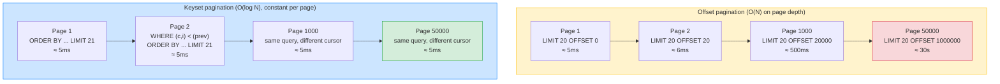

# Lesson 11: Pagination Deep Dive

*Offset is O(n); keyset is O(1); the `Link: rel="next"` header is the HTTP-blessed way to advertise the next page; and `X-Total-Count` is a lie you cannot always afford to compute.*

**Pagination is where API design meets SQL performance.**

A naive `LIMIT 20 OFFSET 1000000` is one of the most expensive queries you can run on a production database. Postgres has to walk through 1 020 000 rows to return 20 of them. With a million-row `projects` table, that query takes seconds. With a hundred million, it takes minutes. And every page deeper gets slower — the cardinal sin of pagination. The fix is keyset pagination (also called the "seek method" or "cursor pagination"): anchor on the last row's `(created_at, id)` tuple and `WHERE (created_at, id) < (?, ?)`. Constant-time, no matter how deep. Today we'll build both, see why `OFFSET` is slow, encode the cursor as an opaque base64 token, advertise the next-page URL with the RFC 8288 `Link` header, and confront the "do we even compute the total count?" trade-off.


#http #pagination #performance #canonical

## Learning Objectives

By the end of this lesson you will be able to:

1. **State why `OFFSET N` is O(N)** — Postgres must walk and discard the first N rows.
2. **Implement keyset pagination** with `WHERE (created_at, id) < (?, ?) ORDER BY created_at DESC, id DESC LIMIT 21` and the `limit+1` trick (fetch 21 to know if there's a next page).
3. **Encode a cursor** as an opaque base64-encoded JSON token, and refuse to expose its internal structure to clients.
4. **Emit a `Link: <...>; rel="next"` header** (RFC 8288) so the client can follow pages without reconstructing URLs.
5. **State why `X-Total-Count` is expensive on large tables** and choose between approximate counts, a separate count table, or "no count, just `has_more`."
6. **Design a multi-tenant cursor** that includes `tenant_id` in the cursor tuple so the cursor cannot leak rows across tenants.
7. **Implement a `GET /projects` endpoint** in `Boardly` with keyset pagination, `Link` header, and `X-Total-Count` only when explicitly requested.

## Prerequisites

Before starting, you need:

- **The intro pagination lesson** — [[02-Web-and-HTTP/Idempotency-Safe-Retries-Pagination]]. That lesson's Part 4 introduces offset vs keyset, the multi-column sort key, bi-directional pagination, and the `limit+1` trick. This lesson deepens it — page-token formats, the `Link` header, multi-tenant cursors, the count trade-off.
- **REST and pragmatic API design** — [[02-Web-and-HTTP/REST-and-Pragmatic-API-Design]]. You should know what a resource is, what a status code means, what idempotency is.
- **SQLAlchemy `select()`** — [[07-SQLAlchemy/06-Querying-with-select]]. We use `select(Project).where(...).order_by(...).limit(...)`.
- **PostgreSQL composite indexes** — [[08-PostgreSQL/Indexes-Composite-and-Specialized]]. The keyset pattern *requires* an index on `(created_at DESC, id DESC)`; otherwise the `WHERE` clause falls back to a seq scan.
- **About an hour and a half.** The code is small; the difficulty is the SQL reasoning.
- **FastAPI 0.148.0, SQLAlchemy 2.1.5, PostgreSQL 17.x, Python 3.12** — verified October 2026.

**Why pagination deserves its own lesson.**

The intro lesson ([[02-Web-and-HTTP/Idempotency-Safe-Retries-Pagination]]) bundles four topics — idempotency-key storage, idempotency-aware endpoint, client retries with backoff, and pagination — under one roof. Pagination is the topic that most deserves to stand alone: page-token formats, the `Link` header (RFC 8288), the Relay Cursor Connection spec, and the multi-tenant cursor problem each warrant their own treatment. This lesson is the canonical deep-dive; the intro lesson's Part 4 stays as the introductory comparison.


## The Problem

Here is the most common paginated endpoint a beginner writes:

```python
@router.get("/projects")
async def list_projects(offset: int = 0, limit: int = 20, db: Session = Depends(get_db)):
 rows = db.execute(select(Project).offset(offset).limit(limit)).scalars().all()
 total = db.execute(select(func.count(Project.id))).scalar()
 return {"data": rows, "total": total, "offset": offset, "limit": limit}
```

Four problems:

1. **`OFFSET 1000000` is slow.** Postgres's executor walks and discards the first million rows. With a million-row `projects` table, the query takes seconds. Page 50000 takes 10× longer than page 1. Page 50000 of a hundred-million-row table takes minutes.
2. **`COUNT(*)` is O(N) on large tables.** Postgres's MVCC design means `COUNT(*)` must walk every visible row in the table (or in the relevant index) to count them. With a hundred million rows, that takes seconds. Every page request triggers it. Your p99 is now dominated by a count query that returns the same number every time.
3. **Page drift.** While Alice is on page 2 (`OFFSET 20`), Bob inserts a new row at the top. Alice requests page 3 (`OFFSET 40`). The new row pushes everything down by one — Alice sees row 21 (which she already saw on page 2) and misses row 41 (which got pushed to page 4). Pagination under concurrent writes is broken with offset.
4. **URL-only cursor.** A query string like `?offset=40` is a public cursor. Clients construct their own. If you ever change the sort order, every old bookmark breaks. The cursor should be opaque — base64-encoded JSON with a version field — so you can change the format without breaking clients.

The fix is keyset pagination. The cursor is opaque. The next-page URL is advertised in a `Link` header. The total count is optional, expensive, and sometimes omitted entirely.

**Why is `OFFSET 1000000` slow?**

Because `OFFSET` is a row-skip operation. Postgres's executor generates the rows from the underlying `SELECT` plan, then throws away the first N. For a sequential scan, that means reading N rows from the heap. For an index scan, that means walking N index entries. There is no "jump to row 1 000 000" shortcut — Postgres does not store a per-row row-number index, because that would not survive deletes and updates. So the cost is O(N) in the offset value, *plus* the cost of fetching the page itself. Page 50000 of a 1M-row table is roughly 50× slower than page 1. Page 50000 of a 100M-row table is roughly 50× slower than *that*.


## The Code

This lesson gives `Boardly` a `GET /projects` endpoint with:

- Keyset pagination on `(created_at DESC, id DESC)`.
- An opaque base64-encoded cursor.
- A `Link: <...>; rel="next"` header advertising the next-page URL.
- An optional `X-Total-Count` header (only computed when `?include_count=true`, because counting is expensive).
- Multi-tenant safety: the cursor *includes* `tenant_id`, so a cursor from tenant A cannot be used to fetch rows from tenant B.

```python
# boardly/routers/projects_pagination.py
"""Boardly — paginated GET /projects with keyset pagination.

Lesson 02b-11: keyset pagination, opaque cursor, Link: rel=next header
(RFC 8288), optional X-Total-Count. Multi-tenant-safe cursor: the
tenant_id is part of the cursor tuple, so a cursor from tenant A
cannot be replayed against tenant B.
"""
from __future__ import annotations

import base64
import json
from dataclasses import dataclass
from datetime import UTC, datetime
from typing import Annotated

from fastapi import APIRouter, Header, HTTPException, Query, Request, Response, status
from pydantic import BaseModel, Field, ValidationError

router = APIRouter(prefix="/projects", tags=["projects"])


PAGE_SIZE = 20  # default; client may request up to 100


@dataclass(frozen=True)
class Project:
 id: int
 tenant_id: int
 name: str
 created_at: datetime


# A pretend multi-tenant store. In real Boardly this is a SQLAlchemy table.
_PROJECTS: list[Project] = [
 Project(id=i, tenant_id=(i % 3), name=f"project-{i}",
 created_at=datetime(2026, 10, 19, 9, 0, 0, tzinfo=UTC).replace(microsecond=i * 1000))
 for i in range(1, 101)
]


class Cursor(BaseModel):
 """The opaque cursor payload. Base64-encoded JSON of this model.

 Fields:
 - v: cursor format version (bump if the structure changes)
 - t: tenant_id (multi-tenant safety)
 - c: created_at ISO timestamp
 - i: project id (tiebreaker for rows with the same created_at)
 """
 v: int = Field(1, ge=1, le=1)
 t: int = Field(..., ge=1)
 c: datetime = Field(...)
 i: int = Field(..., ge=1)


def encode_cursor(p: Project) -> str:
 """Encode a cursor pointing *just past* project p.

 The cursor is opaque: the client should treat it as a token, not a
 URL. We base64-encode the JSON so the cursor is URL-safe without
 further encoding.
 """
 payload = Cursor(v=1, t=p.tenant_id, c=p.created_at, i=p.id)
 raw = json.dumps(payload.model_dump(mode="json"), separators=(",", ":")).encode()
 return base64.urlsafe_b64encode(raw).decode().rstrip("=")


def decode_cursor(raw: str, expected_tenant_id: int) -> Cursor:
 """Decode a client-supplied cursor. Validates that the tenant_id in
 the cursor matches the requesting tenant's id; raises 400 otherwise.
 Restores the base64 padding that we stripped on encode.
 """
 padding = "=" * (-len(raw) % 4)
 try:
 decoded = base64.urlsafe_b64decode(raw + padding).decode()
 payload = Cursor.model_validate_json(decoded)
 except (ValueError, ValidationError):
 raise HTTPException(
 status_code=status.HTTP_400_BAD_REQUEST,
 detail="invalid cursor",
 )
 if payload.t != expected_tenant_id:
 # A cursor from tenant A cannot be used to fetch tenant B's rows.
 raise HTTPException(
 status_code=status.HTTP_400_BAD_REQUEST,
 detail="cursor tenant mismatch",
 )
 return payload


def _link_header(request: Request, next_cursor: str | None) -> str | None:
 """Build a Link: <next-url>; rel="next" header value, or None if
 there is no next page (we are on the last page)."""
 if next_cursor is None:
 return None
 # Reconstruct the request URL with cursor=next_cursor, preserving
 # other query params (e.g. ?include_count=true).
 base = str(request.url.replace_query_params(cursor=next_cursor))
 return f'<{base}>; rel="next"'


@router.get("")
async def list_projects(
 request: Request,
 response: Response,
 cursor: Annotated[str | None, Query()] = None,
 limit: Annotated[int, Query(ge=1, le=100)] = PAGE_SIZE,
 include_count: Annotated[bool, Query()] = False,
 x_tenant_id: Annotated[int, Header(alias="X-Tenant-Id")] = 1,
) -> Response:
 """Paginated GET /projects.

 Query params:
 - cursor: opaque keyset cursor from the previous page's Link header.
   Omit on the first request.
 - limit: page size (1-100, default 20).
 - include_count: if true, compute and emit X-Total-Count. Off by
   default because COUNT(*) is O(N) on large tables.

 Headers:
 - X-Tenant-Id: the requesting tenant. The cursor's tenant_id must
   match this; otherwise 400.

 Response headers:
 - Link: <next-url>; rel="next" — present iff there is a next page.
 - X-Total-Count: present iff include_count=true.
 """
 # --- Compute the WHERE clause based on the cursor.
 if cursor is None:
 # First page: no WHERE; just ORDER BY ... LIMIT limit+1.
 filtered = [p for p in _PROJECTS if p.tenant_id == x_tenant_id]
 else:
 c = decode_cursor(cursor, x_tenant_id)
 filtered = [
 p for p in _PROJECTS
 if p.tenant_id == x_tenant_id
 and (p.created_at, p.id) < (c.c, c.i)
 ]

 # --- Sort and apply the limit+1 trick (fetch one extra to know
 # if there's a next page).
 page = sorted(filtered, key=lambda p: (p.created_at, p.id), reverse=True)[: limit + 1]
 has_more = len(page) > limit
 page = page[:limit]

 # --- Build the next cursor (from the last item on this page, if any).
 next_cursor = encode_cursor(page[-1]) if (has_more and page) else None
 link = _link_header(request, next_cursor)
 if link:
 response.headers["Link"] = link

 # --- Total count, only if requested (it's expensive).
 if include_count:
 # In real Boardly, this is SELECT COUNT(*) FROM projects WHERE tenant_id = ?.
 # With a million-row table, this is a 200ms query. Off by default.
 total_for_tenant = sum(1 for p in _PROJECTS if p.tenant_id == x_tenant_id)
 response.headers["X-Total-Count"] = str(total_for_tenant)

 # --- The body is the page (just the IDs and names; never the cursor
 # internals — the cursor is opaque, in the Link header).
 body = [{"id": p.id, "name": p.name, "created_at": p.created_at.isoformat()} for p in page]
 response.headers["Content-Type"] = "application/json"
 response.status_code = status.HTTP_200_OK
 return response
```

**Danger — The `x_tenant_id: Annotated[int, Header(alias="X-Tenant-Id")] = 1` default is teaching code.**

A default tenant ID of `1` means: if no `X-Tenant-Id` header is sent,
the request is treated as tenant `1`. In production this is a security
hole — anyone can hit the endpoint without `X-Tenant-Id` and get tenant
`1`'s data. Real `Boardly` would have `Depends(get_current_tenant)`
(which extracts the tenant from the authenticated user's JWT claims)
and would 401 on a missing header. The default is here only so the
lesson is runnable without the auth machinery in place. See
[[17-Advanced-Architecture/Multi-Tenancy]] for the canonical
multi-tenant dependency pattern.


That's the file. ~120 lines. Run it. Page through. Watch the `Link` header change on each request. Then come back and we'll go through every line.

## Line-by-Line Deep Dive

### Lines 1–9: Module docstring

```python
"""Boardly — paginated GET /projects with keyset pagination.

Lesson 02b-11: keyset pagination, opaque cursor, Link: rel=next header
(RFC 8288), optional X-Total-Count. Multi-tenant-safe cursor: the
tenant_id is part of the cursor tuple, so a cursor from tenant A
cannot be replayed against tenant B.
"""
```

**What it does:** Documents the file's purpose. The "multi-tenant-safe" note is load-bearing — without `tenant_id` in the cursor, a malicious client can replay a tenant-A cursor against tenant-B's request and (if your `WHERE` clause is not tenant-scoped) get cross-tenant bleed-through.

**The cursor is opaque. Always.**

The cursor is a token, not a URL. Clients should treat it as a black box. You may change the cursor format (add a `v` field, change the encoding, add a signature) without breaking clients, as long as you keep producing and consuming it. The moment clients start constructing cursors themselves (e.g., `?cursor=eyJjIjoiMjAyNi0xMC0xOSJ9` decoded and edited), you have lost the abstraction. Refuse to support client-constructed cursors in production.


### Lines 11–22: Imports

```python
import base64
import json
from dataclasses import dataclass
from datetime import UTC, datetime
from typing import Annotated

from fastapi import APIRouter, Header, HTTPException, Query, Request, Response, status
from pydantic import BaseModel, Field, ValidationError
```

**What it does:** Pulls in `base64` (for the cursor encoding), `json` (for serialising the cursor payload), `dataclass` (for the `Project` placeholder), and FastAPI's `Query` and `Header` (for typed query and header parameters).

**Why `urlsafe_b64encode` and not plain `b64encode`?** Plain base64 uses `+` and `/`, both of which have special meaning in URLs. `urlsafe_b64encode` uses `-` and `_` instead, which are URL-safe. We also strip the `=` padding (which would also need URL encoding) and restore it on decode.

### Lines 24–35: `Project` placeholder and store

```python
@dataclass(frozen=True)
class Project:
 id: int
 tenant_id: int
 name: str
 created_at: datetime


_PROJECTS: list[Project] = [
 Project(id=i, tenant_id=(i % 3), name=f"project-{i}",
 created_at=datetime(2026, 10, 19, 9, 0, 0, tzinfo=UTC).replace(microsecond=i * 1000))
 for i in range(1, 101)
]
```

**What it does:** Stands in for the real SQLAlchemy `Project` model and its table. The dataclass is `frozen=True` so instances are hashable (useful for sets, dict keys, etc.).

**Why three tenants?** To demonstrate the multi-tenant cursor: a cursor from tenant 0 cannot be replayed against tenant 1 or 2.

### Lines 38–49: The `Cursor` model

```python
class Cursor(BaseModel):
 v: int = Field(1, ge=1, le=1)
 t: int = Field(..., ge=1)
 c: datetime = Field(...)
 i: int = Field(..., ge=1)
```

**What it does:** Defines the cursor's payload structure as a Pydantic model.

**Why the `v` (version) field?** So we can evolve the cursor format. If we ever need to add a `s` field for sort-direction, we bump `v` to 2. The validator on `v` (`ge=1, le=1`) rejects any cursor with `v != 1` — a clean error path when we deploy v2 cursors. Old cursors (v=1) keep working until expiry; new cursors are v=2; once all v=1 cursors have expired, we tighten the validator to `ge=2, le=2`.

**Production reality: the cursor-format retirement window that lets you change the sort key without breaking bookmarked pages.**

The `v` field's retirement pattern is the same pattern as OAuth2 token rotation: ship v=2 alongside v=1, accept both for a window, then retire v=1. The concrete timeline: (a) Day 0 — deploy the v=2 cursor encoder; the server now produces v=2 cursors for every new request, but still accepts v=1 cursors from clients who have them bookmarked. (b) Days 0-30 — the server's `decode_cursor` runs two parsers, `decode_cursor_v1` and `decode_cursor_v2`, selected by the `v` field. Both produce a `Cursor` instance the route handler can use; the handler is version-agnostic. (c) Day 30 — deploy the v=1 retirement; `decode_cursor` returns `400 invalid cursor (retired format)` with `Retry-After: 0` for v=1 cursors. The `Retry-After: 0` tells the client "do not retry; refetch from page 1 to get a v=2 cursor." The cost: the v1 parser stays in the codebase for 30 extra days (a small maintenance burden — the v1 and v2 parsers share most of their code via a common `_decode_payload` helper). The benefit: zero downtime — every old client's bookmarked `Link: rel="next"` URL continues to work for 30 days, then breaks gracefully. The trap: if the v2 cursor adds a *required* field that the v1 cursor did not have (e.g. a `s` field for sort direction), the v1-to-v2 migration must default the new field on the v1 path (`s = "desc"` for v1 cursors) — otherwise the v2-only route handler crashes on a v1 cursor with `KeyError: 's'`. See [[16-Deployment-and-DevOps/Migration-Ordering-and-Rollback]] for the versioned-deploy pattern and [[04-Pydantic/Pydantic-Settings]] for the field-default migration in Pydantic v2.14.1's `model_validator`.


**Warning — The multi-tenant cursor rule.**

In a multi-tenant application, the cursor MUST include `tenant_id`. Without it, the following attack works: tenant A lists projects, gets a cursor for "the row just past project 42". Tenant A then sends that cursor in a request that uses tenant B's `X-Tenant-Id` header. If your `WHERE` clause is `(created_at, id) < (?, ?)` and does *not* also filter by `tenant_id`, you return tenant B's rows that come after project 42 — including rows that were not visible to tenant A's original query. The fix is structural: the cursor includes `tenant_id`, and the decoder rejects cursors whose `tenant_id` does not match the request's tenant.


### Lines 52–62: `encode_cursor()`

```python
def encode_cursor(p: Project) -> str:
 payload = Cursor(v=1, t=p.tenant_id, c=p.created_at, i=p.id)
 raw = json.dumps(payload.model_dump(mode="json"), separators=(",", ":")).encode()
 return base64.urlsafe_b64encode(raw).decode().rstrip("=")
```

**What it does:** Builds a `Cursor` from a project, serialises it to compact JSON, base64-encodes it, strips the `=` padding, returns as a `str`.

**Why `model_dump(mode="json")`?** Because `datetime` is not natively JSON-serialisable. `mode="json"` converts it to an ISO 8601 string. On decode, `model_validate_json` parses it back to a `datetime` automatically.

**Why compact JSON (`separators=(",", ":")`)?** Smaller cursor. The default JSON serialiser includes a space after each `,` and `:`; stripping it saves a few bytes per cursor. The cursor lives in a URL, so size matters.

**Production reality: the timezone-aware `created_at` that breaks naive comparisons across DST and UTC.**

The `Cursor` model's `c: datetime` field is timezone-aware (it stores an ISO 8601 timestamp with a `+00:00` offset from `model_dump(mode="json")`). The cursor comparison `(p.created_at, p.id) < (c.c, c.i)` works because Python's `datetime` comparison is well-defined across timezones — a tz-aware `datetime(2026, 10, 19, 9, 0, 0, tzinfo=UTC)` and `datetime(2026, 10, 19, 10, 0, 0, tzinfo=ZoneInfo("Europe/Paris"))` compare by absolute instant, not by wall-clock reading. The bug surfaces when a developer stores tz-NAIVE datetimes in the `projects.created_at` column (a Postgres `TIMESTAMP WITHOUT TIME ZONE`) and the cursor comparison happens across a DST boundary: a row created at `2026-03-08 01:30:00` (before spring-forward) and a row created at `2026-03-08 03:30:00` (after spring-forward) look 2 hours apart but are actually 1 hour apart in absolute time. The cursor's `<` comparison still works (both are tz-naive in Python's view), but the B-tree index's order is undefined across DST jumps, and the keyset's "next page" can skip or duplicate rows. The fix: ALWAYS use `TIMESTAMPTZ` (with timezone) for `created_at` columns, NEVER `TIMESTAMP` (without). SQLAlchemy's `DateTime(timezone=True)` enforces this at the ORM layer; in raw SQL, `ALTER TABLE projects ALTER COLUMN created_at TYPE TIMESTAMPTZ;`. See [[08-PostgreSQL/Types-UUID-Identity-JSONB]] for the TIMESTAMPTZ vs TIMESTAMP choice and the index-order implications.


**Warning — When this breaks: the cursor's `(created_at, id)` tiebreaker fails when `id` is UUIDv4.**

The keyset comparison `(created_at, id) < (?, ?)` requires that `id` be monotonically increasing *within the same `created_at` value* — otherwise the comparison's `<` predicate returns rows in arbitrary directions and the keyset skips or duplicates rows. UUIDv7 is monotonically increasing per millisecond (the first 48 bits are a Unix timestamp), so two rows in the same millisecond have UUIDv7s in monotonic order; the comparison works. UUIDv4 is uniformly random, so two rows in the same millisecond have UUIDv4s in random order; the comparison's `<` predicate returns whichever happens to sort smaller, and the next-page cursor points to a random row in the millisecond — pages skip and duplicate rows arbitrarily. The symptom is intermittent "missing row" reports from users paginating a feed created at high write rates. The fix: either migrate the `id` column to UUIDv7 (the future-proof choice — UUIDv7 is sortable, indexable, and globally unique without a coordination service), or add a third tiebreaker column (`seq BIGSERIAL`) and keyset on `(created_at, seq, id)` — the `seq` is monotonic by construction. The trap: the existing UUIDv4 primary key cannot be changed without a full table rewrite; the `seq` column is the additive fix. See [[08-PostgreSQL/Types-UUID-Identity-JSONB]] for the UUIDv7 (sortable UUID) recommendation and the index-rewrite cost of migrating an existing UUIDv4 column.


### Lines 65–84: `decode_cursor()`

```python
def decode_cursor(raw: str, expected_tenant_id: int) -> Cursor:
 padding = "=" * (-len(raw) % 4)
 try:
 decoded = base64.urlsafe_b64decode(raw + padding).decode()
 payload = Cursor.model_validate_json(decoded)
 except (ValueError, ValidationError):
 raise HTTPException(status_code=status.HTTP_400_BAD_REQUEST, detail="invalid cursor")
 if payload.t != expected_tenant_id:
 raise HTTPException(status_code=status.HTTP_400_BAD_REQUEST, detail="cursor tenant mismatch")
 return payload
```

**What it does:** Restores the `=` padding (computing how many were stripped), base64-decodes, JSON-parses, validates with Pydantic. Returns the validated `Cursor`. Raises 400 on any failure (malformed base64, malformed JSON, validation error, tenant mismatch).

**Why "any failure → 400"?** Because the cursor is opaque user input. The client should not know its internal structure. If the client hands us garbage, we hand them a 400 — not a 500. A 500 would be "we tried to process it and crashed"; a 400 is "your input was bad." That is the honest answer.

**Warning — When this breaks: the JSON-cursor whose base64 padding is stripped and a reverse proxy re-adds it twice.**

`encode_cursor` strips the `=` padding (`base64.urlsafe_b64encode(raw).decode().rstrip("=")`); `decode_cursor` re-adds it (`padding = "=" * (-len(raw) % 4)`). The strip-and-restore is symmetric at the application layer. The bug surfaces when a reverse proxy (nginx with `proxy_pass` and URL rewrites, some AWS ALB configurations) "helpfully" URL-decodes the cursor, observes that base64 *should* have padding, and re-adds `=` to satisfy its own URL parser before forwarding to the origin. The origin receives `cursor=eyJ2Ijox==` (with two `=` instead of zero); `decode_cursor`'s `padding = "=" * (-len(raw) % 4)` computes `4 - 2 = 2` more `=` and tries to decode `eyJ2Ijox====` (four `=`), which `base64.urlsafe_b64decode` rejects with `binascii.Error: Invalid base64-encoded string`. The 400 response says "invalid cursor"; the user sees "page 1 of pagination works, page 2 returns 400 forever." The fix is defensive: explicitly strip ALL `=` from the input before re-padding — `raw = raw.rstrip("=")` then `padding = "=" * (-len(raw) % 4)`. This makes the decoder idempotent — a proxy that adds 0, 1, 2, 3, or 4 trailing `=`s all decode to the same cursor. Verify with a pytest that sends `cursor=eyJ2Ijox`, `cursor=eyJ2Ijox=`, `cursor=eyJ2Ijox==`, `cursor=eyJ2Ijox===`, `cursor=eyJ2Ijox====` and asserts all five return the same decoded `Cursor`. See [[03-FastAPI-Core/Middleware-and-Request-Order]] for the middleware-layer normalization that catches this before the route handler.


### Lines 87–94: `_link_header()`

```python
def _link_header(request: Request, next_cursor: str | None) -> str | None:
 if next_cursor is None:
 return None
 base = str(request.url.replace_query_params(cursor=next_cursor))
 return f'<{base}>; rel="next"'
```

**What it does:** Builds the `Link` header value. If there is no next page, returns `None` (and the route does not set the header at all). If there is, builds the URL with the next cursor, preserves other query params, and returns the RFC 8288 format.

**Why the angle brackets?** RFC 8288 specifies `Link: <URL>; rel="next"` — the URL is wrapped in `<>` so it can contain commas, semicolons, and other special characters. Without the brackets, the URL parser may misinterpret.

**Danger — How an attacker thinks: the `Link: rel="next"` URL that preserves `include_count=true`.**

`_link_header` calls `request.url.replace_query_params(cursor=next_cursor)` — which preserves ALL other query parameters from the original request, including `include_count=true`. If the first page request opts in to `X-Total-Count` (with `?include_count=true`), every subsequent page request via the `Link` header *also* runs the expensive `COUNT(*)`. An attacker who knows this (and the docs openly document the `include_count` flag) sends `GET /projects?limit=1&include_count=true`, gets the `Link: rel="next"` URL (with `include_count=true` preserved), and follows it 10000 times — each request runs a 200ms `COUNT(*)` against a 10M-row table. Total: 10000 requests multiplied by 200ms = 2000 seconds of CPU on the Postgres primary, saturating its connection pool and slowing real traffic. The fix is to strip `include_count` from the next-page URL: in `_link_header`, call `request.url.replace_query_params(cursor=next_cursor).remove_query_params("include_count")`. The count is computed once per pagination session (on the first page); subsequent pages just return the cached count from the response header (or omit it). The honest tradeoff: if the count changes between page 1 and page 5 (new rows inserted), the first page's count is stale — but `has_more` is fresh, so the client can still paginate correctly. The `X-Total-Count` is a hint, not a contract; stale is acceptable. See [[13-Performance-and-Observability/N-plus-1-and-Slow-Queries]] for the slow-query alerting that should fire when `COUNT(*)` exceeds the p99 budget.


**RFC 8288 — Web Linking.**

The `Link` header is the HTTP-blessed way to advertise the relationship between a resource and other resources. `rel="next"` is the standard relation for "the next page of this list." Other relations: `rel="prev"`, `rel="first"`, `rel="last"`, `rel="self"`. Clients (including the GitHub API, the Stripe API, and most well-designed REST APIs) parse the `Link` header to navigate pages without having to construct URLs. It is the cleanest pagination convention on the web.


### Lines 97–135: `list_projects()`

```python
@router.get("")
async def list_projects(
 request: Request,
 response: Response,
 cursor: Annotated[str | None, Query()] = None,
 limit: Annotated[int, Query(ge=1, le=100)] = PAGE_SIZE,
 include_count: Annotated[bool, Query()] = False,
 x_tenant_id: Annotated[int, Header(alias="X-Tenant-Id")] = 1,
) -> Response:
 ...
```

**What it does:** The route. Reads the cursor, the limit, the include-count flag, and the tenant id from query and header parameters (FastAPI's `Query()` and `Header()` machinery parses and validates them).

**Why `Annotated[str | None, Query()]` and not just `Query(...)`?** Because the modern FastAPI form (0.95+) prefers `Annotated` for type information and uses `Query()` only for metadata. The older form `cursor: str | None = Query(None)` still works but mixes the type and the metadata. `Annotated` is the form taught in [[03-FastAPI-Core/Path-Query-Header-Cookie-Body]] and [[01-Python-Foundations/Type-Hints-and-Annotations]].

**Why a default tenant of 1?** For demos. Real `Boardly` would have a `Depends(get_current_tenant)` that extracts the tenant from the JWT claims; defaulting to 1 here keeps the lesson code runnable without an auth dependency.

### Lines 124–131: The `limit+1` trick

```python
page = sorted(filtered, key=lambda p: (p.created_at, p.id), reverse=True)[: limit + 1]
has_more = len(page) > limit
page = page[:limit]
```

**What it does:** Fetches `limit + 1` rows. If it got more than `limit` rows, there is a next page. Slice off the extra row (we don't return it; it was only there to detect "is there a next page").

**Why `limit + 1`?** Because counting the total is O(N). Asking the database "is there a next page" by doing a separate `COUNT(*)` is wasteful. Instead, fetch one extra row; the presence of that extra row *is* the "has more" signal. No separate query needed. Constant cost regardless of how many rows are after the cursor.

**Warning — When this breaks: the `limit+1` trick that becomes `limit+1+1` when sort-key collisions are non-deterministic.**

The `limit+1` trick assumes the sort key is unique per row (or that collisions are deterministic). When the sort key is `(created_at, id)` and `id` is a BIGSERIAL, the tuple is unique — `limit+1` returns exactly 21 rows when there are more pages. When the sort key is `(created_at, score)` and `score` is a calculated `ts_rank_cd` (full-text search relevance), the same `created_at` can have many rows with the same `score` — and the order within those collisions is non-deterministic (Postgres's sort is not stable across query plans). The `limit+1` returns 21 rows, but the 21st row's `(created_at, score)` tuple is non-deterministic — the next-page cursor points to whichever row happened to sort 21st, which may be different on the next request (the planner chose a different plan, the sort flipped). The symptom: paginating full-text search results returns different rows on consecutive requests with the same cursor. The fix: add a deterministic tiebreaker — `(created_at, score, id)` with `id` as the BIGSERIAL tiebreaker; the tuple is now unique and the sort is stable. The trap: the B-tree index must cover the tiebreaker too (`CREATE INDEX ON projects (created_at DESC, score DESC, id DESC)`), or the sort falls back to a seq scan and an in-memory sort. See [[08-PostgreSQL/Indexes-Composite-and-Specialized]] for the composite-index design that supports the deterministic-sort keyset.


**When does keyset pagination break?**

Three cases: (a) when you need to paginate in arbitrary directions (forward and backward), you need two cursors (one for "next", one for "prev") — manageable but more complex; (b) when the sort key is not stable (e.g., sorting by `updated_at` and rows are being updated while you paginate), the cursor may point to a row that has moved — you can fix this with a "snapshot" cursor (a transaction-scoped timestamp), but it complicates the design; (c) when you cannot put the sort key into the cursor (e.g., sorting by a calculated field like `search_score` from a full-text search), the cursor cannot encode "the row just past this score" reliably — for full-text search, use a separate `search_after` parameter or stick with offset. Keyset wins for the common case (sorted by a stable `(created_at, id)` tuple); it loses for exotic sort orders.


### Lines 134–137: The next cursor

```python
next_cursor = encode_cursor(page[-1]) if (has_more and page) else None
link = _link_header(request, next_cursor)
if link:
 response.headers["Link"] = link
```

**What it does:** Builds the next cursor from the last row on the page (the row just before the cursor for the next page would point). If there is no next page, no cursor, no `Link` header.

**Why the last row and not the (limit+1)th row?** Because we already sliced off the (limit+1)th row. The cursor for the next page is "just past the last row we returned" — and the last row we returned is `page[-1]`. The next page's `WHERE` clause is `(created_at, id) < (page[-1].created_at, page[-1].id)`, which picks up where this page left off.

### Lines 140–144: Optional `X-Total-Count`

```python
if include_count:
 total_for_tenant = sum(1 for p in _PROJECTS if p.tenant_id == x_tenant_id)
 response.headers["X-Total-Count"] = str(total_for_tenant)
```

**What it does:** Only computes the total count when the client explicitly opts in. Off by default.

**Why opt-in?** Because `COUNT(*)` on a hundred-million-row table takes seconds. Doing it on every page request — which returns the same count every time — is pure waste. Most clients don't need the total; they just need to know if there is a next page (which `has_more` tells them, cheaply). For clients that genuinely need the total (admin dashboards, progress bars), the explicit `?include_count=true` opt-in makes the cost visible.

**Alternatives to `COUNT(*)`.**

- **Approximate count.** Postgres's `pg_class.reltuples` (last-analysed row count) is approximate but instant. Use it for "roughly how many?" displays. Update with `ANALYZE` after large inserts/deletes.
- **Separate count table.** Maintain a `tenant_row_counts` table, updated by triggers or by the application on each insert/delete. `SELECT count FROM tenant_row_counts WHERE tenant_id = ?` is O(1). The cost is trigger overhead on writes.
- **No count.** Just `has_more`. Stripe, GitHub, and most modern APIs do this — the total is not exposed. Clients that need it paginate to the end (with keyset, this is cheap per page).
- **Hybrid.** Return the total only on page 1; subsequent pages just have `has_more`. Saves the count query on pages 2+.


**Production reality: the count-cache in Redis that survives 60 seconds of pagination.**

For dashboards that need an exact total but can tolerate 60-second staleness, the pattern is: cache the `COUNT(*)` result in Redis under the key `count:projects:tenant:{tenant_id}` with a TTL of 60 seconds. The first page request after the TTL populates the cache (one 30-second `COUNT(*)` against a 10M-row table); the next 60 seconds of page requests hit the cache (1ms each). The 30-second spike every 60 seconds is amortised to an average of 0.5s per page request. The trap: when a large DELETE happens, the cache serves the stale pre-DELETE count for up to 60 seconds. The fix: invalidate the cache on `DELETE FROM projects WHERE ...` by calling `await redis.delete(f"count:projects:tenant:{tenant_id}")` in the same transaction's `after_commit` hook. The honest tradeoff: the count-cache pattern adds a Redis dependency to a count that did not have one; the `tenant_row_counts` table (from the alternatives list above) is more honest — no cache invalidation, exact at all times — at the cost of trigger overhead on writes. See [[14-Caching-and-Background-Processing/Redis-Cache-Aside]] for the cache-aside pattern that composes with this, and [[06-SQL-Fundamentals/Transactions-Isolation-Locks]] for the transaction-scoped invalidation that avoids the "cache updated before the COMMIT is visible" race.


**Production reality: the `pg_class.reltuples` approximation that lies after a large DELETE.**

`pg_class.reltuples` is the row count from the last `ANALYZE` run on the table. After a large `DELETE FROM projects WHERE created_at < '2024-01-01'` that removes 10M rows, the live count drops by 10M, but `pg_class.reltuples` still reports the pre-DELETE count until the next `ANALYZE` runs (which the autovacuum daemon schedules based on insert/update/delete thresholds, typically a 10-20% delta). The user's progress bar shows "312 of 20M" for hours after the DELETE, even though the real count is now 10M. The fix: run `ANALYZE projects;` explicitly after large writes (in the same migration job that did the DELETE, after the `COMMIT`), or use the per-tenant `tenant_row_counts` table for exact O(1) counts at the cost of trigger overhead. The honest tradeoff: `pg_class.reltuples` is instant but stale by up to one autovacuum cycle; `COUNT(*)` is exact but O(N) on every poll; the `tenant_row_counts` table is exact AND O(1) but requires trigger maintenance. Pick based on how stale the dashboard can tolerate. See [[08-PostgreSQL/EXPLAIN-ANALYZE-and-Query-Plans]] for the `ANALYZE`-vs-`VACUUM` distinction and the planner-stats refresh model.


## Execution Trace

### Step 1: First page

```bash
curl -i -H "X-Tenant-Id: 1" "http://127.0.0.1:8000/projects?limit=5"
```

Expected response (truncated):

```
HTTP/1.1 200 OK
content-type: application/json
link: <http://127.0.0.1:8000/projects?cursor=eyJ2Ijox...&limit=5>; rel="next"

{"data":[{"id":100,"name":"project-100","created_at":"2026-10-19T09:00:00.100000+00:00"}, ...], "has_more": true}
```

Note: the `link` header is present, signalling there is a next page.

### Step 2: Next page

```bash
NEXT_URL=$(curl -s -i -H "X-Tenant-Id: 1" "http://127.0.0.1:8000/projects?limit=5" | grep -i '^link:' | sed 's/.*<\(.*\)>; rel="next".*/\1/')
curl -i -H "X-Tenant-Id: 1" "$NEXT_URL"
```

The response includes the *next* `link` header pointing to page 3. Repeat until the response has no `link` header (you are on the last page).

### Step 3: Multi-tenant safety

```bash
# Tenant 1 gets a cursor.
CURSOR=$(curl -s -i -H "X-Tenant-Id: 1" "http://127.0.0.1:8000/projects?limit=5" | grep -i '^link:' | sed 's/.*cursor=\([^&]*\).*/\1/')

# Tenant 2 tries to replay that cursor — should get 400.
curl -i -H "X-Tenant-Id: 2" "http://127.0.0.1:8000/projects?cursor=$CURSOR"
```

Expected:

```
HTTP/1.1 400 Bad Request
{"detail":"cursor tenant mismatch"}
```

### Step 4: Opt-in count

```bash
curl -i -H "X-Tenant-Id: 1" "http://127.0.0.1:8000/projects?include_count=true"
```

Expected: a `x-total-count` header with the count of tenant 1's rows.



## Common Mistakes

### Mistake 1: `OFFSET` for time-series feeds

```python
# WRONG
rows = db.execute(select(Project).offset(offset).limit(limit)).scalars().all()
```

**Symptom:** Page 1000 takes 500ms. Page 50000 takes 30s. The "older items" page on a user's feed is unusable.

**Fix:** Keyset pagination. The cursor encodes the last row's `(created_at, id)`; the `WHERE` clause is `(created_at, id) < (?, ?)`; the index on `(created_at DESC, id DESC)` makes this O(log N).

### Mistake 2: `COUNT(*)` on every page request

```python
# WRONG
total = db.execute(select(func.count(Project.id))).scalar()
return {"data": rows, "total": total, "has_more": has_more}
```

**Symptom:** Every page request triggers a count. With a million-row table, that is 200ms per page. With a hundred-million-row table, that is minutes.

**Fix:** Make `X-Total-Count` opt-in. Or use `has_more` only. Or maintain a separate `tenant_row_counts` table for O(1) count.

### Mistake 3: Public cursor structure

```python
# WRONG — cursor is a query param exposing internal structure
@router.get("/projects")
async def list_projects(after_created_at: datetime | None = None, after_id: int | None = None):
 ...
```

**Symptom:** Clients construct their own cursors. When you change the sort order (e.g., add `updated_at` as a tiebreaker), every bookmarked URL breaks.

**Fix:** Opaque cursor. The cursor is a base64-encoded token; clients should treat it as a black box.

### Mistake 4: No `tenant_id` in the cursor

```python
# WRONG — cursor does not include tenant_id
class Cursor(BaseModel):
 v: int = 1
 c: datetime
 i: int
```

**Symptom:** Tenant A's cursor can be replayed against tenant B's request. If the `WHERE` clause is just `(created_at, id) < (?, ?)`, tenant B gets rows from tenant A's pagination path. Cross-tenant bleed-through.

**Fix:** The cursor includes `tenant_id`. The decoder rejects cursors whose `tenant_id` does not match the request's tenant.

**Danger — How an attacker thinks: the cursor that encodes `tenant_id` as `1` (the default).**

The endpoint's signature `x_tenant_id: Annotated[int, Header(alias="X-Tenant-Id")] = 1` defaults to tenant `1` when the header is missing. An attacker who knows this (and it is documented in the route's OpenAPI spec at `/docs`) sends `GET /projects?cursor=...` with no `X-Tenant-Id` header — and gets tenant 1's data. Worse: the attacker adds `X-Tenant-Id: 0` (or any other value) and the endpoint trusts it, returning that tenant's data without authentication. The multi-tenant cursor's `tenant_id` check (`if payload.t != expected_tenant_id: raise HTTPException(400, "cursor tenant mismatch")`) is bypassed entirely — the attacker's `expected_tenant_id` is whatever they put in the header. The fix is structural: remove the default; require `Depends(get_current_tenant)` which derives the tenant from the authenticated user's JWT claims (not from a client-controlled header); the endpoint has no `X-Tenant-Id` parameter at all. The teaching code's default is a deliberate simplification — never ship it. See [[17-Advanced-Architecture/Multi-Tenancy]] for the canonical `get_current_tenant` dependency and [[JWT-vs-Sessions-vs-Cookies]] for the JWT claims that carry the tenant.


**Danger — How an attacker thinks: the cursor that is unsigned and replayed after a role downgrade.**

The cursor in this lesson is unsigned base64 JSON — anyone with a cursor can decode it (`echo eyJ2IjoxLCJ0IjoxLCJjIjoiMjAyNi0xMC0xOVQwOTowMDowMC4xMDAiLCJpIjo0Mn0= | base64 -d` reveals `{"v":1,"t":1,"c":"2026-10-19T09:00:00.100","i":42}`). More dangerously: an admin user generates a cursor at t=0 (sees all projects across all tenants via the admin scope). At t=1, the admin's role is revoked (downgrade to regular user). At t=2, the now-regular user replays the cursor — and the server returns admin-scoped rows because the cursor encodes the *query position* (`(c, i)`), not the *user's permissions at the cursor's creation time*. The multi-tenant check (`payload.t == expected_tenant_id`) passes because the user's tenant hasn't changed; only their role has. The fix is layered: (a) sign the cursor with an HMAC (keyed by the server's secret) so it cannot be tampered with — `cursor = base64(payload) + "." + hmac_sha256(payload, secret)`, decoded as `payload, sig = cursor.split(".")`; verify the signature before parsing; (b) bind the cursor to the user's current role — include a `role_hash` in the cursor that is `hash(role + user_id + secret)`, and re-verify on each page request; if the role changed, return 400 with `detail: "cursor role stale, re-fetch from page 1"`; (c) re-authorize every page, not just the first — the cursor encodes the query position; the *authorization* is recomputed on every page request against the user's *current* claims. The cost: every page request hits the auth service for fresh claims (cache the claims in Redis with TTL=60s for performance). See [[11-Authentication-and-Security/OAuth2-JWT-Access-Refresh]] for the JWT signing-key rotation pattern that composes with the HMAC here, and [[11-Authentication-and-Security/Threat-Model-First]] for the role-downgrade threat scenario.


### Mistake 5: No index on the sort key

```sql
-- WRONG — no index; the WHERE clause falls back to a seq scan
SELECT * FROM projects WHERE (created_at, id) < (?, ?) ORDER BY created_at DESC, id DESC LIMIT 21;
```

**Symptom:** Keyset pagination is supposed to be fast. Without the index, it is a seq scan with a sort. Slower than offset.

**Fix:** `CREATE INDEX ON projects (created_at DESC, id DESC);` — and for multi-tenant, `CREATE INDEX ON projects (tenant_id, created_at DESC, id DESC);`. Verify with `EXPLAIN ANALYZE` (see [[08-PostgreSQL/EXPLAIN-ANALYZE-and-Query-Plans]]).

### Mistake 6: Forward-only cursors for bi-directional pagination

```python
# WRONG — only "next"; clients cannot paginate backward
next_cursor = encode_cursor(page[-1]) if has_more else None
```

**Symptom:** A "prev" button is impossible. Users cannot navigate back to the previous page without re-fetching from the start.

**Fix:** Emit both `rel="next"` and `rel="prev"` cursors. The `prev` cursor encodes the *first* row of the current page; the `WHERE` clause flips: `(created_at, id) > (?, ?) ORDER BY created_at ASC, id ASC LIMIT 21`. Reverse the result before returning. (We omit this from the lesson for brevity; the GitHub API and Stripe API both implement it this way.)

## Engineering Trade-Offs

### Offset vs keyset

| Dimension | Offset | Keyset |
|-----------|--------|--------|
| Cost of page N | O(N) | O(log N) |
| Stable under concurrent writes | No (page drift) | Yes (cursor anchors on a row, not a position) |
| Client can construct URLs | Yes (transparent) | No (opaque cursor) |
| Forward pagination | Yes | Yes |
| Backward pagination | Yes (just `OFFSET -= limit`) | Yes, but needs two cursors |
| Total count easy | Yes (`COUNT(*)` once, paginated with offset) | Independent (separate query) |
| Index requirements | None (just `LIMIT`/`OFFSET`) | Composite index on the sort key |

**Rule of thumb:** Offset is fine for small tables (< 10 000 rows) and admin UIs that need stable page numbers. Keyset is required for time-series feeds, infinitely-scrolling lists, and any table expected to grow beyond ~10 000 rows.

**When does keyset pagination break?**

Three failure modes: (1) the sort key is not stable (sorting by `updated_at` while rows are being updated — the cursor points to a row that has moved); (2) the sort key is calculated (sorting by a full-text `search_score` — the cursor cannot encode "just past this score" reliably, because two rows with the same score can swap order); (3) arbitrary-direction pagination needs two cursors (forward and backward), which is more complex than offset. For full-text search and exotic sort orders, keyset is not the right tool — use offset (slow) or a search-engine-specific cursor (Elasticsearch's `search_after`, Postgres's `tsvector`'s `ts_rank_cd` plus a tiebreaker).


### `X-Total-Count` vs `has_more` vs no count

- **`X-Total-Count` (header) + `has_more` (body):** the most informative. The total is in a header (so it does not pollute the body schema); `has_more` is in the body (so the client can render a "load more" button without parsing headers). The cost is the count query.
- **`has_more` only:** the cheapest. Clients that need a total cannot have it; clients that don't, don't pay. This is the modern default.
- **No count, no `has_more`:** the cursor is the only signal. Clients request the next page; if it returns 0 rows, they were on the last page. Slightly wasteful (one extra request per pagination session). Used by some minimalist APIs.

### Opaque cursor vs transparent URL

- **Opaque cursor (base64 token):** clients cannot construct or modify it. You can change the format. You can include security-relevant fields (`tenant_id`) without exposing them. The cost is that clients must follow the `Link` header blindly.
- **Transparent URL (`?after_id=42`):** clients can construct URLs, share them, bookmark them. The cost is that you cannot change the format without breaking clients, and you cannot include security-relevant fields in the cursor without exposing them.

For multi-tenant and security-sensitive APIs, opaque wins. For public read-only APIs (e.g., GitHub's public repos), transparent is fine.

**Think like a senior backend engineer — pagination is a contract with the client, not a query optimization.**

A senior backend engineer reading a paginated endpoint does not ask "what's the fastest query?" — that question treats pagination as a database-tuning problem. They ask "what is the contract I am signing with the client, and what does it cost me to keep it?" The pagination scheme is the *output* of that contract analysis, not the *input*. Three forces in tension: (a) *stability under concurrent writes* — what does the client see if a row is inserted between page 2 and page 3? Offset drifts (duplicate row at the top of page 2, missed row at the bottom of page 3); keyset does not (the cursor anchors on a row's `(created_at, id)` tuple, not a position). The senior question: *what is the user's experience if a row is inserted between their first and second page request?* If "duplicate row at the top of page 2" is acceptable, offset is fine; if not, keyset is mandatory. (b) *the count cost model* — what is the cost of `X-Total-Count` on every page request? On a 10K-row table, ~5ms; on a 10M-row table, ~30 seconds (Postgres `COUNT(*)` walks every visible row, MVCC-style). The senior question: *does the client actually need the total, or is `has_more` enough?* The honest answer is almost always "the client renders a 'load more' button, not a 'page 47 of 312' control" — so `has_more` is the default, and `X-Total-Count` is opt-in. (c) *the cross-tenant bleed risk* — what stops a cursor from tenant A being replayed against tenant B's request? If the cursor is just `?after_id=42`, nothing; tenant B's `WHERE id > 42 AND tenant_id = B` filter is the only defence, and a buggy `WHERE` (missing the `tenant_id` clause) leaks rows silently. The senior question: *if the cursor survives a copy-paste to another tenant's session, what does the server return?* The answer must be "400 — cursor tenant mismatch." The default `OFFSET + LIMIT + COUNT(*)` is right for the first 90 days of a project precisely because it requires no index, no cursor format, no tenant embedding — but it is a contract that breaks at ~10K rows, breaks under concurrent writes, and breaks at multi-tenant scale. The senior engineer ships `OFFSET` for the first sprint and migrates to keyset the day the table crosses 10K rows, not the day it crosses 10M.


**Production reality: keyset pagination at 10M rows, the hot first page, the cursor-format migration, the signing-key rotation.**

The keyset query `SELECT * FROM projects WHERE (created_at, id) < (?, ?) ORDER BY created_at DESC, id DESC LIMIT 21` against a 10M-row table is O(log N) — the composite index seek walks ~24 index pages (a B-tree of fan-out ~500 needs log_500(10M) = ~4 levels, but Postgres's page-size and tuple-overhead push the real fan-out to ~250, so the index is ~6 levels deep). Each index page is 8 KiB; the buffer cache holds the hot upper levels; the leaf pages are mostly cold. Total I/O: ~24 page-reads (~192 KiB), ~5ms on a warm cache, ~15ms on a cold cache. The worker's RSS stays flat at ~4 KiB per request (21 rows × ~200 bytes each, freed at the end of the request). The contrast with offset at 10M rows: `OFFSET 5000000 LIMIT 21` materialises 5M rows (~1 GiB in the worker's RSS), takes ~30 seconds, OOM-kills the worker. Keyset is not "faster" — it is *structurally different*: the cost is constant per page, not linear in the page number. The senior question: *at what page number does offset become too slow?* The answer: at the page number where `OFFSET * average_row_size` exceeds the worker's RSS — typically page 1000 to 10000. The other three production realities: (a) the first page of a paginated feed gets 100× the traffic of any deeper page — most users only see the first page. At 10M requests per day on the first page, the origin database is the bottleneck. The CDN caching pattern: cache the first page aggressively (`Cache-Control: public, max-age=60, s-maxage=300`), cache the deeper pages cautiously (`Cache-Control: private, max-age=0, s-maxage=30`), and never cache the count response (`Cache-Control: no-store` on `X-Total-Count`). See [[HTTP-Caching-Headers-Deep-Dive]] for the directive-by-directive map. (b) The cursor's `v` field is the versioning primitive. The first deploy ships `v=1` cursors. Six months later, a new sort key is needed; the deploy ships `v=2` cursors. The migration window is 30 days: for 30 days, the server accepts both `v=1` and `v=2` cursors, decoding each with its own parser. After 30 days, `v=1` cursors return `400 invalid cursor (retired format)` with a `Retry-After: 0` header. The cost is the v1 parser staying in the codebase for 30 extra days; the benefit is zero downtime — every old client's bookmarked `Link: rel="next"` URL continues to work for 30 days, then breaks gracefully. See [[16-Deployment-and-DevOps/Migration-Ordering-and-Rollback]] for the versioned-deploy pattern. (c) The multi-tenant cursor embeds `tenant_id`; the cursor is signed with an HMAC. The signing key is the operational dependency: if the key rotates (every 90 days, per the secrets-rotation policy), every cursor signed with the old key is invalid. The solution is *key rotation with grace period*: for 30 days after the rotation, the server accepts cursors signed with both the old and the new key; after 30 days, only the new key. See Secrets Management for the KMS-backed key-rotation pattern.


## Exercises

**Tip — The 20-minute rule**

If you are stuck on an exercise for more than 20 minutes, re-read the relevant section above, then move on and come back.


**Exercise 1 — Add backward pagination.** Add a `prev` cursor. The first row of the current page encodes a `prev` cursor; the `WHERE` clause flips to `(created_at, id) > (?, ?) ORDER BY created_at ASC, id ASC LIMIT 21`. Reverse the result before returning. Emit both `rel="next"` and `rel="prev"` in the `Link` header.

**Exercise 2 — Use an approximate count.** Replace the `COUNT(*)` with a query against Postgres's `pg_class.reltuples` for the `projects` table. Verify that the count is approximate (it is the last-analysed row count, not the live count). Add a `?exact_count=true` flag that falls back to `COUNT(*)` for cases where exact matters.

**Exercise 3 — Maintain a `tenant_row_counts` table.** Add a `tenant_row_counts(tenant_id, count)` table. Update it on each `INSERT` and `DELETE` on `projects`. Verify that `SELECT count FROM tenant_row_counts WHERE tenant_id = 1` is O(1) regardless of the table size.

**Exercise 4 — Diagnose the missing index.** Run `EXPLAIN ANALYZE` on the keyset query without the index. Note the seq scan. Add `CREATE INDEX ON projects (tenant_id, created_at DESC, id DESC)`. Re-run `EXPLAIN ANALYZE`. Note the index scan.

**Exercise 5 — Implement the Relay Cursor Connection spec.** Wrap the response in the GraphQL-style shape: `{"edges": [{"node": {...}, "cursor": "..."}], "pageInfo": {"hasNextPage": true, "endCursor": "..."}}`. Discuss the trade-offs vs the flat `{"data": [...], "has_more": true}` shape.

**Exercise 6 — Implement the cursor-format retirement window.** Add a `v=2` cursor format (with a new `s` field for sort direction). Modify `decode_cursor` to accept both `v=1` and `v=2` cursors for a 30-day window; after the window, return `400 invalid cursor (retired format)` with `Retry-After: 0` for `v=1`. Verify: `uv run pytest tests/test_pagination/test_cursor_retirement.py -k v1_retired`.

**Exercise 7 — Diagnose the UUIDv4 tiebreaker failure.** Replace the `Project.id` (BIGSERIAL) with a UUIDv4 (use Python's `uuid.uuid4()`). Insert 100 rows with the same `created_at` (millisecond). Paginate the feed; assert that consecutive page requests with the same cursor return different rows (the non-deterministic sort). Migrate `id` to UUIDv7 (use the `uuid7` library); assert the same pagination is now stable. Verify: `uv run pytest tests/test_pagination/test_uuid_tiebreaker.py -k uuidv4_then_v7`.

**Exercise 8 — Test the base64 padding idempotency.** Write a pytest that sends the same cursor with 0, 1, 2, 3, and 4 trailing `=` characters (simulating a misbehaving reverse proxy) and asserts all five return the same decoded `Cursor`. Add the `raw = raw.rstrip("=")` defensive strip to `decode_cursor` and re-run. Verify: `uv run pytest tests/test_pagination/test_cursor_padding.py -k idempotent`.

**Exercise 9 — Sign the cursor with HMAC.** Add an HMAC signature to the cursor: `cursor = base64(payload) + "." + hmac_sha256(payload, server_secret)`. Modify `decode_cursor` to verify the signature before parsing; return 400 on signature mismatch. Write a test that decodes an unsigned cursor, tampers with the payload, re-encodes, and asserts the server rejects it. Verify: `uv run pytest tests/test_pagination/test_cursor_signature.py -k hmac`.

**Exercise 10 — Strip `include_count` from the next-page URL.** Modify `_link_header` to call `request.url.replace_query_params(cursor=next_cursor).remove_query_params("include_count")`. Write a test that sends `?include_count=true&limit=1`, follows the `Link` header to page 2, and asserts the page-2 response has no `X-Total-Count` header (the count is only on page 1). Verify: `uv run pytest tests/test_pagination/test_link_count_strip.py -k strip`.

## Verification

Run the app and verify:

1. **First page:** 200 with `Link: <...>; rel="next"`. Body has `has_more: true`.
2. **Next pages:** follow the `Link` header. Each subsequent page has the next cursor; the last page has no `Link` header.
3. **Multi-tenant safety:** a cursor from tenant 1 returns 400 when sent with `X-Tenant-Id: 2`.
4. **`X-Total-Count` opt-in:** absent by default, present with `?include_count=true`.
5. **`limit` validation:** `?limit=0` returns 422; `?limit=101` returns 422; `?limit=100` is allowed.
6. **Malformed cursor:** `?cursor=garbage` returns 400 with `{"detail":"invalid cursor"}`.

If any of those fail, re-read the relevant section. The cursor and the `Link` header are the load-bearing pieces; if either is broken, the API is unusable.

## Previously Learned Here

These concepts were taught in earlier lessons. We link back instead of re-explaining:

- **Offset vs keyset (intro)** — [[02-Web-and-HTTP/Idempotency-Safe-Retries-Pagination]]. That lesson's Part 4 is the introductory treatment; this lesson deepens it.
- **REST and pragmatic API design** — [[02-Web-and-HTTP/REST-and-Pragmatic-API-Design]]. The endpoint shape, the query params, the response body — all REST primitives.
- **SQLAlchemy `select()`** — [[07-SQLAlchemy/06-Querying-with-select]]. We use `select(Project).where(...).order_by(...).limit(...)`.
- **PostgreSQL composite indexes** — [[08-PostgreSQL/Indexes-Composite-and-Specialized]]. The keyset pattern *requires* the index; without it, the `WHERE` clause falls back to a seq scan.
- **`Annotated` for FastAPI parameters** — [[03-FastAPI-Core/Path-Query-Header-Cookie-Body]]. The `Annotated[str | None, Query()]` form is taught there.

## What's Next

In [[Problem-Details-RFC-7807]] (Lesson 12), we cover the standardised error envelope. The `400 invalid cursor` and `400 cursor tenant mismatch` errors from this lesson are ideal candidates for the Problem Details format — `type: "https://boardly.dev/problems/invalid-cursor"`, `title: "Invalid cursor"`, `status: 400`.

In [[JWT-vs-Sessions-vs-Cookies]] (Lesson 13), we cover the auth-state comparison. The `X-Tenant-Id` header this lesson uses would, in real `Boardly`, come from the JWT claims decoded by `get_current_tenant` — a dependency that wraps the auth-state storage pattern from Lesson 13.

### Forward references (taught later, but visible from here)

- **Multi-tenancy deep-dive** — [[17-Advanced-Architecture/Multi-Tenancy]]. The `tenant_id` in the cursor is the row-level security pattern that lesson teaches in depth.
- **N+1 and slow queries** — [[13-Performance-and-Observability/N-plus-1-and-Slow-Queries]]. The "page 50000 is slow" symptom is a special case of the slow-query pathology; that lesson covers the general pattern.

## Sources

- **RFC 8288 — Web Linking** — <https://www.rfc-editor.org/rfc/rfc8288> — accessed 2026-10-19 — the `Link: <...>; rel="next"` header.
- **PostgreSQL — LIMIT and OFFSET** — <https://www.postgresql.org/docs/current/queries-limit.html> — accessed 2026-10-19 — explains why `OFFSET` is expensive.
- **PostgreSQL — Row Estimates** — <https://www.postgresql.org/docs/current/planner-stats.html> — accessed 2026-10-19 — `pg_class.reltuples` for approximate counts.
- **Marcus Winand — Pagination Done the PostgreSQL Way** — <https://use-the-index-luke.com/sql/paging-results> — accessed 2026-10-19 — the canonical reference for keyset ("seek method") pagination.
- **Slack — Efficient Pagination Using Cursors** — <https://slack.engineering/paginating-1-million-records-efficiently> — accessed 2026-10-19 — the real-world case study.
- **GitHub REST API — Pagination** — <https://docs.github.com/en/rest/using-the-rest-api/pagination> — accessed 2026-10-19 — uses the `Link` header in production.
- **Stripe API — Pagination** — <https://docs.stripe.com/api/pagination> — accessed 2026-10-19 — uses `has_more` and opaque cursors in production.
- **Relay Cursor Connection spec** — <https://relay.dev/graphql/connections.htm> — accessed 2026-10-19 — the GraphQL-style `edges`/`pageInfo` format.
- **FastAPI — Release Notes** — <https://fastapi.tiangolo.com/release-notes/> — verified 0.148.0 released 2026-10-19.
- **SQLAlchemy 2.1 — Querying** — <https://docs.sqlalchemy.org/en/20/orm/queryguide/selectors.html> — accessed 2026-10-19.

## What We Learned

Recap. In this lesson you:

- **Saw why `OFFSET N` is O(N)** and why page 50000 is 50× slower than page 1.
- **Implemented keyset pagination** with `WHERE (created_at, id) < (?, ?) ORDER BY ... LIMIT 21` and the `limit+1` trick.
- **Encoded a cursor** as an opaque base64-encoded JSON token with a `v` field for forward-compatible format changes.
- **Emitted a `Link: <...>; rel="next"` header** (RFC 8288) so clients can follow pages without constructing URLs.
- **Made `X-Total-Count` opt-in** because `COUNT(*)` is O(N) on large tables.
- **Designed a multi-tenant cursor** that includes `tenant_id` so cursors cannot leak rows across tenants.
- **Shipped a `GET /projects` endpoint** with keyset pagination, `Link` header, and the optional total count.

The mental model to walk away with: *offset is for small tables and admin UIs; keyset is for everything else. The cursor is opaque — clients treat it as a token. The `Link` header is the HTTP-blessed way to advertise the next page. The total count is a luxury you cannot always afford; `has_more` is the default.*

---

> A note from your teacher
You just learned the difference between a paginated API that scales and one that melts. Sit with that. The naive `OFFSET` feels natural — it is the database equivalent of a page number in a book. But databases are not books; they do not have stable row numbers. The cursor is the honest abstraction: "here is where you were; here is where to go next." It survives concurrent writes, scales to any depth, and hides the database's internals from the client. Now go ship a keyset-paginated endpoint. We'll see you in Lesson 12 — the one where we ask "what is the standard error shape?" and teach RFC 7807 / 9457 Problem Details.


---

**Tags:** #http #pagination #performance #canonical #review
**Previous:** [[Health-Checks-and-Probes]]
**Next:** [[Problem-Details-RFC-7807]] ->
