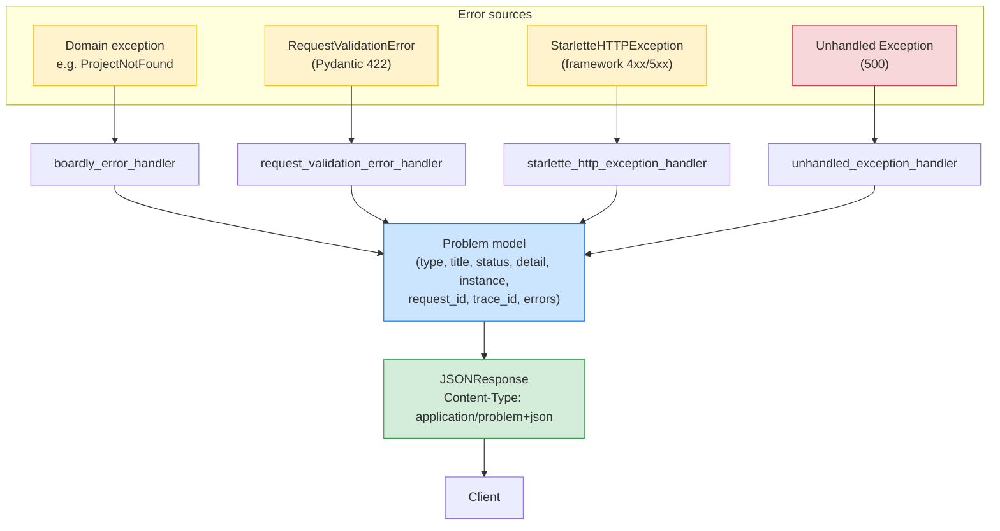

# Lesson 12: Problem Details (RFC 7807 / RFC 9457)

*The standardised error envelope — `application/problem+json` — and the FastAPI exception handler that turns `ProjectNotFound`, `ConflictError`, and `RequestValidationError` into one consistent, machine-readable, RFC 9457-compliant shape.*

**This is the lesson that keeps the dangling cross-reference promise.**

`[[03-FastAPI-Core/Exception-Handlers]]` Lesson 6 says: "Section 13 covers RFC 7807 in more depth." It never did — the original plan was to put it in Section 13 (Observability), but the natural home is here, in Backend Foundations, because Problem Details is a wire-format primitive, not an observability concept. Today we close that loop. By the end you'll know the five required fields (`type`, `title`, `status`, `detail`, `instance`), the RFC 9457 `errors` array for validation failures, how to wrap FastAPI's `RequestValidationError` into a Problem Details response, and the trade-off between `about:blank` and your own `type` URIs.


#http #errors #rfc-7807 #canonical

## Learning Objectives

By the end of this lesson you will be able to:

1. **State the `application/problem+json` media type** and why it deserves a separate type from `application/json`.
2. **List the five RFC 7807 fields** — `type`, `title`, `status`, `detail`, `instance` — and explain what each carries.
3. **Distinguish RFC 7807 (2016) from RFC 9457 (2023)** — the `errors` array for validation errors, the `Idempotency-Key` extension, the relaxed `Content-Type` rule.
4. **Implement a FastAPI exception handler** that converts a domain exception (`ProjectNotFound`) into a Problem Details response with extension members.
5. **Wrap FastAPI's `RequestValidationError`** (the default 422 with `{"detail": [...]}`) into a RFC 9457 Problem Details response with an `errors` array.
6. **Explain when `type` should be `about:blank`** (the "no additional information" sentinel) vs a real URI.
7. **State the observability benefit** of one consistent error shape — clients can build a single parser; logs can grep by `type`; Sentry can group by `type`.

## Prerequisites

Before starting, you need:

- **The Exception Handlers lesson** — [[03-FastAPI-Core/Exception-Handlers]]. You should know how `@app.exception_handler(MyError)` works, what `request.state.request_id` is, and the trade-off between one envelope and many. This lesson builds on that skeleton and *standardises* the envelope per RFC 9457.
- **HTTP vocabulary** — [[02-Web-and-HTTP/Methods-Status-Headers-Content-Types]]. You should know what a media type is, what a status code means, what `Content-Type` does.
- **HTTP headers** — [[HTTP-Headers-Deep-Dive]]. You should know what `Content-Type: application/problem+json; charset=utf-8` means.
- **Python exceptions** — [[01-Python-Foundations/Exceptions-Done-Right]]. You should know how to define an exception class, how `raise` works, how `try/except` works.
- **About an hour and a half.** The code is ~150 lines; the difficulty is the design — what to put in each field, what to leave out.
- **FastAPI 0.148.0, Starlette 1.9.0, Pydantic v2.14.1, Python 3.12** — verified October 2026.

**The two RFCs in this lesson.**

- **RFC 7807** (2016) — "Problem Details for HTTP APIs." The original spec. Defines the five required fields, the `application/problem+json` media type, the extension members.
- **RFC 9457** (2023) — "Problem Details for HTTP APIs." Obsoletes RFC 7807. Adds: the `errors` array (for per-field validation errors), the relaxed `Content-Type` rule (clients should accept `application/json` as well, for legacy compatibility), the `Idempotency-Key` extension member. We cite both; RFC 9457 is the current canonical.


## The Problem

`Boardly`'s endpoints, after Lesson 6 of Section 03, return errors in this shape:

```json
{
  "error": {
    "code": "project_not_found",
    "message": "Project 42 not found",
    "request_id": "req_abc123"
  }
}
```

That's a consistent shape — Lesson 6 of Section 03 did its job. But it's *Boardly's* shape. The Stripe API has its own shape (`{"error": {"type": "...", "code": "...", "message": "..."}}`). The GitHub API has its own (`{"message": "...", "documentation_url": "..."}`). JSON:API has its own (`{"errors": [{"status": "...", "source": {"pointer": "..."}}]}`). Every API reinvents the error envelope.

This matters for two reasons:

1. **Clients have to write a different parser per API.** If you're writing a client that talks to five different APIs, you have five error parsers. That's wasteful, bug-prone, and locks you into the API's idiosyncratic shape.
2. **Observability tooling can't group errors across services.** Sentry, Datadog, NewRelic — they all want to group errors by some "type" field. If every service has its own shape, the tooling falls back to status-code grouping ("all 500s together") which is too coarse.

The fix is standardisation: RFC 9457 defines the shape, the field names, the semantics. Every service that emits `application/problem+json` can be parsed by a single client library; every observability tool can group by the `type` field.

**Why a separate media type instead of `application/json`?**

Two reasons. (1) **Content negotiation.** A client that sends `Accept: application/problem+json` is saying "I specifically want Problem Details if there's an error." The server can decide to honour it (return Problem Details) or not (return the legacy `{"error": "..."}` shape for backward compatibility). With `application/json`, the client cannot express that preference. (2) **Caching and proxies.** A CDN that sees `application/problem+json` knows the response is an error and may apply different caching rules (don't cache, or cache with a short TTL). With `application/json`, the CDN treats errors and successes identically. RFC 9457 actually relaxes this — clients should accept `application/json` as well, for legacy compatibility — but the recommendation remains: emit `application/problem+json` when you can.


## The Code

A new `boardly/problems.py` module ships with:

- A `Problem` Pydantic model with the five required fields plus extension members (`request_id`, `errors`).
- A `problem_response()` helper that converts a `Problem` to a `JSONResponse` with the correct `Content-Type`.
- An exception handler for `BoardlyError` (the base class from Lesson 6 of Section 03) that emits a Problem Details response.
- An exception handler for `RequestValidationError` that emits a Problem Details response with the `errors` array.
- A catch-all handler for unhandled `Exception` that emits a 500 Problem Details response (without leaking internals).

```python
# boardly/problems.py
"""Boardly — RFC 9457 Problem Details responses.

Lesson 02b-12: standardises every error response as
application/problem+json. Wraps both domain exceptions
(BoardlyError) and FastAPI's RequestValidationError.
"""
from __future__ import annotations

import logging
from typing import Any

from fastapi import FastAPI, Request, status
from fastapi.exceptions import RequestValidationError
from fastapi.responses import JSONResponse
from pydantic import BaseModel
from starlette.exceptions import HTTPException as StarletteHTTPException

logger = logging.getLogger("boardly")


PROBLEM_CONTENT_TYPE = "application/problem+json"


class Problem(BaseModel):
 """RFC 9457 Problem Details. The five required fields plus
 Boardly-specific extension members.

 - type: URI reference identifying the problem type. Use
   "about:blank" when there is no additional information beyond
   the HTTP status code; otherwise a boardly.dev URI.
 - title: short human-readable summary. Stable across instances.
 - status: HTTP status code. The Problem may travel through proxies
   that rewrite the status; this field preserves the original.
 - detail: human-readable explanation specific to this occurrence.
 - instance: URI reference identifying this specific occurrence.
   We use the request_id (from RequestIDMiddleware) — it is unique
   per request and grep-able in logs.

 Extension members (allowed by RFC 9457 §3.2):
 - request_id: the request ID stamped by the middleware. Mirrors
   instance but as a discrete field for observability tooling that
   expects structured fields.
 - errors: array of per-field validation errors (RFC 9457 §3.3).
   Only present for RequestValidationError.
 - trace_id: OpenTelemetry trace ID (present only when tracing is on).
 """

 type: str = "about:blank"
 title: str = "An error occurred"
 status: int = status.HTTP_500_INTERNAL_SERVER_ERROR
 detail: str | None = None
 instance: str | None = None
 # --- extension members ---
 request_id: str | None = None
 trace_id: str | None = None
 errors: list[dict[str, Any]] | None = None

 model_config = {"extra": "allow"}  # allow any other extension members


def problem_response(
 problem: Problem,
 status_code: int | None = None,
) -> JSONResponse:
 """Build a JSONResponse with Content-Type: application/problem+json.

 The status_code defaults to problem.status, but the caller may
 override (e.g., when a proxy has rewritten the status). The body
 is the problem.model_dump(exclude_none=True) — extension members
 that are None are omitted from the JSON, so a problem without
 `errors` does not show "errors": null in the body.
 """
 body = problem.model_dump(exclude_none=True, mode="json")
 return JSONResponse(
 status_code=status_code or problem.status,
 content=body,
 media_type=PROBLEM_CONTENT_TYPE,
 )


# --- The BoardlyError family (extends Lesson 6 of Section 03) ---

class BoardlyError(Exception):
 """Base class for Boardly domain errors. Mirrors Lesson 6's class
 but emits Problem Details via the registered handler."""
 type: str = "about:blank"
 title: str = "An internal error occurred."
 status_code: int = status.HTTP_500_INTERNAL_SERVER_ERROR
 # Extension members to include in the Problem response.
 extensions: dict[str, Any] = {}

 def __init__(self, detail: str | None = None, **extra: Any) -> None:
 self.detail = detail
 self.extra = extra
 super().__init__(detail)

 def to_problem(self, request_id: str | None, trace_id: str | None) -> Problem:
 p = Problem(
 type=self.type,
 title=self.title,
 status=self.status_code,
 detail=self.detail,
 instance=f"req:{request_id}" if request_id else None,
 request_id=request_id,
 trace_id=trace_id,
 )
 # Merge extension members.
 for k, v in {**self.extensions, **self.extra}.items():
 setattr(p, k, v)
 return p


class ProjectNotFound(BoardlyError):
 type = "https://boardly.dev/problems/project-not-found"
 title = "Project not found"
 status_code = status.HTTP_404_NOT_FOUND


class ConflictError(BoardlyError):
 type = "https://boardly.dev/problems/conflict"
 title = "Conflict"
 status_code = status.HTTP_409_CONFLICT


# --- The handlers ---

async def boardly_error_handler(request: Request, exc: BoardlyError) -> JSONResponse:
 request_id = getattr(request.state, "request_id", None)
 trace_id = getattr(request.state, "trace_id", None)
 problem = exc.to_problem(request_id, trace_id)
 return problem_response(problem)


async def request_validation_error_handler(
 request: Request, exc: RequestValidationError
) -> JSONResponse:
 """Wrap FastAPI's RequestValidationError (the default 422 with
 {"detail": [...]}) into a RFC 9457 Problem Details response with
 an `errors` array."""
 request_id = getattr(request.state, "request_id", None)
 trace_id = getattr(request.state, "trace_id", None)
 # The errors array carries the validation details in the shape
 # RFC 9457 §3.3 suggests: each entry has at least `detail` and
 # (optionally) `pointer` (a JSON Pointer to the invalid field).
 errors: list[dict[str, Any]] = []
 for err in exc.errors():
 # FastAPI's error shape: {"loc": [...], "msg": "...", "type": "..."}
 pointer = "/".join(str(loc) for loc in err.get("loc", []))
 errors.append({
 "detail": err.get("msg"),
 "pointer": f"/{pointer}" if pointer else None,
 "code": err.get("type"),
 })
 problem = Problem(
 type="https://boardly.dev/problems/validation-error",
 title="Request validation failed",
 status=status.HTTP_422_UNPROCESSABLE_ENTITY,
 detail="One or more fields failed validation.",
 instance=f"req:{request_id}" if request_id else None,
 request_id=request_id,
 trace_id=trace_id,
 errors=errors,
 )
 return problem_response(problem)


async def starlette_http_exception_handler(
 request: Request, exc: StarletteHTTPException
) -> JSONResponse:
 """Wrap Starlette's HTTPException (the framework's own transport-level
 errors — 404 from no route match, 401 from auth, 405 from wrong method)
 into Problem Details."""
 request_id = getattr(request.state, "request_id", None)
 problem = Problem(
 type="about:blank",
 title={404: "Not Found", 401: "Unauthorized", 403: "Forbidden",
 405: "Method Not Allowed", 429: "Too Many Requests"}.get(exc.status_code, "Error"),
 status=exc.status_code,
 detail=str(exc.detail) if exc.detail else None,
 instance=f"req:{request_id}" if request_id else None,
 request_id=request_id,
 )
 return problem_response(problem)


async def unhandled_exception_handler(request: Request, exc: Exception) -> JSONResponse:
 """Catch-all for unhandled exceptions. Logs the full traceback
 server-side; returns a generic 500 Problem Details to the client
 without leaking internals."""
 request_id = getattr(request.state, "request_id", None)
 logger.exception("Unhandled exception (request_id=%s): %s", request_id, exc)
 problem = Problem(
 type="about:blank",
 title="Internal Server Error",
 status=status.HTTP_500_INTERNAL_SERVER_ERROR,
 detail="An unexpected error occurred. The request ID is in the response; "
 "contact support with this ID.",
 instance=f"req:{request_id}" if request_id else None,
 request_id=request_id,
 )
 return problem_response(problem)


def install_problem_handlers(app: FastAPI) -> None:
 """Wire all the Problem Details handlers."""
 app.add_exception_handler(BoardlyError, boardly_error_handler)
 app.add_exception_handler(RequestValidationError, request_validation_error_handler)
 app.add_exception_handler(StarletteHTTPException, starlette_http_exception_handler)
 app.add_exception_handler(Exception, unhandled_exception_handler)
```

That's the file. ~180 lines. Wire it in `boardly/main.py`:

```python
from boardly.problems import install_problem_handlers
install_problem_handlers(app)
```

Now every error response from `Boardly` is `application/problem+json`. Run the app. Trigger each error path. Watch the headers and bodies. Then come back and we'll go through every line.

## Line-by-Line Deep Dive

### Lines 1–9: Module docstring

```python
"""Boardly — RFC 9457 Problem Details responses.

Lesson 02b-12: standardises every error response as
application/problem+json. Wraps both domain exceptions
(BoardlyError) and FastAPI's RequestValidationError.
"""
```

**What it does:** Documents the file's purpose. The note "standardises *every* error response" is load-bearing — there is one handler for each error class, and together they cover every error path.

**Why we keep `BoardlyError` separate from `Problem`.**

`BoardlyError` is a Python exception (raised in domain code). `Problem` is a wire-format model (serialised to JSON). The exception → Problem conversion happens in the handler. This separation keeps domain code free of wire-format concerns — `raise ProjectNotFound(detail="42")` doesn't know about `Content-Type` or `request_id`; the handler adds those.


### Lines 11–22: Imports

```python
import logging
from typing import Any

from fastapi import FastAPI, Request, status
from fastapi.exceptions import RequestValidationError
from fastapi.responses import JSONResponse
from pydantic import BaseModel
from starlette.exceptions import HTTPException as StarletteHTTPException
```

**What it does:** Pulls in `FastAPI` (for `add_exception_handler`), `Request` (for the handler signatures), `RequestValidationError` (the FastAPI exception raised when validation fails), `JSONResponse` (for the response), `BaseModel`/`Field` (for the `Problem` model), and `StarletteHTTPException` (Starlette's HTTP-level exception, which FastAPI's `HTTPException` subclasses).

**Why import `HTTPException as StarletteHTTPException`?** Because FastAPI's `HTTPException` (from `fastapi`) is a subclass of Starlette's. Registering a handler for the Starlette base class catches both. (FastAPI's `HTTPException` exists mostly for historical reasons — its only addition is the `headers` field, which Problem Details mostly subsumes.)

### Lines 26–63: The `Problem` model

```python
class Problem(BaseModel):
 type: str = "about:blank"
 title: str = "An error occurred"
 status: int = status.HTTP_500_INTERNAL_SERVER_ERROR
 detail: str | None = None
 instance: str | None = None
 request_id: str | None = None
 trace_id: str | None = None
 errors: list[dict[str, Any]] | None = None

 model_config = {"extra": "allow"}
```

**What it does:** Defines the wire-format model with the five RFC 7807 required fields plus three RFC 9457 extension members.

**What each field means:**

- **`type`** (string, URI reference) — identifies the problem type. RFC 7807 §3.1 says: "If it is 'about:blank', the problem has no additional information beyond the status code." Otherwise, dereferencing the URI should give human-readable documentation about the error. In `Boardly`, we use `https://boardly.dev/problems/<slug>` for our own types and `about:blank` for framework-level errors (404 from no route match, 500 from unhandled exception).

**When should `type` be `about:blank`?**

Per RFC 9457 §3.1.1, `about:blank` is the sentinel for "the problem has no additional information beyond the status code." Use it when: (a) the error is generic and the status code is the only useful information (a 404 from no route match — there's nothing more specific to say); (b) the error is framework-level and you do not control the type (a 500 from an unhandled exception — you don't know what happened yet); (c) the error is so common that the status code already says enough (a 401 from an unauthenticated request). Use a real URI when you have something specific to add: a domain error (`project-not-found`), a validation error, a rate-limit error with a `Retry-After` extension member.


- **`title`** (string) — short human-readable summary. Stable across instances of the same problem type. ("Project not found" — same for every 404 on a project; the *detail* varies per occurrence.)
- **`status`** (int) — HTTP status code. May travel through proxies that rewrite the status; this field preserves the original.
- **`detail`** (string) — human-readable explanation specific to this occurrence. ("Project 42 not found" — the `42` is the per-occurrence detail.)
- **`instance`** (URI reference) — identifies this specific occurrence. In `Boardly`, we use the request ID (`req:abc123`). The client can include this in a support ticket; support can grep the logs for the request ID.

- **`request_id`** (extension) — same value as `instance`, but as a discrete field. Observability tools (Sentry, Datadog) that expect structured fields rather than URI-typed strings can use this directly. RFC 9457 allows any extension members; this is ours.
- **`trace_id`** (extension) — OpenTelemetry trace ID. Present only when tracing is on.
- **`errors`** (extension, RFC 9457 §3.3) — array of per-field validation errors. Each entry has `detail`, `pointer` (a JSON Pointer to the invalid field), `code` (the validation error type). Present only for validation errors.

**Why `model_config = {"extra": "allow"}`?** Because RFC 9457 §3.2 explicitly allows extension members (the bank example in the RFC has `balance` and `accounts`). We don't enumerate them all in the model; we allow them dynamically. Pydantic v2's `extra="allow"` keeps unknown fields in the serialised output.

### Lines 66–83: `problem_response()`

```python
def problem_response(problem: Problem, status_code: int | None = None) -> JSONResponse:
 body = problem.model_dump(exclude_none=True, mode="json")
 return JSONResponse(
 status_code=status_code or problem.status,
 content=body,
 media_type=PROBLEM_CONTENT_TYPE,
 )
```

**What it does:** Builds the wire response. `exclude_none=True` strips fields that are `None` (so a problem without `errors` does not show `"errors": null`). `mode="json"` converts datetimes to ISO strings, UUIDs to strings, etc. `media_type=PROBLEM_CONTENT_TYPE` sets `Content-Type: application/problem+json` on the response.

**Why `exclude_none=True`?** Because RFC 9457 says fields that are not present are equivalent to their default values; explicit `null` is not the same as absence. A problem without `errors` should not have `"errors": null` in the body; it should have no `errors` key at all. `exclude_none=True` achieves that.

**Warning — When this breaks: `exclude_none=True` silently drops three-valued extension fields.**

A subclass that uses `extra="allow"` to set an extension field to `None` (e.g., `ConflictError(conflicting_name=None)` to mean "name conflict detected, but the conflicting name is not available") finds the field *disappears* from the response body — `model_dump(exclude_none=True)` cannot distinguish "the field is None" from "the field was never set." A client that keys on `conflicting_name` being present gets a `KeyError`, and the three-valued semantics (None / default-None / unset) collapse to two. The defense: when an extension field carries three-valued semantics, use `"not-set"` (a string sentinel) instead of `None`, or call `model_dump(exclude_unset=True)` (which only drops fields the caller never set — `None` set by the caller survives). The trade-off: `exclude_unset=True` keeps *every* field with a default in the dump (because "has a default" ≠ "was set by the caller"), which means every Problem response now includes `"trace_id": null` if tracing is off — bloat that violates the spirit of `exclude_none`. The right answer for Problem Details is `exclude_none=True` for the *five required fields* (where absence == default) and an explicit `"not-set"` sentinel for extension fields that need three-valued semantics. Don't use `None` for "unknown" in an extension member that the client keys on.


### Lines 88–112: `BoardlyError`

```python
class BoardlyError(Exception):
 type: str = "about:blank"
 title: str = "An internal error occurred."
 status_code: int = status.HTTP_500_INTERNAL_SERVER_ERROR
 extensions: dict[str, Any] = {}

 def __init__(self, detail: str | None = None, **extra: Any) -> None:
 self.detail = detail
 self.extra = extra
 super().__init__(detail)

 def to_problem(self, request_id: str | None, trace_id: str | None) -> Problem:
 p = Problem(
 type=self.type,
 title=self.title,
 status=self.status_code,
 detail=self.detail,
 instance=f"req:{request_id}" if request_id else None,
 request_id=request_id,
 trace_id=trace_id,
 )
 for k, v in {**self.extensions, **self.extra}.items():
 setattr(p, k, v)
 return p
```

**What it does:** The base domain exception. Subclasses set `type`, `title`, `status_code`. The `to_problem()` method converts to a `Problem` instance, merging extension members.

**Why `**extra` in `__init__`?** So domain code can pass per-occurrence extension members at raise time:

```python
raise ConflictError(
 detail="Project name 'alpha' already exists",
 conflicting_name="alpha",
 conflicting_id=42,
)
```

The `conflicting_name` and `conflicting_id` become extension members in the Problem response. Useful for clients that need to take action on the conflict.

**Warning — When this breaks: `setattr(p, k, v)` on the Pydantic model bypasses validation entirely.**

The `to_problem()` loop does `for k, v in {**self.extensions, **self.extra}.items(): setattr(p, k, v)`. Pydantic v2 validates on `__init__` and on `model_validate`, but `setattr` on an already-constructed model goes through Pydantic's *validator* if the field is declared, *or* through `extra="allow"` storage if it's not. For declared fields (`type`, `title`, `status`, `detail`, `instance`, `request_id`, `trace_id`, `errors`), `setattr` *does* validate in v2 (a change from v1). But for `extra="allow"` fields (any extension member the model doesn't enumerate), `setattr` stores the value *as-is* — no type check, no coercion, no validation. The result: `raise ConflictError(conflicting_id="42")` (string instead of int, because the caller passed a URL parameter that hadn't been cast yet) produces a Problem response with `"conflicting_id": "42"` — a string where the client's TypeScript interface expects `number`. The client's runtime type guard fires (or worse, doesn't, and the bug surfaces as a NaN in the UI). The defense: validate the `extra` dict at the boundary — `for k, v in extra.items(): if not isinstance(v, (str, int, float, bool, type(None))): raise TypeError(f"extension member {k} must be a JSON primitive, got {type(v)}")` before the `setattr` loop. Better: declare the extension members you use as real fields on a `ConflictProblem(Problem)` subclass, so Pydantic validates them at `__init__`.


### Lines 115–126: `ProjectNotFound` and `ConflictError`

```python
class ProjectNotFound(BoardlyError):
 type = "https://boardly.dev/problems/project-not-found"
 title = "Project not found"
 status_code = status.HTTP_404_NOT_FOUND


class ConflictError(BoardlyError):
 type = "https://boardly.dev/problems/conflict"
 title = "Conflict"
 status_code = status.HTTP_409_CONFLICT
```

**What they do:** Subclass `BoardlyError` with the right `type`, `title`, `status_code` for each domain error.

**Why the `type` URI?** So a client (or an LLM) that fetches `https://boardly.dev/problems/project-not-found` gets human-readable documentation about what this error means, what causes it, and what to do. The URI is *not* dereferenced by the client at runtime; it's a stable identifier that the client can use as a lookup key.

### Lines 130–137: `boardly_error_handler()`

```python
async def boardly_error_handler(request: Request, exc: BoardlyError) -> JSONResponse:
 request_id = getattr(request.state, "request_id", None)
 trace_id = getattr(request.state, "trace_id", None)
 problem = exc.to_problem(request_id, trace_id)
 return problem_response(problem)
```

**What it does:** The exception handler for `BoardlyError` (and subclasses). Reads `request_id` and `trace_id` from `request.state` (set by the middleware in Lesson 5 of Section 03), converts the exception to a Problem, returns the response.

**Why read `request_id` from `request.state`?** Because the middleware (from [[03-FastAPI-Core/Middleware-and-Request-Order]]) already stamped it there. We don't re-generate; we reuse.

### Lines 140–165: `request_validation_error_handler()`

```python
async def request_validation_error_handler(request: Request, exc: RequestValidationError) -> JSONResponse:
 request_id = getattr(request.state, "request_id", None)
 trace_id = getattr(request.state, "trace_id", None)
 errors: list[dict[str, Any]] = []
 for err in exc.errors():
 pointer = "/".join(str(loc) for loc in err.get("loc", []))
 errors.append({
 "detail": err.get("msg"),
 "pointer": f"/{pointer}" if pointer else None,
 "code": err.get("type"),
 })
 problem = Problem(
 type="https://boardly.dev/problems/validation-error",
 title="Request validation failed",
 status=status.HTTP_422_UNPROCESSABLE_ENTITY,
 detail="One or more fields failed validation.",
 instance=f"req:{request_id}" if request_id else None,
 request_id=request_id,
 trace_id=trace_id,
 errors=errors,
 )
 return problem_response(problem)
```

**What it does:** The handler for `RequestValidationError`. FastAPI raises this when a request body, query, or header fails Pydantic validation. The default FastAPI shape is `{"detail": [{"loc": [...], "msg": "...", "type": "..."}]}`. We wrap that into a Problem Details response with an `errors` array.

**Why the `pointer` field with JSON Pointer format?** RFC 9457 §3.3 suggests JSON Pointers (RFC 6901) as the canonical way to point to a field in the request body. A pointer like `/body/owner/email` says "the `email` field inside `owner` inside the body." Clients can use this to highlight the invalid field in the UI.

**Danger — How an attacker thinks: a `dict[str, ...]` field name containing `/` or `~` makes the JSON Pointer ambiguous.**

The current code joins `err.get("loc", [])` with `/` to build the pointer: `pointer = "/".join(str(loc) for loc in err.get("loc", []))`. If the validated schema has a `dict[str, Any]` field (common for arbitrary-keyed metadata — `tags: dict[str, str]`), an attacker can submit a body with a key like `a/b` or `~1` (the JSON Pointer escape sequences for `/` and `~` themselves — see RFC 6901 §3). The pointer `body/user/a/b` is then ambiguous: it could be `body.user["a"]["b"]` (the legitimate interpretation) or `body.user["a/b"]` (the attacker's actual key). A client that parses the pointer to highlight the invalid field ends up highlighting the wrong field (or crashing on a non-existent path). Worse: an attacker who controls the body's *key names* can craft a pointer that looks like a different field's path — `body/user/../../admin/email` is not valid JSON Pointer (no `..`), but `body/user/~1admin~1email` is, and it decodes to `body.user["/admin/email"]`, a key the attacker controls. The defense: JSON-pointer-encode each `loc` component *before* joining — replace `~` with `~0` and `/` with `~1` (in that order — RFC 6901 §3 specifies the order to avoid double-encoding): `def _encode_part(p: str) -> str: return str(p).replace("~", "~0").replace("/", "~1")`. Then `pointer = "/" + "/".join(_encode_part(p) for p in err.get("loc", []))`. The current code is fine for field names that don't contain `/` or `~`; it's broken against any `dict[str, ...]` schema where the keys are user-controlled.


### Lines 168–183: `starlette_http_exception_handler()`

```python
async def starlette_http_exception_handler(request: Request, exc: StarletteHTTPException) -> JSONResponse:
 request_id = getattr(request.state, "request_id", None)
 problem = Problem(
 type="about:blank",
 title={404: "Not Found", 401: "Unauthorized", 403: "Forbidden",
 405: "Method Not Allowed", 429: "Too Many Requests"}.get(exc.status_code, "Error"),
 status=exc.status_code,
 detail=str(exc.detail) if exc.detail else None,
 instance=f"req:{request_id}" if request_id else None,
 request_id=request_id,
 )
 return problem_response(problem)
```

**What it does:** The handler for Starlette's `HTTPException` (which FastAPI's `HTTPException` subclasses). Catches framework-level errors: 404 from no route match, 401 from an auth dependency, 405 from a wrong method, 429 from a rate limiter.

**Why `type="about:blank"`?** Because these errors are framework-level, not domain-level. There's no additional information beyond the status code (RFC 9457 §3.1.1). If we wanted, we could mint specific `type` URIs (`https://boardly.dev/problems/not-found` for 404s, etc.) but the framework status codes already say enough; minting types for them adds noise.

### Lines 186–198: `unhandled_exception_handler()`

```python
async def unhandled_exception_handler(request: Request, exc: Exception) -> JSONResponse:
 request_id = getattr(request.state, "request_id", None)
 logger.exception("Unhandled exception (request_id=%s): %s", request_id, exc)
 problem = Problem(
 type="about:blank",
 title="Internal Server Error",
 status=status.HTTP_500_INTERNAL_SERVER_ERROR,
 detail="An unexpected error occurred. The request ID is in the response; "
 "contact support with this ID.",
 instance=f"req:{request_id}" if request_id else None,
 request_id=request_id,
 )
 return problem_response(problem)
```

**What it does:** The catch-all. Logs the full traceback server-side (`logger.exception`); returns a generic 500 Problem to the client *without* the traceback in the body.

**Why no traceback in the body?** Because the traceback may contain secrets (database URLs, environment variables, file paths). The client gets a generic message and a request ID. Support can grep the logs for the request ID to find the traceback. This is the "don't leak internals" rule from Lesson 6 of Section 03.

**Production reality: `better-exceptions` and `rich.traceback` include local variables by default — and the locals are the leak.**

The `logger.exception("Unhandled exception ...", exc)` call captures the traceback via Python's standard `traceback.format_exception`, which by default does *not* include local variables. That's the safe default — the traceback goes to the log with file paths, line numbers, and the exception message, but no locals. The leak comes from libraries that *extend* the traceback formatter to include locals: `better-exceptions` (a popular `pip install better-exceptions` that hooks `sys.excepthook`), `rich.traceback` (the `rich` library's traceback, used by `textual` and many CLIs), and `traceback-with-locals` (a drop-in replacement). If any of these is installed in production, the *server-side* log now includes the local variables of every frame — and those locals can include the request body (PII), the SQLAlchemy session (database credentials in the engine URL), the OAuth token (bearer token from the auth dependency), the Stripe customer ID (PCI scope), the user's password hash (from a `User` model instance that was in scope). The defense: in production, set `structlog`'s `ProcessorFormatter` to use `traceback.format_exception` (the stdlib formatter) explicitly, *not* the `better-exceptions` or `rich.traceback` formatter; keep the rich formatter for staging (where locals are gold for debugging) and switch to stdlib for prod. Verify with a red-team test: raise an exception whose local is `bearer_token = "sk_live_..."`; grep the production log aggregator for `sk_live_` — zero hits is the only acceptable result. See [[13-Performance-and-Observability/Structured-Logging-and-Request-IDs]] for the formatter configuration seam.


**Danger — How an attacker thinks: the *time* to respond leaks the error class, even when the body is generic.**

The unhandled-exception handler returns the same `Problem(type="about:blank", title="Internal Server Error", status=500, detail="An unexpected error occurred...")` for every exception. But the response *time* differs by exception class: a `KeyError` (fast — a dict lookup miss, microseconds) vs a `psycopg.OperationalError` (slow — the DB timeout, often 30 s) vs a `cryptography.EncryptionError` (medium — the KMS round trip, 200-500 ms). An attacker who triggers each exception class and measures response time fingerprints the *type* of error your service produces, even though the body says nothing. Combine with status-code correlation (a 500 from `/auth/login` with a 30-s response time is almost certainly a DB outage; a 500 with a 5-ms response time is almost certainly a code bug). The defense: for the unhandled-exception handler, *add an artificial floor delay* — `await asyncio.sleep(max(0, 0.1 - elapsed))` to round every 500 up to at least 100 ms. The trade-off: you slow down fast failures to match slow ones, which is bad UX but good security. The pragmatic rule: don't bother for low-stakes APIs; bother for high-stakes APIs (auth, payment) where the timing fingerprint is a real attack vector. The OWASP API Top 10 ("Improper Error Handling") covers the body-leak case; the timing-leak case is the next frontier.


### Lines 201–206: `install_problem_handlers()`

```python
def install_problem_handlers(app: FastAPI) -> None:
 app.add_exception_handler(BoardlyError, boardly_error_handler)
 app.add_exception_handler(RequestValidationError, request_validation_error_handler)
 app.add_exception_handler(StarletteHTTPException, starlette_http_exception_handler)
 app.add_exception_handler(Exception, unhandled_exception_handler)
```

**What it does:** Registers all four handlers. The order of registration does not matter — FastAPI dispatches to the most specific handler first (so a `ProjectNotFound` goes to `boardly_error_handler`, not the catch-all).

**Why not use `@app.exception_handler(...)` decorators?** Because the decorators work only when defined in the same module as the app (they use the `app` variable in scope). The `install_problem_handlers(app)` function lets us ship a reusable module that any `Boardly`-style app can install with one line. This is the pattern from [[03-FastAPI-Core/Routers-and-Modular-Apps]] — module-level functions, wired in `main.py`.

**Production reality: handler registration order does not matter for dispatch — but it matters for test isolation.**

FastAPI dispatches to the most specific handler first regardless of registration order (a `ProjectNotFound` goes to `boardly_error_handler`, not the `Exception` catch-all, because `ProjectNotFound` is more specific than `Exception`). But registration order matters for *removal*: a test that installs custom handlers via `app.add_exception_handler(...)` and forgets to remove them leaves them registered for the next test. The next test (which expected the default FastAPI 422 with `{"detail": [...]}`) now gets `application/problem+json` with the `errors` array — and either passes for the wrong reason or fails mysteriously. The defense: pair `install_problem_handlers(app)` with an `uninstall_problem_handlers(app)` that calls `app.exception_handlers.clear()` (or, more surgical, removes only the four keys this module added) in a pytest fixture's teardown phase. Better: use the `app.dependency_overrides` pattern for *test-only* handler swaps, and reserve `install_problem_handlers` for the production app constructor. The full pattern: `@pytest.fixture(autouse=True)` calls `install_problem_handlers(app)` in setup and `app.exception_handlers.clear()` in teardown, so every test starts with a clean handler registry. See [[12-Testing-and-Quality/Testing-FastAPI-Endpoints]] for the fixture pattern.


## Execution Trace

### Step 1: Domain error – `ProjectNotFound`

```bash
curl -i http://127.0.0.1:8000/projects/99999
```

Expected:

```
HTTP/1.1 404 Not Found
content-type: application/problem+json; charset=utf-8

{
  "type": "https://boardly.dev/problems/project-not-found",
  "title": "Project not found",
  "status": 404,
  "detail": "Project 99999 not found",
  "instance": "req:abc123",
  "request_id": "abc123"
}
```

### Step 2: Validation error – `RequestValidationError`

```bash
curl -i -X POST http://127.0.0.1:8000/projects \
 -H "Content-Type: application/json" \
 -d '{"name": ""}'  # name is required, min_length=1
```

Expected:

```
HTTP/1.1 422 Unprocessable Entity
content-type: application/problem+json; charset=utf-8

{
  "type": "https://boardly.dev/problems/validation-error",
  "title": "Request validation failed",
  "status": 422,
  "detail": "One or more fields failed validation.",
  "instance": "req:def456",
  "request_id": "def456",
  "errors": [
    {
      "detail": "String should have at least 1 character",
      "pointer": "/body/name",
      "code": "string_too_short"
    }
  ]
}
```

### Step 3: Framework error – 405 Method Not Allowed

```bash
curl -i -X DELETE http://127.0.0.1:8000/projects/1
```

Expected:

```
HTTP/1.1 405 Method Not Allowed
content-type: application/problem+json; charset=utf-8

{
  "type": "about:blank",
  "title": "Method Not Allowed",
  "status": 405,
  "instance": "req:ghi789",
  "request_id": "ghi789"
}
```

### Step 4: Unhandled exception – 500

```python
# Trigger by adding `raise RuntimeError("boom")` to a route handler.
```

Expected:

```
HTTP/1.1 500 Internal Server Error
content-type: application/problem+json; charset=utf-8

{
  "type": "about:blank",
  "title": "Internal Server Error",
  "status": 500,
  "detail": "An unexpected error occurred. The request ID is in the response; contact support with this ID.",
  "instance": "req:jkl012",
  "request_id": "jkl012"
}
```

Server-side logs include the full traceback, tagged with `request_id=jkl012`.



## Common Mistakes

### Mistake 1: Mixing Problem Details with the legacy `{"detail": "..."}` shape

```python
# WRONG — handler returns the legacy shape
@app.exception_handler(BoardlyError)
async def handler(request, exc):
 return JSONResponse(status_code=400, content={"detail": str(exc)})
```

**Symptom:** Half the API's errors are `application/problem+json`; the other half are `application/json` with `{"detail": "..."}`. Clients need two parsers.

**Fix:** Use the `install_problem_handlers()` from this lesson for *every* error. Remove or replace any legacy handlers.

### Mistake 2: `type: "about:blank"` with a meaningful `detail`

```python
# WRONG — using about:blank when you have specific information
Problem(type="about:blank", title="Project not found", detail="Project 42 not found")
```

**Symptom:** The client cannot programmatically distinguish "project not found" from "user not found" — both are `about:blank` with a different `title`. Observability tooling groups them all as "about:blank."

**Fix:** Mint a `type` URI for each domain error: `type="https://boardly.dev/problems/project-not-found"`. Reserve `about:blank` for "no additional information."

### Mistake 3: Leaking the traceback in the 500 response

```python
# WRONG
async def unhandled_exception_handler(request, exc):
 import traceback
 return problem_response(Problem(detail="".join(traceback.format_exception(exc))))
```

**Symptom:** The 500 response contains the full Python traceback, including the database URL in the SQLAlchemy engine string, the environment variable names, the file paths.

**Fix:** Log the traceback server-side; return a generic `detail` to the client. The client gets `request_id`; support gets the traceback from logs.

### Mistake 4: Forgetting the `errors` array for validation errors

```python
# WRONG — wraps RequestValidationError but doesn't include per-field errors
async def request_validation_error_handler(request, exc):
 return problem_response(Problem(
 type="https://boardly.dev/problems/validation-error",
 title="Request validation failed",
 status=422,
 ))
```

**Symptom:** The client gets a 422 with no per-field detail. The form cannot highlight the invalid field. The user sees "validation failed" with no clue which field.

**Fix:** Include the `errors` array with `pointer` per field. See `request_validation_error_handler()` above.

### Mistake 5: Setting `Content-Type: application/json` instead of `application/problem+json`

```python
# WRONG — generic JSON content type
return JSONResponse(status_code=404, content=body)  # media_type defaults to application/json
```

**Symptom:** The client's `Accept: application/problem+json` request does not get its preferred content type. CDNs do not know the response is an error.

**Fix:** Use `media_type=PROBLEM_CONTENT_TYPE` (which is `application/problem+json`).

### Mistake 6: Putting the `status` field in the body but using a different HTTP status code

```python
# WRONG — body says 404 but HTTP status is 500
return problem_response(Problem(status=404, ...), status_code=500)
```

**Symptom:** The client's HTTP-layer code (which checks the HTTP status) and the client's body-parser code (which reads `problem.status`) disagree. Bugs.

**Fix:** Keep them in sync. The HTTP status is the source of truth; `problem.status` should match (or be the *original* status if a proxy rewrote the HTTP one — RFC 9457 §3.1.3 allows this).

## Engineering Trade-Offs

### Problem Details vs custom envelope vs JSON:API errors

Three camps:

- **RFC 9457 Problem Details (this lesson):** a standard with broad library support in many languages. Clients can use a generic `problem-details` parser. The media type is registered with IANA. The `type` URI convention is a stable identifier that survives across services.
- **Custom envelope (`{"error": {"code": "...", "message": "..."}}`):** simple to ship. You control the shape. The cost is that every client must write a parser; observability tooling must be told the shape.
- **JSON:API errors (`{"errors": [{"status": "...", "source": {"pointer": "..."}}]}`):** standardised for JSON:API-style APIs. Useful if you're already committed to JSON:API's hypermedia conventions; overkill if you're not.

For `Boardly`, Problem Details is the right answer — it's a standard, it's terse, and it composes with the framework's own exception types.

### `type: "about:blank"` vs `type: "https://my-app/problems/..."`

- **`about:blank`** — generic. Use when the status code is the only useful information. Free.
- **`https://my-app/problems/<slug>`** — specific. Use when you have per-error documentation to offer. The cost is maintaining the URI (a web page at that URL describing the error). The benefit is observability grouping and client self-service.

For domain errors, mint a URI. For framework errors, use `about:blank`.

### One Problem per response vs the `errors` array

RFC 9457 §3.3 allows both: a single problem (one `type`, one `title`) with multiple `errors` (per-field), OR multiple problems in a `[]` array. In practice:

- **One Problem + `errors` array** is the right shape for validation errors. The single `type` is "validation-error"; the `errors` array enumerates the per-field problems.
- **An array of Problems** is the right shape when you have multiple *distinct* problems — e.g., a batch API where each item in the batch may have its own error. Rare for typical REST APIs.

**When should `type` be `about:blank`?**

Three cases: (a) the error is framework-level and you have nothing more specific than the status code (404 from no route match — `about:blank`); (b) the error is unhandled and you don't yet know what happened (500 from `Exception` — `about:blank`); (c) the error is so common that the status code already says enough (401 from an unauthenticated request — `about:blank`). Reserve real `type` URIs for domain errors (`project-not-found`, `conflict`, `validation-error`) where you have specific documentation to offer.


## Exercises

**Tip — The 20-minute rule**

If you are stuck on an exercise for more than 20 minutes, re-read the relevant section above, then move on and come back.


**Exercise 1 — Add a rate-limit Problem.** Add a `RateLimited(BoardlyError)` with `type="https://boardly.dev/problems/rate-limited"`, `status_code=429`, and an extension member `retry_after_seconds`. Emit a `Retry-After` HTTP header on the response as well. (RFC 9457 + `Retry-After` from RFC 9110 §10.2.3.)

**Exercise 2 — Add extension members for conflict.** Modify `ConflictError` to include the conflicting resource's `id` and `name` as extension members. Verify that the Problem response includes `conflicting_id` and `conflicting_name`.

**Exercise 3 — Test the validation-error `pointer`.** Send a malformed body with two invalid fields. Verify that the `errors` array has two entries, each with a correct `pointer` (e.g., `/body/owner/email`).

**Exercise 4 — Diagnose the leak.** (Thought experiment.) Your unhandled-exception handler includes the traceback in the response body. An attacker sends a malformed request that triggers an unhandled `KeyError` in a route handler. Describe what information leaks. (Hint: the traceback includes the file path, the line of code, the local variables — including potentially a database URL or a JWT signing key.)

**Exercise 5 — Serve the `type` URI.** Add a `GET /problems/{slug}` endpoint that returns a human-readable HTML page describing the problem type. Verify that `https://boardly.dev/problems/project-not-found` resolves to a real page. (This is the "URI should dereference to documentation" recommendation from RFC 9457 §3.1.)

**Exercise 6 — JSON Pointer encoding.** Submit a body with a `dict[str, str]` field whose key is `a/b` and another whose key is `~1` (the JSON Pointer escape sequences for `/` and `~` themselves — see RFC 6901 §3). Confirm the `pointer` field in the validation-error response is encoded as `/body/tags/a~1b` and `/body/tags/~01` (the correct JSON Pointer encoding), not `/body/tags/a/b` and `/body/tags/~1` (the ambiguous unencoded form).

Verify: `uv run pytest tests/problems/test_json_pointer_encoding.py -v` — the test submits both keys and asserts the encoded pointer form.

**Exercise 7 — Extension-member type validation.** Raise `ConflictError(conflicting_id="42")` (string instead of int). Confirm the Problem response either (a) rejects the type at `setattr` time via the `isinstance(v, (str, int, float, bool, type(None)))` guard, or (b) coerces the value to a real int via a declared `ConflictProblem(Problem)` Pydantic subclass. Confirm the response *never* silently passes a string where the schema says int.

Verify: `uv run pytest tests/problems/test_extra_type_validation.py -v` — the test asserts a `TypeError` is raised or a coerced int is in the response body.

**Exercise 8 — Traceback-leak audit.** Install `rich.traceback` (or `better-exceptions`) and configure `structlog`'s `ProcessorFormatter` to use the rich traceback formatter. Raise an unhandled exception whose local is `bearer_token = "sk_live_test_fake_token_12345"`. Trigger the exception via a test request. Confirm the 500 response body contains neither `sk_live_` nor the local variable name. Confirm the production-log formatter (stdlib `traceback.format_exception`) does *not* include locals — only the staging formatter does.

Verify: `uv run pytest tests/problems/test_traceback_leak.py -v` — the test asserts the response body has no `sk_live_` and the stdlib-formatted log line has no locals.

**Exercise 9 — Handler isolation.** Write a pytest fixture that calls `install_problem_handlers(app)` in setup and `app.exception_handlers.clear()` in teardown. Run two tests back-to-back: (a) a test that triggers `RequestValidationError` and asserts `application/problem+json`; (b) a test that triggers `RequestValidationError` *without* the fixture and asserts the default FastAPI `application/json` with `{"detail": [...]}` shape. Confirm (b) actually returns the default shape — if it returns Problem Details, the previous test's handlers leaked.

Verify: `uv run pytest tests/problems/test_handler_isolation.py -v` — the test asserts both shapes are returned in the right order.

**Exercise 10 — Status-mismatch defense.** Construct `problem_response(Problem(status=404, ...), status_code=500)` (the proxy-rewrote-status scenario from RFC 9457 §3.1.3). Confirm the HTTP response status is 500 but the body's `status` field is 404. Write a client-side assertion that handles the mismatch by trusting the *HTTP* status, not the body's `status`, and logging the mismatch as a warning. Confirm your client's HTTP-layer code (which checks `response.status_code`) and body-parser code (which reads `problem.status`) don't silently disagree.

Verify: `uv run pytest tests/problems/test_status_mismatch.py -v` — the test asserts the HTTP status is 500, the body's `status` is 404, and the client-side warning is logged.

**Exercise 11 — Content-Type assertion.** Confirm the `Content-Type` header on every Problem response is exactly `application/problem+json` or `application/problem+json; charset=utf-8` (both are RFC 9457-compliant; the `charset` suffix is allowed by RFC 9457 §3.1.1 but breaks naive clients that do an exact-match). Write a client-side assertion that the header *starts with* `application/problem+json` (not `application/json`, not `text/plain`). The assertion guards against Mistake 5 above.

Verify: `uv run pytest tests/problems/test_content_type.py -v` — the test covers all four error paths (domain, validation, framework, unhandled) and asserts the header prefix.

## Verification

Run the app and verify the four error paths:

1. **Domain error (404):** `GET /projects/99999` returns `application/problem+json` with `type=https://boardly.dev/problems/project-not-found`.
2. **Validation error (422):** `POST /projects` with an invalid body returns `application/problem+json` with the `errors` array.
3. **Framework error (405):** `DELETE /projects/1` returns `application/problem+json` with `type=about:blank` and `title=Method Not Allowed`.
4. **Unhandled exception (500):** trigger a `RuntimeError` in a route; verify the response body has no traceback, the logs do, and the `request_id` matches.

If any of those fail, re-read the relevant section. The `Content-Type` header and the `errors` array are the load-bearing pieces.

## Previously Learned Here

These concepts were taught in earlier lessons. We link back instead of re-explaining:

- **Custom exception handlers (Lesson 6 of Section 03)** — [[03-FastAPI-Core/Exception-Handlers]]. That lesson teaches the *mechanism* (`@app.exception_handler`); this lesson teaches the *shape* (RFC 9457). The two compose.
- **HTTP vocabulary** — [[02-Web-and-HTTP/Methods-Status-Headers-Content-Types]]. Status codes, media types, the `Content-Type` header.
- **HTTP headers** — [[HTTP-Headers-Deep-Dive]]. The `Content-Type: application/problem+json` header is what makes a Problem a Problem.
- **Python exceptions** — [[01-Python-Foundations/Exceptions-Done-Right]]. The `BoardlyError` base class and the subclass pattern come from there.
- **Middleware, `request.state.request_id`** — [[03-FastAPI-Core/Middleware-and-Request-Order]]. The `request_id` extension member comes from the middleware.
- **Structured logging** — [[13-Performance-and-Observability/Structured-Logging-and-Request-IDs]]. The `request_id` makes the Problem response correlate to the log line.

## What's Next

In [[JWT-vs-Sessions-vs-Cookies]] (Lesson 13), we cover the auth-state comparison. The Problem Details format is the right shape for auth errors (`type: "https://boardly.dev/problems/unauthorized"`, `status: 401`) — the comparison lesson references this one for the error shape.

### Forward references (taught later, but visible from here)

- **OpenTelemetry tracing** — [[13-Performance-and-Observability/OpenTelemetry-Tracing]]. The `trace_id` extension member in the Problem response is the bridge between an error on the wire and a trace in the observability stack.
- **OWASP API Top 10** — [[11-Authentication-and-Security/OWASP-API-Top-10]]. The "Improper Error Handling" entry is exactly what this lesson's "don't leak internals" rule defends against.

## Sources

- **RFC 9457 — Problem Details for HTTP APIs** (2023, obsoletes RFC 7807) — <https://www.rfc-editor.org/rfc/rfc9457> — accessed 2026-10-19 — the canonical current spec.
- **RFC 7807 — Problem Details for HTTP APIs** (2016, obsolete) — <https://www.rfc-editor.org/rfc/rfc7807> — accessed 2026-10-19 — the original spec; still widely cited.
- **RFC 9110 — HTTP Semantics** — <https://www.rfc-editor.org/rfc/rfc9110> — accessed 2026-10-19 — the `Retry-After` header, status codes, media types.
- **RFC 6901 — JSON Pointer** — <https://www.rfc-editor.org/rfc/rfc6901> — accessed 2026-10-19 — the `pointer` field's syntax.
- **IANA — Media Type Registration** — <https://www.iana.org/assignments/media-types/application/problem+json> — accessed 2026-10-19.
- **FastAPI — Handling Errors** — <https://fastapi.tiangolo.com/tutorial/handling-errors/> — accessed 2026-10-19.
- **FastAPI — `RequestValidationError`** — <https://fastapi.tiangolo.com/handling-errors/> — accessed 2026-10-19.
- **Starlette — Exceptions** — <https://www.starlette.io/exceptions/> — accessed 2026-10-19.
- **FastAPI — Release Notes** — <https://fastapi.tiangolo.com/release-notes/> — verified 0.148.0 released 2026-10-19.
- **Pydantic v2 — `model_dump`** — <https://docs.pydantic.dev/latest/concepts/serialization/> — accessed 2026-10-19.

## What We Learned

Recap. In this lesson you:

- **Learned the `application/problem+json` media type** and why it deserves a separate type from `application/json`.
- **Listed the five RFC 7807 fields** — `type`, `title`, `status`, `detail`, `instance` — and what each carries.
- **Distinguished RFC 7807 (2016) from RFC 9457 (2023)** — the `errors` array, the relaxed `Content-Type` rule, the `Idempotency-Key` extension member.
- **Implemented a FastAPI exception handler** that converts `BoardlyError` into a Problem Details response with extension members.
- **Wrapped FastAPI's `RequestValidationError`** into a Problem Details response with the `errors` array and JSON Pointer `pointer` fields.
- **Learned when `type` should be `about:blank`** vs a real URI.
- **Saw the observability benefit** — clients build one parser, logs grep by `type`, Sentry groups by `type`.
- **Closed the dangling cross-reference** from [[03-FastAPI-Core/Exception-Handlers]] Lesson 6.

The mental model to walk away with: *Problem Details is the standardised error envelope — one `type`, one `title`, one `status`, one `detail`, one `instance`, plus extension members. Every error from your service — domain, validation, framework, unhandled — has the same shape. Clients build one parser. Observability tooling groups by `type`. The `request_id` makes every error correlate to a log line.*

---

> A note from your teacher
You just closed the dangling promise from Lesson 6 of Section 03. Sit with that. The promise — "Section 13 covers RFC 7807 in more depth" — was a pedagogy violation: the vault promised a deep dive and never delivered. Today we deliver. Problem Details is not glamorous; it's a 5-field envelope with extension members. But every production API that ships it gets a force multiplier: clients write one parser, observability groups by `type`, support correlates by `request_id`. The boring standardised envelope is the one that scales. Now go install the handlers and watch every error response settle into the same shape. We'll see you in Lesson 13 — the comparison lesson the user explicitly asked for: JWT vs Sessions vs Cookies, when to use what.


---

**Tags:** #http #errors #rfc-7807 #canonical #review
**Previous:** [[Pagination-Deep-Dive]]
**Next:** [[JWT-vs-Sessions-vs-Cookies]] ->
