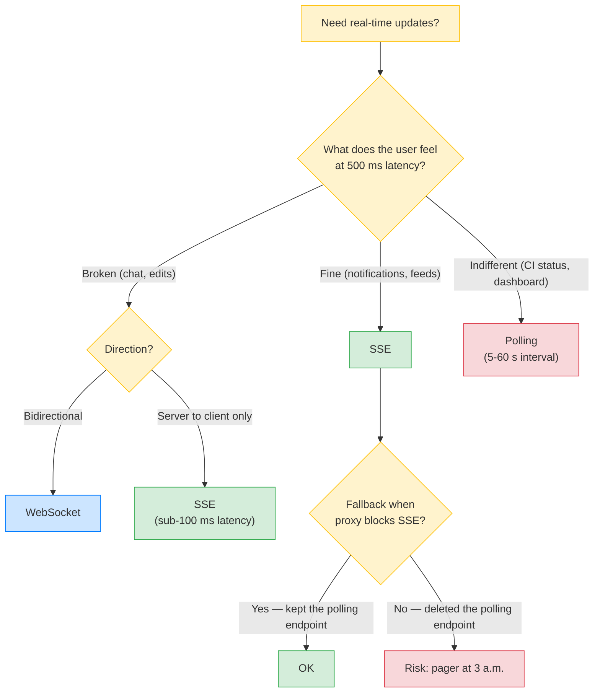
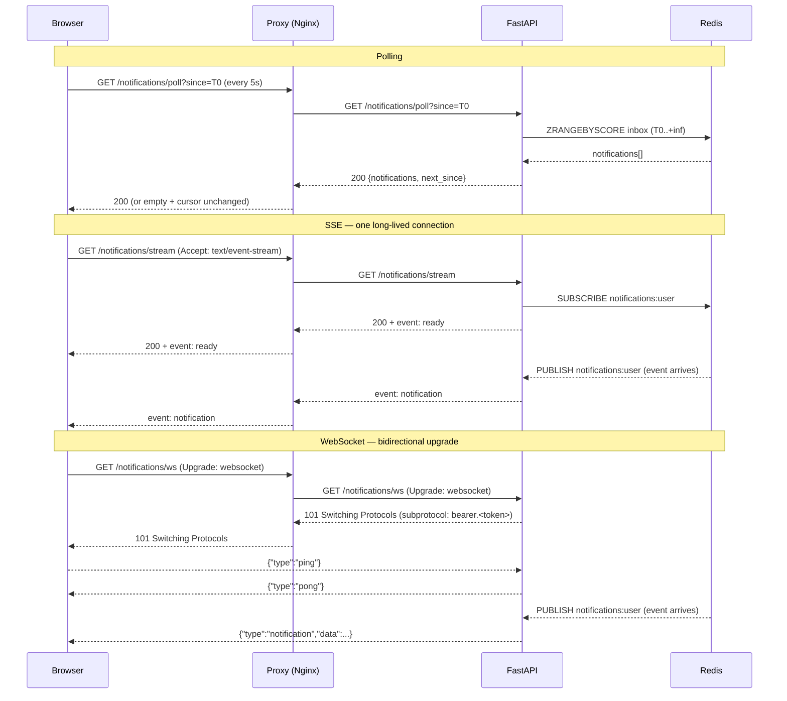
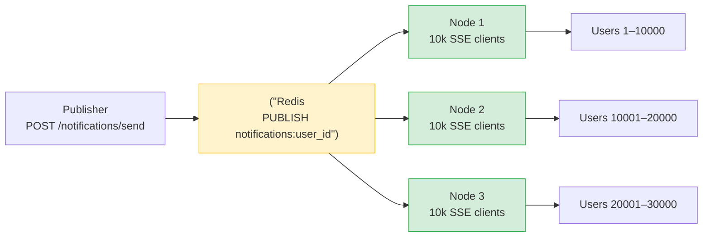
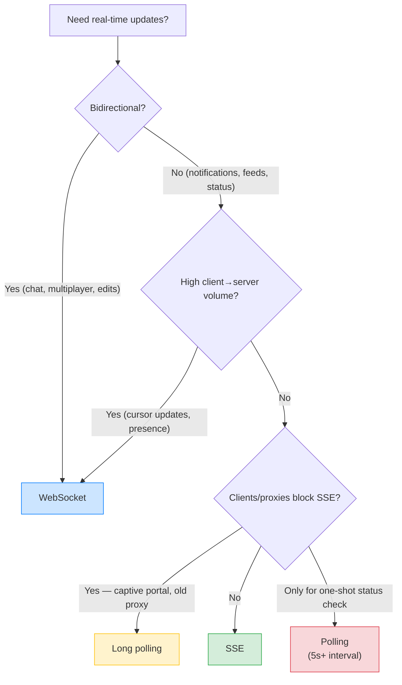

# Lesson 14: Real-Time Transports Compared – Polling vs SSE vs WebSocket

*The decision tree, the four transports (polling, long polling, SSE, WebSocket), the C10K maths, and the same `Boardly` notification stream implemented three ways so you can see the difference with your own eyes.*

**This is the lesson you reach for when "should I use WebSocket here?" comes up.**

The vault has the pieces — `Background-Tasks-Streaming-Uploads` taught you the streaming generator, `ASGI-Starlette-Uvicorn` taught you the `websocket` ASGI protocol, and Project 06 in `18-Portfolio-Projects` ships a real SSE fan-out. But none of those is the "when to use which" canonical. Today is that canonical. We'll build the same `Boardly` notification stream three ways — first as a polling endpoint, then as an SSE endpoint, then as a WebSocket endpoint — and you'll see exactly why SSE is the right default for notification fan-out, exactly when WebSocket beats it, and exactly why polling survives as the fallback when every proxy between you and the client is broken. By the end you'll have a decision tree you can apply in five seconds.


#http #sse #websocket #polling #comparison

## Learning Objectives

By the end of this lesson you will be able to:

1. **Name the four transports** for server-to-client real-time updates — polling, long polling, Server-Sent Events (SSE), WebSocket — and explain what each one is.
2. **State the latency, overhead, and complexity trade-off** for each: polling (high latency, high overhead, trivial complexity), long polling (medium latency, high overhead, medium complexity), SSE (low latency, low overhead, low complexity), WebSocket (lowest latency, medium overhead, high complexity).
3. **Implement a polling endpoint** in FastAPI — `GET /notifications/poll` that returns the user's notifications since a cursor and the new cursor.
4. **Implement an SSE endpoint** in FastAPI — `GET /notifications/stream` that uses `StreamingResponse` with `text/event-stream` and the `event:`/`data:` line protocol, with `EventSource` auto-reconnect semantics.
5. **Implement a WebSocket endpoint** in FastAPI — `@app.websocket("/notifications/ws")` with `WebSocket.accept()`, `WebSocket.send_json()`, `WebSocket.close()`, the `Sec-WebSocket-Protocol` subprotocol trick for auth, and the first-message auth pattern.
6. **Explain the C10K problem and why SSE scales better than WebSocket** for one-way fan-out (one TCP+TLS context per SSE connection, but no per-frame state machine, no custom keepalive, no pong handler).
7. **Walk the decision tree** to pick the right transport for a given situation: notification stream → SSE; chat → WebSocket; legacy client → long polling; one-shot status check → polling.
8. **State why polling is wasteful but still used** — the operational simplicity argument (any proxy, any client, zero infra, debug with `curl`).

## Prerequisites

Before starting, you need:

- **HTTP headers (general)** — [[HTTP-Headers-Deep-Dive]]. You should know what `Content-Type`, `Cache-Control`, and `Connection` headers are and how Starlette reads them.
- **Content negotiation** — [[Content-Negotiation]]. SSE and WebSocket both involve `Accept`-style negotiation, although in different forms. You should already know what `Vary` and `Accept` do.
- **Streaming responses** — [[03-FastAPI-Core/Background-Tasks-Streaming-Uploads]]. The SSE endpoint uses a Python `async` generator and `StreamingResponse`. If you have never written `yield` inside an `async def`, go back.
- **ASGI basics** — [[02-Web-and-HTTP/ASGI-Starlette-Uvicorn]]. You should know what an ASGI app is and what the `websocket` ASGI protocol type is (the second of the two, alongside `http`).
- **About an hour and a half.** The transports are simple; the trade-offs are not.
- **FastAPI 0.148.0, Starlette 1.9.0, httpx 0.28.x, Python 3.12** — verified October 2026.

**The four transports in one table.**

| Transport | Direction | Latency | Per-request overhead | Complexity | When to use |
|---|---|---|---|---|---|
| Polling | Client→Server | High (bounded by poll interval) | High (one HTTP request per check) | Trivial | Low-frequency updates, simple clients, broken proxies |
| Long polling | Client→Server (held) | Medium | High (one HTTP request per event batch) | Medium | Legacy clients, fallback when SSE blocked |
| SSE | Server→Client | Low | Low (one HTTP request, many events) | Low | Notification streams, status feeds, log tails |
| WebSocket | Bidirectional | Lowest | Medium (one HTTP upgrade, many frames) | High | Chat, multiplayer, collaborative editing, gaming |
The rest of this lesson unpacks each row.


## Think Like a Senior Engineer

Before the decision tree, the reframe. Read this section slowly — every real-time-transport incident in production reduces to one of the four UX-driven misuses below, and every "we shipped WebSocket and doubled our cloud bill" regret reduces to a senior who skipped the questions in this section.

### The reframe: a real-time transport is a UX decision, not a technology decision

A senior engineer reading a route handler does not ask "should I use WebSocket here?" — that question treats the transport as a technology choice for the engineer. They ask "what is the user's experience if this update is 500 ms late? 5 s late? 30 s late?" The transport is a contract with three downstream consumers, each of which has a different latency tolerance:

1. **The user's perception of the product.** Chat at 500 ms latency feels laggy; notifications at 5 s latency feel fine; a CI-status feed at 30 s latency feels fine. The transport's latency floor is a *product* property, not a technology property — polling at 5 s satisfies a notification UX and is the wrong choice for a chat UX.
2. **The client's reconnect story.** `EventSource` auto-reconnects on disconnect with a backoff; the WebSocket API drops the connection and emits `onclose`/`onerror`, leaving the reconnect logic to the application code. A senior asks: when this connection drops, who reconnects, with what backoff, and what does the user see during the gap? SSE gives a default answer; WebSocket forces you to write one.
3. **The operational bill.** One SSE connection per user is one TCP+TLS context for the session (minutes-to-hours); one WebSocket connection per user is the same plus a 30-second ping/pong exchange per connection. At 10 000 concurrent users, SSE's keepalive cost is zero (HTTP keepalive between proxy and origin handles it); WebSocket's keepalive cost is ~333 frame exchanges per second just for keepalive (10 000 connections / 30 s ping interval). The transport's per-connection cost is a *cloud-bill* property.

The transport is not "the right answer from a list." It is a three-way contract that determines what the user feels, what the client does on disconnect, and what the cloud bill looks like. The "wrong" transport does not just feel different to the user — it changes the system's behaviour at three layers.

### The three questions on the sticky note

For every `@router.websocket(...)` or `StreamingResponse(...)` you write, ask:

1. **If this update is 500 ms late, does the user notice? 5 s late? 30 s late?** If 500 ms latency breaks the UX (chat, multiplayer, cursor positions), you need a sub-second transport — SSE for one-way, WebSocket for bidirectional. If 5 s latency is fine (notifications), polling is operationally simpler and you do not need the long-lived connection. If 30 s is fine (CI status, dashboards), polling is the only right answer — a long-lived SSE stream for a UX that tolerates 30 s latency is a self-inflicted keepalive cost.
2. **If this update never arrives, does the user notice immediately or eventually?** If immediately (chat — the next message's absence is the bug), the transport must be reliable and the client must surface disconnection. If eventually (notifications — the badge count is wrong), the transport can drop events on reconnect and the client reconciles by cursor on the next poll. This is the SSE-auto-reconnect vs WebSocket-manual-reconnect trade-off, rephrased as a UX property.
3. **If we ship the "wrong" transport today, how expensive is the migration to the "right" one tomorrow?** Polling→SSE: refactor one endpoint, no client changes if the client uses `EventSource` (the browser API is built in). SSE→WebSocket: bigger refactor — the client needs new SDK code (the WebSocket API is lower-level than `EventSource`), the server needs a state machine, the auth story changes (no `Authorization` header on the upgrade). The migration cost is the strongest argument for picking SSE first and upgrading to WebSocket only when the UX demands it.

If you cannot answer all three, you are not ready to ship the transport. The default SSE-for-one-way / WebSocket-for-bidirectional rule is the right answer until you can — and that rule is almost always the right answer.

### The four cardinal sins (the ones that break clients in production)

The four transport mistakes that cause real production incidents are not "I picked the wrong subprotocol string" — they are "I picked a transport from the wrong UX family," which breaks the user's perception, the client's reconnect logic, and the cloud bill simultaneously. Memorise these four; they are the ones that page you at 3 a.m.

| Sin | What happens | Why the UX breaks |
|-----|--------------|----------------------|
| **Polling for a sub-second-latency UX** | A chat UI polls every 500 ms to keep "Alice is typing…" indicators fresh. | 120 requests per minute per user. The DB connection pool exhausts; the load balancer logs fill with 200s with empty bodies; the cloud bill doubles. The latency floor (500 ms) is right for the UX, but the overhead is wrong for the system. The right answer is WebSocket — the per-frame overhead is a fraction of the per-request HTTP overhead. |
| **WebSocket for one-way fan-out** | A notification stream shipped as WebSocket "for future-proofing." | 90 lines of state-machine code for what an SSE generator does in 70 lines. The per-connection keepalive cost doubles the cloud bill (333 frame exchanges/s at 10 000 connections vs SSE's zero). The "future-proofing" never arrives — the bidirectional capability is never used because the notification UX never needs client→server traffic. |
| **SSE for a high-frequency bidirectional UX** | A chat client uses SSE for server→client and `POST /messages` for client→server. | The chat feels responsive on send (the POST returns immediately) but under load the POSTs pile up — each is a full HTTP request (TCP+TLS overhead, parse, route, handler, response). The same UX over WebSocket frames is a fraction of the per-message cost. The "SSE is simpler" choice was the right call at MVP and the wrong call at scale. |
| **Treating the fallback as an afterthought** | A team ships SSE for a notification stream; six months later, users behind a corporate captive portal report no notifications. | The captive portal buffers `text/event-stream` and breaks the streaming contract. The team has no polling fallback (it was deleted "because SSE works") and pages users into a Friday-night incident to relearn that long-polling is the escape hatch. The polling endpoint should have been kept — not as the primary, but as the documented escape hatch for the 0.1 % of clients behind broken proxies. |

**Warning — When this breaks: the polling interval matched to the LB keepalive instead of the event rate**

The polling-interval decision is rarely made from the event-rate distribution; it is copied from the previous team's code (5 s) or matched to the LB's idle timeout (60 s, "so we don't time out"). Both are wrong. The interval should be matched to the p99 inter-event gap (the time between two notifications for the median user), not the average — the average is dragged down by idle users who never get a notification, the p99 is the user who gets 20 messages in a burst. Polling at 5 s for a p99 burst rate of 1 event/200 ms means the burst user sees a 5 s latency for 19 of the 20 messages, and the polling endpoint absorbs 25 sequential `SELECT WHERE created_at > ?` queries back-to-back as the client catches up. The fix is a metrics-driven interval: sample `inbox:inter_event_gap_p99_ms` from the publish pipeline, set the polling interval to `max(1000, p99 / 4)`, and let clients shorten the interval on their end if they observe a burst. The senior question for every polling endpoint: *is the interval derived from observed event-rate percentiles, or copied from a default?* If the latter, the interval is wrong at the p99 user and over-pays at the median user. See [[13-Performance-and-Observability/N-plus-1-and-Slow-Queries]] for the metrics-driven-config pattern and [[Pagination-Deep-Dive]] for the cursor-catch-up batch implication.


The pattern across all four: each sin is a *UX-family* mistake (one-way vs bidirectional, low-latency vs high-latency, primary vs fallback), not a *technology* mistake. The transport branches on the UX; the UX family is the load-bearing part of the contract.

### The decision tree, rephrased: the senior lens

The decision tree at the end of this lesson asks "bidirectional? high client→server volume? clients/proxies block SSE?" — three technology questions. The senior-lens tree asks three UX questions first, then maps to the same technology answers.



Read the tree top-down. The first question — *what does the user feel at 500 ms latency* — is the UX-family decision, and it is the one that breaks clients when answered wrong. The second question — *direction* — is the technology decision, and it is the one that doubles the cloud bill when answered wrong. The third question — *did you keep the polling fallback* — is the operational decision, and it is the one that pages you at 3 a.m. when answered wrong.

**Why is "indifferent at 500 ms latency" the polling case and not the SSE case?**

Because if the UX tolerates 5-30 s latency, a long-lived SSE connection is paying a per-connection cost (file descriptor, TCP context, keepalive frame, pubsub subscription) for a UX that does not need it. The CI-status page that polls once a minute does not need an always-on SSE stream — the latency is fine, the overhead is one HTTP request per minute, and the operational simplicity (debug with `curl`, no proxy buffering risk, no keepalive tuning) wins. SSE is for UXs that need sub-second latency AND are one-way. Polling is for UXs that tolerate seconds-to-minutes latency. The crossover is roughly at "1 update per minute per user" — below it, polling wins; above it, SSE wins.


**Warning — The UX family is the contract; the technology is the implementation.**

A client SDK that branches on the UX family ("is this a chat UX or a notification UX?") is correct. A client SDK that branches on the technology ("is this WebSocket or SSE?") is fragile — it will not gracefully handle a server-side migration from SSE to WebSocket, or a fallback from SSE to polling when the proxy breaks. Design your transport so the *UX family* tells the client what to do even if the client only reads the UX family. A WebSocket for a notification UX is a lie to the UX-family-reader; an SSE for a chat UX is a lie to the UX-family-reader. Both are sins.


## The Problem

`Boardly` has a notification stream. When Alice adds Bob to a project, Bob should see a notification in the top-right corner of his browser within a second or two. The naive implementation is polling — Bob's browser asks `GET /notifications?since=...` every 5 seconds, and the server responds with whatever has arrived since the cursor. That works. It is also wrong for three reasons:

1. **Latency floor.** The 5-second interval caps notification latency at 5 seconds. To get sub-second latency you'd poll every 500 ms, which is 120 requests per minute per user. With 10 000 concurrent users that's 1 200 requests per second just to ask "anything new?"
2. **Wasted requests.** Most polls come back empty. If notifications arrive at one per minute per user, then 119 of every 120 polling requests are useless. Each one still costs a TCP handshake (or keepalive), a TLS handshake (or session resumption), a request parse, a DB query, a JSON serialise, a response. That's real money on real infrastructure.
3. **Connection churn.** HTTP/1.1 keepalive helps, but polling still churns connections — every poll is a request, every request is a chance for a 502 from a flaky proxy, every 502 is a retry, every retry is another request.

So you reach for SSE — Server-Sent Events. Bob's browser opens one long-lived HTTP connection to `GET /notifications/stream`, and the server pushes events down it as they arrive. The browser's `EventSource` API auto-reconnects on disconnect. Latency drops to milliseconds. Overhead drops to one TCP+TLS context per user. The implementation is one Python generator. This is the right answer for notification fan-out.

But then the product team asks for chat. Real-time, bidirectional, multiplayer chat. Bob sends a message; Alice sees it instantly; Alice replies; Bob sees the reply instantly. SSE is server→client only — Bob cannot *send* messages over an SSE connection (he'd need a separate `POST /messages` endpoint, which is fine for low-volume chat but not for the "every keystroke is a cursor update" collaborative editor use case). For chat you reach for WebSocket — a bidirectional, full-duplex protocol that starts as an HTTP `Upgrade` and becomes a custom binary protocol on top. WebSocket is more complex: you write a state machine for the connection, you handle `ping`/`pong` keepalive frames, you implement auth (no `Authorization` header on the upgrade for browsers — you use the `Sec-WebSocket-Protocol` subprotocol trick or the first-message auth pattern), you implement graceful shutdown of long-lived connections when the pod receives `SIGTERM`. WebSocket is the right answer for chat, but only for chat.

The question is: how do you decide? The answer is the decision tree at the end of this lesson. First, we walk each transport in code.

**Why is polling wasteful but still used?**

Three reasons. (a) **Operational simplicity.** Polling works through every proxy, every firewall, every corporate captive portal. SSE works through most but not all — some older proxies buffer `text/event-stream` and break the streaming contract. WebSocket is the worst — some proxies refuse the `Upgrade` handshake, some load balancers time out the long-lived connection after 60 seconds. If you are debugging a Tuesday-morning "users in our Brazil office can't get notifications" ticket, the polling endpoint still works when nothing else does. (b) **Debuggability.** A polling endpoint is a plain `GET` — you can `curl` it, you can paste the URL in a browser, you can replay it from the Access logs. SSE and WebSocket both need special tooling (the `EventSource` API, a `wscat` CLI). (c) **Fallback.** When SSE/WebSocket fail, the right fallback is long polling, and long polling's degenerate form is polling. So you keep the polling endpoint around as the ultimate fallback even after you ship SSE. The waste is real; the operational simplicity is also real. Pick the right transport per use case; keep polling as the escape hatch.


## The Code

The same `Boardly` notification stream is built three times here. Each implementation lives in a separate file so you can compare them side by side. The shared infrastructure — the `notifications` table, the Redis pub/sub channel, the `get_current_user` dependency — is identical across all three.

```python
# boardly/notifications/__init__.py
"""Boardly notifications — three transports, one source of truth.

Lesson 14: polling, SSE, WebSocket. Same notifications table; same
Redis pub/sub fan-out; three endpoints that expose the same stream
three different ways.
"""
from .poll import router as poll_router        # GET /notifications/poll
from .sse import router as sse_router            # GET /notifications/stream
from .ws import router as ws_router              # WS /notifications/ws

__all__ = ["poll_router", "sse_router", "ws_router"]
```

```python
# boardly/notifications/models.py
"""Shared models and Redis pub/sub primitives used by all three transports."""
from __future__ import annotations

import json
from datetime import datetime, timezone
from uuid import UUID, uuid4

from pydantic import BaseModel, Field
from redis.asyncio import Redis


def _now() -> datetime:
    return datetime.now(timezone.utc)


class Notification(BaseModel):
    """A single notification delivered to a user."""
    id: UUID = Field(default_factory=uuid4)
    user_id: UUID
    type: str = Field(description="'project.invite', 'comment.mention', etc.")
    title: str
    body: str = ""
    created_at: datetime = Field(default_factory=_now)
    read: bool = False


async def publish_notification(redis: Redis, n: Notification) -> None:
    """Publish a notification to the user's personal Redis channel.

    All three transports subscribe to this channel — SSE via
    `pubsub.get_message(timeout=1.0)`, WebSocket via the same, polling via
    a `notifications` table the writer also inserts into. One fan-out,
    three reading patterns.
    """
    channel = f"notifications:{n.user_id}"
    await redis.publish(channel, n.model_dump_json())


async def list_notifications_since(
    redis: Redis, user_id: UUID, since: datetime, limit: int = 50
) -> list[Notification]:
    """Fallback list used by the polling endpoint.

    Real Boardly uses a `notifications` Postgres table; this stub uses a Redis
    sorted set so the lesson is runnable without a DB. The polling endpoint
    reads this; SSE and WebSocket subscribe to the pub/sub channel instead.
    """
    raw = await redis.zrangebyscore(
        f"notifications:inbox:{user_id}",
        since.timestamp(),
        "+inf",
        start=0,
        num=limit,
    )
    return [Notification.model_validate_json(r) for r in raw]
```

That's the shared layer. Now the three transports.

### Transport 1: Polling

```python
# boardly/notifications/poll.py
"""Polling endpoint — GET /notifications/poll?since=<iso8601>.

The browser asks 'any new notifications?' every N seconds; we respond with
whatever has arrived since `since`, plus a new cursor the browser sends back
on the next poll. Simplest possible transport. Works through any proxy.
"""
from __future__ import annotations

from datetime import datetime, timezone
from typing import Annotated
from uuid import UUID

from fastapi import APIRouter, Depends, HTTPException, Query
from fastapi.requests import Request
from pydantic import BaseModel

from ..auth import get_current_user
from .models import Notification, list_notifications_since

router = APIRouter(prefix="/notifications", tags=["notifications-poll"])


class PollResponse(BaseModel):
    """The polling response: a list of new notifications and the new cursor."""
    notifications: list[Notification]
    next_since: datetime  # the cursor the client sends on the next poll


@router.get("/poll", response_model=PollResponse)
async def poll(
    request: Request,
    user: Annotated[dict, Depends(get_current_user)],
    since: Annotated[datetime | None, Query(
        description="ISO 8601 timestamp; only notifications newer than this are returned.",
    )] = None,
) -> PollResponse:
    redis = request.app.state.redis
    user_id = UUID(user["sub"])

    # First poll: cursor is "now" (the client will get nothing on the first poll
    # and then poll again in N seconds; subsequent polls use the returned cursor).
    cursor = since or datetime.now(timezone.utc)

    notifications = await list_notifications_since(redis, user_id, cursor)

    if not notifications:
        # No new notifications — return the same cursor the client sent.
        return PollResponse(notifications=[], next_since=cursor)

    # The new cursor is the timestamp of the newest notification. Subsequent
    # polls use this; it prevents the client from re-receiving the same batch.
    newest = max(n.created_at for n in notifications)
    return PollResponse(notifications=notifications, next_since=newest)
```

That's 40 lines. The browser calls `GET /notifications/poll?since=2026-10-19T12:00:00Z`, gets back `{"notifications": [...], "next_since": "2026-10-19T12:00:05Z"}`, waits N seconds, calls again with the new cursor. There is nothing here that requires long-lived state on the server. It is plain HTTP. It works through every proxy on Earth.

### Transport 2: Server-Sent Events

```python
# boardly/notifications/sse.py
"""SSE endpoint — GET /notifications/stream.

Server-Sent Events: one long-lived HTTP connection; the server pushes events
down it as they arrive. The browser's EventSource API auto-reconnects on
disconnect. The wire protocol is plain text — `event: <name>\\n` then
`data: <json>\\n\\n`. Simplest streaming transport that works in 2026.
"""
from __future__ import annotations

import asyncio
import json
from collections.abc import AsyncIterator
from typing import Annotated
from uuid import UUID

from fastapi import APIRouter, Depends, Request
from fastapi.responses import StreamingResponse

from ..auth import get_current_user
from .models import Notification

router = APIRouter(tags=["notifications-sse"])

# Heartbeat interval for the SSE stream. Most production proxies and load
# balancers kill idle SSE connections after 60–100 seconds (AWS ALB: 60s,
# Cloudflare: 100s, Nginx `proxy_read_timeout` default 60s). A 30s ping
# comment frame keeps the TCP socket visibly active without delivering
# spurious events to the client. See [[Health-Checks-and-Probes]] for the
# analogous liveness-vs-readiness argument.
HEARTBEAT_INTERVAL_S = 30.0
# Poll cadence for the disconnect check + heartbeat. `pubsub.get_message`
# with `timeout=1.0` already interleaves a periodic wake-up with the
# pub/sub read; this constant governs how often we re-check the client
# disconnect state in between heartbeats. 1 second is cheap and matches
# the rate at which Starlette polls `http.disconnect`.
DISCONNECT_POLL_S = 1.0


async def _sse_event(event: str, data: dict) -> bytes:
    """Serialise one SSE event as the wire protocol.

    The SSE wire format is: `event: <name>\\n` (optional) then one or more
    `data: <line>\\n` lines, terminated by a blank `\\n`. The blank line is
    what tells the browser 'event complete, dispatch to the listener'.
    """
    payload = json.dumps(data, default=str)
    # If the payload has newlines, split across multiple `data:` lines so the
    # blank-line terminator still works (the SSE spec is line-oriented).
    if "\n" in payload:
        body = "\n".join(f"data: {line}" for line in payload.split("\n"))
    else:
        body = f"data: {payload}"
    return f"event: {event}\n{body}\n\n".encode("utf-8")


async def _notification_stream(
    request: Request, user_id: UUID
) -> AsyncIterator[bytes]:
    """Subscribe to the user's Redis pub/sub channel and yield SSE events.

    This generator runs for the lifetime of the HTTP connection — until the
    browser closes it, the network drops, or the pod receives SIGTERM. Each
    published notification becomes one SSE event on the wire. A periodic
    `: ping` comment frame keeps the connection alive behind proxies with
    short idle timeouts.

    The loop interleaves a 1-second disconnect check with the pub/sub read
    via `pubsub.get_message(timeout=1.0)`. Do NOT use `pubsub.listen()` —
    it blocks indefinitely between events, which makes
    `request.is_disconnected()` dormant. See Mistake 3 below.
    """
    redis = request.app.state.redis
    pubsub = redis.pubsub()
    channel = f"notifications:{user_id}"
    await pubsub.subscribe(channel)
    # Tell the client the stream is live — the browser's EventSource waits
    # for the first event before flipping to OPEN; sending a `ready` event
    # early prevents the client from thinking the connection failed.
    yield await _sse_event("ready", {"user_id": str(user_id)})
    loop = asyncio.get_event_loop()
    last_heartbeat = loop.time()
    try:
        while True:
            # `pubsub.get_message(timeout=1.0)` returns a message frame if one
            # arrived in the last 1s; otherwise returns `None` after the
            # timeout. Either outcome is an opportunity to check the client
            # and emit a heartbeat — the bug we are avoiding is the
            # `async for message in pubsub.listen():` form, which blocks
            # indefinitely between events.
            message = await pubsub.get_message(
                timeout=DISCONNECT_POLL_S,
                ignore_subscribe_messages=True,
            )
            if message is not None and message["type"] == "message":
                n = Notification.model_validate_json(message["data"])
                yield await _sse_event("notification", n.model_dump(mode="json"))
                continue
            # No message arrived in the last second. Check the client —
            # `request.is_disconnected()` polls the ASGI `receive` channel
            # for `http.disconnect`. The browser closing the tab is the
            # canonical case; the network dropping is the other.
            if await request.is_disconnected():
                break
            # Heartbeat — a `:`-prefixed SSE comment frame. The browser
            # ignores it; the proxy in front sees traffic and resets its
            # idle timer. 30s beats AWS ALB (60s), Cloudflare (100s), and
            # Nginx's default `proxy_read_timeout` (60s) with margin.
            now = loop.time()
            if now - last_heartbeat >= HEARTBEAT_INTERVAL_S:
                yield b": ping\n\n"
                last_heartbeat = now
    finally:
        await pubsub.unsubscribe(channel)
        await pubsub.aclose()


@router.get("/notifications/stream")
async def stream(
    request: Request,
    user: Annotated[dict, Depends(get_current_user)],
) -> StreamingResponse:
    user_id = UUID(user["sub"])
    return StreamingResponse(
        _notification_stream(request, user_id),
        media_type="text/event-stream",
        headers={
            # SSE responses must NOT be cached by intermediate proxies —
            # the events are real-time, caching them would deliver stale
            # notifications to the wrong client.
            "Cache-Control": "no-cache, no-store, must-revalidate",
            # Nginx and other buffering proxies will buffer the response
            # and break the streaming contract. `X-Accel-Buffering: no`
            # tells Nginx to disable buffering for this response.
            "X-Accel-Buffering": "no",
            # SSE connections are long-lived — `Connection: keep-alive` is
            # the default for HTTP/1.1, but we set it explicitly so the
            # proxy in front does not close after the first response.
            "Connection": "keep-alive",
        },
    )
```

**The `user` dict shape is canonical across this vault.**

`get_current_user` returns `{"sub": str, "id": int, "email": str}` — the
same shape used by [[11-Authentication-and-Security/OAuth2-JWT-Access-Refresh]]
and every other transport, upload, and versioning lesson in 02b. Copy it
as-is; do not re-derive the claim shape per endpoint.


That's 70 lines. The browser's `EventSource` opens the connection once, and the server pushes events down it. The browser dispatches each event to the listener. On disconnect, `EventSource` auto-reconnects after a backoff. Latency drops from 5 seconds to milliseconds. Overhead drops from 120 requests per minute to one request per session.

### Transport 3: WebSocket

```python
# boardly/notifications/ws.py
"""WebSocket endpoint — WS /notifications/ws.

WebSocket: a bidirectional, full-duplex protocol that starts as an HTTP Upgrade
and becomes a custom binary protocol on top. Necessary for chat and other
high-frequency bidirectional use cases; overkill for one-way notification fan-out
but shown here for completeness.
"""
from __future__ import annotations

import asyncio
import json
from uuid import UUID

import jwt
from fastapi import APIRouter, Depends, WebSocket, WebSocketDisconnect, status
from pydantic import ValidationError
from starlette.websockets import WebSocketState

from ..auth import decode_access_token
from .models import Notification

router = APIRouter(tags=["notifications-ws"])


async def _authenticate_ws(ws: WebSocket) -> dict:
    """Two ways to authenticate a WebSocket connection in a browser.

    The HTTP Upgrade request from a browser cannot set custom `Authorization`
    headers (the WebSocket API does not allow it). So either (a) the client
    passes the token in the `Sec-WebSocket-Protocol` subprotocol field — a
    hack that works because the field allows arbitrary strings — or (b) the
    client sends the token as the first message after the upgrade succeeds.

    We support both: prefer the subprotocol trick (single round-trip), fall
    back to first-message auth (one extra frame but works with clients that
    can't set subprotocols). If the subprotocol trick was attempted but the
    bearer did not decode, we reject the upgrade BEFORE `ws.accept()` —
    Starlette answers the HTTP Upgrade with 403 instead of opening an
    unauthenticated WebSocket that sits idle until timeout.
    """
    # (a) The subprotocol trick — `new WebSocket(url, ['bearer.' + token])`
    # in the browser puts the token in the `Sec-WebSocket-Protocol` header.
    subprotocols = ws.headers.get("sec-websocket-protocol", "").split(", ")
    attempted_subprotocol = False
    for sp in subprotocols:
        if sp.startswith("bearer."):
            attempted_subprotocol = True
            token = sp.removeprefix("bearer.").strip()
            try:
                return decode_access_token(token)
            except (jwt.PyJWTError, ValidationError):
                # Catch only the JWT/Pydantic exceptions we expect from
                # `decode_access_token`. A bare `except Exception:` would
                # swallow `WebSocketDisconnect`, `RuntimeError`, and
                # anything else that indicates a real bug rather than an
                # invalid token.
                continue

    # If the client attempted the subprotocol trick and we couldn't decode
    # any candidate, reject the upgrade BEFORE accepting. Closing before
    # `ws.accept()` makes Starlette return HTTP 403 to the upgrade request —
    # the socket never opens, the client gets a clean failure, and we
    # don't hold an unauthenticated WebSocket open until timeout.
    if attempted_subprotocol:
        await ws.close(code=status.WS_1008_POLICY_VIOLATION)
        raise WebSocketDisconnect()

    # (b) First-message auth — accept the upgrade, expect the first frame
    # to be `{"type":"auth","token":"<jwt>"}`. If it isn't, close with 4001.
    await ws.accept()
    try:
        first = await ws.receive_json()
    except WebSocketDisconnect:
        await ws.close(code=status.WS_1008_POLICY_VIOLATION)
        raise
    if first.get("type") != "auth" or not (token := first.get("token")):
        await ws.close(code=status.WS_1008_POLICY_VIOLATION)
        raise WebSocketDisconnect()
    try:
        return decode_access_token(token)
    except (jwt.PyJWTError, ValidationError):
        await ws.close(code=status.WS_1008_POLICY_VIOLATION)
        raise


@router.websocket("/notifications/ws")
async def ws_notifications(ws: WebSocket) -> None:
    """Bidirectional notification stream over WebSocket.

    The server pushes notifications down (same as SSE); the client can also
    send messages up — `{"type":"mark_read","id":"<uuid>"}` to acknowledge
    a notification, or `{"type":"ping"}` to keep the connection alive through
    a 60-second-idle proxy.
    """
    user = await _authenticate_ws(ws)

    # If the subprotocol trick was used, we haven't accepted yet. Accept now.
    if ws.client_state != WebSocketState.CONNECTED:
        await ws.accept()

    user_id = UUID(user["sub"])
    redis = ws.app.state.redis
    pubsub = redis.pubsub()
    channel = f"notifications:{user_id}"
    await pubsub.subscribe(channel)

    async def _push() -> None:
        """Forward pub/sub messages to the WebSocket."""
        try:
            async for message in pubsub.listen():
                if message["type"] != "message":
                    continue
                n = Notification.model_validate_json(message["data"])
                await ws.send_json({"type": "notification", "data": n.model_dump(mode="json")})
        except WebSocketDisconnect:
            pass

    async def _recv() -> None:
        """Receive client→server frames and act on them."""
        try:
            async for raw in ws.iter_json():
                if raw.get("type") == "ping":
                    await ws.send_json({"type": "pong"})
                elif raw.get("type") == "mark_read" and (nid := raw.get("id")):
                    # In real Boardly this would UPDATE notifications SET read=true
                    # WHERE id=? AND user_id=?; here we just acknowledge.
                    await ws.send_json({"type": "ack", "id": nid})
        except WebSocketDisconnect:
            pass

    # Run push and recv concurrently; either one closing means we're done.
    tasks = [asyncio.create_task(_push()), asyncio.create_task(_recv())]
    try:
        await asyncio.wait(tasks, return_when=asyncio.FIRST_COMPLETED)
    finally:
        for t in tasks:
            t.cancel()
        await pubsub.unsubscribe(channel)
        await pubsub.aclose()
        if ws.client_state == WebSocketState.CONNECTED:
            await ws.close()
```

That's 90 lines. The WebSocket endpoint accepts the upgrade, authenticates the client (twice over — once via the subprotocol trick, once via first-message auth as a fallback), then runs two coroutines concurrently: one to push pub/sub messages down the socket, one to receive client→server frames (pings, mark_read acknowledgements). On disconnect, both coroutines are cancelled and the pub/sub is unsubscribed.

```python
# boardly/main.py — wiring the three routers
"""Boardly main app — Lesson 14 wires the three notification transports."""
from collections.abc import AsyncIterator
from contextlib import asynccontextmanager

from fastapi import FastAPI
from redis.asyncio import Redis

from .auth import auth_router
from .notifications import poll_router, sse_router, ws_router


@asynccontextmanager
async def lifespan(app: FastAPI) -> AsyncIterator[None]:
    app.state.redis = Redis.from_url("redis://localhost:6379/0", decode_responses=True)
    await app.state.redis.ping()
    yield
    await app.state.redis.aclose()


app = FastAPI(title="Boardly", version="0.14.0", lifespan=lifespan)
app.include_router(auth_router)
app.include_router(poll_router)
app.include_router(sse_router)
app.include_router(ws_router)
```

That's the full skeleton. The three routers expose the same notifications three ways. Run it, then in one terminal `curl http://127.0.0.1:8000/notifications/poll`, in another `curl -N http://127.0.0.1:8000/notifications/stream` (the `-N` disables buffering so you see events as they arrive), in a third open a `wscat -c ws://127.0.0.1:8000/notifications/ws`. Publish a notification via the Redis CLI: `redis-cli PUBLISH notifications:<user_id> '{"id":"...","user_id":"...","type":"project.invite","title":"You were added to Project X"}'`. All three clients see it. Same fan-out, three transports.

## Line-by-Line Deep Dive

We'll go through each transport's load-bearing pieces — the parts where the choice between polling, SSE, and WebSocket shows up.

### The polling endpoint: the cursor

The polling endpoint's load-bearing piece is the cursor. Look at this block:

```python
if not notifications:
    return PollResponse(notifications=[], next_since=cursor)

newest = max(n.created_at for n in notifications)
return PollResponse(notifications=notifications, next_since=newest)
```

**Why this matters:** the cursor is the difference between "client sees every notification exactly once" and "client sees duplicates on every poll." The cursor is the watermark — "I've seen everything up to this point; send me what's newer." On the next poll, the client sends the cursor back, and the server uses it as the `WHERE created_at > ?` filter.

Two classic bugs. First: returning the current time instead of the newest notification's timestamp. If notifications arrive at `12:00:03` and the client polls at `12:00:05`, returning `12:00:05` as the cursor means any notification that arrives at `12:00:04` is invisible — the next poll asks "what's newer than `12:00:05`?" and skips the `12:00:04` one. Always use the newest notification's timestamp. Second: using `>=` instead of `>` in the filter. With `>=`, the client re-receives the boundary notification on every poll. Always use strict `>`.

**Tip — Polling cursors should be opaque to the client.**

Real Boardly encodes the cursor as an opaque base64 string — `?since=eyJ0IjoxNzMyMjQxNjA1fQ` — rather than a bare ISO timestamp. The client treats it as a black box and sends it back unchanged. This lets the server evolve the cursor format (add a sequence number, add a tenant ID, switch to a sequence-based cursor instead of a timestamp) without breaking clients. The polling endpoint here uses a bare timestamp for clarity; production code should not. See [[Pagination-Deep-Dive]] for the same opacity argument applied to paginated cursors.


**Danger — How an attacker thinks: the polling cursor as a metrics-pipeline poisoning primitive**

The cursor is `datetime` parsed by `Annotated[datetime | None, Query(alias="since")]` and then used in the Redis read (`ZRANGEBYSCORE inbox:{user_id} ({since} +inf`). FastAPI's `datetime` parser rejects non-ISO strings (a `RequestValidationError` 422), so the naive SQL-injection-via-cursor attack does not work. But the cursor is also logged (the access log records `?since=2026-10-19T...`), and the log line is then ingested by the metrics pipeline that builds `notifications:latency_p99_ms` by computing `now - since`. A malicious client sends `?since=1970-01-01T00:00:00Z` (a 56-year-old cursor) and the metrics pipeline computes `now - since = 1.77e9 seconds` — the latency p99 explodes, pagers fire on "notifications latency through the roof," and the on-call engineer wastes an hour on a non-existent latency regression. The defence is structural: the cursor is server-issued (the previous poll's `next_since` field) and the server rejects cursors older than a windowed threshold (`if (datetime.now(timezone.utc) - since).total_seconds() > 7 * 24 * 3600: raise HTTPException(422, "cursor too old")`) — the 7-day window covers any reasonable notification history; anything older is either a client bug or an attacker probing the metrics pipeline. The senior question for every cursor-accepting endpoint: *is the cursor bounded in age, or does the endpoint accept any ISO timestamp?* If the latter, the cursor is a metrics-poisoning primitive. See [[13-Performance-and-Observability/Structured-Logging-and-Request-IDs]] for the "attacker controls a logged field" pattern.


### The SSE endpoint: the `text/event-stream` wire format

The SSE wire format is plain text, line-oriented. Look at the `_sse_event` helper:

```python
return f"event: {event}\n{body}\n\n".encode("utf-8")
```

**What it does:** builds the SSE wire format — `event: <name>` line, one or more `data: <line>` lines, terminated by a blank line. The blank line is what tells the browser "event complete; dispatch to the listener."

**Why this format:** the SSE spec is intentionally simple — it's plain text, line-oriented, debuggable with `curl -N`. You can paste a stream into your terminal and read it. The `event:` line lets you dispatch different event types to different listeners on the browser (`eventSource.addEventListener('notification', ...)`, `eventSource.addEventListener('ready', ...)`). The `data:` line is the JSON payload.

**Why the `\n\n` matters:** the blank line is the event terminator. Forget it and the browser buffers everything waiting for the terminator that never comes. Test with `curl -N` — if you see your events immediately, the terminator is correct; if `curl` shows nothing for 30 seconds and then dumps everything at once, the terminator is missing.

```python
headers={
    "Cache-Control": "no-cache, no-store, must-revalidate",
    "X-Accel-Buffering": "no",
    "Connection": "keep-alive",
},
```

**What these headers do:** they tell every proxy in the path "this is a live stream; do not buffer it." `Cache-Control: no-cache, no-store, must-revalidate` is the standard no-cache directive (see [[HTTP-Caching-Headers-Deep-Dive]] for why `no-cache` alone is not enough). `X-Accel-Buffering: no` is an Nginx-specific directive — without it, Nginx's default `proxy_buffering on` will buffer your stream and break the latency contract. `Connection: keep-alive` is the default for HTTP/1.1 but we set it explicitly so a proxy that defaults to `close` doesn't kill the connection after the first event.

**Warning — The Nginx buffering footgun.**

The #1 SSE bug is "events arrive in batches of 5 every 30 seconds instead of one at a time." The cause is Nginx's `proxy_buffering on` (the default). The fix is either `X-Accel-Buffering: no` on the response (per-endpoint) or `proxy_buffering off` in the Nginx config (global). Both work; the per-endpoint version is safer because it doesn't disable buffering for the rest of the site. Always test SSE behind a real proxy in front of your dev box — `curl -N` against `localhost:8000` doesn't catch this; `curl -N` against `localhost:80` (through Nginx) does.


**Production reality: the `Last-Event-ID` resumption window and the Redis Stream eviction**

The SSE spec's `id:` field is the resumption primitive — when the browser's `EventSource` reconnects, it sends `Last-Event-ID: <last-seen-id>` on the next request, and the server uses that id to resume from where it left off. The canonical `_sse_event` helper here does not emit an `id:` field — that is deliberate (the lesson focuses on the wire format, not the resumption), but production code MUST. Without `id:`, the browser cannot resume and every reconnect drops in-flight events. The resumption source is typically a Redis Stream (not pub/sub) — `XADD inbox:{user_id} * notification {...}` autogenerates a monotonic ID, the SSE handler does `XREAD BLOCK 5000 STREAMS inbox:{user_id} {last_event_id}`, and the `Last-Event-ID` request header seeds the read position. The catch: Redis Streams have a `MAXLEN` trim policy (or a `MINID` time-trim) — events older than the trim window are gone. If the client disconnects for 30 minutes and the trim window is 10 minutes, the `Last-Event-ID` the client sends points to a deleted entry, and the SSE handler must fall back to a snapshot rebuild (a `SELECT WHERE created_at > last_event_id` query) and emit a `event: resync` event to tell the client "your cursor was stale; here is a catch-up batch." The senior question for every SSE endpoint with `id:` fields: *what is the resumption window, and what happens when the client reconnects after the window?* If the answer is "events are silently dropped" or "the stream errors," the resumption contract is broken. See [[14-Caching-and-Background-Processing/Redis-Cache-Aside]] for the Stream-vs-pub/sub trade-off and [[Pagination-Deep-Dive]] for the catch-up batch pattern.


### The SSE endpoint: the disconnect check

The canonical generator uses `pubsub.get_message(timeout=1.0)` in a `while True` loop, not `pubsub.listen()`. Here is the load-bearing shape:

```python
while True:
    message = await pubsub.get_message(
        timeout=DISCONNECT_POLL_S,
        ignore_subscribe_messages=True,
    )
    if message is not None and message["type"] == "message":
        n = Notification.model_validate_json(message["data"])
        yield await _sse_event("notification", n.model_dump(mode="json"))
        continue
    # Either `get_message` timed out (message is None) or returned a
    # non-message frame — both are opportunities to check the client and
    # emit a heartbeat.
    if await request.is_disconnected():
        break
    now = loop.time()
    if now - last_heartbeat >= HEARTBEAT_INTERVAL_S:
        yield b": ping\n\n"
        last_heartbeat = now
```

**What it does:** interleaves a 1-second disconnect check with the pub/sub read, and emits a 30-second `: ping` comment frame to keep the proxy in front from killing the connection.

**Why this matters:** without the `get_message(timeout=1.0)` form, the generator never returns. The browser disconnects (user closes the tab, network drops, laptop sleeps), but the server-side generator is blocked on `pubsub.listen()` waiting for the next event. The connection stays open on the server until the next event arrives, at which point the server tries to write to a closed socket and gets a `ConnectionResetError`. With the `get_message(timeout=1.0)` form, the generator wakes up every second, notices the disconnect on the next iteration, and exits — the `finally` block cleans up the pub/sub, and the request completes.

Starlette's `request.is_disconnected()` is the canonical check. It works by polling the ASGI `receive` channel for `http.disconnect` events. The key property: calling it from inside `async for message in pubsub.listen():` is **dormant between events** — `pubsub.listen()` blocks until the next message arrives, so the disconnect check inside the loop body never fires when the stream is idle. `pubsub.get_message(timeout=1.0)` returns `None` after 1 second of silence, which is the wake-up you need to call `is_disconnected()` and the heartbeat. For Boardly's notification stream (a few events per minute per user), 1 second of poll cadence is cheap; for high-volume streams (thousands of events per second per connection), the same pattern works — you simply do not notice the 1-second poll because real events arrive faster than the timeout.

**Warning — `pubsub.listen()` looks correct but is dormant between events.**

Calling `is_disconnected()` inside `async for message in pubsub.listen():` looks correct — the check is present, the code reads cleanly — but the check only fires when a new pub/sub message arrives. When the stream is idle (the common case for notification fan-out: a few events per minute per user), `pubsub.listen()` blocks indefinitely and `is_disconnected()` is never called. The browser closing the tab leaves the server-side generator blocked forever, the file descriptor stays open, and after a day of users opening and closing tabs Uvicorn hits the file-descriptor limit. The fix is the `pubsub.get_message(timeout=1.0)` pattern shown above. This is also Mistake 3 below.


**Warning — When this breaks: `is_disconnected()` returning False for up to two hours after a dirty close**

Starlette's `request.is_disconnected()` polls the ASGI `receive` channel for `http.disconnect` events. The disconnect event arrives when the underlying socket gets a RST or FIN from the client (the browser sent it when the tab closed). On a clean TCP close (the user closes the tab gently), the FIN arrives in milliseconds — `is_disconnected()` returns True on the next `get_message(timeout=1.0)` wake-up, and the generator exits cleanly. On a dirty close (the user's laptop sleeps, the Wi-Fi drops mid-packet, the corporate proxy kills the connection without a FIN), the OS may not notice the dead socket for the full TCP keepalive timeout — Linux's default `tcp_keepalive_time` is 7200 s (two hours), and the OS only flags the socket as dead after `tcp_keepalive_probes` unanswered probes. The result: the SSE generator's `is_disconnected()` check returns False for the full two hours, the pubsub subscription stays open, the file descriptor stays open, and the user's notification stream is "alive" on the server for two hours after the browser is closed. The fix is application-level heartbeats with ack-style acknowledgements: the `: ping` comment frame is sent every 30 s, but the SSE contract is one-way (the browser can't acknowledge it without an XHR). The structural fix is to add a separate `POST /notifications/ack` endpoint that the browser's `EventSource` `onmessage` handler calls every 30 s — if the server hasn't seen an ack in 90 s, treat the connection as dead and exit the generator. The grep: `rg "is_disconnected" boardly/notifications/` returns the call site; `rg "tcp_keepalive" /etc/sysctl.conf` returns the OS-level tuning (the 7200 s default is the load-bearing misconfiguration on most Linux boxes). The senior question for every SSE handler: *how long can a dirty-disconnected connection stay "alive" before the generator notices?* If the answer is "two hours (the TCP keepalive default)," the disconnect check is half a fix.


### The WebSocket endpoint: the auth problem

```python
subprotocols = ws.headers.get("sec-websocket-protocol", "").split(", ")
attempted_subprotocol = False
for sp in subprotocols:
    if sp.startswith("bearer."):
        attempted_subprotocol = True
        token = sp.removeprefix("bearer.").strip()
        try:
            return decode_access_token(token)
        except (jwt.PyJWTError, ValidationError):
            continue
```

**What it does:** extracts the access token from the `Sec-WebSocket-Protocol` subprotocol field — the workaround for the browser WebSocket API not allowing custom headers on the upgrade.

**Why this hack exists:** the browser's `new WebSocket(url, subprotocols)` constructor lets you pass an array of subprotocol strings. The spec intends this for protocol negotiation (`["json", "msgpack"]` — "I prefer msgpack but accept json"). The strings end up in the `Sec-WebSocket-Protocol` HTTP header on the upgrade request. The trick is to abuse this field to carry the auth token — `new WebSocket(url, ["bearer." + token])`. The server reads the token from the header, validates it, and either accepts the upgrade (returning the chosen subprotocol) or rejects it (closing the connection).

**Why `except (jwt.PyJWTError, ValidationError)` and not `except Exception`:** the bare `except Exception:` form catches `WebSocketDisconnect` (which would mask a real disconnect), `RuntimeError` (which would mask a Starlette state-machine bug), and anything else that indicates a real bug rather than an invalid token. The narrow form catches exactly what `decode_access_token` can raise — a JWT signature/expiry/issuer failure (`jwt.PyJWTError`) or a Pydantic claims-shape failure (`ValidationError`). Everything else propagates and surfaces in the logs.

**The fallback:** the alternative is first-message auth. Accept the upgrade without auth, then expect the first frame to be `{"type":"auth","token":"<jwt>"}`. This costs one extra round-trip but works with clients that cannot set subprotocols (some mobile WebSocket libraries). Both patterns are valid; the subprotocol trick is faster and is the recommended default for browser-to-server. If the subprotocol trick was attempted but failed to decode, the canonical code rejects the upgrade before `ws.accept()` — Starlette answers the HTTP Upgrade with 403, the socket never opens, and no unauthenticated WebSocket sits idle until timeout.

**Danger — How an attacker thinks: the `Sec-WebSocket-Protocol` subprotocol field carrying the bearer token through intermediary logs**

The subprotocol trick (the canonical pattern here) puts the access token in the `Sec-WebSocket-Protocol` header on the HTTP upgrade request. The token is a JWT, plaintext-base64url, in an HTTP header that intermediaries (corporate proxies, CDN edge logs, the cloud provider's load-balancer access log) record by default. AWS ALB's access logs include request headers verbatim; nginx's `$http_sec_websocket_protocol` variable is loggable; Cloudflare's "Log HTTP Request Headers" worker feature ships the header to your log aggregator. A token in a header that is logged is a token in a file that an attacker with read access to the log pipeline (a misconfigured IAM role, a Logstash dashboard with broad RBAC, an S3 bucket with public-read ACLs) can harvest in bulk. The defence is layered: (1) use short-lived access tokens (5-10 min expiry) so a harvested token is stale by the time it reaches an attacker's replay tool; (2) prefer first-message auth (the token goes in the WebSocket frame after TLS, never in an HTTP header the intermediary logs) for high-security endpoints, accepting the one-extra-round-trip cost; (3) configure the LB and CDN to redact `Sec-WebSocket-Protocol` from access logs (AWS ALB: do not include it in the access-log format; Cloudflare: do not enable "Log HTTP Request Headers" for the WebSocket upgrade path). The senior question for every WebSocket auth endpoint: *is the token in a header that intermediaries log by default?* If yes, the token is a bulk-harvest primitive. See [[11-Authentication-and-Security/OAuth2-JWT-Access-Refresh]] for the short-lived-access-token pattern and [[11-Authentication-and-Security/Threat-Model-First]] for the "intermediary logs the secret" trust-boundary expansion.


**When does WebSocket beat SSE?**

Three situations. (a) **Bidirectional.** SSE is server→client only. If the client needs to send high-frequency messages back (chat messages, cursor positions, multiplayer inputs, collaborative edits), SSE forces you to send those over a *separate* `POST /messages` endpoint, which has higher per-message overhead (one HTTP request per message). WebSocket frames are cheaper — one frame per message, no per-frame HTTP overhead. (b) **Binary.** SSE is text-only — you serialise payloads to JSON or base64. WebSocket supports binary frames natively, which is half the bandwidth for binary payloads (game state diffs, image thumbnails, audio chunks). (c) **Custom protocol.** WebSocket lets you implement a custom protocol on top — `ping`/`pong` keepalives, message acknowledgements, multiplexing, presence. SSE gives you the `EventSource` API and nothing more. The cost is complexity: you write the state machine, the keepalive handler, the auth, the graceful shutdown. For one-way fan-out (notifications, status feeds, log tails), that complexity buys you nothing. For chat, multiplayer, collaborative editing, gaming — it's necessary.


### The WebSocket endpoint: the dual coroutine pattern

```python
async def _push() -> None:
    """Forward pub/sub messages to the WebSocket."""
    async for message in pubsub.listen():
        ...
        await ws.send_json({"type": "notification", ...})

async def _recv() -> None:
    """Receive client→server frames and act on them."""
    async for raw in ws.iter_json():
        if raw.get("type") == "ping":
            await ws.send_json({"type": "pong"})
        ...

tasks = [asyncio.create_task(_push()), asyncio.create_task(_recv())]
await asyncio.wait(tasks, return_when=asyncio.FIRST_COMPLETED)
```

**What it does:** runs two coroutines concurrently — one reads from Redis pub/sub and pushes down the socket, one reads from the socket and handles client→server messages.

**Why this pattern:** WebSocket is bidirectional, so the server must read from the socket and write to the socket at the same time. A single coroutine can't do both — if it's blocked on `pubsub.listen()` waiting for the next event, it isn't reading from the socket, and the client's `ping` frame goes unanswered. The dual-coroutine pattern lets each direction proceed independently; `asyncio.wait(..., FIRST_COMPLETED)` exits when either coroutine returns (typically because the client disconnected and `WebSocketDisconnect` was raised).

**The cleanup:** `t.cancel()` for the unfinished task, then `await pubsub.unsubscribe(channel)` and `await pubsub.aclose()` in the `finally`. The cancel is critical — without it, the surviving coroutine keeps running after the WebSocket closes, leaking the pub/sub subscription. See [[10-Async-Python/asyncio-Primitives]] for the cancellation semantics.

## Execution Trace

Three terminals. In the first, run the server:

```bash
uv run uvicorn boardly.main:app --reload
```

Expected output:

```
INFO: Will watch for changes in these directories: ['/.../boardly']
INFO: Uvicorn running on http://127.0.0.1:8000 (Press CTRL+C to quit)
INFO: Started reloader process [1234] using StatReload
INFO: Started server process [1235]
INFO: Waiting for application startup.
INFO: Application startup complete.
```

In the second terminal, get an access token (via the `POST /auth/login` endpoint from Lesson 13), then open the SSE stream:

```bash
ACCESS_JWT=$(curl -s -X POST http://127.0.0.1:8000/auth/login \
  -H "Content-Type: application/json" \
  -d '{"email":"bob@boardly.dev","password":"alice-demo-pw-2026"}' | python -c "import sys, json; print(json.load(sys.stdin)['access_token'])")

curl -N -H "Authorization: Bearer $ACCESS_JWT" http://127.0.0.1:8000/notifications/stream
```

Expected output (the `ready` event arrives immediately, then nothing until a notification is published):

```
event: ready
data: {"user_id": "..."}

(stuck here, waiting for events)
```

In the third terminal, publish a notification via Redis:

```bash
# Decode the JWT payload (base64url, stripped `=` padding) to extract
# the user id (`sub`). JWTs strip the standard base64 `=` padding;
# we restore it before `base64.urlsafe_b64decode`, otherwise the
# Python parser silently fails and `$USER_ID` is empty.
USER_ID=$(python -c "
import json, base64
payload = '$ACCESS_JWT'.split('.')[1]
payload += '=' * ((4 - len(payload) % 4) % 4)
print(json.loads(base64.urlsafe_b64decode(payload))['sub'])
")
redis-cli PUBLISH "notifications:$USER_ID" "{\"id\":\"$(uuidgen)\",\"user_id\":\"$USER_ID\",\"type\":\"project.invite\",\"title\":\"You were added to Project X\",\"body\":\"\",\"created_at\":\"$(date -Iseconds)\",\"read\":false}"
```

In the second terminal, the SSE stream shows:

```
event: ready
data: {"user_id": "..."}

event: notification
data: {"id": "...", "user_id": "...", "type": "project.invite", "title": "You were added to Project X", "body": "", "created_at": "...", "read": false}
```

The same notification, over polling:

```bash
curl -s -H "Authorization: Bearer $ACCESS_JWT" "http://127.0.0.1:8000/notifications/poll?since=$(date -u -d '1 hour ago' +%Y-%m-%dT%H:%M:%SZ)" | python -m json.tool
```

```json
{
  "notifications": [
    {
      "id": "...",
      "type": "project.invite",
      "title": "You were added to Project X",
      ...
    }
  ],
  "next_since": "2026-10-19T..."
}
```

And the same notification, over WebSocket (`wscat` is `npm install -g wscat`):

```bash
wscat -c "ws://127.0.0.1:8000/notifications/ws" \
  -s "bearer.$ACCESS_JWT"
```

```json
< {"type": "notification", "data": {"id": "...", "type": "project.invite", ...}}
```

Same fan-out. Three transports. One Redis pub/sub channel.



**The three transports all work.**

Same notification, three clients, one Redis `PUBLISH`. The difference is latency (polling: 5s, SSE: <100 ms, WebSocket: <50 ms), overhead (polling: 120 req/min, SSE: 1 req/session, WebSocket: 1 upgrade + N frames), and complexity (polling: 40 lines, SSE: 70 lines, WebSocket: 90 lines). Pick based on what your use case actually needs.


## Common Mistakes

### Mistake 1: Polling with a sub-second interval

```python
# In the browser
setInterval(() => fetch('/notifications/poll?since=' + cursor), 500)
```

**Symptom:** 120 requests per minute per user. With 10 000 users, 1 200 req/s just to ask "anything new?" The database connection pool exhausts, the load balancer logs fill with 200s with empty bodies, the cloud bill doubles.

**Why:** polling is bounded by the interval. If you need sub-second latency, you don't need polling — you need SSE.

**Fix:** use SSE. The polling endpoint stays as a fallback for clients that can't open a long-lived connection (some corporate captive portals, some old proxies), but the interval goes back to 5 seconds and the latency stays at 5 seconds for those clients. The 99% of clients on modern browsers get SSE.

### Mistake 2: Forgetting `X-Accel-Buffering: no` on the SSE endpoint

```python
# WRONG
return StreamingResponse(_stream(), media_type="text/event-stream")
```

**Symptom:** in dev (no Nginx), the stream works — events arrive as they are published. In production (behind Nginx), events arrive in batches of 5 every 30 seconds. The first event after the connection opens is delivered instantly (because Nginx flushes the headers); every event after is buffered.

**Why:** Nginx's default `proxy_buffering on` buffers the response body and flushes it in 4 KB chunks (or on a 30-second timeout). For a normal response that's fine; for an SSE stream that sends one 200-byte event every few seconds, the buffer never fills and the timeout is the only flush.

**Fix:** set `X-Accel-Buffering: no` on the SSE response (per-endpoint), or `proxy_buffering off` in the Nginx config (global, but affects everything).

**Warning — Test behind a real proxy.**

The dev box runs Uvicorn directly, so SSE works in dev and breaks in prod. The fix is to test with Nginx in front of Uvicorn even in dev. The `docker-compose-nginx-uvicorn.yml` pattern from [[16-Deployment-and-DevOps/Docker-Compose-Local-Dev]] is the right starting point.


### Mistake 3: SSE generator that uses `pubsub.listen()` (the disconnect check is dormant between events)

```python
# WRONG — `pubsub.listen()` blocks indefinitely between events; the
# `is_disconnected()` check inside the loop body only fires when the
# next pub/sub message arrives. Idle stream → dormant disconnect check
# → file descriptor stays open after the browser closes the tab.
async def _stream(request: Request) -> AsyncIterator[bytes]:
    async for message in pubsub.listen():
        if await request.is_disconnected():  # looks correct, never fires when idle
            break
        n = Notification.model_validate_json(message["data"])
        yield _sse_event("notification", n.model_dump())
```

**Symptom:** the connection's file descriptor stays open after the browser closes the tab. After a day of users opening and closing tabs, Uvicorn hits the file-descriptor limit and starts refusing new connections.

**Why:** `pubsub.listen()` is an infinite async iterator that blocks until the next pub/sub message arrives. The `is_disconnected()` check inside the loop body only runs after a message arrives — when the stream is idle (the common case for notification fan-out), the check is dormant. The TCP socket closes (browser side), but the server-side generator never notices because it is blocked inside `pubsub.listen()`.

**Fix:** use `pubsub.get_message(timeout=1.0)` in a `while True` loop. `get_message` returns `None` after the timeout — that is the wake-up you need to call `is_disconnected()` and emit the heartbeat. The canonical code at the top of this lesson is the fixed pattern; the Line-by-Line walks why it works. The naive `asyncio.wait_for(pubsub.get_message(timeout=1.0), timeout=1.0)` form also works (it raises `asyncio.TimeoutError` instead of returning `None`); the `get_message(timeout=1.0)` form is cleaner because no exception is raised in the common case.

### Mistake 4: WebSocket auth by URL parameter

```python
# WRONG — token in the URL
ws://boardly.dev/notifications/ws?token=<JWT>
```

**Symptom:** the access token is in the URL. URLs end up in proxy access logs, in browser history, in `Referer` headers, in error reporting tools, in CDN logs. The token leaks everywhere.

**Why:** developers reach for URL parameters because the browser WebSocket API doesn't allow custom headers. It's the wrong workaround.

**Fix:** use the `Sec-WebSocket-Protocol` subprotocol trick (`new WebSocket(url, ["bearer." + token])`), or use first-message auth (`ws.send(JSON.stringify({type: "auth", token}))` immediately after the upgrade). Both keep the token out of the URL.

### Mistake 5: WebSocket without a ping/pong keepalive

```python
# WRONG — no keepalive
@router.websocket("/ws")
async def ws_endpoint(ws: WebSocket) -> None:
    await ws.accept()
    while True:
        msg = await ws.receive()  # blocks forever if nothing arrives
        ...
```

**Symptom:** the connection dies silently after 60 seconds of inactivity on most cloud load balancers (AWS ALB defaults to 60s idle timeout; Cloudflare defaults to 100s). The client thinks it's connected; the server thinks it's connected; the next `send_json` raises `ConnectionClosed`.

**Why:** load balancers and proxies time out idle connections. Without a keepalive, the connection looks idle from the LB's perspective.

**Fix:** implement a `ping`/`pong` exchange. Either the server sends `ping` frames every 30 seconds (WebSocket protocol-level pings via `ws.send_bytes(b"")` with the appropriate opcode — Starlette doesn't expose this directly, so use the application-level ping pattern: `await ws.send_json({"type": "ping"})` and expect `{"type": "pong"}` back), or the client sends `ping` every 30 seconds. Either way, the keepalive keeps the LB from killing the connection.

**Tip — WebSocket keepalive is a server responsibility too.**

The implementation above uses client-initiated pinging — the client sends `{"type": "ping"}` and the server replies `{"type": "pong"}`. That keeps the load balancer's idle timer reset and tells the server the client is still alive. The stricter pattern is server-initiated: the server sends `{"type": "ping"}` every 30 seconds even when the client is silent, expects `{"type": "pong"}` within 10 seconds, and closes the connection as dead if no pong arrives. Starlette's `WebSocket` doesn't expose protocol-level pings directly; the application-level JSON ping is the portable workaround in either direction.


### Mistake 6: Polling cursor that uses `>=` instead of `>`

```python
# WRONG
notifications = await list_notifications_since(redis, user_id, since, op=">=")
```

**Symptom:** the client re-receives the boundary notification on every poll. If Alice has one notification at `12:00:05`, the polling response includes it; the cursor is `12:00:05`; the next poll asks "what's `>= 12:00:05`?" and gets the same notification back. Alice sees each notification forever.

**Why:** `>=` includes the boundary; `>` does not. The boundary is "I've seen this; give me what's newer."

**Fix:** always use strict `>`. The cursor is a watermark, not a filter.

## Engineering Trade-Offs

### SSE vs WebSocket for the notification stream

For one-way fan-out (notifications, status feeds, log tails), SSE beats WebSocket on three axes:

- **Complexity.** SSE is a Python generator and a `text/event-stream` response. WebSocket is a state machine, an auth handler, a ping/pong loop, a dual-coroutine pattern, a graceful-shutdown handler. SSE is 70 lines; WebSocket is 90 lines and the 90 lines are more load-bearing.
- **Browser API.** `EventSource` is built into every browser, auto-reconnects on disconnect, dispatches events to typed listeners. The WebSocket API is lower-level — you write the reconnect logic, you write the event dispatch, you handle the `onclose`/`onerror` distinction.
- **HTTP semantics.** SSE is plain HTTP — `GET` with `Accept: text/event-stream`. Every proxy, every load balancer, every CDN handles it. WebSocket is an `Upgrade` — some proxies reject it, some LBs time it out, some CDNs charge extra for it.

WebSocket beats SSE on one axis: bidirectional. If the client needs to send high-frequency messages back (chat, multiplayer, collaborative editing), SSE forces you to use a separate `POST` endpoint for the upstream, which has higher per-message overhead. WebSocket frames are cheaper.

For Boardly's notification stream, SSE is the right answer. For Boardly's future chat feature, WebSocket is the right answer. They are not in competition — they serve different use cases.

**Why does SSE scale better than WebSocket for one-way fan-out?**

Two reasons. (a) **Per-connection state.** SSE is one Python generator per connection — Starlette's `StreamingResponse` is a thin wrapper around an `async` generator. WebSocket is one state machine per connection — the ASGI `websocket` protocol has its own `receive`/`send` channels, plus the WebSocket frame parser, plus the ping/pong handler, plus the close-code state machine. Per-connection memory is roughly 2× higher for WebSocket. (b) **Keepalive cost.** SSE's keepalive is implicit — the HTTP keepalive between proxy and origin handles it; the browser's `EventSource` handles reconnect on the client side. WebSocket's keepalive is explicit — you send `ping` frames every 30 seconds or the LB kills the connection. Each ping is a write syscall, a frame parse, a pong response, a frame write. At 10 000 connections that's 10 000 pings every 30 seconds = 333 frame exchanges per second just for keepalive. SSE has zero. Both transports can hit 10 000 connections per node — SSE just does it cheaper.


**Production reality: the per-connection p99 write-latency difference (and why it does NOT matter for notifications)**

SSE's per-event write is one `yield b"event: ..."` followed by Starlette's `send({"type": "http.response.body", "body": ...})` — one `send` syscall per event, no per-event framing. WebSocket's per-event write is `ws.send_json({...})` → Starlette's `send({"type": "websocket.send", "bytes": ...})` → the ASGI server frames the message (opcode, length, masking for client→server, no masking for server→client) → one `send` syscall per event. The framing overhead adds ~2-5 µs per event on commodity hardware (measured via `perf` on the ASGI server's send path). At 1 event/s/user, this is invisible — both transports are sub-millisecond and the framing cost is in the noise. At 1 000 events/s/user (a real-time market-data feed, a multiplayer game state diff), the framing cost accumulates: SSE is ~1 ms/event, WebSocket is ~5 ms/event — and the WebSocket p99 write latency is 5× higher. The senior question for every high-frequency real-time endpoint: *is the per-event write latency in the noise, or is it the bottleneck?* For notification fan-out (1 event/s/user), it is noise; for market-data or multiplayer (1 000 events/s/user), SSE's lower per-event write latency wins. But — and this is the punchline — most notification systems never approach 1 000 events/s/user, so the SSE-vs-WebSocket write-latency difference is a theoretical concern, not a practical one. See [[13-Performance-and-Observability/OpenTelemetry-Tracing]] for the per-event write-latency measurement pattern.


### The C10K problem and the fan-out pattern

The C10K problem (coined by Dan Kegel around 1999) is the question "how do you handle 10 000 concurrent connections on one server?" In 2026 the answer is "trivially — use async I/O" — but the *scale* of the problem has grown to C1M (one million connections) for large-scale notification fan-out. The pattern is the same regardless of scale:

1. **One node holds N connections.** N is bounded by memory (each connection has a buffer + state machine + file descriptor) and by the OS file-descriptor limit (raise it with `ulimit -n 1048576`).
2. **Each connection subscribes to a Redis pub/sub channel keyed by user ID.** Redis handles the fan-out — one `PUBLISH` per notification, N subscribers receive it.
3. **Multiple nodes share the load.** Each node handles a fraction of the connections; Redis pub/sub broadcasts to all nodes; each node forwards to its locally-connected users.
4. **Graceful shutdown drains the connections.** On `SIGTERM`, the node stops accepting new connections, sends a `1001 Going Away` close frame to each WebSocket (or closes the SSE stream with a `bye` event), and waits up to `terminationGracePeriodSeconds` for them to drain.



The pattern works for SSE and WebSocket identically — the choice of transport is independent of the fan-out architecture. For Boardly's notification stream, SSE is the per-connection transport; Redis pub/sub is the cross-node fan-out; multiple FastAPI nodes share the connection load. See [[18-Portfolio-Projects/06-RealTime-Collaboration-Notifications]] for the production version of this architecture.

### The decision tree



Walk it. **Bidirectional?** If yes — chat, multiplayer, collaborative editing — go WebSocket. If no — notifications, status feeds, log tails — go to the next question. **High client→server volume?** Even for "one-way" use cases, the client sometimes needs to send high-frequency messages back (cursor positions in a collaborative editor, presence pings, typing indicators). If yes, go WebSocket — the per-frame overhead beats per-request HTTP overhead. If no, go to the next question. **Do clients/proxies block SSE?** If the client is on a captive portal that buffers `text/event-stream`, or behind a proxy that doesn't support long-lived connections, fall back to long polling. If everything is fine, SSE is the answer. For one-shot status checks (a CI pipeline status page that polls once a minute), polling is fine.

**When does long polling beat SSE?**

Almost never in 2026. The two situations are: (a) **Legacy clients.** Internet Explorer 9 doesn't support `EventSource`. If you have to support a 2010-era browser, long polling is the only option. (b) **Proxies that buffer `text/event-stream`.** Some older corporate proxies buffer the entire response before forwarding it, breaking the streaming contract. Long polling works because it's a plain HTTP response — the proxy buffers it, then forwards, then the client immediately polls again. The latency is higher than SSE (one round-trip per batch of events) but the proxy doesn't break it. If neither situation applies, SSE wins. Long polling is the fallback, not the default.


## When This Breaks: A Senior Engineer's Debugging Guide

The Common Mistakes section catalogued the transport errors; this section catalogues the *production failures* those errors produce when they meet a CDN, a corporate proxy, and a retry policy at 3 a.m. Each is symptom, diagnosis, fix — the way an on-call engineer sees them.

### Failure 1: The CDN idle-timeout SSE kill

**Warning — When this breaks: SSE stream dies silently after exactly 60 s; no client-side error**

**Symptom.** The SSE stream opens, the `ready` event arrives, then exactly 60 seconds later (AWS ALB default) or 100 seconds later (Cloudflare) the connection closes from the client's perspective with no error event. The browser's `EventSource` auto-reconnects (so the user sees nothing wrong), but the server-side pubsub subscription leaks — every reconnect leaves an orphaned subscription on the Redis instance, and after a day of idle users the Redis `PUBSUB NUMSUB` count is many times the actual connection count.
**Diagnosis.** The load balancer's idle timer fired. AWS ALB's default idle timeout is 60 s; Cloudflare's is 100 s; Nginx's `proxy_read_timeout` default is 60 s. The keepalive `: ping` comment frame in the canonical SSE code (the `HEARTBEAT_INTERVAL_S = 30.0` constant) was removed "because it looked like noise" — without it, the LB sees 60 s of no bytes flowing and kills the connection from its side. The client's `EventSource` auto-reconnects (so the user is fine), but the server's `finally` block runs (cleanup happens) and then immediately the new connection re-subscribes (new pubsub, new FD) — if the new connection's `_notification_stream` is slow to start, the old pubsub may not have been unsubscribed yet, and the count grows.
**Fix.** Don't panic — this is the most common SSE incident in production and the fix is one constant. Keep the 30-second `: ping` comment frame. It is not noise — it is the keepalive that beats every default LB idle timeout (AWS ALB 60 s, Cloudflare 100 s, Nginx 60 s) with margin. The grep: `rg "HEARTBEAT_INTERVAL_S" boardly/` should return the constant; `rg "ping\\\\n\\\\n" boardly/` should return the yield site. The CI lint: a unit test that asserts the generator emits at least one `: ping` frame per `HEARTBEAT_INTERVAL_S` interval when no events arrive. The structural fix: drive the heartbeat interval off the LB's configured idle timeout (e.g. `HEARTBEAT_INTERVAL_S = float(os.environ.get("LB_IDLE_TIMEOUT_S", "60")) / 2`) so a future LB change doesn't silently break the keepalive.


### Failure 2: The silent WebSocket drop on LB idle

**Warning — When this breaks: 60 s of idle, the next `send_json` raises `ConnectionClosed`**

**Symptom.** A WebSocket chat client connects, the user steps away for a minute, the next message they send raises `starlette.websockets.WebSocketDisconnect` on the server (or `WebSocket.CONNECTION_CLOSED` on the browser). The connection looked alive from both sides — no error event, no close frame — but the LB killed it 30 seconds ago and the next write is the first thing to notice.
**Diagnosis.** The WebSocket handler has no application-level ping/pong keepalive. The `async for raw in ws.iter_json():` loop in `_recv` is blocked on `receive`, and the `_push` coroutine is blocked on `pubsub.listen()` — neither side notices that the LB killed the TCP connection 30 seconds ago, because nothing has tried to write. The first write (the user's next message) discovers the closed socket. This is the on-call version of Mistake 5 in Common Mistakes above — see that mistake for the code-snippet fix.
**Fix.** Implement server-initiated JSON pings. The canonical `_recv` already replies `{"type": "pong"}` to client `{"type": "ping"}` — extend it with a third coroutine that sends `{"type": "ping"}` every 30 seconds and expects `{"type": "pong"}` within 10 seconds; if no pong arrives, close the connection as dead. The grep: `rg "ping" boardly/notifications/ws.py` should return both the client-initiated and server-initiated sites. The structural fix: drive the ping interval off the LB's idle timeout (half of it, same as SSE). The senior question for every WebSocket endpoint: *if the connection is idle for 60 s, does anything try to write to it?* If not, the LB kills it and the next write is the discovery.


### Failure 3: The long-poll DoS on a sync framework

**Warning — When this breaks: 200 concurrent long-poll clients bring a sync ASGI worker to its knees**

**Symptom.** A long-poll endpoint that worked at 10 concurrent clients collapses at 200. Uvicorn logs "Worker is overloaded" or returns 502; the request queue grows; new clients time out before the request even reaches the application. The fix-the-capacity ticket asks for 4× the Uvicorn workers, which postpones the collapse to 800 clients.
**Diagnosis.** Long-poll is a held HTTP request — the client opens the connection and the server holds it open until an event arrives (or a timeout fires). On a sync framework (Flask/Django without async views, or FastAPI with `def` instead of `async def` route handlers), each held request is a blocked worker thread. Uvicorn's default sync-worker thread pool is 40 threads; 200 concurrent held requests means 160 are queued, and the queue grows until the worker is "overloaded." The bug is not the long-poll pattern — it is the misuse of long-poll on a sync framework. The same 200 concurrent long-poll clients on FastAPI with `async def` handlers run trivially (the held connection is an `await`, not a thread).
**Fix.** Use an async framework (FastAPI/Starlette on async ASGI workers — `uvicorn ... --workers N` with `async def` handlers). Cap the held-connection lifetime at 25 seconds (below the LB's 60 s idle timeout — `if loop.time() - start > 25: yield end_of_batch_event; break`). Rate-limit concurrent long-poll connections per IP at the LB (Cloudflare's "Maximum Concurrent Connections" or AWS WAF rate-based rules). The grep: `rg "def .*poll" boardly/ | rg "^def "` (sync handlers — the `^def ` matches non-`async def`); every match is a candidate for `async def`. The structural fix: long-poll should be the *fallback* for clients that can't open an SSE connection; if it's the primary, the team has the wrong transport for the wrong UX.


### Failure 4: The Nginx `proxy_buffering on` SSE batch-of-5

**Warning — When this breaks: events arrive in batches of 5 every 30 s instead of one-by-one**

**Symptom.** In dev (no proxy), the SSE stream delivers events as they are published — sub-100 ms latency. In production (behind Nginx), events arrive in batches: 5 events at once, every 30 seconds. The first event after the connection opens is delivered instantly (Nginx flushes the headers); every event after is buffered.
**Diagnosis.** Nginx's default `proxy_buffering on` buffers the response body and flushes it in 4 KB chunks (or on a 30-second timeout). For a normal HTTP response that's fine; for an SSE stream that sends one 200-byte event every few seconds, the buffer never fills and the 30-second timeout is the only flush. The user sees the latency jump from sub-100 ms to 30 s — but only in production, only behind Nginx, only for SSE responses. This is the on-call version of Mistake 2 in Common Mistakes above — see that mistake for the per-endpoint `X-Accel-Buffering: no` fix.
**Fix.** Set `X-Accel-Buffering: no` on the SSE response (per-endpoint, the canonical code already does this), or `proxy_buffering off` in the Nginx config (global, but disables buffering for the rest of the site). The grep: `rg "X-Accel-Buffering" boardly/` should return the SSE response site. The CI test: an integration test that runs Nginx in front of Uvicorn (`docker-compose-nginx-uvicorn.yml` from [[16-Deployment-and-DevOps/Docker-Compose-Local-Dev]]) and asserts that an event published via `redis-cli PUBLISH` arrives at the `curl -N` client within 1 second. Without the test, the dev box (no Nginx) is the lie; production (Nginx) is the honest result.


### Failure 5: The corporate proxy that strips `Sec-WebSocket-Protocol`

**Warning — When this breaks: WebSocket clients behind a corporate proxy get 403 on the upgrade**

**Symptom.** A WebSocket client works from home (no proxy) and from the office (a corporate proxy that sanitises headers). The office client gets HTTP 403 on the upgrade; the home client gets 101 Switching Protocols. The corporate proxy strips the `Sec-WebSocket-Protocol: bearer.<token>` header (it is not on the proxy's header allowlist), and the server's subprotocol-trick auth path sees no candidate subprotocols, marks `attempted_subprotocol = False`, and falls through to first-message auth — which the client doesn't send because it expects the subprotocol trick to have worked. The server accepts the upgrade, waits for the first message, times out, closes with 1008.
**Diagnosis.** Corporate proxies that perform header sanitation remove non-allowlisted headers; `Sec-WebSocket-Protocol` is on the spec but not on every corporate proxy's allowlist. The subprotocol trick is a *hack* — it abuses a header that the spec intends for protocol negotiation (`["json", "msgpack"]`) to carry the auth token. The hack works against public-internet proxies (which pass the header through); it fails against corporate proxies (which strip it).
**Fix.** The canonical code already supports both auth paths — the subprotocol trick *and* first-message auth. The fix is on the client: send the auth token via both paths (the subprotocol field AND the first message after upgrade), and let the server pick whichever arrives first. The client code: `const ws = new WebSocket(url, ["bearer." + token]); ws.onopen = () => ws.send(JSON.stringify({type: "auth", token}))` — the server's `_authenticate_ws` function tries the subprotocol trick first, and if that fails (no candidate subprotocols decoded), it accepts the upgrade and waits for the first message; the client's `onopen` fires after the upgrade succeeds and the first message arrives. The grep: `rg "Sec-WebSocket-Protocol" boardly/` should return the auth site; `rg "first.*message.*auth\|auth.*first.*message" boardly/` should return the fallback comment. The structural fix: document both auth paths in the API spec; the client SDK should send via both; the server should support both.


## How an Attacker Thinks

A senior security engineer reading your real-time transport surface looks for four things attackers love: *cross-user stream confusion via SSS (server-side store) on SSE*, *WebSocket origin validation bypass*, *long-poll DoS amplification*, and *SSE stream as a side-channel for timing leaks*.

**Danger — How an attacker thinks: SSS (server-side store) via SSE cross-user stream confusion**

An attacker reuses Alice's JWT (XSS-exfiltrated or session-cookie-reused) to open `GET /notifications/stream?user_id=bob`. If the SSE endpoint's `_notification_stream` function trusts the `user_id` query parameter (instead of the auth dependency's `user["sub"]`), the attacker's stream subscribes to Bob's Redis pubsub channel — `pubsub.subscribe(f"notifications:{user_id}")` with `user_id = "bob"`. The attacker now receives every notification intended for Bob, including project invites, mentions, and any sensitive notification body. The defence is structural: the channel name MUST be derived from the auth dependency's `user["sub"]`, never from a query parameter, path parameter, or request body. The senior question for every SSE/WebSocket endpoint: *does the channel name come from the authenticated subject, or from anything the client can spoof?* If the latter, the endpoint is a cross-user stream-confusion primitive. The fix is one line — `user_id = UUID(user["sub"])` — but the structural fix is a CI lint rule that flags any pubsub channel name built from anything other than the auth dependency's claim. See [[11-Authentication-and-Security/RBAC-and-Object-Level-Auth]] for the analogous object-level-authority check.


**Danger — How an attacker thinks: WebSocket origin validation bypass**

The browser's `WebSocket` constructor sends an `Origin` header on the upgrade (RFC 6455 §10.2); the server can read it and reject upgrades from origins not on the allowlist — the CSRF analogue for WebSocket. Without origin validation, a malicious page on `attacker.com` can open `new WebSocket("wss://api.boardly.dev/notifications/ws", ["bearer." + stolenToken])` from a victim's browser (the token is in the victim's localStorage, exfiltrated via an XSS on a subdomain). The WebSocket opens, the victim's browser holds a live socket to the victim's account, and the attacker's page can send and receive frames — including reading every notification the victim receives, or sending `{"type":"mark_read"}` frames that acknowledge notifications the victim hasn't seen. The defence is explicit: check `ws.headers["origin"]` against an allowlist (`{"https://app.boardly.dev", "https://boardly.dev"}`) BEFORE `ws.accept()`; reject with 403 if the origin is not on the list. The senior question for every WebSocket endpoint: *is the `Origin` header checked before `ws.accept()`?* If not, the endpoint is a cross-origin primitive. The same-origin policy that protects XHR does not protect WebSocket — the spec explicitly allows cross-origin upgrades (RFC 6455 §1.3). See [[CSRF-Protection]] for the analogous origin-check pattern on state-changing HTTP requests.


**Danger — How an attacker thinks: long-poll DoS amplification**

An attacker opens 10 000 concurrent long-poll connections from a botnet (or via a single compromised CDN edge that doesn't enforce per-client connection caps); each connection holds a worker for the 25-second held-connection lifetime. On a sync framework with a 40-thread worker pool, 10 000 held connections exhaust the pool in seconds — the worker queue grows, new clients time out, the service is effectively down. The attack is amplified: 10 000 bots (cheap) take down a service that serves 100 000 legitimate users. The defence is layered: per-IP connection caps at the LB (Cloudflare's "Maximum Concurrent Connections" or AWS WAF rate-based rules — typically 100 concurrent connections per IP); per-account connection caps in the application (`redis.incr(f"conn:{user_id}")` on connect, `redis.decr` on disconnect, reject if > N — typically 5 concurrent connections per user); and the move-off-long-polling to SSE where the held-connection cost is bounded by the OS (one file descriptor, one async generator — no thread) rather than the worker pool. The senior question for every long-poll endpoint: *what is the per-IP and per-account connection cap, and where is it enforced?* If the answer is "nowhere," the endpoint is a DoS amplifier.


**Danger — How an attacker thinks: the SSE stream as a timing side-channel**

An attacker subscribes to their own notification stream and measures the inter-event timing on a shared Redis instance. If the same Redis instance handles pubsub for multiple users, the attacker's `pubsub.get_message(timeout=1.0)` returns slightly slower when other users' publishes are completing — the timing correlation is the side-channel. The leak is small (milliseconds of jitter on a shared Redis) but observable across thousands of samples, and it can leak information about *when* another user is active (e.g., the cadence of "Alice is typing" notifications reveals Alice's work pattern). The defence is to use a dedicated Redis instance for pubsub fan-out (separate from the Redis used for caching, sessions, or any other workload that creates correlated timing); or to accept the leak and rate-limit the per-user connection count (the attacker can't open thousands of streams from one account). The senior question for every per-user pubsub stream: *does the timing of one user's events correlate with another user's activity?* If yes, the channel leaks. See [[11-Authentication-and-Security/Threat-Model-First]] for the side-channel-as-security-property pattern.


## Production Reality

The transport decision is taught as a per-endpoint choice; in production it is also a *capacity-planning*, *connection-tracking*, and *CDN-edge* decision. The four points below are what changes when the lesson's one-endpoint example meets a 10 000-concurrent-connection load, a multi-node deployment, and a CDN in front.

**Production reality: 10 000 concurrent SSE connections — the maths**

Each SSE connection on a FastAPI/Starlette/Uvicorn async worker costs roughly 10-20 KB: one TCP socket (the OS file descriptor, ~4-8 KB kernel-side receive + send buffers), one Python generator frame (~1 KB on CPython 3.12, measured via `sys.getsizeof`), one Redis pubsub subscription (~4 KB buffer in the redis-py client), and a small Starlette `StreamingResponse` wrapper. At 10 000 concurrent connections per node: ~100-200 MB RAM — comfortably within a 1 GB Uvicorn worker. The file-descriptor limit is the harder constraint: 10 000 connections = 10 000 file descriptors, plus the Redis pubsub connection (one per node, multiplexed across all SSE connections on that node — 1 FD, not 10 000), plus the upstream DB connections, plus stderr/stdout. The OS default `ulimit -n` is 1024 on most Linux distros; raise it to `ulimit -n 1048576` (or via systemd's `LimitNOFILE=1048576` in the unit file) before shipping. The senior question for every SSE endpoint that expects > 1 000 concurrent connections: *what is the per-connection memory cost on YOUR stack, and what is the file-descriptor limit on YOUR boxes?* Measure both before the load test, not during the incident.


**Production reality: WebSocket connection tracking at scale**

Each WebSocket has, in addition to the SSE costs: an ASGI websocket state machine (Starlette's `WebSocket` object including the `WebSocketState` enum and the close-code tracking), a frame parser (a buffer for partial frames, since WebSocket frames can be fragmented across TCP segments), a ping/pong handler (one pending pong deadline per connection), and the application's per-connection state (the dual-coroutine pattern's two `asyncio.Task` objects). Total per-connection memory: roughly 2× SSE's 10-20 KB, i.e. ~25-40 KB. Per-connection CPU is also higher: the WebSocket frame parser runs on every frame (one frame per inbound message + one frame per outbound message + ping/pong frames), while SSE's `yield` is a single write syscall per event. At 10 000 concurrent WebSocket connections per node and 3 nodes for HA, that is 30 000 concurrent WebSockets — a real number that needs Redis Cluster (not a single Redis instance) for pubsub fan-out, because a single Redis handles ~50 000 pubsub messages/second on commodity hardware and the keepalive cost alone (333 pings/s per node × 3 nodes = 1 000 pings/s) starts to saturate it. The senior question for every WebSocket deployment at scale: *does your pubsub layer scale horizontally, or is one Redis instance the bottleneck at 10 K connections/node × 3 nodes?* See [[18-Portfolio-Projects/06-RealTime-Collaboration-Notifications]] for the production multi-node architecture.


**Production reality: the CDN edge for SSE**

Cloudflare supports SSE on its edge (the edge holds the long-lived connection and forwards events as they arrive); AWS CloudFront supports SSE via response-streaming (similar pattern, with `Transfer-Encoding: chunked`); AWS ALB supports SSE with idle timeout configurable up to 4 000 seconds (the default is 60 s, which breaks SSE without a keepalive). The pattern: the CDN edge holds the client connection; the origin's connection count drops from "one per user" (e.g. 100 000 users = 100 000 origin connections) to "one per CDN edge that has at least one user" (e.g. 30-200 edges globally = 30-200 origin connections). The origin fan-out is now a manageable number — the SSE endpoint on the origin serves N edges, each edge serves its locally-connected users. The catch: the CDN's idle timeout applies between the edge and the origin (not between the client and the edge), so the keepalive must beat the CDN-edge-to-origin idle timeout (typically 60-90 s). Cloudflare's Worker can also terminate SSE on the edge (the Worker holds the connection, the origin is only hit for the initial event stream setup) — useful for very-high-volume SSE where even one-connection-per-edge is too many. The senior question for every public-facing SSE endpoint: *are you using the CDN edge for SSE fan-in, or is every user's connection terminating at your origin?* If the latter, the origin is the bottleneck at > 10 000 concurrent users.


**Production reality: graceful shutdown drains the connections**

On `SIGTERM` (the Kubernetes pod-termination signal), the node stops accepting new connections, sends a `1001 Going Away` close frame to each WebSocket (or a `bye` event on the SSE stream — `yield await _sse_event("bye", {"reason": "server_shutting_down"})`), and waits up to `terminationGracePeriodSeconds` (typically 30 s on Kubernetes) for the connections to drain. The drain order matters: (1) the LB stops routing new connections to the pod (the pod's readiness probe returns 503); (2) the pod sends `1001 Going Away` to each WebSocket and a `bye` event to each SSE stream; (3) the pod waits for the connections to close (the client's `EventSource` auto-reconnects to a different pod; the WebSocket client must reconnect manually); (4) the pod's `finally` blocks clean up pubsub subscriptions; (5) the pod exits. The senior question for every long-lived-connection deployment: *does the pod's `terminationGracePeriodSeconds` match your drain time, or are connections being killed mid-drain?* The default 30 s is too short for a pod with 1 000 WebSocket connections each requiring a clean shutdown handshake; set it to 60 s and test the drain under load. See [[16-Deployment-and-DevOps/Docker-Compose-Local-Dev]] for the local testing pattern and [[03-FastAPI-Core/Application-and-Lifespan]] for the lifespan-shutdown hook.


## Exercises

**Tip — The 20-minute rule**

If you are stuck on an exercise for more than 20 minutes, re-read the relevant section above, then move on and come back.


**Exercise 1 — Add a `mark_read` endpoint for the polling transport.** Polling clients receive notifications but can't acknowledge them without a separate `POST /notifications/{id}/read` endpoint. Add it. Verify with `curl` that the next poll no longer returns the marked-read notifications.

**Exercise 2 — Add a `ping` event to the SSE stream.** Every 30 seconds, the server should yield a `event: ping\ndata: {}\n\n` event. This keeps the HTTP connection alive through proxies with a shorter idle timeout than the SSE auto-reconnect interval. Verify with `curl -N` that the ping arrives every 30 seconds.

**Exercise 3 — Implement the WebSocket fallback.** Add a `?transport=poll` query parameter to the WebSocket endpoint that, if present, makes the endpoint behave like the polling endpoint (return the latest batch and close). This lets clients that fail the WebSocket upgrade fall back to polling without changing the URL.

**Exercise 4 — Test the dual-coroutine cleanup.** Connect a WebSocket client, publish a notification (it arrives), then close the client. Verify (via `redis-cli PUBSUB NUMSUB notifications:<user_id>`) that the subscription count drops to 0 — the cleanup ran. If it stays at 1, the cleanup is broken.

**Exercise 5 — Implement the C10K test.** Write a small Python script using `httpx.AsyncClient` that opens 1 000 SSE connections to your local server, holds them open for 60 seconds, and reports the memory usage of the Uvicorn process. Multiply by 10 to estimate the C10K memory cost. Compare with the same test using `websockets` for 1 000 WebSocket connections. SSE should be roughly 2× cheaper.

**Exercise 6 — Implement the SSE `Last-Event-ID` resumption.** Add an `id: <redis-stream-id>\n` line to every event emitted by the `_sse_event` helper (the id is a Redis Stream ID returned by `XADD inbox:{user_id} * notification {...}`). On the SSE handler, read the `Last-Event-ID` request header; if present, seed the `XREAD BLOCK 5000 STREAMS inbox:{user_id} {last_event_id}` starting position with it; if the entry is gone (trimmed by the stream's `MAXLEN N` policy), emit a `event: resync` event followed by a `SELECT WHERE created_at > last_event_id` catch-up batch. Verify with `curl -N` that a tab close + reopen resumes from the last seen event id without dropping in-flight notifications.
Verify: `uv run pytest tests/notifications/test_sse_resumption.py -k last_event_id_resync` — close the SSE client mid-stream, `redis-cli XTRIM inbox:{user_id} MAXLEN 0` to wipe the stream, reconnect with `Last-Event-ID: <old-id>`, assert the response starts with `event: resync` followed by the catch-up batch.

**Exercise 7 — Implement the WebSocket server-initiated ping with a pong deadline.** Extend the dual-coroutine pattern with a third coroutine that sends `{"type": "ping"}` every 30 s and expects `{"type": "pong"}` within 10 s; if no pong arrives, close the connection with code 1001 (going away) and exit. Use `asyncio.wait_for(ws.receive_json(), timeout=10.0)` after the ping — if `asyncio.TimeoutError` fires, the connection is dead and the cleanup runs. The three coroutines are awaited via `asyncio.wait(tasks, return_when=asyncio.FIRST_COMPLETED)`.
Verify: `uv run pytest tests/notifications/test_ws_keepalive.py -k server_ping_pong_deadline` — connect a stub client that ignores pings (no `pong` reply), wait 40 s, assert the server closes the connection with code 1001, the `finally` block runs, and `redis-cli PUBSUB NUMSUB notifications:{user_id}` returns 0 (no subscription leak).

**Exercise 8 — Test the polling cursor monotonicity under clock skew.** Run two FastAPI workers with NTP deliberately skewed by 2 s (one worker's clock is ahead). Publish a notification; the worker-ahead writes the notification with `created_at = ahead_time`; the polling client on the worker-behind sends the cursor (set by the worker-ahead's earlier poll) and the worker-behind's `WHERE created_at > cursor` query returns the notification (because `ahead_time > behind_time`). Now reverse: a notification published on the worker-behind has `created_at = behind_time`, but the worker-ahead's `WHERE created_at > cursor` (where cursor was set by the worker-ahead's last poll, which was ahead) misses the notification entirely. Document the fix: use a monotonic server-side sequence number for the cursor, not a wall-clock timestamp.
Verify: `uv run pytest tests/notifications/test_poll_clock_skew.py -k skewed_workers_miss_notification` — start two Uvicorn workers with `freezegun`'s `tz_offset` set to +2s and -2s respectively, publish on each, poll on each, assert the worker-ahead's poll misses the worker-behind's notification, and assert the cursor-from-sequence-number fix (replace `created_at` with `notification_seq`) returns both notifications regardless of clock skew.

**Exercise 9 — Implement the SSE origin check.** The `EventSource` browser API sends the `Origin` request header on cross-origin reconnects (same-origin reconnects omit it). Add a dependency that reads `Origin` and rejects with 403 if the origin is not on the allowlist (`{"https://app.boardly.dev", "https://boardly.dev"}`). The same-origin case (no `Origin` header) is allowed by default. The check must run before the SSE handler streams its first event — a 403 after the 200 + `event: ready` is a half-streamed response that the browser cannot cleanly retry.
Verify: `uv run pytest tests/notifications/test_sse_origin.py -k cross_origin_rejected` — open the SSE endpoint from a stub client with `Origin: https://attacker.com`, assert 403 with no body; open with `Origin: https://app.boardly.dev`, assert 200 + `event: ready`; open with no `Origin` header (same-origin), assert 200 + `event: ready`; verify the 403 path does not allocate a Redis pubsub subscription (no leak).

**Exercise 10 — Test the graceful-shutdown drain.** Open 100 SSE connections and 100 WebSocket connections against a running Uvicorn worker. Send `SIGTERM` to the worker. Verify that (a) the readiness probe returns 503 within 1 s (the pod stops accepting new connections), (b) the worker sends a `bye` event to each SSE client and a `1001 Going Away` close frame to each WebSocket client, (c) the worker exits within `terminationGracePeriodSeconds=60` s (no SIGKILL from the kubelet), (d) `redis-cli PUBSUB NUMSUB notifications:{user_id}` returns 0 for every user after exit (no subscription leak). The drain order: stop routing → send bye/1001 → wait → cleanup pubsub → exit.
Verify: `uv run pytest tests/notifications/test_graceful_shutdown.py -k sigterm_drains_connections` — use `httpx.AsyncClient` for SSE and `websockets` for WebSocket, open 100 of each, `os.kill(pid, signal.SIGTERM)`, assert all four conditions, and confirm the worker's exit code is 0 (clean exit, not SIGKILL'd at the grace period).

**Exercise 11 — Implement the per-account connection cap.** Add a Redis-backed per-user connection cap: on SSE/WebSocket connect, `INCR conn:{user_id}` and reject with 503 if the count exceeds 5; on disconnect, `DECR conn:{user_id}` in the `finally` block (wrap the DECR in a `try/except` so a Redis-down does not block cleanup). The cap prevents a single user (or a compromised token replayed across many browsers) from opening 10 000 connections and exhausting the file-descriptor limit. Use `INCR` (atomic) not `GET → check → INCR` (the race condition lets 50 concurrent connects all pass the check before any INCRs).
Verify: `uv run pytest tests/notifications/test_conn_cap.py -k per_user_cap_enforced` — open 6 SSE connections with the same JWT in parallel (use `asyncio.gather`), assert the 6th returns 503 and the first 5 return 200; close one, assert the next connect succeeds; verify the Redis counter is decremented on disconnect (no leak after 100 connect/disconnect cycles — `redis-cli GET conn:{user_id}` returns 0 at the end).

## Verification

Run the app and verify the three transports behave correctly:

```bash
uv run uvicorn boardly.main:app --reload
```

1. **Polling endpoint:** `curl -H "Authorization: Bearer $ACCESS_JWT" "http://127.0.0.1:8000/notifications/poll?since=$(date -u -d '1 hour ago' +%Y-%m-%dT%H:%M:%SZ)" | python -m json.tool` returns `{"notifications": [], "next_since": "..."}` when nothing has been published, and `{"notifications": [...], "next_since": "<newest>"}` after a publish.
2. **SSE endpoint:** `curl -N -H "Authorization: Bearer $ACCESS_JWT" http://127.0.0.1:8000/notifications/stream` returns the `event: ready` line immediately, then nothing until a publish. After publishing via `redis-cli PUBLISH`, the `event: notification` line arrives within 100 ms.
3. **WebSocket endpoint:** `wscat -c "ws://127.0.0.1:8000/notifications/ws" -s "bearer.$ACCESS_JWT"` connects, and after a publish the `{"type": "notification", ...}` frame arrives. Send `{"type": "ping"}` and verify the `{"type": "pong"}` reply.
4. **Cleanup:** close the SSE client (`Ctrl+C` on the `curl -N`). Within a few seconds, `redis-cli PUBSUB NUMSUB notifications:<user_id>` returns 0. Same for the WebSocket client.
5. **No buffering:** the SSE stream's first event arrives within 1 second of the connection opening, not 30 seconds later. If it arrives 30 seconds later, the proxy in front is buffering; add `X-Accel-Buffering: no`.

If any of those fail, re-read the relevant section. The transport choice matters; getting it wrong manifests as either latency (polling) or buffering (SSE) or connection drops (WebSocket keepalive).

## Previously Learned Here

These concepts were taught in earlier lessons. We link back instead of re-explaining:

- **HTTP headers (general)** — [[HTTP-Headers-Deep-Dive]]. `Cache-Control`, `Content-Type`, `Connection` come from there.
- **Streaming responses** — [[03-FastAPI-Core/Background-Tasks-Streaming-Uploads]]. The SSE generator uses `StreamingResponse` and `yield`; that lesson is the canonical introduction.
- **ASGI and the `websocket` protocol** — [[02-Web-and-HTTP/ASGI-Starlette-Uvicorn]]. The `websocket` ASGI protocol type, the upgrade handshake, and `WebSocketDisconnect` are taught there.
- **Content negotiation** — [[Content-Negotiation]]. The `Accept` header and `Vary` are the negotiation primitives SSE inherits from HTTP.
- **Cache headers on streaming responses** — [[HTTP-Caching-Headers-Deep-Dive]]. The `Cache-Control: no-cache, no-store, must-revalidate` on the SSE response is the canonical no-cache pattern from that lesson.
- **Pagination (opaque cursor pattern)** — [[Pagination-Deep-Dive]]. The polling endpoint's `?since=<cursor>` parameter reuses the opaque-cursor pattern from the pagination lesson — the client treats the cursor as a black box and sends it back unchanged. The body of this lesson points at that one for the same opacity argument; this entry makes the cross-link explicit in the recap.
- **`Annotated`** — [[01-Python-Foundations/Type-Hints-and-Annotations]]. The canonical code uses `Annotated[dict, Depends(get_current_user)]` and `Annotated[datetime | None, Query(...)]`; the typing primitive is taught in Phase 1.

## What's Next

In [[API-Versioning-Strategies]] (Lesson 15), we cover URL vs header vs content-type versioning, the `Sunset` and `Deprecation` headers (RFC 8594 / RFC 9730), and the migration patterns for running v1 and v2 side by side. Versioning is the axis the notification stream doesn't need (it's an internal API) but every public-facing `Boardly` endpoint does — and the versioning strategy you pick affects cache behaviour, observability, and the deprecation timeline you can promise your clients.

In [[Resumable-and-Chunked-Uploads]] (Lesson 16), we cover the `tus` protocol and S3 multipart upload — the resumability story for large file uploads. The transports in this lesson are server→client; resumable uploads are the client→server analog for large payloads that can't fit in a single request.

### Forward references (taught later, but visible from here)

- **Real-time collaboration project** — [[18-Portfolio-Projects/06-RealTime-Collaboration-Notifications]]. The production version of the SSE + Redis pub/sub fan-out architecture, with presence, typing indicators, and the multi-node scale-out. Read this lesson first; the project uses the patterns taught here.
- **Backpressure** — not yet a canonical lesson; flagged in the R5-A review as a high-priority gap. The bounded-queue + load-shedding pattern for SSE/WebSocket fan-out (when the publisher outpaces the subscribers) is the load-bearing piece. For now, see [[10-Async-Python/asyncio-Primitives]] for `asyncio.Queue(maxsize=N)` and [[15-External-Integrations/Circuit-Breaker-vs-Bulkhead-vs-Timeout]] for the bulkhead pattern.

## Sources

- **RFC 9110 — HTTP Semantics** — <https://www.rfc-editor.org/rfc/rfc9110> — accessed 2026-10-19 — the canonical reference for HTTP methods, status codes, and headers used by polling and SSE.
- **HTML Living Standard — Server-sent events** — <https://html.spec.whatwg.org/multipage/server-sent-events.html> — accessed 2026-10-19 — the `text/event-stream` wire format and `EventSource` browser API.
- **RFC 6455 — The WebSocket Protocol** — <https://www.rfc-editor.org/rfc/rfc6455> — accessed 2026-10-19 — the WebSocket wire protocol.
- **FastAPI — WebSockets** — <https://fastapi.tiangolo.com/advanced/websockets/> — accessed 2026-10-19 — Starlette's `WebSocket` integration in FastAPI.
- **Starlette — Streaming responses** — <https://www.starlette.io/responses/#streamingresponse> — accessed 2026-10-19 — the `StreamingResponse` class used for SSE.
- **MDN — Server-sent events** — <https://developer.mozilla.org/en-US/docs/Web/API/Server-sent_events> — accessed 2026-10-19 — the `EventSource` browser API and reconnect semantics.
- **MDN — WebSocket** — <https://developer.mozilla.org/en-US/docs/Web/API/WebSocket> — accessed 2026-10-19 — the browser WebSocket API and the `Sec-WebSocket-Protocol` subprotocol field.
- **C10K problem** — <http://www.kegel.com/c10k.html> — accessed 2026-10-19 — Dan Kegel's original 1999 paper on handling 10 000 concurrent connections.
- **Redis — Pub/Sub** — <https://redis.io/docs/interact/pubsub/> — accessed 2026-10-19 — the `PUBLISH`/`SUBSCRIBE` primitives used for cross-node fan-out.
- **Nginx — proxy_buffering** — <https://nginx.org/en/docs/http/ngx_http_proxy_module.html#proxy_buffering> — accessed 2026-10-19 — the directive that breaks SSE in production and the `X-Accel-Buffering: no` per-endpoint opt-out.
- **FastAPI — Release Notes** — <https://fastapi.tiangolo.com/release-notes/> — verified 0.148.0 released 2026-10-19.

## What We Learned

Recap. In this lesson you:

- **Named the four transports** for server-to-client real-time updates — polling, long polling, SSE, WebSocket — and explained what each is.
- **Stated the latency/overhead/complexity trade-off** for each.
- **Implemented the polling endpoint** — `GET /notifications/poll?since=<cursor>` returning the batch and the new cursor.
- **Implemented the SSE endpoint** — `GET /notifications/stream` using `StreamingResponse` with `text/event-stream`, the `event:`/`data:` wire format, the disconnect check, and the `X-Accel-Buffering: no` header.
- **Implemented the WebSocket endpoint** — `@router.websocket("/notifications/ws")` with the dual-coroutine pattern, the `Sec-WebSocket-Protocol` subprotocol auth trick, the first-message auth fallback, and the application-level ping/pong keepalive.
- **Walked the decision tree** to pick the right transport for a given situation.
- **Stated the C10K maths** for SSE vs WebSocket per-connection memory and keepalive cost.
- **Hit and fixed the six classic transport bugs** — sub-second polling, missing `X-Accel-Buffering`, missing disconnect check, WebSocket auth by URL, missing keepalive, `>=` cursor.

The mental model to walk away with: *the question is never "polling or SSE or WebSocket?" — it's "what does this use case need?" One-way fan-out → SSE. Bidirectional → WebSocket. Legacy/proxy-blocked → long polling. One-shot status check → polling. The transports are not in competition; they serve different use cases. Pick based on what the use case actually needs.*

---

> A note from your teacher
You just learned the "when to use what" lesson for real-time transports. Sit with that. The four transports look interchangeable from a distance — they all deliver updates to a browser — but the trade-offs are sharp. Polling wastes bandwidth; SSE saves it but breaks on buffering proxies; WebSocket is the most flexible but the most complex. The decision tree is the load-bearing piece — internalise it, and you'll never again reach for WebSocket to deliver notifications. Now go and pick the right transport for your next project. We'll see you in Lesson 15 — the one where we ask "how do I version an API without breaking every client at once?" and teach the Sunset/Deprecation header pattern.


---

**Tags:** #http #sse #websocket #polling #comparison #review
**Previous:** [[JWT-vs-Sessions-vs-Cookies]]
**Next:** [[API-Versioning-Strategies]] ->
