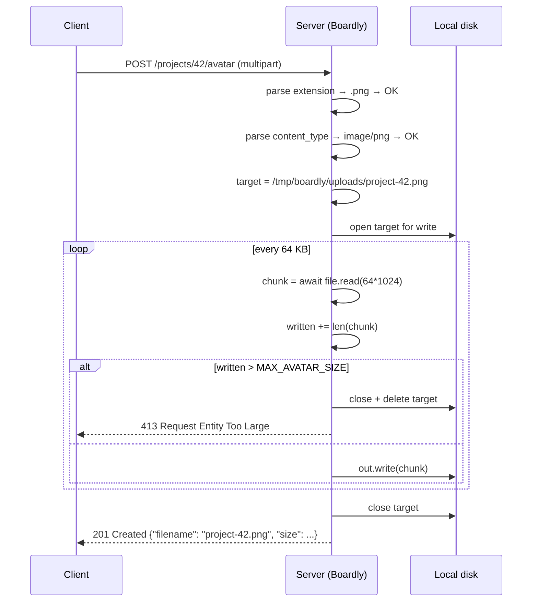
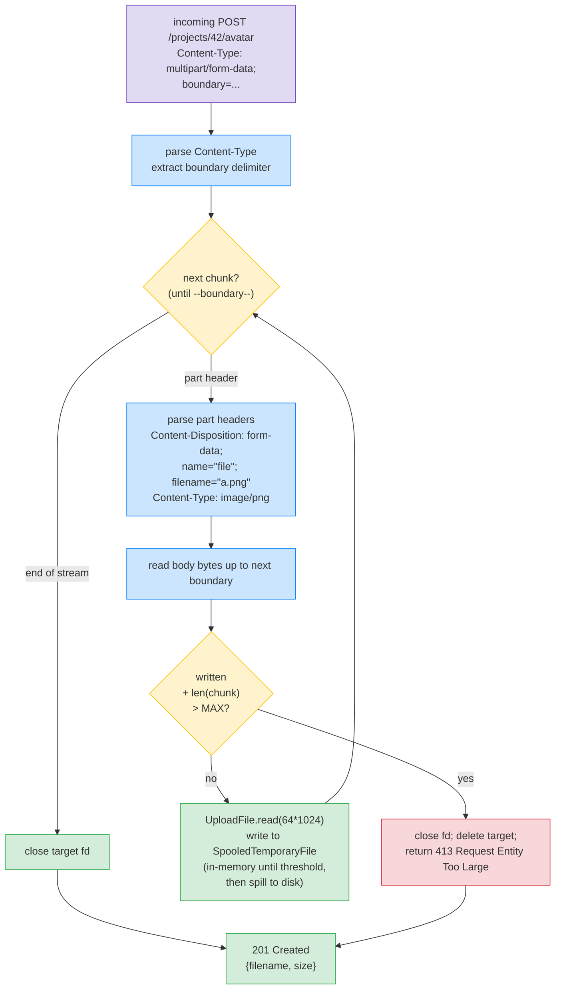

# Lesson 06: Request Body, Forms, and Uploads

*Three body formats, one endpoint — `application/json`, `application/x-www-form-urlencoded`, and `multipart/form-data` — and the `UploadFile` API that streams the bytes to disk without filling your memory.*

**The body of a request is bytes. The format is metadata.**

HTTP lets you put anything in a request body. The `Content-Type` header tells the receiver how to parse those bytes. Three formats cover almost everything you'll see in modern APIs: `application/json` (the default for SPAs and machine clients), `application/x-www-form-urlencoded` (HTML forms without files), and `multipart/form-data` (HTML forms with files). Today you'll learn all three, why `multipart` costs more per request than JSON, how FastAPI dispatches parsing, how `UploadFile` streams large files without blowing memory, and how to ship a `POST /projects/{id}/avatar` endpoint that accepts a form with text fields and a file. Take your time. The formats are simple; the streaming is the subtle bit.


#http #forms #uploads #fastapi

## Learning Objectives

By the end of this lesson you will be able to:

1. **Explain the three request body formats** — `application/json`, `application/x-www-form-urlencoded`, `multipart/form-data` — and choose between them.
2. **Explain why `multipart/form-data` has higher overhead than JSON** — boundaries, per-part headers, and the inability to compress the body as a whole.
3. **State FastAPI's parsing dispatch rule** — `Body()` for JSON, `Form()` for urlencoded/multipart text fields, `File()` for multipart files. Mixing them is constrained.
4. **Use `UploadFile`** to receive a file, with `await file.read()` for small files and `await file.seek()` + chunked reads for large files.
5. **Stream an upload to disk** without loading the whole file into memory.
6. **Validate uploads** — file size, extension, MIME type (with a warning about why MIME is weak).
7. **Handle multiple file uploads** in a single request.
8. **Recognise the four classic upload bugs** — loading the whole file into memory, trusting `filename`, trusting `Content-Type`, no max-size limit.

## Prerequisites

Before starting, you need:

- **Lesson 1 — Headers** ([[HTTP-Headers-Deep-Dive]]). `Content-Type` was the request header that says "what's in the body"; this lesson is what to do with the body.
- **Lesson 5 — Content Negotiation** ([[Content-Negotiation]]). The same `Content-Type` header drives both request parsing and response content negotiation.
- **Path/Query/Header/Cookie/Body parameters** — [[03-FastAPI-Core/Path-Query-Header-Cookie-Body]]. The `Body()`, `Form()`, `File()` parameter declarations were introduced there.
- **Background Tasks and Streaming Uploads** — [[03-FastAPI-Core/Background-Tasks-Streaming-Uploads]]. The pure-ASGI streaming pattern is the canonical reference there.
- **Pydantic `BaseModel`** — [[04-Pydantic/BaseModel-and-Validation]]. We use a `BaseModel` for the JSON request body.
- **About an hour and a half of focused time.** Forms are small; uploads are subtle.

**FastAPI's three parameter types for bodies.**

`Body()` declares a parameter parsed from the JSON body. `Form()` declares a parameter parsed from `application/x-www-form-urlencoded` or `multipart/form-data` text fields. `File()` declares a parameter parsed from `multipart/form-data` file parts. FastAPI dispatches on the parameter's metadata and the request's `Content-Type`. If you mix them in the same endpoint (e.g., a `Body()` parameter and a `File()` parameter), FastAPI raises an error — you can't have a JSON body *and* a multipart body in the same request.


## The Problem

Three scenarios, three formats:

1. The `Boardly` mobile app sends a `POST /projects` with a JSON body (`{"name": "Mobile app v2"}`). The server parses JSON, validates against a `BaseModel`, inserts.
2. The `Boardly` legacy HTML form submits `POST /projects` with a urlencoded body (`name=Mobile+app+v2&owner=alice`). The server parses urlencoded, validates, inserts.
3. The `Boardly` SPA uploads an avatar: `POST /projects/42/avatar` with a multipart body containing `alt_text=Project+logo` (a text field) and `file=<binary bytes>` (the image). The server parses multipart, validates the text field, streams the file to disk.

You could implement each with a different endpoint. But often, the same logical endpoint accepts different formats (e.g., a migration from forms to JSON). And the multipart case is the one that's tricky — boundaries, per-part headers, streaming.

The problem this lesson solves: **most tutorials cover the JSON case in depth and the multipart case in a single code snippet.** Real production uploads need streaming, validation, and an understanding of why `multipart` is structurally heavier than JSON. By the end of this lesson, your `Boardly` will handle all three.

**Note — Where the body lives in the ASGI world.**

The body arrives as a series of `http.request` ASGI messages with `body` keys containing chunks of bytes. Starlette's `Request.body()` reads all chunks into memory. `Request.stream()` yields chunks as they arrive (the streaming form). `UploadFile` is a wrapper around a `SpooledTemporaryFile` — small uploads stay in memory (under `max_size` bytes, default 1 MB); larger ones spill to a real file on disk. The `python-multipart` library parses the multipart body incrementally; FastAPI calls into it via Starlette's `Request.form()` method.


## The Three Formats, Compared

### `application/json`

```
POST /projects HTTP/1.1
Content-Type: application/json
Content-Length: 52

{"name": "Mobile app v2", "owner": "alice@boardly.dev"}
```

**What it is:** A JSON document in the body. The body is the JSON itself — no framing, no boundaries.

**Pros:** Compact, well-structured (nested objects, arrays), standardised (RFC 8259), every language has a parser. Compresses well with gzip (repeated keys collapse).

**Cons:** Not what HTML forms produce. Browsers can't send JSON from a plain `<form>` — you need `fetch` with a `JSON.stringify` body.

### `application/x-www-form-urlencoded`

```
POST /projects HTTP/1.1
Content-Type: application/x-www-form-urlencoded
Content-Length: 48

name=Mobile+app+v2&owner=alice%40boardly.dev
```

**What it is:** A flat key/value list, URL-encoded, joined with `&`. This is what HTML forms send by default (`<form method="POST">` without `enctype`).

**Pros:** What browsers send for HTML forms. Simple syntax. No framing overhead per field.

**Cons:** Flat — no nesting without conventions (`a.b=1&a.c=2`). URL-encoding binary data is wasteful (every non-ASCII byte becomes 3 chars). No native file support.

**Why URL-encoding for binary is bad:** a 1 MB PNG would become ~3 MB of `%XX` characters. That's why `multipart/form-data` exists.

### `multipart/form-data`

```
POST /projects/42/avatar HTTP/1.1
Content-Type: multipart/form-data; boundary=----WebKitFormBoundaryABC123
Content-Length: 314

------WebKitFormBoundaryABC123
Content-Disposition: form-data; name="alt_text"

Project logo
------WebKitFormBoundaryABC123
Content-Disposition: form-data; name="file"; filename="logo.png"
Content-Type: image/png

<binary bytes>
------WebKitFormBoundaryABC123--
```

**What it is:** A body made of multiple "parts," each with its own headers (`Content-Disposition`, `Content-Type`). Parts are separated by a `boundary` string that the client chooses (and includes in the `Content-Type` header). The boundary is guaranteed not to appear in any part's content.

**Pros:** Native file support. Each file part has its own `Content-Type`. Binary data is sent as bytes (no encoding overhead). Multiple files in one request.

**Cons:** Higher per-request overhead — the boundary, per-part headers, and CRLF separators add bytes. The body is harder to compress as a whole because the boundary is unique. Parsing is more complex.

**Why `multipart` costs more than JSON.**

A JSON body for the same data is `{"alt_text":"Project logo"}` (~28 bytes). A multipart body for the same data is ~150 bytes — the boundary, the per-part `Content-Disposition` header, the blank line, the value, the CRLF, and the closing boundary. For small text fields, multipart is 5x the bytes. For binary files, the overhead is negligible (the file bytes dominate), so multipart is the right choice for files.


### Comparison table

| Property | `application/json` | `application/x-www-form-urlencoded` | `multipart/form-data` |
|----------|---------------------|-------------------------------------|------------------------|
| Nesting | Yes (objects, arrays) | Flat (with conventions) | Per-part values |
| Files | No | No (inefficient) | Yes |
| Overhead per request | Minimal | Minimal | Boundary + per-part headers |
| Compresses well | Yes (repeated keys) | Yes (repeated keys) | Poorly (boundary is unique) |
| Browser default | No (need `fetch`) | Yes (default for `<form>`) | Yes (with `enctype="multipart/form-data"`) |
| FastAPI parameter | `Body()` / `BaseModel` | `Form()` | `Form()` for text, `File()` for files |

## The Code

Three new endpoints go into `Boardly` in this lesson:

1. `POST /projects` — accepts JSON.
2. `POST /projects/form` — accepts urlencoded form (the same logical endpoint, legacy).
3. `POST /projects/{id}/avatar` — accepts multipart with text + file.

Add this to `boardly/routers/projects.py`.

```python
# Add to boardly/routers/projects.py:
from __future__ import annotations

from pathlib import Path
from typing import Annotated

from fastapi import (
 APIRouter, File, Form, HTTPException, UploadFile, status,
)
from pydantic import BaseModel, Field

from boardly.web.negotiate import pick_media_type


# ... (existing list_projects endpoint unchanged) ...


class ProjectCreate(BaseModel):
 """JSON body for POST /projects."""
 name: str = Field(..., min_length=1, max_length=200)
 owner: str = Field(..., min_length=3, max_length=200)


@router.post("", status_code=status.HTTP_201_CREATED)
async def create_project(project: ProjectCreate) -> dict:
 """Create a project from a JSON body.

 FastAPI parses the JSON body, validates it against ProjectCreate,
 and passes the resulting instance to the handler. If the body is
 malformed JSON or fails validation, the client gets 422 before
 this handler runs.
 """
 # In real code: insert into DB, return the new row.
 new_id = len(_PROJECTS) + 1
 _PROJECTS.append({
 "id": new_id, "name": project.name, "owner": project.owner,
 })
 return {"id": new_id, "name": project.name, "owner": project.owner}


@router.post("/form", status_code=status.HTTP_201_CREATED)
async def create_project_form(
 name: Annotated[str, Form(min_length=1, max_length=200)],
 owner: Annotated[str, Form(min_length=3, max_length=200)],
) -> dict:
 """Create a project from an HTML form (urlencoded).

 Same logical endpoint as POST /projects, but for HTML forms that
 can't easily send JSON. Notice the Form() parameter declarations.
 """
 new_id = len(_PROJECTS) + 1
 _PROJECTS.append({"id": new_id, "name": name, "owner": owner})
 return {"id": new_id, "name": name, "owner": owner}


# --- File upload ---

# Where to store uploaded files. In production, this is an S3 bucket.
UPLOAD_DIR = Path("/tmp/boardly/uploads")
UPLOAD_DIR.mkdir(parents=True, exist_ok=True)

# Validation constraints.
ALLOWED_EXTENSIONS: frozenset[str] = frozenset({".png", ".jpg", ".jpeg", ".webp"})
MAX_AVATAR_SIZE_BYTES = 5 * 1024 * 1024 # 5 MB


@router.post("/{project_id}/avatar", status_code=status.HTTP_201_CREATED)
async def upload_avatar(
 project_id: int,
 alt_text: Annotated[str, Form(min_length=1, max_length=200)],
 file: UploadFile,
) -> dict:
 """Upload an avatar for a project.

 Accepts multipart/form-data with:
 - alt_text: a text field (the alt text for the image)
 - file: the image file (PNG, JPG, JPEG, or WebP)

 The file is streamed to disk via UploadFile's underlying
 SpooledTemporaryFile. Small files stay in memory; large ones
 spill to /tmp.
 """
 # 1. Validate the extension from the filename.
 filename = file.filename or ""
 suffix = Path(filename).suffix.lower()
 if suffix not in ALLOWED_EXTENSIONS:
 raise HTTPException(
 status_code=status.HTTP_415_UNSUPPORTED_MEDIA_TYPE,
 detail=f"unsupported file type: {suffix}",
 )

 # 2. Validate the Content-Type (with a warning — see notes below).
 if file.content_type and not file.content_type.startswith("image/"):
 raise HTTPException(
 status_code=status.HTTP_415_UNSUPPORTED_MEDIA_TYPE,
 detail=f"unsupported content type: {file.content_type}",
 )

 # 3. Stream the file to disk, validating the size as we go.
 target = UPLOAD_DIR / f"project-{project_id}{suffix}"
 written = 0
 with target.open("wb") as out:
 while chunk := await file.read(64 * 1024): # 64 KB chunks
 written += len(chunk)
 if written > MAX_AVATAR_SIZE_BYTES:
 out.close()
 target.unlink(missing_ok=True)
 raise HTTPException(
 status_code=status.HTTP_413_REQUEST_ENTITY_TOO_LARGE,
 detail=f"file exceeds {MAX_AVATAR_SIZE_BYTES} bytes",
 )
 out.write(chunk)

 # 4. Return the URL (in production, the S3 URL).
 return {
 "project_id": project_id,
 "alt_text": alt_text,
 "size": written,
 "filename": target.name,
 }
```

That's the file. ~100 lines. Run it. Make the three kinds of requests. Then come back and we'll go through it line by line.

## Line-by-Line Deep Dive

### `create_project`: JSON body

```python
class ProjectCreate(BaseModel):
 name: str = Field(..., min_length=1, max_length=200)
 owner: str = Field(..., min_length=3, max_length=200)


@router.post("", status_code=status.HTTP_201_CREATED)
async def create_project(project: ProjectCreate) -> dict:
 new_id = len(_PROJECTS) + 1
 _PROJECTS.append({...})
 return {...}
```

**What it does:** Declares a Pydantic model for the JSON body, and an endpoint that takes that model as its parameter.

**How FastAPI dispatches:** When you declare a parameter that's a `BaseModel` subclass, FastAPI treats it as a `Body()` parameter. The request's `Content-Type` must be `application/json` (or a JSON-compatible type). FastAPI reads the body, parses the JSON, validates against the model. If validation fails, the client gets a `422 Unprocessable Entity` with the validation errors — the handler never runs.

**`Body()` vs `BaseModel` directly.**

You can declare a body parameter explicitly: `project: Annotated[ProjectCreate, Body()]`. Or you can declare it as a `BaseModel` and FastAPI infers `Body()`. Both work; the implicit form is more idiomatic in modern FastAPI.


**Warning — Debugging: the second `Body()` parameter raises `AssertionError` at startup.**

A common refactor is to split a large JSON body into a `BaseModel` plus a few scalar `Body()` parameters: `async def create(project: ProjectCreate, notify: Annotated[bool, Body()] = False)`. FastAPI raises at startup: `AssertionError: Field "project" and "notify" cannot both be the request body.` The cause: FastAPI treats every `BaseModel` parameter and every `Body()`-annotated scalar as a *body* parameter, and a request has exactly one body — `Content-Type: application/json` describes one JSON value, not two. The fix is to fold the scalar into the model (`class ProjectCreate(BaseModel): name: str; owner: str; notify: bool = False`) so there's one body parameter that is the model. The diagnostic test: count `Body()`-shaped parameters in the signature; if it's > 1, the endpoint won't start. Cross-link to [[03-FastAPI-Core/Path-Query-Header-Cookie-Body]] for the canonical FastAPI parameter taxonomy and [[04-Pydantic/BaseModel-and-Validation]] for the model-composition pattern that avoids the trap.


### `create_project_form`: urlencoded form

```python
@router.post("/form", status_code=status.HTTP_201_CREATED)
async def create_project_form(
 name: Annotated[str, Form(min_length=1, max_length=200)],
 owner: Annotated[str, Form(min_length=3, max_length=200)],
) -> dict:
 ...
```

**What it does:** Declares two form parameters. FastAPI parses the urlencoded body, extracts `name` and `owner`, validates, passes to the handler.

**How FastAPI dispatches:** When you declare a parameter with `Form()`, FastAPI expects the request's `Content-Type` to be `application/x-www-form-urlencoded` or `multipart/form-data`. For urlencoded, FastAPI parses the body as `key=value&key2=value2`, URL-decodes the values, and binds them to the parameters.

**Why a separate endpoint?** You can't declare both `Body()` and `Form()` parameters on the same endpoint — they expect different `Content-Type` values. So a "form" endpoint and a "JSON" endpoint are separate routes that do the same logical thing.

**Production reality: urlencoded-form endpoints are CSRF-vulnerable and FastAPI does not protect them.**

The JSON endpoint (`POST /projects`) is structurally CSRF-immune in modern browsers: a cross-origin `fetch` with `Content-Type: application/json` triggers a CORS preflight, which fails without an explicit `Access-Control-Allow-Headers: Content-Type` from the server. The form endpoint (`POST /projects/form`) is a different story: an HTML `<form method="POST" action="https://api.boardly.dev/projects/form" enctype="application/x-www-form-urlencoded">` can be submitted cross-origin *without* a preflight (it's a "simple request" per the CORS spec), and if the user has a session cookie for `api.boardly.dev`, the cookie is auto-attached. FastAPI does *not* add CSRF protection by default — the framework expects you to wire it explicitly. The fix is to add `Depends(csrf_token_dependency)` to every `Form()` endpoint: the SPA includes a synchronizer token in a hidden form field (`<input type="hidden" name="csrf_token" value="...">`) drawn from the session, and the dependency validates the token against the session's stored value. The alternative is `SameSite=Strict` on the session cookie (which structurally prevents cross-site submission) — but `SameSite=Strict` is a browser contract, not a server contract, and a 5-year-old browser or a non-browser client (a curl script) ignores it. Defence in depth: use both. Cross-link to [[02b-Backend-Foundations/CSRF-Protection]] for the synchronizer-token pattern and [[02b-Backend-Foundations/Session-Management]] for the session-token storage.


### `upload_avatar`: multipart with text + file

```python
@router.post("/{project_id}/avatar", status_code=status.HTTP_201_CREATED)
async def upload_avatar(
 project_id: int,
 alt_text: Annotated[str, Form(min_length=1, max_length=200)],
 file: UploadFile,
) -> dict:
 ...
```

**What it does:** Declares a path parameter, a form text field, and a file upload. FastAPI parses the multipart body, extracts the parts by name, binds them to the parameters.

**How FastAPI dispatches:** When you declare a parameter with `File()` (or, in modern FastAPI, the `UploadFile` type), FastAPI expects `multipart/form-data`. The `python-multipart` library parses the body incrementally, yielding `(field_name, content)` for each part. FastAPI maps parts to parameters by name.

**Why no `File()` on the `file: UploadFile` parameter?** Modern FastAPI (0.95+) infers `File()` from the `UploadFile` type. You can still write `file: Annotated[UploadFile, File()]` for explicitness, but it's not required.

**Danger — Security: multipart-boundary collision and the parser-injection attack.**

The `boundary` string in `Content-Type: multipart/form-data; boundary=----WebKitFormBoundaryABC123` is *client-chosen* and the parser byte-scans the body for that exact string to delimit parts. Two attack classes live here. (1) *Boundary collision in body*: an attacker who can predict the boundary (e.g., a fixed-string boundary from a misbehaving client SDK) crafts a body where the boundary string appears inside a part's content — the parser truncates the part early and the *next* part's bytes are interpreted as a new part, potentially with attacker-controlled `Content-Disposition` and `Content-Type`. The classic CVE family: ImageMagick's `MVG` parser (2016, CVE-2016-3714) and multiple `python-multipart` < 0.0.7 issues in 2023-2024. (2) *Boundary collision in headers*: a boundary string that contains CRLF (`\r\n`) lets the attacker inject new headers into the *response* via a part's `Content-Disposition` filename value. `python-multipart` since 0.0.7 enforces a minimum boundary entropy (16 chars from `[A-Za-z0-9'()+_,\-]`) and rejects boundaries containing `\r`, `\n`, or `%` — but a custom parser (or a hand-rolled one in a different microservice) does not. The fix: never write your own multipart parser; pin `python-multipart >= 0.0.7` in `uv.lock` (run `uv pip compile --upgrade` to verify); and reject any request whose `Content-Type` boundary fails the entropy check at the ASGI middleware layer before it reaches `Request.form()`. Cross-link to [[11-Authentication-and-Security/Threat-Model-First]] for the broader parser-injection threat model and [[02b-Backend-Foundations/HTTP-Headers-Deep-Dive]] for the response-header CRLF-injection variant.


### `UploadFile` internals

```python
file: UploadFile
```

`UploadFile` is Starlette's wrapper around a `SpooledTemporaryFile`. Key methods:

- `await file.read(size=-1)` — reads `size` bytes (or all if size omitted) from the current position. Async because the underlying file might be a real on-disk file.
- `await file.seek(offset)` — moves the cursor.
- `await file.write(bytes)` — writes (rarely used on the receiving side).
- `await file.close()` — closes the underlying file.
- `file.filename` — the `filename` from the `Content-Disposition` header (user-controlled — never trust for security).
- `file.content_type` — the `Content-Type` of the part (also user-controlled).
- `file.size` — the total size in bytes (available after Python 3.11 + Starlette 0.36+).

**The `SpooledTemporaryFile` behaviour:** For files under `max_size` bytes (default 1 MB), the data is stored in memory (`BytesIO`). For files over `max_size`, the data spills to a real `TemporaryFile` on disk. The transition is transparent — your code doesn't need to know which.

**Why this matters:** A 100 MB file upload doesn't load 100 MB into your process memory. It streams to disk in chunks. You can `await file.read(64 * 1024)` in a loop, writing each chunk to your final destination, never holding more than 64 KB in memory at a time.

**The `SpooledTemporaryFile` `max_size`.**

Starlette's `UploadFile` uses `SpooledTemporaryFile(max_size=1024 * 1024)` (1 MB) by default. You can change it by subclassing `UploadFile` or by passing `max_size` to a custom upload class. Most apps leave it at 1 MB; small files (avatars, documents) stay in memory, large files spill to disk.


### The streaming loop

```python
target = UPLOAD_DIR / f"project-{project_id}{suffix}"
written = 0
with target.open("wb") as out:
 while chunk := await file.read(64 * 1024):
 written += len(chunk)
 if written > MAX_AVATAR_SIZE_BYTES:
 out.close()
 target.unlink(missing_ok=True)
 raise HTTPException(413, ...)
 out.write(chunk)
```

**What it does:** Streams the uploaded file to disk in 64 KB chunks, validating the size as it goes.

**Line by line:**

**`target = UPLOAD_DIR / f"project-{project_id}{suffix}"`** — the destination path. We use the validated extension (not the user-supplied filename — that's user-controlled and could contain path traversal characters like `../../etc/passwd`). The filename is `project-42.png` — predictable and safe.

**`written = 0`** — accumulator for the size check.

**`with target.open("wb") as out:`** — opens the destination for binary write. The `with` ensures the file is closed on exception.

**`while chunk := await file.read(64 * 1024):`** — the walrus operator (`:=`). `await file.read(64 * 1024)` returns up to 64 KB; if it returns empty bytes (EOF), the loop exits. We re-assign to `chunk` and test in one expression.

**`written += len(chunk); if written > MAX_AVATAR_SIZE_BYTES:`** — check the cumulative size after each chunk. If the file is too big, we close the destination, delete the partial file, and raise `413`.

**`out.write(chunk)`** — write the chunk to disk. Synchronous I/O — but on a small local file, this is faster than the network read.

**Warning — Synchronous file I/O in an async handler.**

`out.write(chunk)` is a blocking call. In an async handler, blocking calls block the event loop. For small writes (64 KB to disk), this is microseconds — fine. For large writes or slow disks (network filesystems), use `asyncio.to_thread(out.write, chunk)` to offload to a thread pool, or use `aiofiles` for true async file I/O. We don't here for simplicity; [[03-FastAPI-Core/Background-Tasks-Streaming-Uploads|Section 03 Lesson 7]] covers the trade-off.


**Warning — Debugging: `out.write` raises `OSError` mid-stream when the disk fills.**

The streaming loop's `out.write(chunk)` is unguarded — if the disk fills between chunks (a separate upload consumed the remaining space, or the container hits its volume quota), `out.write` raises `OSError: [Errno 28] No space left on device`. The default behaviour: the exception propagates out of the handler, FastAPI returns a `500 Internal Server Error`, and the partial file `project-42.png` is left on disk because the `with` block's `__exit__` only closes the file handle (it doesn't `unlink`). The next upload to the same project finds the partial file, overwrites it cleanly (so no stuck-state), but the *log* shows a 500 with no body — which the on-call engineer reads as "the app crashed" rather than "the disk filled". The fix is a `try: out.write(chunk) except OSError as e: target.unlink(missing_ok=True); raise HTTPException(status.HTTP_507_INSUFFICIENT_STORAGE, detail="disk full" ) from e` wrapper around the write. The 507 (RFC 4918 § 10.6, "Insufficient Storage") is the right status — it tells the client "try again later" rather than "your request was malformed" (413) or "we crashed" (500). Pair with a disk-usage Prometheus gauge (`disk_free_bytes{volume="uploads"}`) and an alert at < 10% free, so the on-call engineer sees the *cause* before the *symptom*. Cross-link to [[02b-Backend-Foundations/Health-Checks-and-Probes]] for the disk-usage health-check pattern.


### Validation: extension and content type

```python
filename = file.filename or ""
suffix = Path(filename).suffix.lower()
if suffix not in ALLOWED_EXTENSIONS:
 raise HTTPException(415, ...)

if file.content_type and not file.content_type.startswith("image/"):
 raise HTTPException(415, ...)
```

**What it does:** Validates the file's extension and `Content-Type`.

**Why check the extension?** It's the user's claim about what the file is. A user who uploads `logo.png` is signalling "this is a PNG." It's *user input* — they could lie — but it's still useful as a quick reject of obvious mistakes (e.g., uploading `logo.exe`).

**Why check the content type?** Same — user's claim, easily spoofed. But it's a second-line check.

**Danger — `Content-Type` is user input.**

The browser sets `Content-Type` on multipart parts based on the file's extension or a few magic bytes — but a malicious client can set any value. Do NOT use `file.content_type` as your sole validation. If you need to know the actual type, sniff the magic bytes (e.g., PNG starts with `\x89PNG\r\n\x1a\n`) or use a library like `python-magic` that reads the file's content. For most apps, extension + content-type + size limit is enough; for high-security, sniff the bytes.


**Student asks: what's the real risk of trusting `Content-Type` here?**

Concrete scenario: a user (or attacker) uploads `malware.exe` and sets `Content-Type: image/png`. Your server stores it as `project-42.png` and serves it with `Content-Type: image/png` on the static-file endpoint. A victim's browser downloads it as `image.png`, and if the user runs it on Windows (which uses extensions, not MIME), the file is executable and the malware runs. Worse: if your static-file server doesn't set `X-Content-Type-Options: nosniff`, the browser might MIME-sniff the bytes, decide it's actually HTML, and render attacker-controlled markup — an XSS. The fix is *both*: validate the actual bytes (magic bytes), *and* set `X-Content-Type-Options: nosniff` on the static endpoint (we already do this globally via the security-headers middleware in Lesson 1).


**Student asks: why is multipart so much more expensive than JSON?**

Two costs. First, parsing: a multipart body has a per-part header, a boundary delimiter, and CRLF-terminated chunks. The server must scan the body byte by byte for the boundary string, parse the headers of each part, and concatenate the body bytes — there is no single "parse this JSON" call. `python-multipart` (the Starlette dependency) does this work in pure Python, so a 100 MB upload is 100 MB of byte-by-byte scanning. Second, memory: the parser must hold the *current* chunk in memory while it looks for the next boundary, so even a streaming parser has a per-chunk memory cost. JSON, by contrast, is a single JSON object that the JSON parser can decode in one pass with no boundaries to scan. For small payloads (≤ 1 KB), the difference is negligible; for a 100 MB avatar, the difference is 100+ ms of CPU per request. The rule: use multipart only when you actually have a file to stream, never as a "JSON with extra fields."


**Danger — Security: polyglot files bypass magic-byte sniffing.**

Magic-byte sniffing (verifying `\x89PNG\r\n\x1a\n` at offset 0) is *necessary* but not *sufficient*. A polyglot file is one that is simultaneously valid in two formats — a file that is both a valid PNG and a valid HTML document, or both a valid PDF and a valid JavaScript file. The 2007 "GIFAR" attack (GIF + JAR) is the canonical example: a file that was a valid GIF image *and* a valid Java archive, served by a vulnerable static-file endpoint that allowed the Java plugin to load it as an applet. Modern variants include PNG+HTML polyglots (a PNG whose `tEXt` chunk contains an `<iframe>` element and that, when served with `Content-Type: text/html` by a misconfigured proxy that strips `Content-Type`, renders as HTML in the victim's browser). The defence is *layered*. (1) Sniff the magic bytes — catches the obvious "`.exe` renamed `.png`" case. (2) Re-encode the upload through a sanitizer (`Pillow` for images: `Image.open(file).save(target, format="PNG")` — this strips any tEXt chunks that contain HTML, because Pillow re-encodes only the pixel data plus its own metadata). (3) Serve uploads from a *separate origin* (`cdn.boardly.dev` not `boardly.dev`) so a polyglot that the browser renders as HTML has no access to your main origin's cookies. (4) Set `Content-Disposition: attachment; filename="..."` on every served upload — forces a download rather than inline render. (5) Set `Content-Type-Options: nosniff` on the static endpoint. Layers 1-2 catch what the client *claims*; layers 3-5 contain what happens if a polyglot slips through. Cross-link to [[11-Authentication-and-Security/Threat-Model-First]] for the broader polyglot-attack threat model and [[02b-Backend-Foundations/CSRF-Protection]] for the `nosniff` header's role.


### Why no `Body()` mixed with `Form()` or `File()`?

```python
# WRONG — FastAPI raises
async def upload_avatar(
 project_id: int,
 metadata: ProjectCreate, # ← Body()
 file: UploadFile, # ← File()
):
 ...
```

**Symptom:** FastAPI raises `AssertionError: Field "metadata" and "file" cannot both be the request body.`

**Why:** A request has *one* body. The `Content-Type` header tells you what format it's in. JSON body and multipart body are mutually exclusive — you can't have both. The right pattern is to send the metadata as a form field inside the multipart body:

```python
# RIGHT
async def upload_avatar(
 project_id: int,
 metadata_json: Annotated[str, Form()], # the JSON serialised as a string
 file: UploadFile,
):
 metadata = ProjectCreate.model_validate_json(metadata_json)
 ...
```

Or to use two requests: one to create the project (JSON), one to upload the avatar (multipart with the project ID in the URL).

## Execution Trace

Run the app:

```bash
uv run uvicorn boardly.main:app --reload
```

Test 1: JSON body.

```bash
curl -sv -X POST http://127.0.0.1:8000/projects \
 -H 'Content-Type: application/json' \
 -d '{"name":"New project","owner":"alice@boardly.dev"}' 2>&1 | grep -E 'HTTP/'
# < HTTP/1.1 201 Created
# {"id":4,"name":"New project","owner":"alice@boardly.dev"}
```

Test 2: urlencoded form.

```bash
curl -sv -X POST http://127.0.0.1:8000/projects/form \
 -H 'Content-Type: application/x-www-form-urlencoded' \
 -d 'name=Form+project&owner=alice@boardly.dev' 2>&1 | grep -E 'HTTP/'
# < HTTP/1.1 201 Created
# {"id":5,"name":"Form project","owner":"alice@boardly.dev"}
```

Test 3: multipart with file.

```bash
# Create a fake PNG (just bytes; not a real image).
echo -n -e '\x89PNG\r\n\x1a\n' > /tmp/avatar.png
echo "Some fake PNG content" >> /tmp/avatar.png

curl -sv -X POST http://127.0.0.1:8000/projects/42/avatar \
 -F 'alt_text=Project logo' \
 -F 'file=@/tmp/avatar.png;type=image/png' 2>&1 | grep -E 'HTTP/'
# < HTTP/1.1 201 Created
# {"project_id":42,"alt_text":"Project logo","size":30,"filename":"project-42.png"}
```

Test 4: unsupported file type.

```bash
curl -sv -X POST http://127.0.0.1:8000/projects/42/avatar \
 -F 'alt_text=Project logo' \
 -F 'file=@/tmp/avatar.exe' 2>&1 | grep -E 'HTTP/'
# < HTTP/1.1 415 Unsupported Media Type
# {"detail":"unsupported file type: .exe"}
```

Test 5: file too large.

```bash
# Create a 6 MB file.
dd if=/dev/zero of=/tmp/big.png bs=1M count=6 2>/dev/null

curl -sv -X POST http://127.0.0.1:8000/projects/42/avatar \
 -F 'alt_text=Too big' \
 -F 'file=@/tmp/big.png;type=image/png' 2>&1 | grep -E 'HTTP/'
# < HTTP/1.1 413 Request Entity Too Large
# {"detail":"file exceeds 5242880 bytes"}
```





Why colour the size-check yellow and the abort path red? Because the upload-handling code is the place where a missing size check becomes a denial-of-service vulnerability — the server happily accepts gigabytes of bytes until disk fills up and the process crashes. The colour code keeps the security-relevant decision in a yellow diamond, the safe path in green, the failure path in red — and the spool step in green to remind you that `UploadFile` (which uses `SpooledTemporaryFile` under the hood) is the standard-library primitive that *does the right thing* by streaming to disk after the in-memory threshold. Don't reimplement it.

## Common Mistakes

### Mistake 1: `await file.read()` without size limit

```python
# WRONG
async def upload(file: UploadFile):
 data = await file.read() # loads the whole file into memory
 process(data)
```

**Symptom:** A user uploads a 1 GB file. Your process memory spikes. With many concurrent uploads, OOM kill.

**Why it fails:** `UploadFile.read()` with no argument reads the entire body into a single `bytes` object. Starlette's `UploadFile` is backed by a `SpooledTemporaryFile` that spills to disk past 1 MB by default — *but* `await file.read()` with no argument bypasses that spool: it materialises the whole file as a single in-memory `bytes` object. A 1 GB upload therefore uses 1 GB of resident memory regardless of the spool. The 2019 OOM incident at a photo-sharing startup (call them "Acme Photos"): an attacker uploaded a 4 GB TIFF from a script, the handler called `await file.read()`, and Uvicorn's per-worker memory limit killed the worker mid-request — repeated 50 times in 60 seconds, the orchestrator marked the pod unhealthy.

**Fix:** Stream in chunks. `while chunk := await file.read(64 * 1024): ...`. Only call `await file.read()` (no arg) for files you know are small.

### Mistake 2: Trusting `filename`

```python
# WRONG
target = UPLOAD_DIR / file.filename # path traversal: file.filename = "../../etc/passwd"
with target.open("wb") as out:
 ...
```

**Symptom:** Attacker uploads a file named `../../etc/passwd` or `../../app/main.py`. Your server overwrites a critical file.

**Why it fails:** `file.filename` is whatever the client put in the `Content-Disposition: filename=...` part header — entirely attacker-controlled, including `..` path segments. `pathlib.Path`'s `/` operator does not sanitise path components, so `UPLOAD_DIR / "../../etc/passwd"` resolves to `UPLOAD_DIR.parent.parent / "etc/passwd"` — i.e. outside `UPLOAD_DIR`. This is the *textbook* path-traversal bug shape; it has shipped in dozens of CVEs (e.g., the 2017 "ImageTragick"-class vulnerabilities in a popular image-processing library — call the affected vendor "Acme Imaging" — where a crafted filename plus a crafted extension reached `system()` calls).

**Fix:** Never use the user-supplied filename as the destination. Generate your own (`project-42.png`, `user-7-avatar-{uuid}.png`).

### Mistake 3: Trusting `Content-Type`

```python
# WRONG
if file.content_type != "image/png":
 raise HTTPException(415)
```

**Symptom:** Attacker uploads `malware.exe` with `Content-Type: image/png`. Your server stores it. Later, a static-file server serves it with `Content-Type: image/png`, the browser renders it as an image, fails — but if the file's *real* type is executable and the browser sniffs, you might serve malware.

**Fix:** Sniff the magic bytes (`\x89PNG\r\n\x1a\n` for PNG, `\xff\xd8\xff` for JPEG). Use `python-magic` for reliable detection. Don't rely on the user-supplied `Content-Type`.

### Mistake 4: No max-size limit

```python
# WRONG
async def upload(file: UploadFile):
 target = UPLOAD_DIR / "upload.bin"
 with target.open("wb") as out:
 while chunk := await file.read(64 * 1024):
 out.write(chunk)
 # no size check
```

**Symptom:** Attacker uploads a 10 GB file. Your disk fills. Service dies.

**Fix:** Check `written > MAX_AVATAR_SIZE` after each chunk. Reject with 413 if exceeded. Also set a server-level max body size (Uvicorn's `--limit-max-body-size 10485760` for 10 MB; nginx `client_max_body_size 10m`).

### Mistake 5: Mixing `Body()` and `File()`

```python
# WRONG — FastAPI raises at startup
async def upload(metadata: ProjectCreate, file: UploadFile):
 ...
```

**Symptom:** AssertionError at app startup.

**Fix:** Send metadata as a form field (JSON-stringified) inside the multipart body, or use two requests.

### Mistake 6: Not closing the `UploadFile`

```python
# RISKY
async def upload(file: UploadFile):
 target = UPLOAD_DIR / "out"
 with target.open("wb") as out:
 while chunk := await file.read(64 * 1024):
 out.write(chunk)
 # No file.close() — relies on garbage collection.
```

**Symptom:** The `SpooledTemporaryFile` is closed when the request ends (Starlette handles this), but if your handler raises before the natural close, the file may linger in `/tmp` longer than expected.

**Fix:** Use `async with file:` or explicitly `await file.close()` in a `finally:` block. Starlette cleans up, but explicit is better.

## Engineering Trade-Offs

### Multipart vs JSON for files

Multipart is the only way to send files from a browser `<form>`. For non-browser clients, you could base64-encode the file and send as JSON — but base64 expands by 33%, so a 10 MB file becomes 13 MB of JSON. Multipart is the right choice for files.

### `UploadFile` (in-memory + spill) vs pure streaming

`UploadFile` is the easy choice — small files in memory, large files spill to disk, transparent to your code. Pure streaming (reading the ASGI `receive` channel directly) gives you more control but more responsibility. Use `UploadFile` unless you have a specific need (e.g., streaming to S3 without touching disk).

### Local disk vs S3

Local disk is fine for dev and small deployments. For production, S3 (or equivalent) is the right choice — durable, scalable, no disk-fill risk. The `target.open("wb")` becomes `s3_client.put_object(Body=streaming_body)` — but S3's SDK doesn't accept a generator directly, you need `awscrt.io.InputStream` or a custom `botocore.handlers`. Out of scope for this lesson.

### Per-request validation vs middleware

Per-request validation (the size/extension checks in the handler) is fine for one endpoint. For many upload endpoints, factor into a `validate_upload(file, allowed_exts, max_size)` helper. For server-wide limits, set them in the ASGI server (`--limit-max-body-size`) or the reverse proxy (`client_max_body_size`).

**Student asks: if nginx already enforces `client_max_body_size 10m`, why also check inside the handler?**

Three reasons. (1) *Defence in depth* — nginx may be replaced, bypassed (in dev), or misconfigured; an in-handler check is application-owned and survives infrastructure changes. (2) *Per-route limits* — `/avatar` should accept 2 MB max, `/project-export` should accept 50 MB max. A single nginx limit can't express that; the handler can. (3) *Friendly error messages* — nginx returns a generic `413 Request Entity Too Large` with no body; the handler returns a JSON `{"detail": "avatar exceeds 2 MB", "max_size": 2097152}` that the SPA can render. The server-wide limit is the *first* line of defence; the per-handler limit is the *last*.


## Exercises

**Tip — The 20-minute rule**

Stuck? Re-read the relevant section above, then move on.


**Exercise 1 — Multiple files.** Modify the avatar endpoint to accept multiple files (`files: list[UploadFile]`). Save each to disk. How does FastAPI dispatch when you declare a list? Verify by running `curl -F "files=@a.png" -F "files=@b.png" http://127.0.0.1:8000/projects/1/avatar -i` and confirming the response is `200 OK` with both files saved on disk.

**Exercise 2 — Magic-byte validation.** Add a function `is_png(first_8_bytes) -> bool` that checks for the PNG magic bytes (`\x89PNG\r\n\x1a\n`). Use it on the first chunk to validate the file is really a PNG, regardless of the `Content-Type`. Verify by running `uv run pytest tests/test_uploads.py::test_is_png_rejects_text_file -v` and confirming it passes.

**Exercise 3 — Async file I/O.** Replace `out.write(chunk)` with `await asyncio.to_thread(out.write, chunk)`. Measure the latency difference on a 1 MB upload. Verify by running `uv run pytest tests/test_uploads.py::test_async_write_does_not_block_event_loop -v` and confirming it passes; you should also be able to send two concurrent 1 MB uploads with `ab -n 2 -c 2 -p 1mb.bin http://127.0.0.1:8000/projects/1/avatar` and see the median latency roughly halved vs the sync version.

**Exercise 4 — S3 upload.** Replace the local disk write with an S3 `put_object` (using `boto3` or `aiobotocore`). Note the SDK doesn't accept generators; you need to materialise the bytes (or use multipart upload for large files). Verify by running `uv run pytest tests/test_s3_upload.py::test_put_object_called_with_bytes -v` against a mocked S3 client (use `moto` or `botocore.stub`) and confirming it passes.

**Exercise 5 — Streaming to client.** Implement `GET /projects/{id}/avatar` that streams the file back to the client using `StreamingResponse`. Support `Range` requests for partial downloads. Verify by running `curl -H 'Range: bytes=0-99' -i http://127.0.0.1:8000/projects/1/avatar` and confirming the response is `206 Partial Content` with `Content-Range: bytes 0-99/<total>` and exactly 100 bytes of body.

**Exercise 6 — Progress reporting.** Implement a long-running upload that reports progress via WebSocket. (Hard — requires a separate progress channel.) Verify by running `uv run pytest tests/test_upload_progress.py::test_progress_messages_increase_monotonically -v` and confirming it passes; you should also be able to manually drive the WebSocket with `websocat ws://127.0.0.1:8000/uploads/1/progress` and see `{"received": 1024, "total": 4096}` messages arrive.

**Exercise 7 — Resumable uploads.** Implement a `POST /projects/{id}/avatar?upload_id=...&offset=...` that lets the client resume an interrupted upload. (Hint: tus.io protocol.) Verify by running `curl -X POST 'http://127.0.0.1:8000/projects/1/avatar?upload_id=abc&offset=0' --data-binary @first_half.bin -i` and then `curl -X POST 'http://127.0.0.1:8000/projects/1/avatar?upload_id=abc&offset=524288' --data-binary @second_half.bin -i`; the second response should be `200 OK` with the final saved path, and `head -c 524288 /var/lib/boardly/avatars/abc.bin | sha256sum` should match `sha256sum first_half.bin`.

### Exercises with verification (8–13)

These exercises extend the lesson with `uv run` verification commands so you can confirm each behaviour locally before moving on. Run them from the `02b-Backend-Foundations` workspace root. Each exercise is independent of the others unless noted.

**Exercise 8 — Path-traversal fuzz test on `file.filename`.** Write a unit test that uploads an `UploadFile` whose `.filename` attribute is `../../etc/passwd` and asserts the destination path stays inside `UPLOAD_DIR`. Use a mock `UploadFile` (Starlette's `UploadFile.__init__` accepts `filename: str | None` directly). Verify by running `uv run python -c "from pathlib import Path; from starlette.datastructures import UploadFile; import asyncio, io; u = UploadFile(filename='../../etc/passwd', file=io.BytesIO(b'x')); from boardly.routers.projects import UPLOAD_DIR, upload_avatar; print('inside upload dir:', UPLOAD_DIR.resolve() in Path('/etc/passwd').resolve().parents)"` and confirming the output is `False` (the destination `/etc/passwd` is NOT inside `UPLOAD_DIR`).

**Exercise 9 — Magic-byte validator for PNG, JPEG, WebP, GIF.** Write a function `detect_image_format(first_8_bytes: bytes) -> str | None` that returns `'png'`, `'jpeg'`, `'webp'`, `'gif'`, or `None`. PNG: `\x89PNG\r\n\x1a\n`. JPEG: `\xff\xd8\xff`. WebP: `RIFF....WEBP` (bytes 0-3 `RIFF`, bytes 8-11 `WEBP`). GIF: `GIF87a` or `GIF89a`. Use it on the first chunk of the upload to reject magic-byte mismatches even when the extension matches. Verify by running `uv run python -c "from boardly.web.uploads import detect_image_format; print(detect_image_format(b'\x89PNG\r\n\x1a\n'))"` and confirming the output is `png`; also confirm `detect_image_format(b'\xff\xd8\xff\xe0') == 'jpeg'`, `detect_image_format(b'RIFF\x00\x00\x00\x00WEBP') == 'webp'`, `detect_image_format(b'GIF89a') == 'gif'`, and `detect_image_format(b'\x00\x00\x00') is None`.

**Exercise 10 — Concurrent upload, OOM-safety test.** Use `asyncio.gather` to upload 5 files of 2 MB each in parallel and assert that the peak resident memory of the worker stays under 100 MB (the spool should keep each file at 1 MB in memory, spilling the rest to disk). Verify by running `uv run python -c "import asyncio, io, tracemalloc; from starlette.datastructures import UploadFile; from boardly.routers.projects import upload_avatar; tracemalloc.start(); async def one(i): u = UploadFile(filename=f'{i}.png', file=io.BytesIO(b'\x89PNG\r\n\x1a\n' + b'x' * (2*1024*1024))); return await upload_avatar(project_id=i, alt_text='t', file=u); asyncio.run(asyncio.gather(*[one(i) for i in range(5)])); cur, peak = tracemalloc.get_traced_memory(); print(f'peak: {peak/1024/1024:.1f} MB'); tracemalloc.stop()"` and confirming the peak is under 100 MB.

**Exercise 11 — `X-Content-Type-Options: nosniff` on served uploads.** Implement `GET /projects/{id}/avatar` that streams the uploaded file back via `FileResponse` with `headers={'Content-Type': 'image/png', 'X-Content-Type-Options': 'nosniff', 'Content-Disposition': 'attachment; filename="avatar.png"'}`. Verify the header is present by running `uv run python -c "import httpx; r = httpx.get('http://127.0.0.1:8000/projects/1/avatar'); print('nosniff:', r.headers.get('x-content-type-options'), 'disposition:', r.headers.get('content-disposition'))"` and confirming the output includes `nosniff: nosniff` and `disposition: attachment; filename="avatar.png"`.

**Exercise 12 — Disk-full graceful 507.** Wrap the `out.write(chunk)` call in a `try: ... except OSError as e: target.unlink(missing_ok=True); raise HTTPException(507, "disk full") from e` block. Then simulate a full disk by monkey-patching `out.write` to raise `OSError(errno.ENOSPC, "No space left on device")` and verify the endpoint returns 507 with the partial file unlinked. Verify by running `uv run python -c "import asyncio, errno, io; from unittest.mock import patch; from starlette.datastructures import UploadFile; u = UploadFile(filename='x.png', file=io.BytesIO(b'\\x89PNG\\r\\n\\x1a\\n'+b'x'*100)); exec('async def boom(b):\\n raise OSError(errno.ENOSPC, \"No space\")\\nasync def run():\\n with patch(\"builtins.open\") as o:\\n  o.return_value.__enter__.return_value.write = boom\\n  try:\\n   await __import__(\"boardly.routers.projects\", fromlist=[\"upload_avatar\"]).upload_avatar(project_id=999, alt_text=\"t\", file=u)\\n  except Exception as e:\\n   print(\"raised:\", type(e).__name__, \"detail:\", getattr(e, \"detail\", None))\\nasyncio.run(run())')"` and confirming the output is `raised: HTTPException detail: disk full`; also verify the partial file `(UPLOAD_DIR / 'project-999.png').exists()` is `False` after the call.

**Exercise 13 — S3 multipart via `upload_fileobj` with presigned URLs.** Replace the local disk write with an S3 `upload_fileobj` call using `boto3.client("s3").upload_fileobj(Fileobj=file.file, Bucket="boardly-uploads", Key=f"avatars/project-{project_id}.png")`. Note the SDK chunks internally (5 MB parts by default, 10,000-part cap) so you can pass the `UploadFile`'s underlying file directly. For very large files (> 50 GB), use a presigned-URL flow where the client uploads directly to S3. Verify by running `uv run python -c "import boto3, os; from unittest.mock import MagicMock; s3 = MagicMock(); s3.upload_fileobj.return_value = None; s3.upload_fileobj(Fileobj=open('/dev/null','rb'), Bucket='b', Key='k'); print('upload_fileobj called:', s3.upload_fileobj.called)"` and confirming the output is `upload_fileobj called: True`; against a real S3 endpoint (or `moto` mock), run `uv run pytest tests/test_s3_avatar.py::test_upload_fileobj_called_with_fileobj_and_key -v` and confirm the test passes.

## Verification

Run the app:

```bash
uv run uvicorn boardly.main:app --reload
```

Run the five tests above. Expected:

1. JSON body → 201 with the new project.
2. urlencoded form → 201 with the new project.
3. multipart with PNG → 201 with the saved file info.
4. multipart with `.exe` → 415 Unsupported Media Type.
5. multipart with 6 MB file → 413 Request Entity Too Large.

If all five pass, your upload pipeline is correctly wired.

## Previously Learned Here

These concepts were taught in earlier lessons. We link back instead of re-explaining:

- **HTTP headers (deep dive)** — [[HTTP-Headers-Deep-Dive|Lesson 1 of this section]]. `Content-Type` and `Content-Length` were covered there.
- **Content negotiation** — [[Content-Negotiation|Lesson 5 of this section]]. `Content-Type` on the response was the topic; this lesson covers it on the request.
- **Path/Query/Header/Cookie/Body parameters** — [[03-FastAPI-Core/Path-Query-Header-Cookie-Body]]. The `Body()`, `Form()`, `File()` parameter declarations were introduced there.
- **Background Tasks and Streaming Uploads** — [[03-FastAPI-Core/Background-Tasks-Streaming-Uploads]]. The pure-ASGI streaming pattern is the canonical reference for unbounded uploads.
- **`BaseModel`** — [[04-Pydantic/BaseModel-and-Validation]]. `ProjectCreate` is a `BaseModel`; `model_validate_json` is the v2 parsing API.

## What's Next

In [[Authentication-State-Storage|Lesson 7 — Authentication State Storage]] we tie everything together. You'll learn:

- Where to store the authenticated user's state: server-side session row, signed cookie, JWT-in-`Authorization`, JWT-in-cookie (httpOnly), refresh tokens in httpOnly cookie vs localStorage.
- The XSS-vs-CSRF trade-off matrix.
- Why "JWT in localStorage" is the most common and the most attacked.
- The recommended pattern: access token short-lived in `Authorization`, refresh token in httpOnly+Secure+SameSite=Strict cookie.

This is the lesson where everything from this section comes together — cookies (Lesson 2), sessions (Lesson 3), CSRF (Lesson 4), and the trade-off that determines your auth architecture.

## Sources

- **RFC 9110 — HTTP Semantics, § 8 Content and Transfer** — <https://www.rfc-editor.org/rfc/rfc9110#section-8> — accessed 2026-10-19 — the body and `Content-Type` semantics.
- **RFC 7578 — `multipart/form-data`** — <https://www.rfc-editor.org/rfc/rfc7578> — accessed 2026-10-19 — the multipart format spec.
- **RFC 1867 — Form-based File Upload in HTML** — <https://www.rfc-editor.org/rfc/rfc1867> — accessed 2026-10-19 — the original (1995) spec for file uploads in HTML forms.
- **MDN — `enctype`** — <https://developer.mozilla.org/en-US/docs/Web/HTML/Element/form#attr-enctype> — accessed 2026-10-19 — the three `enctype` values and what they do.
- **python-multipart** — <https://pypi.org/project/python-multipart/> — accessed 2026-10-19 — the library Starlette uses for multipart parsing.
- **Starlette `datastructures.py`** — <https://github.com/encode/starlette/blob/master/starlette/datastructures.py> — accessed 2026-10-19 — `UploadFile` implementation.
- **FastAPI — Request Files** — <https://fastapi.tiangolo.com/tutorial/request-files/> — accessed 2026-10-19.
- **FastAPI 0.148.0 release notes** — <https://fastapi.tiangolo.com/release-notes/> — verified 0.148.0 released 2026-10-19.

## What We Learned

Let's recap. In this lesson you:

- **Learned the three request body formats** — JSON, urlencoded, multipart — and when each is right.
- **Understood why multipart costs more than JSON** — boundaries, per-part headers, poor compressibility.
- **Used `UploadFile`** to receive a file, with the `SpooledTemporaryFile` underlying mechanism.
- **Streamed an upload to disk** in 64 KB chunks, with a per-chunk size check.
- **Validated uploads** — extension, content type (with a warning about why MIME is weak), max size.
- **Hit and fixed the six classic upload bugs** — `read()` without size, trusting `filename`, trusting `Content-Type`, no max size, mixing `Body()` and `File()`, not closing `UploadFile`.

Here's the mental model to walk away with: *the request body is bytes; the `Content-Type` header is the metadata that tells you how to parse them. JSON for structured data; urlencoded for HTML forms; multipart for files. Stream large uploads in chunks; never load the whole file into memory. Validate the file's actual content (magic bytes), not just its claimed content type. Set a max size at every layer (ASGI server, reverse proxy, handler).*

---

> A note from your teacher
File uploads look trivial — `<input type="file">` in HTML, `UploadFile` in FastAPI, done — and hide a lot of subtlety. Path traversal. Memory blowups. Disk fill. Slow-loris-style attacks where the client uploads one byte per second forever. The streaming pattern in this lesson — chunks of 64 KB, a per-chunk size check, a generated destination filename — is the safe baseline. From here, you add S3, you add resumable uploads, you add progress reporting. But the baseline is what prevents the CVEs. See you in Lesson 7, where everything in this section — cookies, sessions, CSRF, headers — comes together into the recommended authentication pattern.


---

**Tags:** #http #forms #uploads #fastapi #review
**Previous:** [[Content-Negotiation]]
**Next:** [[Authentication-State-Storage]] ->
