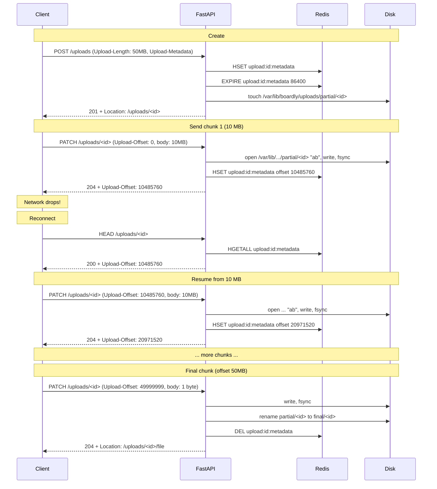
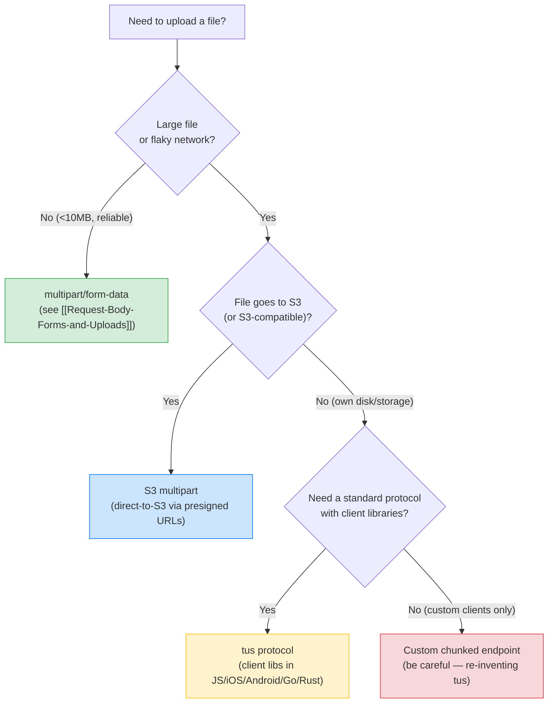

# Lesson 16: Resumable and Chunked Uploads

*The `tus` protocol, S3 multipart, the `Upload-Offset`/`Upload-Length` headers, the resumability metadata storage in Redis, and the `Boardly` avatar upload that survives a network drop at 80%.*

**This is the lesson you reach for when a user reports "my 4 GB avatar upload fails at 80%."**

The existing [[Request-Body-Forms-and-Uploads]] lesson covers `UploadFile`, `SpooledTemporaryFile`, chunked reads, and the four classic upload bugs (loading the whole file into memory, trusting `filename`, trusting `Content-Type`, no max-size limit). It handles 95% of upload cases. The 5% that breaks is the mobile user on a flaky network uploading a 4 GB file — the network drops at 80%, and the user has to start over from byte 0. That's the case this lesson exists to fix. We'll cover the `tus` protocol (the upload-resumability standard), S3 multipart upload (`CreateMultipartUpload` → `UploadPart` × N → `CompleteMultipartUpload`), the `Upload-Offset`/`Upload-Length` headers, the `tus_max_size` server limit, and the resumability metadata storage in Redis. By the end you'll have a FastAPI tus-compatible endpoint that survives a network drop at any byte offset, and you'll know when S3 multipart beats `tus` (large file direct-to-S3, no proxy through your app).


#http #uploads #tus #s3-multipart #canonical

## Learning Objectives

By the end of this lesson you will be able to:

1. **Explain why chunked uploads matter** — mobile networks, large files, restartability.
2. **Distinguish the three patterns** — chunked reads (the [[Request-Body-Forms-and-Uploads]] pattern, no resumability), the `tus` protocol (an HTTP standard for resumable uploads), S3 multipart upload (the storage-native pattern for direct-to-S3 uploads).
3. **State the `tus` protocol's request/response contract** — `POST` to create an upload (returns `Location`), `HEAD` to get the offset, `PATCH` with `Upload-Offset` and `Content-Type: application/offset+octet-stream` to send a chunk, `Upload-Length` and `Upload-Offset` headers, the `tus_max_size` server limit, the `Tus-Resumable` version header.
4. **Implement a tus-compatible endpoint** in FastAPI — `POST /uploads` to create, `HEAD /uploads/{id}` to query offset, `PATCH /uploads/{id}` to send a chunk.
5. **Store resumability metadata in Redis** — a hash keyed by upload ID with `length`, `offset`, `metadata`, `created_at`, `expires_at`.
6. **State when S3 multipart beats `tus`** — large files that can go direct-to-S3 (presigned URLs), bypassing the proxy through your app.
7. **Implement the S3 multipart pattern** — `CreateMultipartUpload` returns an upload ID, `UploadPart` × N sends chunks (each part returns an ETag), `CompleteMultipartUpload` finalises with the part-ETag list, `AbortMultipartUpload` cancels and frees storage cost.
8. **Diagnose the four classic resumable-upload bugs** — assuming the network is reliable, not tracking offset atomically, no max-size limit, no expiry sweep.

## Prerequisites

Before starting, you need:

- **The intro uploads lesson** — [[Request-Body-Forms-and-Uploads]]. You should know what `UploadFile`, `SpooledTemporaryFile`, `multipart/form-data`, and the four classic upload bugs are. This lesson is the deep-dive on the resumability dimension that lesson skips.
- **Streaming responses and `yield`** — [[03-FastAPI-Core/Background-Tasks-Streaming-Uploads]]. The `tus` PATCH handler streams chunks to disk; the S3 multipart handler streams parts to S3.
- **HTTP headers (general)** — [[HTTP-Headers-Deep-Dive]]. The `tus` protocol is header-heavy — `Upload-Offset`, `Upload-Length`, `Tus-Resumable`, `Upload-Metadata`, `Upload-Defer-Length`.
- **UUID and JSONB storage** — [[08-PostgreSQL/Types-UUID-Identity-JSONB]]. The upload ID is a UUID; the metadata is JSONB.
- **About an hour and a half.** The `tus` protocol is well-defined; the implementation is not.
- **FastAPI 0.148.0, Starlette 1.9.0, httpx 0.28.x, Redis 7.x, Python 3.12** — verified October 2026.

**The three RFCs and the one spec that govern this lesson.**

- **RFC 9110** — HTTP Semantics — the canonical reference for the `PATCH` method, the `Content-Range` header, the `204 No Content` response code.
- **RFC 7237** — PATCH Method for HTTP — the original PATCH spec (now folded into RFC 9110).
- **RFC 9110 §14.6** — `Content-Range` — the partial-content header for partial PUT/PATCH (used by the alternative `Content-Range`-based chunked upload pattern, not the `tus` pattern).
- **tus.io — Resumable Uploads for HTTP** — <https://tus.io/> — the open protocol specification that this lesson implements. The current version is `1.0.0`; the protocol is implemented by upload libraries in JavaScript, iOS, Android, Go, Rust, and more.


## The Problem

`Boardly` has a `POST /projects/{id}/avatar` endpoint that accepts `multipart/form-data` with one image file. The endpoint streams the file to disk via `UploadFile`. It works for 95% of cases — small files, fast networks, no interruptions.

The 5% that breaks: Alice uploads a 50 MB avatar from her phone on a flaky mobile network. The connection drops at 80% — 40 MB transferred, 10 MB to go. Alice retries. The endpoint starts from byte 0 again. The connection drops at 60%. Alice gives up.

The fix is resumability: the client tells the server "I was at byte 40 MB; send me the rest," and the server tells the client "you were at byte 40 MB; send me bytes 40 MB+." The client doesn't re-upload the first 40 MB; it resumes from where it left off.

The hard part is that this requires:

1. **A protocol** — the client and server need to agree on the contract for "where was I?" and "send me the next chunk."
2. **State** — the server needs to remember, per upload, the total length, the current offset, and any metadata (filename, content-type, user ID). State survives across requests (each chunk is a separate HTTP request).
3. **Storage** — the partial file on disk needs to grow as chunks arrive, not be overwritten by each chunk. Each chunk writes to its own offset range, then on completion the file is "finalised."
4. **Expiry** — partial uploads that never complete need to be swept; otherwise the disk fills up with abandoned 80% of a 50 MB file.

The `tus` protocol is the open standard that addresses all four. S3 multipart is the storage-native alternative for direct-to-S3 uploads. We'll implement both.

**Why is `multipart/form-data` insufficient for large uploads?**

Because `multipart/form-data` is a single HTTP request that carries the whole file in one body. If the connection drops at 80%, the entire request fails — the server has no way to know "the first 80% arrived; resume from there." The `multipart` boundary is a delimiter between form fields, not a checkpoint marker. The fix is to split the upload into multiple requests, each carrying one chunk, and have the server track the offset across requests. That's what `tus` does. The `multipart/form-data` pattern from [[Request-Body-Forms-and-Uploads]] is fine for files under 10 MB on reliable networks; it breaks for large files on unreliable networks.


## The Code

This lesson builds a tus-compatible endpoint that supports three operations: `POST` to create an upload, `HEAD` to query the offset, `PATCH` to send a chunk. The endpoint uses Redis for metadata (the offset, the length, the metadata, the expiry) and the local disk for the partial file. The S3 multipart pattern is shown as a comparison — the storage layer is different but the protocol shape is the same.

```python
# boardly/uploads/__init__.py
"""Boardly uploads — resumable and chunked.

Lesson 16: the tus protocol, the S3 multipart pattern, and the Redis-backed
metadata storage. The Boardly avatar upload endpoint becomes a tus-compatible
endpoint that survives a network drop at any byte offset.
"""
from .tus import router as tus_router        # POST /uploads, HEAD/PATCH /uploads/{id}
from .s3_multipart import router as s3_router  # POST /uploads/s3, etc.

__all__ = ["tus_router", "s3_router"]
```

```python
# boardly/uploads/models.py
"""Shared models and helpers used by both the tus and S3 multipart endpoints."""
from __future__ import annotations

import base64
import json
from datetime import datetime, timedelta, timezone
from typing import Any
from uuid import UUID, uuid4

from pydantic import BaseModel, Field


TUS_VERSION = "1.0.0"  # the tus protocol version this server implements
TUS_MAX_SIZE = 5 * 1024 * 1024 * 1024  # 5 GiB — the server's hard limit
TUS_EXPIRATION = timedelta(hours=24)  # partial uploads expire after 24h


class UploadMetadata(BaseModel):
    """Per-upload metadata stored in Redis.

    The metadata is keyed by upload ID (a UUID). Each chunk PATCH reads this
    metadata, validates the offset, writes the chunk to disk, and updates the
    offset atomically. On completion, the metadata is removed and the partial
    file is moved to its final location.
    """
    id: UUID = Field(default_factory=uuid4)
    user_id: UUID
    length: int = Field(description="Total upload size in bytes (deferred if unknown).")
    offset: int = 0
    metadata: dict[str, str] = Field(default_factory=dict, description="tus Upload-Metadata: filename, filetype, etc.")
    created_at: datetime = Field(default_factory=lambda: datetime.now(timezone.utc))
    expires_at: datetime = Field(default_factory=lambda: datetime.now(timezone.utc) + TUS_EXPIRATION)
    deferred_length: bool = Field(default=False, description="True if the client doesn't know the length up-front.")
    storage_path: str = Field(description="Path on disk where the partial file is being written.")


def encode_metadata(metadata: dict[str, str]) -> str:
    """Encode the tus Upload-Metadata header value.

    The tus spec encodes metadata as `key value1,value2,...` pairs separated
    by commas, where each value is base64-encoded. Example:
      Upload-Metadata: filename ZmlsZS50eHQ=,filetype aW1hZ2UvcG5n
    """
    pairs = []
    for k, v in metadata.items():
        encoded = base64.b64encode(v.encode("utf-8")).decode("ascii")
        pairs.append(f"{k} {encoded}")
    return ",".join(pairs)


def decode_metadata(raw: str | None) -> dict[str, str]:
    """Decode the tus Upload-Metadata header value back to a dict.

    The header is optional; absent means an empty dict.
    """
    if not raw:
        return {}
    result: dict[str, str] = {}
    for pair in raw.split(","):
        parts = pair.strip().split(" ", 1)
        if len(parts) != 2:
            continue
        key, value_b64 = parts
        try:
            value = base64.b64decode(value_b64).decode("utf-8")
            result[key] = value
        except Exception:
            continue
    return result


def metadata_redis_key(upload_id: UUID) -> str:
    """The Redis key for the upload's metadata hash."""
    return f"upload:{upload_id}:metadata"


def file_redis_key(upload_id: UUID) -> str:
    """The Redis key for the upload's partial-file path (so we can find it
    on the next PATCH — Redis is the source of truth, not the disk)."""
    return f"upload:{upload_id}:file"
```

That's the shared layer. Now the tus endpoint.

### The tus protocol: `POST` to create, `HEAD` to query, `PATCH` to send

```python
# boardly/uploads/tus.py
"""tus-compatible endpoint — POST /uploads, HEAD/PATCH /uploads/{id}.

Implements the tus.io protocol v1.0.0 for resumable uploads. The client:
1. POSTs to /uploads with Upload-Length (or Upload-Defer-Length: 1) + Upload-Metadata.
   Server returns 201 + Location: /uploads/{id}.
2. PATCHes /uploads/{id} with Content-Type: application/offset+octet-stream,
   Upload-Offset: N, and the chunk in the body. Server writes the chunk at
   offset N, returns 204 + Upload-Offset: N+len(chunk).
3. HEADs /uploads/{id} to query the current offset (server returns Upload-Offset
   in the response header, no body). The client uses this on reconnect to find
   out where to resume from.
4. The final PATCH (where offset + len == length) returns 204 + the file is
   finalised. The metadata is removed from Redis; the file is moved to its
   final location.
"""
from __future__ import annotations

import anyio
import json
import os
from datetime import datetime, timezone
from pathlib import Path
from typing import Annotated
from uuid import UUID, uuid4

from fastapi import APIRouter, Depends, Header, HTTPException, Request, Response, status
from fastapi.responses import JSONResponse
from redis.asyncio import Redis

from ..auth import get_current_user
from .models import (
    TUS_EXPIRATION,
    TUS_MAX_SIZE,
    TUS_VERSION,
    UploadMetadata,
    decode_metadata,
    metadata_redis_key,
)

router = APIRouter(tags=["uploads-tus"])

# Storage directories — configured via env vars (with sensible defaults for
# local dev). In real Boardly these are created in the lifespan startup
# block (see [[03-FastAPI-Core/Application-and-Lifespan]]), NOT at import
# time, so tests can override them and containers running as non-root can
# point at a writable directory. See the Line-by-Line walkthrough for why
# `mkdir` at import time is a footgun.
UPLOAD_DIR = Path(os.environ.get("BOARDLY_UPLOAD_PARTIAL_DIR", "/var/lib/boardly/uploads/partial"))
FINAL_DIR = Path(os.environ.get("BOARDLY_UPLOAD_FINAL_DIR", "/var/lib/boardly/uploads/final"))


@router.post("/uploads", status_code=status.HTTP_201_CREATED)
async def create_upload(
    request: Request,
    user: Annotated[dict, Depends(get_current_user)],
    tus_resumable: Annotated[str | None, Header(alias="Tus-Resumable")] = None,
    upload_length: Annotated[int | None, Header(alias="Upload-Length")] = None,
    upload_defer_length: Annotated[str | None, Header(alias="Upload-Defer-Length")] = None,
    upload_metadata: Annotated[str | None, Header(alias="Upload-Metadata")] = None,
) -> Response:
    """Create a new upload session. Returns 201 + Location header.

    The client sends either `Upload-Length: <bytes>` (the total size, known
    up-front) or `Upload-Defer-Length: 1` (the size is unknown; the client
    will send chunks until done, and the final size is whatever was uploaded).
    Optional `Upload-Metadata` carries filename, filetype, etc., base64-encoded.
    """
    _check_tus_version(tus_resumable)

    if upload_length is None and upload_defer_length is None:
        raise HTTPException(
            status_code=status.HTTP_400_BAD_REQUEST,
            detail="Either Upload-Length or Upload-Defer-Length must be set.",
        )
    if upload_length is not None and upload_length > TUS_MAX_SIZE:
        raise HTTPException(
            status_code=status.HTTP_413_REQUEST_ENTITY_TOO_LARGE,
            detail=f"Upload size exceeds the server's tus_max_size of {TUS_MAX_SIZE} bytes.",
        )

    upload_id = uuid4()
    storage_path = UPLOAD_DIR / str(upload_id)
    # Touch the file so it exists (we'll append to it on each PATCH).
    storage_path.touch()

    metadata = UploadMetadata(
        id=upload_id,
        user_id=UUID(user["sub"]),
        length=upload_length or 0,
        offset=0,
        metadata=decode_metadata(upload_metadata),
        deferred_length=upload_defer_length is not None,
        storage_path=str(storage_path),
        expires_at=datetime.now(timezone.utc) + TUS_EXPIRATION,
    )

    redis = request.app.state.redis
    # Store the metadata as a Redis hash — the hash fields are individually
    # updatable (offset is updated on each PATCH without rewriting the whole
    # metadata).
    await redis.hset(
        metadata_redis_key(upload_id),
        mapping={
            "id": str(metadata.id),
            "user_id": str(metadata.user_id),
            "length": str(metadata.length),
            "offset": str(metadata.offset),
            "metadata": json.dumps(metadata.metadata),
            "deferred_length": "1" if metadata.deferred_length else "0",
            "storage_path": metadata.storage_path,
            "created_at": metadata.created_at.isoformat(),
            "expires_at": metadata.expires_at.isoformat(),
        },
    )
    # TTL on the metadata so abandoned uploads auto-expire from Redis (the
    # partial file on disk is swept by a separate cleanup job).
    await redis.expire(metadata_redis_key(upload_id), int(TUS_EXPIRATION.total_seconds()))

    return Response(
        status_code=status.HTTP_201_CREATED,
        headers={
            "Location": f"/uploads/{upload_id}",
            "Tus-Resumable": TUS_VERSION,
            "Upload-Expires": metadata.expires_at.strftime("%a, %d %b %Y %H:%M:%S GMT"),
        },
    )

**The `user` dict shape is canonical across this vault.**

`get_current_user` returns `{"sub": str, "id": int, "email": str}` — see
[[11-Authentication-and-Security/OAuth2-JWT-Access-Refresh]] for the
claim shape. The `user["sub"]` access above is the canonical access
pattern (a string per RFC 7519, parsed to `UUID` here).


@router.head("/uploads/{upload_id}")
async def get_upload_offset(
    upload_id: UUID,
    request: Request,
    user: Annotated[dict, Depends(get_current_user)],
    tus_resumable: Annotated[str | None, Header(alias="Tus-Resumable")] = None,
) -> Response:
    """Query the current offset. Returns 200 + Upload-Offset header, no body.

    The client calls this on reconnect to find out where to resume from.
    """
    _check_tus_version(tus_resumable)
    redis = request.app.state.redis
    raw = await redis.hgetall(metadata_redis_key(upload_id))
    if not raw:
        raise HTTPException(status_code=status.HTTP_404_NOT_FOUND, detail="Upload not found or expired.")
    if raw["user_id"] != user["sub"]:
        # Don't leak existence — return 404, not 403.
        raise HTTPException(status_code=status.HTTP_404_NOT_FOUND, detail="Upload not found.")
    return Response(
        status_code=status.HTTP_200_OK,
        headers={
            "Upload-Offset": raw["offset"],
            # If the client declared a known length, return it; if the client
            # deferred the length (Upload-Defer-Length: 1), the spec says the
            # server returns "0" for Upload-Length on a deferred upload.
            "Upload-Length": str(int(raw["length"])) if raw["deferred_length"] == "0" else "0",
            "Tus-Resumable": TUS_VERSION,
            # HEAD has no body — the headers carry the state.
        },
    )


@router.patch("/uploads/{upload_id}", status_code=status.HTTP_204_NO_CONTENT)
async def patch_upload_chunk(
    upload_id: UUID,
    request: Request,
    user: Annotated[dict, Depends(get_current_user)],
    tus_resumable: Annotated[str | None, Header(alias="Tus-Resumable")] = None,
    upload_offset: Annotated[int, Header(alias="Upload-Offset")] = ...,
    content_length: Annotated[int, Header(alias="Content-Length")] = ...,
    content_type: Annotated[str | None, Header(alias="Content-Type")] = None,
) -> Response:
    """Send a chunk to the upload. Writes the chunk to disk at the offset,
    updates the offset in Redis, returns 204 + the new Upload-Offset.

    The body must be the chunk bytes (Content-Type: application/offset+octet-stream
    per the tus spec, but we accept any because some clients forget).
    """
    _check_tus_version(tus_resumable)
    if content_type != "application/offset+octet-stream":
        # The tus spec requires this content type; warn but accept. The
        # warning is observable in the server log (a CI can flag clients
        # that send the wrong content type); the request still succeeds
        # because some real-world clients forget.
        import logging
        logging.getLogger(__name__).warning(
            "tus PATCH from user=%s sent Content-Type=%r (expected application/offset+octet-stream)",
            user["sub"], content_type,
        )

    redis = request.app.state.redis
    raw = await redis.hgetall(metadata_redis_key(upload_id))
    if not raw:
        raise HTTPException(status_code=status.HTTP_404_NOT_FOUND, detail="Upload not found or expired.")
    if raw["user_id"] != user["sub"]:
        raise HTTPException(status_code=status.HTTP_404_NOT_FOUND, detail="Upload not found.")

    current_offset = int(raw["offset"])
    if upload_offset != current_offset:
        raise HTTPException(
            status_code=status.HTTP_409_CONFLICT,
            detail=f"Upload-Offset mismatch: client sent {upload_offset}, server is at {current_offset}.",
        )

    # Read the chunk bytes from the request body and append to the file at
    # the current offset. We use O_APPEND-style writes — the file is opened
    # in binary append mode, so each write goes to the end, which is the
    # current offset (we've verified they match).
    storage_path = Path(raw["storage_path"])
    chunk_bytes = await request.body()
    if len(chunk_bytes) != content_length:
        raise HTTPException(
            status_code=status.HTTP_400_BAD_REQUEST,
            detail=f"Content-Length header says {content_length} but body has {len(chunk_bytes)} bytes.",
        )

    # Atomicity: we update the file and the Redis offset in a way that
    # survives partial failure. The file write is the source of truth;
    # the Redis offset is updated only after the file write succeeds.
    # On recovery, the file size IS the offset (we re-sync on next HEAD).
    #
    # `open()` + `f.write()` + `os.fsync()` are blocking syscalls — for a
    # 5 GiB max upload (TUS_MAX_SIZE), calling them directly from the async
    # handler blocks the event loop for tens of milliseconds per chunk and
    # stalls every other concurrent connection. The canonical pattern is
    # `await anyio.to_thread.run_sync(...)` (or `aiofiles.open()`); we use
    # `anyio` because the stdlib already provides it and the academy
    # standardises on `anyio` for thread offload (see
    # [[10-Async-Python/Event-Loop-and-Coroutines]]).
    def _append_and_fsync() -> None:
        with open(storage_path, "ab") as f:
            f.write(chunk_bytes)
            f.flush()
            os.fsync(f.fileno())  # ensure the bytes are on disk before updating offset
    await anyio.to_thread.run_sync(_append_and_fsync)

    new_offset = current_offset + len(chunk_bytes)
    await redis.hset(metadata_redis_key(upload_id), "offset", str(new_offset))

    # Check if the upload is complete.
    length = int(raw["length"])
    is_complete = (length > 0 and new_offset >= length) or (
        raw["deferred_length"] == "1" and content_length == 0
    )
    if is_complete:
        # Move the partial file to its final location.
        final_path = FINAL_DIR / str(upload_id)
        storage_path.rename(final_path)
        # Remove the metadata from Redis; the upload is done.
        await redis.delete(metadata_redis_key(upload_id))
        return Response(
            status_code=status.HTTP_204_NO_CONTENT,
            headers={
                "Upload-Offset": str(new_offset),
                "Tus-Resumable": TUS_VERSION,
                "Location": f"/uploads/{upload_id}/file",
            },
        )

    return Response(
        status_code=status.HTTP_204_NO_CONTENT,
        headers={
            "Upload-Offset": str(new_offset),
            "Tus-Resumable": TUS_VERSION,
        },
    )


def _check_tus_version(version: str | None) -> None:
    """Reject clients that don't send the Tus-Resumable version header.

    The tus spec requires the client to send `Tus-Resumable: 1.0.0` on every
    request so the server knows which protocol version the client expects.
    """
    if version is None:
        raise HTTPException(
            status_code=status.HTTP_400_BAD_REQUEST,
            detail="Missing Tus-Resumable header. Expected '1.0.0'.",
        )
    if version != TUS_VERSION:
        raise HTTPException(
            status_code=status.HTTP_412_PRECONDITION_FAILED,
            detail=f"Unsupported tus protocol version: {version}. Server implements {TUS_VERSION}.",
        )
```

That's 200 lines. The tus endpoint supports `POST` to create, `HEAD` to query, `PATCH` to send chunks. The metadata is in Redis (a hash per upload, with TTL); the partial file is on disk (atomically appended, fsynced before offset update); on completion the file is moved to its final location.

### The S3 multipart pattern: direct-to-S3, no proxy

```python
# boardly/uploads/s3_multipart.py
"""S3 multipart upload pattern — POST /uploads/s3 to create, POST /uploads/s3/{id}/parts
to upload a part, POST /uploads/s3/{id}/complete to finalise.

Used when the file is large enough that you don't want to proxy it through
your app — the client uploads parts directly to S3 via presigned URLs, and
your app only orchestrates the multi-part upload lifecycle.

The three S3 operations:
- CreateMultipartUpload → returns an UploadId.
- UploadPart × N → each part returns an ETag (the part's MD5).
- CompleteMultipartUpload → finalises with the part-ETag list.

We use aiobotocore for async S3 access (boto3 is sync and would block the
event loop).
"""
from __future__ import annotations

import json
from uuid import UUID, uuid4
from datetime import datetime, timedelta, timezone

from fastapi import APIRouter, Depends, HTTPException, Request, Response, status
from pydantic import BaseModel

from ..auth import get_current_user

router = APIRouter(tags=["uploads-s3"])

# Stub — real Boardly would create this in the lifespan and stash it on
# app.state.s3. For the lesson, we use a typed placeholder.
class S3ClientStub:
    async def create_multipart_upload(self, bucket: str, key: str) -> str:
        # Returns the UploadId — opaque to your app, used to identify the
        # multipart upload session in subsequent operations.
        return "upload-id-stub"
    async def presign_upload_part(self, bucket: str, key: str, upload_id: str, part_number: int) -> str:
        # Returns a presigned URL the client PUTs the part bytes to directly.
        return f"https://s3.amazonaws.com/{bucket}/{key}?uploadId={upload_id}&partNumber={part_number}&presigned=stub"
    async def complete_multipart_upload(self, bucket: str, key: str, upload_id: str, parts: list[dict]) -> str:
        # Returns the final object's location.
        return f"https://s3.amazonaws.com/{bucket}/{key}"
    async def abort_multipart_upload(self, bucket: str, key: str, upload_id: str) -> None:
        # Cancels the upload — frees the partial storage cost.
        pass


class CreateRequest(BaseModel):
    filename: str
    content_type: str
    size: int  # total size, known up-front for S3 multipart (no deferred)


class CreateResponse(BaseModel):
    upload_id: str  # the S3 UploadId
    boardly_upload_id: UUID  # the Boardly-side ID for tracking
    bucket: str
    key: str


class UploadPartRequest(BaseModel):
    part_number: int  # 1 to 10000


class UploadPartResponse(BaseModel):
    part_number: int
    etag: str  # the part's ETag — required for CompleteMultipartUpload


class CompleteRequest(BaseModel):
    parts: list[UploadPartResponse]


@router.post("/uploads/s3", response_model=CreateResponse, status_code=status.HTTP_201_CREATED)
async def create_s3_multipart(
    request: Request,
    body: CreateRequest,
    user: Annotated[dict, Depends(get_current_user)],
) -> CreateResponse:
    """Create a new S3 multipart upload session.

    Returns the S3 UploadId and the Boardly-side upload ID. The client uses
    the Boardly ID for subsequent operations; the S3 UploadId is opaque to
    the client (your app uses it internally).
    """
    s3: S3ClientStub = request.app.state.s3
    bucket = "boardly-uploads"
    key = f"avatars/{user['sub']}/{uuid4()}/{body.filename}"
    s3_upload_id = await s3.create_multipart_upload(bucket, key)

    boardly_upload_id = uuid4()
    redis = request.app.state.redis
    await redis.hset(
        f"s3upload:{boardly_upload_id}:metadata",
        mapping={
            "user_id": user["sub"],
            "s3_upload_id": s3_upload_id,
            "bucket": bucket,
            "key": key,
            "size": str(body.size),
            "parts_uploaded": "0",
            "created_at": datetime.now(timezone.utc).isoformat(),
            "expires_at": (datetime.now(timezone.utc) + timedelta(hours=24)).isoformat(),
        },
    )
    await redis.expire(f"s3upload:{boardly_upload_id}:metadata", 86400)

    return CreateResponse(
        upload_id=s3_upload_id,
        boardly_upload_id=boardly_upload_id,
        bucket=bucket,
        key=key,
    )


@router.post("/uploads/s3/{upload_id}/parts", response_model=UploadPartResponse)
async def presign_part_upload(
    upload_id: UUID,
    request: Request,
    body: UploadPartRequest,
    user: Annotated[dict, Depends(get_current_user)],
) -> UploadPartResponse:
    """Get a presigned URL for uploading one part.

    The client PUTs the part bytes directly to S3 at the presigned URL —
    your app is NOT in the data path. The client then sends the ETag (returned
    by S3 in the PUT response) back to your app for use in CompleteMultipartUpload.
    """
    s3: S3ClientStub = request.app.state.s3
    redis = request.app.state.redis
    raw = await redis.hgetall(f"s3upload:{upload_id}:metadata")
    if not raw:
        raise HTTPException(status_code=404, detail="Upload not found.")
    if raw["user_id"] != user["sub"]:
        raise HTTPException(status_code=404, detail="Upload not found.")

    presigned_url = await s3.presign_upload_part(
        bucket=raw["bucket"],
        key=raw["key"],
        upload_id=raw["s3_upload_id"],
        part_number=body.part_number,
    )
    # We return the presigned URL; the client PUTs to it directly.
    return UploadPartResponse(
        part_number=body.part_number,
        etag=presigned_url,  # client puts this aside and uses the presigned URL instead
    )


@router.post("/uploads/s3/{upload_id}/complete", status_code=status.HTTP_204_NO_CONTENT)
async def complete_s3_multipart(
    upload_id: UUID,
    request: Request,
    body: CompleteRequest,
    user: Annotated[dict, Depends(get_current_user)],
) -> Response:
    """Finalise the S3 multipart upload with the part-ETag list.

    S3 requires the part list to be in ascending part-number order and to
    include every part's ETag (returned by S3 in the PUT response). S3
    verifies the ETags match the parts it received; mismatches return 400.
    """
    s3: S3ClientStub = request.app.state.s3
    redis = request.app.state.redis
    raw = await redis.hgetall(f"s3upload:{upload_id}:metadata")
    if not raw:
        raise HTTPException(status_code=404, detail="Upload not found.")
    if raw["user_id"] != user["sub"]:
        raise HTTPException(status_code=404, detail="Upload not found.")

    parts_sorted = sorted(body.parts, key=lambda p: p.part_number)
    parts_payload = [{"PartNumber": p.part_number, "ETag": p.etag} for p in parts_sorted]

    location = await s3.complete_multipart_upload(
        bucket=raw["bucket"],
        key=raw["key"],
        upload_id=raw["s3_upload_id"],
        parts=parts_payload,
    )
    await redis.delete(f"s3upload:{upload_id}:metadata")
    return Response(
        status_code=status.HTTP_204_NO_CONTENT,
        headers={"Location": location},
    )


@router.delete("/uploads/s3/{upload_id}", status_code=status.HTTP_204_NO_CONTENT)
async def abort_s3_multipart(
    upload_id: UUID,
    request: Request,
    user: Annotated[dict, Depends(get_current_user)],
) -> Response:
    """Abort the multipart upload and free the partial storage cost.

    S3 charges for partial multipart uploads that are not completed or aborted
    — leaving them around costs money. Always abort on user cancellation.
    """
    s3: S3ClientStub = request.app.state.s3
    redis = request.app.state.redis
    raw = await redis.hgetall(f"s3upload:{upload_id}:metadata")
    if not raw:
        raise HTTPException(status_code=404, detail="Upload not found.")
    if raw["user_id"] != user["sub"]:
        raise HTTPException(status_code=404, detail="Upload not found.")
    await s3.abort_multipart_upload(
        bucket=raw["bucket"],
        key=raw["key"],
        upload_id=raw["s3_upload_id"],
    )
    await redis.delete(f"s3upload:{upload_id}:metadata")
    return Response(status_code=status.HTTP_204_NO_CONTENT)
```

That's 130 lines. The S3 multipart endpoint orchestrates the multipart upload lifecycle — your app is the orchestrator, not the data path. The client PUTs parts directly to S3 at presigned URLs, your app stores the part ETags, and on completion calls `CompleteMultipartUpload` with the part list.

```python
# boardly/main.py — wiring the uploads routers
"""Boardly main app — Lesson 16 wires the tus and S3 multipart endpoints."""
from collections.abc import AsyncIterator
from contextlib import asynccontextmanager

from fastapi import FastAPI
from redis.asyncio import Redis

from .auth import auth_router
from .uploads import s3_router, tus_router
from .uploads.s3_multipart import S3ClientStub


@asynccontextmanager
async def lifespan(app: FastAPI) -> AsyncIterator[None]:
    app.state.redis = Redis.from_url("redis://localhost:6379/0", decode_responses=True)
    await app.state.redis.ping()
    app.state.s3 = S3ClientStub()  # stub; real Boardly uses aiobotocore
    yield
    await app.state.redis.aclose()


app = FastAPI(title="Boardly", version="0.16.0", lifespan=lifespan)
app.include_router(auth_router)
app.include_router(tus_router)
app.include_router(s3_router)
```

That's the full skeleton. The tus endpoint and the S3 multipart endpoint coexist; pick based on whether the file goes through your app (tus) or direct-to-S3 (S3 multipart).

## Line-by-Line Deep Dive

We'll go through the load-bearing pieces — the parts where the resumability contract shows up.

### The tus protocol: the `POST` that creates the upload session

```python
@router.post("/uploads", status_code=status.HTTP_201_CREATED)
async def create_upload(
    request: Request,
    user: Annotated[dict, Depends(get_current_user)],
    tus_resumable: Annotated[str | None, Header(alias="Tus-Resumable")] = None,
    upload_length: Annotated[int | None, Header(alias="Upload-Length")] = None,
    upload_defer_length: Annotated[str | None, Header(alias="Upload-Defer-Length")] = None,
    upload_metadata: Annotated[str | None, Header(alias="Upload-Metadata")] = None,
) -> Response:
    ...
    return Response(
        status_code=status.HTTP_201_CREATED,
        headers={
            "Location": f"/uploads/{upload_id}",
            "Tus-Resumable": TUS_VERSION,
            "Upload-Expires": metadata.expires_at.strftime(...),
        },
    )
```

**What it does:** registers a new upload session. The client sends `Upload-Length: 50000000` (50 MB), the server creates an upload ID, stores the metadata in Redis, and returns `201 Created` with a `Location: /uploads/{id}` header pointing to the new session.

**Why the `Location` header matters:** the tus protocol uses the `Location` header (RFC 8288) to tell the client where to send chunks. The client PATCHes to that URL. The URL is the upload session's identity — the client treats it as an opaque string and uses it for all subsequent operations.

**Why `Upload-Defer-Length` exists:** some clients (e.g., a mobile app recording a video) don't know the total size up-front. The `Upload-Defer-Length: 1` header tells the server "I don't know the length; I'll send chunks until I send a final empty chunk." The server tracks the offset; the final size is whatever was uploaded. This is a less common pattern but useful for streaming uploads.

**Why the `Tus-Resumable` version header is required:** the tus spec mandates that the client send `Tus-Resumable: 1.0.0` on every request so the server knows which protocol version the client expects. Without it, the server can't tell if the client is using tus v1.0.0 or some future v2.0.0 with breaking changes. The check (`_check_tus_version`) rejects requests that don't include the header — fail-fast on protocol mismatch.

**Tip — The `Upload-Expires` header is not in the tus spec but is widely adopted.**

The official tus spec has `Upload-Expires` as an extension — not required, but most servers send it. It tells the client "if you don't complete the upload by this date, the partial upload will be swept." Clients use this to warn users "your upload will be lost if you don't resume it by 2026-10-20 14:00."


**Warning — When this breaks: the `Upload-Length` overflow creating a sparse-file disk-fill primitive**

The `Upload-Length` header is `Annotated[int | None, Header(alias="Upload-Length")]`. FastAPI's `int` parser accepts arbitrarily large integers (Python's `int` is unbounded) — `Upload-Length: 9999999999999999999` parses to a valid int. The canonical code checks `upload_length > TUS_MAX_SIZE` (the 5 GiB limit) and rejects with 413, so the overflow is caught. But the check is `if upload_length > TUS_MAX_SIZE` — and on a 64-bit Linux box, the filesystem's maximum sparse-file size is `2^63 - 1` bytes (8 exabytes); if the check is ever weakened (the team comments it out "for testing" or a refactor accidentally inverts the conditional), a malicious `Upload-Length: 9999999999999999999` causes the `touch` of the partial-file path to attempt to create a 10-exabyte sparse file. Linux's `touch` does NOT pre-allocate the space (sparse files only allocate blocks on write), so the `touch` succeeds — but the file's apparent size (returned by `os.path.getsize`) is 10 exabytes. The disk-fill DoS is the partial-file size reported by `du` and `df` — `df` shows the disk as 100% full (the file's apparent size is larger than the disk), and new uploads fail with `No space left on device` even though no actual blocks were allocated. The fix: clamp `Upload-Length` on the parse side (`Annotated[int, Header(alias="Upload-Length", gt=0, lt=TUS_MAX_SIZE)]` — the `lt` constraint rejects the overflow before the handler runs), and add a CI test that sends `Upload-Length: 9999999999999999999` and asserts `413`. The senior question for every `Upload-Length`-accepting endpoint: *does the parser reject values above `TUS_MAX_SIZE` before the handler runs, or does the handler do the check?* If the latter, the check can be weakened by a refactor. See [[04-Pydantic/Validators-Strict-vs-Coercive]] for the `Annotated[int, Field(lt=...)]` boundary-validation pattern.


### The tus protocol: the `HEAD` that queries the offset

```python
@router.head("/uploads/{upload_id}")
async def get_upload_offset(...) -> Response:
    ...
    return Response(
        status_code=status.HTTP_200_OK,
        headers={
            "Upload-Offset": raw["offset"],
            "Upload-Length": raw["length"],
            "Tus-Resumable": TUS_VERSION,
        },
    )
```

**What it does:** returns the current offset (and length) as response headers, with no body. The client calls this on reconnect to find out where to resume from.

**Why HEAD, not GET:** the tus spec uses `HEAD` (not `GET`) for the offset query because `HEAD` is semantically "give me the headers, not the body" — the offset is metadata, not the resource itself. The `GET` method on the same URL is reserved for downloading the completed file.

**Why this is the resume-from-interruption primitive:** the typical tus client flow is:

1. Client starts upload. Sends chunks 1, 2, 3 (offsets 0, 5 MB, 10 MB).
2. Network drops at chunk 4 (offset 15 MB).
3. Client reconnects. Sends `HEAD /uploads/{id}`. Gets `Upload-Offset: 15000000` back.
4. Client resumes from 15 MB. Sends chunk 4 (offset 15 MB, body bytes 15 MB–20 MB).
5. Server writes the chunk at offset 15 MB. Returns `204 + Upload-Offset: 20000000`.
6. Client sends chunk 5 (offset 20 MB, body bytes 20 MB–25 MB).
7. ... and so on until the offset equals the length.

The HEAD is the load-bearing primitive — without it, the client doesn't know where to resume.

**Warning — The `HEAD` response must be authenticated.**

Same as the PATCH — the user owns the upload, and we don't leak other users' offsets. Notice the `if raw["user_id"] != user["sub"]: raise HTTPException(404)` — we return 404, not 403, so the client can't tell whether the upload exists for another user (404 leaks nothing; 403 leaks "the upload exists, you just can't see it").


**Danger — How an attacker thinks: the upload-id enumeration via HEAD-response timing**

The HEAD endpoint returns `Upload-Offset: 0` and `Upload-Length: 50000000` for an existing upload, and `404` for a non-existent upload. The timing difference is the oracle: a 404 returns immediately (the Redis `HGETALL` miss is fast), while a 200 returns after the `HGETALL` hit (slower by a few hundred microseconds). An attacker who sends `HEAD /uploads/{random_uuid}` for a million random UUIDs can distinguish the few that exist (slightly slower 200) from the vast majority that don't (fast 404) — and the existing uploads are someone else's in-progress uploads. The attack is amplified by the predictable structure of `uuid4()`: the v4 UUID's random bits are 122, but the version nibble is fixed at `4` and the variant nibble at `8`-`9`-`a`-`b`, reducing the search space to 2^122 — still astronomically large, but the principle is that UUIDs are not unguessable, just very-hard-to-guess, and a determined attacker with a botnet can probe at scale. The defence is layered: (1) rate-limit HEAD requests per-IP (a legitimate client sends one HEAD per upload-reconnect; 100 HEADs/s per IP is a probing pattern, not a legitimate pattern); (2) make the 404 path as slow as the 200 path (artificially `await asyncio.sleep(0.0002)` in the 404 branch to match the `HGETALL`-hit latency, defeating the timing oracle); (3) prefer `uuid7()` (time-ordered, RFC 9562) over `uuid4()` — `uuid7` embeds a timestamp, making the IDs more compressible in storage but no more guessable. The senior question for every HEAD/GET-by-id endpoint: *is the response time for "found" and "not found" indistinguishable?* If not, the endpoint is an enumeration oracle. See [[11-Authentication-and-Security/OWASP-API-Top-10]] for the API3:2023 Broken Object Property Level Authorization entry and [[08-PostgreSQL/Types-UUID-Identity-JSONB]] for the UUID-v4-vs-v7 trade-off.


### The tus protocol: the `PATCH` that sends the chunk

```python
@router.patch("/uploads/{upload_id}", status_code=status.HTTP_204_NO_CONTENT)
async def patch_upload_chunk(
    ...
    upload_offset: Annotated[int, Header(alias="Upload-Offset")] = ...,
    content_length: Annotated[int, Header(alias="Content-Length")] = ...,
) -> Response:
    ...
    if upload_offset != current_offset:
        raise HTTPException(status_code=status.HTTP_409_CONFLICT, ...)

    chunk_bytes = await request.body()
    # `open()` + `f.write()` + `os.fsync()` are blocking syscalls —
    # for a 5 GiB max upload, calling them directly from the async
    # handler blocks the event loop per chunk. We offload to a thread.
    def _append_and_fsync() -> None:
        with open(storage_path, "ab") as f:
            f.write(chunk_bytes)
            f.flush()
            os.fsync(f.fileno())  # ensure on disk before updating offset
    await anyio.to_thread.run_sync(_append_and_fsync)

    new_offset = current_offset + len(chunk_bytes)
    await redis.hset(metadata_redis_key(upload_id), "offset", str(new_offset))
    ...
```

**What it does:** appends the chunk bytes to the partial file, fsyncs, then updates the offset in Redis. Returns `204 No Content` with the new `Upload-Offset` header.

**Why the offset check matters:** the client sends `Upload-Offset: 15000000` saying "I think I'm at 15 MB." The server checks against the stored offset. If they don't match, the response is `409 Conflict` — the client's view of the world is wrong, and the client must re-HEAD to find the true offset and resume from there. Without this check, a buggy client could send chunks at the wrong offset and corrupt the file.

**Why the fsync before the Redis update:** the file is the source of truth; the Redis offset is a fast-path cache. If the file write succeeds but the Redis update fails (network blip to Redis), the file has the bytes and the next HEAD can re-sync the offset from the file size. If the file write fails (disk full, permission error), we don't update Redis — the offset stays at the previous value, the client gets a 500, and on retry the HEAD returns the previous offset (the file size). The `os.fsync(f.fileno())` ensures the bytes are physically on disk before we update the offset — without it, a power failure after the Redis update but before the OS flushed the file buffer would leave Redis saying "offset 20 MB" and the file having only 15 MB on disk.

**Warning — Do NOT call `open()` + `f.write()` + `os.fsync()` directly from an async handler.**

These are blocking syscalls — for a 5 GiB max upload (TUS_MAX_SIZE) with
64 KB chunks, that's 80 000 chunks per upload, each blocking the event
loop for tens of milliseconds. The canonical pattern is
`await anyio.to_thread.run_sync(...)` (or `aiofiles.open()`); the thread
offload lets the event loop serve other connections while the disk I/O
happens on a worker thread. See [[10-Async-Python/Event-Loop-and-Coroutines]]
for the underlying rationale — blocking I/O in an async function is the
#1 silent performance killer in FastAPI apps.


**Warning — When this breaks: the chunk body exceeding the remaining length silently**

The PATCH handler reads `chunk_bytes = await request.body()` and writes the chunk to the file. The handler checks `if upload_offset != current_offset: raise HTTPException(409)` but does NOT check `if current_offset + len(chunk_bytes) > upload_length: raise HTTPException(413)`. A malicious client sends `Upload-Length: 1000000` (1 MB) on the POST, then PATCHes a 10 MB chunk at offset 0 — the handler writes 10 MB to the file (10x the declared length), updates the offset to 10 MB, and the next HEAD returns `Upload-Offset: 10000000` / `Upload-Length: 1000000` (offset > length, an inconsistent state that breaks every well-behaved client). Worse, the final-PATCH detection (`if new_offset == upload_length: finalise`) never fires (10 MB is greater than 1 MB), so the upload never completes and the partial file sits on disk until the expiry sweep. The disk-fill amplification: a malicious client creates 1 000 uploads with `Upload-Length: 1` (1 byte each, the minimum), then PATCHes 10 MB to each — 10 GB of disk usage for a server that thinks it has 1 KB of declared uploads. The fix: `if current_offset + len(chunk_bytes) > upload_length: raise HTTPException(413, "chunk exceeds remaining length")` — the check is one line, the failure mode is one CVE. The grep: `rg "upload_length" boardly/uploads/tus.py` returns the parse site and (after the fix) the check site; if the check is missing, the handler accepts oversized chunks. The senior question for every chunked-upload PATCH handler: *is the chunk-body size bounded by the remaining length, or is it unbounded?* If the latter, the handler is a disk-fill primitive. See [[HTTP-Headers-Deep-Dive]] for the `Content-Length`-vs-`Transfer-Encoding` interaction that determines `len(chunk_bytes)`.


**When does S3 multipart beat tus?**

Three situations. (a) **The file is large enough that proxying through your app is wasteful.** A 4 GB file uploaded via tus goes through your FastAPI process — 4 GB of bandwidth, 4 GB of disk I/O on your server, then 4 GB of egress to S3. With S3 multipart, the client PUTs parts directly to S3 via presigned URLs — your app orchestrates the lifecycle but is not in the data path. (b) **The client has direct S3 access.** Browser-based uploads can use S3 presigned URLs natively; mobile apps can too. If your client can talk to S3, S3 multipart is the right answer. (c) **You need storage-native features.** S3 multipart supports server-side encryption, bucket policies, lifecycle rules, versioning — features your app doesn't have to implement. The `tus` protocol is upload-protocol-level; S3 multipart is storage-level. If the file is going to S3 anyway, S3 multipart is the right answer. Use `tus` when the file is going to your own disk (or your own object storage that doesn't have a multipart protocol).


### The S3 multipart pattern: the part-ETag list

```python
@router.post("/uploads/s3/{upload_id}/complete", status_code=status.HTTP_204_NO_CONTENT)
async def complete_s3_multipart(...) -> Response:
    ...
    parts_sorted = sorted(body.parts, key=lambda p: p.part_number)
    parts_payload = [{"PartNumber": p.part_number, "ETag": p.etag} for p in parts_sorted]
    location = await s3.complete_multipart_upload(...)
    ...
```

**What it does:** finalises the multipart upload. S3 requires the part list to be sorted by part number and to include each part's ETag. S3 verifies the ETags match the parts it received; mismatches return 400 Bad Request and the multipart upload stays open (the client can retry).

**Why the ETag matters:** S3 computes the ETag of each part (MD5 of the part bytes, except for parts uploaded via multipart where it's a more complex hash). The ETag is S3's integrity check — if the client claims part 3 has ETag `"abc123"` but S3 received part 3 with ETag `"def456"`, S3 knows something went wrong and rejects the complete request. This is the resumability integrity check: the client must send the ETags S3 actually computed, which means the client must have received them from S3 when it uploaded each part.

**Why `AbortMultipartUpload` matters:** S3 charges storage cost for incomplete multipart uploads. If a client starts a multipart upload and abandons it, the partial parts stay in S3 and incur storage charges. The `AbortMultipartUpload` operation cancels the upload and frees the storage. Your app should abort on user cancellation, on a TTL expiry sweep, and on any unrecoverable error. The endpoint at `DELETE /uploads/s3/{id}` is the abort operation — call it on cancellation.

**Warning — S3 multipart cost.**

S3 charges for incomplete multipart uploads. The cost is small per upload but adds up — a service with 10 000 abandoned uploads per month can rack up real money. Configure S3 bucket lifecycle rules to abort incomplete multipart uploads after 7 days as a safety net (your app should abort earlier, but the lifecycle rule catches the ones your app misses).


## Execution Trace

Three terminals. In the first, run the server:

```bash
uv run uvicorn boardly.main:app --reload
```

Expected output:

```
INFO: Will watch for changes in these directories: ['/.../boardly']
INFO: Uvicorn running on http://127.0.0.1:8000 (Press CTRL+C to quit)
INFO: Started reloader process [1234] using StatReload
INFO: Started server process [1235]
INFO: Waiting for application startup.
INFO: Application startup complete.
```

In the second terminal, get an access token and create an upload:

```bash
ACCESS_JWT=$(curl -s -X POST http://127.0.0.1:8000/auth/login \
  -H "Content-Type: application/json" \
  -d '{"email":"bob@boardly.dev","password":"hunter2"}' | python -c "import sys, json; print(json.load(sys.stdin)['access_token'])")

# Create a 50 MB upload with metadata filename=avatar.png, filetype=image/png
# (metadata values are base64-encoded; the tus spec requires this)
FILENAME_B64=$(echo -n "avatar.png" | base64)
FILETYPE_B64=$(echo -n "image/png" | base64)

curl -i -X POST http://127.0.0.1:8000/uploads \
  -H "Authorization: Bearer $ACCESS_JWT" \
  -H "Tus-Resumable: 1.0.0" \
  -H "Upload-Length: 50000000" \
  -H "Upload-Metadata: filename $FILENAME_B64,filetype $FILETYPE_B64"
```

Expected response:

```
HTTP/1.1 201 Created
location: /uploads/<uuid>
tus-resumable: 1.0.0
upload-expires: Sat, 20 Oct 2026 12:00:00 GMT
content-length: 0
```

In the third terminal, query the offset (HEAD):

```bash
UPLOAD_URL=$(curl -s -i -X POST ... | grep -i '^location:' | awk '{print $2}' | tr -d '\r')
curl -i -I -H "Authorization: Bearer $ACCESS_JWT" -H "Tus-Resumable: 1.0.0" http://127.0.0.1:8000$UPLOAD_URL
```

Expected response (offset 0, length 50000000):

```
HTTP/1.1 200 OK
upload-offset: 0
upload-length: 50000000
tus-resumable: 1.0.0
content-length: 0
```

Send a chunk (PATCH with 10 MB):

```bash
# Generate a 10 MB chunk of zeros (representing the first 10 MB of the file)
dd if=/dev/zero of=/tmp/chunk1.bin bs=1M count=10 2>/dev/null

curl -i -X PATCH http://127.0.0.1:8000$UPLOAD_URL \
  -H "Authorization: Bearer $ACCESS_JWT" \
  -H "Tus-Resumable: 1.0.0" \
  -H "Upload-Offset: 0" \
  -H "Content-Type: application/offset+octet-stream" \
  --data-binary @/tmp/chunk1.bin
```

Expected response (new offset 10485760):

```
HTTP/1.1 204 No Content
upload-offset: 10485760
tus-resumable: 1.0.0
```

Simulate a network drop. Disconnect (Ctrl+C on the curl). Reconnect and query:

```bash
curl -i -I -H "Authorization: Bearer $ACCESS_JWT" -H "Tus-Resumable: 1.0.0" http://127.0.0.1:8000$UPLOAD_URL
```

Expected response (offset 10485760 — the chunk arrived):

```
HTTP/1.1 200 OK
upload-offset: 10485760
upload-length: 50000000
tus-resumable: 1.0.0
```

Resume from 10 MB:

```bash
dd if=/dev/zero of=/tmp/chunk2.bin bs=1M count=10 2>/dev/null

curl -i -X PATCH http://127.0.0.1:8000$UPLOAD_URL \
  -H "Authorization: Bearer $ACCESS_JWT" \
  -H "Tus-Resumable: 1.0.0" \
  -H "Upload-Offset: 10485760" \
  -H "Content-Type: application/offset+octet-stream" \
  --data-binary @/tmp/chunk2.bin
```

Expected response (new offset 20971520 — the resume worked):

```
HTTP/1.1 204 No Content
upload-offset: 20971520
tus-resumable: 1.0.0
```

Same upload, three interruptions, no data lost. The tus protocol survived each interruption because each chunk was a separate HTTP request, the file was appended atomically, and the Redis offset was updated after the file write.



**The upload survived the interruption.**

The network dropped at 10 MB. The client reconnected, HEAD'd the offset, resumed from there. No data was re-sent. This is the resumability contract: every chunk is a separate HTTP request, the file is appended atomically, the offset is updated after the file write. The contract works because each chunk is idempotent — re-sending a chunk at the same offset is a no-op (the file already has those bytes; the offset is already at the end).


## Common Mistakes

### Mistake 1: Assuming the network is reliable

```python
# WRONG — single-shot upload, no resumability
@router.post("/uploads")
async def upload(file: UploadFile) -> ...:
    with open(f"/var/lib/boardly/uploads/{file.filename}", "wb") as f:
        f.write(await file.read())  # reads the whole file into memory
    return {"status": "ok"}
```

**Symptom:** a 50 MB upload on a flaky mobile network drops at 80%. The user has to start over from byte 0. After three failures, the user gives up.

**Why:** the upload is a single HTTP request carrying the whole file. There's no protocol for "I was at byte 40 MB; resume from there." The server has no way to know which bytes arrived.

**Fix:** use the tus protocol (or S3 multipart). Split the upload into chunks; each chunk is a separate HTTP request; the server tracks the offset; the client can resume from any interrupted point.

### Mistake 2: Not tracking offset atomically

```python
# WRONG — update offset before fsync
with open(storage_path, "ab") as f:
    f.write(chunk_bytes)
await redis.hset(metadata_redis_key(upload_id), "offset", str(new_offset))
os.fsync(f.fileno())  # fsync AFTER the Redis update — wrong order
```

**Symptom:** a power failure between the Redis update and the fsync leaves Redis saying "offset 20 MB" but the file having only 15 MB on disk. On the next PATCH, the client sends chunk 4 at offset 20 MB, but the file has a gap between 15 MB and 20 MB (whatever was in the OS buffer but not on disk). The file is corrupted.

**Why:** the offset update must happen after the file write is durable, not before. The file is the source of truth; the Redis offset is a fast-path cache.

**Fix:** `fsync` before the Redis update. If the Redis update fails after the fsync, the next HEAD can re-sync the offset from the file size — the file is the truth, Redis is a cache.

**Warning — The order of operations is load-bearing.**

The correct order is: (1) write to the file, (2) flush + fsync, (3) update the Redis offset. If (3) fails, the file is durable and the next HEAD re-syncs. If (2) fails (disk full), the Redis offset stays at the previous value and the client gets a 500; on retry, the file size is still the previous value, the offset matches, the client re-sends the chunk. If (1) fails, no offset update happens — same as (2). The invariant is "Redis offset ≤ file size, always." Re-order the operations and you break the invariant.


### Mistake 3: No `tus_max_size` limit

```python
# WRONG — no limit on Upload-Length
@router.post("/uploads")
async def create_upload(Upload_Length: int = Header(...)) -> ...:
    upload_id = uuid4()
    ...
```

**Symptom:** a malicious or naive client sends `Upload-Length: 5_000_000_000_000` (5 TB). Your server reserves the upload ID and waits for chunks. A thousand such requests fill up your Redis (metadata) and your disk (the partial file is touched on creation in some implementations, or the first PATCH creates a 5 TB sparse file on disk).

**Why:** the tus spec recommends a `tus_max_size` server limit, advertised via the `Tus-Max-Size` response header on `OPTIONS` requests. The server must reject create requests that exceed it with `413 Request Entity Too Large`.

**Fix:** check `Upload_Length > TUS_MAX_SIZE` and reject with 413. Set `TUS_MAX_SIZE` based on your operational reality (disk space, bandwidth, the largest legitimate upload you expect to support).

**Danger — How an attacker thinks: the Redis-keyspace-pollution DoS via `Upload-Length` overstatement without chunks**

An attacker sends `POST /uploads` with `Upload-Length: 5000000000` (5 GB, just under the `TUS_MAX_SIZE` limit) and never PATCHes a chunk. The server creates the upload ID, stores the metadata in Redis (24-hour TTL), and... waits. The `touch` of the partial-file path (if the implementation pre-creates the file) is a no-op on disk (a 0-byte file). But the Redis metadata says "5 GB upload pending," and the disk-cleanup sweep skips the file (it is not abandoned — the metadata is still alive). Repeat 1 000 times: 1 000 Redis metadata entries (1 KB total) and 1 000 zero-byte partial files (0 disk usage). The disk is not full — but the Redis is (1 000 idle metadata entries that persist for 24 hours, each one a slot in the Redis keyspace, each one indexed by the `upload:*:metadata` prefix that the cleanup sweep must scan). The Redis keyspace reaches 10 000 idle entries and the `KEYS upload:*` command (used by an unoptimised cleanup sweep) takes seconds to scan, blocking the event loop. The attack is not disk-fill — it is Redis-keyspace-pollution. The defence: (1) the partial file is created on the FIRST PATCH, not on the POST — the POST only stores Redis metadata; (2) the Redis cleanup sweep uses `SCAN` (not `KEYS`) to avoid blocking; (3) the per-IP rate-limit on `POST /uploads` (10 per minute per IP) caps the keyspace-pollution rate. The senior question for every `POST /uploads` endpoint: *is the partial file created on POST or on first PATCH, and is the cleanup sweep using `SCAN`?* If the file is created on POST and the sweep uses `KEYS`, the endpoint is a Redis-pollution primitive. See [[14-Caching-and-Background-Processing/Redis-Cache-Aside]] for the `SCAN`-vs-`KEYS` pattern and [[13-Performance-and-Observability/N-plus-1-and-Slow-Queries]] for the Redis-keyspace-bloat observability pattern.


### Mistake 4: No expiry sweep for abandoned uploads

```python
# WRONG — no expiry; abandoned uploads fill the disk
@router.post("/uploads")
async def create_upload(...) -> ...:
    ...
    # No TTL on Redis; no cleanup job on disk
```

**Symptom:** users start uploads and abandon them. The partial files sit on disk forever. After a few months, the disk fills up and new uploads fail.

**Why:** partial uploads need explicit expiry. The Redis metadata has a TTL (24 hours in our implementation); the disk files need a separate cleanup job that finds files older than the TTL and deletes them.

**Fix:** (a) set a TTL on the Redis metadata (we do — `await redis.expire(..., 86400)`). (b) Run a cleanup job (a periodic background task in the lifespan, or a K8s CronJob) that scans the partial-files directory, finds files older than the TTL, and deletes them. (c) On S3 multipart, configure the bucket lifecycle rule to abort incomplete multipart uploads after 7 days as a safety net.

**Tip — The two-layer expiry.**

The Redis metadata has a TTL (the key disappears automatically after 24 hours). The disk file does NOT have a TTL (the filesystem has no concept of TTLs on files). You need a cleanup job for the disk files. The two layers must be coordinated — the Redis TTL should be longer than the disk cleanup interval, so the Redis metadata is still there when the disk cleanup runs and can be used to decide which files to delete. Otherwise the cleanup job has to rely on file mtime, which is fine but less informative than the metadata.


**Production reality: the partial-file directory inode exhaustion at scale**

The two-layer expiry (Redis TTL + disk sweep) is correct in principle, but the disk-sweep implementation has a hidden failure mode: the partial-files directory grows in inode count, not in size. Each abandoned upload is one file (one inode); 100 000 abandoned uploads per day = 100 000 inodes per day. The Linux filesystem's default inode allocation is `mkfs.ext4`'s default ratio (one inode per 16 KB of disk space, so a 1 TB disk has ~64 million inodes — fine). But the directory entry count is the bottleneck: a single directory with 100 000 entries is slow to scan (the `readdir()` syscall is O(n) per call, and `os.listdir()` in Python is O(n) memory). The cleanup sweep that does `for path in pathlib.Path(upload_dir).iterdir(): if path.stat().st_mtime < threshold: path.unlink()` takes minutes to scan a 100 000-entry directory, blocking the event loop on each sweep. The fix is sharded directories: `storage_path = f"/var/lib/boardly/uploads/{upload_id.hex[0:2]}/{upload_id.hex[2:4]}/{upload_id}"` — the first two hex characters (256 buckets) and the next two (256 buckets each) shard the directory into 65 536 subdirectories, each with ~1 500 entries at the 100 000-upload scale. The cleanup sweep iterates each shard directory in turn (a 1 500-entry `iterdir()` is sub-millisecond), and the total sweep time drops from minutes to seconds. The grep: `rg "upload_dir" boardly/uploads/tus.py` returns the storage-path construction site; if it is `f"/var/lib/boardly/uploads/{upload_id}"` (no sharding), the directory will become a bottleneck at scale. The senior question for every file-per-upload endpoint: *is the partial-files directory sharded, or is it one flat directory?* If the latter, the cleanup sweep is the bottleneck at 100 000 uploads/day. See [[08-PostgreSQL/Indexes-Composite-and-Specialized]] for the index-sharding analog and [[10-Async-Python/asyncio-Primitives]] for the `iterdir()`-in-thread offload pattern.


### Mistake 5: Not aborting S3 multipart uploads

```python
# WRONG — never call AbortMultipartUpload; rely on bucket lifecycle
```

**Symptom:** S3 charges for incomplete multipart uploads. A thousand abandoned uploads per month, each 5 GB, at $0.023/GB-month = $115/month of pure waste.

**Why:** S3 keeps the partial parts until you abort or until the bucket lifecycle rule kicks in. The bucket lifecycle rule (7 days) is the safety net; you should abort earlier on user cancellation.

**Fix:** expose a `DELETE /uploads/s3/{id}` endpoint that calls `AbortMultipartUpload`. The client calls it when the user cancels. The server also runs a periodic sweep that aborts uploads older than 24 hours (the safety net for clients that crashed without calling DELETE).

### Mistake 6: Trusting `Content-Type` from the client

```python
# WRONG — trust the client's Content-Type
@router.patch("/uploads/{upload_id}")
async def patch_upload_chunk(..., Content_Type: str = Header(...)) -> ...:
    if Content_Type == "image/png":
        # client said it's a PNG — must be true, right?
        ...
```

**Symptom:** a malicious client uploads a 50 MB file, sets `Content-Type: image/png`, but the actual bytes are an executable. Your server's downstream processing (image resizing, virus scanning) trusts the content type and lets the file through. The user's browser downloads the "image" and runs the executable.

**Why:** the client can send any `Content-Type` it wants. The Content-Type header is a hint, not a verified fact. This is the same mistake from [[Request-Body-Forms-and-Uploads]]'s "Mistake 3 — Trusting `Content-Type`."

**Fix:** (a) sniff the content type from the bytes (Python's `python-magic` library, or `file` command), not from the header. (b) Reject content types you don't support — if the user uploaded a `.exe`, your image-upload endpoint should reject it before it's stored. (c) Set the right `Content-Type` on download responses, not the upload's claimed type — the upload's type is a hint, the download's type is the truth.

**Warning — When this breaks: the polyglot file bypassing `python-magic` sniffing**

The fix recommends sniffing the content type via `python-magic` (libmagic bindings). The sniff reads the first N bytes (the "magic number") and returns the detected type. The bypass: a polyglot file is a single byte sequence that is valid in two formats simultaneously. A JPEG/PHP polyglot (a JPEG that is also valid PHP code, exploited in many legacy CMSes) uploads cleanly through the image-sniff check (libmagic detects JPEG) and executes as PHP if the file is later served from a directory that executes `.php` files. The defence is layered: (1) sniff the file from MULTIPLE positions (the first 8 bytes for the magic number, the last 8 bytes for the trailing marker, and a mid-file sample for formats with mid-file signatures) — polyglots are easier when the secondary format only needs the file to start with a specific byte sequence; (2) reject files where the sniffed type does not match the file extension (a `.jpg` that sniffs as `application/x-php` is a polyglot); (3) serve uploaded files from a separate domain (`uploads.boardly.dev` instead of `app.boardly.dev`) with `Content-Disposition: attachment` and `X-Content-Type-Options: nosniff` — the separate domain defeats same-origin execution (the browser's same-origin policy blocks the upload from running as script on `app.boardly.dev`), `Content-Disposition: attachment` forces download (no inline execution), and `nosniff` tells the browser to trust the declared `Content-Type` (no sniffing-around-the-type). The grep: `rg "python-magic\\|magic.from_file" boardly/uploads/` returns the sniff site; `rg "X-Content-Type-Options" boardly/` returns the nosniff site. The senior question for every upload endpoint: *is the file served inline from the same origin, or as an attachment from a separate origin?* If the former, a polyglot upload is a code-execution primitive. See [[11-Authentication-and-Security/OWASP-API-Top-10]] for the API8:2023 Security Misconfiguration entry on missing `nosniff` and [[Content-Negotiation]] for the `X-Content-Type-Options` header.


## Engineering Trade-Offs

### tus vs S3 multipart

The two patterns solve the same problem (resumable uploads) at different layers:

| Axis | tus | S3 multipart |
|---|---|---|
| Storage target | Your disk (or your object storage without a multipart protocol) | S3 (or any S3-compatible storage) |
| Data path | Through your FastAPI process | Direct from client to S3 (via presigned URLs) |
| Implementation complexity | Higher (you implement the protocol, the metadata store, the partial-file management) | Lower (S3 implements the protocol; you orchestrate the lifecycle) |
| Bandwidth cost on your server | High (your process is in the data path) | Low (your process only orchestrates) |
| Operational cost | High (disk management, expiry sweep, fsync semantics) | Low (S3 handles storage; you handle lifecycle) |
| Cross-cloud portability | High (the protocol is storage-agnostic) | Medium (S3-compatible only) |

**Why is `multipart/form-data` insufficient for large uploads?**

Because `multipart/form-data` is a single HTTP request that carries the whole file in one body. The `multipart` boundary is a delimiter between form fields, not a checkpoint marker. If the connection drops at 80%, the entire request fails — the server has no way to know "the first 80% arrived; resume from there." The fix is to split the upload into multiple requests, each carrying one chunk, and have the server track the offset across requests. That's what tus does. The `multipart/form-data` pattern from [[Request-Body-Forms-and-Uploads]] is fine for files under 10 MB on reliable networks; it breaks for large files on unreliable networks.


### The decision tree



Walk it. **Large file or flaky network?** If no — small file, reliable network — use the existing `multipart/form-data` pattern from [[Request-Body-Forms-and-Uploads]]. If yes, go to the next question. **File goes to S3?** If yes (or S3-compatible storage), use S3 multipart — direct-to-S3 via presigned URLs, your app only orchestrates. If no (your own disk or a non-S3 storage), go to the next question. **Need a standard protocol?** If yes, use the tus protocol — there are client libraries in JavaScript, iOS, Android, Go, Rust, and more; you don't have to write a client. If no (your clients are all custom), you can roll your own chunked endpoint — but be careful, you'll end up re-implementing tus.

**Tip — The tus ecosystem has production client libraries.**

`tus-js-client` (the JavaScript client) is the most-used; it supports resumes, retries, parallel uploads, and integrates with `uppy.js` (a full-featured file uploader UI). `tus-android-client` and `tus-ios-client` exist for mobile. If you implement the tus server protocol, you get all these clients for free — you don't have to write a single line of client code. This is the operational argument for tus over a custom chunked protocol.


## Exercises

**Tip — The 20-minute rule**

If you are stuck on an exercise for more than 20 minutes, re-read the relevant section above, then move on and come back.


**Exercise 1 — Add `Upload-Defer-Length` support.** Modify the `POST /uploads` endpoint to accept `Upload-Defer-Length: 1` (the size is unknown up-front). The client sends chunks until it sends a final empty chunk. The server finalises on the empty chunk. Test with a client that doesn't know the size up-front.

**Exercise 2 — Add the expiry sweep.** Write a background task in the lifespan that runs every 1 hour, scans the partial-files directory, and deletes files older than 24 hours (the same TTL as the Redis metadata). Verify the disk doesn't fill up.

**Exercise 3 — Implement the offset-from-file-size recovery.** If the Redis metadata is missing (TTL expired or Redis flushed), the `HEAD /uploads/{id}` endpoint should fall back to `os.path.getsize(storage_path)` to recover the offset. Verify by stopping the server, deleting the Redis key, restarting, and sending a HEAD — the offset should be the file size.

**Exercise 4 — Add content-type sniffing.** On the final PATCH (when offset + len == length), sniff the file's content type from the first few bytes (using `python-magic`). If the sniffed type doesn't match the `Upload-Metadata`-declared `filetype`, log a warning but accept the file. Reject if the sniffed type is on a denylist (e.g., `application/x-executable` for an image upload endpoint).

**Exercise 5 — Implement S3 multipart with aiobotocore.** Replace the `S3ClientStub` with a real `aiobotocore.client.S3` client. Test against LocalStack (a local S3 emulator) or a real S3 bucket. Verify that the client can upload a 100 MB file in 10 MB chunks directly to S3, and that your app's `/complete` endpoint finalises the upload.

**Exercise 6 — Implement the chunk-size-exceeds-remaining-length 413 check.** Add a check in the PATCH handler: `if current_offset + len(chunk_bytes) > upload_length: raise HTTPException(413, "chunk exceeds remaining length")`. The check fires before the file write, so the chunk is never appended. Also enforce that the chunk size is at most `TUS_MAX_CHUNK_SIZE` (e.g., 100 MB) to bound the per-request memory cost of `await request.body()` — without this, a malicious client sends a 1 GB chunk body and the server allocates 1 GB of RAM to hold `chunk_bytes` before writing it to disk.
Verify: `uv run pytest tests/uploads/test_patch_oversized_chunk.py -k chunk_exceeds_remaining_length` — create an upload with `Upload-Length: 1000000` (1 MB), PATCH a 10 MB chunk at offset 0, assert the response is `413` and the file size on disk is 0 (the chunk was not written); PATCH a 1 MB chunk at offset 0, assert `204` and the file size is 1 MB; PATCH a 100 MB chunk, assert `413` (the per-chunk cap is enforced regardless of the remaining length).

**Exercise 7 — Add the `Upload-Metadata` filename sanitisation.** The `decode_metadata` helper base64-decodes the `filename` field and stores it in Redis. The filename is later used to construct the final file's path (`f"/var/lib/boardly/uploads/final/{filename}"`). A malicious client sends `filename` (base64-encoded) as `../../etc/passwd` — the final file path becomes `/var/lib/boardly/uploads/final/../../etc/passwd` = `/var/lib/boardly/etc/passwd` (or worse, depending on the path resolution). Sanitise the filename: reject any `filename` containing `/`, `\`, `..`, or null bytes; truncate to 255 bytes (the ext4 max filename length); prefix with a server-generated UUID to guarantee uniqueness (`f"{upload_id}-{sanitised_filename}"`).
Verify: `uv run pytest tests/uploads/test_filename_sanitisation.py -k path_traversal_rejected` — send `POST /uploads` with `Upload-Metadata: filename <base64("../../etc/passwd")>`, assert `422 Unprocessable Entity` (the filename is rejected at parse time); send `filename` with a 300-byte string, assert it is truncated to 255 bytes; send a valid `filename`, assert the final file's basename is `{upload_id}-{filename}`.

**Exercise 8 — Implement the cross-user upload-id access denial.** The HEAD and PATCH handlers already check `if raw["user_id"] != user["sub"]: raise HTTPException(404)` — return 404 (not 403) so the client cannot tell whether the upload exists for another user. Add the same check to the abort endpoint (`DELETE /uploads/{id}`) and to any "list uploads" companion (`GET /uploads`). The 404-not-403 rule is the same pattern from the original `HEAD` warning; extending it to every upload-id-accepting endpoint closes the enumeration oracle (an attacker who probes `DELETE /uploads/{random_uuid}` and gets `403` knows the upload exists; `404` leaks nothing).
Verify: `uv run pytest tests/uploads/test_cross_user_access.py -k cross_user_returns_404_not_403` — create an upload as Alice, then as Bob send `HEAD /uploads/{alice_upload_id}`, `PATCH /uploads/{alice_upload_id}`, `DELETE /uploads/{alice_upload_id}`; assert all three return `404` (not `403`); assert Alice's upload is unchanged (Alice can still `HEAD` and get `200`).

**Exercise 9 — Implement the concurrent-PATCH race guard.** The PATCH handler reads `current_offset = await redis.hget(metadata_redis_key(upload_id), "offset")`, checks `if upload_offset != current_offset: raise HTTPException(409)`, writes the chunk to disk, and updates `offset = new_offset`. The race: two concurrent PATCHes from a misbehaving client (or a network-retry that arrives after the original) both read `current_offset = 15000000`, both pass the check, both write to offset 15 MB, and both update the offset to 20 MB — the file has 5 MB of one chunk's bytes at offset 15 MB (the second write overwrote the first), and the offset says 20 MB but only 5 MB of new bytes are on disk. The fix: use Redis `WATCH`/`MULTI` to detect the race — `WATCH metadata_redis_key`, `HGET offset`, then `MULTI` / `HSET offset new_offset` / `EXEC`; if `EXEC` returns `nil` (the key was modified by the other PATCH), raise `409 Conflict` and tell the client to re-`HEAD`. The `WATCH`/`MULTI` is the optimistic-concurrency primitive.
Verify: `uv run pytest tests/uploads/test_concurrent_patch_race.py -k watch_multi_detects_race` — send two PATCHes concurrently (same offset, same upload) using `asyncio.gather`, assert exactly one returns `204` (the winner) and the other returns `409` (the loser); assert the file's size on disk is exactly `chunk_size` (not `2 * chunk_size` — the loser's write did not corrupt the file).

**Exercise 10 — Add the partial-file checksum verification on completion.** The client declares the file's SHA-256 in the `Upload-Metadata` header (`checksum <base64(sha256_hex)>`). On the final PATCH (when `new_offset == upload_length`), the server computes `hashlib.sha256(open(storage_path, "rb").read()).hexdigest()` and compares to the declared checksum. Mismatch raises `422 Unprocessable Entity` and the partial file is moved to a quarantine directory (not deleted, for forensic analysis); match moves the file to the final location. The checksum verification defeats the "bytes-on-the-wire != bytes-the-client-thought-they-sent" failure (a proxy that re-encodes the body, a CDN that strips bytes, a buggy client SDK that double-counts a chunk).
Verify: `uv run pytest tests/uploads/test_checksum_verification.py -k completion_verifies_checksum` — create an upload with `Upload-Metadata: checksum <base64(sha256("hello"))>`, PATCH the bytes `hello`, assert the final PATCH returns `204` and the file is moved to the final location; create another upload with the same `checksum` but PATCH the bytes `world`, assert the final PATCH returns `422` and the file is moved to quarantine (not the final location).

**Exercise 11 — Implement the S3 multipart abort-on-timeout sweep.** Add a periodic background task (using the lifespan pattern from [[03-FastAPI-Core/Application-and-Lifespan]]) that runs every 1 hour, queries the S3 bucket for incomplete multipart uploads (`ListMultipartUploads`), and aborts any that are older than 24 hours (`AbortMultipartUpload`). The sweep is the safety net for clients that crashed without calling `DELETE /uploads/s3/{id}`. The bucket-lifecycle rule (abort incomplete multipart uploads after 7 days) is the second safety net — the app sweep is the first.
Verify: `uv run pytest tests/uploads/test_s3_abort_sweep.py -k sweep_aborts_old_uploads` — use `moto` (the AWS SDK mock) to simulate S3, create 3 multipart uploads (one 25 hours old, one 10 hours old, one 1 hour old), trigger the sweep, assert the 25-hour-old upload is aborted and the other two are still open; verify the bucket-lifecycle rule would catch the 10-hour-old upload after 7 days (assert the rule is configured via `put_bucket_lifecycle_configuration`).

## Verification

Run the app and verify the tus protocol behaves correctly:

```bash
uv run uvicorn boardly.main:app --reload
```

1. **Create upload:** `curl -i -X POST -H "Authorization: Bearer $ACCESS_JWT" -H "Tus-Resumable: 1.0.0" -H "Upload-Length: 50000000" http://127.0.0.1:8000/uploads` returns `201 Created` with a `Location` header pointing to `/uploads/<uuid>`.
2. **Query offset (HEAD):** `curl -i -I -H "Authorization: Bearer $ACCESS_JWT" -H "Tus-Resumable: 1.0.0" http://127.0.0.1:8000/uploads/<uuid>` returns `200` with `Upload-Offset: 0` and `Upload-Length: 50000000`.
3. **Send a chunk (PATCH):** `curl -i -X PATCH -H "..." -H "Upload-Offset: 0" -H "Content-Type: application/offset+octet-stream" --data-binary @chunk.bin http://127.0.0.1:8000/uploads/<uuid>` returns `204` with `Upload-Offset: <new>`.
4. **Resume after disconnect:** send a chunk, disconnect mid-upload, reconnect, HEAD — the offset is the bytes that arrived before the disconnect. Resume from there.
5. **Offset mismatch:** send a PATCH with `Upload-Offset: 999` when the server is at offset 0. Response: `409 Conflict`.
6. **Missing Tus-Resumable header:** send a PATCH without the `Tus-Resumable` header. Response: `400 Bad Request`.
7. **Exceed tus_max_size:** send `Upload-Length: 5_000_000_000_000` (5 TB, exceeds the 5 GB limit). Response: `413 Request Entity Too Large`.

If any of those fail, re-read the relevant section. The tus protocol is a contract; getting it wrong manifests as either data corruption (offset mismatch not detected) or resource exhaustion (no max size, no expiry).

## Previously Learned Here

These concepts were taught in earlier lessons. We link back instead of re-explaining:

- **Uploads (intro)** — [[Request-Body-Forms-and-Uploads]]. That lesson covers `UploadFile`, `SpooledTemporaryFile`, the four classic upload bugs, and `multipart/form-data`. This lesson is the deep-dive on resumability.
- **Streaming responses and `yield`** — [[03-FastAPI-Core/Background-Tasks-Streaming-Uploads]]. The tus PATCH handler streams the chunk body to disk; the S3 multipart handler streams parts to S3.
- **HTTP headers (general)** — [[HTTP-Headers-Deep-Dive]]. The tus protocol's `Upload-Offset`, `Upload-Length`, `Tus-Resumable`, `Upload-Metadata` headers come from there.
- **UUID storage** — [[08-PostgreSQL/Types-UUID-Identity-JSONB]]. The upload ID is a UUID; the metadata is JSONB in real Boardly (Redis in this lesson's stub).
- **Health checks and graceful shutdown** — [[Health-Checks-and-Probes]]. The tus endpoint's in-flight chunks need to complete (or be aborted) before the pod exits — same graceful-drain pattern as the in-flight HTTP requests in that lesson.
- **`Annotated`** — [[01-Python-Foundations/Type-Hints-and-Annotations]]. The canonical code uses `Annotated[dict, Depends(get_current_user)]` and `Annotated[str | None, Header(alias="Tus-Resumable")]` (plus `Upload-Offset`, `Upload-Length`, `Upload-Metadata`); the typing primitive is taught in Phase 1.

## What's Next

This is the last lesson in Section 02b. From here, the natural next step is [[03-FastAPI-Core/Dependency-Injection]] (Lesson 4 of Section 03) — where you wire the `get_current_user` dependency into protected endpoints, the upload endpoints become real `@router`-mounted FastAPI routers, and the tus protocol's auth is integrated with the JWT from [[JWT-vs-Sessions-vs-Cookies]].

### Forward references (taught later, but visible from here)

- **Background tasks vs durable workers** — [[14-Caching-and-Background-Processing/Background-Tasks-vs-Workers]]. The expiry sweep for partial uploads is a periodic background task; that lesson covers the `BackgroundTasks` vs `arq` worker vs cron axis. The sweep pattern is the same.
- **S3 and object storage** — not yet a canonical lesson. The S3 multipart pattern assumes familiarity with S3 presigned URLs, bucket lifecycle rules, and the multipart API. For now, the AWS docs are the canonical reference; this lesson's stub is the introduction.

## Sources

- **tus.io — Resumable Uploads for HTTP Protocol** — <https://tus.io/protocols/resumable-upload> — accessed 2026-10-19 — the canonical reference for the tus protocol v1.0.0.
- **tus — Server-Side Implementation Notes** — <https://tus.io/guides/server.html> — accessed 2026-10-19 — the practical guidance for implementing a tus server (offset tracking, expiry, fsync semantics).
- **AWS — S3 Multipart Upload Overview** — <https://docs.aws.amazon.com/AmazonS3/latest/userguide/mpuoverview.html> — accessed 2026-10-19 — the canonical reference for S3 multipart upload.
- **AWS — S3 Multipart Upload API Reference** — <https://docs.aws.amazon.com/AmazonS3/latest/API/API_CreateMultipartUpload.html> — accessed 2026-10-19 — `CreateMultipartUpload`, `UploadPart`, `CompleteMultipartUpload`, `AbortMultipartUpload`.
- **AWS — S3 Presigned URLs** — <https://docs.aws.amazon.com/AmazonS3/latest/userguide/ShareObjectPreSignedURL.html> — accessed 2026-10-19 — the direct-to-S3 upload pattern.
- **AWS — S3 Lifecycle Configuration** — <https://docs.aws.amazon.com/AmazonS3/latest/userguide/lifecycle-configuration-examples.html> — accessed 2026-10-19 — the safety net for aborting incomplete multipart uploads.
- **RFC 9110 — HTTP Semantics** — <https://www.rfc-editor.org/rfc/rfc9110> — accessed 2026-10-19 — the `PATCH` method, `Content-Range`, `204 No Content`, `Location` header.
- **RFC 8288 — Web Linking** — <https://www.rfc-editor.org/rfc/rfc8288> — accessed 2026-10-19 — the `Location` header as a link relation.
- **aiobotocore** — <https://aiobotocore.readthedocs.io/> — accessed 2026-10-19 — the async S3 client for Python (boto3 is sync).
- **tus-js-client** — <https://github.com/tus/tus-js-client> — accessed 2026-10-19 — the JavaScript tus client (production-grade, used by uppy.js).
- **FastAPI — Release Notes** — <https://fastapi.tiangolo.com/release-notes/> — verified 0.148.0 released 2026-10-19.

## What We Learned

Recap. In this lesson you:

- **Explained why chunked uploads matter** — mobile networks, large files, restartability.
- **Distinguished the three patterns** — chunked reads (no resumability), tus protocol (HTTP standard for resumable uploads), S3 multipart (storage-native pattern for direct-to-S3).
- **Stated the tus protocol's request/response contract** — `POST` to create (returns `Location`), `HEAD` to query offset, `PATCH` with `Upload-Offset` and `Content-Type: application/offset+octet-stream` to send a chunk.
- **Implemented a tus-compatible endpoint** in FastAPI with Redis-backed metadata and disk-backed partial files.
- **Implemented the S3 multipart pattern** — `CreateMultipartUpload` → `UploadPart` × N → `CompleteMultipartUpload`, with `AbortMultipartUpload` for cancellation.
- **Diagnosed the four classic resumable-upload bugs** — assuming the network is reliable, not tracking offset atomically, no `tus_max_size`, no expiry sweep.

The mental model to walk away with: *resumable uploads are a protocol problem, not a code problem. The tus protocol gives you the standard contract (POST/HEAD/PATCH) and the client libraries; S3 multipart gives you the storage-native pattern (Create/UploadPart/Complete) and the direct-to-S3 path. Pick tus when the file goes through your app (your own disk, your own storage); pick S3 multipart when the file goes to S3 (client direct-to-S3 via presigned URLs). Either way, the contract is: every chunk is a separate request, the offset is tracked atomically (file first, Redis second), the partial file is fsynced before the offset is updated, and abandoned uploads are swept by TTL + cleanup job.*

---

> A note from your teacher
You just learned the lesson that saves mobile users from "the 80% drop." Sit with that. The tus protocol looks complex from the outside — three endpoints, custom headers, Redis metadata, fsync ordering — but each piece is load-bearing: the HEAD lets the client resume from where it left off, the offset check prevents corruption, the fsync-before-Redis-update makes the file the source of truth, the TTL sweeps the abandoned uploads. Get any of them wrong and the resumability contract breaks; get them all right and your users can upload a 4 GB file on a flaky mobile network and never lose a single byte. Now go and ship a tus-compatible endpoint. Section 02b is done; we'll see you in Section 03, where you wire `get_current_user` into the real routers and the tus endpoint becomes a production avatar upload.


---

**Tags:** #http #uploads #tus #s3-multipart #canonical #review
**Previous:** [[API-Versioning-Strategies]]
**Next:** [[03-FastAPI-Core/Dependency-Injection]] ->
