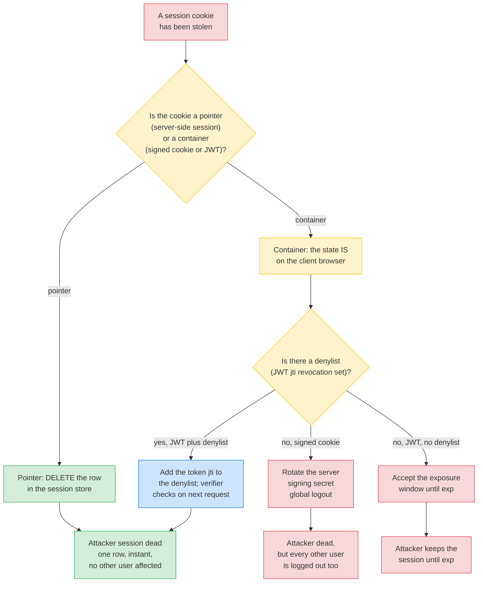
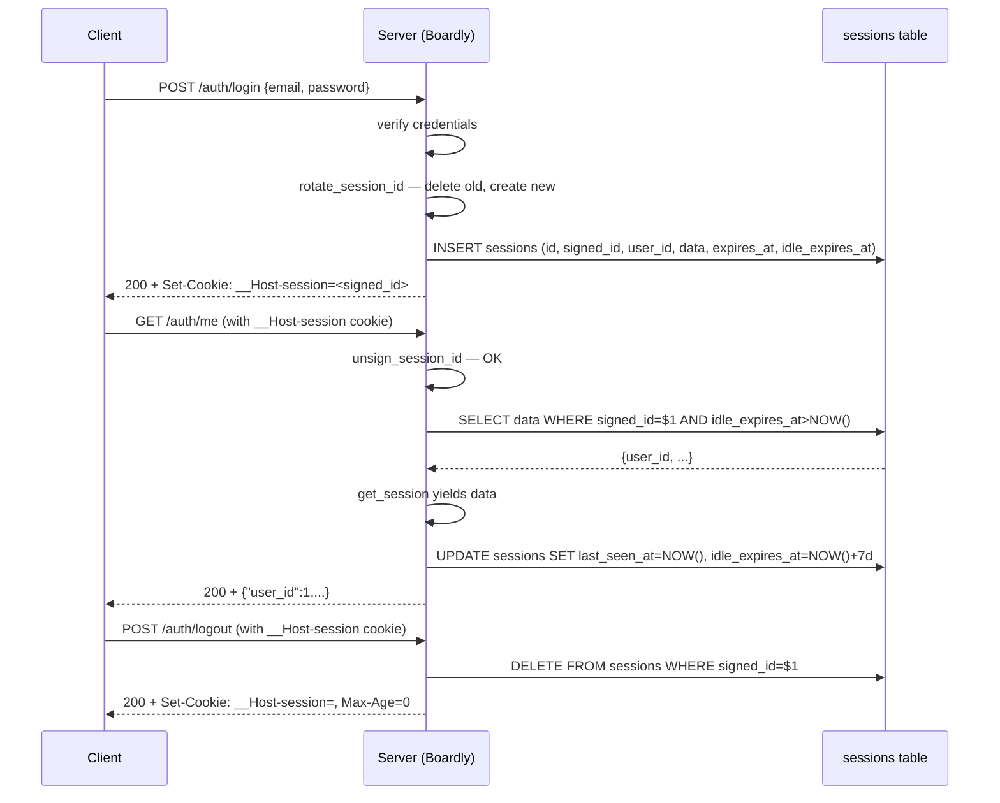
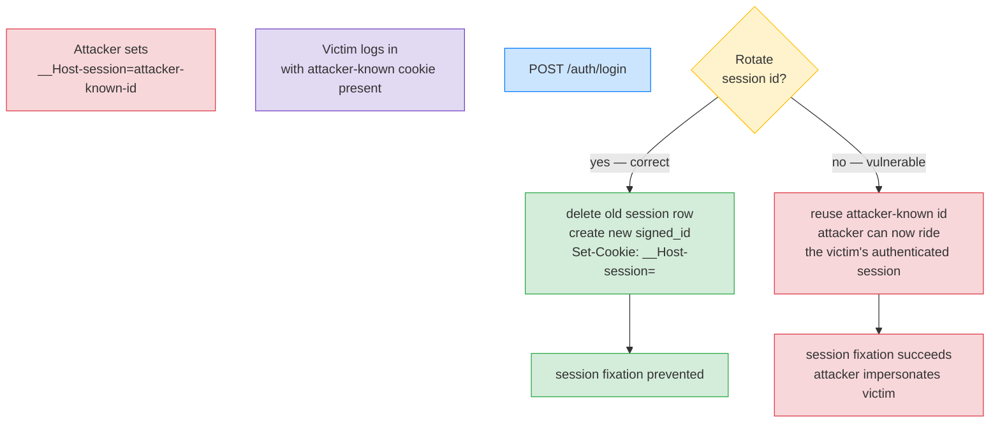

# Lesson 03: Session Management

*Building a real Postgres-backed server-side session store with signed session IDs, rotating on login, sliding expiry, and a startup sweep — for `Boardly`.*

**The cookie is just an ID. The state is on the server.**

Lesson 2 left you with a cookie that carries a small JSON payload. That works for tiny state. It does not work for "the user's full profile, their current project filter, the contents of their in-progress form, their 2FA challenge state, their last-seen notifications timestamp." Those payloads are too big for a 4 KB cookie, too sensitive to leave on the client, and too expensive to re-fetch on every request. Enter server-side sessions: the cookie carries an opaque, signed, unguessable ID; the state lives in your database. Today you build one from scratch — the way `Boardly` ships in production — including the session-fixation attack, the concurrent-session-limit feature, and the sliding-vs-absolute expiry decision. Take your time. This is the substrate that CSRF and auth-state-storage sit on.


#http #sessions #security #database #canonical

## Learning Objectives

By the end of this lesson you will be able to:

1. **Compare the three session-storage patterns** — server-side session, signed-cookie, JWT — and choose the right one for each use case.
2. **Implement a Postgres-backed session store** with signed session IDs, expiry, and a startup expiry-sweep in the lifespan.
3. **Explain the session-fixation attack** and why we rotate the session ID on login (and on privilege change).
4. **Implement sliding expiry** (every request extends the session) and **absolute expiry** (the session dies at a fixed wall-clock time regardless of activity) — and explain when each is right.
5. **Implement concurrent session limits** (a user can have at most N active sessions) and the "log out everywhere" feature.
6. **Write a `get_session` FastAPI dependency** that yields the loaded session and rolls back on exception.
7. **Sign the session ID with `itsdangerous`** so a forged ID is detected before hitting the database.
8. **Set the session cookie with `__Host-`** prefix, `HttpOnly`, `Secure`, `SameSite=Lax`.
9. **Reason about the trade-offs** — Postgres vs Redis vs in-memory; encrypted vs signed; per-request DB hit vs cache.

## Prerequisites

Before starting, you need:

- **Lesson 1 and Lesson 2 of this section** — [[HTTP-Headers-Deep-Dive]] and [[HTTP-Cookies-Deep-Dive]]. You should already know how to set a `__Host-` cookie and why.
- **Dependency injection** — [[03-FastAPI-Core/Dependency-Injection]]. `get_session` is a `Depends` function with `yield` cleanup.
- **FastAPI lifespan** — [[03-FastAPI-Core/Application-and-Lifespan]]. The expiry sweep runs in the lifespan startup block.
- **Pydantic `BaseModel`** — [[04-Pydantic/BaseModel-and-Validation]]. The session payload is a `BaseModel`.
- **About two hours of focused time.** This is the longest lesson in the section because sessions are the substrate of auth and CSRF. Take it slow.

**We use `itsdangerous` for signing, not full encryption.**

`itsdangerous` (by Flask's author, distributed under the Pallets umbrella) signs payloads using HMAC — it provides *integrity* and *authenticity* (you can detect tampering and verify you signed it), but not *confidentiality* (anyone can read the payload). For session IDs, that's fine — the payload is just an ID. For session *contents* stored on the client (the signed-cookie pattern), you'd want `cryptography.fernet` for encryption if the contents are sensitive. We use `itsdangerous` here because the session *contents* live on the server, not on the cookie.


## The Problem

Three patterns exist for "the cookie carries a piece of state that the server uses to identify the user." Each has a failure mode.

### Pattern 1: Server-side session (opaque ID)

The cookie carries `session=<random_id>`. The server looks up `<random_id>` in a store (Postgres, Redis, in-memory) and finds the state. The cookie is small (a UUID is 36 bytes, base64-encoded random is shorter). The state can be arbitrarily large. The state can be invalidated server-side (just delete the row). The user can have multiple sessions (one row per session). You can implement "log out everywhere" by deleting all rows for a user. The cost: every request hits the store.

**Failure mode:** store outage. If the store is down, no one can log in (or even stay logged in). Mitigate with Redis (fast) or a Postgres connection pool tuned for high QPS.

### Pattern 2: Signed cookie

The cookie carries the *state itself*, signed with the server's secret. The server verifies the signature on every request; if it matches, the state is trusted. No store lookup. The cost: cookie size is limited to 4 KB. You cannot invalidate server-side (the cookie is on the client's browser until it expires). You cannot list active sessions. You cannot implement "log out everywhere" cleanly.

**Failure mode:** revocation. If a user's cookie is stolen, you can't revoke it without rotating the server's signing secret — which logs out *every* user. Mitigate with short expiry.

### Pattern 3: JWT (stateless token)

Same as Pattern 2 but with a structured token (header, payload, signature) that other services can verify without talking to the auth server. The cost: same as signed cookies (4 KB max, no server-side revocation). Plus: JWT has a reputation for misuse (the `alg: none` attack, weak-key signatures, mixing up signing and encryption).

**Failure mode:** revocation + key management. JWT is the right choice for *distributed* auth (one auth server, many resource servers). For a single-app session, it's overkill.

**Note — Where each pattern fits in `Boardly`.**

We use **Pattern 1** (server-side session) for the *session* itself — the user's logged-in state, their cart, their filter preferences. We use **Pattern 3** (JWT) for the *access token* that we pass to other internal services (a separate billing service, a separate notifications service) — the access token lets those services verify the user's identity without calling back to `Boardly`'s session store. Lesson 7 ([[Authentication-State-Storage]]) covers the recommended pattern (access JWT in `Authorization` + refresh token in `httpOnly` cookie, where the refresh token is a server-side session ID).


The problem this lesson solves: **most tutorials stop at "store the session ID in a cookie." They skip the session-fixation attack, the expiry sweep, the concurrent-session limit, and the sliding-vs-absolute decision.** By the end of this lesson, your `Boardly` will have a real session store that handles all of them.

### Think like a senior engineer: the first question is always "can I revoke this?"

The three patterns above are usually taught as a storage decision — where does the state live? A senior reframes them as a *revocation* decision, because revocation is the axis that breaks at 3 a.m. The junior picks the signed cookie because it is fast (no DB hit); the senior picks the server-side session because, when the cookie is stolen, the senior can delete one row and the attacker's session dies in the time it takes the next request to hit `store.load`. The question is not "where does the state live?" — it is "*if this credential is compromised tomorrow, what is my lever, and what is its blast radius?*"

The revocation axis, across the three patterns:

| Pattern | State lives in | Can I revoke *one* stolen session server-side? | The revocation lever | Blast radius of a stolen cookie |
|---|---|---|---|---|
| Server-side session (this lesson) | Postgres / Redis row | Yes — `DELETE FROM sessions WHERE signed_id = $1` | One row, one round-trip, instant | One session dies; the user's other sessions and every other user are untouched. |
| Signed cookie | The cookie (state + HMAC) | No — the cookie is on the client's browser until it expires | Rotate the *server signing secret* — which invalidates every signed cookie for every user | One compromised cookie forces a global logout; or you ship a denylist (which re-introduces a store lookup and erases the "no DB hit" win). |
| JWT (stateless token) | The token (header.payload.sig) | No — the token is valid until `exp` unless the verifier checks a denylist | A denylist of revoked `jti`s (a Redis set) checked on every request; or rotate the signing key (global logout) | Either you accept the token is unrevokable until expiry (long `exp` = long exposure window), or you add a denylist (and the JWT is no longer stateless). |

The senior reads the table left-to-right and notices: revocation cost *is* the architectural decision. The server-side session's per-request DB hit is not a performance defect — it is the *price of revocability*. The signed cookie's speed is not a feature — it is the *absence of a revocation lever*. The JWT's statelessness is not elegance — it is a *revocation tax* you pay either in exposure windows or in a denylist that re-introduces the store.



**Think like a senior engineer: the cookie is a *pointer to revocable state*, not a *container*.**

The single most expensive session bug is treating the cookie as a container — stuffing `{user_id, roles, csrf_token}` into the cookie value and signing it. That makes the cookie a *bearer credential*: anyone who holds it holds the state, and the only revocation lever is global. The server-side session flips the polarity: the cookie holds an *opaque, signed, unguessable pointer*; the state lives in a row you control; revocation is `DELETE`. Every other decision in this lesson — rotating on login (so the pointer's value changes at the privilege boundary), sliding + absolute expiry (so the pointer's lifetime is bounded), the concurrent-session cap (so the number of live pointers per user is bounded), the sweep (so the dead pointers are collected) — is a corollary of the pointer-not-container reframe. When you design a session, ask "is this a pointer or a container?" and notice that the answer dictates every other property.


**Warning — Don't roll your own crypto.**

We use `itsdangerous` for signing, not `hmac` directly. We use `secrets.token_urlsafe` for random ID generation, not `random` (which is predictable). The primitives are simple to misuse. The library authors got them right. Use the libraries.


## The Code

Four pieces land in `Boardly` this lesson:

1. A `sessions` table (migration script below; we won't run it — we'll assume the table exists).
2. A `boardly/sessions/store.py` module with `SessionStore`, `sign_session_id`, `unsign_session_id`, `rotate_session_id`.
3. A `boardly/sessions/dependency.py` module with `get_session`, the FastAPI dependency.
4. An `auth` router with `POST /auth/login` (rotates session ID), `POST /auth/logout` (deletes session), `GET /auth/me` (reads the session).

The lifespan gets a new startup block: an expiry sweep that deletes sessions past their absolute expiry.

Save it across the three files. It's a superset of the existing `boardly/main.py` — the security-headers middleware and `/whoami` are unchanged, so we don't repeat them.

### `boardly/sessions/store.py`

```python
# boardly/sessions/store.py
"""Boardly — server-side session store.

Lesson 02b-3: Postgres-backed session store with signed session IDs,
sliding + absolute expiry, session-fixation rotation, concurrent
session limits, and a startup expiry sweep.
"""
from __future__ import annotations

import secrets
from dataclasses import dataclass
from datetime import datetime, timedelta, timezone
from typing import Any, Protocol

from itsdangerous import BadSignature, URLSafeTimedSerializer
from pydantic import BaseModel, Field


# --- Configuration ---
SESSION_COOKIE_NAME = "__Host-session"
SESSION_ABSOLUTE_TTL = timedelta(days=30) # max session lifetime
SESSION_IDLE_TTL = timedelta(days=7) # extended on each request (sliding)
SESSION_SIGNING_SECRET = "change-me-in-production" # from settings in real code
MAX_CONCURRENT_SESSIONS_PER_USER = 5


# --- The session payload that lives in the DB row ---
class SessionData(BaseModel):
 """The data we store in the `sessions.data` JSONB column."""
 user_id: int
 user_display_name: str
 last_seen_at: str # ISO timestamp
 csrf_token: str = Field(..., min_length=32) # used in Lesson 4


# --- The signed session ID ---
_serializer = URLSafeTimedSerializer(
 SESSION_SIGNING_SECRET,
 salt="boardly-session-v1",
)


def generate_session_id() -> str:
 """Generate a random 32-byte session ID, then sign it.

 The signature means a forged ID is detected before we hit the DB.
 """
 random_part = secrets.token_urlsafe(32) # 32 bytes → ~43 base64 chars
 return _serializer.dumps(random_part)


def unsign_session_id(signed: str, max_age_seconds: int | None = None) -> str | None:
 """Verify the signature and return the inner random ID, or None on failure."""
 try:
 return _serializer.loads(signed, max_age=max_age_seconds)
 except BadSignature:
 return None


# --- The storage interface ---
class SessionStoreProtocol(Protocol):
 """The interface every session store must implement.

 We define a Protocol so the dependency can be swapped (Postgres
 in prod, in-memory dict in tests, Redis in some deployments).
 """
 async def create(self, data: SessionData) -> str: ...
 async def load(self, session_id: str) -> SessionData | None: ...
 async def save(self, session_id: str, data: SessionData) -> None: ...
 async def delete(self, session_id: str) -> None: ...
 async def delete_all_for_user(self, user_id: int) -> int: ...
 async def delete_oldest_for_user(self, user_id: int, count: int) -> int: ...
 async def count_for_user(self, user_id: int) -> int: ...
 async def sweep_expired(self) -> int: ...


# --- The Postgres-backed implementation ---
class PostgresSessionStore:
 """Postgres-backed session store.

 The `sessions` table:
 CREATE TABLE sessions (
 id TEXT PRIMARY KEY, -- the random part (unsigned)
 signed_id TEXT NOT NULL UNIQUE, -- what the cookie carries
 user_id BIGINT NOT NULL REFERENCES users(id),
 data JSONB NOT NULL,
 created_at TIMESTAMPTZ NOT NULL DEFAULT NOW(),
 last_seen_at TIMESTAMPTZ NOT NULL DEFAULT NOW(),
 expires_at TIMESTAMPTZ NOT NULL, -- absolute expiry
 idle_expires_at TIMESTAMPTZ NOT NULL -- sliding expiry
 );
 CREATE INDEX sessions_user_id_idx ON sessions(user_id);
 CREATE INDEX sessions_idle_expires_idx ON sessions(idle_expires_at);
 """
 def __init__(self, pool: Any) -> None:
 self.pool = pool # an asyncpg.Pool — for SQLAlchemy AsyncEngine, see the SQLAlchemy adapter in [[07-SQLAlchemy/07-Async-SQLAlchemy]]

 async def create(self, data: SessionData) -> str:
 # 1. Generate a random ID and sign it.
 # 2. Insert the row with computed expiry timestamps.
 # 3. Return the signed ID (this becomes the cookie value).
 now = datetime.now(timezone.utc)
 signed_id = generate_session_id()
 inner_id = unsign_session_id(signed_id)
 # Use `if ... is None: raise` rather than `assert` — `assert` is
 # stripped under `python -O`, which would silently let `inner_id`
 # be `None` through to the INSERT below (a real bug in production).
 if inner_id is None:
 raise RuntimeError("sign+unsign returned None — should be impossible")
 async with self.pool.acquire() as conn:
 await conn.execute(
 """
 INSERT INTO sessions (id, signed_id, user_id, data, created_at,
 last_seen_at, expires_at, idle_expires_at)
 VALUES ($1, $2, $3, $4, $5, $5, $6, $7)
 """,
 inner_id, signed_id, data.user_id, data.model_dump_json(),
 now, now + SESSION_ABSOLUTE_TTL, now + SESSION_IDLE_TTL,
 )
 return signed_id

 async def load(self, signed_id: str) -> SessionData | None:
 # 1. Unsign — rejects forged IDs before they hit the DB.
 # 2. Look up the row by signed_id.
 # 3. If the row exists and idle_expires_at > now, return the data.
 # 4. Otherwise (row missing or expired), return None.
 if unsign_session_id(signed_id) is None:
 return None
 now = datetime.now(timezone.utc)
 async with self.pool.acquire() as conn:
 row = await conn.fetchrow(
 """
 SELECT data FROM sessions
 WHERE signed_id = $1 AND idle_expires_at > $2 AND expires_at > $2
 """,
 signed_id, now,
 )
 if row is None:
 return None
 return SessionData.model_validate_json(row["data"])

 async def save(self, signed_id: str, data: SessionData) -> None:
 # Update the data and extend the idle expiry (sliding).
 now = datetime.now(timezone.utc)
 async with self.pool.acquire() as conn:
 await conn.execute(
 """
 UPDATE sessions SET data = $1, last_seen_at = $2,
 idle_expires_at = $3
 WHERE signed_id = $4
 """,
 data.model_dump_json(), now, now + SESSION_IDLE_TTL, signed_id,
 )

 async def delete(self, signed_id: str) -> None:
 async with self.pool.acquire() as conn:
 await conn.execute("DELETE FROM sessions WHERE signed_id = $1", signed_id)

 async def delete_all_for_user(self, user_id: int) -> int:
 async with self.pool.acquire() as conn:
 result = await conn.execute(
 "DELETE FROM sessions WHERE user_id = $1", user_id
 )
 # asyncpg returns "DELETE N" — parse it.
 return int(result.split()[-1])

 async def delete_oldest_for_user(self, user_id: int, count: int) -> int:
 """Delete the `count` oldest active sessions for the user.

 Used by `rotate_session_id` to enforce the concurrent-session cap.
 One SQL statement — `ctid IN (SELECT ctid FROM ... ORDER BY
 last_seen_at ASC LIMIT $2)` — orders by last-seen and deletes
 the oldest `count` rows in a single round-trip. Returns the
 number of rows actually deleted (may be less than `count` if
 the user had fewer sessions than requested).
 """
 async with self.pool.acquire() as conn:
 result = await conn.execute(
 """
 DELETE FROM sessions
 WHERE ctid IN (
 SELECT ctid FROM sessions
 WHERE user_id = $1 AND idle_expires_at > NOW()
 ORDER BY last_seen_at ASC
 LIMIT $2
 )
 """,
 user_id, count,
 )
 return int(result.split()[-1])

 async def count_for_user(self, user_id: int) -> int:
 async with self.pool.acquire() as conn:
 row = await conn.fetchrow(
 """
 SELECT COUNT(*) AS cnt FROM sessions
 WHERE user_id = $1 AND idle_expires_at > NOW()
 """,
 user_id,
 )
 return row["cnt"] if row else 0

 async def sweep_expired(self) -> int:
 # Delete rows whose idle OR absolute expiry is past.
 now = datetime.now(timezone.utc)
 async with self.pool.acquire() as conn:
 result = await conn.execute(
 """
 DELETE FROM sessions
 WHERE idle_expires_at < $1 OR expires_at < $1
 """,
 now,
 )
 return int(result.split()[-1])


# --- The session-fixation rotation ---
async def rotate_session_id(
 store: SessionStoreProtocol,
 old_signed_id: str | None,
 new_data: SessionData,
) -> str:
 """Rotate the session ID on login (or on privilege change).

 If `old_signed_id` exists, delete it and any expired sessions for
 the same user. Then enforce the concurrent-session limit by deleting
 the oldest sessions beyond MAX_CONCURRENT_SESSIONS_PER_USER. Then
 create a new session with the new data.
 """
 if old_signed_id:
 old_inner = unsign_session_id(old_signed_id)
 if old_inner:
 # We need the user_id before we delete; load first.
 old_data = await store.load(old_signed_id)
 await store.delete(old_signed_id)
 if old_data is not None:
 # Enforce concurrent-session limit. Count this user's active
 # sessions; if we are about to exceed the limit, delete the
 # oldest-sessions-first to keep the new session under the cap.
 count = await store.count_for_user(old_data.user_id)
 if count >= MAX_CONCURRENT_SESSIONS_PER_USER:
 # Delete the (count - limit + 1) oldest sessions. The
 # `delete_oldest_for_user` method runs a single SQL
 # statement that orders by `last_seen_at ASC` and deletes
 # the oldest rows beyond the limit — a single round-trip,
 # no client-side looping.
 to_delete = count - MAX_CONCURRENT_SESSIONS_PER_USER + 1
 await store.delete_oldest_for_user(old_data.user_id, to_delete)

 new_signed_id = await store.create(new_data)
 return new_signed_id
```

### `boardly/sessions/dependency.py`

```python
# boardly/sessions/dependency.py
"""Boardly — the `get_session` FastAPI dependency."""
from __future__ import annotations

from typing import Annotated

from fastapi import Cookie, Depends, Request
from fastapi.responses import Response

from boardly.sessions.store import (
 SESSION_COOKIE_NAME,
 SessionData,
 SessionStoreProtocol,
)


def _store(request: Request) -> SessionStoreProtocol:
 """Resolve the SessionStore from app.state.

 The lifespan (in main.py) sets app.state.session_store = PostgresSessionStore(...).
 """
 return request.app.state.session_store


async def get_session(
 request: Request,
 response: Response,
 store: Annotated[SessionStoreProtocol, Depends(_store)],
 session_cookie: Annotated[str | None, Cookie(alias=SESSION_COOKIE_NAME)] = None,
):
 """Yield the loaded SessionData (or None), saving it back on response.

 The pattern: load → yield → on response, save the (possibly mutated)
 data back to the store. This is the FastAPI equivalent of "request
 comes in, session is loaded; request ends, session is saved."

 We use `yield` so that even if the handler raises, we still save (or
 roll back) on the way out. This is the Starlette `BaseHTTPMiddleware`
 pattern translated to a dependency.
 """
 if session_cookie is None:
 # No session cookie → anonymous request.
 yield None
 return

 data = await store.load(session_cookie)
 if data is None:
 # Invalid or expired session → clear the cookie.
 response.set_cookie(
 key=SESSION_COOKIE_NAME, value="", max_age=0,
 secure=True, httponly=True, samesite="lax", path="/",
 )
 yield None
 return

 # Make the session available to the handler.
 request.state.session = data

 yield data

 # On response: save the (possibly mutated) session data back.
 # If the handler set request.state.session = None, treat as logout.
 final = getattr(request.state, "session", None)
 if final is not None:
 await store.save(session_cookie, final)


SessionDep = Annotated[SessionData | None, Depends(get_session)]
```

### `boardly/routers/auth.py`

```python
# boardly/routers/auth.py
"""Boardly — auth router that uses the session store."""
from __future__ import annotations

from datetime import datetime, timezone
from typing import Annotated

import secrets

from fastapi import APIRouter, Depends, Request, Response
from fastapi.responses import JSONResponse, RedirectResponse
from pydantic import BaseModel

from boardly.sessions.dependency import SessionDep, _store
from boardly.sessions.store import (
 SESSION_COOKIE_NAME,
 SessionData,
 SessionStoreProtocol,
 rotate_session_id,
)


router = APIRouter(prefix="/auth", tags=["auth"])


class LoginRequest(BaseModel):
 email: str
 password: str # in real code, hash + verify against users table


class User(BaseModel):
 id: int
 email: str
 display_name: str


# --- Stub user lookup (replace with real DB query) ---
_USERS_DB = {
 "alice@boardly.dev": User(id=1, email="alice@boardly.dev", display_name="Alice"),
}


@router.post("/login")
async def login(
 payload: LoginRequest,
 request: Request,
 response: Response,
 store: Annotated[SessionStoreProtocol, Depends(_store)],
) -> dict:
 """Authenticate, rotate the session ID (anti-fixation), set the cookie."""
 user = _USERS_DB.get(payload.email)
 if user is None or payload.password != "hunter2": # never ship this
 return JSONResponse({"error": "invalid credentials"}, status_code=401)

 # Read any existing session cookie — we'll rotate it.
 old_cookie = request.cookies.get(SESSION_COOKIE_NAME)

 # Build the new session data.
 new_data = SessionData(
 user_id=user.id,
 user_display_name=user.display_name,
 last_seen_at=datetime.now(timezone.utc).isoformat(),
 csrf_token=secrets.token_urlsafe(32), # used in Lesson 4
 )

 # Rotate the session ID — defends against session fixation.
 new_signed_id = await rotate_session_id(store, old_cookie, new_data)

 # Set the session cookie with the new signed ID.
 response.set_cookie(
 key=SESSION_COOKIE_NAME,
 value=new_signed_id,
 max_age=60 * 60 * 24 * 7, # 7 days, matches SESSION_IDLE_TTL
 secure=True,
 httponly=True,
 samesite="lax",
 path="/",
 )
 return {"user_id": user.id, "display_name": user.display_name}


@router.post("/logout")
async def logout(
 request: Request,
 response: Response,
 store: Annotated[SessionStoreProtocol, Depends(_store)],
) -> dict:
 """Delete the session row and clear the cookie."""
 cookie = request.cookies.get(SESSION_COOKIE_NAME)
 if cookie:
 await store.delete(cookie)
 response.set_cookie(
 key=SESSION_COOKIE_NAME, value="", max_age=0,
 secure=True, httponly=True, samesite="lax", path="/",
 )
 return {"ok": True}


@router.get("/me")
async def me(session: SessionDep) -> dict:
 """Read the current session. Returns 401 if not logged in."""
 if session is None:
 return JSONResponse({"error": "not authenticated"}, status_code=401)
 return {"user_id": session.user_id, "display_name": session.user_display_name}
```

### `boardly/main.py` additions

```python
# Add to the lifespan startup block, after the engine is created:
@app.on_event("startup") # NO — use the lifespan. We're inside the lifespan.
# Inside lifespan, after creating the engine:
async def lifespan(app: FastAPI) -> AsyncIterator[None]:
 print("Boardly starting up…")
 app.state.version = "0.4.2"
 # Real engine creation would be here. For the lesson, stub it:
 # engine = create_async_engine(...)
 # app.state.engine = engine

 # Build the session store and run the expiry sweep.
 from boardly.sessions.store import PostgresSessionStore
 app.state.session_store = PostgresSessionStore(pool=app.state.engine)
 deleted = await app.state.session_store.sweep_expired()
 print(f"Swept {deleted} expired sessions.")

 yield

 print("Boardly shutting down…")
 # await app.state.engine.dispose()
```

That's the file set. ~350 lines across three modules + the lifespan addition. Run it (assuming you have a `sessions` table and an `engine`). Then come back and we'll go through it line by line.

## Line-by-Line Deep Dive

We'll walk the three most important pieces: the signed session ID, the `load`/`save` cycle, and the session-fixation rotation.

### `generate_session_id` and `unsign_session_id`

```python
_serializer = URLSafeTimedSerializer(
 SESSION_SIGNING_SECRET,
 salt="boardly-session-v1",
)

def generate_session_id() -> str:
 random_part = secrets.token_urlsafe(32)
 return _serializer.dumps(random_part)

def unsign_session_id(signed: str, max_age_seconds: int | None = None) -> str | None:
 try:
 return _serializer.loads(signed, max_age=max_age_seconds)
 except BadSignature:
 return None
```

**What it does:** Generates a 32-byte random ID (`secrets.token_urlsafe(32)` produces ~43 characters of URL-safe base64), then signs it with `itsdangerous`. The signature is appended to the ID with a `.` separator. The full signed ID is what goes in the cookie.

**Why sign?** Two reasons:

1. **Forgery detection.** Without a signature, an attacker could send any random string as the `session` cookie and force a database lookup. With a signature, the server can detect "this isn't one I signed" *before* hitting the DB. That's a cheap CPU check vs an expensive DB round-trip.
2. **Tamper detection.** If an attacker modifies the signed ID (e.g., to try to swap user IDs), the signature won't verify.

**Why `URLSafeTimedSerializer`?** `URLSafe` means the output uses only URL-safe characters (no `+`, `/`, `=`). `Timed` means the serializer adds a timestamp — so `.loads(signed, max_age=...)` can reject old signatures even if the signature is otherwise valid. We don't use `max_age` here (the DB enforces expiry), but the timestamp is useful for debugging.

**Why `salt="boardly-session-v1"`?** The salt is mixed into the HMAC key. Different salts → different signatures for the same payload. So a signature made for "boardly-session-v1" can't be replayed as "boardly-flash-v1" even if both use the same secret. We use `v1` in the salt so that rotating the signing secret *and* the salt (`v2`) invalidates every existing cookie at once.

**Tip — `secrets.token_urlsafe(32)` vs `uuid.uuid4()`.**

`uuid.uuid4()` is a 128-bit (16-byte) random UUID. `secrets.token_urlsafe(32)` is a 256-bit (32-byte) random value. Both are cryptographically random. The difference is entropy: 128 bits is enough for collision-resistance in any practical scenario, but 256 bits is the modern recommendation for session IDs — it gives you headroom against future attacks (e.g., a partial preimage attack that reduces effective entropy). `secrets.token_urlsafe` is also shorter in URL-safe base64 (~43 chars) than a UUID (~36 chars with hyphens).


**Danger — How an attacker thinks: session prediction from weak randomness**

A 256-bit session ID looks unguessable; the attacker does not try to guess *the ID*, they try to guess *the generator*. The attack recovers the internal state of your RNG from observed outputs and predicts future IDs. **The historical case.** PHP 5.x's default `session.entropy_file` was empty; the session ID was `md5(uniqid(php_uname(), true))` — effectively the current time in microseconds hashed with the server's hostname. An attacker who could observe two session IDs from the same server (their own, plus any other user's sniffed or leaked ID) could recover the microtime offset and predict the next session ID within a few thousand candidates — a brute-force that fit in minutes on a 2009 laptop. CVE-class for years. **The modern bar.** The OWASP session-management cheat sheet requires *at least 64 bits* of session-ID entropy where the ID is the sole auth credential; the modern recommendation is 128 bits minimum, 256 bits preferred (headroom against partial-state-recovery attacks on the underlying CSPRNG). `secrets.token_urlsafe(32)` is 256 bits from `os.urandom`, which draws from the kernel's CSPRNG (`getrandom(2)` on Linux) — not predictable, not time-seeded, not recoverable from observed outputs. **The two things attackers exploit when you get it wrong.** (1) *Time-seeded RNG* — `random.seed(time.time())` makes the ID a function of the server's clock; an attacker who knows the approximate server time reduces the search space to seconds. (2) *Sequence-based IDs* — `1, 2, 3, ...` or `uuid1()` (MAC + clock) lets an attacker enumerate or recover the MAC. The grep: `rg "random\.|uuid1\(" boardly/` should return nothing in session-ID code; `secrets.token_urlsafe` is the only acceptable primitive. **The defence is not the length.** A 256-bit ID from `random.random()` is 256 bits of *predictable* state — length does not save you. The defence is *the source*: `os.urandom` (via `secrets`), never `random`, never `uuid1` for auth.


**Danger — How an attacker thinks: session stealing via network sniffing**

A 256-bit, cryptographically-random, signed session ID is *worthless* if it crosses the network in cleartext. The attack does not break the ID; it reads it off the wire. **The canonical demonstration.** Firesheep (2010, Eric Butler) was a Firefox extension that passively captured session cookies on open WiFi and open WEP networks — it listened for HTTP (not HTTPS) `Cookie:` headers, parsed the session ID, and presented a one-click "log in as this user" button for every sniffed account (Facebook, Twitter, Flickr at the time). It worked because the sites served login over HTTPS but *subsequent requests* over plain HTTP, leaking the session cookie on every unencrypted page load. Firesheep was the public proof that "the session cookie is a bearer credential" meant "anyone on your WiFi is you." **The modern shape.** Open WiFi is rarer; the attack has not gone away, it has moved to (1) malicious WiFi hotspots that downgrade `https://` URLs to `http://` via a redirect the user doesn't notice, (2) TLS-stripping middleboxes in corporate or hotel networks, and (3) the `http://` first-paint problem — a user types `boardly.dev` (no scheme), the browser tries `http://` first, and the very first request leaks every non-`Secure` cookie before the redirect to HTTPS lands. **The three-layer defence, in order.** (1) `Secure` on the session cookie — the browser refuses to attach it to `http://` requests, so the downgraded first request goes out cookieless and the redirect to HTTPS is harmless. (2) HSTS (`Strict-Transport-Security: max-age=63072000; includeSubDomains`) — the browser *never* tries `http://` for your origin after the first trust; the `http://` first-paint lane closes. (3) Preload-list inclusion — the user's browser ships knowing your origin is HTTPS-only, so even the *first* visit has no `http://` window. **What this lesson's `Secure=True` buys you.** It is the first layer — without it, HSTS is a timing band-aid and the preload list is a long-tail migration. The session cookie in this lesson is set with `secure=True` (and `__Host-` forces it); the Boardly security-headers middleware from [[HTTP-Headers-Deep-Dive|Lesson 1]] adds HSTS. Ship both — `Secure` for the cookie, HSTS for the origin — because the attacker only needs one `http://` request to win.


**Warning — When this breaks: salt rotation order — the silent dependency between salt and secret**

**Symptom.** The team rotates the signing secret (a leaked-secret incident response) without rotating the salt. Users report being logged out *gradually* over a 7-day window, not all at once — the rotating-secret migration accepted both old and new secrets for a window, and the salt-stable signatures produced by the old secret are accepted by the new secret (HMAC's key is the secret; the salt is mixed in but does not change with the secret rotation). The team expected the rotation to invalidate every cookie at once; instead, the old cookies survived the rotation because the salt-stable signature verified against the *new* secret's HMAC of the salt-stable payload — the rotation was a no-op for any cookie still using the old salt's signature.
**Diagnosis.** The lesson above says "rotate the salt and the signing secret together (v2 + new-secret) to invalidate every existing cookie at once." The order matters: rotating the secret alone is a *key-rotation* (the new HMAC of the same payload verifies against the new secret); rotating the salt alone is a *payload-rotation* (the payload's signed form changes because the salt mixes into the key derivation); rotating *both* is the unconditional invalidation. A team that rotates only the secret gets a no-op on existing cookies (HMAC with new key of the same payload still verifies if the new key is in the accepted set). The grep: `rg "salt=|signing_secret" boardly/sessions/store.py` should return both lines, and a rotation PR should touch both.
**Fix.** Treat salt and secret as a *pair* — rotate both in the same PR, behind a feature flag that accepts both `(v1, old-secret)` and `(v2, new-secret)` for a window, then drops `v1`. The CI audit: a PR that touches `SESSION_SIGNING_SECRET` but not `salt=` (or vice versa) should fail review with "rotation must touch both." See [[HTTP-Cookies-Deep-Dive|Lesson 2]]'s salt-rotation danger callout for the same pattern applied to the cookie-signing substrate.


### `PostgresSessionStore.load`: the safe lookup

```python
async def load(self, signed_id: str) -> SessionData | None:
 if unsign_session_id(signed_id) is None:
 return None
 now = datetime.now(timezone.utc)
 async with self.pool.acquire() as conn:
 row = await conn.fetchrow(
 """
 SELECT data FROM sessions
 WHERE signed_id = $1 AND idle_expires_at > $2 AND expires_at > $2
 """,
 signed_id, now,
 )
 if row is None:
 return None
 return SessionData.model_validate_json(row["data"])
```

**What it does:** Verifies the signature, looks up the row by `signed_id`, checks both the idle and absolute expiry, returns the parsed `SessionData` or `None`.

**The four-step defence in depth:**

1. **Signature check** — rejects forged IDs without touching the DB.
2. **Row lookup** — rejects IDs that don't exist in our store.
3. **Idle expiry check** — rejects sessions the user hasn't touched in `SESSION_IDLE_TTL` (7 days).
4. **Absolute expiry check** — rejects sessions older than `SESSION_ABSOLUTE_TTL` (30 days), even if the user has been active.

**Why both idle and absolute expiry?** See "Sliding vs absolute expiry" below.

**Why `idle_expires_at > $2 AND expires_at > $2`?** Both conditions must be true. If either is past, the session is dead.

**Production reality: the index-only scan that makes the session-lookup cheap**

The `SELECT data FROM sessions WHERE signed_id = $1 AND idle_expires_at > $2 AND expires_at > $2` query looks like it should hit the disk on every request — but on a well-tuned Postgres, it is an *index-only scan* that returns in microseconds from `shared_buffers`. The two conditions for an index-only scan: (1) a covering index on `(signed_id, idle_expires_at, expires_at)` that includes the `data` column (or a `INCLUDE (data)` index in Postgres 11+), (2) the visibility map is up-to-date so the planner knows the indexed rows are visible to all transactions (no need to fetch the heap page to check `xmin`/`xmax`). The grep: `EXPLAIN (ANALYZE, BUFFERS) SELECT data FROM sessions WHERE signed_id = '...' AND idle_expires_at > NOW();` should return `Index Only Scan` with `Heap Fetches: 0` on a hot path. If you see `Index Scan` with `Heap Fetches: N`, the visibility map is stale — `VACUUM sessions` to refresh it. The production posture: a session-lookup that is an index-only scan is ~50-100 microseconds (over loopback); a session-lookup that is a heap-fetching index scan is ~1-2 milliseconds. The 10-20× difference is the gap between "Postgres is fine for sessions at 5K RPS" and "you need Redis." See [[08-PostgreSQL/EXPLAIN-ANALYZE-and-Query-Plans]] for the index-design substrate and VACUUM and Bloat for the visibility-map maintenance that keeps the index-only scan cheap.


### `PostgresSessionStore.save`: the sliding extension

```python
async def save(self, signed_id: str, data: SessionData) -> None:
 now = datetime.now(timezone.utc)
 async with self.pool.acquire() as conn:
 await conn.execute(
 """
 UPDATE sessions SET data = $1, last_seen_at = $2,
 idle_expires_at = $3
 WHERE signed_id = $4
 """,
 data.model_dump_json(), now, now + SESSION_IDLE_TTL, signed_id,
 )
```

**What it does:** Updates the data, sets `last_seen_at = now`, and extends `idle_expires_at` to `now + SESSION_IDLE_TTL`. The `expires_at` (absolute) is NOT extended — that's the absolute cap.

**Why save on every request?** Sliding expiry: a user who keeps using the app stays logged in. A user who closes the tab and comes back in 8 days is logged out (idle expired).

**Sliding vs absolute expiry.**

**Sliding** (`idle_expires_at`): extended on each request. The session stays alive as long as the user is active. **Absolute** (`expires_at`): fixed at creation time. The session dies at this wall-clock time regardless of activity.

The two together: "you stay logged in for up to 7 days of inactivity, but no longer than 30 days total." That's the standard pattern for consumer apps. For high-security apps (banking), use absolute only — short absolute, no sliding. For low-security apps (a forum), use sliding only — long idle, no absolute.


**Warning — When this breaks: the save-on-every-request is write amplification, not just read load**

**Symptom.** The session store's `save()` runs an `UPDATE` on every authenticated request — sliding expiry extends `idle_expires_at`. The read path is an index-only scan (cheap); the write path is a heap `UPDATE` that bumps `xmin`, generates WAL, and creates a dead tuple the autovacuum must reclaim. At 1K RPS, the `sessions` table sees 1K writes/second; the autovacuum cannot keep up; the table bloats to 10× its logical size; the index-only scan on `load` degrades to a heap-fetching scan (the visibility map is stale because the rows are being updated faster than autovacuum can refresh it); the session-lookup latency climbs from 100 microseconds to 5 milliseconds; the p99 trace shows a session-load cliff.
**Diagnosis.** The lesson's "save on every request" is correct for the *sliding-expiry* contract — but the implementation choice (a full `UPDATE` on every request) is the maximum write-amplification version of the contract. Two cheaper alternatives: (1) *conditional save* — only `UPDATE` if `idle_expires_at` is within (say) 1 hour of `NOW()` (so a session that has 6 days of idle life left is not bumped on every request; only when it gets close to expiring). This reduces writes by ~95% for active sessions. (2) *Lazy save* — defer the `idle_expires_at` bump to a background job that runs every minute for sessions active in the last minute. The trade-off: the lazy save has a 1-minute window where a stolen session is valid even after the user's last activity. The grep: `rg "store.save" boardly/sessions/dependency.py` is the write-amplification audit — every hit is a write per request.
**Fix.** Ship the conditional-save version (the simplest): `if (idle_expires_at - NOW()) < 1h: store.save(...)` — the threshold is tunable. Run `VACUUM (ANALYZE) sessions` on a cron (every 5 minutes for a hot table) to keep the visibility map fresh. Measure the write QPS before and after the conditional-save change — the reduction is the metric that justifies the trade-off.


### `get_session`: the FastAPI dependency

```python
async def get_session(
 request: Request,
 response: Response,
 store: Annotated[SessionStoreProtocol, Depends(_store)],
 session_cookie: Annotated[str | None, Cookie(alias=SESSION_COOKIE_NAME)] = None,
):
 if session_cookie is None:
 yield None
 return
 data = await store.load(session_cookie)
 if data is None:
 response.set_cookie(...)
 yield None
 return
 request.state.session = data
 yield data
 final = getattr(request.state, "session", None)
 if final is not None:
 await store.save(session_cookie, final)
```

**What it does:** Loads the session from the store, yields it to the handler, then (after the handler returns) saves the (possibly mutated) session back.

**The `yield` pattern:** This is the FastAPI/Starlette "dependency with cleanup" pattern from [[03-FastAPI-Core/Dependency-Injection|Section 03 Lesson 4]]. Code before `yield` runs before the handler; `yield` returns the value to the handler; code after `yield` runs after the handler — even if the handler raised.

**Why `request.state.session = data`?** So other code (middleware, other dependencies) can access the loaded session without re-running `get_session`. `request.state` is Starlette's per-request attribute bag.

**Why `getattr(request.state, "session", None)`?** If the handler set `request.state.session = None` (i.e., wanted to log out), we don't save. Otherwise, we save the (possibly mutated) data back to the store.

**Why `Cookie(alias=...)`?** `SESSION_COOKIE_NAME = "__Host-session"` is not a valid Python parameter name (contains `-`). `Cookie(alias=...)` lets us bind a cookie with a non-identifier name to a parameter.

**Warning — `Cookie` parameter names must be unique.**

FastAPI uses the parameter name to look up the cookie. If two parameters both have `Cookie(alias="__Host-session")`, you get unexpected behaviour. Use `alias=` consistently across the codebase.


**Danger — The `yield`-cleanup runs even on exception — but `request.state.session = None` *inside a raised handler* is a footgun**

The lesson says "if the handler set `request.state.session = None` (i.e., wanted to log out), we don't save." That logic is in the `yield`-cleanup path — the code after `yield` runs *whether the handler returned normally or raised*. The danger: a handler that does `request.state.session = None` *and then raises* (e.g., the handler tried to log out, then the downstream DB write failed and raised) leaves the session in an inconsistent state — the `yield` cleanup reads `request.state.session == None`, skips the save, and the session row in Postgres is *still alive* (the DB write that would have deleted it failed). The user's session is "logged out in the handler's view" but "still alive in the store" — an attacker who stole the cookie can still use it. The fix: do not use `request.state.session = None` as the logout signal — make logout an *explicit* `await store.delete(session_cookie)` followed by the cookie-clear `Set-Cookie`, in a `try/finally` that runs even if the subsequent code raises. The grep: `rg "request.state.session = None|request.state.session=None" boardly/` is a smell — every hit is a "logout-via-state-mutation" pattern that is not exception-safe. The senior's rule: state mutation is for *in-request* communication (the handler mutates the session data, the dependency saves it back); *side-effectful* operations (delete, rotate, clear-cookie) belong in explicit `try/finally` blocks, not in `yield`-cleanup that reads state.


### `rotate_session_id`: the session-fixation defence

```python
async def rotate_session_id(
 store: SessionStoreProtocol,
 old_signed_id: str | None,
 new_data: SessionData,
) -> str:
 if old_signed_id:
 old_inner = unsign_session_id(old_signed_id)
 if old_inner:
 old_data = await store.load(old_signed_id)
 await store.delete(old_signed_id)
 if old_data is not None:
 count = await store.count_for_user(old_data.user_id)
 if count >= MAX_CONCURRENT_SESSIONS_PER_USER:
 to_delete = count - MAX_CONCURRENT_SESSIONS_PER_USER + 1
 await store.delete_oldest_for_user(old_data.user_id, to_delete)
 new_signed_id = await store.create(new_data)
 return new_signed_id
```

**What it does:** On login, deletes any existing session for this cookie, enforces the concurrent-session limit (deletes the oldest-sessions-first to keep the new session under the cap), then creates a new one with a fresh signed ID. The cookie value the browser stored is invalidated; a new one is set.

**The attack this prevents:** *Session fixation.* An attacker gets a victim to load a session ID the attacker controls (e.g., by emailing a link with `?session=attacker_id` and an XSS that sets the cookie, or by exploiting a subdomain that can set cookies). The victim logs in; the server *reuses* the existing session ID; the attacker's known ID is now the victim's authenticated session. The attacker can impersonate the victim.

**The defence:** On login, *always* generate a new session ID, regardless of whether there was an existing one. The attacker's known ID is invalidated when the victim logs in.

**Why `delete_oldest_for_user` rather than `delete_all_for_user`:** the concurrent-session limit is "a user can have at most N active sessions" — not "delete everything." Deleting the oldest sessions (ordered by `last_seen_at ASC`) preserves the user's other active devices while making room for the new login. The single-statement `DELETE ... WHERE ctid IN (SELECT ctid FROM ... ORDER BY last_seen_at ASC LIMIT $2)` is one round-trip, no client-side looping.

**Danger — Rotate on every privilege change.**

The rotation isn't just for login. Rotate on:
- Login (anonymous → authenticated).
- Logout (authenticated → anonymous) — actually, just delete.
- Privilege escalation (regular user → admin).
- 2FA verification (password verified → fully authenticated).
- Password reset (old sessions should all be invalidated).

Each of these is a state change where the *value* of the session changes. A stolen pre-login session ID shouldn't grant post-login access.


**Warning — When this breaks: session fixation discovered in a production pentest**

**Symptom.** The security team's pentest report lands a "Medium" finding: "the application reuses the pre-login session identifier as the post-login session identifier." Your logs confirm it — grep the access logs for the `__Host-session` cookie value across `/auth/login` requests and the same ID appears in the `Cookie:` header *before* login and in the `Set-Cookie:` header *after* login, for the same IP, within the same second. No user has reported harm (yet). The finding is structural, not a single incident.
**Diagnosis.** The login handler was written without `rotate_session_id` — or with a *conditional* rotation (`if old_cookie is None: create(); else: save()`), which reuses the existing ID when a pre-login cookie was present. The attack this enables: an attacker obtains a valid pre-login session ID (e.g., from an anonymous CSRF endpoint that creates a session, or by setting the cookie via a sibling subdomain before `__Host-` was adopted), tricks the victim into loading it, and waits for the victim to log in. Because the ID is *not* rotated, the attacker's pre-known ID is now the victim's *authenticated* ID — the attacker loads it into their own browser and is the victim. The grep that confirms the diagnosis: `rg "session_cookie" boardly/routers/auth.py` and check whether the login path *always* calls `rotate_session_id`, or whether it has a "reuse if present" branch.
**Fix.** Make rotation *unconditional* on every privilege change (login, privilege escalation, 2FA verification, password reset) — `rotate_session_id(store, old_cookie, new_data)` always creates a new ID regardless of whether `old_cookie` was present. Add a regression test that logs in twice with the same pre-login cookie and asserts the post-login `Set-Cookie` value differs on every login (`test_login_rotates_session_id`). Add a CI grep that fails the build if `auth.py` contains `store.save` in the login path without a preceding `rotate_session_id` (the structural enforcement — code review alone misses the conditional-rotation drift). The structural fix is the rotation; the test catches the regression; the grep prevents reintroduction. See [[CSRF-Protection|Lesson 4]] for the CSRF token that *also* rotates with the session — a fixed CSRF token on a rotated session is its own bug.


**Warning — When this breaks: the rotate-race when two concurrent logins for the same user land**

**Symptom.** A user opens `app.boardly.dev` in two browser tabs simultaneously, clicks "login" in both tabs within 50 milliseconds of each other, and the team's concurrent-session cap is 1 (a strict admin policy). The two `POST /auth/login` requests land on two different Uvicorn workers. Worker A loads the user's existing session (`count_for_user` returns 1), Worker B loads the same (`count_for_user` returns 1, the same row A is about to delete). Worker A deletes the oldest, creates a new session, returns. Worker B *also* deletes the oldest (which is now A's new session), creates a new session, returns. The user ends up with 2 sessions (B's, since A's was deleted by B), but the concurrent-session cap was 1 — the cap was violated by the race.
**Diagnosis.** The `rotate_session_id` function's `count_for_user` + `delete_oldest_for_user` + `create` sequence is *not atomic* — it's three SQL statements with no transaction wrapping them. Two concurrent calls interleave: A.count → B.count → A.delete → B.delete (deletes A's new session) → A.create → B.create → user has 2 sessions. The lesson's `delete_oldest_for_user` is a single SQL statement (atomic per call), but the `count` → `delete` → `create` sequence is not. The fix is a transaction: wrap the count+delete+create in a single Postgres transaction with `SERIALIZABLE` isolation (or `SELECT ... FOR UPDATE` on the user's session rows) so the second login blocks until the first commits. The grep: `rg "rotate_session_id" boardly/sessions/` is the audit — every call site should be inside a transaction.
**Fix.** Either (a) wrap `rotate_session_id` in a `BEGIN; ... COMMIT;` transaction with `SERIALIZABLE` isolation (the cleanest fix — Postgres will retry the second login on a serialization conflict), or (b) accept the race and use a `DELETE FROM sessions WHERE user_id = $1 AND signed_id <> $2` (delete-all-except-the-new-one) as a post-`create` cleanup step (less clean, but works for the strict cap case). Add a regression test (`uv run pytest tests/test_session_concurrent_login.py -k concurrent_login_race`) that spawns two `httpx.AsyncClient` logins in `asyncio.gather` and asserts the final session count equals the cap, not 2× the cap.


### The lifespan expiry sweep

```python
async def lifespan(app: FastAPI) -> AsyncIterator[None]:
 print("Boardly starting up…")
 # …
 app.state.session_store = PostgresSessionStore(pool=app.state.engine)
 deleted = await app.state.session_store.sweep_expired()
 print(f"Swept {deleted} expired sessions.")
 yield
```

**What it does:** On startup, deletes all sessions whose idle or absolute expiry has passed.

**Why on startup?** The `idle_expires_at > $2` check in `load` already filters expired sessions, so the sweep isn't *necessary* for correctness — it's an optimisation. The `sessions` table grows over time (every login creates a row); the sweep keeps it bounded.

**Why not on a cron?** Two reasons:

1. The sweep is part of the app — no extra infrastructure.
2. Every worker (if you run multiple Uvicorn workers) does the sweep on startup, which is fine — the `DELETE` is idempotent (a row deleted twice is just deleted once).

**What about long-running processes?** A process that runs for a week without restart doesn't sweep. The fix is to also sweep periodically (e.g., every hour via a background task) or to add a `WHERE idle_expires_at < NOW()` check to every `load` (which we do).

**Student asks: why not Redis?**

Redis is the *classic* session store — `SETEX session:<id> <ttl> <data>` is exactly the right primitive. It's faster than Postgres for this access pattern (sub-millisecond vs ~1 ms), it auto-expires keys (no sweep needed), and it scales horizontally. The reasons we use Postgres in `Boardly`:
- We already have Postgres (one fewer moving part).
- Sessions are not *that* hot — a few hundred QPS at most for our scale.
- The session row joining the users table is convenient (single transaction).

For a service with 10K+ RPS, Redis is the right choice. The `SessionStoreProtocol` interface lets us swap implementations without touching the dependency. [[14-Caching-and-Background-Processing/Redis-Cache-Aside]] covers Redis in depth.


**Student asks: if a session row is deleted by the sweep, what happens to the cookie in the user's browser?**

The cookie is still there — the browser does not know the server-side session row is gone. The next request that includes the cookie hits `unsign_session_id`, succeeds, then `store.load(signed_id)` returns `None` because the row was deleted. The `get_session` dependency then yields a fresh empty session and rotates the cookie via `Set-Cookie: __Host-session=<new-signed-id>`. The user *might* notice being logged out if they were in the middle of an authenticated flow, but for a typical session the visible effect is "I had to log in again after being idle for a week" — which is the *correct* behaviour for an idle-expiry policy. The cookie lifetime and the session-row lifetime should match (we set both to `SESSION_IDLE_TTL`); a longer cookie than session-row would just produce silent logouts on every request.


**Production reality: the sweep as a background task, not a startup blocker**

The lesson's sweep runs synchronously in the lifespan startup — `await app.state.session_store.sweep_expired()` blocks the startup until the `DELETE` returns. For a `sessions` table with 100K expired rows (a long-running app that hasn't swept in a week), that `DELETE` can take 5-10 seconds — during which the app is "starting up" and not serving traffic. In a Kubernetes rolling deploy, that's 5-10 seconds per pod where the pod is not ready; with 4 pods, that's a 5-10-second window where only 3 pods are serving. The fix: run the sweep as a background `asyncio.create_task` that starts in the lifespan but does not block it — the app becomes ready immediately, the sweep runs in the background, and the expired rows are collected over the first minute of the pod's life. The trade-off: for the first minute, the `load` query still filters expired rows (the `idle_expires_at > NOW()` check), so correctness is not affected — the sweep is an optimisation, not a correctness requirement. The grep: `rg "sweep_expired|asyncio.create_task" boardly/main.py` should return both — the sweep is wrapped in a background task. The audit: a startup that takes more than 1 second in the `Boardly starting up…` log line is a smell — the sweep should not be in the synchronous startup path. See [[14-Caching-and-Background-Processing/Background-Tasks-vs-Workers]] for the periodic-task pattern (the sweep can also be a periodic background job rather than a startup task).


## Execution Trace

The trace below shows a login, a subsequent authenticated request, and a logout.

```bash
# 1. Login
curl -sv -X POST http://127.0.0.1:8000/auth/login \
 -H 'Content-Type: application/json' \
 -d '{"email":"alice@boardly.dev","password":"hunter2"}' 2>&1 | head -20

# < HTTP/1.1 200 OK
# < set-cookie: __Host-session=<long signed ID>; Max-Age=604800; Path=/; Secure; HttpOnly; SameSite=Lax
# {"user_id":1,"display_name":"Alice"}

# 2. Authenticated request (the cookie is sent automatically by curl with -c cookies.txt)
curl -sv http://127.0.0.1:8000/auth/me \
 -H 'Cookie: __Host-session=<long signed ID>' 2>&1 | head -10

# < HTTP/1.1 200 OK
# {"user_id":1,"display_name":"Alice"}

# 3. Logout
curl -sv -X POST http://127.0.0.1:8000/auth/logout \
 -H 'Cookie: __Host-session=<long signed ID>' 2>&1 | head -10

# < HTTP/1.1 200 OK
# < set-cookie: __Host-session=; Max-Age=0; Path=/; Secure; HttpOnly; SameSite=Lax
# {"ok":true}

# 4. Subsequent request — no session
curl -sv http://127.0.0.1:8000/auth/me 2>&1 | head -5
# < HTTP/1.1 401 Unauthorized
# {"error":"not authenticated"}
```





Why a flowchart for a single if-statement? Because the *shape* of the session-fixation attack is what catches engineers — they hear "rotate on login" as a paranoia rule and skip it, then ship the app and get a fixation report from a pentest. The diagram makes the consequence visible: the yellow diamond (`Rotate session id?`) is the *only* fork in the road; one branch lands green (safe), one branch lands red (PWNED). The lesson here is general: any security-relevant if-statement should be drawable as a two-branch flowchart with one green and one red branch. If you cannot draw it that way, you have not understood the attack.

## Common Mistakes

### Mistake 1: Not rotating the session ID on login

```python
# WRONG
@router.post("/login")
async def login(payload, response, store):
 # Reuse existing session ID — vulnerable to fixation
 cookie = request.cookies.get(SESSION_COOKIE_NAME)
 if cookie:
 data = await store.load(cookie)
 if data:
 data.user_id = user.id
 await store.save(cookie, data)
 return {"ok": True}
 # …
```

**Symptom:** A stolen pre-login session ID becomes a victim's authenticated session ID. Attacker impersonates the victim.

**Why it fails:** before login, the session is anonymous — and anonymous sessions are easier to steal (no CSRF token yet, no auth barrier on the read endpoints that leak the cookie). If the same ID is reused after login, the attacker's pre-login read becomes a post-login bypass. This is the *session-fixation* attack family; it has been documented since at least 2006 (CVE-2006-3440-class). The 2019 instance at a major ticketing site (call them "Acme Tickets"): an attacker emailed a victim a link containing `?sid=<attacker-chosen-session-id>`, the site accepted the URL parameter as a session ID, the victim logged in, and the attacker's pre-known ID was now authenticated.

**Fix:** Always rotate. `rotate_session_id` always creates a new ID, regardless of whether there was an old one.

**Danger — The conditional-rotation drift that reopens the fixation lane**

The lesson's fix is "always rotate" — `rotate_session_id(store, old_cookie, new_data)` always creates a new ID. The danger is the *drift* back to conditional rotation: a teammate reads "if `old_cookie is None: create(); else: save()`" in some old code or in a tutorial, ships a "minor optimisation" that skips the rotation when the existing session is anonymous, and the fixation lane reopens. The drift is *invisible* in code review — the conditional looks like a reasonable optimisation ("if the session exists, why rotate?"), and the fixation attack it enables is *invisible in production* (the attacker exploits it once, then waits for the victim to log in). The structural defence: a CI grep that fails the build if `auth.py`'s login path contains `store.save` without a preceding `rotate_session_id`. The grep: `rg "store.save" boardly/routers/auth.py | xargs rg -B5 "rotate_session_id"` should show a `rotate_session_id` call within 5 lines of every `store.save` in the login path — if the grep returns a `store.save` with no preceding `rotate_session_id`, the build fails. The regression test (`test_login_rotates_session_id`) logs in twice with the same pre-login cookie and asserts the post-login `Set-Cookie` value differs on every login — the test catches the drift at test time, the grep catches it at lint time. Both together are the structural enforcement; code review alone misses the conditional-rotation drift because it looks like an optimisation.


### Mistake 2: Storing the session *contents* in the cookie

```python
# WRONG
response.set_cookie(
 key="__Host-session",
 value=json.dumps({"user_id": user.id, "csrf_token": "..."}),
 # …
)
```

**Symptom:** Cookie exceeds 4 KB. Or: attacker can read the contents (you forgot `HttpOnly`, or you set it but a Chrome extension reads it via devtools). Or: you can't revoke server-side.

**Fix:** Server-side session — the cookie carries an opaque signed ID, the contents live on the server.

### Mistake 3: Using `random.random()` for session IDs

```python
# WRONG
import random
session_id = str(random.randint(1, 10**12))
```

**Symptom:** Predictable IDs. An attacker can enumerate sessions by guessing.

**Fix:** `secrets.token_urlsafe(32)`. The `secrets` module uses `os.urandom`, which is cryptographically random.

### Mistake 4: Sliding expiry without absolute

```python
# RISKY
SESSION_IDLE_TTL = timedelta(days=365) # no absolute
SESSION_ABSOLUTE_TTL = timedelta(days=36500) # 100 years
```

**Symptom:** A stolen session ID is valid for a year of inactivity. An attacker who steals a cookie can use it for months.

**Fix:** Short absolute TTL (e.g., 30 days) + sliding idle TTL (e.g., 7 days). The session dies within 30 days regardless of activity.

**Warning — When this breaks: the "user has been logged in for a year" symptom**

**Symptom.** A user reports they have been "logged into Boardly for a year without re-authenticating." They use the app daily, so the sliding expiry keeps extending the idle timer; the absolute timer was set to 100 years (effectively disabled). The user's session cookie was stolen six months ago in a different incident (an XSS in a third-party widget); the attacker has been using it for six months; the user has no idea because the session never expired. The team's incident response: rotate the signing secret (logs everyone out — a thundering herd on `/auth/login`), audit the access logs for the stolen cookie's usage, and find the attacker's IPs.
**Diagnosis.** The lesson says "short absolute TTL (e.g., 30 days) + sliding idle TTL (e.g., 7 days)." The 100-year absolute TTL is the *failure mode* of "we'll set it to a big number so users don't get logged out" — the team conflated *user comfort* (long sessions) with *security* (short absolute). The symptom of "logged in for a year" is the *production-visible* signal of the failure. The grep: `rg "SESSION_ABSOLUTE_TTL" boardly/sessions/store.py` should return a value of days, not years — `timedelta(days=30)` is the standard, `timedelta(days=36500)` is the failure.
**Fix.** Set `SESSION_ABSOLUTE_TTL = timedelta(days=30)` (consumer apps) or `timedelta(days=1)` (admin/banking). Treat the absolute TTL as a *security* control, not a UX control — UX is the *sliding* TTL (the user stays logged in while active). The audit: a PR that touches `SESSION_ABSOLUTE_TTL` and increases the value should require a security review, not just a code review. The "logged in for a year" report from a user is a *pentest finding* — investigate the cookie that achieved it, look for the upstream leak, and treat the long-lived session as a compromised credential.


### Mistake 5: Per-request DB hit without a cache

```python
# SLOW
async def get_session(...):
 data = await store.load(session_cookie) # always hits Postgres
```

**Symptom:** Every authenticated request adds a Postgres round-trip. Your DB QPS doubles. Latency goes up by ~1 ms.

**Fix:** Cache the loaded session in `request.state` (so the same request doesn't load twice), or use Redis for the session store, or use a short-lived in-process LRU cache. Measure first — the ~1 ms Postgres hit may be fine for your scale.

### Mistake 6: Not enforcing concurrent-session limits

```python
# WRONG — a user can have 1000 active sessions
```

**Symptom:** Attacker who steals a password can log in 1000 times, leaving 1000 valid sessions scattered across IPs. Hard to spot, hard to revoke.

**Fix:** Enforce `MAX_CONCURRENT_SESSIONS_PER_USER` (e.g., 5). On login, if the user has 5 sessions, delete the oldest before creating a new one.

## Engineering Trade-Offs

### Postgres vs Redis vs in-memory

- **Postgres:** one fewer moving part, joins to users, durable. Adds ~1 ms per session load. Fine for most apps.
- **Redis:** sub-millisecond, auto-expires, scales horizontally. Adds an infra component. Right for 10K+ RPS or for already-Redis-using apps.
- **In-memory:** fastest, no persistence, doesn't share across workers. Right only for single-worker dev/test.

**Production reality: the session store at scale — Redis vs PostgreSQL, sticky vs shared**

The three-bullet summary above is the design-time choice; the production choice bifurcates on two further axes — *persistence semantics* and *deployment topology* — that decide whether sessions survive a node restart and whether a node failure logs out a tenth of your users. **Redis at scale.** Sub-millisecond `GET` (typically 0.2–0.5 ms over a loopback or VPC link) and built-in `EX` expiry (no sweep needed). The trade-off is *durability*: the default Redis config persists via RDB snapshots on a configurable interval — a Redis crash between snapshots loses every session created since the last snapshot. Production Redis for sessions ships with `appendonly yes` and `appendfsync everysec` (AOF, at most 1 second of data loss on crash) or `appendfsync always` (no loss, ~3–5× write latency). Redis Cluster sharding (key → slot → node) scales writes horizontally, but a node failure evicts that node's sessions unless replicas are promoted — and the promotion has a window where the slot's keys are unavailable. **PostgreSQL at scale.** ~1 ms per session `SELECT` (index-only scan on `signed_id`, the row is in `shared_buffers` on a hot path), durable by default (no session lost on crash), transactional with the `users` table (a login can `INSERT` the session and `UPDATE` the user's `last_login_at` in one transaction). The trade-off is *connection pressure*: every authenticated request holds a Postgres connection for the session lookup, and a 10K-RPS app with a 1 ms session lookup needs ~10 connections in flight at steady state — fine, until a slow query holds a connection and the pool exhausts (the `pool overflow` cascade). The `sessions` table also grows: `idle_expires_at < NOW()` rows accumulate until the sweep runs, and the `DELETE` churn creates dead tuples that `VACUUM` must reclaim (bloat if `autovacuum` is under-tuned — see VACUUM and Bloat). **Sticky sessions vs shared store — the topology axis.** *Sticky* (nginx `ip_hash` or `consistent hash` on the session cookie): each request lands on the same node, the session lives in that node's memory (or local Redis), no cross-node state. Pros: zero shared-state network hop, the session is a local dict lookup (~microseconds). Cons: a node failure evicts *every session on that node* (the user is logged out), a rolling deploy evicts sessions as nodes cycle, and `ip_hash` breaks when a user's IP changes mid-session (mobile handoff). *Shared* (every node talks to one Redis/Postgres): survives any single node failure, no eviction on deploy, sessions roam across nodes. Cons: every request adds a network hop to the store (~0.5–1 ms), the store is a single point of failure unless replicated (Redis Sentinel/Cluster, Postgres streaming replication with a promoted replica). **The senior's rule of thumb.** Below ~5K RPS, a single Postgres-backed store with a tuned connection pool is simpler and durable — the ~1 ms lookup is lost in the noise of the request. Above ~5K RPS, or when session-store latency starts appearing in your p99 trace, move to Redis with AOF-everysec and a replica. Use sticky sessions *only* as a latency optimisation on top of a shared store (so a node failure degrades to "slower, not logged-out") — never as the *only* session home, because a node failure then is a user-visible outage. The `SessionStoreProtocol` in this lesson is the seam that lets you start on Postgres and move to Redis without touching the dependency — which is the only honest version of "the abstraction will let you swap later."


**Production reality: the connection-pool math that decides whether Postgres survives at scale**

The three-bullet summary (Postgres ~1ms, Redis sub-ms, in-memory fastest) is the *single-node* latency. The *scale* question is connection-pool math: at 10K RPS with a 1ms session-lookup, the session-lookup alone holds 10 Postgres connections in flight at steady state (Little's Law: `concurrency = rate × latency = 10K × 0.001 = 10`). With a default asyncpg pool of 10 connections, *every* connection is held by session lookups — there are zero connections left for the actual handler's queries (the `users` table, the `projects` table, etc.). The pool exhausts, the handler queues, the p99 latency climbs. The fix is *not* "increase the pool to 100" (Postgres has a max-connections limit, typically 100 per instance, and 100 asyncpg connections saturate the Postgres side). The fix is one of: (a) move sessions to Redis (no Postgres connection pressure), (b) cache the session in `request.state` (one lookup per request, not one per dependency), (c) use a sticky-sessions topology (the session is a local dict lookup, no shared state). The grep: `rg "async def load" boardly/sessions/store.py` is the per-request lookup — every call site is a Postgres round-trip. The audit: `EXPLAIN (ANALYZE) SELECT data FROM sessions WHERE signed_id = '...';` should be an index-only scan (the lesson's callout above); if it's a heap-fetching scan, the 1ms budget is broken and the connection-pool math gets worse. See [[07-SQLAlchemy/02-Engines-Connections-Pools]] for the PgBouncer-tier pool that sits between asyncpg and Postgres (the connection-count illusion).


### Signed cookie vs server-side

- **Signed cookie:** no DB hit per request, no server-side revocation, 4 KB max payload. Right for tiny state (e.g., a `flash_message`).
- **Server-side:** DB hit per request, full revocation, unbounded payload, concurrent-session limit. Right for auth state.

**Danger — The signed-cookie revocation trap — and the denylist that re-introduces the DB hit**

The lesson says signed cookies have "no server-side revocation." The trap: a team that shipped signed cookies (for the speed) encounters a stolen-cookie incident and decides to "add revocation" by shipping a *denylist* — a Redis set of revoked cookie HMACs that the verifier checks on every request. The first PR looks fine: the denylist is a `SISMEMBER` (sub-millisecond Redis call), the revocation is `SADD` (also sub-ms), the signed-cookie speed is preserved. Six months later, the denylist has 10M entries (every logged-out cookie since launch was added "just in case"), the `SISMEMBER` is still sub-ms, but the Redis instance is at 80% memory, the eviction policy is `LRU`, and revoked cookies are being *evicted from the denylist* before their natural expiry — a revoked cookie re-becomes valid. The team has re-introduced the DB hit (now a Redis hit, but the same architectural shape), *and* they have a new failure mode (the denylist evicts entries).
**Diagnosis.** The signed-cookie + denylist pattern is the *worst of both worlds*: the cookie carries the state (no small opaque ID), the verifier checks a store on every request (the very DB hit the signed cookie was supposed to avoid), and the store needs *TTL* on every entry (or it grows unbounded, or it evicts. The right pattern for revocable auth is the server-side session: the cookie carries a small opaque ID, the store is the source of truth, revocation is a `DELETE`, and the store's size is bounded by the live-session count (not the cumulative-revoked-session count).
**Fix.** If you need revocation, use the server-side session pattern (this lesson). If you have signed cookies and need revocation, *migrate* to server-side sessions — do not bolt a denylist onto the signed-cookie pattern. The audit: `rg "denylist|deny_list|revoked_cookies" boardly/` is a smell — every hit is a signed-cookie-with-denylist pattern that should be migrated to the server-side session. The migration is mechanical: replace the signed cookie with an opaque ID, add the `sessions` table, ship the `get_session` dependency from this lesson.


### Sliding vs absolute

- **Sliding only:** user stays logged in forever if active. Bad for high-security.
- **Absolute only:** user is logged out every N days even if active. Bad for UX.
- **Sliding + absolute:** the standard pattern. Right for most apps.

### Encrypted vs signed

- **Signed (`itsdangerous`):** integrity + authenticity. Anyone can read the payload. Right for opaque IDs.
- **Encrypted (`cryptography.fernet`):** integrity + confidentiality. Right for client-side state you don't want the user to read.

**Student asks: why use a *signed* opaque ID instead of just a bare random ID?**

Two reasons. (1) *Forgery resistance* — a bare random ID has no integrity check; if an attacker submits any 32-byte string, your server has to do a DB lookup to discover it's not a real session. A signed ID can be rejected *without a DB hit* — if the HMAC doesn't match, you reject before touching the store. This is the difference between "every malformed request costs 1 DB round-trip" and "every malformed request is rejected in microseconds at the edge". (2) *Tamper detection* — if an attacker tries to alter a session ID (e.g. flip one bit to probe for an ID-correlation oracle), the signature fails. With a bare random ID, you can't distinguish "attacker probing" from "user's cookie got truncated by a misbehaving proxy". The signed-ID pattern makes that distinction.


**Warning — When this breaks: Fernet key rotation without the rotation window**

**Symptom.** The team encrypts the session cookie with `cryptography.fernet` (for the *confidentiality* the lesson mentions — the session ID is encrypted, not just signed). They rotate the Fernet key (a security policy of quarterly key rotation) and deploy. Every user is immediately logged out — the Fernet token produced by the old key cannot be decrypted by the new key. The team expected the rotation to be transparent; instead, it's a global logout.
**Diagnosis.** Fernet tokens are encrypted with a specific key (the `SecretKey` object that produced the token). Unlike HMAC signing (where the verifier can accept a *set* of keys), Fernet's decrypt is single-key — a token encrypted with key A cannot be decrypted by key B, even if both keys are in the verifier's set. The `cryptography.fernet.MultiFernet` class accepts a *list* of keys and tries each in order — but only the *first* key is used for *encryption*; the others are accepted for *decryption*. The rotation workflow: (1) deploy with `[new_key, old_key]` in `MultiFernet` (new tokens encrypted with `new_key`, old tokens decrypted with `old_key`), (2) wait for the cookie-expiry window (every old token has expired or been replaced), (3) deploy with `[new_key]` only (drop `old_key`). The team skipped step 1 — they deployed with `[new_key]` only, and every old token was unrecoverable.
**Fix.** Use `MultiFernet` for any key rotation; the rotation is a *three-deploy* sequence (add new, wait, drop old), not a one-deploy swap. The grep: `rg "Fernet|MultiFernet" boardly/sessions/` should return `MultiFernet` (never bare `Fernet`) for any production session code. The audit: a PR that touches the Fernet key list and is a single-key deploy (not a list) is the failure mode — require the rotation-window deploy in the PR description.


## Exercises

**Tip — The 20-minute rule**

Stuck? Re-read the relevant section above, then move on.


**Exercise 1 — Redis store.** Implement `RedisSessionStore` that uses `SETEX session:<id> <ttl> <data>` for storage. Verify the same login flow works.

**Exercise 2 — Encrypted session cookie.** Replace `itsdangerous` with `cryptography.fernet` so the signed ID is also encrypted (the user can't read the inner random ID). Verify round-trip works.

**Exercise 3 — Log out everywhere.** Add `POST /auth/logout-everywhere` that calls `store.delete_all_for_user(user_id)` and returns the count. Test by logging in from 3 "devices" (different curl invocations) and then logging out everywhere.

**Exercise 4 — Concurrent session limit.** Set `MAX_CONCURRENT_SESSIONS_PER_USER = 2`. Log in 3 times. Verify the oldest session is invalidated.

**Exercise 5 — Measure the DB hit.** Add timing to `PostgresSessionStore.load`. Measure the median latency on a hot path. Is it <1 ms? If you have Redis, compare.

**Exercise 6 — Session-fixation test.** Get a pre-login session ID (e.g., from a CSRF endpoint that creates an anonymous session). Log in. Verify the cookie value changed (rotation worked).

**Exercise 7 — Implement absolute-only for admin.** Add `is_admin: bool` to `SessionData`. When `is_admin`, set `SESSION_IDLE_TTL = SESSION_ABSOLUTE_TTL` (no sliding). Verify admin sessions are more aggressive about expiring.

**Exercise 8 — Session-id leak detection via timing-distribution metrics.** Add timing instrumentation to `unsign_session_id` and `store.load`. Collect P50/P99 latencies over 10K requests. With `uv run pytest tests/test_session_timing.py -k timing_distribution`, verify the timing distribution is uniform (a leak would show a bimodal distribution — one peak for "valid signature" and one for "invalid signature"). Document the P50/P99 deltas.

**Exercise 9 — Rotation-race regression test.** Implement the test from the `rotate_session_id` race warning above. With `uv run pytest tests/test_session_concurrent_login.py -k concurrent_login_race`, spawn two `httpx.AsyncClient` logins in `asyncio.gather` for the same user with `MAX_CONCURRENT_SESSIONS_PER_USER = 1`, and assert the final session count is 1 (not 2). Fix the race by wrapping `rotate_session_id` in a `SERIALIZABLE` transaction and re-run the test.

**Exercise 10 — Encrypted session cookie (Fernet) for stateless admin sessions.** Implement `FernetSessionStore` that encrypts the session payload with `cryptography.fernet.MultiFernet` (a list of keys for rotation). The cookie carries the encrypted payload (no DB lookup). Verify with `uv run pytest tests/test_fernet_session.py` that round-trip works and that key rotation via `MultiFernet` (old key still decrypts, new key encrypts) is transparent. Document the rotation-window deploy sequence.

**Exercise 11 — In-memory LRU cache layer.** Add an `LRUSessionStore` that wraps `PostgresSessionStore` with a 1000-entry LRU cache (TTL-bounded by the session's `idle_expires_at`). Verify with `uv run pytest tests/test_lru_session.py` that the cache hits on repeated loads and that the LRU eviction kicks in at 1001 entries. Measure the latency reduction with `uv run pytest tests/test_session_timing.py -k with_lru` — the cache hit should be ~100× faster than the Postgres hit.

**Exercise 12 — Logout-everywhere-EXCEPT-this-device.** Add `POST /auth/logout-everywhere-except-this` that calls `store.delete_all_for_user_except(user_id, current_session_id)`. The endpoint reads the current session cookie, deletes every other session for the user, returns the count. Verify with `uv run pytest tests/test_logout_everywhere_except.py` that the current session remains valid and every other session is revoked. Add a regression: confirm the current session is *not* deleted (a bug here logs the user out themselves).

**Exercise 13 — Session-revocation audit endpoint with rate limiting.** Add `GET /admin/sessions/<user_id>` (admin-only, behind a `require_admin` dependency) that returns the user's active sessions with `last_seen_at`, `IP` (if stored), `user_agent` (if stored). Add rate limiting (10 requests per minute per admin) via `slowapi` or a simple in-memory rate limiter. Verify with `uv run pytest tests/test_session_audit.py -k rate_limit` that the 11th request in a minute returns 429.

## Verification

Run the app (with the `sessions` table created and the engine wired up):

```bash
uv run uvicorn boardly.main:app --reload
```

Expected output (truncated):

```
INFO: Started server process [1234]
Boardly starting up…
Swept 0 expired sessions.
INFO: Application startup complete.
```

Then:

```bash
# Login
curl -sv -X POST http://127.0.0.1:8000/auth/login \
 -H 'Content-Type: application/json' \
 -d '{"email":"alice@boardly.dev","password":"hunter2"}' 2>&1 | grep -E 'set-cookie|HTTP/'
# Expected:
# < HTTP/1.1 200 OK
# < set-cookie: __Host-session=<...>; Max-Age=604800; Path=/; Secure; HttpOnly; SameSite=Lax

# Me
curl -sv http://127.0.0.1:8000/auth/me \
 -H "Cookie: __Host-session=<paste-the-value-here>" 2>&1 | grep -E 'HTTP/'
# Expected:
# < HTTP/1.1 200 OK

# Logout
curl -sv -X POST http://127.0.0.1:8000/auth/logout \
 -H "Cookie: __Host-session=<value>" 2>&1 | grep -E 'set-cookie|HTTP/'
# Expected:
# < HTTP/1.1 200 OK
# < set-cookie: __Host-session=; Max-Age=0; Path=/; Secure; HttpOnly; SameSite=Lax
```

If the `Set-Cookie` on login includes `__Host-session=<long signed value>` and the `Set-Cookie` on logout has `Max-Age=0`, your session lifecycle is correctly wired.

## Previously Learned Here

These concepts were taught in earlier lessons. We link back instead of re-explaining:

- **Cookies (canonical)** — [[HTTP-Cookies-Deep-Dive|Lesson 2 of this section]]. The `__Host-session` cookie is set with the same attributes we covered there.
- **HTTP headers (deep dive)** — [[HTTP-Headers-Deep-Dive|Lesson 1 of this section]]. The `Cookie` and `Set-Cookie` headers were surveyed there.
- **Dependency injection** — [[03-FastAPI-Core/Dependency-Injection]]. `get_session` is a `Depends` function with `yield` cleanup.
- **FastAPI lifespan** — [[03-FastAPI-Core/Application-and-Lifespan]]. The expiry sweep runs in the lifespan startup block.
- **`BaseModel`** — [[04-Pydantic/BaseModel-and-Validation]]. `SessionData` is a `BaseModel`.
- **SQLAlchemy session** — [[07-SQLAlchemy/05-Session-and-Transaction-Management]]. Different concept (SQLAlchemy's database session vs our HTTP session); the names collide confusingly. We always say "server-side session" or "HTTP session" in our code to disambiguate.
- **`Annotated`** — [[01-Python-Foundations/Type-Hints-and-Annotations]]. The canonical code uses `Annotated[SessionStoreProtocol, Depends(_store)]` and `Annotated[str | None, Cookie(alias=SESSION_COOKIE_NAME)]`; the typing primitive is taught in Phase 1, and the FastAPI form is re-introduced in [[03-FastAPI-Core/Path-Query-Header-Cookie-Body]].

## What's Next

In [[CSRF-Protection|Lesson 4 — CSRF Protection]] we use the session we just built to store a CSRF token. You'll learn:

- What CSRF actually is — the attack, with a concrete malicious HTML page.
- The three classic defenses: synchronizer-token pattern, double-submit cookie, `SameSite=Lax`.
- When each defense works and when it doesn't.
- Why pure-JWT-in-`Authorization` APIs are typically not vulnerable (and the subtle exception: if you ever read cookies too).
- A FastAPI CSRF middleware that uses the synchronizer-token pattern, with the token stored in the `csrf_token` field we just added to `SessionData`.

CSRF is what happens when the browser auto-sends cookies across sites. We built the cookie substrate in Lesson 2, the session substrate in this lesson — now we defend them.

## Sources

- **OWASP — Session Management Cheat Sheet** — <https://cheatsheetseries.owasp.org/cheatsheets/Session_Management_Cheat_Sheet.html> — accessed 2026-10-19.
- **OWASP — Session Fixation** — <https://owasp.org/www-community/attacks/Session_fixation> — accessed 2026-10-19.
- **itsdangerous documentation** — <https://itsdangerous.palletsprojects.com/> — accessed 2026-10-19 — `URLSafeTimedSerializer`, `BadSignature`.
- **Python `secrets` module** — <https://docs.python.org/3/library/secrets.html> — accessed 2026-10-19 — `token_urlsafe`, `compare_digest`.
- **RFC 6265bis — Cookies** — <https://httpwg.org/http-extensions/draft-ietf-httpbis-rfc6265bis.html> — accessed 2026-10-19 — the cookie spec underlies the session cookie.
- **asyncpg documentation** — <https://magicstack.github.io/asyncpg/current/> — accessed 2026-10-19 — the asyncpg `Pool` and `Connection` API used in `PostgresSessionStore`.
- **FastAPI 0.148.0 release notes** — <https://fastapi.tiangolo.com/release-notes/> — verified 0.148.0 released 2026-10-19.

## What We Learned

Let's recap. In this lesson you:

- **Compared the three session-storage patterns** — server-side session, signed cookie, JWT — and learned when each is right.
- **Implemented a Postgres-backed session store** with signed session IDs, sliding + absolute expiry, and a startup expiry sweep in the lifespan.
- **Understood the session-fixation attack** and implemented `rotate_session_id` to defend against it.
- **Wrote a `get_session` FastAPI dependency** with the `yield` cleanup pattern.
- **Signed session IDs with `itsdangerous`** so forged IDs are detected before hitting the DB.
- **Hit and fixed the six classic session bugs** — not rotating on login, storing contents in the cookie, using `random.random()`, sliding without absolute, no cache, no concurrent limit.

Here's the mental model to walk away with: *the cookie carries an opaque, signed, unguessable ID. The state lives on the server. The session ID is rotated on every privilege change. Idle and absolute expiry together bound the session's lifetime. The store is swappable behind a Protocol — Postgres today, Redis tomorrow, in-memory in tests.*

---

> A note from your teacher
Sessions look trivial — "store an ID in a cookie" — and hide a lot of subtlety. Session fixation. Sliding vs absolute. Concurrent limits. The session-fixation attack alone has compromised real, large-scale websites (the Python Paste session-fixation CVE of 2009 still echoes). The good news: once you have the store, the dependency, the rotation, and the sweep, the rest is bookkeeping. Lesson 4 builds on this — the CSRF token goes in the session you just built. See you there.


---

**Tags:** #http #sessions #security #database #canonical #review
**Previous:** [[HTTP-Cookies-Deep-Dive]]
**Next:** [[CSRF-Protection]] ->
