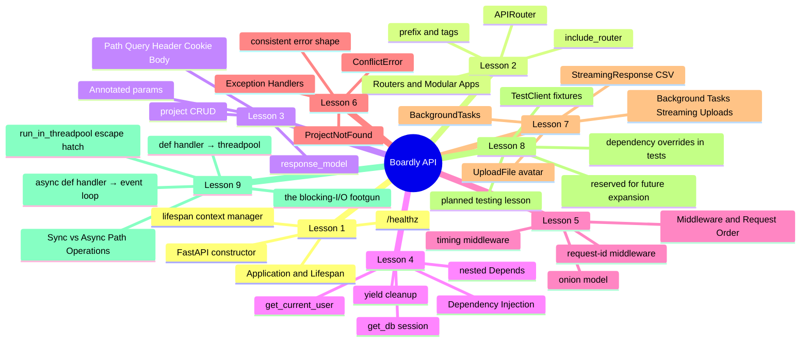
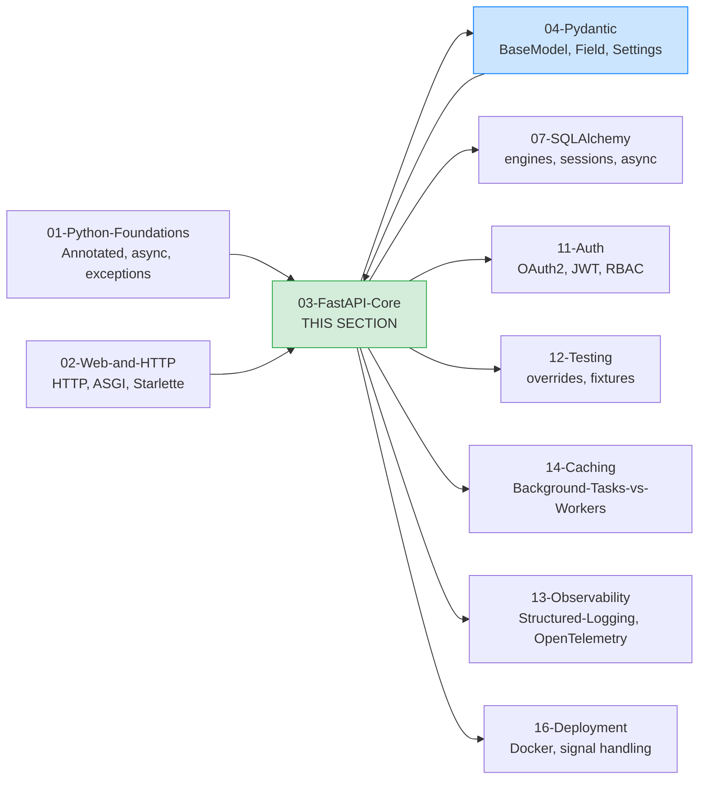

# FastAPI Core: Map of Content

**Bookmark this page.**

This is the **home base** for Section 03 — the FastAPI Core. Every lesson in this folder, every concept, every reference back to the rest of the vault — all reachable from here. When you get lost, come back to the MOC.

Hello, friend. Pull up a chair.

You've made it past Python foundations (`Annotated`, async, exceptions) and past the Web-and-HTTP section (HTTP request cycle, ASGI, Starlette, Uvicorn). You can read an ASGI app, you can read a type hint, you can explain what happens when a request lands on `127.0.0.1:8000`. Good. Now we build **the framework layer** — the part where Python *becomes* a service.

In the next seven lessons we are going to build **`Boardly`** — a small project-management API. Organizations → Projects → Tasks → Comments. Tiny. Real. The kind of API you would actually ship as a v1. Each lesson adds one piece to the same running application, and each lesson explains every single line of the piece it adds. By the end of Lesson 7, you will have a complete FastAPI service that you wrote yourself, line by line, and you will understand *why* every line is there.

**You're in the right place.**

If you've poked at FastAPI's hello world but want to actually *understand* it — the lifespan, the dependency injection, the middleware onion, the exception translation — this section was written for you. We'll go slow. We'll explain every line. You will build a real thing.

---

## The Boardly Progression #boardly

Seven lessons plus one comparison. One growing application. By Lesson 7 your `Boardly` API has:

- A typed `FastAPI()` constructor with a real lifespan that owns its resources
- Routers split per feature, mounted with `prefix` and `tags`
- Full CRUD on `/projects` with `Annotated` parameters, query filtering, and `response_model` output filtering
- A `get_db` session dependency, a `get_current_user` dependency, and a nested `require_scope("projects:write")` dependency
- A request-id middleware and a timing middleware, wrapped in the right order
- Custom `ProjectNotFound` and `ConflictError` exceptions translated into a consistent JSON error shape
- Background task logging on project creation, a streaming CSV export endpoint, and an avatar `UploadFile`
- Lesson 9's decision table for `def` vs `async def` route handlers — the rule that keeps the event loop unblocked under load

And you'll know *why* every line is there.

---

## Lessons in Order

| # | Lesson | What you add to `Boardly` | Time |
|---|--------|---------------------------|------|
| 1 | [[Application-and-Lifespan]] | The bare `boardly/main.py` with `FastAPI(lifespan=...)`, startup/shutdown messages, and `GET /healthz` | 60–90 min |
| 2 | [[Routers-and-Modular-Apps]] | Split into `routers/health.py` and `routers/projects.py`, mount with `include_router(prefix=..., tags=...)` | 60–90 min |
| 3 | [[Path-Query-Header-Cookie-Body]] | Full project CRUD — `GET /projects/{id}`, `GET /projects?status=active&limit=20`, `POST /projects` with a Pydantic body and `response_model` | 75–100 min |
| 4 | [[Dependency-Injection]] | `get_db` session dependency, `get_current_user` dependency, nested `require_scope("projects:write")`, `yield` cleanup, override hooks | 90–120 min |
| 5 | [[Middleware-and-Request-Order]] | Request-id middleware (UUID) and timing middleware — show the "last added = outermost" onion rule | 60–90 min |
| 6 | [[Exception-Handlers]] | `ProjectNotFound`, `ConflictError`, `@app.exception_handler`, consistent `{"error": {...}}` shape | 60–90 min |
| 7 | [[Background-Tasks-Streaming-Uploads]] | `BackgroundTasks` log on project create, `StreamingResponse` CSV export, `UploadFile` avatar upload — and the limits of background tasks | 75–100 min |
| 8 | — (intentionally reserved for future expansion) | A slot kept open for a planned future lesson on testing FastAPI apps (TestClient, fixtures, dependency overrides, integration testing). Until that lesson ships, depend on [[23-Templates/Lesson-Template]] and the dependency-override pattern from Lesson 4. | — |
| 9 | [[Sync-vs-Async-Path-Operations]] | The decision table for `def` vs `async def` route handlers — what Starlette does with each, the `async def` + blocking-I/O footgun, the `run_in_threadpool` escape hatch, the benchmark-when-unsure rule | 60–90 min |

**Lesson 08 is intentionally reserved for future expansion.**

The file-title sequence skips from Lesson 07 to Lesson 09 (the comparison capstone). Lesson 08 is not a mistake — it is a placeholder slot for a planned future lesson on testing FastAPI apps. We keep the slot rather than renumber Lesson 09 down to 08 so that already-published references to "Lesson 09 — Sync vs Async" remain valid. The MOC table preserves the gap with a placeholder row, matching the convention used by `16-Deployment-MOC` for its reserved slots.

**Tip — How to read this section**

Read the lessons **in order**. Each lesson's code is a strict superset of the previous one — same filenames (`boardly/main.py`, `boardly/routers/projects.py`, …) evolve across lessons, so by Lesson 7 you have one coherent application, not seven disconnected snippets. If you skip ahead, you'll bring in dependencies you haven't built yet and the code won't run. Lesson 9 is a *comparison* lesson — it audits the `def` vs `async def` decision across the handlers you wrote in Lessons 1–7, so it's read *after* the code lessons, not in place of them.

Each lesson follows the same shape: **Learning Objectives → Prerequisites → The Problem → The Code → Line-by-Line Deep Dive → Execution Trace → Common Mistakes → Engineering Trade-Offs → Exercises → Verification → Previously Learned Here → What's Next → Sources → What We Learned**. Open the lesson in one pane and `boardly/main.py` in another, side by side. Type the code yourself. Don't copy-paste. Typing is what makes it stick.

---

## How This Section Fits in the Vault

FastAPI is a thin, opinionated layer over Starlette and Pydantic. The lessons in this folder assume you've already read the [[02-Web-and-HTTP/ASGI-Starlette-Uvicorn|ASGI lesson]] and are comfortable with [[01-Python-Foundations/Type-Hints-and-Annotations|`Annotated`]] from Phase 1. The Pydantic section (Section 04) is a strict prerequisite for Lesson 3 onwards — FastAPI leans on `BaseModel` and `Field` everywhere.

---

## Concepts First Taught Here

Three recurring concepts are taught for the first time in this section. They each have a canonical lesson:

- **`FastAPI lifespan`** — first taught in [[Application-and-Lifespan]]. The async context manager that owns process-lifecycle resources (engines, pools, clients).
- **Dependency injection (FastAPI `Depends`)** — first taught in [[Dependency-Injection]]. The `Depends()` primitive, the `Annotated[T, Depends(...)]` preferred form, per-request caching, `yield` cleanup, dependency overrides.
- **Middleware** — first taught in [[Middleware-and-Request-Order]]. The onion model, `BaseHTTPMiddleware` vs pure ASGI, the "last added = outermost" rule.

If a later section (SQLAlchemy, Auth, Testing, Observability) touches one of these, it links back here instead of re-explaining. That's the rule from [[00-Start-Here/Concept-Registry]].

## Concepts Reused Here (not re-explained)

These were taught in earlier sections. We link back instead of repeating:

- `Annotated` — [[01-Python-Foundations/Type-Hints-and-Annotations]].
- `ASGI` — [[02-Web-and-HTTP/ASGI-Starlette-Uvicorn]].
- `BaseModel` — [[04-Pydantic/BaseModel-and-Validation]].
- `Pydantic Settings` — [[04-Pydantic/Pydantic-Settings]].
- `CORS` — [[02-Web-and-HTTP/CORS-Caching-Headers-Conditional-Requests]].
- `Exceptions (Python)` — [[01-Python-Foundations/Exceptions-Done-Right]].
- `Iterators / Generators / Context Managers` — [[01-Python-Foundations/Iterators-Generators-Context-Managers]].

---

## Reading Paths

Not everyone has eight hours in one block. Pick a path:

### The Fast Path (3 hours)

Just want to ship a typed CRUD API today? Read Lessons 1, 3, 4 in that order. You'll have an app, typed routes, and a database-session dependency. Come back for 2, 5, 6, 7 as the codebase grows.

### The Thorough Path (8–10 hours)

Linear. The lessons deliberately build on each other: lifespan creates the resources that the dependency-injection lesson yields per request; middleware wraps that request before it reaches the router; exception handlers shape the response that the middleware returns to the client. Skip none of it.

**Example — Which path are you on?**

Open a daily note and write down: which path, when you'll study each lesson, and a target completion date. Committing to a schedule beats willpower every time.

---

## Verified Versions (October 2026)

This section targets the following versions, all verified current as of 2026-10-19:

| Package | Version | Notes |
|---------|---------|-------|
| FastAPI | 0.148.0 | Released 2026-10-19. |
| Starlette | 1.9.0 | Pinned by FastAPI. |
| Pydantic | v2.14.1 | Pydantic v2 only — no v1 idioms. |
| `uv` | 0.13.1 | The modern Python package runner. |
| Python | 3.12 | The canonical learner version (3.13 also works). |
| SQLAlchemy | 2.1.5 | When we touch it (mostly in Section 07). |
| Alembic | 1.20.0 | Migration tooling. |

**Warning — Version pinning matters.**

FastAPI's surface has evolved a lot since 0.95 (when `Annotated[T, Depends(...)]` became the preferred form). All the code in this section uses the modern `Annotated` form, Pydantic v2 idioms (`model_dump`, `ConfigDict`), and the `lifespan` async context manager — **not** the deprecated `@app.on_event`. If you're on an older FastAPI, the code will still run (with deprecation warnings); we'll point out the diff when it matters.

---

## Reference Links

- FastAPI documentation — <https://fastapi.tiangolo.com/>
- FastAPI release notes — <https://fastapi.tiangolo.com/release-notes/> — verified 0.148.0 on 2026-10-19.
- Starlette documentation — <https://www.starlette.io/>
- Pydantic v2 documentation — <https://docs.pydantic.dev/2.0/>
- See [[21-Reference-Library/Source-Register]] for the full source list with dates accessed.

---

**Your map is ready.**

Seven lessons, one growing `Boardly` application, all reachable from this page. Pick a starting point and go. We'll see you on the other side. 

---

**Tags:** #moc #fastapi #core #index #home
**Previous:** [[00-Start-Here/Curriculum-Index]]
**Start:** [[Application-and-Lifespan]] →
