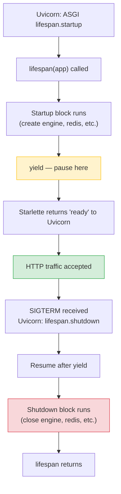
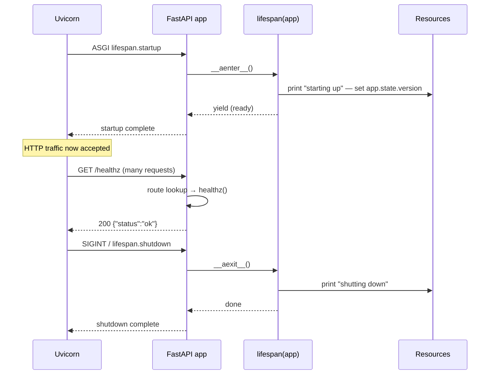

# Lesson 01: Application and Lifespan

*Building the bare `Boardly` app, the `lifespan` that owns the process, and the `/healthz` that says "I'm alive."*

**You're at the very beginning of Section 03.**

Every FastAPI service you'll ever admire — the tiny side project, the production system, the open-source library — was once exactly where you are now: staring at `app = FastAPI(lifespan=...)` and wondering what `lifespan` is for. Take your time. Type every line. Read the tracebacks. **This is how you learn.** 


#fastapi #lifespan #asgi #canonical

## Learning Objectives

By the end of this lesson you will be able to:

1. **Construct a `FastAPI()` instance** with meaningful configuration (`title`, `version`, `lifespan`).
2. **Write an `async def lifespan(app)`** using `@asynccontextmanager` from the standard library.
3. **Explain what `yield` does inside a lifespan** — the line between "before traffic" and "after traffic".
4. **Wire a `GET /healthz` endpoint** with `@app.get` and return JSON via a plain dict.
5. **Explain why `@app.on_event("startup")` is deprecated** and what bug it had.
6. **Run the app under `uv run uvicorn boardly.main:app --reload`** and read the startup/shutdown logs.
7. **Recognise the three classic lifespan mistakes** — forgetting `await`, swallowing exceptions in shutdown, and defining `lifespan` but never passing it to `FastAPI()`.

## Prerequisites

Before starting, you need:

- **FastAPI 0.148.0** (verified Oct 2026). If you've never installed it: `uv init boardly && cd boardly && uv add fastapi uvicorn`.
- **The ASGI lesson** — [[02-Web-and-HTTP/ASGI-Starlette-Uvicorn]]. You should already know what an ASGI app is, what Uvicorn does, and what `(scope, receive, send)` means.
- **Async context managers** — [[01-Python-Foundations/Iterators-Generators-Context-Managers]]. The lifespan *is* an async context manager. If `@asynccontextmanager` and `yield` make no sense to you, go back and review.
- **Type hints and `Annotated`** — [[01-Python-Foundations/Type-Hints-and-Annotations]]. We use modern annotations everywhere.
- **About an hour of focused time.** This lesson is short on code (the file is ~30 lines) and long on explanation — read it slowly.

**The most common gap: context managers.**

If you have never written `@asynccontextmanager` before, the `yield` inside the lifespan function looks magical. It isn't. The prerequisite lesson [[01-Python-Foundations/Iterators-Generators-Context-Managers]] explains it from scratch. Go read the first third of that lesson, then come back. You'll be glad you did.


## The Problem

A FastAPI service is a long-running process. People start it in the morning, it serves thousands of requests an hour, and at midnight an orchestrator kills it with `SIGTERM`. Some resources — database engines, Redis pools, ML models, HTTP clients, an open file — must be created **once** at process start, shared by every request, and torn down **once** at process end. Get this wrong and you get one of three failure modes:

1. **Resource leak.** Every restart leaves orphaned database connections until Postgres refuses new ones.
2. **Slow first request.** The engine is created lazily on request #1 — so request #1 takes 4 seconds while requests #2–1000 take 8 ms.
3. **Ungentle shutdown.** Uvicorn receives `SIGTERM`, but the in-flight DB transactions don't get committed because nothing closes the engine cleanly.

The lifespan is the single, opinionated hook FastAPI gives you to do this correctly. There's exactly one lifespan per app, exactly one `yield` per lifespan, and zero ambiguity about *when* startup ends and shutdown begins.

**Note — Historical context — `on_event` and before**

Before FastAPI 0.93 / Starlette 0.27 (March 2023), you wrote two separate functions:
```python
@app.on_event("startup")
async def _startup(): ...

@app.on_event("shutdown")
async def _shutdown(): ...
```
This was deprecated for two reasons: (a) ordering across multiple handlers was implicit and fragile — you couldn't express "create the engine before creating the Redis client that depends on it" without relying on registration order; (b) sharing state between the startup handler and the shutdown handler required module-level globals or `app.state` indirect writes. The `lifespan` context manager solves both: it's one function with linear code, so ordering is just code order, and variables captured in the closure scope are visible to the shutdown block. `on_event` is still supported — your old apps won't crash on upgrade — but it has been emitting a `DeprecationWarning` since FastAPI 0.93. In 0.148.0 it still works, but new code should use `lifespan`.


## The Code

Here is the complete `boardly/main.py` you'll write in this lesson. Save it mentally — every FastAPI app you ever write is a variation of this skeleton. Everything else in this section (routers, dependencies, middleware, exception handlers, background tasks) is *additions to this file*.

```python
# boardly/main.py
"""Boardly — a small project-management API.

Lesson 1: a bare app with a lifespan and a /healthz endpoint.
"""
from collections.abc import AsyncIterator
from contextlib import asynccontextmanager

from fastapi import FastAPI


@asynccontextmanager
async def lifespan(app: FastAPI) -> AsyncIterator[None]:
 # --- startup: resources that live for the whole process ---
 print("Boardly starting up…")
 app.state.version = "0.1.0"

 yield # ← traffic is now accepted

 # --- shutdown: close anything opened above ---
 print("Boardly shutting down…")


app = FastAPI(
 title="Boardly",
 version="0.1.0",
 lifespan=lifespan,
)


@app.get("/healthz")
async def healthz() -> dict[str, str]:
 return {"status": "ok"}
```

That's 30 lines. Run it. Visit it. Change it. Break it. Fix it. That's the loop. We'll explain every line next — not just *what it does* but *what Python / Starlette / FastAPI does internally* when that line runs.

## Line-by-Line Deep Dive

This section is the heart of the lesson. Read it twice. Don't skip.

### Lines 1–8: The module docstring and imports

```python
"""Boardly — a small project-management API.

Lesson 1: a bare app with a lifespan and a /healthz endpoint.
"""
from collections.abc import AsyncIterator
from contextlib import asynccontextmanager

from fastapi import FastAPI
```

**What it does:** Pulls in three things — `AsyncIterator` (a typing primitive), `asynccontextmanager` (a decorator from the standard library), and `FastAPI` (the class we're about to instantiate).

**Why we need each:**

- `AsyncIterator` is used to annotate the return type of `lifespan`. It comes from `collections.abc`, **not** `typing` — since Python 3.9 you can use `collections.abc.AsyncIterator` directly in type hints. Using the `collections.abc` form is the modern, recommended import.
- `asynccontextmanager` is the decorator that turns an `async def` with a single `yield` into an *async context manager* — the protocol Starlette's lifespan expects. Without it, you'd have to write a class with `__aenter__` and `__aexit__` by hand. With it, the `yield` form is six lines.
- `FastAPI` is the class itself. Capital `F`. The lowercase package name `fastapi` is the folder; `FastAPI` (capital) is the class inside it.

**Tip — Why `from contextlib import asynccontextmanager` and not `from contextlib import contextmanager`?**

Because the lifespan is `async def`. `contextmanager` (the synchronous one) only works on regular `def`. If you mix them up you get a confusing error at decoration time. The rule: `async def` → `asynccontextmanager`; `def` → `contextmanager`.


**Example — What's actually in the `fastapi` package?**

`FastAPI` is the class, but the package also re-exports `APIRouter`, `Depends`, `HTTPException`, `UploadFile`, `BackgroundTasks`, `Query`, `Path`, `Body`, `Header`, `Cookie`, `Request`, `Response`, `status`, `FastAPI`, and several response classes. You'll meet all of these in later lessons. For Lesson 1, just `FastAPI` is enough.


### Lines 10–11: The `@asynccontextmanager` decorator and the function signature

```python
@asynccontextmanager
async def lifespan(app: FastAPI) -> AsyncIterator[None]:
```

**What it does:** Defines an async function called `lifespan` that takes a `FastAPI` instance as its argument and returns an `AsyncIterator[None]`.

**Why the decorator?** Starlette's lifespan protocol expects an *async context manager* — i.e. an object with `__aenter__` and `__aexit__`. Writing those by hand is verbose. The `@asynccontextmanager` decorator wraps your `async def` (which contains a `yield`) so that:

- `__aenter__` runs everything *up to* the `yield`.
- `__aexit__` runs everything *after* the `yield`.

The function reads top-to-bottom as "startup, then traffic, then shutdown." That linear readability is the whole reason the `lifespan` API replaced `on_event`.

**Student asks: Why does the function take `app` as an argument? Can't it just close over the `app` variable from the outer scope?**

Good instinct. It could — `app` is defined later in the same file. But passing `app` as an argument is more honest: it documents the *dependency* (the lifespan needs the app object to stash resources on `app.state`) and makes the lifespan testable in isolation — you can pass a mock `app` to it without monkeypatching the module. The same principle applies to `Depends`-style function signatures in Lesson 4: explicit dependencies beat hidden closures.


### Lines 12–14: The startup block

```python
 # --- startup: resources that live for the whole process ---
 print("Boardly starting up…")
 app.state.version = "0.1.0"
```

**What it does:** Prints a startup message and stashes the app's version string on `app.state`.

**Why stash on `app.state`?** Starlette gives every app a `State` object (`app.state`) — an attribute bag you can write to. The lifespan writes resources here; dependency functions read them later. (We'll wire up a proper `Depends` for the version in Lesson 4.)

**What `app.state` actually is**

It's an instance of `starlette.applications.State` — a tiny class with `__getattr__`, `__setattr__`, and `__delattr__` overrides that just store attributes. It's not a dict, it's an attribute bag. You write `app.state.engine = engine` and read `app.state.engine` later. There's no schema, no validation — that's deliberate. It's a per-app scratchpad.


For Lesson 1 we don't have a real database or Redis pool — we'll add those in Lesson 4 and in Section 07. For now, the `print` statements let you *see* the lifespan running, which is the point. When you graduate to real resources, you'll create them in exactly this block:

```python
# What this block looks like in a real app:
engine = create_async_engine(settings.database_url, pool_pre_ping=True)
app.state.engine = engine
app.state.sessionmaker = async_sessionmaker(engine, expire_on_commit=False)
redis = Redis.from_url(settings.redis_url, decode_responses=True)
await redis.ping() # fail loud at startup, not on the first request
app.state.redis = redis
```

You don't need any of that for Lesson 1 — keep your `boardly/main.py` exactly as in section "The Code" above. We'll add real resources when they have somewhere to be *consumed* (Lesson 4 — `get_db`).

### Line 16: The `yield` (the most important line in the file)

```python
 yield # ← traffic is now accepted
```

**What it does:** Suspends the lifespan function. Control returns to Starlette, which signals "ready" to Uvicorn. Uvicorn starts accepting HTTP requests.

**Why this line matters more than any other in the file:** This is the line that decides *when traffic is allowed*. Everything before `yield` runs at startup — if it raises, **no traffic is ever served** and Uvicorn exits non-zero. Everything after `yield` runs at shutdown. There is exactly one `yield` per lifespan.



**Warning — Exactly one `yield` per lifespan.**

A common mistake is to write `yield` twice — perhaps trying to model a "warming up" phase and a "ready" phase. The ASGI lifespan protocol has only two events (`startup` and `shutdown`); there is no concept of a multi-phase lifespan. If you `yield` twice, you'll get `RuntimeError: async generator didn't stop` from Starlette. One yield. Always.


**What happens inside: the ASGI lifespan messages**

When Starlette drives your `lifespan` async context manager, it does not just call your function — it sends and receives ASGI messages over the `(scope, receive, send)` triple you met in [[02-Web-and-HTTP/ASGI-Starlette-Uvicorn]]. On startup, Starlette invokes `await lifespan(app).__aenter__()`, runs your startup block, and when control reaches `yield`, Starlette sends `lifespan.startup.complete` back to Uvicorn. If your startup block raises, Starlette catches the exception and sends `lifespan.startup.failed` with the formatted message; Uvicorn then logs `ERROR: Application startup failed. Exiting.` and exits non-zero — no traffic is ever accepted. On shutdown, Starlette invokes `await __aexit__(...)`, runs your shutdown block, and sends either `lifespan.shutdown.complete` or `lifespan.shutdown.failed`. The senior engineer's reading of the lifespan is therefore: *the `yield` is not just a code pause, it is the protocol message that says "I am ready."* A slow startup block delays the message; an exception in startup sends a failure message. Either way, traffic is gated on the message, not on the function returning — which is why `await redis.ping()` in startup is a good idea: the readiness signal is then honest about whether Redis is actually reachable.


**Tip — Think like a senior engineer: which side of `yield` am I on?**

The mental model that survives every refactor: *before `yield` is the contract "if I raise, no traffic flows"; after `yield` is the contract "if I raise, traffic already flowed, so log loudly and keep unwinding."* The asymmetry matters at every 3 a.m. incident. A failed `create_async_engine(...)` in the startup block means the deploy fails safe — Kubernetes rolls the pod back, no user ever sees a 500, and the rollout is reverted before breakfast. A failed `await engine.dispose()` in the shutdown block means the deploy succeeded for hours, served thousands of users, and only now bleeds connections because teardown silently swallowed a `ConnectionPoolTimeout`. Senior engineers grade shutdown failures as *worse* than startup failures because they are quieter — they happen after the success metrics looked green. The fix is structural: in shutdown, write `logger.exception("lifespan shutdown step failed")` *and* `raise`; let Starlette log it loudly; never swallow with `except Exception: pass` (see Mistake 2). The same asymmetry decides where you put retry logic: startup can be retried by the orchestrator (a crashed pod is restarted); shutdown usually cannot (the SIGTERM clock is already running).


### Lines 18–20: The shutdown block

```python
 # --- shutdown: close anything opened above ---
 print("Boardly shutting down…")
```

**What it does:** Prints a shutdown message. (In a real app: `await redis.aclose(); await engine.dispose()`.)

**Why this matters:** If you opened something in the startup block, you must close it in the shutdown block. The `lifespan` context manager guarantees that the shutdown block runs even if a request handler raises an unhandled exception — `__aexit__` always runs. But it does *not* guarantee the shutdown block runs if the *startup* block raises before the `yield`.

**Tip — Use `try/finally` around `yield` when you have multiple resources.**

If you create two resources in startup, and the second one's creation raises, the first one is already open with no shutdown block to clean it up. The fix:
```python
@asynccontextmanager
async def lifespan(app: FastAPI) -> AsyncIterator[None]:
engine = create_async_engine(...)
app.state.engine = engine
try:
redis = Redis.from_url(...)
await redis.ping()
app.state.redis = redis
yield
finally:
await app.state.redis.aclose()
await engine.dispose()
```
The `finally` block runs whether the `yield` is reached normally, the body raises, or a request handler raises during traffic. For Lesson 1's `print`-only version, `try/finally` isn't needed.


### Lines 23–27: Constructing the app

```python
app = FastAPI(
 title="Boardly",
 version="0.1.0",
 lifespan=lifespan,
)
```

**What it does:** Constructs the `FastAPI` instance and stores it in the variable `app`. Passes `lifespan` so the app knows how to bootstrap.

**Why these arguments:**

- `title="Boardly"` and `version="0.1.0"` populate the OpenAPI metadata — you'll see "Boardly" in the title of the Swagger UI at `/docs`. (We'll cover OpenAPI in Section 19.)
- `lifespan=lifespan` is the line that wires the lifespan into the app. **If you forget this argument, the app starts and serves traffic — but your lifespan never runs.** This is the #1 lifespan footgun. See Common Mistake #3 below.

**Why is `on_event` deprecated?** Because the old `@app.on_event("startup")` + `@app.on_event("shutdown")` pair had no structural guarantee that the two handlers were paired. You could open a Redis connection in `startup` and forget to close it in `shutdown` — FastAPI wouldn't warn you. The lifespan context manager fixes that: a single `@asynccontextmanager` function contains both the resource-creation code (before `yield`) and the resource-teardown code (after `yield`) in one block you can read top-to-bottom. You can't accidentally start something without also stopping it — the `try/finally` around `yield` makes the pairing syntactic, not a convention you have to remember. The deprecation is the library saying "this API was a footgun, please use the safer one."

**Why must lifespan be an *async* context manager and not a sync one?** Because Uvicorn drives the ASGI protocol with `await` — the `lifespan.startup` and `lifespan.shutdown` events are themselves awaitable. A sync context manager (the `contextmanager` decorator on a plain `def`) has no way to `await create_async_engine(...)` or `await redis.ping()` inside its body. Starlette checks the type at registration time and rejects a sync context manager with a `TypeError` rather than letting you discover the mismatch only when a real async resource fails to initialize. The async protocol also lets startup *block* Uvicorn from accepting traffic — which is the whole point: don't accept requests until the database is reachable.

**Example — What `FastAPI()` actually does internally**

`FastAPI` inherits from Starlette's `Starlette`, which inherits lifespan handling from `Starlette.__init__`. When you pass `lifespan=...`, Starlette wraps it as a `LifespanManager` and stores it on `self.lifespan`. When Uvicorn sends the ASGI `lifespan.startup` message, Starlette calls `await self.lifespan.__aenter__(...)`. When Uvicorn sends `lifespan.shutdown`, Starlette calls `await self.lifespan.__aexit__(...)`. The `FastAPI` class itself adds: OpenAPI schema generation, Pydantic validation, dependency injection, and `Annotated` parameter parsing. All of that sits on top of the lifespan — it doesn't replace it.


### Lines 30–32: The `/healthz` endpoint

```python
@app.get("/healthz")
async def healthz() -> dict[str, str]:
 return {"status": "ok"}
```

**What it does:** Registers a `GET /healthz` route that returns the JSON `{"status":"ok"}`.

**Why this pattern:** The `@app.get("/healthz")` decorator is the FastAPI equivalent of `@app.route("/healthz", methods=["GET"])` in Flask. It tells the app: "when a `GET` request arrives at `/healthz`, call this function." The function returns a Python dict; FastAPI serializes it to JSON using its default response class — `JSONResponse`.

**What `JSONResponse` does (under the hood)**

FastAPI's default response class is `starlette.responses.JSONResponse`. When your endpoint returns a `dict`, FastAPI:
1. Calls `json.dumps(...)` (well, `jsonable_encoder` then `JSONResponse`) to serialize.
2. Sets `Content-Type: application/json`.
3. Sets the status code to `200 OK` (or whatever you returned).
4. Hands the response back to Starlette, which sends it on the wire.

If you wanted to override any of this — say, to set a custom status code or a custom header — you'd return a `JSONResponse` directly:
```python
from fastapi.responses import JSONResponse

@app.get("/healthz")
async def healthz() -> JSONResponse:
return JSONResponse(
content={"status": "ok"},
headers={"X-Boardly-Version": "0.1.0"},
)
```
Same JSON on the wire, but you controlled the headers explicitly. We'll meet `JSONResponse` again in Lesson 6 (exception handlers) and Lesson 7 (streaming responses).


**Spot the bug — what happens if you delete `async ` and make `healthz` a regular `def`?**

Answer: nothing breaks. FastAPI runs synchronous route handlers in a threadpool automatically. But — and this is the subtlety — the *rest of the app* still runs on the event loop, so a sync handler blocks a worker thread. For a 1-ms healthz endpoint, it doesn't matter. For a route that calls a slow synchronous database driver, it matters a lot. The rule we'll use throughout this section: `async def` when the handler awaits something; `def` only when you have a synchronous library you can't avoid. Most of `Boardly` is `async def`.


**The production pattern for health checks is taught in [[02b-Backend-Foundations/Health-Checks-and-Probes]].**

This lesson's `/healthz` returns a constant `{"status": "ok"}` — the textbook "first route" that proves the app is wired up. Production health-checks are richer: a *liveness* probe (the process is alive, can serve traffic), a *readiness* probe (the process has its dependencies — DB, Redis, upstream — connected and ready), and per-dependency sub-checks that report which one is failing. The full liveness-vs-readiness split, the dependency-probe pattern, and the Kubernetes `livenessProbe`/`readinessProbe` integration are taught in [[02b-Backend-Foundations/Health-Checks-and-Probes]]. Read this lesson for the skeleton; read that one when you ship.


## Execution Trace

Time to run it. In your terminal:

```bash
uv run uvicorn boardly.main:app --reload
```

What happens, in order:

1. **Uvicorn starts.** It imports `boardly.main`, which executes the module-level code — defining `lifespan`, constructing `app`, registering `/healthz`.
2. **Uvicorn sends the ASGI `lifespan.startup` message** to the app.
3. **Starlette calls `lifespan(app).__aenter__()`.** The startup block runs: `Boardly starting up…` is printed; `app.state.version = "0.1.0"` is set.
4. **The startup block reaches `yield`.** Starlette returns control to Uvicorn.
5. **Uvicorn logs:**
 ```
 INFO: Started server process [1234]
 INFO: Waiting for application startup.
 INFO: Application startup complete.
 INFO: Uvicorn running on http://127.0.0.1:8000 (Press CTRL+C to quit)
 ```
 The crucial line is `Application startup complete.` — that means the `yield` was reached. If you don't see it, the startup block raised.
6. **Traffic is now accepted.** In another terminal:
 ```bash
 curl http://127.0.0.1:8000/healthz
 ```
 You should see:
 ```json
 {"status":"ok"}
 ```
7. **You press `Ctrl+C`.** Uvicorn receives `SIGINT`, sends `lifespan.shutdown` to the app.
8. **Starlette resumes the lifespan after `yield`.** The shutdown block runs: `Boardly shutting down…` is printed.
9. **Uvicorn logs:**
 ```
 INFO: Waiting for application shutdown.
 INFO: Application shutdown complete.
 INFO: Finished server process [1234]
 ```



**You've just run a real FastAPI app.**

It's small — one endpoint, no database, no auth. But the architecture is identical to a service with 500 endpoints, four routers, three middlewares, and a Redis pool. The skeleton is permanent. Everything else is additions.


## Common Mistakes

**Warning — When this breaks: `Application startup failed. Exiting.`**

**Symptom.** Uvicorn logs `ERROR: Application startup failed. Exiting.` and exits non-zero; no traffic is served; Kubernetes restarts the pod in a `CrashLoopBackOff` and the deploy rolls back. **Diagnosis.** Open the log and look for the traceback immediately *above* that line — it lives in the startup block of your `lifespan` (anything before `yield`). The three usual suspects: (1) `await engine.connect()` raised because the DB is unreachable from the pod's network — reproduce with `uv run python -c "import asyncio, asyncpg; asyncio.run(asyncpg.connect('postgres://...'))"` from *inside* the pod; (2) `Settings()` raised because a required env var is unset — add a one-line `print(os.environ)` at the top of the startup block and confirm the variable is actually in the pod's environment, not just in your shell; (3) the `lifespan` function was defined but never passed as `lifespan=lifespan` to `FastAPI()` (Mistake 3 below) — in this case Uvicorn logs `Application startup complete.` but the lifespan never ran, and the readiness probe will start failing as soon as the route tries to read `app.state.engine`. **Fix.** Do not trust the deploy script's "started" line — trust `Application startup complete.` *and* `Boardly starting up…` together. If the first is missing, the startup block raised and you need the traceback above; if the second is missing, the lifespan was never registered. Both are deploy-blocking.


### Mistake 1: Forgetting to `await` inside the lifespan

```python
# WRONG
@asynccontextmanager
async def lifespan(app: FastAPI) -> AsyncIterator[None]:
 redis = Redis.from_url(...)
 await redis.ping()
 app.state.redis = redis
 yield
 redis.aclose() # ← forgot `await`!
```

**Symptom:** A `RuntimeWarning: coroutine 'Redis.aclose' was never awaited` and the connection pool not closing. Uvicorn may hang for a few seconds during shutdown waiting for the unwound coroutine.

**Why:** `redis.aclose()` is a coroutine. Calling it without `await` creates the coroutine object but never schedules it.

**Fix:** `await redis.aclose()`. Same for `await engine.dispose()`. If a method is `async def`, you `await` it.

**Warning — The pattern: async methods need `await`.**

Every `async def` you call must be awaited. If you see `RuntimeWarning: coroutine ... was never awaited`, you forgot an `await` somewhere. Search the file for `async def` definitions of the methods you called — if the method is `async`, your call needs `await`.


### Mistake 2: Swallowing exceptions in the shutdown half

```python
# WRONG
@asynccontextmanager
async def lifespan(app: FastAPI) -> AsyncIterator[None]:
 app.state.engine = create_async_engine(...)
 yield
 try:
 await app.state.engine.dispose()
 except Exception:
 pass # ← swallowing!
```

**Symptom:** The engine's connection pool leaks across restarts because `dispose()` raised before it could close the connections, and the `except` hid the failure.

**Why:** Production code that silently swallows `Exception` is the cause of about half of all "intermittent" production incidents. If `engine.dispose()` fails, you want to *know* — log it, alert on it, but don't pretend it worked.

**Fix:** Either let the exception propagate (Starlette will log it) or log explicitly:

```python
 yield
 try:
 await app.state.engine.dispose()
 except Exception:
 logger.exception("engine.dispose() failed during shutdown")
 raise
```

### Mistake 3: Defining `lifespan` but never passing it to `FastAPI()`

```python
# WRONG
@asynccontextmanager
async def lifespan(app: FastAPI) -> AsyncIterator[None]:
 print("Boardly starting up…")
 yield
 print("Boardly shutting down…")

app = FastAPI(title="Boardly") # ← forgot lifespan=lifespan!
```

**Symptom:** The app starts and serves traffic, but you never see "Boardly starting up…" or "Boardly shutting down…" in the logs. The startup and shutdown blocks simply don't run.

**Why:** A `lifespan` function is just a function. Passing it as the `lifespan=` argument to `FastAPI()` is what *registers* it with the app. Without that, Starlette uses its default (no-op) lifespan.

**Fix:** Always check the `FastAPI(...)` constructor call includes `lifespan=lifespan`.

### Mistake 4: Multiple `yield` statements

```python
# WRONG
@asynccontextmanager
async def lifespan(app: FastAPI) -> AsyncIterator[None]:
 print("warming up…")
 yield
 print("ready…")
 yield # ← RuntimeError
```

**Symptom:** `RuntimeError: async generator didn't stop` from Starlette.

**Why:** The ASGI lifespan protocol has only two events. The `@asynccontextmanager` decorator turns your function into a generator with exactly one yield point. A second `yield` confuses it.

**Fix:** One `yield` per lifespan. Always.

### Mistake 5: Module-level resource creation

```python
# WRONG
engine = create_async_engine("postgresql+asyncpg://localhost/boardly") # runs at import

@asynccontextmanager
async def lifespan(app: FastAPI) -> AsyncIterator[None]:
 app.state.engine = engine # already created
 yield
 # never disposed
```

**Symptom:** The engine is created at *import* time — so importing `boardly.main` from a test (or from another module) opens a real database connection. It's also never disposed because the shutdown block doesn't do it.

**Why:** Module-level code runs on `import`. The lifespan runs on startup. They're different events.

**Fix:** Create the engine *inside* the lifespan, before `yield`. Tests can then override the lifespan entirely (Lesson 4 — `dependency_overrides` and Lesson 12 — testing).

## Engineering Trade-Offs

### `@asynccontextmanager` lifespan vs class-based `__aenter__`/`__aexit__`

The Line-by-Line above mentions in passing that without `@asynccontextmanager` you'd have to write a class with `__aenter__` and `__aexit__` by hand. That's worth surfacing as a decision rather than an aside — both forms are valid ASGI lifespan implementations, and the wrong choice obscures startup/shutdown ordering.

**The two forms, side by side.** Same lifespan, written both ways:

```python
# Form A — @asynccontextmanager (the canonical modern form)
@asynccontextmanager
async def lifespan(app: FastAPI) -> AsyncIterator[None]:
    app.state.engine = create_async_engine(...)
    yield
    await app.state.engine.dispose()


# Form B — class with __aenter__ / __aexit__ (the lower-level form)
class Lifespan:
    async def __aenter__(self) -> None:
        self.engine = create_async_engine(...)   # but `app` is not in scope here!
        return self

    async def __aexit__(self, *exc_info) -> None:
        await self.engine.dispose()

# Wiring Form B into FastAPI requires the class to also be an
# asynccontextmanager-compatible callable — which means wrapping it
# again with `asynccontextmanager` or implementing `__call__`. In
# practice, Form B is never used directly with FastAPI(); it shows
# up in lower-level Starlette apps or in libraries that need full
# control over the lifespan protocol's `scope["type"] == "lifespan"`
# messages.
```

**The decision:**

| Need | Reach for | Why |
|---|---|---|
| Most lifespans — startup block + traffic + shutdown block | `@asynccontextmanager` | Linear top-to-bottom readability; `app` is in scope; matches the FastAPI docs |
| Multiple resources with explicit teardown ordering that doesn't fit linear code | `@asynccontextmanager` + nested `async with` | Composes naturally with `AsyncExitStack` if you need dynamic teardown ordering |
| A library that needs to manipulate the raw ASGI `lifespan` messages (e.g., to defer `lifespan.startup.complete` until a health-check passes) | a class implementing `__aenter__` / `__aexit__` (or `asynccontextmanager` with explicit `lifespan.startup.complete()` sends via `anyio`) | The decorator form hides the message-sending; the class form exposes it |
| Test fixtures that share teardown ordering across many tests | `@asynccontextmanager` (matches `pytest-asyncio`'s fixture form) | The decorator is what `pytest-asyncio` expects for async fixtures; a class is a steeper cognitive load for a test fixture |

**The rule of thumb.**

**Reach for `@asynccontextmanager` for every FastAPI lifespan you'll ever write.** The class form is a footnote from the underlying ASGI protocol — it's there because the protocol allows it, not because you should reach for it. The decorator form is six lines, linear, type-checks cleanly, and matches every example in the FastAPI docs. The class form is ~20 lines, has no clean way to access `app` in `__aenter__`, and is only seen in libraries that need raw message control. If you find yourself writing a `Lifespan` class, double-check you're not reinventing what `asynccontextmanager` already does.


**When does the class form actually win?**

Three narrow cases. (1) You're writing a library that wraps Starlette's lifespan protocol and needs to manipulate the raw `scope["type"] == "lifespan"` messages — e.g., to send `lifespan.startup.complete` only after a health check passes. The decorator form hides the message-sending behind `yield`; the class form exposes it. (2) You have a lifespan with multiple disjoint startup phases that need to be tested in isolation — the class form lets you mock `__aenter__` and `__aexit__` separately, while the decorator form is one indivisible function. (3) You're integrating with an existing async-context-manager class (a database driver's connection pool that's already a class); wrapping it with `asynccontextmanager` would just call its `__aenter__`/`__aexit__` for you, so the class form is what you'd reach for. For a FastAPI app, none of these is the common case — the decorator is the right answer.


### `app.state` vs dependency-injected singletons

`app.state.engine = engine` is simple and explicit. The alternative is a `get_engine` dependency that wraps a module-level singleton. Trade-off:

- **`app.state`**: explicit, easy to inspect (`print(app.state.__dict__)`), no module globals. But routes must read `request.app.state.X`, which is opaque and not type-safe.
- **`Depends(get_engine)`**: type-safe, override-friendly in tests, but you must wire it through every route.

In `Boardly`, we will use **`app.state` in the lifespan** (for the *act of creating* resources) and **`Depends` everywhere else** (for the *act of consuming* them). That split is the cleanest pattern we've found — and it's the one we'll apply from Lesson 4 onwards.

**The comparison table:**

| Concern | `app.state.X` | `Depends(get_X)` | Module-level singleton |
|---|---|---|---|
| Where the resource lives | On the app instance (per-worker) | On the app instance (per-worker) — `get_X` reads from `app.state` | At import time, in the module's namespace |
| Type safety | None — `request.app.state.engine` is `Any` | Strong — `Annotated[AsyncSession, Depends(get_db)]` is typed | None — `engine` is a module global of inferred type |
| Test override | Replace `app.state.X` in a fixture (works but is untyped) | `app.dependency_overrides[get_db] = fake_get_db` (typed, idiomatic) | Monkey-patch the module (fragile, global state) |
| Per-request resources | Wrong shape — `app.state` is per-worker, not per-request | Right shape — return a fresh resource per request | Wrong shape — shared across the whole process |
| Startup-time config | Right shape — `Settings()` runs once in the lifespan | Wrong shape — `Settings()` would run per request unless cached | Right shape (if read once at import) but import-time read is fragile |
| Inspection / debugging | `print(app.state.__dict__)` shows the bag | Requires `print(app.dependency_overrides)` — only shows overrides | `print(module.X)` works but reveals nothing about lifecycle |

**The three-place rule.**

**`app.state` for engine/discovery (created once in the lifespan, shared by every request). `Depends` for per-request resources (a `Session` is per-request; an `AsyncSession` is per-request). `app.state.settings` for parsed-at-startup config (one `Settings()` call in the lifespan). `Depends(get_settings)` only if you want test overrides — otherwise `app.state.settings` is fine.** The split is "is it per-process or per-request?" — engine is per-process, session is per-request, settings are per-process. Each kind lives in the right place.


**Why not just use `Depends(get_settings)` for everything?**

You can — and many codebases do. The trade-off is: `Depends(get_settings)` lets you override `Settings` in tests with `app.dependency_overrides[get_settings] = lambda: fake_settings`, which is a clean test override. The cost is wiring `Depends(get_settings)` through every route and service that needs a setting, which is verbose. The Boardly convention is to read settings *once* in the lifespan (`app.state.settings = Settings()`), then read `app.state.settings` directly from services — for the rare test override, we replace `app.state.settings` in the fixture. The split is "lifespan reads settings via `Settings()` directly; routes read sessions via `Depends(get_db)`."


**Warning — The mutable-default trap with `app.state`.**

`app.state` is an attribute bag, not a typed object. If you write `app.state.engine = engine` and then later typo `app.state.engne` in a route, you get `AttributeError` at runtime — not a type-check error at static-analysis time. The mitigation is `Depends(get_db)` for the per-request case (typed) and a typed `app.state.settings: Settings` annotation for the per-process case (the annotation lives on a `State` subclass if you want full typing). The Boardly convention: type-annotate the *consumption* (`Depends`), accept untyped `app.state` for the *creation* (in the lifespan).


### Synchronous vs asynchronous resources

Both `create_async_engine` and `Redis.from_url` return awaitable-on-use objects. But what if you have a **synchronous** resource (a plain file handle, a `psycopg2` connection, a CPU-bound ML model)?

- Wrap blocking setup in `asyncio.to_thread(...)` so the event loop is not blocked.
- For teardown, do the same.
- Or: prefer the async-native driver. SQLAlchemy 2.x has both sync and async APIs — choose per project, don't mix.

### Multiple worker processes

Uvicorn workers are separate OS processes, each with their own lifespan, engine, and Redis pool. If your "shared" resource is actually shared (e.g., a Postgres connection with a max pool size of 100, and you run 4 workers), the **total** connection count is `4 × 100 = 400`. Plan capacity accordingly. And don't run migrations in the lifespan — they'd race across workers. Run migrations in a separate deploy step. See [[16-Deployment-and-DevOps/Migration-Ordering-and-Rollback]].

**Danger — How an attacker thinks: the lifespan as a global mutable surface**

A senior engineer reading your `lifespan` function looks for two things attackers love: *long-running startup* and *process-global mutable state*. **Long-running startup.** If your startup block takes 30 seconds (warming caches, pre-loading ML models, running `alembic upgrade head`), then during a rolling deploy half the pods are not yet serving; an attacker who patterns your deploy cadence can trigger a synchronous load spike just *as* the rollout begins, pushing the remaining pods into overload before the new ones finish warming up. The defense is a readiness probe that distinguishes "process is alive" from "process is ready" — taught in [[02b-Backend-Foundations/Health-Checks-and-Probes]]. **Process-global mutable state.** `app.state.rate_limiter = InMemoryTokenBucket()` looks innocent, but it means a single process's bucket is shared across all requests on *that* worker — and not shared across workers. An attacker who can drive 1000 req/s to one worker (via a misconfigured sticky-session load balancer, or by hammering a single shard) exhausts that worker's bucket while the other three workers sit idle at 0 req/s; legitimate clients on the saturated worker are rate-limited and the others aren't. The defense is to put rate-limit counters in Redis, not in `app.state`, unless you genuinely want per-worker limits (which is rarely the goal). The senior question for every line of your lifespan is: *if this line takes 30 seconds, or if this state is read concurrently by 1000 requests on one worker and zero on the others, what breaks?* If the honest answer is "the line blocks all traffic" or "the state diverges per worker," the design is wrong.


**Production reality: teardown is not instant**

In a typical production deployment, `await engine.dispose()` in your shutdown block does not actually close every database connection in 0 ms. SQLAlchemy's `AsyncEngine.dispose()` closes each `AsyncConnection` in the pool, but each close is itself an async operation that has to send a `Terminate` message to Postgres and wait for the server's ACK. With a `pool_size=20` and a 50 ms network round-trip to the DB, the dispose call takes ~20 × 50 ms = 1 second if the connections close sequentially — longer if any close stalls on a slow server response. Uvicorn's `--timeout-graceful-shutdown` (default 30 seconds) is the ceiling; if your shutdown exceeds it, Uvicorn sends `SIGKILL` and the connections leak until Postgres's `idle_in_transaction_session_timeout` (default 0, meaning off — set it!) reaps them, or until the orchestrator's hard kill does. The senior engineer's sizing rule: count the resources your shutdown closes, multiply by the worst-case close time, and verify the sum fits inside `--timeout-graceful-shutdown` with margin. If it doesn't, close concurrently: `await asyncio.gather(*(c.aclose() for c in pool))` shaves 20 × 50 ms down to one ~50 ms round-trip. Never assume teardown is instant; at 3 a.m. during a deploy it is the line that decides whether the next deploy starts healthy or starts in a degraded state.


**Student asks: what actually breaks if I run `alembic upgrade head` inside the lifespan with 4 workers?**

All four workers start within ~100 ms of each other, each sends `lifespan.startup`, each calls `alembic upgrade head` against the same database. Two failure modes follow. (a) DDL races: worker 1 begins `CREATE TABLE projects (...)`, worker 2 begins the same `CREATE TABLE` before worker 1's transaction commits, Postgres blocks worker 2 on the relation lock, then worker 2 raises `DuplicateTable` once worker 1 commits. (b) App lock-up: `alembic upgrade` for a non-trivial migration takes 5–30 seconds; during that window all four workers hold their DB connections idle, and Uvicorn has not yet started accepting HTTP traffic — so the load balancer's first health-check against any worker times out and the deploy gets rolled back. The fix is structural: run `alembic upgrade head` from a one-shot Job (Kubernetes) or a pre-deploy hook **before** the workers start. The workers then start against a schema that is already at the target version. See [[16-Deployment-and-DevOps/Migration-Ordering-and-Rollback]] for the deploy pipeline that gets this right.


## Exercises

**Tip — The 20-minute rule**

If you're stuck on an exercise for more than 20 minutes, re-read the relevant section above, then move on and come back. Learning isn't linear.


**Exercise 1 — Add a startup resource.** Add `app.state.start_time = time.time()` in the startup block and `app.state.uptime_seconds = time.time() - app.state.start_time` in the shutdown block. Print the uptime at shutdown. (You'll need `import time` at the top.)

**Exercise 2 — Return a JSONResponse explicitly.** Change `healthz` to return a `JSONResponse` with a custom header `X-Boardly-Version: 0.1.0`. Verify with `curl -v http://127.0.0.1:8000/healthz` — you should see the header.

**Exercise 3 — Trigger a startup failure.** Add `raise RuntimeError("boom")` *before* `yield`. Restart the app. What does Uvicorn log? What HTTP responses do you get? (Spoiler: none — startup failed, no traffic is served.)

**Exercise 4 — Add a second endpoint.** Add `GET /version` that returns `{"version": app.state.version}`. Read `app.state.version` via `request: Request` (you'll need to import `Request` from `fastapi`). Visit it.

**Exercise 5 — Spot the bug.** This lifespan won't behave correctly on shutdown. Why?

```python
@asynccontextmanager
async def lifespan(app: FastAPI) -> AsyncIterator[None]:
 app.state.engine = create_async_engine(...)
 yield
 app.state.engine.dispose()
```

(Answer: `app.state.engine.dispose()` is a coroutine that's never awaited — same as Mistake 1.)

**Exercise 6 — Migrate from `on_event`.** Find an old FastAPI project (yours or a friend's) that uses `@app.on_event("startup")`. Rewrite it as a single `lifespan` context manager. Confirm the new version produces the same startup/shutdown ordering by adding `print()` statements and watching the Uvicorn logs.

## Verification

Run the app:

```bash
uv run uvicorn boardly.main:app --reload
```

Expected terminal output:

```
INFO: Will watch for changes in these directories: ['/.../boardly']
INFO: Uvicorn running on http://127.0.0.1:8000 (Press CTRL+C to quit)
INFO: Started reloader process [1234] using StatReload
Boardly starting up…
INFO: Started server process [1235]
INFO: Waiting for application startup.
INFO: Application startup complete.
```

In another terminal:

```bash
curl http://127.0.0.1:8000/healthz
# expected: {"status":"ok"}

curl http://127.0.0.1:8000/docs
# expected: the Swagger UI HTML
```

Then back in the first terminal, press `Ctrl+C`. Expected:

```
Boardly shutting down…
INFO: Waiting for application shutdown.
INFO: Application shutdown complete.
INFO: Finished server process [1235]
```

If you see `Boardly starting up…` *and* `Boardly shutting down…`, your lifespan is correctly wired. If you see only the `INFO:` lines and no `Boardly …` messages, you forgot to pass `lifespan=lifespan` to `FastAPI()` (Mistake 3).

## Previously Learned Here

These concepts were taught in earlier lessons. We link back instead of re-explaining:

- **`ASGI`** — [[02-Web-and-HTTP/ASGI-Starlette-Uvicorn]]. New detail here: the lifespan is the *second* ASGI protocol (the other being HTTP). It uses the same `(scope, receive, send)` triple but with `scope["type"] == "lifespan"`. Uvicorn sends `lifespan.startup` and `lifespan.shutdown` messages.
- **`Annotated`** — [[01-Python-Foundations/Type-Hints-and-Annotations]]. We didn't use it directly in this lesson's code, but `AsyncIterator[None]` is the typing primitive that makes the lifespan signature readable. In Lesson 3, `Annotated` becomes the preferred form for *all* FastAPI parameters.
- **Async context managers** — [[01-Python-Foundations/Iterators-Generators-Context-Managers]]. The lifespan *is* an async context manager. If `@asynccontextmanager` and `yield` together still feel magical, revisit this lesson.
- **Python exceptions** — [[01-Python-Foundations/Exceptions-Done-Right]]. The "swallowing exceptions in shutdown" mistake (Mistake 2) is exactly the anti-pattern that lesson warns about.

## What's Next

In [[Routers-and-Modular-Apps]] we split `boardly/main.py` into a real project layout. You'll:

- Move `/healthz` into `boardly/routers/health.py` behind an `APIRouter`.
- Add `boardly/routers/projects.py` with stub routes (`GET /projects`, `POST /projects`).
- Mount both with `app.include_router(health.router, tags=["health"])` and `app.include_router(projects.router, prefix="/projects", tags=["projects"])`.
- See why `APIRouter` is the FastAPI equivalent of Flask blueprints — and why you should reach for it from day one, not as a refactor later.

By the end of Lesson 2, `Boardly` will have a real folder structure: a `main.py` that *composes* routers, two router modules, and an `__init__.py` that aggregates them.

### Forward references (taught later, but visible from here)

These concepts show up in this lesson's reading — but they are formally taught in Section 04 onwards. Skim now for shape; the canonical lessons will re-teach them:

- **`BaseModel`** — [[04-Pydantic/BaseModel-and-Validation]]. Not used in this lesson (no request body yet). Used heavily from Lesson 3 onwards.
- **`Pydantic Settings`** — [[04-Pydantic/Pydantic-Settings]]. The clean way to load `BOARDLY_DATABASE_URL` etc. We'll add a `Settings` class in Lesson 4 alongside `get_db`.

## Sources

- **FastAPI — Lifespan Events** — <https://fastapi.tiangolo.com/advanced/events/> — accessed 2026-10-19 — canonical reference for the `lifespan` async context manager and the deprecation of `on_event`.
- **FastAPI — Release Notes** — <https://fastapi.tiangolo.com/release-notes/> — verified 0.148.0 released 2026-10-19.
- **Starlette — Lifespan** — <https://www.starlette.io/lifespan/> — accessed 2026-10-19 — the underlying ASGI lifespan implementation FastAPI delegates to.
- **ASGI specification — Lifespan** — <https://asgi.readthedocs.io/en/latest/specs/lifespan.html> — accessed 2026-10-19 — the protocol contract Uvicorn relies on.
- **Uvicorn — Lifespan** — <https://www.uvicorn.org/settings/#lifespan> — accessed 2026-10-19 — server behavior on startup/shutdown messages.
- **Python `contextlib` — `asynccontextmanager`** — <https://docs.python.org/3/library/contextlib.html#contextlib.asynccontextmanager> — accessed 2026-10-19 — the standard-library decorator we used.
- **FastAPI source — `applications.py`** — <https://github.com/fastapi/fastapi/blob/master/fastapi/applications.py> — accessed 2026-10-19 — confirms the constructor arguments and lifespan wiring.

## What We Learned

Let's recap. In this lesson you:

- **Built a bare `Boardly` app** — a 30-line `boardly/main.py` with a `FastAPI()` instance, a lifespan, and a `/healthz` endpoint.
- **Wrote an `async def lifespan(app)` using `@asynccontextmanager`** — the canonical modern form. You saw that the `yield` is the line between "before traffic" and "after traffic."
- **Stashed resources on `app.state`** — the per-app attribute bag Starlette gives you. We added `app.state.version`; later we'll add `engine`, `redis`, etc.
- **Wired a `GET /healthz` endpoint** with `@app.get(...)` and returned a plain dict, which FastAPI serialized to JSON via `JSONResponse` under the hood.
- **Learned why `on_event` is deprecated** — implicit ordering, awkward state sharing — and how `lifespan` solves both.
- **Ran the app under `uv run uvicorn boardly.main:app --reload`** and read the startup/shutdown logs.
- **Hit and fixed the five classic lifespan mistakes** — missing `await`, swallowing shutdown exceptions, forgetting to register the lifespan, multiple `yield`s, and module-level resource creation.

Here's the mental model to walk away with: *a FastAPI app is an ASGI callable plus a lifespan context manager. The lifespan owns the resources that live for the whole process; everything else — routers, dependencies, middleware, exception handlers — is added on top of that skeleton. Get the lifespan right early; it's much harder to retrofit.*

---

> A note from your teacher
You just built the skeleton of every FastAPI app you'll ever write. Sit with that. Thirty lines, and your laptop is now serving a real, typed, OpenAPI-documented HTTP API. The browser sends a request; FastAPI finds the route; your function returns a dict; FastAPI serializes it. That's it. That's the whole of web development, scaled up. We're going to add routers next, then dependencies, then middleware, then exceptions, then background tasks — but the skeleton you wrote today stays the same. See you in Lesson 02. 


---

**Tags:** #fastapi #lifespan #asgi #canonical #review
**Previous:** [[00-FastAPI-MOC]]
**Next:** [[Routers-and-Modular-Apps]] →
