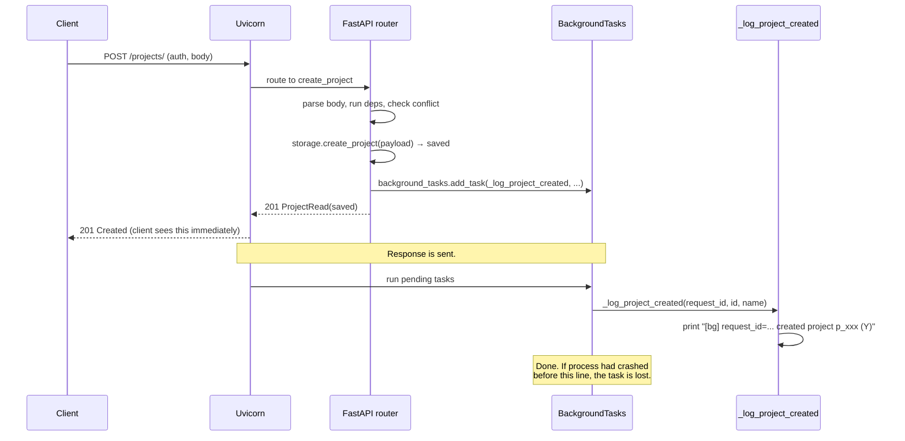
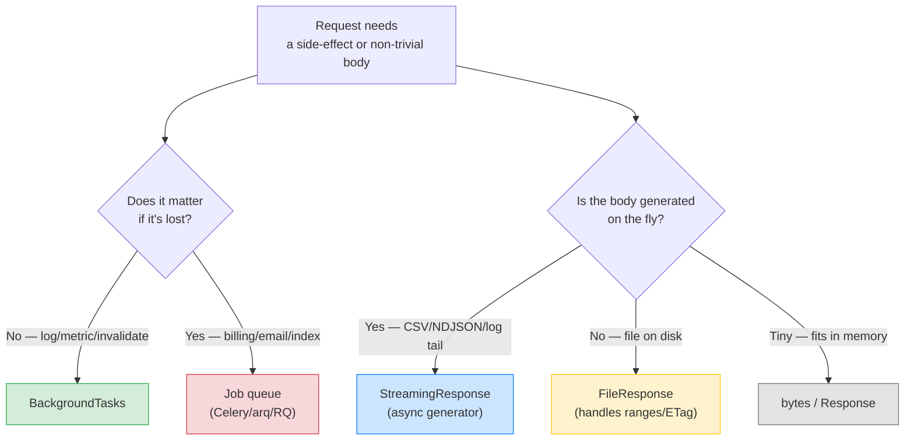

# Lesson 07: Background Tasks, Streaming, Uploads

*Three things that look like "do work after the response" — `BackgroundTasks`, `StreamingResponse`, `UploadFile` — and why only one of them is actually that.*

**The last code-building lesson of Section 03.**

You've built the skeleton, the routers, the parameters, the dependencies, the middleware, the exception handlers. One last piece: handling work that doesn't fit inside a synchronous request/response. Lesson 09 — the comparison capstone [[Sync-vs-Async-Path-Operations]] — follows this one and audits the `def` vs `async def` decision across the handlers you wrote in Lessons 1–7; read it after this lesson, before moving on to the rest of the vault. Three patterns cover 90% of what you'll need: background tasks (do something *after* the response), streaming (send a *huge* response in chunks), uploads (receive a *huge* request). Each is a different shape with different limits — and the limits matter. By the end of this lesson, `Boardly` is a complete, real API. 


#fastapi #background-tasks #streaming #uploads

## Learning Objectives

By the end of this lesson you will be able to:

1. **Use `BackgroundTasks`** — fire-and-forget work after the response is sent.
2. **Explain the limits of `BackgroundTasks`** — best-effort, lost on crash, not a job queue.
3. **Write a `StreamingResponse`** with an async generator that yields chunks.
4. **Stream a CSV** without buffering the whole file in memory.
5. **Accept an `UploadFile`** and stream it to disk (or S3) chunk by chunk.
6. **Validate uploads** — file size, content type, filename.
7. **Choose between `BackgroundTasks` and a real worker queue** — and know when each is appropriate.

## Prerequisites

- **[[Dependency-Injection]]** — `BackgroundTasks` is injected via the same `Depends` machinery (technically via direct parameter type, which we'll explain).
- **[[Path-Query-Header-Cookie-Body]]** — `UploadFile` is a parameter source, like `Body` or `Query`.
- **[[Exception-Handlers]]** — we'll raise domain exceptions (`ProjectNotFound`) from the new routes.
- **[[01-Python-Foundations/Iterators-Generators-Context-Managers]]** — `StreamingResponse` takes an async generator; `UploadFile` is an async context manager.
- **About 90 minutes.** This lesson's code is more lines than Lesson 6's, but the difficulty is conceptual — knowing which tool to reach for.

**The most common gap: async generators.**

`StreamingResponse` takes an *async generator* — a function with `yield`. If `async def gen(): yield chunk` is unfamiliar, re-read [[01-Python-Foundations/Iterators-Generators-Context-Managers]]. The TL;DR: an async generator is a function you `await` to get the next chunk from. Starlette reads chunks until the generator is exhausted.


## The Problem

Three distinct Starlette primitives show up in real services, and `Boardly`'s `POST /projects` endpoint is the natural place where all three become necessary. Each primitive answers a different problem; the Line-by-Line treats them in the same order.

- On `POST /projects`, `Boardly` wants to log the event, send a Slack notification, and update a search index — all of which take time and which the client does not need to wait for. The natural shape is a fire-and-forget side-effect that runs *after* the `201 Created` response is sent.
- `Boardly`'s `GET /projects/{id}/export` endpoint returns the project as CSV. A big project can be 50 MB, and building the whole CSV in memory per concurrent request would OOM the server. The natural shape is a response that streams chunks on the wire as they are generated.
- `Boardly`'s `POST /projects/{id}/avatar` endpoint accepts a 100 MB image upload. Reading the whole file into memory before writing to disk would double the memory cost. The natural shape is a streaming upload that the handler reads chunk by chunk.

Each sub-problem motivates one Starlette primitive — `BackgroundTasks`, `StreamingResponse`, `UploadFile` respectively. They share a lesson because they all push back on the "build the whole thing in memory and return it" assumption that naive FastAPI code makes; they differ enough to warrant their own line-by-line treatment.

### Problem 1: Background tasks

On `POST /projects`, you want to log the event, send a Slack notification, update a search index — all of which take time. The client doesn't need to wait for any of them. You want to return `201 Created` *immediately* and do the side-effects *after*.

The natural shape is a fire-and-forget primitive that runs after the response is sent. Starlette's `BackgroundTasks` is exactly that — a per-request collection of `(func, args)` tuples that Starlette runs sequentially *after* the response is sent. Not a job queue (no persistence, no retry, no DLQ); see the trade-off below and [[14-Caching-and-Background-Processing/Background-Tasks-vs-Workers]] for when you outgrow it.

### Problem 2: Streaming responses

`GET /projects/{id}/export` exports a project's data as CSV. A big project might be 50 MB. If you build the whole CSV in memory and return it, you use 50 MB of RAM *per concurrent request* — your server falls over at 20 concurrent exports.

The natural shape is a response whose body is generated lazily, chunk by chunk, by an async generator. Starlette's `StreamingResponse` is exactly that — it takes a generator (sync or async), sends the response headers immediately, and then iterates the generator's chunks onto the wire. Memory usage stays flat regardless of file size.

### Problem 3: File uploads

`POST /projects/{id}/avatar` accepts a 100 MB image. Reading the whole file into memory and writing it to disk uses 200 MB (file in memory + bytes written).

The natural shape is an upload that the handler reads in chunks and writes to its destination chunk by chunk. Starlette's `UploadFile` is exactly that — it wraps a `SpooledTemporaryFile` (in-memory until 1 MB, then spilled to disk) and exposes async methods (`await file.read(size)`, `await file.write(data)`) so the handler can stream the upload through. The handler never holds the whole file in memory.

Three patterns, three solutions. We'll build them next.

**Note — Historical context — `BackgroundTasks` is from Starlette**

`BackgroundTasks` was introduced in Starlette 0.12 (2019). It's modelled on the same idea in Flask (`after_this_request`) and Quart. The key thing to know: it's *not* a job queue. There's no persistence, no retry, no cross-process coordination. If the worker process crashes between the response and the task, the task is gone. Section 14 ([[14-Caching-and-Background-Processing/Background-Tasks-vs-Workers]]) covers the real job-queue pattern (Celery, RQ, Dramatiq, arq). For Lesson 7, we use `BackgroundTasks` because it's *in-process* and simple — but we're explicit about its limits.


## The Code

This lesson **updates** `routers/projects.py` to add a background task to `create_project` (Problem 1), and **adds two new routes**: `GET /projects/{id}/export` (StreamingResponse CSV — Problem 2) and `POST /projects/{id}/avatar` (UploadFile — Problem 3).

### `boardly/routers/projects.py` (final form)

```python
# boardly/routers/projects.py
"""Project routes for Boardly.

Lesson 7: adds BackgroundTasks, StreamingResponse (CSV export),
and UploadFile (avatar upload).
"""
import csv
import io
from pathlib import Path
from typing import Annotated

from fastapi import (
 APIRouter,
 BackgroundTasks,
 Body,
 Depends,
 File,
 Path as FastapiPath,
 Query,
 UploadFile,
 status,
)
from fastapi.responses import StreamingResponse
from starlette.requests import Request

from boardly.deps import DbSession, User, get_current_user, get_db, require_scope
from boardly.errors import ConflictError, ProjectNotFound
from boardly.models import ProjectCreate, ProjectRead

router = APIRouter(prefix="/projects", tags=["projects"])

# Where avatars live — in a real app this would be S3 / GCS / etc.
_AVATAR_DIR = Path("uploads/avatars")


# --- A function to run as a background task ------------------------------

def _log_project_created(request_id: str, project_id: str, name: str) -> None:
 """In a real app this would push to a queue, write to a log, etc."""
 print(f"[bg] request_id={request_id} created project {project_id} ({name!r})")


# --- Existing routes (unchanged except create_project) -------------------

@router.get("/", response_model=list[ProjectRead])
async def list_projects(
 db: Annotated[DbSession, Depends(get_db)],
 status: Annotated[str | None, Query(pattern="^(active|archived|deleted)$")] = None,
 limit: Annotated[int, Query(gt=0, le=100)] = 20,
) -> list[ProjectRead]:
 items = await db.list_projects(status=status, limit=limit)
 return [ProjectRead.model_validate(p) for p in items]


@router.get("/{project_id}", response_model=ProjectRead)
async def get_project(
 project_id: Annotated[str, FastapiPath(min_length=4, max_length=32)],
 db: Annotated[DbSession, Depends(get_db)],
 user: Annotated[User, Depends(get_current_user)],
) -> ProjectRead:
 project = await db.get_project(project_id)
 if project is None:
 raise ProjectNotFound(project_id)
 return ProjectRead.model_validate(project)


@router.post(
 "/",
 response_model=ProjectRead,
 status_code=status.HTTP_201_CREATED,
)
async def create_project(
 payload: Annotated[ProjectCreate, Body()],
 db: Annotated[DbSession, Depends(get_db)],
 _: Annotated[None, Depends(require_scope("projects:write"))],
 background_tasks: BackgroundTasks,
 request: Request,
) -> ProjectRead:
 existing = await db.get_project_by_name(payload.name)
 if existing is not None:
 raise ConflictError(f"A project named '{payload.name}' already exists.")
 saved = await db.create_project(payload)

 # Fire-and-forget: log the event AFTER the response is sent.
 request_id = getattr(request.state, "request_id", "req_unknown")
 background_tasks.add_task(_log_project_created, request_id, saved.id, saved.name)

 return ProjectRead.model_validate(saved)


# --- New routes (Lesson 7) ----------------------------------------------

@router.get("/{project_id}/export")
async def export_project(
 project_id: Annotated[str, FastapiPath(min_length=4, max_length=32)],
 db: Annotated[DbSession, Depends(get_db)],
 user: Annotated[User, Depends(get_current_user)],
) -> StreamingResponse:
 """Streams the project as CSV. No response_model — StreamingResponse
 bypasses model validation; we control the bytes directly."""
 project = await db.get_project(project_id)
 if project is None:
 raise ProjectNotFound(project_id)

 async def csv_rows() -> io.BytesIO:
 """Yields CSV bytes in chunks."""
 # In-memory text buffer; csv.writer writes to it; we yield bytes.
 buffer = io.StringIO()
 writer = csv.writer(buffer)
 writer.writerow(["id", "name", "status", "description"])
 writer.writerow([project.id, project.name, project.status, project.description or ""])
 # Yield one chunk (the whole CSV is small for Lesson 7).
 yield buffer.getvalue().encode("utf-8")

 return StreamingResponse(
 csv_rows(),
 media_type="text/csv",
 headers={"Content-Disposition": f'attachment; filename="project_{project_id}.csv"'},
 )


@router.post("/{project_id}/avatar", status_code=status.HTTP_204_NO_CONTENT)
async def upload_avatar(
 project_id: Annotated[str, FastapiPath(min_length=4, max_length=32)],
 file: Annotated[UploadFile, File(description="An image file.")],
 db: Annotated[DbSession, Depends(get_db)],
 user: Annotated[User, Depends(get_current_user)],
 _: Annotated[None, Depends(require_scope("projects:write"))],
) -> None:
 """Accepts an avatar upload and writes it to disk."""
 project = await db.get_project(project_id)
 if project is None:
 raise ProjectNotFound(project_id)

 # Validate content type — don't trust the client.
 if file.content_type not in ("image/png", "image/jpeg", "image/webp"):
 raise ConflictError(f"Unsupported content type: {file.content_type!r}")

 # Validate size — read up to 5 MB, reject larger.
 MAX_BYTES = 5 * 1024 * 1024 # 5 MB
 _AVATAR_DIR.mkdir(parents=True, exist_ok=True)
 dest = _AVATAR_DIR / f"{project_id}_{file.filename or 'avatar'}"

 written = 0
 with dest.open("wb") as out:
 while chunk := await file.read(64 * 1024): # 64 KB at a time
 written += len(chunk)
 if written > MAX_BYTES:
 out.close()
 dest.unlink(missing_ok=True)
 raise ConflictError(f"File too large (max {MAX_BYTES} bytes).")
 out.write(chunk)

 print(f"[avatar] {project_id} saved {written} bytes to {dest}")
 return None
```

## Line-by-Line Deep Dive

### `BackgroundTasks`: the parameter type that's its own dependency

```python
async def create_project(
 payload: Annotated[ProjectCreate, Body()],
 db: Annotated[DbSession, Depends(get_db)],
 _: Annotated[None, Depends(require_scope("projects:write"))],
 background_tasks: BackgroundTasks, # ← special!
 request: Request, # ← also special!
) -> ProjectRead:
```

**What it does:** Declares two parameters (`background_tasks` and `request`) with *no* `Depends(...)` and *no* `Annotated` metadata. FastAPI recognises their types and injects them automatically.

**Why no `Depends`?** Because `BackgroundTasks` and `Request` are *special parameter types* — FastAPI checks the type annotation and injects the right object without needing `Depends`. This is the "implicit dependency" pattern; FastAPI documents both as "special types."

**What `BackgroundTasks` actually is:** It's a per-request collection that Starlette maintains. When you call `background_tasks.add_task(func, *args)`, Starlette stashes `(func, args)`. After the response is sent, Starlette runs each stashed task in order. The task can be sync or async.

**What `Request` actually is:** The raw Starlette `Request` object — the same one your middleware sees. Reading `request.state.request_id` gets the value `RequestIDMiddleware` set in Lesson 5. Useful for correlation in background logs.

**When is the background task run?**

After the response is sent. Specifically, Starlette's `BaseHTTPMiddleware` machinery (or the response-sending code path) schedules the tasks to run *after* `response.send()` completes. The client has thus already received `201 Created` when `_log_project_created` runs.

This is critical: the client doesn't wait for the background task. The 201 returns immediately.






### `background_tasks.add_task(...)`

```python
request_id = getattr(request.state, "request_id", "req_unknown")
background_tasks.add_task(_log_project_created, request_id, saved.id, saved.name)
```

**Line by line:**

1. `request_id = getattr(request.state, "request_id", "req_unknown")` — Reads the request_id (set by `RequestIDMiddleware` from Lesson 5). The background task will log it so you can correlate the task to the request that triggered it.
2. `background_tasks.add_task(_log_project_created, request_id, saved.id, saved.name)` — Stashes the function and its arguments. The function is `_log_project_created`; the args are `request_id`, `saved.id`, `saved.name`.

**Warning — `add_task` takes the function and args — NOT a callable that takes no args.**

The signature is `add_task(func, *args, **kwargs)`. So `add_task(_log_project_created, "req_x", "p_y", "name")` is equivalent to `await _log_project_created("req_x", "p_y", "name")` (well, it runs without `await` — sync functions are called directly, async functions are awaited). A common mistake is `add_task(lambda: _log_project_created(...))` — that works but is uglier. Just pass the function and args.


**Danger — `BackgroundTasks` is best-effort. Tasks are lost if the process crashes.**

If Uvicorn crashes between sending the response and running the task, the task is gone. There is no persistence, no retry, no audit log. If your task is *important* (charge a credit card, send a critical email, write to an audit log), do NOT use `BackgroundTasks` — use a real job queue (Celery, Dramatiq, arq, RQ). See [[14-Caching-and-Background-Processing/Background-Tasks-vs-Workers]].

For `Boardly`'s `_log_project_created`, the task is informational — losing it means a missing log line, not a missing charge. Fine for `BackgroundTasks`. Anything more important goes to a queue.


**Production reality: `BackgroundTasks` runs on the *same* Uvicorn worker process that served the response.**

A load-balanced deployment with `uv run uvicorn boardly.main:app --workers 4` runs four independent worker processes, each with its own event loop and its own pending `BackgroundTasks` list. When worker 2 serves `POST /projects/` and stashes `_log_project_created`, the task runs in worker 2 — *after* worker 2's response-sending loop finishes. Three consequences follow. (1) *Per-worker capacity*: if worker 2 is also serving 200 other concurrent requests, the background task queues behind every coroutine waiting on the loop; a 50 ms `_log_project_created` can become a 5-second delay under load. `BackgroundTasks` is not a real queue — it is the request's event loop. (2) *Loss on restart*: a `SIGHUP` reload (or a `kubectl rollout` of the Deployment) sends `lifespan.shutdown` and the worker exits; tasks still in the pending list are lost *even if the response was already sent* — the task has not yet started. (3) *Worker skew*: if worker 2 is hot and worker 3 is cold, the task's runtime is non-deterministic across deploys — a 5-second task on worker 2 (loaded) becomes a 50-ms task on worker 3 (idle), and a log that took 5 s yesterday takes 50 ms today; the on-call chasing a latency regression finds nothing because the regression is per-worker, not per-route. The senior rule: treat `BackgroundTasks` as *in-process, best-effort, on whichever worker served the request* — never as a queue with guarantees. For work that needs a guarantee (max latency, at-least-once, retries), hand it to a real worker pool via `arq` or `Dramatiq` with a Redis broker; the broker is the cross-worker contract that `BackgroundTasks` cannot provide. See [[14-Caching-and-Background-Processing/Background-Tasks-vs-Workers]] for the migration path and [[13-Performance-and-Observability/Structured-Logging-and-Request-IDs]] for the `request_id` propagation that makes the per-worker skew debuggable.


**Student asks: Why does `BackgroundTasks` run after the response is sent, not before?**

Two reasons. (1) The contract is "return the response to the client fast, then do non-critical work" — if the work ran before the response, the client would wait for the work to finish, which defeats the whole point of moving it to "background". (2) The implementation: Starlette's `BackgroundTasks` object is an `await`-able that the response-sending loop drives *after* the HTTP body is fully written. If the work ran in-process but before `return`, an exception would turn a 200 into a 500 — but the response was already sent. By moving it after, FastAPI keeps the response contract honest. The trade-off: if the work throws, you can't tell the client — so the rule above ("don't put important work here") is the inverse of the same property. Use `BackgroundTasks` only for work whose failure is acceptable to discover via logs, not via the HTTP response.


**Warning — When this breaks: the `BackgroundTasks` task that raised and you never knew.**

**Symptom.** A `_log_project_created` background task is updated to also push to a Slack webhook. The webhook URL is misconfigured (a typo in `os.environ["SLACK_WEBHOOK_URL"]`). `POST /projects/` returns `201 Created` to the client (correct). Two minutes later, the marketing team asks why the new-project Slack channel has been silent since the last deploy. The on-call greps the structured logs for `slack` and finds nothing — the typo raised a `ConnectionError` inside the background task, but the response was already sent and the task's exception was swallowed by Starlette's `BackgroundTasks.__await__` (it logs at WARNING level via `anyio`'s capture, but the default uvicorn log config drops the traceback into the worker's stderr at a verbosity level that is below the production log filter).
**Diagnosis.** Starlette's `BackgroundTasks` runner catches `Exception` from each task and logs it via `anyio`'s `BlockingPortal` (sync tasks) or the event loop's exception handler (async tasks) — *but does not propagate to the client* (the response is already on the wire). Two failure modes compound. (1) The default `logging` config in `uvicorn` 0.30+ sends task-tracebacks to the `uvicorn.error` logger at WARNING level; if your production log aggregator filters on ERROR and above, the traceback is invisible. (2) The task that raised is *not retried* — `BackgroundTasks` runs each task exactly once, and a failed task does not block subsequent tasks in the same request's pending list. The visible result: tasks 1, 3, 5 succeed; task 2 fails silently; tasks 4, 6 succeed; the failure is invisible in the response.
**Fix.** Three layers. (1) Wrap every background task body in a `try/except Exception` that logs at ERROR level with the `request_id` from the closure: `logger.exception("bg task failed request_id=%s", request_id)` — the `logger.exception` form captures the traceback at the level your production filter actually surfaces. (2) Add a `tests/test_bg_task_failure.py` that monkey-patches the task to raise and asserts the response is still `201` (regression-test the "task failure must not affect the response" contract). (3) For tasks that *must* succeed, hand them to a real queue with retry semantics (arq, Dramatiq, Celery) — `BackgroundTasks` is for informational side effects only, and the failure contract is "logs, not response, not retry." The grep: `rg "background_tasks.add_task" boardly/` should return only functions whose body wraps its own `try/except Exception`. See [[14-Caching-and-Background-Processing/Background-Tasks-vs-Workers]] for the queue migration and [[13-Performance-and-Observability/Structured-Logging-and-Request-IDs]] for the `request_id` propagation that makes the silent failure debuggable in 30 seconds instead of 30 minutes.


### `StreamingResponse` with an async generator

```python
async def csv_rows() -> io.BytesIO:
 buffer = io.StringIO()
 writer = csv.writer(buffer)
 writer.writerow(["id", "name", "status", "description"])
 writer.writerow([project.id, project.name, project.status, project.description or ""])
 yield buffer.getvalue().encode("utf-8")

return StreamingResponse(
 csv_rows(),
 media_type="text/csv",
 headers={"Content-Disposition": f'attachment; filename="project_{project_id}.csv"'},
)
```

**What it does:** Returns a `StreamingResponse` whose body is generated by the async generator `csv_rows()`. The generator yields bytes; Starlette sends each chunk on the wire as it's yielded.

**Why an async generator?** Because the data might be huge. If `csv_rows` is a generator, only one chunk is in memory at a time. Starlette sends chunk 1, then asks the generator for chunk 2, sends chunk 2, etc. The client receives the response *progressively*; memory usage stays flat regardless of file size.

**What `StreamingResponse` actually does**

`StreamingResponse(content, media_type, ...)` takes a generator (sync or async) as `content`. When Starlette sends the response:
1. Sends the `http.response.start` message (headers, status).
2. Iterates `content` — for each chunk, sends an `http.response.body` message.
3. When the generator is exhausted, sends a final empty `http.response.body` to signal end.

This bypasses `response_model` (no Pydantic serialization) and bypasses `BaseHTTPMiddleware`'s response buffering — *if* you write your middleware carefully (see Mistake 2 below). The body bytes go directly to the wire.


**Warning — When this breaks: the `StreamingResponse` whose generator keeps yielding into a closed socket for 30 seconds.**

**Symptom.** `GET /projects/{id}/export` streams a 50 MB CSV. A mobile client cancels the request 2 seconds in (user taps "Cancel"). Server-side metrics show the route's `p99` is 32 seconds — far longer than the full export takes. CPU usage on the worker spikes. The on-call greps for the `request_id` and finds the generator is still being polled 30 seconds after the client disconnected.
**Diagnosis.** `StreamingResponse` iterates its content generator and pushes each chunk via the ASGI `send` callable. When the client closes the connection, Uvicorn detects the disconnect (via the `http.disconnect` message on the `receive` callable), but Starlette's `StreamingResponse.__call__` does not propagate the disconnect to the generator — it keeps calling `__anext__` on the generator until the generator is exhausted. The generator does not know the client is gone. Two failure modes compound. (1) The generator continues to do work (database queries, CSV row generation) for the entire body, even though the bytes go nowhere — wasted CPU and DB load. (2) If the generator holds resources (a database cursor, a file handle, a Redis stream consumer), they are held until the generator is exhausted, not until the client disconnects — a slow-producing generator with many disconnecting clients is a connection-pool exhaustion vector.
**Fix.** Three layers. (1) Use Starlette's `request.is_disconnected()` check inside the generator's loop: `if await request.is_disconnected(): return` (early-exit) — the check polls the `receive` callable for a `http.disconnect` message; in a tight loop you'd check every N chunks to amortise the cost. (2) Wrap the generator's body in a `try/finally` so resources are released on disconnect: `try: yield chunk finally: cursor.close()`. (3) For generators that produce slowly (a database cursor that takes 100 ms per row), set a per-chunk timeout via `anyio.move_on_after(30)` so a stuck producer doesn't hold resources forever. The grep: `rg "is_disconnected" boardly/routers/` should return at least one hit per streaming route. The deeper rule: a streaming response is a long-lived coroutine that must cooperate with the client's lifetime, not just its own — the generator must observe disconnect, not just exhaustion. See [[02-Web-and-HTTP/HTTP-Request-Lifecycle]] for the disconnect semantics and [[13-Performance-and-Observability/OpenTelemetry-Tracing]] for the span that would have surfaced the 32-second over-run.


**Tip — Use `media_type=` to set the Content-Type.**

For CSV, `media_type="text/csv"`. For PDF, `application/pdf`. For NDJSON, `application/x-ndjson`. For arbitrary binary, `application/octet-stream`. The Content-Disposition header (`attachment; filename=...`) tells the browser to download instead of display.


**Production reality: the chunk-size sweet spot for `StreamingResponse` throughput is 16–64 KB, not 1 KB and not 1 MB.**

The chunk size you `yield` from a `StreamingResponse` generator is a trade-off with three forces. (1) *Per-chunk overhead*: every `yield` triggers an `http.response.body` ASGI message, which Starlette serialises and Uvicorn writes via `send()`; smaller chunks mean more syscalls per byte — a 1 KB chunk on a 50 MB export is 50,000 syscalls, and `strace` shows the worker spending 40% of its time in `write(2)`. (2) *Memory footprint*: larger chunks mean more RAM per concurrent stream — a 1 MB chunk on 100 concurrent exports is 100 MB of resident memory just for the in-flight chunks; a 64 KB chunk is 6.4 MB. (3) *Time-to-first-byte*: the first chunk must be produced before the client sees anything; a 1 MB chunk on a slow-producing generator (a database cursor at 100 ms per row) means the client waits 100 ms for the first row, then sees a megabyte all at once — defeating the progressive-render UX of a streaming endpoint. The sweet spot in 2026 production codebases is 16–64 KB: small enough that 100 concurrent streams use <10 MB of resident chunk memory, large enough that a 50 MB export produces 800–3,200 syscalls (not 50,000). For NDJSON streams of database rows, yield one row at a time encoded as bytes — the row is typically 1–4 KB, well within the sweet spot; do not buffer 1000 rows before yielding. For file-streaming, use `FileResponse` (which uses `sendfile(2)` and bypasses the chunk loop entirely) rather than `StreamingResponse` with a manual chunk loop. The grep: `rg "\\* 1024" boardly/routers/` should return one literal chunk-size constant per streaming route; the senior review checks that each constant is in the 16–64 KB band. See [[13-Performance-and-Observability/N-plus-1-and-Slow-Queries]] for the database-cursor pattern that produces the rows and [[02-Web-and-HTTP/CORS-Caching-Headers-Conditional-Requests]] for the `Vary` header that prevents a CDN from caching a partial stream.


**Why no `response_model` on `export_project`?**

Because `response_model` is a Pydantic-filtering mechanism. `StreamingResponse` returns raw bytes — there's no Pydantic model to filter through. Adding `response_model=...` to a `StreamingResponse` route would either be ignored or fail. When you return a `Response` subclass (`StreamingResponse`, `FileResponse`, `JSONResponse` constructed explicitly), `response_model` is bypassed. (See Lesson 3, Mistake 3.)


### `UploadFile`: the streaming upload parameter

```python
async def upload_avatar(
 project_id: Annotated[str, FastapiPath(min_length=4, max_length=32)],
 file: Annotated[UploadFile, File(description="An image file.")],
 db: Annotated[DbSession, Depends(get_db)],
 user: Annotated[User, Depends(get_current_user)],
 _: Annotated[None, Depends(require_scope("projects:write"))],
) -> None:
```

**What it does:** Declares `file` as a multipart upload. FastAPI parses the multipart body and exposes it as an `UploadFile` object.

**What `UploadFile` actually is:** A Starlette class that wraps a SpooledTemporaryFile (a file that lives on disk after exceeding a threshold, default 1 MB) and exposes async methods: `await file.read(size)`, `await file.write(data)`, `await file.seek(offset)`, `await file.close()`. The `file.content_type`, `file.filename`, and `file.size` attributes give metadata.

**Why `Annotated[UploadFile, File(...)]` instead of just `UploadFile`?** Two reasons:

1. The `File(...)` marker lets you add metadata (description, etc.) that shows up in the OpenAPI doc.
2. It signals intent — this parameter comes from a multipart form field named `file`.

**`UploadFile` vs `bytes`**

You can also accept a file as `file: bytes = File(...)` — which reads the whole file into memory. For large files, this is a memory bomb; for small files (a few KB), it's fine. The rule: use `bytes` only for tiny files; use `UploadFile` for anything that could be large.


**Danger — How an attacker thinks: the multipart body that OOMs the worker before your handler runs.**

A senior engineer reviewing `POST /projects/{id}/avatar` with `file: UploadFile` checks for the *pre-handler* memory exposure. The attack surface is that FastAPI (via Starlette's `multipart` parser) reads the entire multipart body into a `SpooledTemporaryFile` *before* your handler is called — the spool threshold defaults to 1 MB (in-memory) and spills to disk after, but the *parsing* of the multipart boundary structure happens in memory, one chunk at a time. An attacker who sends a malformed multipart body — a `Content-Type: multipart/form-data; boundary=---` with a body that contains millions of tiny boundary-like sequences (`-----`, `-----`, `-----`, ...) — forces the parser to allocate a new buffer for each perceived part header; a 10 MB body of `-----` bytes produces millions of small allocations, and the parser's `BytesIO` accumulator holds them all before the handler sees `file.content_type`. The visible result: the worker process OOMs (or hits `RLIMIT_AS`) before the handler runs, and the request fails with a bare 500 — no `ConflictError`, no `ProjectNotFound`, no chance to enforce the size limit your handler carefully implemented.
The senior defence is structural. (a) The body-size cap belongs at the *reverse proxy*, not at the application — once the body is at the worker, the multipart parser has already allocated. nginx: `client_max_body_size 10m;` per virtual host; Caddy: `request_body { max_size 10MB }`; Cloudflare's free-tier 100 MB cap is the outermost layer. (b) Keep Starlette's `UploadFile` spool threshold at the default 1 MB (set when Starlette calls `python-multipart`'s parser via `request.form()`); do not raise it without a measured reason — a higher threshold means more in-memory allocation per concurrent upload. (c) For routes that accept multipart, wire a pure-ASGI middleware that rejects `Content-Length > MAX` *before* the body is read — `BaseHTTPMiddleware` is too late, the body has been buffered by the time `dispatch` runs. (d) Add a CI grep that fails the build if `boardly/routers/` contains an `UploadFile` route and the reverse-proxy config does not set a body-size limit: `rg "UploadFile" boardly/routers/` returns routes whose paths must appear in the body-size-limited virtual host of `rg "client_max_body_size|request_body" deploy/ Caddyfile nginx/`. The deeper rule: the body-size cap belongs at the edge (reverse proxy / CDN), not at the application — by the time the body reaches FastAPI, the parse cost is already paid. See [[02b-Backend-Foundations/Request-Body-Forms-and-Uploads]] for the multipart spec, [[16-Deployment-and-DevOps/Deployment-Targets-When-To-Use-What]] for the reverse-proxy layer, and [[11-Authentication-and-Security/Threat-Model-First]] for the threat model where pre-handler resource exhaustion is the lane.


### The streaming upload loop

```python
MAX_BYTES = 5 * 1024 * 1024 # 5 MB
_AVATAR_DIR.mkdir(parents=True, exist_ok=True)
dest = _AVATAR_DIR / f"{project_id}_{file.filename or 'avatar'}"

written = 0
with dest.open("wb") as out:
 while chunk := await file.read(64 * 1024): # 64 KB at a time
 written += len(chunk)
 if written > MAX_BYTES:
 out.close()
 dest.unlink(missing_ok=True)
 raise ConflictError(f"File too large (max {MAX_BYTES} bytes).")
 out.write(chunk)
```

**What it does:** Reads the uploaded file 64 KB at a time, writes each chunk to disk, and rejects the upload if it exceeds 5 MB.

**Line by line:**

1. `MAX_BYTES = 5 * 1024 * 1024` — The maximum allowed upload size. Hard-coded for Lesson 7; in production this would come from settings.
2. `_AVATAR_DIR.mkdir(parents=True, exist_ok=True)` — Creates the destination directory if it doesn't exist. Idempotent — won't fail if it exists.
3. `dest = _AVATAR_DIR / f"{project_id}_{file.filename or 'avatar'}"` — Builds the destination path. Note we use the project_id as a prefix — this prevents filename collisions from different projects. (We also trust the client's filename here, which is a footgun — see Mistake 4.)
4. `with dest.open("wb") as out:` — Opens the destination file for binary writing. The `with` block closes the file automatically.
5. `while chunk := await file.read(64 * 1024):` — Reads up to 64 KB from the upload. The `:=` (walrus operator) assigns and tests in one expression. When `file.read` returns `b""` (empty), the loop exits.
6. `written += len(chunk)` — Tracks total bytes written.
7. `if written > MAX_BYTES: ...` — Rejects if over the limit. We close the file, delete the partial write, and raise `ConflictError`. The client gets a 409.
8. `out.write(chunk)` — Writes the chunk to disk.

**Warning — Validate content type AND size — don't trust the client.**

`file.content_type` is sent by the client and is *trivially spoofable*. A client can send `Content-Type: image/png` with a `.exe` body. Always validate by reading magic bytes (the first few bytes of the file — e.g. PNG starts with `\x89PNG\r\n\x1a\n`) if you need to be sure. For Lesson 7, the content-type check is a first line of defence; in production, use `python-magic` to sniff the file's actual type.

Size limits matter even more — without them, a malicious client can upload a 10 GB file and exhaust your disk. The streaming-loop-with-counter pattern (above) is the standard mitigation: reject as soon as the limit is exceeded, don't wait for the upload to finish.


**Tip — Don't trust `file.filename`.**

`file.filename` is client-controlled and can contain `..`, `/`, `\`, NUL bytes — anything. Naively using it as a path lets a client overwrite arbitrary files (path traversal). Always sanitise: strip path separators, prefix with a server-generated name, or just use the project_id as we did above. In our code, we prepend `project_id_` — but if `file.filename` is `../../../etc/passwd`, the resulting path is `uploads/avatars/p_xxx_../../../etc/passwd`, which `Path` normalises to `etc/passwd` in some configurations. Always run `file.filename` through `os.path.basename` and a regex like `[^a-zA-Z0-9._-]`. Better: ignore the client's filename entirely; generate your own.


**Danger — How an attacker thinks: the `file.file` attribute that turns your async upload into a blocking sync I/O.**

A senior engineer reviewing `await file.read(64 * 1024)` in `upload_avatar` checks for the *sync-leak* surface. The attack surface is that `UploadFile` wraps a `SpooledTemporaryFile`, and the underlying file object is exposed as `file.file` (the raw `SpooledTemporaryFile` instance). A teammate who reads the FastAPI docs and reaches for the standard-library idiom — `file.file.read(64 * 1024)`, `file.file.seek(0)`, `file.file.write(chunk)` — has just called *synchronous* I/O on the event loop, because `SpooledTemporaryFile` (and the `TemporaryFile` underneath it) has no async API; every call blocks the worker thread for the duration of the disk read or write. Under load, a single `file.file.read(64 * 1024)` per request stalls the event loop for ~1 ms (warm cache) to ~50 ms (cold disk); 100 concurrent uploads on a worker mean the worker is blocked for 5 seconds of cumulative I/O time, and *every other coroutine* — `/healthz`, `/projects/{id}`, the background tasks — is parked.
The senior defence is structural. (a) Use the async API exclusively: `await file.read(size)`, `await file.write(data)`, `await file.seek(offset)`, `await file.close()` — Starlette's `UploadFile` wraps the sync calls in `anyio.to_thread.run_sync` internally, so the blocking I/O runs on a worker thread, not on the event loop. (b) Add a CI grep that fails the build if `boardly/` calls the sync form: `rg "\\.file\\.(read|write|seek|close)\\b" boardly/ | rg -v "await"` should return nothing — the `\\.file\\.` access pattern and the absence of `await` on the same line catches the sync-leak. (c) For routes that need to call a sync library on the upload (e.g. `Pillow.Image.open(file.file)` for image resizing), wrap the call: `await anyio.to_thread.run_sync(Image.open, file.file)` — the worker thread blocks, not the event loop. The deeper rule: the `UploadFile` async API exists *because* the underlying `SpooledTemporaryFile` is sync; reaching past the async wrapper is a regression to WSGI semantics on an ASGI loop. See [[03-FastAPI-Core/Sync-vs-Async-Path-Operations]] for the `def` vs `async def` decision and [[13-Performance-and-Observability/OpenTelemetry-Tracing]] for the span that would have surfaced the 5-second stall as a `file.read` block on the loop.


## Execution Trace

Run the app:

```bash
uv run uvicorn boardly.main:app --reload
```

In another terminal:

```bash
# 1. Create a project — fires a background task
curl -i -X POST http://127.0.0.1:8000/projects/ \
 -H 'Content-Type: application/json' -H 'Authorization: Bearer token-alice' \
 -d '{"name":"ExportTest","status":"active"}'
# → 201 {"id":"p_xxx",...} (returns immediately)
# Server-side, AFTER the response is sent:
# [bg] request_id=req_xxx created project p_xxx ('ExportTest')

# 2. Export the project as CSV
curl -i -H 'Authorization: Bearer token-alice' \
 http://127.0.0.1:8000/projects/p_xxx/export
# → 200 OK
# Headers: Content-Type: text/csv
# Content-Disposition: attachment; filename="project_p_xxx.csv"
# Body:
# id,name,status,description
# p_xxx,ExportTest,active,

# 3. Upload an avatar
# Make a small PNG with ImageMagick or curl:
echo -n -e '\x89PNG\r\n\x1a\n' > /tmp/avatar.png
curl -i -X POST -H 'Authorization: Bearer token-alice' \
 -F 'file=@/tmp/avatar.png' \
 http://127.0.0.1:8000/projects/p_xxx/avatar
# → 204 No Content
# Server-side:
# [avatar] p_xxx saved 8 bytes to uploads/avatars/p_xxx_avatar.png

# 4. Upload a too-large file (use a real 10 MB file):
# (truncate -s 10M /tmp/big.bin; curl -X POST -H 'Authorization: Bearer token-alice' \
# -F 'file=@/tmp/big.bin' http://127.0.0.1:8000/projects/p_xxx/avatar)
# → 409 {"error":{"code":"conflict","message":"File too large (max 5242880 bytes).",...}}

# 5. Upload a wrong content type:
curl -i -X POST -H 'Authorization: Bearer token-alice' \
 -F 'file=@/tmp/not_an_image.txt' \
 http://127.0.0.1:8000/projects/p_xxx/avatar
# → 409 {"error":{"code":"conflict","message":"Unsupported content type: 'text/plain'.",...}}
```

## Common Mistakes

### Mistake 1: Treating `BackgroundTasks` as a job queue

```python
# WRONG (architecturally)
background_tasks.add_task(charge_credit_card, user_id, amount)
```

**Symptom:** The process crashes after sending the 201 response but before running the task. The credit card is never charged. The client thinks their order succeeded. Support gets angry calls.

**Why:** `BackgroundTasks` is in-process. If the process dies (crash, deploy, OOM kill), pending tasks are lost. No persistence. No retry. No DLQ.

**Fix:** Anything that *matters* goes to a real job queue (Celery, Dramatiq, arq, RQ). `BackgroundTasks` is for *informational* side effects — logging, metrics, cache invalidation. See [[14-Caching-and-Background-Processing/Background-Tasks-vs-Workers]].

### Mistake 2: `BaseHTTPMiddleware` buffering `StreamingResponse`

```python
# WRONG (if you want true streaming)
class MyMiddleware(BaseHTTPMiddleware):
 async def dispatch(self, request, call_next):
 response = await call_next(request)
 # The response from a StreamingResponse route is a StreamingResponse
 # object — but BaseHTTPMiddleware may buffer it.
 return response
```

**Symptom:** A `StreamingResponse` that should send 1000 chunks progressively instead sends them all at once at the end. The client sees nothing until the whole response is built.

**Why:** `BaseHTTPMiddleware` uses an `anyio` task group and a channel to communicate between the inner-app task and the outer middleware. The default behaviour *can* buffer the response in some Starlette versions. This is a known issue (see Starlette issue tracker).

**Fix:** For routes that must stream, use a pure ASGI middleware (which doesn't buffer) or use Starlette's `StreamingResponse` directly without `BaseHTTPMiddleware` between it and the client. Or upgrade — Starlette 1.x has improved this significantly. Verify with `curl --no-buffer` and watch the chunks arrive.

**Warning — If streaming matters, test it.**

Don't assume your streaming response streams. Test with `curl -N http://...` (no buffering) and observe the chunks arriving progressively. If they arrive all at once, your middleware is buffering.


### Mistake 3: Reading the entire `UploadFile` into memory

```python
# WRONG (for large files)
async def upload_avatar(file: UploadFile):
 contents = await file.read() # ← reads the WHOLE file into memory!
 with dest.open("wb") as out:
 out.write(contents)
```

**Symptom:** A 100 MB upload uses 100 MB of memory. 10 concurrent uploads use 1 GB. Server falls over.

**Why:** `await file.read()` (no argument) reads the whole file. The streaming `await file.read(size)` form reads in chunks.

**Fix:** Use the streaming loop pattern from the lesson: `while chunk := await file.read(64 * 1024): ...`. Memory usage stays at `chunk_size` regardless of file size.

### Mistake 4: Path traversal via `file.filename`

```python
# WRONG
dest = _AVATAR_DIR / file.filename # ← client controls filename!
```

**Symptom:** A client uploads a file named `../../../../etc/passwd` and overwrites a system file (depending on permissions).

**Why:** `file.filename` is client-controlled. Naively using it as a path lets the client escape the destination directory.

**Fix:** Generate the server-side filename yourself, or sanitise:

```python
import re
safe_name = re.sub(r"[^a-zA-Z0-9._-]", "", file.filename or "avatar")[:64]
dest = _AVATAR_DIR / f"{project_id}_{safe_name}"
```

Better: ignore the client's filename entirely and use a server-generated UUID.

### Mistake 5: Forgetting to authenticate upload endpoints

```python
# WRONG
@router.post("/{project_id}/avatar")
async def upload_avatar(
 project_id: str,
 file: UploadFile,
 # ← no auth!
) -> None:
 ...
```

**Symptom:** Any anonymous client can upload files to your server. Disk fills up. Inappropriate content gets stored. Bandwidth bills explode.

**Why:** It's easy to forget auth on a "new" endpoint that doesn't fit the existing CRUD pattern.

**Fix:** Always require auth (and scope checks) on upload endpoints. In our code, `_: Annotated[None, Depends(require_scope("projects:write"))]` enforces this.

**Danger — Unauthenticated uploads are a Denial-of-Service vector.**

A botnet can hit your `/avatar` endpoint with 10 GB uploads from 1000 IPs simultaneously. Without auth + size limits, your server is down in seconds. Always authenticate uploads. Always enforce a size limit. Always run behind a CDN with its own limits (Cloudflare, Fastly).


### Mistake 6: Returning a Pydantic model from a `StreamingResponse` route

```python
# WRONG
@router.get("/{project_id}/export", response_model=ProjectRead)
async def export_project(...) -> StreamingResponse:
 ...
 return StreamingResponse(csv_rows(), media_type="text/csv")
```

**Symptom:** The OpenAPI doc says the response is `ProjectRead`; the actual response is CSV bytes. Clients generated from the OpenAPI doc break.

**Why:** `response_model=ProjectRead` and a `StreamingResponse` return value contradict each other. FastAPI ignores the `response_model` when you return a `Response` subclass, but the OpenAPI doc still claims the wrong shape.

**Fix:** Don't set `response_model` on streaming routes. Document the response shape manually in the route's docstring or with `responses=...` if you need to.

## Engineering Trade-Offs

### `BackgroundTasks` vs a job queue

| Criterion | `BackgroundTasks` | Job queue (Celery, arq, RQ) |
|-----------|-------------------|-----------------------------|
| Persistence | None — lost on crash | Persisted (Redis, DB) |
| Retry | None | Built-in |
| Cross-process | No | Yes — workers are separate processes |
| Latency | Sub-millisecond | Milliseconds to seconds (queue + worker start) |
| Complexity | Zero | High (broker, worker process, monitoring) |
| Best for | Informational side effects | Important side effects (email, billing, indexing) |

For `Boardly`'s `_log_project_created`, `BackgroundTasks` is the right choice — losing the log line is not a production incident. For "charge the credit card," "send the password-reset email," or "update the search index" — use a queue.

### `StreamingResponse` vs `FileResponse`

For files that already exist on disk, `FileResponse` is simpler:

```python
from fastapi.responses import FileResponse

@router.get("/{id}/avatar")
async def get_avatar(id: str) -> FileResponse:
 return FileResponse(_AVATAR_DIR / f"{id}.png")
```

`FileResponse` handles `Content-Length`, range requests, and ETag automatically. Use it for static files. Use `StreamingResponse` for *generated* content (CSV exports, NDJSON streams of database rows, real-time logs).

### `UploadFile` vs `bytes`

For small files (<1 MB) where you need the whole content in memory anyway (e.g. parsing a JSON config upload), `bytes` is fine:

```python
async def upload_config(config: Annotated[bytes, File()]) -> dict:
 parsed = json.loads(config)
 return {"received": True, "keys": list(parsed.keys())}
```

For anything that could be large (images, videos, archives), use `UploadFile` and stream. The threshold depends on your concurrent-load expectations; 1 MB is a safe default.

**When would you NOT reach for `StreamingResponse`?**

Three cases reach for something else. (1) When you have a complete in-memory object that fits comfortably in RAM — `JSONResponse`, `HTMLResponse`, or returning the model directly is simpler and lets FastAPI's response_model machinery run. `StreamingResponse` bypasses `response_model`, so you lose the safety net. (2) When the data is on disk and you want the OS to handle range requests, etag, and conditional-GET — use `FileResponse` instead, which wires up `Last-Modified`, `ETag`, and `206 Partial Content` for free. (3) When the data is static and rarely changes — ship it from a CDN; your FastAPI process shouldn't be the one doing the bytes-out. The rule: `StreamingResponse` earns its keep when the data is being *generated* as the request is being served (a CSV export, an SSE stream, a slowly-produced report) — not when it's sitting on disk or in memory ready to send.


## Exercises

**Exercise 1 — Multiple background tasks.** Add a second background task on `POST /projects` that "sends a Slack notification" (just `print`). Confirm both tasks run after the response.

**Exercise 2 — Real CSV streaming.** Modify `csv_rows` to yield the rows one at a time, instead of building the whole CSV in one buffer. Hint: yield `writer.writerow(...)` after each row (you'll need to manage the StringIO buffer per row).

**Exercise 3 — NDJSON streaming.** Add `GET /projects/stream` that returns all projects as NDJSON (one JSON object per line, newline-delimited). Stream them one at a time.

**Exercise 4 — Avatar validation by magic bytes.** Replace the `file.content_type` check with a magic-bytes check: read the first 8 bytes, verify they match PNG/JPEG/WebP signatures, then *seek back to 0* and write the whole file. (Hint: `await file.seek(0)`.)

**Exercise 5 — File metadata.** Add `GET /projects/{id}/avatar` that returns the avatar as a `FileResponse` (using the file saved by Exercise from Lesson 7's upload route). Handle the "no avatar yet" case with a 404.

**Exercise 6 — Spot the bug.** This upload handler has a security hole. What is it?

```python
@router.post("/{project_id}/avatar")
async def upload_avatar(project_id: str, file: UploadFile):
 dest = Path("/tmp") / file.filename
 with dest.open("wb") as out:
 out.write(await file.read())
 return {"saved": str(dest)}
```

(Answer: at least four — (a) no auth, (b) `file.filename` is trusted → path traversal, (c) no size limit → memory bomb via `await file.read()`, (d) returns the saved path to the client, leaking the filesystem layout.)

**Exercise 7 — Test the background task ran.** Add `tests/test_bg_task_ran.py` using `fastapi.testclient.TestClient` and `capsys` to assert that `POST /projects/` triggers `_log_project_created` (captured via the `print` line in the task). Verify with `uv run pytest tests/test_bg_task_ran.py -v` — passes; then comment out the `background_tasks.add_task(...)` line in `routers/projects.py`, re-run, and watch the test fail (the silent-task-not-scheduled regression, caught in CI before deploy).

**Exercise 8 — Reproduce the silent task-exception.** Modify `_log_project_created` to `raise RuntimeError("bg boom")` at the top. Run `uv run uvicorn boardly.main:app --reload` and `curl -i -X POST http://127.0.0.1:8000/projects/ -H 'Content-Type: application/json' -H 'Authorization: Bearer token-alice' -d '{"name":"Boom","status":"active"}'` — confirm the response is `201 Created` (the client is unaffected); the worker's stderr contains the `RuntimeError` traceback. Then add `try: ... except Exception: logger.exception("bg task failed request_id=%s", request_id)` around the body and re-test — the traceback is now logged at ERROR level (visible in the production log filter). The exercise is the failure-mode reproduction from the `add_task` warning callout.

**Exercise 9 — Streaming + disconnect early-exit.** Modify `csv_rows` to `await asyncio.sleep(0.1)` between yields (simulating a slow producer). Run `uv run uvicorn boardly.main:app --reload` and `curl -N http://127.0.0.1:8000/projects/p_xxx/export` — observe chunks arrive progressively. Kill the curl mid-stream (Ctrl+C) and confirm via server logs that the generator continues producing (wasted CPU). Then add `if await request.is_disconnected(): return` inside the generator's loop (pass `request` into `csv_rows`) and re-test — the generator now exits within ~100 ms of the disconnect. The exercise is the failure-mode reproduction from the `StreamingResponse` disconnect warning callout.

**Exercise 10 — Chunk-size benchmark.** Add `scripts/bench_export.py` that uses `httpx.AsyncClient` to fetch `GET /projects/p_xxx/export` 100 times under two `csv_rows` variants (1 KB chunks vs 64 KB chunks). Verify with `uv run python scripts/bench_export.py` — print median latency and peak RSS for each variant. Confirm 64 KB is faster and uses less peak RSS than 1 KB. The benchmark is the senior's evidence that the chunk-size sweet spot (16–64 KB) from the `StreamingResponse` info callout is real, not a folk theorem.

**Exercise 11 — Magic-bytes + size cap integration test.** Add `tests/test_upload_avatar_validation.py` that posts three uploads to `/projects/p_xxx/avatar`: (a) a real 8-byte PNG, (b) a file with a PNG magic header but a 6 MB body, (c) a 100-byte file with no PNG magic. Verify with `uv run pytest tests/test_upload_avatar_validation.py -v` — assert the responses are `204`, `409` (too large), `409` (bad magic) respectively. The exercise is the integration of magic-bytes validation (Exercise 4) with the streaming size cap from the lesson.

**Exercise 12 — Filename sanitiser with path-traversal coverage.** Replace the `f"{project_id}_{file.filename or 'avatar'}"` line with a `sanitise_filename(raw)` helper that runs `os.path.basename`, strips NUL bytes, and rejects anything outside `[a-zA-Z0-9._-]`. Write `tests/test_filename_sanitiser.py` with cases: `../../../etc/passwd` → `etcpasswd`, `a\x00b.png` → `ab.png`, `normal.png` → `normal.png`. Verify with `uv run pytest tests/test_filename_sanitiser.py -v` — passes. The exercise is the structural enforcement against the path-traversal attack from Mistake 4 / the don't-trust-filename tip.

## Verification

```bash
uv run uvicorn boardly.main:app --reload
```

In another terminal:

```bash
# Create a project — see background task run after response
curl -i -X POST http://127.0.0.1:8000/projects/ \
 -H 'Content-Type: application/json' -H 'Authorization: Bearer token-alice' \
 -d '{"name":"VerifyLesson7","status":"active"}'
# Expected: 201 with the project. Server-side log (after response):
# [bg] request_id=... created project p_xxx ('VerifyLesson7')

# Export as CSV
curl -i -H 'Authorization: Bearer token-alice' \
 http://127.0.0.1:8000/projects/p_xxx/export
# Expected:
# HTTP/1.1 200 OK
# Content-Type: text/csv; charset=utf-8
# Content-Disposition: attachment; filename="project_p_xxx.csv"
# id,name,status,description
# p_xxx,VerifyLesson7,active,

# Upload an avatar
echo -n -e '\x89PNG\r\n\x1a\n' > /tmp/test.png # 8 bytes
curl -i -X POST -H 'Authorization: Bearer token-alice' \
 -F 'file=@/tmp/test.png;type=image/png' \
 http://127.0.0.1:8000/projects/p_xxx/avatar
# Expected: 204 No Content
# Server-side:
# [avatar] p_xxx saved 8 bytes to uploads/avatars/p_xxx_test.png

# Verify the file is on disk
ls uploads/avatars/
# Expected: a file matching the project_id

# Wrong content type
curl -i -X POST -H 'Authorization: Bearer token-alice' \
 -F 'file=@/tmp/test.png;type=text/plain' \
 http://127.0.0.1:8000/projects/p_xxx/avatar
# Expected: 409 {"error":{"code":"conflict","message":"Unsupported content type: 'text/plain'.",...}}

# Too-large file (create a 10MB file)
truncate -s 10M /tmp/big.bin
curl -i -X POST -H 'Authorization: Bearer token-alice' \
 -F 'file=@/tmp/big.bin;type=image/png' \
 http://127.0.0.1:8000/projects/p_xxx/avatar
# Expected: 409 {"error":{"code":"conflict","message":"File too large (max 5242880 bytes).",...}}
```

If all six behave as expected, your background tasks, streaming, and uploads are correctly wired.

## Previously Learned Here

- **Async generators** — [[01-Python-Foundations/Iterators-Generators-Context-Managers]]. `StreamingResponse` takes an async generator; `csv_rows()` is one.
- **`BackgroundTasks` (the parameter type)** — introduced here. It's one of FastAPI's "special types" (along with `Request`) that don't need `Depends`.
- **`Request` (the parameter type)** — same family. We read `request.state.request_id` to pass to the background task.
- **Domain exceptions** — [[Exception-Handlers]]. `ProjectNotFound` and `ConflictError` (raised for upload-size and content-type violations) come from Lesson 6.
- **`UploadFile`** — Starlette class. Introduced here. Re-exported from `fastapi`.
- **Multipart form parsing** — handled automatically by FastAPI when you use `UploadFile` / `File`. No `request.form()` parsing needed.

## What's Next

This is the **last code-building lesson in Section 03 (FastAPI Core)**. The comparison capstone — Lesson 09, [[Sync-vs-Async-Path-Operations]] — audits the `def` vs `async def` decision across the handlers you wrote in Lessons 1–7; read it next, before moving on to the broader vault. With Lesson 7 done, your `Boardly` API now has:

- A typed `FastAPI()` constructor + lifespan (Lesson 1)
- Modular routers with prefix/tags (Lesson 2)
- Typed path/query/body parameters with `Annotated` + `response_model` (Lesson 3)
- `Depends`-based dependency injection with `yield` cleanup (Lesson 4)
- Request-id + timing middlewares, ordered correctly (Lesson 5)
- Custom domain exceptions with consistent error envelope (Lesson 6)
- Background tasks, streaming, and uploads with their limits understood (Lesson 7)

Where to go next:

- **[[14-Caching-and-Background-Processing/Background-Tasks-vs-Workers]]** — when `BackgroundTasks` isn't enough. Celery, Dramatiq, arq, RQ.
- **[[07-SQLAlchemy/02-Engines-Connections-Pools]]** — replace `DbSession` with a real `AsyncSession`. The interface stays the same; the storage gets durable.
- **[[11-Authentication-and-Security/OAuth2-JWT-Access-Refresh]]** — replace `_FAKE_USERS` with real JWT verification.
- **[[12-Testing-and-Quality/Testing-FastAPI-Endpoints]]** — test the whole thing end-to-end with `httpx.AsyncClient` and `dependency_overrides`.
- **[[13-Performance-and-Observability/Structured-Logging-and-Request-IDs]]** — replace `print` with `structlog` or `logging`.
- **[[15-External-Integrations/HTTP-Clients-Timeouts-Retries]]** — if `Boardly` calls other services (Slack, Stripe), this is how.

## Sources

- **FastAPI — Background Tasks** — <https://fastapi.tiangolo.com/tutorial/background-tasks/> — accessed 2026-10-19.
- **FastAPI — Response — StreamingResponse** — <https://fastapi.tiangolo.com/advanced/custom-response/#streamingresponse> — accessed 2026-10-19.
- **FastAPI — Request Files** — <https://fastapi.tiangolo.com/tutorial/request-files/> — accessed 2026-10-19.
- **Starlette — Background Tasks** — <https://www.starlette.io/background/> — accessed 2026-10-19 — the underlying implementation.
- **Starlette — Responses — StreamingResponse** — <https://www.starlette.io/responses/#streamingresponse> — accessed 2026-10-19.
- **Starlette — UploadFile** — <https://www.starlette.io/requests/#request-files> — accessed 2026-10-19.
- **OWASP — Unrestricted File Upload** — <https://owasp.org/www-community/vulnerabilities/Unrestricted_File_Upload> — accessed 2026-10-19 — the security angle on uploads.
- **FastAPI — Release Notes** — <https://fastapi.tiangolo.com/release-notes/> — verified 0.148.0 released 2026-10-19.

## What We Learned

Let's recap. In this lesson you:

- **Added a `BackgroundTasks` parameter** to `create_project` and used `add_task(...)` to fire-and-forget a logging task after the response is sent.
- **Wrote a `StreamingResponse`** with an async generator that yields CSV bytes — keeping memory flat regardless of export size.
- **Added an `UploadFile` route** with a streaming chunked-read loop that respects a size limit and rejects bad content types.
- **Understood the limits of `BackgroundTasks`** — best-effort, lost on crash, NOT a job queue. Important work goes to a real queue.
- **Saw how `StreamingResponse` interacts with `BaseHTTPMiddleware`** — buffering risk and how to verify streaming actually streams.
- **Hit and fixed six common patterns-mistakes** — treating BackgroundTasks as a queue, buffering StreamingResponse, reading UploadFile whole, path traversal, unauthenticated uploads, and `response_model` on streaming routes.

Mental model: *`BackgroundTasks` is for fire-and-forget informational side effects — never for important work. `StreamingResponse` lets you send a huge response in chunks; memory stays flat. `UploadFile` lets you receive a huge request in chunks; same memory story. Each has limits; know them; use the right tool. When `BackgroundTasks` isn't enough, use a job queue (Section 14).*

---

> A note from your teacher
You just finished Section 03 — the FastAPI Core. `Boardly` is a complete API: lifespan, routers, typed parameters, dependencies, middleware, exception handlers, background tasks, streaming, uploads. Every line is one you wrote; every line is one you can explain. That's the goal. The rest of the vault — Pydantic, SQLAlchemy, auth, testing, observability, deployment — plugs into this skeleton without changing it. You built the foundation. Everything from here is *additions*, not refactors. See you in Section 04. 


---

**Tags:** #fastapi #background-tasks #streaming #uploads #review
**Previous:** [[Exception-Handlers]]
**Next:** [[04-Pydantic/BaseModel-and-Validation]] →
