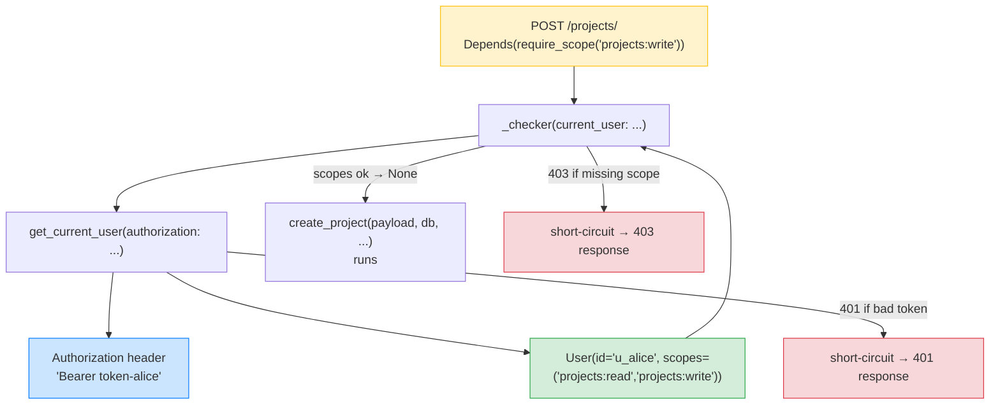
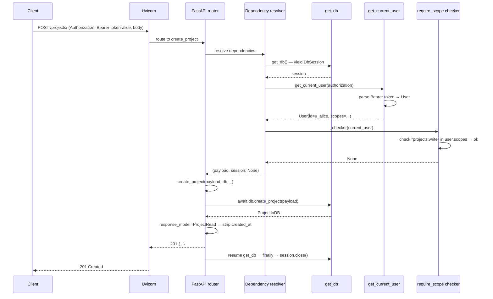

# Lesson 04: Dependency Injection

*Wiring `Boardly`'s routers to their resources via `Depends()`. `get_db`, `get_current_user`, nested `require_scope("projects:write")`, `yield` cleanup, and dependency overrides.*

**You're at the architectural pivot of the section.**

Up to now, `Boardly`'s routers have called `storage.list_projects(...)` directly. That works. It's also wrong — the router knows about storage, the test can't swap storage out, and adding auth means editing every route. In this lesson, we flip it: routers receive their dependencies as parameters, and FastAPI wires them up. The router becomes a transport layer; the dependencies become the application. This is the architectural shift. 


#fastapi #dependency-injection #depends #canonical

## Learning Objectives

By the end of this lesson you will be able to:

1. **Define a `Depends()`-injectable function** with the modern `Annotated[T, Depends(...)]` form.
2. **Write a `yield`-based dependency** that cleans up after itself (the canonical `get_db` pattern).
3. **Explain per-request caching** — why `get_db()` is called *once per request* even if three routes depend on it.
4. **Nest dependencies** — `require_scope("projects:write")` depends on `get_current_user`, which depends on `Authorization` header.
5. **Apply per-router dependencies** to enforce auth on every route in a router.
6. **Override dependencies in tests** with `app.dependency_overrides`.
7. **Reason about the dependency graph** as a DAG FastAPI resolves top-down.

## Prerequisites

- **[[Path-Query-Header-Cookie-Body]]** — you need the `routers/projects.py` with `Annotated` parameters. We're going to *add* dependencies to it.
- **[[01-Python-Foundations/Iterators-Generators-Context-Managers]]** — `yield` dependencies are generators. Same mental model as the lifespan in Lesson 1.
- **[[01-Python-Foundations/Type-Hints-and-Annotations]]** — `Annotated[T, Depends(...)]` is the preferred form (FastAPI 0.95+, October 2026: standard).
- **About 90 minutes.** This is the densest lesson in the section.

**The most common gap: closures vs `Depends`.**

If you've never used a dependency-injection framework, "give me a database session as a function argument" feels strange. The intuition: a dependency function is just a function; FastAPI calls it for you per request, captures its return value, and passes it as the argument. The `yield` form is the same idea, but the function "pauses" with the value held open, and "resumes" when the request is done. Same pattern as the lifespan.


## The Problem

Three pain points push you to dependency injection:

1. **Hard-wired resources.** `from boardly import storage` directly couples the router to one storage implementation. You can't swap to a fake for tests without monkeypatching.
2. **Cross-cutting concerns repeated everywhere.** "Get the current user from the `Authorization` header, validate the JWT, return a `User` object" — without DI, every route that needs auth re-implements that 5-line block.
3. **Cleanup is easy to forget.** Without DI, every route that opens a database session has to remember to close it in a `finally` block. With DI, the dependency's `yield` form handles cleanup automatically, even if the route raises.

FastAPI solves all three with one primitive: `Depends()`. You declare dependencies as function parameters; FastAPI resolves them per request, caches results within a request, and runs cleanup when the request ends.

**Note — Historical context — DI in frameworks**

Dependency injection as a concept comes from the Java/Spring world (early 2000s). Flask's version is `g` (the request-scoped global). Django has its own middleware/plugin system. FastAPI's `Depends()` is closer to Spring's `@Autowired` — a typed, declarative way to wire components. The big innovation in FastAPI is that *any function* can be a dependency, no class registration or container required. You write `def get_db(): ...` and pass `Depends(get_db)` as a parameter; that's the wiring. No XML, no decorators, no containers.


## The Code

This lesson adds one new file (`boardly/deps.py`) and **rewrites** `routers/projects.py` to consume dependencies.

### `boardly/deps.py`

```python
# boardly/deps.py
"""FastAPI dependencies for Boardly.

Three layers of dependency:
 - get_db() → yields a DbSession (one per request)
 - get_current_user() → reads the Authorization header, returns a User
 - require_scope(...) → depends on get_current_user, enforces RBAC
"""
from __future__ import annotations

from collections.abc import AsyncIterator
from dataclasses import dataclass, field
from typing import Annotated

from fastapi import Depends, Header, HTTPException, status

from boardly import storage
from boardly.models import ProjectCreate, ProjectInDB


# --- Layer 1: the per-request "database session" -------------------------

@dataclass
class DbSession:
 """A thin async wrapper around the in-memory store.

 In a real app, this would be a SQLAlchemy AsyncSession. The interface
 (list_projects, get_project, create_project) is what matters.
 """
 user_id: str | None = None
 _created_ids: list[str] = field(default_factory=list)

 async def list_projects(self, *, status: str | None, limit: int) -> list[ProjectInDB]:
 return storage.list_projects(status=status, limit=limit)

 async def get_project(self, project_id: str) -> ProjectInDB | None:
 return storage.get_project(project_id)

 async def create_project(self, payload: ProjectCreate) -> ProjectInDB:
 project = storage.create_project(payload)
 self._created_ids.append(project.id)
 return project

 async def close(self) -> None:
 # In a real app: await self._session.close()
 # For the teaching scaffold: nothing to release.
 self._created_ids.clear()


async def get_db() -> AsyncIterator[DbSession]:
 """Yields a DbSession and closes it after the request."""
 session = DbSession()
 try:
 yield session
 finally:
 await session.close()


# --- Layer 2: the current user (reads the Authorization header) -----------

@dataclass(frozen=True)
class User:
 id: str
 scopes: tuple[str, ...]


# A real app would verify a JWT here. For Lesson 4 we accept any
# "Bearer <token>" and look the token up in a fake user table.
_FAKE_USERS: dict[str, User] = {
 "token-alice": User(id="u_alice", scopes=("projects:read", "projects:write")),
 "token-bob": User(id="u_bob", scopes=("projects:read",)),
}


async def get_current_user(
 authorization: Annotated[str | None, Header()] = None,
) -> User:
 """Reads 'Authorization: Bearer <token>', returns the User.

 Raises 401 if the header is missing or the token is unknown.
 """
 if not authorization or not authorization.lower().startswith("bearer "):
 raise HTTPException(
 status_code=status.HTTP_401_UNAUTHORIZED,
 detail="missing or malformed Authorization header",
 headers={"WWW-Authenticate": "Bearer"},
 )
 token = authorization.split(" ", 1)[1].strip()
 user = _FAKE_USERS.get(token)
 if user is None:
 raise HTTPException(
 status_code=status.HTTP_401_UNAUTHORIZED,
 detail="unknown token",
 headers={"WWW-Authenticate": "Bearer"},
 )
 return user


# --- Layer 3: nested dependency for RBAC ---------------------------------

def require_scope(*required_scopes: str):
 """Returns a dependency that enforces the current user has all scopes.

 Usage:
 async def create_project(
 _: Annotated[None, Depends(require_scope("projects:write"))],
 ...
 ): ...

 The function returned depends on get_current_user, so the
 Authorization header is parsed exactly once per request (DI caching).
 """
 async def _checker(current_user: Annotated[User, Depends(get_current_user)]) -> None:
 missing = [s for s in required_scopes if s not in current_user.scopes]
 if missing:
 raise HTTPException(
 status_code=status.HTTP_403_FORBIDDEN,
 detail=f"missing scopes: {', '.join(missing)}",
 )
 return None

 return _checker
```

### `boardly/routers/projects.py` (rewritten)

```python
# boardly/routers/projects.py
"""Project routes for Boardly.

Lesson 4: dependencies. Routes receive a DbSession and the current user
as parameters; no module-level imports of storage.
"""
from typing import Annotated

from fastapi import APIRouter, Body, Depends, Path, Query, status
from fastapi.responses import Response

from boardly.deps import DbSession, User, get_current_user, get_db, require_scope
from boardly.models import ProjectCreate, ProjectRead

router = APIRouter(prefix="/projects", tags=["projects"])


@router.get("/", response_model=list[ProjectRead])
async def list_projects(
 db: Annotated[DbSession, Depends(get_db)],
 status: Annotated[str | None, Query(pattern="^(active|archived|deleted)$")] = None,
 limit: Annotated[int, Query(gt=0, le=100)] = 20,
) -> list[ProjectRead]:
 items = await db.list_projects(status=status, limit=limit)
 return [ProjectRead.model_validate(p) for p in items]


@router.get("/{project_id}", response_model=ProjectRead)
async def get_project(
 project_id: Annotated[str, Path(min_length=4, max_length=32)],
 db: Annotated[DbSession, Depends(get_db)],
 user: Annotated[User, Depends(get_current_user)],
) -> ProjectRead:
 project = await db.get_project(project_id)
 if project is None:
 return Response(status_code=404)
 return ProjectRead.model_validate(project)


@router.post(
 "/",
 response_model=ProjectRead,
 status_code=status.HTTP_201_CREATED,
)
async def create_project(
 payload: Annotated[ProjectCreate, Body()],
 db: Annotated[DbSession, Depends(get_db)],
 _: Annotated[None, Depends(require_scope("projects:write"))],
) -> ProjectRead:
 saved = await db.create_project(payload)
 return ProjectRead.model_validate(saved)
```

## Line-by-Line Deep Dive

### `deps.py`: `get_db` (the canonical `yield` dependency)

```python
async def get_db() -> AsyncIterator[DbSession]:
 session = DbSession()
 try:
 yield session
 finally:
 await session.close()
```

**What it does:** Creates a `DbSession`, yields it to the route handler, and closes it after the route returns (or raises).

**Why a `yield` dependency?** This is the FastAPI/Starlette pattern for resources that need cleanup. When FastAPI sees a dependency function that's a generator (has `yield`), it:

1. **Calls the generator** up to the `yield` — gets the `DbSession`.
2. **Passes that session** as the argument to whichever route depends on `get_db`.
3. **Runs the route handler.**
4. **Resumes the generator after `yield`** — the `finally` block runs, closing the session.

The `finally` block runs even if the route handler raised an exception. FastAPI captures the exception, runs the cleanup, then re-raises. The session is therefore *always* closed.

**Why this is identical to the lifespan pattern**

Compare this to Lesson 1's lifespan:
```python
@asynccontextmanager
async def lifespan(app: FastAPI) -> AsyncIterator[None]:
# startup
yield
# shutdown
```
The lifespan is a *process-scoped* async context manager. `get_db` is a *request-scoped* one. Same primitive (`yield`), different scope. Both use `try/finally` to guarantee cleanup. If you understood Lesson 1, you understand this.


**What happens inside: the dependency graph and the per-request cache**

When FastAPI sees `Annotated[DbSession, Depends(get_db)]` on a route parameter, it does not just call `get_db()` at request time. At app startup, FastAPI walks the route's signature, sees `Depends(get_db)`, then walks `get_db`'s own signature (which may declare further `Depends(...)` or `Annotated[..., Header()]` parameters), and builds a directed acyclic graph of dependencies. That graph is built *once per route* and cached on the route's `Dependant` object (visible as `route.dependant` — try `print(app.routes[0].dependant.dependencies)` in a debugger). At request time, FastAPI resolves the graph topologically: leaves first (the `Authorization` header parser), then the functions that consume them (`get_current_user`), then the route itself. Results are cached *per request* — if three parameters of one route (or three nodes in the dependency chain) all declare `Depends(get_current_user)`, `get_current_user` runs exactly once per request, and its return value is stored in a request-scoped cache keyed by the dependency callable's identity. That is why the `Authorization` header is parsed once even when both `get_current_user` and `require_scope(...)` consume it. The senior engineer's question on every `Depends` is therefore: *is this dependency cached or fresh within a single request?* The default is cached (one execution per request). Opt out with `Depends(get_X, use_cache=False)` only when the dependency has a side effect you want re-executed (rare — usually a counter or a sequence-generator). The follow-up question: *if my route depends on `get_db` twice through two different paths, do I get the same `DbSession` or two?* Answer: the same one — that is the whole point of the cache. If you genuinely need two sessions on one request (say, a read-replica read followed by a primary write), declare two distinct `Depends` functions (`get_read_db`, `get_write_db`) — the cache key is the callable, so two callables produce two sessions.


**Warning — Exactly one `yield` per dependency.**

Same rule as the lifespan. Two `yield`s → `RuntimeError`. The dependency is a generator; FastAPI drives it once per request.


### `deps.py`: `DbSession` (the dataclass wrapper)

```python
@dataclass
class DbSession:
 user_id: str | None = None
 _created_ids: list[str] = field(default_factory=list)

 async def list_projects(self, *, status, limit) -> list[ProjectInDB]:
 return storage.list_projects(status=status, limit=limit)

 async def create_project(self, payload: ProjectCreate) -> ProjectInDB:
 project = storage.create_project(payload)
 self._created_ids.append(project.id)
 return project

 async def close(self) -> None:
 self._created_ids.clear()
```

**What it does:** A small wrapper that exposes `list_projects`, `get_project`, `create_project`, `close` as methods. Internally it delegates to the module-level `storage` functions.

**Why a class instead of just calling `storage`?** Three reasons:

1. **It models a real `AsyncSession`.** When you swap this scaffold for SQLAlchemy in Section 07, the router code doesn't change — it just calls `await db.list_projects(...)` on a real session instead.
2. **It carries per-request state.** `user_id` (set by an outer dependency), `_created_ids` (used by a hypothetical per-request audit log).
3. **It owns its own cleanup.** The `close()` method is where you'd `await session.close()` for a real SQLAlchemy session.

**Tip — The pattern: dependency functions return objects with `.close()` / `.aclose()` methods.**

In a real app, `get_db` would be:
```python
async def get_db(
sessionmaker: Annotated[async_sessionmaker, Depends(get_sessionmaker)],
) -> AsyncIterator[AsyncSession]:
async with sessionmaker() as session:
yield session
```
Note the `async with` — that's an async context manager (the same primitive as the lifespan). The session is closed on exit. We don't even need a `try/finally` because `async with` does it for us. Our `DbSession` doesn't support `async with` (it's a `@dataclass`, no `__aenter__`/`__aexit__`), so we use the explicit `try/finally`. Both patterns are correct.


**Production reality: pool exhaustion under load**

At 1000 req/s, your `Depends(get_db)` creates a new `AsyncSession` per request. That's 1000 sessions/second. Each session checks out one connection from SQLAlchemy's `AsyncAdaptedQueuePool` (default `pool_size=5`, `max_overflow=10` — a hard ceiling of 15 concurrent connections per worker process). If your average request takes 50 ms, you have `1000 × 0.05 = 50` concurrent sessions in flight, but the pool only holds 15. The pool then *queues* the 16th through 50th requests; once `pool_timeout` (default 30 seconds) elapses, the next checkout raises `TimeoutError: QueuePool limit of size 5 overflow 10 reached, connection timed out, timeout 30.0`. FastAPI converts that into a 500 by default — the worst possible response, because the client will retry and add more load. The senior engineer's sizing equation: `pool_size + max_overflow >= (peak_rps × avg_request_seconds) × safety_factor`, where `safety_factor` is roughly 1.5 for headroom. For 1000 rps at 50 ms, that's `pool_size + max_overflow >= 75`. The non-obvious part: the limit is *per worker process*, so 4 Uvicorn workers each need a `pool_size` of ~19 to collectively serve 1000 rps; Postgres then sees `4 × 19 = 76` idle connections, which counts against `max_connections` (default 100 in Postgres — bump it). The senior question on every `Depends(get_db)` is: *what's my pool size, what's my `pool_timeout`, and what happens when the pool is exhausted?* A `503 Service Unavailable, retry later` (with a `Retry-After` header) is the right answer; a 500 with a stack trace is the wrong one. Catch the `TimeoutError` in an exception handler (Lesson 6) and return the 503.


**Student asks: Why is `get_db` a function and not a class?**

Because FastAPI's DI accepts either form, but they answer different questions. A `def` (or `async def`) function is the idiomatic unit — it composes naturally with `Annotated[AsyncSession, Depends(get_db)]` and is trivially overridable in tests via `app.dependency_overrides[get_db] = lambda: ...`. A class works too (`Annotated[AsyncSession, Depends(DbSession)]` instantiates it with no args), but it's the wrong shape for *stateful* setup/teardown: classes don't `yield` cleanly without turning them into context managers via `@contextmanager` or `__aenter__`/`__aexit__`. The rule: reach for a function when you have setup/teardown (a `yield`); reach for a class only when the dependency is a *pure constructor* (a value object like `DbSession` that just carries data, with no resource lifecycle). Mixing the two — a class with a `__call__` method that yields — is legal but obscure; reserve it for DI frameworks migrating from Flask-style "container" patterns.


### `deps.py`: `get_current_user` (header + 401)

```python
async def get_current_user(
 authorization: Annotated[str | None, Header()] = None,
) -> User:
 if not authorization or not authorization.lower().startswith("bearer "):
 raise HTTPException(
 status_code=status.HTTP_401_UNAUTHORIZED,
 detail="missing or malformed Authorization header",
 headers={"WWW-Authenticate": "Bearer"},
 )
 token = authorization.split(" ", 1)[1].strip()
 user = _FAKE_USERS.get(token)
 if user is None:
 raise HTTPException(
 status_code=status.HTTP_401_UNAUTHORIZED,
 detail="unknown token",
 headers={"WWW-Authenticate": "Bearer"},
 )
 return user
```

**What it does:** Reads the `Authorization` header, parses the Bearer token, looks the user up in `_FAKE_USERS`, and returns a `User`. Raises `HTTPException(401)` if anything is wrong.

**Why `HTTPException` instead of `return None`?** Because raising inside a dependency is how you short-circuit the entire request. If `get_current_user` raises, the route handler never runs, the dependency chain unwinds, and FastAPI returns the 401 response. The route handler can stay clean — no `if user is None: return 401` clutter.

**Why the `WWW-Authenticate: Bearer` header in the response?** Because RFC 6750 says 401 responses should include it. Without it, browsers won't prompt for credentials. It's a small detail that signals "this is a real API, not a tutorial."

**What `HTTPException` actually does**

`HTTPException` is a special exception class. When raised inside a route handler *or* a dependency, FastAPI catches it and converts it into a JSON response:
```json
{"detail": "missing or malformed Authorization header"}
```
with the status code you specified. We'll cover this in detail in Lesson 6 (Exception Handlers). For now: think of `HTTPException` as the "early-exit-with-a-response" primitive.


**Warning — Don't roll your own auth.**

`_FAKE_USERS` is a teaching scaffold. Real auth requires JWT verification (signature, expiry, scopes), refresh tokens, and rate limiting. See [[11-Authentication-and-Security/OAuth2-JWT-Access-Refresh]] for the real version. We're using a fake here so you can see the *dependency-injection pattern* clearly; the auth itself is not the lesson.


**Danger — How an attacker thinks: the `Authorization` header as a timing and information oracle**

A senior engineer reading `get_current_user` checks three things an attacker will probe. (1) **Constant-time comparison.** `user = _FAKE_USERS.get(token)` is a dict lookup, and Python's string-hash comparison is *not* constant-time across inputs of the same length — an attacker who can measure response time to ~1 ms over many thousands of requests can statistically distinguish "unknown token" from "known token with a different prefix" and walk the token space character by character. The real version uses `hmac.compare_digest(token, expected)` after the lookup, so timing variance is bounded. (2) **Error-message information.** `detail="unknown token"` tells the attacker "this token is not in your table"; combined with `detail="missing or malformed Authorization header"`, the two error messages reveal the validation state machine: malformed-header → 401 unknown-token → 401 valid-token-no-scope → 403. An attacker learns the exact stage they reached. The senior defense collapses the first two branches into a single `401 invalid credentials` so the attacker cannot distinguish "header missing" from "header malformed" from "token unknown." (3) **Header parsing robustness.** `authorization.split(" ", 1)[1].strip()` raises `IndexError` on the input `"Bearer"` (no space, no token); FastAPI converts that into a 500, leaking the traceback to the client if `debug=True`. The senior version normalizes first: `parts = authorization.split(" ", 1); if len(parts) != 2 or parts[0].lower() != "bearer": raise HTTPException(401, ...)`. Every line of an auth dependency is an attack surface; assume the attacker reads your `/docs` *and* your error messages.


### `deps.py`: `require_scope` (a *dependency factory*)

```python
def require_scope(*required_scopes: str):
 async def _checker(
 current_user: Annotated[User, Depends(get_current_user)],
 ) -> None:
 missing = [s for s in required_scopes if s not in current_user.scopes]
 if missing:
 raise HTTPException(
 status_code=status.HTTP_403_FORBIDDEN,
 detail=f"missing scopes: {', '.join(missing)}",
 )
 return None

 return _checker
```

**What it does:** Defines a factory function that returns a dependency. The returned dependency depends on `get_current_user` (so the `Authorization` header is parsed) and enforces that the current user has every required scope.

**Why a factory instead of just `def require_scope(required_scopes, current_user=Depends(get_current_user))`?** Because FastAPI reads the function signature to figure out what to inject. If you make `required_scopes` a parameter, FastAPI tries to inject it as a query parameter (because it's a plain `str`). The factory pattern moves `required_scopes` *out* of the injectable signature — it's a closure variable — so FastAPI only sees `_checker(current_user=Depends(get_current_user))`.



**Tip — Per-request caching means the header is parsed exactly once.**

`require_scope("projects:write")` depends on `get_current_user`. `get_current_user` parses the `Authorization` header. Even if a route depends on `require_scope("projects:write")` *and* on `get_current_user` directly (so it can read `user.id`), `get_current_user` runs *once* per request — its result is cached in the request's DI context. You can thus have a route with both `current_user: Annotated[User, Depends(get_current_user)]` and `_: Annotated[None, Depends(require_scope("projects:write"))]` and the auth header is parsed exactly once. This is the **caching rule** of FastAPI DI.


**Tip — Think like a senior engineer: read the dependency graph before you read the route.**

The senior engineer's first read of a FastAPI route is *not* the route body — it is the dependency graph that feeds the route. Open `deps.py`, find every `Depends(...)` callable the route names, walk their own dependencies transitively, and sketch the DAG on paper (or in your head). Three questions follow: (1) *What is cached?* — every node runs at most once per request, so two dependencies sharing a parent are not twice the work. (2) *What can short-circuit?* — any node that raises `HTTPException` ends the request, so the *order* of dependencies matters for security: put auth (401) before rate-limit (429) before body-parse (422) before db-session-checkout, so the cheapest rejection wins first. FastAPI resolves in declaration order, so the order in the route's parameter list is the order of failure. (3) *What cleanup is guaranteed?* — every `yield`-dependency's `finally` block runs even if the route raises, but only the dependencies that *actually started* (reached `yield`) get their cleanup. If a dependency earlier in the chain short-circuits with an `HTTPException`, the later `yield`-dependencies never start and never need cleanup — but any that *did* start before the failure still get their `finally`. The senior engineer's reading of a 200-line `deps.py` is therefore a 5-minute sketch of the DAG, not a 30-minute read of every function. When you can read the graph instead of the lines, you can review a PR in 90 seconds.


### `routers/projects.py`: the new signature for `create_project`

```python
@router.post("/", response_model=ProjectRead, status_code=status.HTTP_201_CREATED)
async def create_project(
 payload: Annotated[ProjectCreate, Body()],
 db: Annotated[DbSession, Depends(get_db)],
 _: Annotated[None, Depends(require_scope("projects:write"))],
) -> ProjectRead:
 saved = await db.create_project(payload)
 return ProjectRead.model_validate(saved)
```

**What it does:** Declares that `POST /projects/` requires (a) a JSON body, (b) a `DbSession`, and (c) the current user to have the `projects:write` scope.

**What FastAPI does when a request arrives:**

1. Reads the URL → matches `POST /projects/`.
2. Inspects the signature → sees three dependencies.
3. Resolves them top-down:
 - `Body()` → parses JSON → `ProjectCreate` instance (or 422).
 - `Depends(get_db)` → runs `get_db` up to `yield` → `DbSession` instance.
 - `Depends(require_scope("projects:write"))` → runs `_checker`, which depends on `Depends(get_current_user)`, which reads the `Authorization` header → `User` → checks scopes → `None` or raises 403.
4. Calls `create_project(payload, db, _)` with the resolved values.
5. Takes the return value, runs it through `response_model=ProjectRead`, returns `201`.

If any step raises (422 from body validation, 401 from bad token, 403 from missing scope), the rest of the chain doesn't run. The first exception wins.

**Spot the smell — why is `_` the parameter name?**

Because the route handler doesn't *use* the return value of the scope-checker (it's `None`). Naming the parameter `_` is the Python convention for "I don't use this value." It signals to readers: "this dependency is here for its side effects (the 403 check), not its return value." An alternative is to make `_checker` raise on failure and return `None` on success — which is what it does — and the route handler just trusts that if execution reaches it, the check passed.


### `routers/projects.py`: `list_projects` (no auth required)

```python
@router.get("/", response_model=list[ProjectRead])
async def list_projects(
 db: Annotated[DbSession, Depends(get_db)],
 status: Annotated[str | None, Query(pattern="^(active|archived|deleted)$")] = None,
 limit: Annotated[int, Query(gt=0, le=100)] = 20,
) -> list[ProjectRead]:
 items = await db.list_projects(status=status, limit=limit)
 return [ProjectRead.model_validate(p) for p in items]
```

**What it does:** Lists projects. Requires a `DbSession` but *not* authentication — public list endpoint.

**Why no auth on `list_projects` but auth on `get_project`?** A pedagogical choice — to show you can mix dependencies per route. In a real app you'd probably require `projects:read` on `list_projects` too. For now, `list_projects` is public so you can `curl http://127.0.0.1:8000/projects/` without a token, while `GET /projects/{id}` and `POST /projects/` require auth. You'll tighten this in Exercise 1.

**Student asks: what is the real-world risk of an unauthenticated `list_projects`?**

Two failure modes are common in production code that ships a "public list" route. (1) Information disclosure: the list returns rows from *all* tenants because the SQL has no `WHERE tenant_id = :current_tenant` filter — the dependency chain never injected the caller's tenant context. A GET request that should return 20 rows for tenant A returns 20,000 rows across all tenants; an attacker pages through them. (2) Resource exhaustion: a `LIMIT 20` without an authenticated caller means an unauthenticated client can hit `/projects/?limit=100` repeatedly and force the database to scan the full index on every request; a single attacker at 50 req/s can saturate a small Postgres instance. The fix is structural: every public list route still needs (a) a multi-tenant filter that scoping injects via `Depends(get_current_tenant)` and (b) a server-side rate limit (e.g. 10 req/min per IP) installed via middleware or a reverse proxy. The pedagogical "no auth" choice in this lesson is fine for the sandbox; do not ship it to production without those two layers.


## Execution Trace

Run the app:

```bash
uv run uvicorn boardly.main:app --reload
```

In another terminal:

```bash
# Public list — no auth required
curl http://127.0.0.1:8000/projects/
# → 200 [...]

# GET a single project — auth required
curl -i http://127.0.0.1:8000/projects/p_a1b2c3d4
# → 401 {"detail":"missing or malformed Authorization header"}

curl -i -H 'Authorization: Bearer token-bob' http://127.0.0.1:8000/projects/p_a1b2c3d4
# → 200 {...}

# POST a project — requires projects:write scope
curl -i -X POST http://127.0.0.1:8000/projects/ \
 -H 'Content-Type: application/json' \
 -H 'Authorization: Bearer token-bob' \
 -d '{"name":"New"}'
# → 403 {"detail":"missing scopes: projects:write"}

curl -i -X POST http://127.0.0.1:8000/projects/ \
 -H 'Content-Type: application/json' \
 -H 'Authorization: Bearer token-alice' \
 -d '{"name":"New"}'
# → 201 {"id":"p_...","name":"New","status":"active","description":null}
```



## Common Mistakes

### Mistake 1: Using `Depends()` without `Annotated` (the old form)

```python
# OLD FORM — works but deprecated in some places
async def create_project(
 payload: ProjectCreate = Body(),
 db: DbSession = Depends(get_db),
):
 ...
```

**Symptom:** Nothing breaks. But the OpenAPI doc has worse type info, and you're using the pre-0.95 form.

**Why we don't use this:** The `Annotated` form is preferred because (a) it's standard Python (PEP 593), (b) it lets you reuse the annotation in non-FastAPI contexts (e.g. another framework that reads `Annotated`), and (c) the FastAPI docs themselves now use `Annotated` everywhere.

**Fix:** Use `Annotated[T, Depends(...)]` everywhere. This is the form we'll use throughout `Boardly`.

### Mistake 2: Calling the dependency function yourself

```python
# WRONG
async def create_project(payload: Annotated[ProjectCreate, Body()]) -> ProjectRead:
 db = get_db() # ← this returns an async generator, not a session!
 session = await db.__aenter__() # don't do this
 ...
```

**Symptom:** Confusing errors; you're holding an `async_generator` object, not a `DbSession`.

**Why:** `Depends(get_db)` is what tells FastAPI to *call* `get_db` for you. If you call `get_db()` yourself, you get the generator object — which isn't useful until driven.

**Fix:** Never call dependency functions yourself in route handlers. Always go through `Depends`. (You *can* call them in tests, but use `dependency_overrides` instead — see below.)

### Mistake 3: `yield` dependency with multiple yields

```python
# WRONG
async def get_db():
 session = DbSession()
 yield session
 # do something
 yield session # ← RuntimeError
```

**Symptom:** `RuntimeError: async generator didn't stop` from FastAPI.

**Why:** Same as the lifespan — one `yield` per dependency.

**Fix:** One `yield`. Always.

### Mistake 4: Forgetting `await` inside the dependency

```python
# WRONG
async def get_db() -> AsyncIterator[DbSession]:
 session = DbSession()
 try:
 yield session
 finally:
 session.close() # ← forgot `await`!
```

**Symptom:** `RuntimeWarning: coroutine 'DbSession.close' was never awaited`.

**Why:** `DbSession.close` is `async def`. Same as Lesson 1's mistake.

**Fix:** `await session.close()`.

### Mistake 5: Sharing mutable state across requests

```python
# WRONG
_shared_session: DbSession | None = None

async def get_db() -> AsyncIterator[DbSession]:
 global _shared_session
 if _shared_session is None:
 _shared_session = DbSession()
 yield _shared_session # ← shared across requests!
```

**Symptom:** Concurrent requests corrupt each other's session state; race conditions; tests fail intermittently.

**Why:** `get_db` is supposed to be **per-request**. The whole point of `yield` is that each request gets its own session. Sharing breaks that contract.

**Fix:** Always create a fresh session inside `get_db`. If you genuinely need a *process*-scoped resource (like a SQLAlchemy engine), put it on `app.state` (Lesson 1's `app.state.engine`) and have `get_db` *consume* it (`session = app.state.sessionmaker()`).

### Mistake 6: Overriding dependencies in production code

```python
# WRONG
app.dependency_overrides[get_db] = lambda: _test_db # ← in production!
```

**Symptom:** The app uses the wrong database. Production data corruption.

**Why:** `dependency_overrides` is for **tests only**. Setting it in production code means the override is permanent for the lifetime of the app instance.

**Fix:** Only set `dependency_overrides` in test fixtures (and reset them after). See Verification below.

**Spot the smell — where in the source tree would you find this anti-pattern?**

Two real places this has shipped. (1) A `main.py` with a `if os.environ.get("BOARDLY_ENV") == "test": app.dependency_overrides[get_db] = get_test_db` block at module bottom — meant for a CI environment that ran pytest against the same module, leaked into production when a deploy script accidentally set `BOARDLY_ENV=test`. The fix is to never branch on environment name in `main.py`; gate test-only wiring behind the `pytest` import or the conftest, not an env var. (2) A `scripts/seed.py` that imports the app, sets `app.dependency_overrides[get_db] = get_seed_db`, and writes fixture data — meant to run as a one-shot, left `app.dependency_overrides` populated because nobody called `clear()`. The fix: use a context manager (`with override(get_db, get_seed_db): ...`) or call `app.dependency_overrides.clear()` in a `finally`. The rule: `app.dependency_overrides` is a global mutable; treat it the way you'd treat a global mutable `dict` in any code review — every writer must prove it cleans up.


## Engineering Trade-Offs

### `Depends` vs class-based DI containers

FastAPI's `Depends` is "function-based DI" — no container, no class registry, no XML config. The trade-off:

- **`Depends`:** no magic, easy to read, IDE-friendly. The graph is implicit (you follow `Depends(...)` chains).
- **Class-based (Spring, etc.):** explicit graph, powerful, but heavier cognitive load. The graph is explicit (in XML or annotations).

FastAPI chose simplicity. For 95% of applications, `Depends` is enough. For the other 5% (huge codebases with dozens of scopes per dependency), you might layer a custom DI container *on top of* `Depends`.

### Per-router dependencies vs per-endpoint dependencies

You can attach dependencies at the router level:

```python
router = APIRouter(
 prefix="/projects",
 tags=["projects"],
 dependencies=[Depends(get_current_user)], # ← applies to every route
)
```

Then every route in this router requires auth, with no per-route annotation. Trade-off:

- **Per-router:** DRY, hard to forget auth on a new route. But invisible at the route signature — readers have to scroll up to the router declaration to know what's enforced.
- **Per-endpoint:** explicit at every signature, easy to see what's enforced. But easy to forget on a new route.

For `Boardly`, we use **per-endpoint** so you can see the dependencies at the call site. Production codebases typically use **per-router** for cross-cutting concerns (auth, rate limiting) and **per-endpoint** for route-specific needs (a specific scope). Hybrid is fine.

### Caching vs `use_cache=False`

By default, FastAPI caches dependency results within a request. You can opt out:

```python
db: Annotated[DbSession, Depends(get_db, use_cache=False)]
```

This forces FastAPI to call `get_db` again even if another route dependency already called it. Use cases are rare — usually you *want* caching. The only reason to disable it is if a dependency has side effects you want to happen multiple times (e.g., incrementing a counter). Don't disable it for `DbSession` — multiple sessions per request is a recipe for inconsistent state.

**When would you NOT reach for `Depends`?**

Three cases. (1) When the value comes from a constant or a pure config lookup that doesn't depend on the request — just read it at module top (`_JWT_SECRET = settings.auth.jwt_secret.get_secret_value()`) and reference the module-level name; wrapping it in `Depends(get_jwt_secret)` adds ceremony without benefit. (2) When the value is a per-process singleton with no per-request variation — `app.state.redis` is already on `app.state`, accessible via `request.app.state.redis`; no DI needed. (3) When you have a value that *must* come from the handler's local scope (a closure over a path param the route already parsed) — re-declaring it as a dependency just to "be consistent" creates a level of indirection that hurts readability. The rule: `Depends` earns its keep when the dependency is *per-request*, *composable*, and *overridable-in-tests*. If any of those three properties is missing, plain Python is fine.


## Dependency Overrides (for tests)

`app.dependency_overrides` is a dict that maps a dependency function to a replacement. FastAPI checks this dict before calling any dependency.

```python
# tests/test_projects.py
from boardly.deps import get_db, get_current_user, User
from boardly.main import app

@pytest.fixture
def fake_db():
 return DbSession() # or a mock with the same methods

@pytest.fixture(autouse=True)
def override_get_db(fake_db):
 app.dependency_overrides[get_db] = lambda: fake_db
 yield
 app.dependency_overrides.clear()

@pytest.fixture(autouse=True)
def override_user():
 fake_user = User(id="u_test", scopes=("projects:read", "projects:write"))
 app.dependency_overrides[get_current_user] = lambda: fake_user
 yield
 app.dependency_overrides.clear()
```

Now your tests can hit the routes via `httpx.AsyncClient` without a real database or a real auth token. The dependency functions are replaced; the route handlers run normally.

**Warning — When this breaks: tests pass in isolation, fail in CI in random order**

**Symptom.** `pytest tests/test_projects.py` passes locally and on CI; but on CI, `pytest` with `pytest-randomly` enabled (or any random-order runner) fails one test in 10 runs with a confusing `AssertionError` — a `test_create_project` suddenly sees a `User(id="u_alice", scopes=(...))` it never asked for, or a `DbSession` that already has rows in `_created_ids`. **Diagnosis.** A previous test set `app.dependency_overrides[get_current_user] = lambda: alice` (or `[get_db] = lambda: fake_db`) and never cleared it; the override leaked across test boundaries. The reproduction command is `pytest -p randomly --randomly-seed=<failing-seed-from-CI>` to make the failure deterministic locally. Once reproduced, grep the suite for `dependency_overrides[` and audit every writer for a matching teardown — the pattern is `yield` then `app.dependency_overrides.clear()` (or `.pop(key, None)` for surgical reset). **Fix.** Two structural defenses. (a) Make every override fixture `autouse=True` so it always tears down: `@pytest.fixture(autouse=True)` + `yield` + `app.dependency_overrides.clear()`. (b) Add a session-scoped guard fixture that asserts `app.dependency_overrides == {}` at *every* test's teardown — a one-line safety net that turns the silent leak into a loud test failure on the test that wrote the override, not the test that inherited it. The rule: `app.dependency_overrides` is a global mutable dict; every writer must prove it cleans up, the way you would in any code review of a global.


**Warning — Always reset `dependency_overrides` after a test.**

`app.dependency_overrides.clear()` in the fixture teardown. Otherwise the override leaks into the next test and you get flaky, order-dependent failures. Use `pytest`'s `yield`-fixture pattern (autouse where appropriate) to guarantee reset.


**Full testing patterns**

This is just the tip. [[12-Testing-and-Quality/Testing-FastAPI-Endpoints]] covers async fixtures, `httpx.AsyncClient` + `ASGITransport`, transactional database fixtures, and how to test the dependency chain end-to-end. The key idea from this lesson: `dependency_overrides` is the seam. Use it.


## Exercises

**Exercise 1 — Require `projects:read` on `list_projects`.** Add `_: Annotated[None, Depends(require_scope("projects:read"))]` to `list_projects`. Confirm `curl http://127.0.0.1:8000/projects/` returns 401 now, but with `Authorization: Bearer token-bob` it returns 200.

**Exercise 2 — Audit log dependency.** Write an `audit_log(action: str)` factory (like `require_scope`) that depends on `get_current_user` and `get_db`, and appends a row to an in-memory `audit` list. Call it from `create_project` with `audit_log("project.create")`. Verify the audit list grows after a POST.

**Exercise 3 — Inject `app.state`.** Add a `get_settings` dependency that returns `app.state.version` (set by the lifespan in Lesson 1). Hint: `request: Request` is a special dependency — FastAPI injects it. You can thus write `def get_version(request: Request) -> str: return request.app.state.version`. Use it in `GET /version`.

**Exercise 4 — Override in a test.** Write a pytest test (using `httpx.AsyncClient`) that hits `POST /projects/` with `Authorization: Bearer token-alice`, after overriding `get_db` to return a mock that records the calls. Assert the mock's `create_project` was called with the right payload.

**Exercise 5 — Graph depth.** Make a 4-layer dependency: `get_engine → get_sessionmaker → get_db → route`. Each is a `Depends` on the previous. Confirm the chain resolves correctly. (This mirrors the SQLAlchemy pattern in Section 07.)

**Exercise 6 — Spot the bug.** This `get_db` is broken. Why?

```python
async def get_db() -> AsyncIterator[DbSession]:
 yield DbSession()
```

(Answer: no cleanup — the session is never closed. A new `DbSession` is created per request, but its `close()` is never called. Add a `try/finally`.)

## Verification

```bash
uv run uvicorn boardly.main:app --reload
```

In another terminal:

```bash
# Public list
curl http://127.0.0.1:8000/projects/
# → 200 [...]

# Get without auth → 401
curl -i http://127.0.0.1:8000/projects/p_a1b2c3d4
# → HTTP/1.1 401 Unauthorized
# → {"detail":"missing or malformed Authorization header"}

# Get with bad token → 401
curl -i -H 'Authorization: Bearer wrong-token' http://127.0.0.1:8000/projects/p_a1b2c3d4
# → HTTP/1.1 401 Unauthorized
# → {"detail":"unknown token"}

# Get with read-only user → 200
curl -i -H 'Authorization: Bearer token-bob' http://127.0.0.1:8000/projects/p_a1b2c3d4
# → HTTP/1.1 200 OK

# Post without auth → 401
curl -i -X POST http://127.0.0.1:8000/projects/ \
 -H 'Content-Type: application/json' -d '{"name":"X"}'
# → 401

# Post with read-only user → 403
curl -i -X POST http://127.0.0.1:8000/projects/ \
 -H 'Content-Type: application/json' \
 -H 'Authorization: Bearer token-bob' \
 -d '{"name":"X"}'
# → 403 {"detail":"missing scopes: projects:write"}

# Post with write user → 201
curl -i -X POST http://127.0.0.1:8000/projects/ \
 -H 'Content-Type: application/json' \
 -H 'Authorization: Bearer token-alice' \
 -d '{"name":"X"}'
# → 201 Created
```

If all six behave as expected, your dependency chain is wired correctly.

## Previously Learned Here

- **`Annotated`** — [[01-Python-Foundations/Type-Hints-and-Annotations]]. `Annotated[T, Depends(...)]` is the preferred form since FastAPI 0.95.
- **Async context managers / generators** — [[01-Python-Foundations/Iterators-Generators-Context-Managers]]. The `yield`-based dependency is a request-scoped async context manager, identical in shape to the lifespan from Lesson 1.
- **`HTTPException`** — introduced here as the dependency-side early-exit primitive. Lesson 6 covers the broader exception-handler machinery.
- **Headers** — [[Path-Query-Header-Cookie-Body]] (Lesson 3). `get_current_user` uses `Annotated[str | None, Header()]` to read the `Authorization` header.
- **SQLAlchemy `AsyncSession`** — [[07-SQLAlchemy/05-Session-and-Transaction-Management]] and [[07-SQLAlchemy/07-Async-SQLAlchemy]]. Our `DbSession` is the scaffold version; the real one drops in via the same interface.
- **Testing** — [[12-Testing-and-Quality/Testing-FastAPI-Endpoints]]. The `dependency_overrides` mechanism is the seam tests use. The full pattern lives in that lesson.

## What's Next

In [[Middleware-and-Request-Order]] we add cross-cutting logic that runs *outside* the dependency chain — a request-id middleware (generates a UUID per request, stores it on the request) and a timing middleware (logs the duration). You'll see:

- The "onion" model: middleware wraps the entire app, including dependencies and routes.
- The "last added = outermost" ordering rule.
- `BaseHTTPMiddleware` vs pure ASGI middleware, and the performance trade-off.
- How middleware and dependencies cooperate (the middleware sets a request-scoped value the dependencies read).

## Sources

- **FastAPI — Dependencies** — <https://fastapi.tiangolo.com/tutorial/dependencies/> — accessed 2026-10-19.
- **FastAPI — Sub-dependencies** — <https://fastapi.tiangolo.com/tutorial/dependencies/sub-dependencies/> — accessed 2026-10-19.
- **FastAPI — Dependencies with `yield`** — <https://fastapi.tiangolo.com/tutorial/dependencies/dependencies-with-yield/> — accessed 2026-10-19 — the canonical cleanup pattern.
- **FastAPI — Testing Dependencies — Overrides** — <https://fastapi.tiangolo.com/advanced/testing-dependencies/> — accessed 2026-10-19.
- **FastAPI — `Annotated` better way** — <https://fastapi.tiangolo.com/python-types/#alternative-syntax> — accessed 2026-10-19 — the modern preferred form.
- **Starlette — Dependencies** — <https://www.starlette.io/dependencies/> — accessed 2026-10-19 — the underlying resolver.
- **FastAPI — Release Notes** — <https://fastapi.tiangolo.com/release-notes/> — verified 0.148.0 released 2026-10-19.

## What We Learned

Let's recap. In this lesson you:

- **Wrote a `yield`-based `get_db` dependency** that creates a `DbSession`, yields it, and closes it after the request — even if the route raised.
- **Wrote `get_current_user`** that reads the `Authorization` header and raises `HTTPException(401)` on bad tokens — the dependency-side early-exit pattern.
- **Wrote `require_scope(...)` as a dependency factory** — nested through `Depends(get_current_user)`. The factory pattern moves configuration out of the injectable signature.
- **Used `Annotated[T, Depends(...)]` everywhere** — the modern preferred form.
- **Learned per-request caching** — `get_current_user` runs exactly once per request, even when multiple dependencies in the chain call it.
- **Saw the dependency graph as a DAG** FastAPI resolves top-down before calling the route.
- **Used `dependency_overrides` to swap dependencies in tests** — and the rule that overrides must be reset in teardown.
- **Hit and fixed six classic DI mistakes** — old form, calling deps yourself, multiple yields, missing awaits, shared mutable state, overriding in production.

Mental model: *a FastAPI dependency is a function FastAPI calls per request. Its return value becomes the route handler's argument. `yield` dependencies add cleanup after the request. Dependencies nest; FastAPI resolves the graph top-down and caches results within one request. `HTTPException` raised inside a dependency short-circuits the chain. `dependency_overrides` is the test seam.*

---

> A note from your teacher
You just decoupled the routers from the storage. That's a bigger shift than it looks — every test you'll ever write for `Boardly` from now on can swap a fake `get_db` and a fake `get_current_user` without touching the routes. That's the value of dependency injection. We're going to add middleware next — code that runs *outside* the dependency chain, wrapping the whole app — and you'll see where DI ends and middleware begins. See you in Lesson 05. 


---

**Tags:** #fastapi #dependency-injection #depends #canonical #review
**Previous:** [[Path-Query-Header-Cookie-Body]]
**Next:** [[Middleware-and-Request-Order]] →
