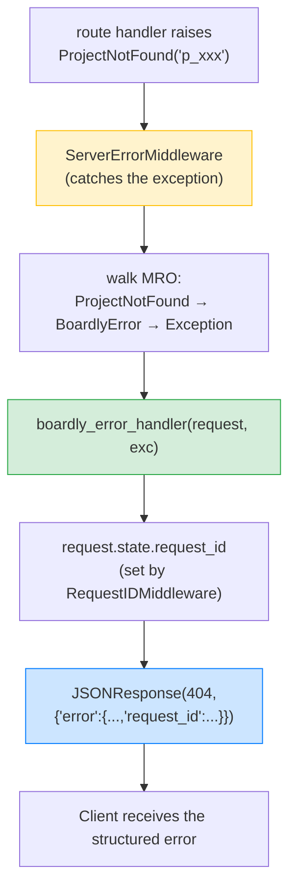
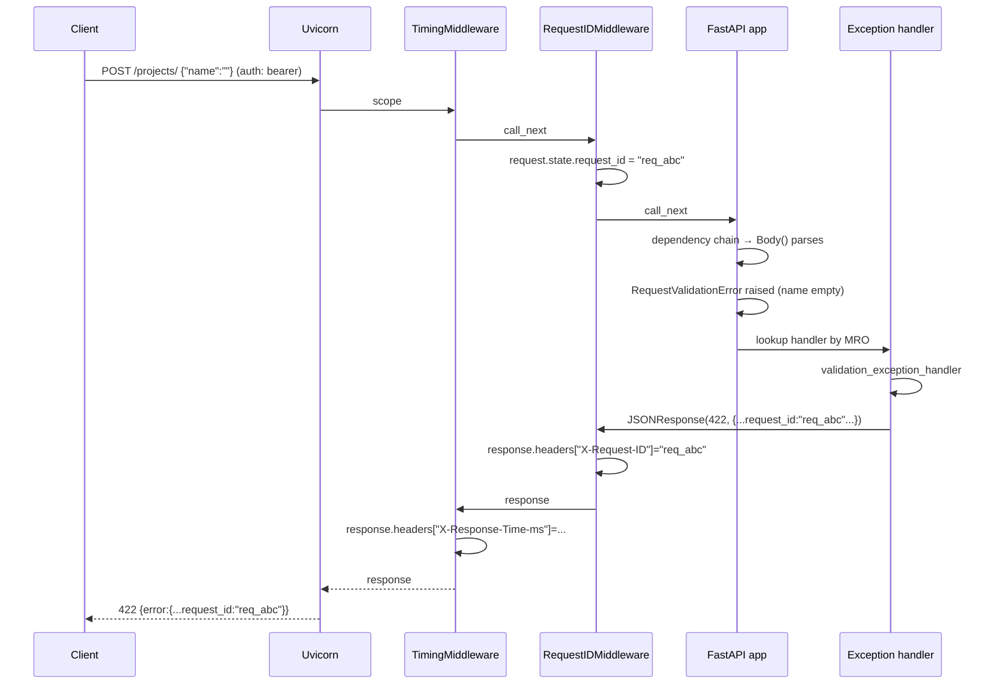

# Lesson 06: Exception Handlers

*Adding custom exceptions (`ProjectNotFound`, `ConflictError`) and translating them into a consistent JSON error shape — with the `request_id` your middleware just stamped.*

**You've built the happy path. Now build the unhappy path.**

Every endpoint you've written so far has assumed the world cooperates: bodies validate, tokens authenticate, projects exist. Real APIs spend as much code on the unhappy path — what happens when the client sends bad data, asks for a missing resource, or causes a conflict. FastAPI gives you a clean way to translate exceptions into consistent JSON errors. This lesson shows you how — and ties it back to the `request_id` middleware from Lesson 5.


#fastapi #exceptions #error-handling

## Learning Objectives

By the end of this lesson you will be able to:

1. **Define custom exception classes** (`ProjectNotFound`, `ConflictError`) with a `code`, a `status_code`, and a `message`.
2. **Register exception handlers** with `@app.exception_handler(MyError)`.
3. **Return a consistent JSON error shape** — `{"error": {"code": "...", "message": "...", "request_id": "..."}}`.
4. **Customise the `RequestValidationError` handler** so 422 responses match your error shape.
5. **Handle uncaught exceptions** with `@app.exception_handler(Exception)` — without leaking internals.
6. **Read `request.state.request_id`** (set by the middleware from Lesson 5) and include it in every error response.
7. **Avoid leaking internals** — no stack traces, no DB column names, no internal exception messages in production.

## Prerequisites

- **[[Dependency-Injection]]** — your `routers/projects.py` raises `HTTPException(401)` from `get_current_user`. We'll add domain-specific exceptions.
- **[[Middleware-and-Request-Order]]** — `request.state.request_id` is set by your `RequestIDMiddleware`. The error handler reads it. The two pieces are coupled.
- **[[01-Python-Foundations/Exceptions-Done-Right]]** — Python exception basics: defining classes, `raise`, `try/except`. We build on that here.
- **About 75 minutes.** This lesson's code is small; the difficulty is the design — what to leak, what to hide.

**The most common gap: exception design.**

Most Python tutorials teach "raise an exception when something is wrong." They don't teach *what* to raise, *what* to put in the message, or *how to translate* between Python exceptions and HTTP responses. Lesson 6 is fundamentally about translation: a domain event (a project doesn't exist) becomes an HTTP response (404 with a structured body). Re-read [[01-Python-Foundations/Exceptions-Done-Right]] if exception class design feels new.


## The Problem

Without exception handlers, your API has three error shapes:

1. **`HTTPException(status_code=401)` from dependencies** → returns `{"detail": "..."}`.
2. **`RequestValidationError`** (auto-raised when validation fails) → returns `{"detail": [{...}]}`.
3. **Any other uncaught exception** → returns `{"detail": "Internal Server Error"}` with status 500.

Three different shapes. Three different field names. No request_id. No way for a client to correlate an error to a log line. The fix: define domain exceptions, register handlers, normalise the shape.

**Why does FastAPI ship three different error shapes by default?**

Because each shape comes from a different layer. `{"detail": "..."}` is what Starlette's `HTTPException` returns — the framework's own transport-level error. `{"detail": [{...}]}` is what FastAPI adds on top for `RequestValidationError` — a structured list so the client can render per-field errors in a form. `{"detail": "Internal Server Error"}` is the catch-all 500 that Starlette's `ServerErrorMiddleware` emits when nothing else matches. Each layer added its own shape over time, and FastAPI inherits them all. Lesson 6 is precisely the act of *unifying* those three shapes into one — your own — via exception handlers.


**Note — Historical context — error shapes in frameworks**

Rails popularised the "consistent error envelope" idea in the 2000s: `{"error": "..."}` for every error. JSON:API standardised it as `{"errors": [...]}`. RFC 7807 (Problem Details for HTTP APIs) formalised it as `{"type": "...", "title": "...", "status": ...}`. FastAPI doesn't mandate a shape — it lets you design your own. We'll use a simple, pragmatic shape that includes the `request_id` for traceability: `{"error": {"code": "...", "message": "...", "request_id": "..."}}`. For the RFC 9457 standardised envelope (`application/problem+json`), see [[02b-Backend-Foundations/Problem-Details-RFC-7807]].


**Think like a senior engineer: the error envelope is a contract the API publishes to clients, and the request_id is the contract's correlation handle.**

The senior's two questions for every error response: (1) *can the client programmatically branch on `code` without parsing `message`?* — if the client has to substring-match `"project" in message`, the envelope has failed its contract; `code` must be a stable, documented, machine-readable token (`project_not_found`, `conflict`, `validation_error`) that the client can `switch` on. (2) *can support find this exact failure in logs within 30 seconds of the user reporting it?* — if the user reads the `request_id` from the error response aloud and support cannot grep the log line in 30 seconds, the envelope has failed its contract; the `request_id` must appear in *both* the response body (so the client has it) and the structured-log line (so support has it), as the same value, on every error path. The two questions surface the two failure modes the unification is designed to prevent: clients coupling to `message` text (which drifts as you refactor), and support unable to correlate a user-reported failure to a server-side log line (which makes every incident a 90-minute archaeology dig). The deeper reframe: the envelope's *required* fields are `code`, `message`, `request_id`; its *optional* fields (`details`, `retry_after`, `trace_url`) are added per-error-class as the client's needs demand. The contract is "every error response has the required three; some have more." RFC 9457 (`application/problem+json`) is the standardized version of this contract — adopt it once your client roster includes third parties who shouldn't have to learn your proprietary shape. See [[02b-Backend-Foundations/Problem-Details-RFC-7807]] for the RFC envelope and [[13-Performance-and-Observability/Structured-Logging-and-Request-IDs]] for the structured-log line that completes the correlation.


## The Code

This lesson adds **one new file** (`boardly/errors.py`), updates `routers/projects.py` to raise the new exceptions, and updates `main.py` to register handlers. We also extend `DbSession` (from Lesson 4) with a `get_project_by_name` method to support the conflict check.

### `boardly/errors.py`

```python
# boardly/errors.py
"""Boardly domain exceptions and their HTTP handlers.

Design goals:
 - Every error response has the same shape:
 {"error": {"code": ..., "message": ..., "request_id": ...}}
 - Domain errors use the request_id stamped by RequestIDMiddleware.
 - Unhandled exceptions return a generic 500 with NO internal details
 leaked to the client (but the server log gets the full traceback).
"""
from fastapi import Request, status
from fastapi.exceptions import RequestValidationError
from fastapi.responses import JSONResponse


# --- Domain exceptions ---------------------------------------------------

class BoardlyError(Exception):
 """Base class for all Boardly domain errors.

 Subclasses set `code`, `status_code`, and `message`.
 """
 code: str = "boardly_error"
 status_code: int = status.HTTP_500_INTERNAL_SERVER_ERROR
 message: str = "An internal error occurred."

 def __init__(self, message: str | None = None) -> None:
 if message is not None:
 self.message = message
 super().__init__(self.message)


class ProjectNotFound(BoardlyError):
 code = "project_not_found"
 status_code = status.HTTP_404_NOT_FOUND

 def __init__(self, project_id: str) -> None:
 # The message we expose to the client — note we don't leak any
 # internal column names; we use the project_id the client gave us.
 super().__init__(f"Project '{project_id}' was not found.")
 self.project_id = project_id


class ConflictError(BoardlyError):
 code = "conflict"
 status_code = status.HTTP_409_CONFLICT


# --- Handlers -----------------------------------------------------------

async def boardly_error_handler(request: Request, exc: BoardlyError) -> JSONResponse:
 """Handler for all BoardlyError subclasses."""
 request_id = getattr(request.state, "request_id", "req_unknown")
 return JSONResponse(
 status_code=exc.status_code,
 content={
 "error": {
 "code": exc.code,
 "message": exc.message,
 "request_id": request_id,
 }
 },
 )


async def validation_exception_handler(
 request: Request, exc: RequestValidationError
) -> JSONResponse:
 """Customise the 422 response to match our error shape."""
 request_id = getattr(request.state, "request_id", "req_unknown")
 return JSONResponse(
 status_code=status.HTTP_422_UNPROCESSABLE_ENTITY,
 content={
 "error": {
 "code": "validation_error",
 "message": "Request validation failed.",
 "request_id": request_id,
 "details": exc.errors(),
 }
 },
 )


async def unhandled_exception_handler(
 request: Request, exc: Exception
) -> JSONResponse:
 """Catch-all for any exception we didn't handle explicitly.

 Logs the full traceback server-side; returns a generic 500 to the
 client with the request_id so the client can find the log line.
 """
 import logging
 logger = logging.getLogger("boardly.errors")
 request_id = getattr(request.state, "request_id", "req_unknown")
 # Server-side log: full traceback, with the request_id for grep.
 logger.exception("[unhandled] request_id=%s exc=%s", request_id, type(exc).__name__)
 return JSONResponse(
 status_code=status.HTTP_500_INTERNAL_SERVER_ERROR,
 content={
 "error": {
 "code": "internal_error",
 "message": "An internal error occurred.",
 "request_id": request_id,
 }
 },
 )
```

### `boardly/deps.py` (add `get_project_by_name`)

Add one method to `DbSession` (from Lesson 4):

```python
async def get_project_by_name(self, name: str) -> ProjectInDB | None:
 """Returns the first project with the given name, or None."""
 all_projects = storage.list_projects(status=None, limit=10_000)
 return next((p for p in all_projects if p.name == name), None)
```

### `boardly/routers/projects.py` (updated to raise)

```python
# boardly/routers/projects.py
"""Project routes for Boardly.

Lesson 6: raise domain exceptions instead of returning bare 404s.
"""
from typing import Annotated

from fastapi import APIRouter, Body, Depends, Path, Query, status
from fastapi.responses import Response # only used in legacy spots

from boardly.deps import DbSession, User, get_current_user, get_db, require_scope
from boardly.errors import ConflictError, ProjectNotFound
from boardly.models import ProjectCreate, ProjectRead

router = APIRouter(prefix="/projects", tags=["projects"])


@router.get("/", response_model=list[ProjectRead])
async def list_projects(
 db: Annotated[DbSession, Depends(get_db)],
 status: Annotated[str | None, Query(pattern="^(active|archived|deleted)$")] = None,
 limit: Annotated[int, Query(gt=0, le=100)] = 20,
) -> list[ProjectRead]:
 items = await db.list_projects(status=status, limit=limit)
 return [ProjectRead.model_validate(p) for p in items]


@router.get("/{project_id}", response_model=ProjectRead)
async def get_project(
 project_id: Annotated[str, Path(min_length=4, max_length=32)],
 db: Annotated[DbSession, Depends(get_db)],
 user: Annotated[User, Depends(get_current_user)],
) -> ProjectRead:
 project = await db.get_project(project_id)
 if project is None:
 raise ProjectNotFound(project_id) # ← domain exception, not bare 404
 return ProjectRead.model_validate(project)


@router.post(
 "/",
 response_model=ProjectRead,
 status_code=status.HTTP_201_CREATED,
)
async def create_project(
 payload: Annotated[ProjectCreate, Body()],
 db: Annotated[DbSession, Depends(get_db)],
 _: Annotated[None, Depends(require_scope("projects:write"))],
) -> ProjectRead:
 existing = await db.get_project_by_name(payload.name)
 if existing is not None:
 raise ConflictError(f"A project named '{payload.name}' already exists.")
 saved = await db.create_project(payload)
 return ProjectRead.model_validate(saved)
```

### `boardly/main.py` (register the handlers)

Add at the bottom of `main.py`:

```python
# Register exception handlers
from boardly.errors import (
 BoardlyError,
 boardly_error_handler,
 unhandled_exception_handler,
 validation_exception_handler,
)
from fastapi.exceptions import RequestValidationError

app.add_exception_handler(BoardlyError, boardly_error_handler)
app.add_exception_handler(RequestValidationError, validation_exception_handler)
app.add_exception_handler(Exception, unhandled_exception_handler)
```

(See Verification below for the complete final `main.py`.)

## Line-by-Line Deep Dive

### `errors.py`: `BoardlyError` (the base class)

```python
class BoardlyError(Exception):
 code: str = "boardly_error"
 status_code: int = status.HTTP_500_INTERNAL_SERVER_ERROR
 message: str = "An internal error occurred."

 def __init__(self, message: str | None = None) -> None:
 if message is not None:
 self.message = message
 super().__init__(self.message)
```

**What it does:** Defines the base class for all Boardly domain errors. Subclasses override `code`, `status_code`, and `message`.

**Why class attributes for `code` and `status_code`?** Because they're *class-level* constants — every instance of `ProjectNotFound` has the same `code` (`"project_not_found"`) and `status_code` (404). They're not per-instance. The `message` *can* be per-instance (different IDs produce different messages), so it's set in `__init__`.

**Why subclass `Exception` and not `HTTPException`?** Two reasons:

1. **`HTTPException` carries only `status_code` and `detail`.** Our domain errors carry `code` and `message` — a richer shape. Subclassing `HTTPException` would force us to cram our structured data into `detail`, which is awkward.
2. **Separation of concerns.** Domain errors are *domain* concepts — `ProjectNotFound` makes sense in business logic, not just HTTP. If you reuse the same code in a CLI tool or a worker, you don't want it coupled to HTTP. By subclassing `Exception`, your domain code stays HTTP-agnostic; the *handler* translates to HTTP.

**Tip — Subclass `Exception`, not `HTTPException`, for domain errors.**

`HTTPException` is for *transport* errors — "this request requires auth" (401), "you're rate-limited" (429). Domain errors — "this project doesn't exist", "you've hit your quota" — belong to your *business*, not to HTTP. Make them subclass `Exception` (or a `BoardlyError` base). Let the handler translate.


**Example — Real-world analogy**

Think of exceptions as postcards. `HTTPException` is a postcard written by the postal service itself — "address unknown, return to sender." `BoardlyError` is a postcard written by the recipient — "I'm not home; please come back tomorrow." The postal service (FastAPI) can deliver either; but the recipient (your domain) should write their own postcards for their own messages, not borrow the postal service's.


### `errors.py`: `ProjectNotFound`

```python
class ProjectNotFound(BoardlyError):
 code = "project_not_found"
 status_code = status.HTTP_404_NOT_FOUND

 def __init__(self, project_id: str) -> None:
 super().__init__(f"Project '{project_id}' was not found.")
 self.project_id = project_id
```

**What it does:** A 404 error specific to "the project with this ID doesn't exist."

**Why include `project_id` in the message?** Because the client gave us the ID; echoing it back helps them debug (they can compare to the IDs they sent). This is safe to leak — the client already knows the ID.

**Why `self.project_id = project_id` on top of the message?** Because a future handler (or test) might want the raw ID without parsing the message. Storing it as an attribute is the cleanest pattern.

### `errors.py`: `ConflictError`

```python
class ConflictError(BoardlyError):
 code = "conflict"
 status_code = status.HTTP_409_CONFLICT
```

**What it does:** A 409 Conflict. Used when creating a resource would violate a uniqueness constraint.

**Why no `__init__` override?** Because `ConflictError` is generic — the message is set by the caller (`ConflictError("A project named 'X' already exists.")`). The base class's `__init__` already handles `message=...`.

### `errors.py`: `boardly_error_handler`

```python
async def boardly_error_handler(request: Request, exc: BoardlyError) -> JSONResponse:
 request_id = getattr(request.state, "request_id", "req_unknown")
 return JSONResponse(
 status_code=exc.status_code,
 content={
 "error": {
 "code": exc.code,
 "message": exc.message,
 "request_id": request_id,
 }
 },
 )
```

**What it does:** Handles *any* `BoardlyError` subclass. Reads the request_id from `request.state`, builds the consistent error envelope.

**Why one handler for all `BoardlyError` subclasses?** Because they all share the shape — `code`, `message`, `request_id`. FastAPI's exception handler lookup walks the MRO (method resolution order) of the raised exception, so a handler for `BoardlyError` catches `ProjectNotFound`, `ConflictError`, and any future subclass. One handler, many exceptions.

**Why does FastAPI walk the MRO instead of using exact type match?** Because that's how Python's exception machinery already works — `except BoardlyError` catches `ProjectNotFound`, and the framework mirrors the language. If FastAPI matched by exact type only, every new `BoardlyError` subclass would force you to re-register a handler, and the registry would drift from your class hierarchy. The MRO-walk keeps the registry and the class tree in lockstep: register at the base, catch every leaf.

**Why `getattr(request.state, "request_id", "req_unknown")`?** Same defensive pattern as in the timing middleware (Lesson 5). If the request didn't go through `RequestIDMiddleware` (maybe a future refactor removed it), we fall back to `"req_unknown"` instead of raising `AttributeError` and crashing the error handler.

**What FastAPI does with `app.add_exception_handler(BoardlyError, handler)`**

Internally, FastAPI stores the handler in `self.exception_handlers` dict, keyed by exception class. When an exception is raised *anywhere* — in a route, in a dependency, in middleware — FastAPI's `ServerErrorMiddleware` catches it, looks up the handler by walking the exception's class MRO, calls `await handler(request, exc)`, and uses the returned `Response` as the HTTP response. If no handler matches, FastAPI returns a generic 500 with `{"detail": "Internal Server Error"}`.




### `errors.py`: `validation_exception_handler`

```python
async def validation_exception_handler(
 request: Request, exc: RequestValidationError
) -> JSONResponse:
 request_id = getattr(request.state, "request_id", "req_unknown")
 return JSONResponse(
 status_code=status.HTTP_422_UNPROCESSABLE_ENTITY,
 content={
 "error": {
 "code": "validation_error",
 "message": "Request validation failed.",
 "request_id": request_id,
 "details": exc.errors(),
 }
 },
 )
```

**What it does:** Replaces FastAPI's default 422 response shape with our consistent shape — but preserves `exc.errors()` (the structured validation details) as `details`.

**Why customise the 422?** Because the default shape (`{"detail": [{"loc": ..., "msg": ..., "type": ...}]}`) doesn't include `request_id`. Without `request_id`, the client can't correlate a 422 to a server log line. Normalising the shape means every error response — 404, 409, 422, 500 — has the same envelope.

**What if we want a different 422 shape per route?** You'd register a custom `RequestValidationError` handler that inspects `request.scope["route"].path_format` (or a flag on `app.state`) and switches shape accordingly. In practice this is almost never worth the complexity — clients prefer one shape they can parse uniformly. If you really need it, the cleaner pattern is to add a `details_shape` field on a per-route `response_model` for the *success* case and let the 422 stay uniform; clients can read the OpenAPI spec to know what each route's `details` will look like.

**Why keep `details`?** Because clients want to know *which fields failed* and *why*. `exc.errors()` returns a list like:

```json
[
 {"type": "string_too_short", "loc": ["body", "name"], "msg": "...", "input": ""},
 {"type": "pattern", "loc": ["body", "status"], "msg": "...", "input": "nope"}
]
```

That's useful structured data; preserve it.

**Warning — Don't customise the 422 in a way that loses information.**

A common mistake is to flatten `exc.errors()` into a single string ("Validation failed for fields: name, status"). That loses the `loc`, `msg`, and `input` — which clients *need* to render helpful error messages. Preserve `exc.errors()` as a structured `details` array.


### `errors.py`: `unhandled_exception_handler`

```python
async def unhandled_exception_handler(
 request: Request, exc: Exception
) -> JSONResponse:
 import logging
 logger = logging.getLogger("boardly.errors")
 request_id = getattr(request.state, "request_id", "req_unknown")
 logger.exception("[unhandled] request_id=%s exc=%s", request_id, type(exc).__name__)
 return JSONResponse(
 status_code=status.HTTP_500_INTERNAL_SERVER_ERROR,
 content={
 "error": {
 "code": "internal_error",
 "message": "An internal error occurred.",
 "request_id": request_id,
 }
 },
 )
```

**What it does:** Catches *any* unhandled exception. Logs the full traceback server-side (with the request_id for grep). Returns a generic 500 with *no* internal details.

**Why not return `str(exc)` to the client?** Three reasons:

1. **Information leakage.** A `psycopg2.errors.UndefinedColumn` error reveals your DB schema. A `KeyError('internal_field')` reveals your internal field names. An attacker can use these to map your system. Never leak internals.
2. **Stability.** Internal error messages change as your code changes. Clients that depend on internal messages break when you refactor.
3. **User experience.** "An internal error occurred" + a request_id is actionable: the user contacts support with the request_id; support greps the logs. "psycopg2.errors.UndefinedColumn: column projects.due_at does not exist" is *not* actionable for a user.

**Why `logger.exception(...)` and not `print(...)`?** Because `logger.exception` includes the *full traceback* in the log line, which is what you need to debug. In Lesson 5 we used `print` for the timing middleware because the output was a single line; here we want the traceback, so we use the logger. (See [[13-Performance-and-Observability/Structured-Logging-and-Request-IDs]] for structured logging patterns.)

**Why register the `Exception` catch-all at all — isn't it a footgun?**

It is, slightly. Without it, an unhandled exception bubbles up to Starlette's `ServerErrorMiddleware`, which returns `{"detail": "Internal Server Error"}` with status 500 — but no `request_id` in the body and no server-side traceback unless you've configured Starlette's `debug=True` (which you should not run in production). The catch-all handler earns its keep in two ways: (1) it stamps `request_id` into the response body so the client can correlate, and (2) it logs the full traceback at the application logger level, which feeds your structured-logging pipeline. The footgun is *if you write the catch-all to leak `str(exc)` to the client* — that's Mistake 1 below. Register the catch-all; just keep the client-facing body generic.


**Danger — Never leak exception messages to clients in production.**

Internal exception messages are a major source of information leakage. They reveal database schemas, file paths, internal field names, and sometimes even secrets (if a config value appears in an error message). Always return a generic 500 message to the client; log the full traceback server-side with the `request_id` for correlation.


### `routers/projects.py`: `raise ProjectNotFound(project_id)`

```python
project = await db.get_project(project_id)
if project is None:
 raise ProjectNotFound(project_id)
return ProjectRead.model_validate(project)
```

**What it does:** Replaces the bare `Response(status_code=404)` from Lesson 3 with a domain exception. The exception is caught by `boardly_error_handler`, translated to a structured 404 response with the request_id.

**Why raise instead of return?** Because returning a 404 from inside a function that's typed to return `ProjectRead` is a *type lie* — the annotation says you return `ProjectRead`, but you actually return a `Response`. Raising an exception is the *honest* signal: "I couldn't fulfil this request; here's why." The route handler stays clean; the handler does the translation.

**Tip — Raise domain exceptions, return happy-path values.**

Your route handlers should *only* return successful responses. Errors are *raised*. This makes the route signature honest (the return type matches what's returned on the happy path) and makes the error flow *declarative* — you can scan a route and see "this raises ProjectNotFound, this raises ConflictError" without reading every line.


### `routers/projects.py`: `raise ConflictError(...)` on duplicate

```python
existing = await db.get_project_by_name(payload.name)
if existing is not None:
 raise ConflictError(f"A project named '{payload.name}' already exists.")
```

**What it does:** Checks for a duplicate project name before creating. If found, raises `ConflictError`.

**Why 409 Conflict and not 422 Unprocessable Entity?** Because the request body is *valid* (it's a well-formed `ProjectCreate`) — it just conflicts with existing state. 422 is "you sent bad data"; 409 is "your data is fine but conflicts with current state." The semantic distinction matters for clients (and for REST conventions).

### `main.py`: Registering the handlers

```python
from boardly.errors import (
 BoardlyError,
 boardly_error_handler,
 unhandled_exception_handler,
 validation_exception_handler,
)
from fastapi.exceptions import RequestValidationError

app.add_exception_handler(BoardlyError, boardly_error_handler)
app.add_exception_handler(RequestValidationError, validation_exception_handler)
app.add_exception_handler(Exception, unhandled_exception_handler)
```

**What it does:** Registers three handlers: one for `BoardlyError` (catches all our domain errors via MRO), one for `RequestValidationError` (FastAPI's 422), and one for `Exception` (catch-all).

**Why three handlers, not one?** Because each exception type has a different *shape* of response. `BoardlyError` has `code`/`message`/`status_code`. `RequestValidationError` has `.errors()` (a structured list). `Exception` has neither — just `str(exc)`.

**Why import `RequestValidationError` from `fastapi.exceptions`?** Because that's the only place it lives. Starlette's `exceptions` module exports `HTTPException` and `WebSocketException` — `RequestValidationError` is FastAPI-specific, defined in `fastapi.exceptions` to wrap the structured Pydantic validation failures (the `.errors()` method returns the per-field list) that Starlette's HTTP layer has no concept of. Importing it from `fastapi.exceptions` is the canonical path the FastAPI docs use in every example.

**Does the order of `add_exception_handler` calls matter?** No. Unlike middleware (where the last registered is outermost and runs first on the way in), exception handlers are stored in a dict keyed by class. When an exception is raised, FastAPI walks the exception's MRO and picks the *most specific* registered match — not the first or last registered. `add_exception_handler(Exception, ...)` is the fallback, but it can be registered first, last, or in the middle without changing behavior.

**Warning — The order of `add_exception_handler` calls does NOT matter.**

Unlike middleware (Lesson 5, "last added = outermost"), exception handlers are *lookup-based* — FastAPI walks the exception's MRO and finds the most-specific match. `add_exception_handler(BoardlyError, ...)` registers for `BoardlyError` *and* its subclasses (via MRO). `add_exception_handler(Exception, ...)` is the fallback. Order of registration doesn't matter; specificity does.


## Execution Trace

Run the app:

```bash
uv run uvicorn boardly.main:app --reload
```

In another terminal:

```bash
# 404 — ProjectNotFound
curl -i -H 'Authorization: Bearer token-alice' http://127.0.0.1:8000/projects/p_doesnotexist
# → HTTP/1.1 404 Not Found
# → {"error":{"code":"project_not_found","message":"Project 'p_doesnotexist' was not found.","request_id":"req_xxx"}}

# 422 — validation error (our custom shape)
curl -i -X POST http://127.0.0.1:8000/projects/ \
 -H 'Content-Type: application/json' -H 'Authorization: Bearer token-alice' \
 -d '{"name": "", "status": "nope"}'
# → HTTP/1.1 422 Unprocessable Entity
# → {"error":{"code":"validation_error","message":"Request validation failed.","request_id":"req_xxx","details":[...]}}

# 409 — ConflictError (create a project, then create another with the same name)
curl -X POST http://127.0.0.1:8000/projects/ \
 -H 'Content-Type: application/json' -H 'Authorization: Bearer token-alice' \
 -d '{"name":"MyProject"}'
# → 201 ...

curl -i -X POST http://127.0.0.1:8000/projects/ \
 -H 'Content-Type: application/json' -H 'Authorization: Bearer token-alice' \
 -d '{"name":"MyProject"}'
# → HTTP/1.1 409 Conflict
# → {"error":{"code":"conflict","message":"A project named 'MyProject' already exists.","request_id":"req_xxx"}}

# 500 — unhandled exception (need to trigger one; try a path that hits a bug)
# (You'd need to add a temporary route that raises; see Exercise 1.)
```



## Common Mistakes

### Mistake 1: Leaking internals in the catch-all handler

```python
# WRONG
@app.exception_handler(Exception)
async def _(request, exc):
 return JSONResponse(
 status_code=500,
 content={"error": {"message": str(exc)}}, # ← leaks internals!
 )
```

**Symptom:** A `KeyError("database_url")` returns `{"error": {"message": "'database_url'"}}` to the client. An attacker now knows you have a config key called `database_url`.

**Why:** `str(exc)` includes the internal exception message, which often reveals schema, field names, or configuration.

**Fix:** Return a generic message. Log the full traceback server-side (with the request_id for correlation). The client never sees internals.

**Danger — How an attacker thinks: the schema-mapping attack via `str(exc)` leakage.**

The attacker workflow that has shipped to production more than once. Step 1: probe `POST /login` with malformed payloads (`{"email": null}`, `{"email": "x"}`, `{"email": <50_000_character_string>}`) and collect the 500 responses that include `"message": str(exc)`. Step 2: read the leaked exception strings as a free schema map. `psycopg2.errors.UndefinedColumn: column users.sso_subject does not exist` tells the attacker the `users` table exists and *does not yet* have an `sso_subject` column — i.e. SSO is configured but the migration didn't run. `KeyError('sso_client_id')` tells them the config key exists and is unset. `AttributeError: 'NoneType' object has no attribute 'tenant_id'` tells them the auth context isn't populated for this route. Step 3: pivot. The attacker now knows your auth schema, your config keys, your tenant-resolution path — enough to craft a payload that exploits the gap (e.g. a `null` email that bypasses a uniqueness check because the check is `WHERE email = NULL` and Postgres treats NULL as not-equal-to-anything, including itself). The defence is structural: a CI deny-list grep that fails the build if any handler returns `str(exc)`, `repr(exc)`, or `traceback.format_exc()` in the response body. `rg "JSONResponse.*str\(exc|JSONResponse.*repr\(exc|content.*traceback\.format" boardly/` should return nothing. The only place `str(exc)` may appear is inside `logger.exception(...)` calls, never inside `JSONResponse(content=...)`. The deeper rule: the unhandled-exception handler is the *last* line of defence — it must be the dullest code in your codebase, returning the same generic 500 for every exception, because it is the code that runs when you have *already* lost control. See [[11-Authentication-and-Security/Threat-Model-First]] for the threat-model that surfaces this lane and [[02b-Backend-Foundations/Problem-Details-RFC-7807]] for the RFC envelope that makes the contract standardised.


### Mistake 2: Registering `HTTPException` handler that loses `detail`

```python
# WRONG
@app.exception_handler(HTTPException)
async def _(request, exc):
 return JSONResponse(
 status_code=exc.status_code,
 content={"error": {"message": "Error"}}, # ← lost exc.detail!
 )
```

**Symptom:** The 401 from `get_current_user` (which sets `detail="missing or malformed Authorization header"`) returns `{"error": {"message": "Error"}}` — useless to the client.

**Why:** `HTTPException.detail` is the message; discarding it makes the error uninformative.

**Fix:** Preserve `exc.detail` as the message:

```python
@app.exception_handler(HTTPException)
async def _(request, exc):
 request_id = getattr(request.state, "request_id", "req_unknown")
 return JSONResponse(
 status_code=exc.status_code,
 content={"error": {"code": "http_error", "message": exc.detail, "request_id": request_id}},
 )
```

Or — better — don't register an `HTTPException` handler at all; let FastAPI's default work, and only customise the shape for your domain errors. The default `HTTPException` response (`{"detail": "..."}`) is at least *truthful*.

### Mistake 3: Catching `Exception` inside a route, hiding it from the handler

```python
# WRONG
@router.post("/")
async def create_project(payload, db):
 try:
 saved = await db.create_project(payload)
 except Exception:
 return Response(status_code=500) # ← hiding!
 return ProjectRead.model_validate(saved)
```

**Symptom:** The route swallows every exception. The unhandled-exception handler never runs; the log never gets the traceback; the client gets a bare 500.

**Why:** `try/except Exception` in the route body intercepts exceptions *before* FastAPI's exception handler machinery sees them.

**Fix:** Don't `try/except` in routes. Raise domain exceptions explicitly. Let the unhandled-exception handler catch the rest and log it.

**Warning — When this breaks: the metrics that lie about a failing endpoint.**

**Symptom.** The structured-logging dashboard shows zero `internal_error` responses for `POST /projects/` over the past 24 hours. The on-call knows the endpoint is failing — clients are reporting 500s in their browser network tabs, and the LB's 5xx-rate metric is spiking — but the application's own metrics show zero. The two sources disagree. The on-call trusts the application metrics (they're instrumented by the unhandled-exception handler) and dismisses the LB metric as a measurement artifact. The incident extends.
**Diagnosis.** Open `boardly/routers/projects.py` and grep for `try:.*except Exception`. A route handler wraps its body in `try: ... except Exception: return JSONResponse(status_code=500, content={"error": {"code": "internal_error", ...}})`. The exception is caught *inside the route body* and translated to a response — it never propagates out of the route, so FastAPI's exception machinery never sees it. The unhandled-exception handler never runs, so its `logger.exception(...)` never fires, so the structured-log line that the dashboard aggregates is never written. The LB sees a 500 (because the response status code is 500) and counts it; the application metrics see zero `internal_error` codes (because the unhandled-exception handler, which emits the `internal_error` metric, never ran). The two sources measure different things — the LB measures the wire, the application measures the framework's exception path — and the route's `try/except` has split them.
**Fix.** Three layers. (1) Delete the `try/except Exception` from the route body; let the exception propagate to the framework's unhandled-exception handler. The handler does the translation; the route does the work. (2) If the route genuinely needs to translate one exception to another (e.g. `except sqlalchemy.exc.IntegrityError: raise ConflictError(...)` from a unique-constraint violation), catch *specific* exception classes and re-raise as a domain error — never `except Exception`. The narrower the catch, the less likely it is to swallow a bug. (3) Add a CI grep that fails the build if any route body contains `except Exception`: `rg "except Exception" boardly/routers/` should return nothing. The structural enforcement matters — the grep catches the next teammate who copy-pastes a "defensive" `try/except` without reading this lesson. The deeper rule: routes raise; handlers translate; middleware decorates. A route that catches `Exception` is doing the handler's job *and* the route's job in the same function — and it will do neither well. See [[Middleware-and-Request-Order]] for the middleware contract and [[01-Python-Foundations/Exceptions-Done-Right]] for the catch-specific-not-broad rule.


### Mistake 4: Returning a `Response` from inside an exception handler

```python
# WRONG
@app.exception_handler(BoardlyError)
async def _(request, exc):
 return Response(status_code=exc.status_code) # ← empty body, no JSON
```

**Symptom:** The client receives a 404 with an empty body — no `code`, no `message`, no `request_id`. The "consistent error shape" is broken.

**Why:** Returning a bare `Response` bypasses the JSON envelope. You need to return a `JSONResponse` (or a Pydantic model) for the structured body.

**Fix:** `return JSONResponse(status_code=exc.status_code, content={...})`.

### Mistake 5: Custom exceptions that don't inherit from `BoardlyError`

```python
# WRONG (orphan exception)
class ProjectAlreadyArchived(Exception):
 ...

@router.post("/{id}/unarchive")
async def unarchive(id: str, db):
 project = await db.get_project(id)
 if project.status == "archived":
 raise ProjectAlreadyArchived(id) # ← no handler!
 ...
```

**Symptom:** The orphan exception reaches the `Exception` catch-all handler, returning a generic 500. The client sees "internal_error" instead of a meaningful "project_already_archived" code.

**Why:** FastAPI's handler lookup walks the MRO. `ProjectAlreadyArchived` doesn't inherit from `BoardlyError`, so the `boardly_error_handler` doesn't match. Only the `Exception` fallback matches.

**Fix:** Inherit from `BoardlyError`:

```python
class ProjectAlreadyArchived(BoardlyError):
 code = "project_already_archived"
 status_code = status.HTTP_409_CONFLICT
```

Now the `BoardlyError` handler matches via MRO.

**Warning — When this breaks: the orphan exception that turns a 404 into a 500.**

**Symptom.** A new endpoint `POST /projects/{id}/unarchive` ships. The teammate who wrote it tested the happy path (an archived project gets unarchived) and the not-archived path (a 200 with a "already active" message). They did not test the not-found path. In production, a client hits `POST /projects/p_doesnotexist/unarchive` and gets `{"code": "internal_error", "message": "An internal error occurred.", "request_id": "req_xxx"}` — a 500 for what should be a 404. The on-call greps the log for `request_id=req_xxx` and finds `ProjectAlreadyArchived` was raised for a project that doesn't exist, but the orphan-exception handler caught it as a generic `Exception`. The client is told "internal error" for a missing resource.
**Diagnosis.** Open `boardly/errors.py` and `boardly/routers/projects.py`. The teammate defined `class ProjectAlreadyArchived(Exception)` directly in `routers/projects.py` (or in a `utils.py`), without inheriting from `BoardlyError`. The unarchive route raises it. FastAPI's exception-handler lookup walks the raised exception's MRO: `ProjectAlreadyArchived` -> `Exception` -> `BaseException`. The `boardly_error_handler` is registered for `BoardlyError`; `ProjectAlreadyArchived` is not a `BoardlyError` subclass; the lookup misses. The `Exception` catch-all handler matches. The client sees a 500 instead of a 404 (or 409, depending on the intended semantics). The orphan exception also bypasses the `code`/`message` envelope — it has no `code`, no `status_code`, just `__str__`.
**Fix.** Three layers. (1) Make `ProjectAlreadyArchived` inherit from `BoardlyError` and set `code = "project_already_archived"` and `status_code = status.HTTP_409_CONFLICT`. Move it to `boardly/errors.py` — the canonical home for domain exceptions. (2) Add a CI grep that fails the build if any `Exception` subclass is defined outside `boardly/errors.py`: `rg "^class \w+\(.*Exception\)" --type py boardly/ | rg -v "boardly/errors.py"` should return nothing. The structural enforcement matters — the grep catches the next orphan before it ships. (3) Add a contract test that asserts every domain exception's MRO includes `BoardlyError`: `assert issubclass(MyError, BoardlyError)` for every exception class registered in the route's raises. The deeper rule: domain exceptions live in one module (`errors.py`), inherit from one base (`BoardlyError`), and are caught by one handler (`boardly_error_handler`). The MRO-walk that makes "register at the base, catch every leaf" work *requires* that every leaf inherits from the base — the rule is enforced by the class hierarchy, not by the framework. See [[01-Python-Foundations/Exceptions-Done-Right]] for the MRO walk and [[12-Testing-and-Quality/Testing-FastAPI-Endpoints]] for the contract-test pattern.


## Engineering Trade-Offs

### One envelope vs many envelopes

We chose *one* error shape (`{"error": {code, message, request_id}}`) for every error. The alternative is different shapes per error class — `{"error": "..."}` for some, `{"errors": [...]}` for others (JSON:API style). Trade-off:

- **One envelope:** simpler for clients (one parser), consistent logs, easy to grep. The cost: some errors need a `details` field that's not always there.
- **Many envelopes:** more semantically precise (different shapes for different errors). The cost: clients need different parsers per error class; logs are noisier.

In `Boardly`, we use one envelope, with optional `details` for validation errors. RFC 9457 (Problem Details, obsoletes RFC 7807) is the standardized version of this pattern — see [[02b-Backend-Foundations/Problem-Details-RFC-7807]].

**Production reality: the one-envelope choice pays off in three concrete ways at scale.**

At 5 routes, one envelope is a style preference. At 200 routes and 12 client SDKs, one envelope is a structural advantage that pays off in three places. (1) *Client SDK is one parser, not N.* The SDK's `parse_error(response)` function is one switch on `error.code`; the per-error-class handlers are one-liners. With N envelopes, the SDK has N parsers, and a refactor that changes one envelope's shape breaks the SDK for one error class but not others — a partial outage that is brutal to debug. (2) *The structured-logging filter works across every endpoint.* The dashboard query `level=ERROR AND error.code=conflict AND route=POST /projects/` returns every conflict on every project-creation route — one query, every route. With N envelopes, the query has to be `(error.code=conflict AND shape=v1) OR (error.errors[0].status=409 AND shape=v2) OR ...` — a query that drifts as envelopes evolve. (3) *The on-call runbook has one section, not one per service.* "How to read an error response" is one page: `code` is the machine-readable token, `message` is the human-readable text, `request_id` is the correlation handle, `details` (if present) is the structured per-field validation list. With N envelopes, the runbook has a section per envelope shape, and the on-call has to remember which shape `POST /billing/` uses versus `POST /projects/` — a memory tax that costs minutes per incident. The cost of one envelope: the `details` field is sometimes empty (404s have nothing to detail); clients must treat it as optional, not required. The senior's rule: the envelope's *required* fields are `code`, `message`, `request_id`; *optional* fields (`details`, `retry_after`, `trace_url`) are added per-error-class as the client's needs demand. Adopt RFC 9457's `application/problem+json` once your client roster includes third parties who shouldn't have to learn your proprietary shape — the standard envelope is the ultimate "one shape" decision, because it's a shape someone else documents and maintains. See [[02b-Backend-Foundations/Problem-Details-RFC-7807]] for the RFC envelope and [[13-Performance-and-Observability/Structured-Logging-and-Request-IDs]] for the structured-log filter that completes the correlation.


### Raising vs returning errors

Two camps:

- **Raise domain exceptions; let handlers translate.** (Our choice.) Honest signatures, declarative error flow.
- **Return errors as values.** (Go's `if err != nil` style.) Forces every call site to handle errors. Verbose but explicit.

FastAPI's design assumes the raise style — `HTTPException` and friends are exception-based. Adopting the return-style in a FastAPI codebase fights the framework. Raise.

### Logging vs returning the traceback

You might be tempted to log the traceback *and* return it to the client (so the client can show it in dev). Don't. Even in dev, returning tracebacks trains clients to depend on them; when you ship to prod, you'll forget to disable it. Always return a generic message; always log the traceback server-side. The `request_id` is the bridge.

### When to use which: `@app.exception_handler` vs route-level `try/except` vs middleware rewrite

When an error happens in a request, you have three places to put the recovery code, and the wrong choice is a common code-smell. The choice is not stylistic — each option has a distinct blast radius and a distinct contract.

**The three forms, side by side.** The same `ProjectNotFound` failure, handled three ways:

```python
# Form A — @app.exception_handler (cross-cutting exception translation)
@app.exception_handler(ProjectNotFound)
async def handle_project_not_found(request: Request, exc: ProjectNotFound) -> JSONResponse:
    return JSONResponse(
        status_code=404,
        content={"error": {"code": exc.code, "message": exc.message,
                           "request_id": request.state.request_id}},
    )

@router.get("/{project_id}")
async def get_project(project_id: str, db: DbSession) -> ProjectRead:
    project = await db.get_project(project_id)
    if project is None:
        raise ProjectNotFound(project_id)   # ← raise; handler translates
    return ProjectRead.model_validate(project)


# Form B — route-level try/except (route-specific recovery)
@router.get("/{project_id}")
async def get_project(project_id: str, db: DbSession) -> ProjectRead | None:
    try:
        project = await db.get_project(project_id)
    except ProjectNotFound:
        # route-specific recovery: serve a stale cache row instead of 404
        cached = await redis.get(f"projects:stale:{project_id}")
        if cached:
            return ProjectRead.model_validate_json(cached)
        raise                       # ← re-raise; let the handler translate
    return ProjectRead.model_validate(project)


# Form C — middleware rewrite (cross-cutting, not exception-shaped)
@app.middleware("http")
async def rewrite_errors_to_envelope(request: Request, call_next):
    response: Response = await call_next(request)
    if response.status_code >= 400 and not response.headers.get("x-boardly-envelope"):
        # rewrite non-Boardly error responses (a 404 from a missing static asset)
        response.headers["x-boardly-envelope"] = "1"
        # NOTE: we cannot add request_id here — middleware runs AFTER the handler,
        # so the request_id middleware already added it in the request.state path.
    return response
```

All three forms run on the same request, but at different points in the Starlette onion: the route body runs first; if it raises, FastAPI's exception machinery kicks in (Form A); if it returns, the middleware onion runs on the way back (Form C). Form B is a *choice the route makes inside its own body* — it doesn't change the framework's dispatch order.

**The decision table:**

| Need | Reach for | Why |
|---|---|---|
| Translate a domain exception class into a JSON envelope (everywhere) | `@app.exception_handler(MyError)` | One registration covers every route that raises `MyError` — including ones not yet written |
| Recover from a route-specific failure (serve stale cache, fall back to default, retry once) | route-level `try/except` inside the route body | Recovery logic is local to one route; cross-cutting translation would be the wrong shape |
| Translate `RequestValidationError` / `HTTPException` into the same envelope | `@app.exception_handler(RequestValidationError)` | Same as Form A — these are exception classes registered once, applied globally |
| Add a cross-cutting concern that's *not exception-shaped* (request-id injection, timing, CORS, gzip) | `@app.middleware("http")` | Middleware runs on every request, success or failure; exception handlers only run on raise |
| Rewrite a response that came back from a downstream proxy | middleware rewrite | The downstream returned a 502 with its own body; middleware can rewrite to the Boardly envelope before sending to the client |
| Catch a *specific* exception only when you can recover | route-level `try/except` then re-raise if you can't | "Recovery" means the client gets a useful answer; if you can't recover, re-raise and let the handler translate |

**The rule of thumb.**

**Use `@app.exception_handler` for cross-cutting exception translation. Use route-level `try/except` only when the route can genuinely recover (and re-raise when it can't). Use middleware for cross-cutting concerns that aren't exception-shaped — request-id injection, timing, CORS, response rewriting.** Three forms, three questions: "is it exception-shaped?", "can this route recover?", "is it cross-cutting?" — and the answer picks the form.


**Warning — Don't reach for `try/except Exception` in route bodies.**

Mistake #3 above shows the canonical anti-pattern: `try: ... except Exception: return Response(status_code=500)`. This swallows the exception before the framework's exception handlers see it — the unhandled-exception handler never runs, the traceback is never logged, the client gets a bare 500 with no `request_id`. The right pattern is "raise domain exceptions explicitly; let handlers translate; recover locally only when you can serve a useful response." If you find yourself writing `except Exception:` in a route body, you're almost certainly hiding a bug from your future self.


**When does route-level `try/except` actually win?**

When the route can genuinely recover. Three honest cases: (1) **Stale-cache fallback** — the DB read raised `ProjectNotFound`, but you have a cached row in Redis from 5 minutes ago; serve the stale row with a `X-Boardly-Stale: true` header instead of a 404. (2) **Retry-once on transient failure** — the upstream service returned a 503; the route retries once with `httpx.AsyncClient` before raising. (3) **Default-value substitution** — the user didn't supply a `display_name`; the route catches the `KeyError` and substitutes `username` instead of returning a 422. In every honest case, the route serves a useful response — that's why `try/except` is local. If the route can't serve a useful response, re-raise and let the handler translate.


**When does middleware rewrite win over `@app.exception_handler`?**

When the response isn't produced by your code raising an exception. Three honest cases: (1) **Downstream proxy** — your `app.mount("/billing", proxy_to_billing_service)` proxies to a billing service that returns its own 502 with its own error shape; the middleware rewrites the 502 into the Boardly envelope before the client sees it. (2) **Static-asset 404s** — a missing `favicon.ico` returns Starlette's default 404 with a plain-text body; the middleware rewrites it into the Boardly envelope for consistency. (3) **Status-code decoration** — every 5xx response should carry a `Retry-After` header; that's a cross-cutting concern that's not exception-shaped (you'd have to register handlers for every 5xx-raising exception class). For `Boardly`, we don't use middleware rewrite for errors today — the exception handlers cover every case we've seen. We list it here for completeness and for the case where you proxy to a non-FastAPI downstream.


**The cleanest split: handlers translate, routes raise, middleware decorates.**

The Boardly convention, made greppable: **routes raise domain exceptions** (one line: `raise ProjectNotFound(project_id)`); **handlers translate classes into the JSON envelope** (one registration per class in `main.py`); **middleware handles request-id injection and timing** (cross-cutting concerns that aren't exception-shaped). Routes recover locally *only* when they can serve a useful response; otherwise, they re-raise. This split keeps the route body short, the handler list grep-able, and the middleware onion honest about its scope. Don't blur the lines — a route that has its own `try/except` for a translation the framework already does is duplicating work and a future refactor will forget one of the two copies.


**Tip — The exception-class MRO is more flexible than middleware rewrite.**

If you can express your concern as "translate exception class X into envelope Y", `@app.exception_handler(X)` is almost always the better choice over middleware rewrite. The reason: FastAPI's exception handler lookup walks the MRO (Method Resolution Order), so registering `@app.exception_handler(BoardlyError)` catches `ProjectNotFound`, `ConflictError`, and any future subclass you add — automatically. Middleware rewrite, by contrast, has to be updated by hand when you add a new error class, and it can't see the exception class at all (it sees only the final `Response`). Reach for middleware rewrite only when the response isn't exception-shaped; reach for `@app.exception_handler` for everything else.


**Note — Where this connects to the rest of the vault.**

The middleware-onion model from [[Middleware-and-Request-Order]] is the structural reason this split works: middleware wraps the *whole route dispatch*, exception handlers wrap the *route's raises*. The two are not interchangeable — middleware can't catch a raise before the framework's exception handler does, and exception handlers can't decorate a successful response. The Lesson 5 onion diagram shows the dispatch order; this lesson's table shows which concern to put at which layer.


## Exercises

**Exercise 1 — Trigger a 500.** Add a temporary route `GET /projects/_boom` that does `raise RuntimeError("kaboom")`. Hit it with `curl -i`. Confirm you get `{"error":{"code":"internal_error","message":"An internal error occurred.","request_id":"req_xxx"}}` and the server log has the full traceback. Delete the route after.

**Exercise 2 — A new domain error.** Add `ProjectAlreadyArchived(BoardlyError)` with `code="project_already_archived"` and `status_code=409`. Add a `POST /projects/{id}/unarchive` route that raises it if the project's status is `"archived"`. Test it.

**Exercise 3 — Customise the 401 shape.** Register an `HTTPException` handler that wraps the 401 from `get_current_user` in our consistent envelope — but preserve `exc.detail` as the message and `exc.headers["WWW-Authenticate"]` as a response header. Test with `curl -i`.

**Exercise 4 — Hide the details in production.** Modify `validation_exception_handler` to *omit* `details` when `app.state.version` (or a `settings.debug` flag) is `False`. (You'll need `request.app.state` — see Lesson 1's `app.state`.)

**Exercise 5 — Spot the bug.** This handler leaks internals. Why?

```python
@app.exception_handler(Exception)
async def _(request, exc):
 return JSONResponse(
 status_code=500,
 content={"error": {"message": repr(exc)}}, # ← ?
 )
```

(Answer: `repr(exc)` includes the exception class name and the message — same leakage as `str(exc)`. Always return a generic message; log the traceback server-side.)

## Verification

Here's the complete `boardly/main.py` after Lesson 6:

```python
# boardly/main.py
"""Boardly — a small project-management API.

Lesson 6: registers exception handlers.
"""
from collections.abc import AsyncIterator
from contextlib import asynccontextmanager

from fastapi import FastAPI
from fastapi.exceptions import RequestValidationError

from boardly.errors import (
 BoardlyError,
 boardly_error_handler,
 unhandled_exception_handler,
 validation_exception_handler,
)
from boardly.middleware import RequestIDMiddleware, TimingMiddleware
from boardly.routers import health, projects


@asynccontextmanager
async def lifespan(app: FastAPI) -> AsyncIterator[None]:
 print("Boardly starting up…")
 app.state.version = "0.1.0"

 yield

 print("Boardly shutting down…")


app = FastAPI(
 title="Boardly",
 version="0.1.0",
 lifespan=lifespan,
)

# Middleware (Lesson 5)
app.add_middleware(RequestIDMiddleware)
app.add_middleware(TimingMiddleware)

# Exception handlers (Lesson 6)
app.add_exception_handler(BoardlyError, boardly_error_handler)
app.add_exception_handler(RequestValidationError, validation_exception_handler)
app.add_exception_handler(Exception, unhandled_exception_handler)

# Routers (Lesson 2)
app.include_router(health.router)
app.include_router(projects.router)
```

Run it:

```bash
uv run uvicorn boardly.main:app --reload
```

In another terminal:

```bash
# 404 with consistent envelope
curl -i -H 'Authorization: Bearer token-alice' \
 http://127.0.0.1:8000/projects/p_doesnotexist
# Expected: 404 {"error":{"code":"project_not_found","message":"Project 'p_doesnotexist' was not found.","request_id":"req_xxx"}}

# 422 with consistent envelope (and details)
curl -i -X POST http://127.0.0.1:8000/projects/ \
 -H 'Content-Type: application/json' -H 'Authorization: Bearer token-alice' \
 -d '{"name":""}'
# Expected: 422 {"error":{"code":"validation_error","message":"Request validation failed.","request_id":"req_xxx","details":[...]}}

# 409 with consistent envelope
curl -X POST http://127.0.0.1:8000/projects/ \
 -H 'Content-Type: application/json' -H 'Authorization: Bearer token-alice' \
 -d '{"name":"ConflictTest"}'

curl -i -X POST http://127.0.0.1:8000/projects/ \
 -H 'Content-Type: application/json' -H 'Authorization: Bearer token-alice' \
 -d '{"name":"ConflictTest"}'
# Expected: 409 {"error":{"code":"conflict","message":"A project named 'ConflictTest' already exists.","request_id":"req_xxx"}}

# The request_id in the response matches the X-Request-ID header
curl -i -H 'X-Request-ID: my-trace-123' \
 -H 'Authorization: Bearer token-alice' \
 http://127.0.0.1:8000/projects/p_doesnotexist
# Expected response headers include: X-Request-ID: my-trace-123
# Expected response body: ...,"request_id":"my-trace-123"
# → they match!
```

If the request_id in the response body matches the `X-Request-ID` header, your middleware and exception handlers are correctly wired together.

## Previously Learned Here

- **Python exceptions** — [[01-Python-Foundations/Exceptions-Done-Right]]. Custom exception classes, MRO, raise, the `BoardlyError` base. We extend that pattern here with HTTP-specific translation.
- **`HTTPException`** — introduced in Lesson 4 (`get_current_user` raises `HTTPException(401)`). Now we see how it's caught and translated.
- **`request.state.request_id`** — set by `RequestIDMiddleware` in Lesson 5. The error handlers read it; the two pieces are coupled.
- **`BaseModel` validation** — [[04-Pydantic/BaseModel-and-Validation]]. The `RequestValidationError` is raised when Pydantic validation of the request body fails. Lesson 3 covered the happy path; this lesson covers the unhappy path.
- **Threat modeling** — [[11-Authentication-and-Security/Threat-Model-First]]. Information leakage via error messages is a real threat vector. This lesson's "never leak internals" rule comes from there.

## What's Next

In [[Background-Tasks-Streaming-Uploads]] we add three things to `Boardly`:

1. **`BackgroundTasks`** — on `POST /projects`, fire a background task to log the event. (Best-effort; lost on crash.)
2. **`StreamingResponse`** — add `GET /projects/{id}/export` that streams a CSV.
3. **`UploadFile`** — add `POST /projects/{id}/avatar` that accepts a file upload.

You'll also see the limits of `BackgroundTasks` — it's not a job queue — and we'll link forward to [[14-Caching-and-Background-Processing/Background-Tasks-vs-Workers]] for the real worker pattern.

## Sources

- **FastAPI — Handling Errors** — <https://fastapi.tiangolo.com/tutorial/handling-errors/> — accessed 2026-10-19.
- **FastAPI — `RequestValidationError`** — <https://fastapi.tiangolo.com/handling-errors/#reuse-fastapis-exception-handlers> — accessed 2026-10-19.
- **Starlette — Exceptions** — <https://www.starlette.io/exceptions/> — accessed 2026-10-19 — the underlying handler machinery.
- **RFC 9457 — Problem Details for HTTP APIs** (obsoletes RFC 7807) — <https://www.rfc-editor.org/rfc/rfc9457> — accessed 2026-10-19 — the standardized error envelope. The deep-dive lesson is [[02b-Backend-Foundations/Problem-Details-RFC-7807]].
- **OWASP — Improper Error Handling** — <https://owasp.org/www-community/Improper_Error_Handling> — accessed 2026-10-19 — the security angle on "don't leak internals."
- **FastAPI — Release Notes** — <https://fastapi.tiangolo.com/release-notes/> — verified 0.148.0 released 2026-10-19.

## What We Learned

Let's recap. In this lesson you:

- **Defined a `BoardlyError` base class** with `code`, `status_code`, `message` — and two subclasses (`ProjectNotFound`, `ConflictError`).
- **Registered `@app.exception_handler(BoardlyError)`** — one handler catches all subclasses via MRO.
- **Customised the 422 (`RequestValidationError`) response shape** to include `request_id` and `details`.
- **Wrote a catch-all `Exception` handler** that logs the full traceback server-side and returns a generic 500 with no internals leaked.
- **Read `request.state.request_id`** in the handlers — bridging the middleware (Lesson 5) to the error response.
- **Updated `routers/projects.py`** to raise domain exceptions instead of returning bare 404s.
- **Hit and fixed the five classic error-handler mistakes** — leaking internals, losing `detail`, hiding exceptions with `try/except`, returning bare `Response`s, orphan exceptions.

Mental model: *domain errors are raised, not returned. Exception handlers translate them into HTTP responses. One handler per shape (domain errors, validation errors, catch-all). Every error response carries `request_id` so clients can correlate to server logs. Never leak internals — log the traceback server-side, return a generic message to the client.*

---

> A note from your teacher
You just turned `Boardly`'s errors from a mess of three shapes into one consistent envelope. Every 4xx and 5xx now has the same fields, the same `request_id`, the same `code`. That's a small thing for you, a huge thing for the client who has to write code against your API. And the `request_id` — the one your middleware stamped in Lesson 5 — now flows from the inbound header, through the middleware, through the route, through the exception handler, into the response body. That's a *trace*. You built a trace. We're going to add background tasks, streaming, and file uploads next — the last piece of the Core section. See you in Lesson 07. 


---

**Tags:** #fastapi #exceptions #error-handling #review
**Previous:** [[Middleware-and-Request-Order]]
**Next:** [[Background-Tasks-Streaming-Uploads]] →
