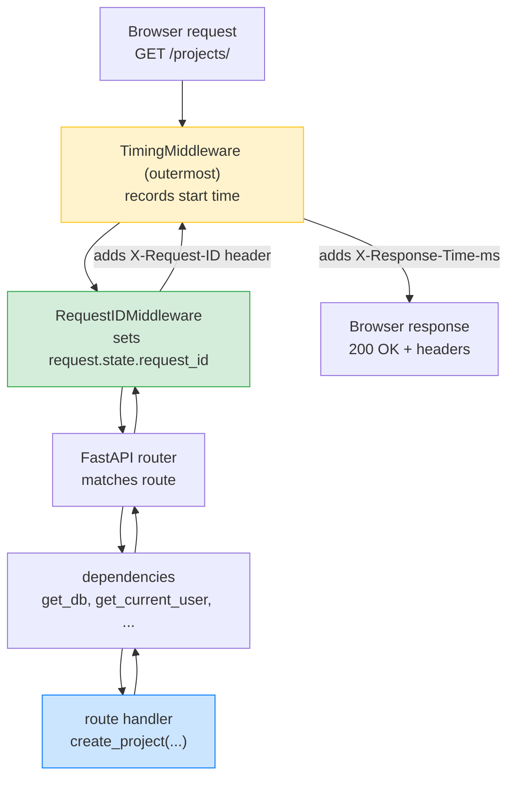
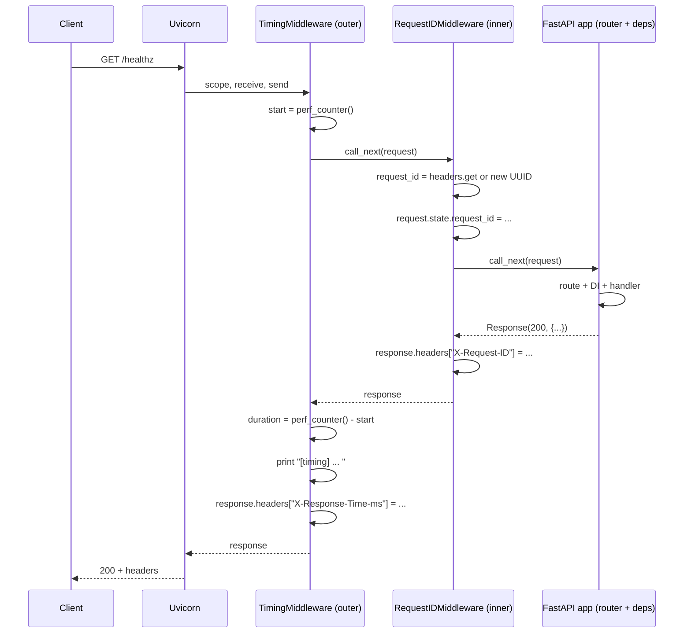

# Lesson 05: Middleware and Request Order

*Adding cross-cutting logic that runs *outside* the dependency chain. A request-id middleware, a timing middleware, and the "last added = outermost" onion rule.*

**You've built the dependency chain. Now wrap it.**

Middleware is what runs *around* your whole app — before dependencies are resolved, before routes are matched, before responses are built. In this lesson you'll add two middlewares to `Boardly`: one that stamps a UUID request-id on every request, one that times every request. And you'll learn the one rule everyone gets wrong the first time: **the order matters, and the rule is the opposite of what you'd guess.** 


#fastapi #middleware #asgi #canonical

## Learning Objectives

By the end of this lesson you will be able to:

1. **Write a `BaseHTTPMiddleware` subclass** with a `dispatch(request, call_next)` method.
2. **Add middleware** with `app.add_middleware(MyMiddleware)` and with the `@app.middleware("http")` decorator.
3. **Explain the onion model** — request flows inward, response flows outward; each middleware can observe both.
4. **Predict middleware order from `add_middleware` calls** — the rule is "last added = outermost."
5. **Read and write `request.state`** to share values between middlewares and dependencies.
6. **Choose between `BaseHTTPMiddleware` and pure ASGI middleware** based on the performance vs ergonomics trade-off.
7. **Recognise the three classic middleware bugs** — mutating the response after sending, swallowing exceptions, ordering surprise.

## Prerequisites

- **[[Dependency-Injection]]** — you need the existing `Boardly` with `get_db` and `get_current_user`. Middleware sits *outside* the DI chain; understanding where DI ends and middleware begins is the whole point.
- **[[02-Web-and-HTTP/ASGI-Starlette-Uvicorn]]** — middleware is just an ASGI app that wraps another ASGI app. Same `(scope, receive, send)` triple.
- **[[02-Web-and-HTTP/CORS-Caching-Headers-Conditional-Requests]]** — you've met one middleware already (`CORSMiddleware`). We generalise here.
- **About 75 minutes.** This lesson's code is small; the difficulty is the ordering rule and the perf trade-off.

**The most common gap: ASGI app composition.**

If `(scope, receive, send)` is unfamiliar, this lesson will feel abstract. Re-read [[02-Web-and-HTTP/ASGI-Starlette-Uvicorn]]. The TL;DR: an ASGI app is a callable that takes three args. A middleware is an ASGI app that wraps another ASGI app — it can do things before calling the inner app and things after.


## The Problem

Three pain points push you to middleware:

1. **Cross-cutting concerns that don't belong in routes.** Logging, tracing, request IDs, timing, CORS, security headers — none of these are "per route" concerns; they're "every request" concerns. Forcing them into every route signature is repetition. Forcing them into a single dependency is awkward (the dependency has to run "around" the route).
2. **Mutating the response uniformly.** Adding `X-Request-ID` to every response, stripping `Server` headers, compressing — these need to happen *after* the route returns, on the response object, *for every route*.
3. **Observability.** You want to log "request X took 5ms" without sprinkling timers through every handler.

Middleware is the answer. It sits between Uvicorn and your app's router — *outside* the dependency chain, *outside* the route handlers. It sees every request and every response.

**Note — Historical context — middleware in WSGI vs ASGI**

WSGI (Flask's protocol) has middleware too — but it's synchronous and *much* less ergonomic. You write `class MyMiddleware: def __init__(self, app): self.app = app; def __call__(self, environ, start_response): ...`. ASGI keeps the same shape but adds async, and Starlette's `BaseHTTPMiddleware` makes it as ergonomic as `async def dispatch(request, call_next)`. The decorator form `@app.middleware("http")` is FastAPI's syntactic sugar over the same pattern. By Starlette 1.9 / FastAPI 0.148 (October 2026), all three forms work; `BaseHTTPMiddleware` is the canonical one.


**Think like a senior engineer: middleware is the only layer that sees *both* the raw inbound request and the final outbound response.**

Three places in the request lifecycle could host a cross-cutting concern: dependencies (run *after* route matching, only on routes that declare them), exception handlers (run *only* on raise), and middleware (runs on *every* request, success or failure, matched or 404). The senior's first question for any cross-cutting concern is "must this hold even for a request that 404s, or that the framework rejected before route-matching?" If yes, the concern belongs in middleware — not a dependency (which never sees a 404) and not an exception handler (which never sees a successful response). The senior's second question: "does this concern mutate the response uniformly, regardless of which route produced it?" If yes, middleware. The third question: "can this concern tolerate seeing the request *before* route-matching decides the route?" — if no (you need the matched route, the path parameters, the OpenAPI tags), use a dependency instead. Request-id stamping, timing, CORS, security headers, gzip, TLS termination, the W3C `traceparent` header — all seven answer "yes" to all three and belong in middleware. Auth and tenant-resolution answer "no" to the third (they need the matched route's required-scopes annotation) and belong in dependencies. The mental model: middleware decides what's true about *the request*; dependencies decide what's true about *the handler*; exception handlers decide what's true about *the failure*. Three layers, three contracts — never substitute one for another. See [[Exception-Handlers]] for where the exception-handler contract begins and [[Dependency-Injection]] for where the dependency contract ends.


## The Code

This lesson adds **one new file** (`boardly/middleware.py`) and **updates** `boardly/main.py` to mount two middlewares.

### `boardly/middleware.py`

```python
# boardly/middleware.py
"""Boardly middleware.

Two middlewares:
 - RequestIDMiddleware: stamps a UUID per request, sets response header.
 - TimingMiddleware: logs the duration, sets response header.

Order rule: the LAST middleware added is the OUTERMOST.
"""
import time
import uuid

from starlette.middleware.base import BaseHTTPMiddleware
from starlette.requests import Request
from starlette.responses import Response


class RequestIDMiddleware(BaseHTTPMiddleware):
 """Sets request.state.request_id and X-Request-ID on the response."""

 async def dispatch(
 self,
 request: Request,
 call_next,
 ) -> Response:
 # Prefer a client-supplied id, fall back to a generated one.
 request_id = (
 request.headers.get("X-Request-ID")
 or f"req_{uuid.uuid4().hex[:16]}"
 )
 request.state.request_id = request_id

 response = await call_next(request)

 response.headers["X-Request-ID"] = request_id
 return response


class TimingMiddleware(BaseHTTPMiddleware):
 """Times the whole request (including inner middleware) and logs it."""

 async def dispatch(
 self,
 request: Request,
 call_next,
 ) -> Response:
 start = time.perf_counter()
 response = await call_next(request)
 duration_ms = (time.perf_counter() - start) * 1000

 # request.state.request_id is set by the inner RequestIDMiddleware.
 request_id = getattr(request.state, "request_id", "req_unknown")
 print(
 f"[timing] {request_id} {request.method} "
 f"{request.url.path} {duration_ms:.2f}ms"
 )

 response.headers["X-Response-Time-ms"] = f"{duration_ms:.2f}"
 return response
```

### `boardly/main.py` (updated)

```python
# boardly/main.py
"""Boardly — a small project-management API.

Lesson 5: adds RequestIDMiddleware and TimingMiddleware.

Order: RequestID is added first (inner), Timing second (outer).
At request time the order is:
 Request → Timing (outer) → RequestID → router → dependencies → route
"""
from collections.abc import AsyncIterator
from contextlib import asynccontextmanager

from fastapi import FastAPI

from boardly.middleware import RequestIDMiddleware, TimingMiddleware
from boardly.routers import health, projects


@asynccontextmanager
async def lifespan(app: FastAPI) -> AsyncIterator[None]:
 print("Boardly starting up…")
 app.state.version = "0.1.0"

 yield

 print("Boardly shutting down…")


app = FastAPI(
 title="Boardly",
 version="0.1.0",
 lifespan=lifespan,
)

# The LAST add_middleware call becomes the OUTERMOST wrapper.
# Below: RequestID is added first (so it ends up inner);
# Timing is added second (so it ends up outer).
app.add_middleware(RequestIDMiddleware)
app.add_middleware(TimingMiddleware)

app.include_router(health.router)
app.include_router(projects.router)
```

## Line-by-Line Deep Dive

### `middleware.py`: `BaseHTTPMiddleware` and `dispatch`

```python
from starlette.middleware.base import BaseHTTPMiddleware

class RequestIDMiddleware(BaseHTTPMiddleware):
 async def dispatch(self, request: Request, call_next) -> Response:
 ...
```

**What it does:** Subclasses `BaseHTTPMiddleware` and overrides `dispatch`. The `dispatch` method receives the request and a `call_next` callable; it can do things before, call `call_next` to invoke the inner app, and do things after.

**What `BaseHTTPMiddleware` actually is:** It's an ASGI app that wraps another ASGI app. Internally, when a request arrives, it:

1. Builds a `Request` object from the raw ASGI scope.
2. Calls your `dispatch(request, call_next)` method.
3. `call_next(request)` runs the inner ASGI app, awaits the response, and returns it as a `Response` object.
4. After your `dispatch` returns, `BaseHTTPMiddleware` serialises the `Response` and sends it on the wire.

The wrapper deals with raw ASGI; you deal with `Request` and `Response`. That's the whole point of `BaseHTTPMiddleware` — ergonomic middleware without losing the ASGI primitives.

**`BaseHTTPMiddleware` perf cost**

Each call to `call_next` spawns an `anyio` task group, runs the inner app in a child task, and uses a channel to pass the response back. That's not free — there's overhead per request (typically tens of microseconds, sometimes more under contention). For most apps, the ergonomics win. For ultra-high-throughput middleware (a load-balancer-grade proxy, a metrics collector at 100k req/s), you'd write a **pure ASGI middleware** instead:
```python
class PureTimingMiddleware:
def __init__(self, app):
self.app = app

async def __call__(self, scope, receive, send):
if scope["type"] != "http":
return await self.app(scope, receive, send)
start = time.perf_counter()
await self.app(scope, receive, send)
duration_ms = (time.perf_counter() - start) * 1000
# Note: can't easily mutate the response headers here — they've
# already been sent. To do that you need to intercept `send`.
```
Pure ASGI middleware is faster but harder to write — you have to intercept the `send` callable if you want to mutate the response, because by the time `self.app(...)` returns, the response has already been sent on the wire. The trade-off: **ergonomics (BaseHTTPMiddleware) vs raw speed (pure ASGI).** Pick the right one for your scale.


### `middleware.py`: `RequestIDMiddleware.dispatch`

```python
async def dispatch(self, request: Request, call_next) -> Response:
 request_id = (
 request.headers.get("X-Request-ID")
 or f"req_{uuid.uuid4().hex[:16]}"
 )
 request.state.request_id = request_id

 response = await call_next(request)

 response.headers["X-Request-ID"] = request_id
 return response
```

**Line by line:**

1. `request_id = request.headers.get("X-Request-ID") or f"req_{uuid.uuid4().hex[:16]}"` — Reads the inbound `X-Request-ID` header if the client sent one (good for distributed tracing — the caller already has a trace id; reuse it). If not, generates one. The format `req_` + 16 hex chars is human-readable; for real production you'd use the full UUID or a W3C `traceparent`.
2. `request.state.request_id = request_id` — Stashes the id on the request's `state` attribute bag. Downstream middlewares (the timing middleware) and dependencies can read it via `request.state.request_id`.
3. `response = await call_next(request)` — Invokes the inner ASGI app — which is either the next middleware (the router, in our order) or another middleware. Awaits the `Response` object.
4. `response.headers["X-Request-ID"] = request_id` — Mutates the response to add the header. The client can correlate its request to logs.
5. `return response` — Returns the response; `BaseHTTPMiddleware` sends it on the wire.

**Tip — Use `request.state`, not module globals, for request-scoped values.**

`request.state` is the per-request attribute bag Starlette gives you. Use it for `request_id`, the current user, a per-request cache — anything that lives for the duration of one request and should be visible to both middleware and dependencies. Don't use module-level globals (they leak across requests and across workers).


**Why is `request.state` per-request and not per-process?** Because the ASGI process serves hundreds of concurrent requests interleaved on the same event loop, a module-level global would be visible to all of them at once — request A's `request_id` would clobber request B's, and you'd log nonsense. Starlette creates a fresh `State()` instance at the start of each request and attaches it to the `Request` object; the per-request object is what middleware and dependencies reach into. The lifecycle is: `Request()` is constructed → middleware writes to `request.state` → dependencies read from it → response is sent → the `Request` and its `state` are garbage-collected. There's no shared mutable scratchpad between requests; if you need one, that's what `app.state` (the per-app bag, written at lifespan startup) is for — never `request.state`.

**Example — Real-world analogy**

Think of middleware as the front-desk staff at a hotel. The guest (request) walks in. The front desk stamps a "guest ID" on their keycard (`request.state.guest_id = ...`). The guest goes to their room (router), orders room service (dependency), and checks out (response). The front desk adds the guest ID to the receipt (`response.headers["X-Guest-ID"] = ...`) before handing it to the guest. Every guest gets the same treatment, regardless of which room they went to.


### `middleware.py`: `TimingMiddleware.dispatch`

```python
async def dispatch(self, request: Request, call_next) -> Response:
 start = time.perf_counter()
 response = await call_next(request)
 duration_ms = (time.perf_counter() - start) * 1000

 request_id = getattr(request.state, "request_id", "req_unknown")
 print(
 f"[timing] {request_id} {request.method} "
 f"{request.url.path} {duration_ms:.2f}ms"
 )

 response.headers["X-Response-Time-ms"] = f"{duration_ms:.2f}"
 return response
```

**Line by line:**

1. `start = time.perf_counter()` — Records a high-resolution timestamp. `perf_counter` is the right tool — it's monotonic (immune to system clock changes) and has nanosecond resolution.
2. `response = await call_next(request)` — Runs the inner app (RequestIDMiddleware → router → dependencies → route). Note: by the time we get here, the inner RequestIDMiddleware has already run its pre-call code (so `request.state.request_id` is set, *if* RequestID is the inner middleware).
3. `duration_ms = (time.perf_counter() - start) * 1000` — Computes duration in milliseconds.
4. `request_id = getattr(request.state, "request_id", "req_unknown")` — Reads the request_id. The `getattr(..., default)` pattern is defensive: if `RequestIDMiddleware` failed to set it (maybe a future refactor removed it, or maybe a request to a path that bypassed it), we fall back to `"req_unknown"` instead of raising `AttributeError`.
5. `print(...)` — Logs the line. In production you'd use a structured logger (see [[13-Performance-and-Observability/Structured-Logging-and-Request-IDs]]); for Lesson 5, `print` is enough to see the output.
6. `response.headers["X-Response-Time-ms"] = ...` — Stamps the response.

**Spot the subtlety — why `getattr(request.state, "request_id", "req_unknown")` instead of `request.state.request_id`?**

Because if the *inner* middleware (RequestID) raises *before* setting `request.state.request_id`, accessing `request.state.request_id` directly would raise `AttributeError`. The `getattr` form gives us a graceful fallback. That said, if RequestID raised before `call_next`, the inner `await call_next(request)` in TimingMiddleware would propagate that exception, and we'd never reach line 4. In *our* order, the only way to reach line 4 is if RequestID ran successfully past `request.state.request_id = ...`. The defensive `getattr` is belt-and-braces. Still — it's good practice.


### `main.py`: The onion order

```python
app.add_middleware(RequestIDMiddleware)
app.add_middleware(TimingMiddleware)
```

**What this does:** Adds two middlewares. **The order of the calls determines the order of execution.**

**The rule — "last added = outermost":** Starlette's `add_middleware` inserts each new middleware at the *front* of the internal middleware list, then `build_middleware_stack` folds the list around the app from the front. Net effect: each `add_middleware` call wraps the existing stack. So:

- `app.add_middleware(RequestIDMiddleware)` — RequestID is now the *only* middleware (it's the outermost AND innermost; it wraps the app directly).
- `app.add_middleware(TimingMiddleware)` — Timing is added; it wraps *everything* (RequestID + app). Timing is now the **outermost**, RequestID is the **inner**.

**Student asks: Why does Starlette reverse the natural reading order — wouldn't "first added = outermost" be less surprising?**

Two reasons. (1) Starlette's internal `add_middleware` prepends to the list because the *typical* pattern is "I have a working app, I want to add a new outermost layer (logging, tracing) without disturbing what's already there." Prepending means each new call is the new outermost without rewriting earlier ones. (2) The same convention matches the WSGI middleware heritage (Django, Flask) where `middleware.insert(0, new_layer)` was the idiom. The cost: readers have to read `add_middleware` calls bottom-up to predict the onion order. The mitigation: in production, write a single `setup_middleware(app)` function and order the calls *bottom-up* intentionally — i.e., if you want RequestID outermost and Timing inner, write `add_middleware(TimingMiddleware)` *before* `add_middleware(RequestIDMiddleware)`. The reader's mental model "later = outer" matches the code's bottom-to-top reading order.




**Warning — This rule trips everyone up.**

The "last added = outermost" rule is the opposite of intuition. Most people expect "first added = outermost" (like stacking decorators on a function — the topmost decorator is applied first). It isn't. The mental model that helps: each `add_middleware` call *wraps the existing stack*. A later call thus adds a layer *outside* everything that came before.


**Why this rule?**

Starlette's `add_middleware` *prepends* the middleware to `self.user_middleware` (so the most-recently-added is at index 0). Then `build_middleware_stack` iterates that list in order, folding each middleware *around* the accumulator. The *first* item in the list (the most-recently-added) is thus folded last, becoming the outermost. That's the "last added = outermost" rule, mechanically.

If this still feels backwards: think of it as `app = new_middleware(app)` — each `add_middleware` rewrites the app variable as "the new middleware wrapping the previous app." The last call wins; the last call is the outermost.


### `main.py`: Alternative – the `@app.middleware("http")` decorator

You can also add middleware with a decorator:

```python
@app.middleware("http")
async def audit_middleware(request: Request, call_next):
 response = await call_next(request)
 response.headers["X-Boardly"] = "true"
 return response
```

This is exactly equivalent to subclassing `BaseHTTPMiddleware` and defining `dispatch` — internally, FastAPI wraps your function in a `BaseHTTPMiddleware` subclass. Use it for tiny one-off middlewares (set a single header, log a single line). Use the class form (`class XMiddleware(BaseHTTPMiddleware)`) for anything with state, tests, or more than a few lines.

**Tip — The class form is easier to test.**

With a class, you can `from boardly.middleware import RequestIDMiddleware` and instantiate it directly in a test, calling `dispatch(request, fake_call_next)`. With a decorator, the function is bound to the module's `app` and harder to exercise in isolation. Prefer classes for anything you'll test.


## Execution Trace

Run the app:

```bash
uv run uvicorn boardly.main:app --reload
```

In another terminal:

```bash
# Make a request with no inbound request id
curl -i http://127.0.0.1:8000/healthz
# Expected response headers:
# X-Request-ID: req_a1b2c3d4e5f6g7h8 ← generated by RequestIDMiddleware
# X-Response-Time-ms: 1.23 ← set by TimingMiddleware
#
# Expected server-side log:
# [timing] req_a1b2c3d4e5f6g7h8 GET /healthz 1.23ms

# Make a request with an inbound request id (client supplied)
curl -i -H 'X-Request-ID: trace-abc-123' http://127.0.0.1:8000/projects/
# Expected response headers:
# X-Request-ID: trace-abc-123 ← reused from client
# X-Response-Time-ms: 4.56
```



## Common Mistakes

### Mistake 1: Wrong order (request-id outside timing, when you wanted the opposite)

```python
# WRONG (if you wanted timing to measure the request-id overhead too)
app.add_middleware(TimingMiddleware) # added first
app.add_middleware(RequestIDMiddleware) # added second → outermost
```

**Symptom:** The `[timing]` log line shows the correct `request_id` (because `call_next` runs the outer RequestID's pre-call *inside* the await, before Timing's post-call code reads `request.state.request_id`). What you lose is the *duration*: the timer starts after RequestID has already done its header lookup and UUID generation, so the measured time excludes RequestID's pre-call work. If you wanted timing to measure everything, this order is wrong.

**Why:** Order matters because each middleware sees only what's between its pre-call and post-call. If timing is inner, it measures only the router + dependencies + route — not the request-id middleware's UUID generation (trivial in this case, but consider a JWT verification middleware: you'd want timing to include that).

**Fix:** Think about what you want timing to measure. If "everything," add timing last (outermost). If "only the router work," add timing first (innermost). Be deliberate.

### Mistake 2: Mutating the response after sending

```python
# WRONG (pure ASGI form)
class PureTimingMiddleware:
 def __init__(self, app):
 self.app = app

 async def __call__(self, scope, receive, send):
 start = time.perf_counter()
 await self.app(scope, receive, send) # ← response already sent!
 duration_ms = (time.perf_counter() - start) * 1000
 # Can't add a header now — the response is on the wire.
```

**Symptom:** No `X-Response-Time-ms` header on the response.

**Why:** In the pure ASGI form, `self.app(scope, receive, send)` sends the response on the wire *during* its execution. By the time it returns, the response headers have been written. To mutate the response, you have to intercept `send` — wrap it with your own callable that captures the headers, modifies them, and forwards them on.

**Fix:** Use `BaseHTTPMiddleware` for response mutation. Or, in pure ASGI, wrap `send`:

```python
async def send_wrapper(message):
 if message["type"] == "http.response.start":
 message["headers"].append((b"x-response-time-ms", f"{duration_ms:.2f}".encode()))
 await send(message)
```

This is why `BaseHTTPMiddleware` exists — it does this wrapping for you.

**Warning — Don't write pure ASGI middleware that mutates responses unless you understand the ASGI spec cold.**

The `send` callable receives `http.response.start` (with headers + status) and `http.response.body` (with the body chunks). Mutating headers after `http.response.start` is sent has no effect. The interception pattern is fiddly. Use `BaseHTTPMiddleware` unless you have a measured reason not to.


**Danger — How an attacker thinks: the silently-dropped security header on the error path.**

A pure-ASGI middleware that appends to `message["headers"]` *after* `await send(message)` has already forwarded the `http.response.start` frame silently drops the header — the bytes are already on the wire, and the client never receives the header you thought you set. An attacker who probes `POST /login` with malformed bodies and collects the 500 responses can discover that your `Content-Security-Policy: default-src 'self'` header is present on 200s but *missing* on 500s — because the unhandled-exception handler returns its own response, and the pure-ASGI CSP middleware's send-interception was wired only for the happy path. The attacker now has a lane: ship a reflected-XSS payload through an error-message path that the CSP would otherwise block on a 200. The defence is structural: intercept `send` *before* the first `http.response.start` is forwarded, mutate the headers list in-place, then forward the (now-mutated) message — never mutate after. The grep: `rg "await send\(message\)" --type py boardly/middleware.py` should return zero hits in any middleware that mutates headers; every `await send(...)` must be inside a `send_wrapper` that owns the mutation window. The deeper rule: security-header middleware must run *outermost* (so it sees every response, including the 500s produced by inner exception handlers); placing it *innermost* leaves the 500 path uncovered. See [[11-Authentication-and-Security/Threat-Model-First]] for the threat-model that surfaces this lane and [[02b-Backend-Foundations/HTTP-Headers-Deep-Dive]] for the CSP header specifically.


### Mistake 3: Swallowing exceptions in middleware

```python
# WRONG
async def dispatch(self, request, call_next):
 try:
 return await call_next(request)
 except Exception:
 return Response("internal error", status_code=500) # ← swallowing!
```

**Symptom:** The route handler raised a `ProjectNotFound` (which Lesson 6 will define). The middleware catches it and returns a generic 500. The client gets a useless error; your logs lose the original exception.

**Why:** Middleware runs *around* exception handlers (Lesson 6). If middleware catches `Exception` itself, FastAPI's `@app.exception_handler` machinery never runs — the exception never reaches it. The structured error shape you carefully designed in Lesson 6 is bypassed.

**Fix:** Let exceptions propagate. FastAPI's exception handlers will catch them. If you must catch (e.g. for logging), re-raise:

```python
async def dispatch(self, request, call_next):
 try:
 return await call_next(request)
 except Exception:
 logger.exception("unhandled error")
 raise # ← re-raise so FastAPI's exception handlers run
```

**Warning — When this breaks: the silent 500 with no traceback.**

**Symptom.** Production incident: clients report intermittent 500s on `POST /projects/`. The on-call opens the structured-logging dashboard, greps for the request_id, and finds *nothing* — no traceback, no `logger.exception(...)` line, no entry in the OpenTelemetry trace. The exception handler registry looks correct; the unhandled-exception handler is registered; the metrics show zero `internal_error` responses, only bare `500`s with a different body shape. The on-call cannot reproduce locally because the failure is data-dependent and only fires in production.
**Diagnosis.** Open `boardly/middleware.py` and grep for `except Exception`. A "defensive" middleware (often added during a previous incident to "make the API more resilient") catches `Exception` and returns `JSONResponse(status_code=500, content={"error": {"message": "internal error"}})` *without re-raising*. The exception never reaches FastAPI's `@app.exception_handler(Exception)` machinery — `ServerErrorMiddleware` only fires when the exception propagates out of route dispatch. The middleware swallowed it. The traceback is lost because `logger.exception(...)` was never called (the catch block returned a response instead of re-raising). The metrics show bare `500`s (not `internal_error` codes) because the catch-all handler never ran — the middleware produced a *different* 500 shape that bypasses your envelope.
**Fix.** Three layers. (1) Delete the `try/except Exception` from the middleware; the framework's exception handler is the only place that should catch `Exception`. (2) If the middleware *must* observe the exception (e.g. to record the timing of a failed request), wrap with `logger.exception("request failed request_id=%s", request_id)` then `raise` from the bare `except` — the `raise` re-propagates so `ServerErrorMiddleware` and your `@app.exception_handler(Exception)` both run. (3) Add a CI grep that fails the build if `boardly/middleware.py` contains `except Exception` *without* a `raise` on the next non-blank line: `rg -A1 "except Exception" boardly/middleware.py | rg -v "raise"` should return nothing. The structural enforcement matters — code review alone cannot catch every drift across a 50-engineer team. The mental rule: middleware observes; exception handlers translate; routes raise. Never blur the line. See [[Exception-Handlers]] for the contract that the middleware is bypassing.


### Mistake 4: Blocking work inside middleware

```python
# WRONG
async def dispatch(self, request, call_next):
 time.sleep(2) # ← blocks the event loop!
 return await call_next(request)
```

**Symptom:** Every request through this middleware stalls the entire event loop for 2 seconds — *all* other requests, even those not hitting this middleware's pre-call code, are blocked.

**Why:** `BaseHTTPMiddleware` is `async def`. It runs on the event loop. Calling blocking I/O (`time.sleep`, `requests.get`, `psycopg2` queries) blocks the loop.

**Fix:** Either make the middleware synchronous (use `def dispatch`, which runs in a threadpool — bad ergonomics), or use `await asyncio.to_thread(blocking_fn, ...)` to push blocking work to a worker thread. Best: use async-native libraries (`httpx.AsyncClient` instead of `requests`, `asyncpg` instead of `psycopg2`).

**Why does blocking the event loop block *all* requests, not just the one inside the middleware?** Because Python's event loop is a single-threaded cooperative scheduler. There's no preemption — the loop runs each coroutine until it hits an `await` that yields control back. While your `time.sleep(2)` is running inside the middleware's `async def dispatch`, the loop cannot switch to any other coroutine: it's stuck inside your synchronous call. Every other request waiting on I/O — database queries, file reads, the `/healthz` endpoint — is parked until your middleware returns. Two seconds of `time.sleep` in one route means two seconds of total throughput loss for *every* client connected to that worker process. The fix `await asyncio.to_thread(...)` works because it pushes the blocking call onto a separate OS thread and returns an awaitable to the loop, freeing the loop to service other coroutines while the worker thread blocks.

**Warning — When this breaks: the /healthz that lies during a DB outage.**

**Symptom.** The load balancer's health check `GET /healthz` returns 200 OK every 5 seconds — including the 90 seconds during which the Postgres primary was unreachable. The on-call's pager fires for "user-facing 500s" but the LB never drained the node. Clients were routed to a node that returned 500s for every authenticated request. The post-incident timeline shows /healthz was green throughout the outage.
**Diagnosis.** Open `boardly/middleware.py` and grep for `psycopg2.connect`, `requests.get`, `time.sleep`, or any other blocking call inside an `async def dispatch`. A sync database ping inside `TimingMiddleware` (or a "health-stamping" middleware that records the request) blocks the event loop for the duration of the DB call — typically 50–200 ms under normal load, but during a Postgres outage the TCP connect timeout is 30 s, so every request through the middleware stalls for 30 s. While the loop is stalled, *no other coroutine runs* — including the `/healthz` coroutine that was already scheduled. The /healthz handler never gets CPU time, so the LB never receives a 500; it receives *no response*, which (depending on the LB config) is treated as either a timeout or a pass. The middleware poisoned the entire worker.
**Fix.** Three layers. (1) Replace the sync call with an async-native driver: `asyncpg` instead of `psycopg2`, `httpx.AsyncClient` instead of `requests`, `aioboto3` instead of `boto3`. (2) For unavoidable sync code (a legacy client library with no async port), push to a worker thread: `await asyncio.to_thread(psycopg2_connect, dsn)` returns control to the loop immediately; the sync call blocks only the worker thread, not the event loop. (3) Add a CI grep that fails the build if `boardly/middleware.py` imports any sync I/O library: `rg "import psycopg2|import requests|from requests|import time" boardly/middleware.py` should return nothing. (4) Make `/healthz` independent of the failure domain it reports on — either by checking `request.url.path == "/healthz"` early in `dispatch` (the one acceptable path-conditional skip in middleware) or by mounting `/healthz` on a separate `FastAPI()` instance with no DB-touching middleware. The deeper rule: a health check that depends on the same failure domain as the production traffic it reports on is not a health check — it is a vested interest. See [[02b-Backend-Foundations/Health-Checks-and-Probes]] for the liveness-vs-readiness split and [[13-Performance-and-Observability/Structured-Logging-and-Request-IDs]] for the request_id propagation that would have made this incident debuggable in 30 seconds instead of 90 minutes.


### Mistake 5: Reading `request.state.X` without setting it

```python
# WRONG
async def dispatch(self, request, call_next):
 user_id = request.state.user_id # ← AttributeError if nothing set it!
 ...
```

**Symptom:** `AttributeError: 'State' object has no attribute 'user_id'` in the middleware, returning a 500 to the client.

**Why:** `request.state` is an empty `State()` at the start of each request. Only middlewares that *set* attributes populate it. Reading an attribute that no middleware set raises `AttributeError`.

**Fix:** Use `getattr(request.state, "user_id", None)` (with a sensible default), *or* ensure the middleware that sets the attribute is *outer* (so it runs before the one that reads).

**Spot the bug — does this middleware chain work or raise at runtime?**

```python
app.add_middleware(TimingMiddleware)        # added first  → outermost
app.add_middleware(RequestIDMiddleware)    # added second → innermost
```
followed by `TimingMiddleware` reading `request.state.request_id` *before* it calls `call_next`. Answer: raises `AttributeError`. The reading happens on the inbound path of the outermost middleware, but the writer (`RequestIDMiddleware`) is the innermost one — its inbound path runs *later* in the request lifecycle (outer-in, inner-out). When `TimingMiddleware` reads `request.state.request_id` at line 1 of its `dispatch`, the `RequestIDMiddleware` has not run yet, so the attribute is unset. The fix is to either swap the order (`RequestIDMiddleware` outer, `TimingMiddleware` inner) so the writer runs first, *or* read the attribute on the outbound path (after `call_next` returns, at which point the inner middleware has populated it). The two questions to ask when designing a middleware chain: "who writes the attribute?" and "do I read it on the way in or on the way out?" — the writer must be outer if the reader reads on the way in.


## Engineering Trade-Offs

### `BaseHTTPMiddleware` vs pure ASGI

| Criterion | `BaseHTTPMiddleware` | Pure ASGI |
|-----------|----------------------|-----------|
| Ergonomics | Excellent — `Request`/`Response` objects | Poor — raw `scope, receive, send` |
| Perf | 10–50 μs overhead per request | Minimal |
| Response mutation | Easy | Requires `send` interception |
| Streaming | Buffers the response body | True streaming |
| Best for | 95% of middlewares | Hot paths, streaming |

For `Boardly`, we use `BaseHTTPMiddleware` — both middlewares are ergonomic, perf is not a concern at our scale. In Section 13 (Observability), we'll consider pure ASGI for the tracing middleware.

### Per-route middleware vs global middleware

FastAPI doesn't have "per-route middleware" — middleware is always global (applies to every route). If you want per-route concerns, use dependencies (Lesson 4). The split:

- **Middleware:** concerns that apply to every request — request IDs, timing, CORS, security headers, gzip.
- **Dependencies:** concerns that apply to some routes — auth, database sessions, specific scope checks.

**Why doesn't FastAPI have per-route middleware?** Because middleware is wired once, at app-construction time, into the ASGI middleware stack — the stack is a fixed pipeline that wraps the entire app. To make it per-route, FastAPI would have to dispatch on `scope["path"]` inside every middleware call, which would defeat the "this middleware runs unconditionally on every request" contract that makes middleware easy to reason about. Per-route concerns are correctly modelled as *dependencies* — `Depends(get_current_user)` on the routes that need auth, absent on the ones that don't. The mental split: middleware decides what's true about *the request* (every request has a request id); dependencies decide what's true about *the handler* (this handler needs a logged-in user).

**Tip — Don't put per-feature logic in middleware.**

If your middleware checks `if request.url.path.startswith("/admin"): ...` — that's a route concern dressed up as middleware. Use a dependency on the admin router instead. Middleware should be path-agnostic.


### Built-in Starlette middleware vs custom

Starlette ships with several middlewares you should reach for before writing your own:

- `CORSMiddleware` — handles CORS preflight and headers.
- `GZipMiddleware` — compresses responses.
- `TrustedHostMiddleware` — rejects requests with unknown `Host` headers.
- `HTTPSRedirectMiddleware` — redirects HTTP to HTTPS.

Use them. See [[02-Web-and-HTTP/CORS-Caching-Headers-Conditional-Requests]] for CORS specifically.

**Student asks: what actually goes wrong if I roll my own CORS middleware instead of using Starlette's `CORSMiddleware`?**

Three failure modes that have shipped to production. (1) Preflight handling: a hand-rolled middleware often returns `200 OK` on `OPTIONS` instead of `204 No Content` and forgets the `Access-Control-Max-Age` header, so the browser re-sends preflight on every request — your p99 latency doubles for no reason. (2) Vary header: `CORSMiddleware` sets `Vary: Origin` so caches don't return one origin's response to another origin; a hand-rolled version forgets this and a CDN serves tenant-A's data to tenant-B. (3) Credential leakage: with `allow_credentials=True`, the response must echo the *exact* `Origin` (not `*`) — a hand-rolled `Access-Control-Allow-Origin: *` with `allow_credentials=True` is rejected by every modern browser, breaking authenticated fetches from your own SPA. Starlette's implementation has had these bugs found and fixed across years of real deployments. Reach for it; do not reinvent it. If you genuinely need a different CORS policy, subclass and override the methods — don't start from `BaseHTTPMiddleware`.


**When would you NOT reach for `BaseHTTPMiddleware`?**

Three scenarios reach for the pure-ASGI form instead. (1) Hot-path middleware that handles *every* request — `BaseHTTPMiddleware` spawns an internal task per request to drive the inner chain, which costs ~10–30 µs per request at high concurrency. For CORS, TrustedHost, GZip — the four built-ins — Starlette implements them as pure ASGI for exactly this reason. (2) Middleware that needs to see or mutate the raw ASGI `scope` *before* Starlette wraps it in a `Request` object (e.g., a custom `Host` rewriting layer that runs before routing). `BaseHTTPMiddleware` only sees the post-wrapped `Request`, which loses raw-scope access. (3) Middleware that handles non-HTTP scopes — `lifespan`, `http.disconnect` — `BaseHTTPMiddleware` only fires on `scope["type"] == "http"`. The rule: reach for `BaseHTTPMiddleware` for the 90% case (per-request logging, timing, request-id, auth); reach for pure ASGI for the 10% case (perf-critical, raw-scope, or non-HTTP).


**Production reality: the BaseHTTPMiddleware-to-pure-ASGI migration that pays off only above ~5k RPS.**

The 10–30 µs per-request overhead of `BaseHTTPMiddleware` is invisible at 50 RPS (50 µs × 50 = 2.5 ms of CPU per second — negligible) and uncomfortable at 50k RPS (50 µs × 50000 = 2.5 s of CPU per second per worker — a meaningful chunk of a 4-core box). The senior's heuristic: profile before you migrate, not after. `py-spy record -o profile.svg --pid <uvicorn-worker-pid> --duration 30` produces a flame graph; if `BaseHTTPMiddleware.__call__` and its anyio task-group machinery show up as <2% of CPU, do not migrate. If they show up as >5%, migrate the request-id and timing middlewares first (they're the simplest — no body inspection, no `send` interception, just header reads and writes); leave CORS and GZip to Starlette's already-pure-ASGI built-ins. The migration is mechanical: rewrite `async def dispatch(self, request, call_next) -> Response` as `async def __call__(self, scope, receive, send)`; replace `request.headers.get(...)` with `dict(scope["headers"])[b"x-request-id"]`; replace `response.headers[...] = ...` with a `send_wrapper` that mutates `http.response.start`'s headers list before forwarding; replace `await call_next(request)` with `await self.app(scope, receive, send_wrapper)`. The gotcha: pure-ASGI middleware cannot use `request.state` (the `Request` object doesn't exist yet at the pure-ASGI layer) — you must stash per-request values on `scope["state"]` (a dict Starlette populates lazily) or in a `contextvars.ContextVar` that the inner middlewares and dependencies read. The latter (`contextvars`) is the modern pattern for tracing-style propagation; `request.state` is the ergonomic pattern for human-readable values. The Boardly rule: stay on `BaseHTTPMiddleware` until a flame graph says otherwise; migrate only the middlewares whose overhead shows up as >5% of CPU; keep the ergonomic `request.state` API for everything that doesn't need to be hot-path. See [[13-Performance-and-Observability/OpenTelemetry-Tracing]] for the `contextvars`-based trace-context propagation that pure-ASGI middleware enables.


## Exercises

**Exercise 1 — Add a third middleware.** Write a `SecurityHeadersMiddleware` that sets `X-Content-Type-Options: nosniff`, `X-Frame-Options: DENY`, and `Strict-Transport-Security: max-age=31536000` on every response. Add it *after* `RequestIDMiddleware` so it runs innermost. Verify with `curl -I`.

**Exercise 2 — Decorator form.** Convert `TimingMiddleware` from a class to the `@app.middleware("http")` decorator form in `main.py`. Confirm it produces the same log output.

**Exercise 3 — Pure ASGI.** Rewrite `RequestIDMiddleware` as a pure ASGI middleware class. Hint: you'll need to intercept `send` to add the `X-Request-ID` header to the `http.response.start` message. Compare the perf with a quick `ab -n 1000 -c 10 http://127.0.0.1:8000/healthz` (Apache Bench) — pure ASGI should be a bit faster.

**Exercise 4 — Propagate request_id to logs.** In `routers/projects.py`, add `request: Request` to `list_projects`'s signature and log `request.state.request_id` at the start. Confirm the same `request_id` appears in both the middleware log and the route log.

**Exercise 5 — Skip middleware on lifespan.** Pure ASGI middleware has a `scope["type"]` check (`if scope["type"] != "http": return await self.app(...)`). `BaseHTTPMiddleware` does this check internally. Why is it important? (Hint: middleware shouldn't intercept lifespan messages.)

**Exercise 6 — Spot the bug.** This middleware silently breaks streaming responses (Lesson 7 will use `StreamingResponse`). Why?

```python
class MyMiddleware(BaseHTTPMiddleware):
 async def dispatch(self, request, call_next):
 response = await call_next(request)
 body = b"".join([c async for c in response.body_iterator])
 # do something with body
 return Response(content=body, status_code=response.status_code)
```

(Answer: it eagerly reads the entire response body into memory — defeating the purpose of `StreamingResponse`. `BaseHTTPMiddleware` buffers the body, which is why streaming responses can be tricky under it. Lesson 7 covers this in detail.)

## Verification

```bash
uv run uvicorn boardly.main:app --reload
```

In another terminal:

```bash
# No inbound request id
curl -i http://127.0.0.1:8000/healthz
# Expected: 200 OK
# Headers:
# X-Request-ID: req_xxxxxxxxxxxxxxxxx
# X-Response-Time-ms: 0.xx
#
# Server-side log line:
# [timing] req_xxxxxxxxxxxxxxxxx GET /healthz 0.xxms

# With inbound request id (client supplied)
curl -i -H 'X-Request-ID: trace-abc-123' http://127.0.0.1:8000/projects/
# Expected headers include:
# X-Request-ID: trace-abc-123
# X-Response-Time-ms: x.xx
#
# Server-side log:
# [timing] trace-abc-123 GET /projects/ x.xxms

# Authenticated request — auth header should still flow through middleware
curl -i -H 'Authorization: Bearer token-alice' http://127.0.0.1:8000/projects/p_a1b2c3d4
# Expected: 200 with X-Request-ID and X-Response-Time-ms headers
```

If all three behave as expected, your middleware is correctly wired and ordered. If `[timing]` shows `request_id=req_unknown`, your order is wrong (Mistake 1).

## Previously Learned Here

- **`ASGI`** — [[02-Web-and-HTTP/ASGI-Starlette-Uvicorn]]. A middleware is an ASGI app wrapping another ASGI app. The `(scope, receive, send)` triple is the underlying interface.
- **`CORS`** — [[02-Web-and-HTTP/CORS-Caching-Headers-Conditional-Requests]]. You've already used `CORSMiddleware`; this lesson generalises to custom middleware.
- **`app.state`** — [[Application-and-Lifespan]]. Lesson 1 used `app.state` for process-scoped resources. This lesson introduces `request.state` for request-scoped values — same pattern, different scope.
- **FastAPI lifespan** — [[Application-and-Lifespan]]. Middleware shouldn't intercept lifespan messages (`scope["type"] == "lifespan"`); only HTTP. Exercise 5 reinforces this.

## What's Next

In [[Exception-Handlers]] we add custom exception classes (`ProjectNotFound`, `ConflictError`) and register handlers that translate them into a consistent JSON error shape `{"error": {"code": "...", "message": "...", "request_id": "..."}}`. You'll:

- Define custom exceptions in `boardly/errors.py`.
- Register `@app.exception_handler(ProjectNotFound)` and `@app.exception_handler(ConflictError)`.
- Read `request.state.request_id` (set by the middleware you just wrote!) and include it in the error response.
- Customise the `RequestValidationError` handler so 422 responses match your error shape.
- See how middleware and exception handlers cooperate.

## Sources

- **FastAPI — Middleware** — <https://fastapi.tiangolo.com/tutorial/middleware/> — accessed 2026-10-19.
- **Starlette — Middleware** — <https://www.starlette.io/middleware/> — accessed 2026-10-19.
- **Starlette — `BaseHTTPMiddleware`** — <https://www.starlette.io/middleware/base/> — accessed 2026-10-19.
- **ASGI specification — Middleware** — <https://asgi.readthedocs.io/en/latest/specs/main.html#middleware> — accessed 2026-10-19.
- **Starlette source — `applications.py`** — <https://github.com/encode/starlette/blob/master/starlette/applications.py> — accessed 2026-10-19 — `add_middleware` and `build_middleware_stack`.
- **FastAPI — Release Notes** — <https://fastapi.tiangolo.com/release-notes/> — verified 0.148.0 released 2026-10-19.

## What We Learned

Let's recap. In this lesson you:

- **Wrote a `BaseHTTPMiddleware` subclass** with `dispatch(request, call_next)` and saw how Starlette turns that into an ASGI app.
- **Added middleware via `app.add_middleware(...)`** and via the `@app.middleware("http")` decorator.
- **Mastered the "last added = outermost" rule** — the ordering rule that trips everyone up the first time.
- **Used `request.state`** to share values between middleware and dependencies.
- **Chose between `BaseHTTPMiddleware` and pure ASGI** based on the ergonomics vs perf trade-off.
- **Hit and fixed the five classic middleware bugs** — wrong order, mutating responses after sending, swallowing exceptions, blocking work, reading unset state.
- **Saw the onion diagram** — request flows inward, response flows outward, each layer sees both.

Mental model: *middleware wraps the entire app — outside the dependency chain, outside the route handlers. Each middleware sees the request on the way in and the response on the way out. Order matters: last added = outermost. Use `request.state` to share values between middlewares and dependencies. Use `BaseHTTPMiddleware` for ergonomics; pure ASGI for hot paths. Don't catch exceptions in middleware — let FastAPI's exception handlers do that.*

---

> A note from your teacher
You just wrapped `Boardly` in observability. Every request now carries a request-id; every response reports its time. That's the foundation of "production-grade" — without these two things, debugging a live system is guesswork. We're going to add custom exceptions next — `ProjectNotFound`, `ConflictError` — and translate them into a consistent JSON error shape that *includes the request_id* your middleware just stamped. The pieces are starting to talk to each other. See you in Lesson 06. 


---

**Tags:** #fastapi #middleware #asgi #canonical #review
**Previous:** [[Dependency-Injection]]
**Next:** [[Exception-Handlers]] →
