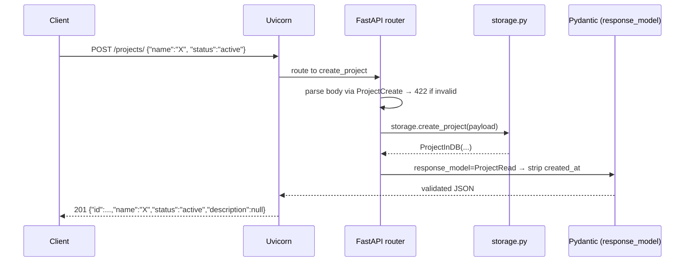

# Lesson 03: Path, Query, Header, Cookie, Body

*Turning `Boardly`'s stub routes into real CRUD: path params, query filters, a Pydantic request body, and `response_model` to filter what comes back out.*

**Welcome to the parameter lesson.**

Everything you've done so far — the lifespan, the routers, the stubs — was scaffolding for this. By the end of this lesson, `Boardly` has a real, typed, validated CRUD surface. `POST /projects` with a Pydantic body. `GET /projects/{project_id}` with a path parameter. `GET /projects?status=active&limit=20` with query parameters. And `response_model` filtering the fields that leave the API. FastAPI's signature magic happens here. 


#fastapi #parameters #pydantic #annotated

## Learning Objectives

By the end of this lesson you will be able to:

1. **Declare path parameters** with `Annotated[str, Path(...)]` and read them at the right place in the URL.
2. **Declare query parameters** with `Annotated[int, Query()]` and use defaults, `gt`/`le` validators, and lists.
3. **Declare a request body** with a Pydantic `BaseModel` and have FastAPI validate it before your function runs.
4. **Use `response_model=ProjectRead`** to filter which fields are returned — stripping secret/internal fields automatically.
5. **Set status codes** correctly — `201 Created` on POST, `200 OK` on GET, `422 Unprocessable Entity` on validation failure (which FastAPI does for you).
6. **Read headers and cookies** with `Annotated[str, Header()]` and `Annotated[str | None, Cookie()]`.
7. **Explain how FastAPI parses your function signature** to know which arguments come from where.

## Prerequisites

- **[[Routers-and-Modular-Apps]]** — you need `routers/projects.py` with stub routes. We're going to *replace* the stubs.
- **[[01-Python-Foundations/Type-Hints-and-Annotations]]** — specifically `Annotated[T, ...]` (PEP 593). FastAPI uses `Annotated` to carry the source of each parameter.
- **[[04-Pydantic/BaseModel-and-Validation]]** — you need to know what a `BaseModel` is and how `model_dump()` works. We're going to define `ProjectCreate` and `ProjectRead` models.
- **[[04-Pydantic/Fields-Annotated-Reusable-Annotations]]** — `Field(...)` and its validators (`min_length`, `ge`, `le`). Used in this lesson's Pydantic models.
- **About an hour and a half.** This is the longest lesson in the section — there's a lot to cover.

**The most common gap: `Annotated` vs `Field` vs `Query` vs `Path` vs `Body`.**

Four names, all doing "validation metadata." The mental model: `Annotated[T, ...]` is the *container*; `Field`, `Query`, `Path`, `Body`, `Header`, `Cookie` are the *specific metadata* you put inside it. `Field` is for Pydantic model fields. `Query`/`Path`/`Body`/`Header`/`Cookie` are for FastAPI function parameters. We'll use `Annotated` everywhere — the modern, FastAPI-0.95+ form.


## The Problem

A web request carries data in five places:

1. **Path** — `/projects/{project_id}` → `project_id` is a path segment.
2. **Query string** — `?status=active&limit=20` → `status` and `limit` are query params.
3. **Headers** — `Authorization: Bearer …` → header values.
4. **Cookies** — `session=…` → cookie values.
5. **Body** — the request body, usually JSON.

In Flask, you reach into `request.args`, `request.headers`, `request.cookies`, and `request.get_json()` by hand. It works, but it pushes validation into your function body — every endpoint re-implements "is this integer valid? is this string long enough? is this dict the right shape?" FastAPI flips that: you declare each parameter's source and validation rules in the *signature*, and FastAPI validates *before* your function runs. If validation fails, your function never runs and FastAPI returns a `422 Unprocessable Entity` with a structured error.

**Note — Historical context — `Annotated` is newer than FastAPI**

FastAPI originally used `path_param: int = Path(...)` (without `Annotated`). In 0.95 (April 2023) the `Annotated` form became the *preferred* form. By 0.148.0 (October 2026), the older form still works but is deprecated in some places and is universally considered "the old way." All new code in `Boardly` uses `Annotated`.


## The Code

This lesson adds **two new files** (`boardly/models.py`, `boardly/storage.py`) and **rewrites** `boardly/routers/projects.py` to use them.

### `boardly/models.py`

```python
# boardly/models.py
"""Pydantic schemas for Boardly.

Three shapes for the same logical entity:
 - ProjectCreate → what the client sends in POST /projects.
 - ProjectInDB → what we store internally (adds the id, created_at).
 - ProjectRead → what we return in API responses (no internal fields).
"""
from datetime import datetime
from pydantic import BaseModel, ConfigDict, Field


class ProjectCreate(BaseModel):
 name: str = Field(min_length=1, max_length=120,
 description="Human-readable project name.")
 status: str = Field(default="active",
 pattern="^(active|archived|deleted)$",
 description="Lifecycle state of the project.")
 description: str | None = Field(default=None, max_length=2000)


class ProjectInDB(BaseModel):
 """The shape stored in our (fake) database."""
 model_config = ConfigDict(from_attributes=True)

 id: str
 name: str
 status: str
 description: str | None
 created_at: datetime


class ProjectRead(BaseModel):
 """The shape returned by GET /projects/{id} and POST /projects.

 Notice: no internal fields. response_model uses this to strip them.
 """
 id: str
 name: str
 status: str
 description: str | None
```

### `boardly/storage.py`

```python
# boardly/storage.py
"""In-memory store for Boardly. Real DB comes in Lesson 4 / Section 07."""
from __future__ import annotations

from datetime import datetime, timezone
from threading import Lock
from uuid import uuid4

from boardly.models import ProjectCreate, ProjectInDB


_lock = Lock()
_store: dict[str, ProjectInDB] = {}


def list_projects(status: str | None = None, limit: int = 20) -> list[ProjectInDB]:
 with _lock:
 items = list(_store.values())
 if status:
 items = [p for p in items if p.status == status]
 return items[:limit]


def get_project(project_id: str) -> ProjectInDB | None:
 with _lock:
 return _store.get(project_id)


def create_project(payload: ProjectCreate) -> ProjectInDB:
 project = ProjectInDB(
 id=f"p_{uuid4().hex[:8]}",
 name=payload.name,
 status=payload.status,
 description=payload.description,
 created_at=datetime.now(timezone.utc),
 )
 with _lock:
 _store[project.id] = project
 return project
```

### `boardly/routers/projects.py` (rewritten)

```python
# boardly/routers/projects.py
"""Project routes for Boardly.

Lesson 3: real CRUD with path/query/body params and response_model.
"""
from typing import Annotated

from fastapi import APIRouter, Body, Path, Query, status
from fastapi.responses import Response

from boardly.models import ProjectCreate, ProjectRead
from boardly import storage

router = APIRouter(prefix="/projects", tags=["projects"])


@router.get("/", response_model=list[ProjectRead])
async def list_projects(
 status: Annotated[str | None, Query(pattern="^(active|archived|deleted)$")] = None,
 limit: Annotated[int, Query(gt=0, le=100)] = 20,
) -> list[ProjectRead]:
 items = storage.list_projects(status=status, limit=limit)
 return [ProjectRead.model_validate(p) for p in items]


@router.get("/{project_id}", response_model=ProjectRead)
async def get_project(
 project_id: Annotated[str, Path(min_length=4, max_length=32)],
) -> ProjectRead:
 project = storage.get_project(project_id)
 if project is None:
 return Response(status_code=404)
 return ProjectRead.model_validate(project)


@router.post(
 "/",
 response_model=ProjectRead,
 status_code=status.HTTP_201_CREATED,
)
async def create_project(
 payload: Annotated[ProjectCreate, Body()],
) -> ProjectRead:
 saved = storage.create_project(payload)
 return ProjectRead.model_validate(saved)
```

## Line-by-Line Deep Dive

### `models.py`: Three shapes for one entity

```python
class ProjectCreate(BaseModel):
 name: str = Field(min_length=1, max_length=120, ...)
 status: str = Field(default="active", pattern="^(active|archived|deleted)$", ...)
 description: str | None = Field(default=None, max_length=2000)
```

**What it does:** Declares the shape clients must send when creating a project. Pydantic validates every field on instantiation.

**Why three models (`ProjectCreate`, `ProjectInDB`, `ProjectRead`) for one entity?** Because the input shape, the storage shape, and the output shape are *different*:

- **Input:** clients send `name` + optional `description` + optional `status`. They don't send `id` (the server generates it) or `created_at` (the server stamps it).
- **Storage:** internally we have all of those — `id`, `name`, `status`, `description`, `created_at`.
- **Output:** we return the storage shape *minus* `created_at` (which is internal bookkeeping, not relevant to API consumers).

This is the **input/storage/output schema separation** pattern. It costs you three classes per entity instead of one, but the payoff is huge: every field on every model is intentional. No "wait, why is `created_at` in the response?" surprises.

**Tip — The pattern: a Pydantic model per "view" of an entity.**

Don't reuse the same model for input and output. The moment you do, you'll find yourself adding `Optional` to fields just because they're not yet known at input time, and then forgetting to filter them out at output time. Three models is the minimum; some teams add `ProjectUpdate` (for PATCH) and `ProjectList` (for list responses without `description`) too.


**What `model_config = ConfigDict(from_attributes=True)` does**

This tells Pydantic: "when validating, you can accept an arbitrary Python object and try to read its attributes." Without it, `ProjectRead.model_validate(some_pydantic_obj)` would fail because Pydantic only accepts dicts by default. With `from_attributes=True`, Pydantic will use `getattr(some_pydantic_obj, "id")` for each field. This is the v2 successor of v1's `Config.orm_mode = True`. We don't strictly need it for `ProjectRead.model_validate(ProjectInDB(...))` (Pydantic accepts dicts from Pydantic objects), but it's the safest setting when you might pass SQLAlchemy ORM instances — which we will in Lesson 4 / Section 07.


**Production reality: the three-models pattern costs three Pydantic validations per request**

The `ProjectCreate` / `ProjectInDB` / `ProjectRead` split looks free at the source-code level — three small classes, each with four fields. In production at 1000 rps, the cost is real and measurable. Each `POST /projects/` request runs *three* Pydantic validations: (1) `ProjectCreate` validates the inbound body (one validation, ~50 µs for a 4-field model on a modern CPU); (2) `ProjectInDB(...)` validates the storage shape (another ~50 µs); (3) `response_model=ProjectRead` re-validates the handler's return value (another ~50 µs). At 1000 rps × 3 validations = 3000 validations/second ≈ 150 ms of CPU per second on a single core, just for one endpoint's Pydantic work. Add `list_projects` (which validates a `list[ProjectRead]` — N validations, not one) and a 50-route service, and Pydantic shows up as 5–15% of CPU in the flame graph under `pydantic_core::validate`. Three senior defenses. (a) *Skip re-validation where you have already validated.* `ProjectRead.model_validate(saved)` in the handler is correct (it converts `ProjectInDB` → `ProjectRead`); the `response_model` step that follows is a *second* validation of the same data — for high-traffic endpoints, set `response_model=None` and trust your explicit `model_validate` call, accepting the trade-off that you have disabled the safety net. (b) *Use `model_construct` for internal conversions.* `ProjectRead.model_construct(**saved.model_dump())` skips validation entirely; only use it when the input shape is *guaranteed* by the storage layer (e.g., when `ProjectInDB` and `ProjectRead` share the same field set). See [[04-Pydantic/Serialization-and-Model-Dump]] for the `model_dump` / `model_construct` pair. (c) *Never build Pydantic models at request time.* Pydantic v2 compiles each model's schema to Rust once at class-definition time; re-importing the model does not re-compile, but creating *dynamic* models (`TypeAdapter(...)` or `model.create_model(...)` inside a hot path) re-compiles on every call. The senior question for every `response_model=X` is: *is the cost of re-validation worth the safety net?* For public-facing endpoints, yes; for an internal RPC at 10k rps, often no. [[04-Pydantic/BaseModel-and-Validation]] covers the compile-once behaviour in detail; [[13-Performance-and-Observability/OpenTelemetry-Tracing]] shows the flame-graph reading that surfaces the cost.


### `models.py`: `Field(...)` validators

```python
name: str = Field(min_length=1, max_length=120, description="…")
status: str = Field(default="active", pattern="^(active|archived|deleted)$", description="…")
```

**What it does:** Declares per-field validation. `name` must be 1–120 chars. `status` must match the regex.

**Why use `Field` instead of `Query`/`Path`?** Because `Field` is for Pydantic *model fields* (input bodies and responses). `Query`/`Path`/`Body`/`Header`/`Cookie` are for *FastAPI function parameters*. They're different categories of "validation metadata" applied at different layers. The same validators exist on both — `min_length`, `max_length`, `pattern`, `gt`, `ge`, `lt`, `le` — but the class you use depends on *where the value comes from*.

**Example — An analogy**

`Field` is "the shape of a column in a database table." `Query` is "the shape of a value in the URL query string." Both can have constraints (`NOT NULL`, `LENGTH <= 120`), but the *container* differs. In Pydantic terms: `Field` constrains a model attribute; `Query`/`Path`/etc. constrain a function parameter that FastAPI extracts from the request.


**Warning — When this breaks: `Field(pattern=...)` with nested quantifiers creates a ReDoS surface inside the body validator.**

The lesson's `status: str = Field(pattern="^(active|archived|deleted)$")` is safe — a simple anchored alternation that runs in O(n). The danger is the moment a teammate writes `Field(pattern=r"^\w+(\s*\w+)*$")` for "free-form name with optional spaces" or `Field(pattern=r"^(a+)+$")` for "at-least-one-a-then-end". Those patterns have nested quantifiers; an attacker sends a 100 000-character body of `{"status": "aaaaaaaaaaaaaaaaaaaaaaaaaaaa!"}` and Pydantic's Rust-backed regex engine (the `regex` crate) backtracks catastrophically, pinning a CPU core for 30+ seconds per request — a single 200-byte payload becomes a 10-MB CPU sink. The defence is two-layered. (a) *Prefer `Literal["active", "archived", "deleted"]` over `pattern=` for closed-vocab fields.* Pydantic supports `Literal` natively, the OpenAPI doc emits an `enum`, and there is no regex to backtrack. (b) *For free-form patterns, anchor and avoid nested quantifiers.* `^[A-Za-z0-9_-]{1,64}$` (fixed quantifier, no nesting) is safe; `^(\w+\s?)*$` (nested) is not. The senior review question for every `Field(pattern=...)` is: *would this regex run in O(n) on a hostile 1-MB string?* If you cannot answer yes by inspection, the pattern is wrong. [[04-Pydantic/Validators-Strict-vs-Coercive]] covers the validator-layer defences; [[11-Authentication-and-Security/OWASP-API-Top-10]] covers the threat-modelling step that surfaces this before launch.


### `storage.py`: The in-memory database

```python
_lock = Lock()
_store: dict[str, ProjectInDB] = {}


def list_projects(status: str | None = None, limit: int = 20) -> list[ProjectInDB]:
 with _lock:
 items = list(_store.values())
 if status:
 items = [p for p in items if p.status == status]
 return items[:limit]
```

**What it does:** Provides `list_projects`, `get_project`, `create_project` — pure functions that read/write a module-level dict.

**Why a `threading.Lock`?** Because FastAPI's sync route handlers run in a threadpool, and multiple threads might call `create_project` simultaneously. Without a lock, two concurrent `POST /projects` could race. In Lesson 4 we'll swap this for a real `AsyncSession` (Section 07 SQLAlchemy) and the lock goes away — but the *interface* (`list_projects`, `get_project`, `create_project`) stays the same, which is what makes this lesson self-contained.

**Warning — Don't take this storage into production.**

`storage.py` is a teaching scaffold. It's process-local (so it doesn't share state across workers), it's not durable (a restart wipes it), and it doesn't do transactions. Real apps use a real database. The whole point of the layered design here is so that swapping `storage.py` for a SQLAlchemy-backed version doesn't touch the router.


**Production reality: the `threading.Lock` survives only because Uvicorn runs one worker per process.**

The `with _lock:` guard in `storage.py` is correct for the teaching topology — `uvicorn boardly.main:app --reload` runs a single worker process, and FastAPI's sync route handlers (declared `def`, not `async def`) execute in Starlette's `anyio.to_thread.run_sync` threadpool, so two concurrent `POST /projects` calls genuinely race on `_store` and the lock serialises them. The trap is that the lock is *process-local*. The moment you scale to `uvicorn ... --workers 4` (the production default in `gunicorn -k uvicorn.workers.UvicornWorker`), four independent processes each have their own `_store` dict and their own `_lock`; a `POST /projects` to worker 1 creates a project that worker 2's `GET /projects/{id}` returns 404 for. Worse, the GIL serialises Python bytecode but does not serialise `await` points — the lesson's `async def list_projects` handler releases the GIL at every `await`, and the apparent atomicity of `items = list(_store.values())` is a lie the moment the storage layer becomes `async`. The senior takeaway is that `threading.Lock` is a teaching tool for *intra-process* serialisation; the moment you cross a process boundary (multi-worker Uvicorn, multi-container Kubernetes) or an `await` boundary (async storage), the lock is theatre. Section 07 replaces it with a PostgreSQL `SELECT ... FOR UPDATE` row lock and the `AsyncSession`; [[07-SQLAlchemy/05-Session-and-Transaction-Management]] covers the real concurrency primitive; [[10-Async-Python/Event-Loop-and-Coroutines]] covers the GIL-vs-await interaction that makes the in-memory lock a footgun the moment the storage layer goes async.


### `routers/projects.py`: The `Annotated` import

```python
from typing import Annotated
from fastapi import APIRouter, Body, Path, Query, status
```

**What it does:** Pulls in `Annotated` from the standard library, and the FastAPI parameter markers from `fastapi`.

**Why `from typing import Annotated` and not `from typing_extensions import Annotated`?** In Python 3.9+, `Annotated` is in the standard library `typing` module. FastAPI accepts both. We use the stdlib form because `Boardly` targets Python 3.12.

**Tip — Always import the parameter markers you use.**

If you write `Annotated[str, Query(...)]` without importing `Query`, you'll get a `NameError` at module load — which Uvicorn surfaces as a `--reload` error and the app refuses to start. The fix is just an import line. Read the Uvicorn output; it tells you the name.


### `routers/projects.py`: `list_projects` (query params)

```python
@router.get("/", response_model=list[ProjectRead])
async def list_projects(
 status: Annotated[str | None, Query(pattern="^(active|archived|deleted)$")] = None,
 limit: Annotated[int, Query(gt=0, le=100)] = 20,
) -> list[ProjectRead]:
 items = storage.list_projects(status=status, limit=limit)
 return [ProjectRead.model_validate(p) for p in items]
```

**What it does:** Registers `GET /projects/` with two optional query parameters.

**What FastAPI does with this signature:**

1. It inspects the function's parameters.
2. For `status: Annotated[str | None, Query(...)]`, it sees the `Query(...)` metadata and registers `status` as a query parameter. It reads the `pattern` constraint and validates the incoming value against it. If a client sends `?status=foo`, FastAPI returns `422 Unprocessable Entity` without ever calling `list_projects`.
3. For `limit: Annotated[int, Query(gt=0, le=100)]`, same — validates that the value is greater than 0 and at most 100. `?limit=0` returns 422; `?limit=200` returns 422; `?limit=20` passes.
4. It runs your function with the parsed values.
5. It takes the return value (a `list[ProjectRead]`) and runs it through `response_model=list[ProjectRead]` — which serializes each item and strips any fields not declared on `ProjectRead`.

**What `response_model` does**

`response_model` is a *filter*. Whatever your function returns, FastAPI runs it through the `response_model` Pydantic class before sending. If your function returns a `dict` with `id`, `name`, `status`, `description`, *and* `created_at`, but `response_model=ProjectRead` only declares `id`, `name`, `status`, `description` — the `created_at` field is silently dropped from the response. This is how you avoid leaking internal fields to clients. It's a *defence-in-depth* pattern: even if you accidentally return more than you meant to, `response_model` saves you.


**Student asks: Why does FastAPI reject `?limit=0` with 422 before my function runs?**

Because FastAPI parses and validates parameters *before* invoking your handler — the signature is a contract, not a suggestion. The `gt=0` constraint on `Annotated[int, Query(gt=0, le=100)]` is enforced by the same Pydantic v2 validator that handles request bodies, so an out-of-range value never reaches `list_projects`. This is intentional: it moves validation out of your handler (where you'd write `if limit <= 0: raise HTTPException(422)`) and into the framework's fast-path (which generates the OpenAPI `parameters` block and the 422 error shape for free). The trade-off: the validation logic is now in the signature, not in the body, which makes it harder to unit-test in isolation. For complex cross-parameter rules, reach for a Pydantic model as a single `Annotated[ProjectListQuery, Query()]` dependency — Lesson 4 covers this pattern.

```mermaid
flowchart LR
 Req["GET /projects/?status=active&amp;limit=20"] --> FastAPI["FastAPI signature parser"]
 FastAPI -->|extract + validate query params| Parsed["status='active'<br/>limit=20"]
 Parsed --> Fn["list_projects(status='active', limit=20)"]
 Fn --> Store["storage.list_projects(...)"]
 Store --> Raw["list[ProjectInDB]<br/>(has created_at)"]
 Raw --> RM["response_model=list[ProjectRead]<br/>filters to ProjectRead fields"]
 RM --> Resp["200 OK<br/>[{'id':..,'name':..,'status':..,'description':..}]<br/>(no created_at)"]

 style FastAPI fill:#d4edda,stroke:#28a745
 style RM fill:#fff3cd,stroke:#ffc107
 style Fn fill:#cce5ff,stroke:#007bff
```




**Spot the bug — what happens if a client sends `?status=ACTIVE`?**

The regex `^(active|archived|deleted)$` is case-sensitive. `ACTIVE` doesn't match. The client gets `422 Unprocessable Entity` with a structured error like `{"detail":[{"loc":["query","status"],"msg":"String should match pattern '^(active|archived|deleted)$'"}]}`. If you wanted case-insensitive matching, you'd either use `pattern="^(?i)(active|archived|deleted)$"` (regex inline flag) or a `field_validator` that lowercases the input before validation. Lesson 6 covers the error shape; for now, just be deliberate about case.


**Tip — Think like a senior engineer: read the signature as the contract, then read the body**

The senior engineer's first read of a FastAPI handler is *not* the function body — it is the signature `async def list_projects(status: Annotated[str | None, Query(pattern="...")] = None, limit: Annotated[int, Query(gt=0, le=100)] = 20) -> list[ProjectRead]`. Three contracts are visible before the body runs. (1) *The input contract.* `status` is optional, must match a regex, defaults to `None`; `limit` is optional, must be 1–100, defaults to 20. A 422 returned for `?limit=999` is *enforced by the signature*, not by the body — which means the body can be deleted, rewritten, or moved to a service layer without changing what the client sees. (2) *The output contract.* The return annotation is `list[ProjectRead]`, but the *enforced* output is `response_model=list[ProjectRead]` (the decorator argument); the senior reads both and asks "are they in sync?" — if the return annotation is `list[ProjectRead]` but `response_model` is omitted, the OpenAPI doc is empty and `response_model` filtering is off (a security footgun — see Mistake 3 below). (3) *The dependency contract (not visible here, but in Lesson 4).* The signature does not list `Depends(get_current_user)`, so either this route is intentionally public or auth is applied at the router level — the senior checks `APIRouter(prefix="/projects", tags=["projects"], dependencies=[...])` in the router file to find out. When you can read the signature as a three-layer contract — input, output, dependency — you can review a handler PR in 90 seconds and never need to read the body unless the signature has a problem. [[03-FastAPI-Core/Dependency-Injection]] covers the dependency dimension; the rest of this lesson fills in input and output.


**Danger — How an attacker thinks: `?limit=100` is a side-channel for total-dataset-size enumeration.**

The `limit: Annotated[int, Query(gt=0, le=100)] = 20` constraint looks defensive — it caps the response payload at 100 projects, preventing a single `GET /projects/?limit=1000000` from blowing up memory. The trap is that the *default* `limit=20` is the leak. An attacker calls `GET /projects/?limit=1&offset=0` and gets `{"id": "p_a1b2c3d4", ...}` — the first project in insertion order. Then `GET /projects/?limit=1&offset=1` returns the second. By iterating `offset` from 0 to N, the attacker walks the entire project table in N requests even though `limit` is capped at 100. Worse, the `next_offset` interaction with `items[:limit]` slicing means an attacker who calls `?limit=100&offset=99999999` and gets an empty list now knows the dataset has fewer than 100 000 000 rows — a single request leaks an upper bound on the total row count. The defences are three-layered. (a) *Authorise before you paginate.* The `list_projects` route has no `Depends(get_current_user)`; in Lesson 4 you add one, and the storage call becomes `storage.list_projects(user_id=current_user.id, ...)` so the attacker only walks *their own* projects — see [[03-FastAPI-Core/Dependency-Injection]]. (b) *Cap the offset too.* `Annotated[int, Query(ge=0, le=10_000)] = 0` bounds the worst-case scan to 10 000 rows; anything beyond is a 422, not a free enumeration. (c) *Add a `Link: rel="next"` header and refuse raw `offset`.* The cursor-pagination pattern from [[02-Web-and-HTTP/Idempotency-Safe-Retries-Pagination]] (and the deep dive in [[02b-Backend-Foundations/Pagination-Deep-Dive]]) replaces `offset` with an opaque cursor that the server can invalidate, rate-limit, and audit. The senior question for every list endpoint is: *can an unauthenticated caller enumerate my entire table by walking `offset`?* If yes, the `limit` cap is theatre. [[11-Authentication-and-Security/OWASP-API-Top-10]] and [[17-Advanced-Architecture/Multi-Tenancy]] cover the multi-tenant variant of this attack.


### `routers/projects.py`: `get_project` (path param + 404)

```python
@router.get("/{project_id}", response_model=ProjectRead)
async def get_project(
 project_id: Annotated[str, Path(min_length=4, max_length=32)],
) -> ProjectRead:
 project = storage.get_project(project_id)
 if project is None:
 return Response(status_code=404)
 return ProjectRead.model_validate(project)
```

**What it does:** Registers `GET /projects/{project_id}` with a path parameter validated to 4–32 characters.

**Why `Path(min_length=4, max_length=32)`?** Because we generate project IDs as `p_` + 8 hex chars (so 11 chars total). Anything shorter than 4 or longer than 32 is malformed; we reject it at the signature level rather than hitting storage.

**Why the `Response(status_code=404)` for the not-found case?** This is a deliberate choice for Lesson 3. In Lesson 6 we'll replace it with `raise ProjectNotFound(project_id)`, which is cleaner. For now, the bare `Response(status_code=404)` works — it returns an empty body with a 404 status, which is the minimum a client needs.

**Warning — Returning `Response` skips `response_model`.**

When you return a `Response` object directly (like the 404 above), FastAPI doesn't run `response_model` — it ships your `Response` as-is. That's why we don't return a `ProjectRead` for the 404 case. If you want a structured JSON 404 body *and* the bypass, you'd build a `JSONResponse(content={"detail": "not found"}, status_code=404)`. Lesson 6 makes this all custom exception-driven.


**Danger — How an attacker thinks: path parameters and query regexes as attack surface**

A senior engineer reading `project_id: Annotated[str, Path(min_length=4, max_length=32)]` checks three things an attacker will probe. (1) *Length probing and ID enumeration.* `max_length=32` tells an attacker that the storage layer accepts IDs up to 32 chars; if storage uses the ID as a Redis key, the attacker can now estimate the Redis key-space and brute-force a 32-char hex ID at the rate Redis allows (millions of `GET`s per second), walking the project space. The defense is to make the public ID format *not* map 1:1 to the storage key — use a separate `public_id` (a 22-char nanoid) that maps to an internal `uuid` via a lookup table, so probing the public ID space does not enumerate the storage space. [[17-Advanced-Architecture/Multi-Tenancy]] covers the multi-tenant variant of this attack. (2) *Regex denial of service (ReDoS).* `Query(pattern="^(active|archived|deleted)$")` is safe (a simple alternation), but the moment a teammate writes a regex with nested quantifiers (`^(a+)+$`, `(a|a)*b`), the validation itself becomes the attack surface — an attacker sends `?status=aaaaaaaaaaaaaaaaaaaaaaaaaaaa!` and Pydantic's regex engine backtracks exponentially, pinning a CPU core for 30+ seconds per request. The defense is to *never* accept unbounded-nested-quantifier patterns from query params; prefer `Literal["active", "archived", "deleted"]` (Pydantic supports it natively, no regex) and reserve `pattern=` for genuine free-form strings where the pattern is anchored and free of nested quantifiers. (3) *The 422 as an oracle.* The structured 422 response `{"detail":[{"type":"pattern","loc":["query","status"],"msg":"String should match pattern '^(active|archived|deleted)$'"}]}` *echoes the pattern back to the attacker*. The attacker now knows the exact set of accepted values without ever reading the source — they probe `?status=active` (200), `?status=archived` (200), `?status=deleted` (200), `?status=foo` (422 with the pattern echoed), and they have the full vocabulary of valid statuses in four requests. The defense is to log the *rejected* value server-side and return a generic `422 invalid query parameter` without echoing the pattern; the OpenAPI doc exposes the pattern to *clients* (who can read it anyway), but the runtime 422 should not repeat it. Every line of a path/query validation is an attack surface; assume the attacker reads your `/openapi.json` *and* your 422 error bodies. [[11-Authentication-and-Security/OWASP-API-Top-10]] and [[11-Authentication-and-Security/Threat-Model-First]] cover the threat-modelling step that surfaces these before launch.


### `routers/projects.py`: `create_project` (body + 201)

```python
@router.post(
 "/",
 response_model=ProjectRead,
 status_code=status.HTTP_201_CREATED,
)
async def create_project(
 payload: Annotated[ProjectCreate, Body()],
) -> ProjectRead:
 saved = storage.create_project(payload)
 return ProjectRead.model_validate(saved)
```

**What it does:** Registers `POST /projects/` with a Pydantic body. Returns `201 Created` (not 200) and runs the response through `ProjectRead`.

**What `Annotated[ProjectCreate, Body()]` does:** Tells FastAPI "the request body should be parsed as JSON and validated against the `ProjectCreate` Pydantic model. If validation fails, return 422 with the structured error. If it succeeds, pass the validated instance as `payload`."

**Why `status_code=status.HTTP_201_CREATED`?** Because REST convention says POST-that-creates-something returns 201, not 200. `status.HTTP_201_CREATED` is just the integer `201`; using the symbolic constant is more readable and greppable. The default status in FastAPI is 200; you have to opt in to 201.

**`Body()` is optional when there's a single body parameter.**

If your function has exactly one parameter whose type is a Pydantic `BaseModel`, FastAPI infers it's the body even without `Body()`. But adding `Body()` explicitly is more readable and signals intent. We'll keep it explicit throughout `Boardly`.


**Example — What happens on a bad POST?**

```bash
curl -X POST http://127.0.0.1:8000/projects/ \
-H 'Content-Type: application/json' \
-d '{"name": "", "status": "unknown"}'
```
Response:
```json
{
"detail": [
{
"type": "string_too_short",
"loc": ["body", "name"],
"msg": "String should have at least 1 character",
"input": ""
},
{
"type": "pattern",
"loc": ["body", "status"],
"msg": "String should match pattern '^(active|archived|deleted)$'",
"input": "unknown"
}
]
}
```
Your function `create_project` never runs. FastAPI returns the 422 directly. Lesson 6 covers how to customise this error shape.


**Warning — When this breaks: a 10-MB JSON body validates to a 1-MB list field and pins the event loop.**

The `payload: Annotated[ProjectCreate, Body()]` parameter looks safe — `ProjectCreate` has four constrained fields, the validation runs in Rust, and a malformed body returns 422 before the handler runs. The trap is that the *size* of the inbound JSON is not constrained by Pydantic. A client sends `POST /projects/` with `Content-Type: application/json` and a 10-MB body of `{"name": "x", "description": "<10 MB of 'a'>"}`. FastAPI's request body parser (`Request.json()`) reads the entire body into memory *before* Pydantic sees it; `ProjectCreate` validates the 10-MB `description` against `max_length=2000`, the validation fails, the 422 is returned — but the 10 MB of `description` is now in the Python heap, the event loop blocked for ~50 ms during `await request.body()`, and an attacker who fires 1000 concurrent 10-MB POSTs against a single Uvicorn worker exhausts the process's RSS limit (default 2 GB on most Kubernetes pods) and triggers an OOMKill in seconds. The defences are layered. (a) *Cap the body size at the ASGI layer.* Starlette's `RequestBodyLimiter` middleware (or a custom middleware that checks `Content-Length` and aborts with 413 before `request.body()`) rejects oversized payloads before they hit the Python heap — see [[03-FastAPI-Core/Middleware-and-Request-Order]] for where this sits in the request lifecycle. (b) *Constrain `max_length` at the field, not the model.* `description: str | None = Field(default=None, max_length=2000)` rejects the 10-MB string at validation time — but only *after* the body has been parsed, so the defence is a backstop, not the first line. (c) *Set `Content-Length` limits in the reverse proxy.* Nginx's `client_max_body_size 1m;` returns 413 before the request ever reaches Uvicorn — the cheapest defence, see [[16-Deployment-and-DevOps/Docker-Multi-Stage-Non-Root]] for the production topology. The senior question for every `Body()` parameter is: *what is the maximum inbound bytes this endpoint will accept, and at which layer is that enforced?* If the answer is "Pydantic's `max_length`", the event loop is exposed. [[02b-Backend-Foundations/Request-Body-Forms-and-Uploads]] covers the upload-specific variant of this attack.


### Headers and cookies (briefly)

We haven't used `Header` or `Cookie` in `Boardly` yet — they show up properly in Lesson 4 (`get_current_user` reads `Authorization`). Here's the pattern for completeness:

```python
from fastapi import Header, Cookie

@router.get("/whoami")
async def whoami(
 authorization: Annotated[str | None, Header()] = None,
 session_token: Annotated[str | None, Cookie()] = None,
) -> dict[str, str | None]:
 return {"auth": authorization, "session": session_token}
```

**What `Header()` does:** Tells FastAPI to read this parameter from the request headers. The header name is the parameter name, hyphenated automatically (so `authorization` reads the `Authorization` header, `x_request_id` reads `X-Request-Id`).

**What `Cookie()` does:** Same, but reads from cookies.

Both can take the same validators as `Query`/`Path`/`Field` (`min_length`, `pattern`, etc.). We'll see `Header` again in Lesson 4 (`get_current_user`) and Lesson 5 (`X-Request-Id`).

**Danger — How an attacker thinks: `session_token: Annotated[str | None, Cookie()]` reads a tamperable value the client controls.**

The lesson's `whoami` endpoint reads `session_token` from a cookie and echoes it back — a teaching example. The trap is the moment a teammate copies this pattern into production for auth: `async def get_current_user(session_token: Annotated[str, Cookie()] = None) -> User:`. A cookie is a client-controlled HTTP header (`Cookie: session_token=...`) — the value is the attacker's to forge. Three attacks follow. (a) *Cookie tampering.* If `session_token` is a plaintext or weakly-signed JWT, the attacker decodes it, edits `{"user_id": 1, "is_admin": true}`, re-encodes, and sends it back — FastAPI's `Cookie()` parser accepts any string the client sends; there is no signature verification. (b) *CSRF.* A third-party site can issue `POST` requests to your API with the victim's cookies attached (the browser sends `Cookie` headers cross-origin for same-site cookies); the `session_token` cookie is present, the endpoint trusts it, and the attacker has forced a state change. (c) *Cookie exfiltration via XSS.* A reflected XSS in any route returns `document.cookie` to the attacker's domain; the `HttpOnly` flag (set when the cookie is issued, not when it is read) is the only defence. The defences are layered. (a) *Never trust a raw cookie value for auth.* The `session_token` should be an opaque server-side session ID (looked up in Redis) or a signed JWT (verified with `jwt.decode(token, SECRET, algorithms=["HS256"])`); see [[11-Authentication-and-Security/OAuth2-JWT-Access-Refresh]] and [[02b-Backend-Foundations/JWT-vs-Sessions-vs-Cookies]]. (b) *Set `HttpOnly`, `Secure`, `SameSite=Lax` (or `Strict`) when issuing the cookie.* The `Set-Cookie` response header — not the FastAPI `Cookie()` parser — controls these flags; see [[02b-Backend-Foundations/HTTP-Cookies-Deep-Dive]]. (c) *For state-changing endpoints, require a CSRF token in addition to the session cookie.* The double-submit-cookie pattern from [[02b-Backend-Foundations/CSRF-Protection]] defends against the cross-origin `POST`. The senior question for every `Cookie()` parameter is: *who can set this value — only my `Set-Cookie` response, or any client?* If the answer is "any client", the parameter is untrusted input, not an auth credential.


## Execution Trace

Run the app:

```bash
uv run uvicorn boardly.main:app --reload
```

Test the full CRUD surface in another terminal:

```bash
# Create a project
curl -X POST http://127.0.0.1:8000/projects/ \
 -H 'Content-Type: application/json' \
 -d '{"name": "My First Project", "status": "active", "description": "hello"}'
# → 201 {"id":"p_a1b2c3d4","name":"My First Project","status":"active","description":"hello"}

# List all projects
curl http://127.0.0.1:8000/projects/
# → 200 [{"id":"p_a1b2c3d4", ...}]

# List with a filter
curl 'http://127.0.0.1:8000/projects/?status=active&limit=10'
# → 200 [same]

# Get a specific project (use the id from step 1)
curl http://127.0.0.1:8000/projects/p_a1b2c3d4
# → 200 {"id":"p_a1b2c3d4","name":"My First Project",...}

# Get a non-existent project
curl -i http://127.0.0.1:8000/projects/p_doesnotexist
# → HTTP/1.1 404 Not Found
# (empty body)

# Send a bad body
curl -X POST http://127.0.0.1:8000/projects/ \
 -H 'Content-Type: application/json' \
 -d '{"name": "", "status": "nope"}'
# → 422 Unprocessable Entity
# (structured validation error)

# Send a bad query
curl -i 'http://127.0.0.1:8000/projects/?limit=999'
# → 422 (limit must be <= 100)
```



## Common Mistakes

### Mistake 1: `Annotated` in the wrong order

```python
# WRONG
async def get_project(project_id: Annotated[Path(min_length=4), str]):
 ...
```

**Symptom:** `TypeError` at import time. The app won't start.

**Why:** `Annotated` takes the *type* first, then the *metadata*. `Annotated[str, Path(...)]` is correct; `Annotated[Path(...), str]` is reversed.

**Fix:** Type first, metadata second. Always.

### Mistake 2: Default value conflicts with required

```python
# WRONG (logically inconsistent)
async def get_project(
 project_id: Annotated[str, Path(min_length=4)] = None,
) -> ...:
 ...
```

**Symptom:** FastAPI accepts the route, but `project_id` is now optional — and `Path(min_length=4)` validation passes `None` weirdly (or fails 422 because None isn't a 4+ char string).

**Why:** A path parameter is *required by definition* — the URL `/projects/{project_id}` can't match without a value. Setting a default of `None` says "this is optional" — which doesn't make sense for a path segment.

**Fix:** Remove the `= None` default for path parameters. Path params are always required.

### Mistake 3: `response_model` doesn't strip what you thought

```python
# WRONG — returning a dict instead of validating through the model
@router.post("/", response_model=ProjectRead, status_code=201)
async def create_project(payload: Annotated[ProjectCreate, Body()]) -> dict:
 saved = storage.create_project(payload)
 return saved.model_dump() # ← includes created_at!
```

**Symptom:** The response includes `created_at` despite `response_model=ProjectRead` not declaring it.

**Why:** `response_model` *does* filter — but `model_dump()` serializes the *whole* model first, and FastAPI re-validates through `ProjectRead`. If `ProjectRead` doesn't declare `created_at`, FastAPI's `response_model` filter *should* strip it. Why is it in the response, then? Probably because you set `model_config = ConfigDict(extra='allow')` on `ProjectRead` (which allows extra fields) — don't. Or because you returned a raw dict and FastAPI serialized it without re-validation in some versions.

**Fix:** The cleanest pattern is what we wrote: return a `ProjectRead.model_validate(...)` instance, not a `dict`. Let `response_model` be the *second* line of defence; let your explicit `model_validate` be the first.

**Warning — Don't disable `response_model` filtering.**

`response_model=None` disables the filter entirely. Don't do this unless you have a specific reason (like streaming — Lesson 7). It's a security footgun.


### Mistake 4: Path parameter shadows a route

```python
@router.get("/{project_id}")
async def get_project(project_id: str): ...

@router.get("/mine") # ← will never match!
async def my_projects(): ...
```

**Symptom:** `GET /projects/mine` calls `get_project` with `project_id="mine"`, never `my_projects`.

**Why:** FastAPI matches routes in registration order. `/{project_id}` matches anything, including `/mine`.

**Fix:** Register the static route *before* the dynamic one, or use a more specific path pattern (`/{project_id:int}` doesn't exist in FastAPI, but you can use `Path(pattern=...)` to constrain).

### Mistake 5: Returning the model when you meant to return a response

```python
# WRONG
@router.post("/", status_code=201)
async def create_project(payload: ProjectCreate) -> ProjectRead:
 saved = storage.create_project(payload)
 return JSONResponse(content=saved.model_dump(), status_code=201)
 # ↑ returning a JSONResponse but the annotation says ProjectRead
```

**Symptom:** Works, but the OpenAPI doc is wrong (it claims the response is a `ProjectRead` JSON body when actually you returned a `JSONResponse` which FastAPI bypasses `response_model` for).

**Why:** Mixing the two response styles. Either return a model and let FastAPI build the response, or return a `Response` object and own the response construction. Don't mix.

**Fix:** Pick one per route. In `Boardly`, we'll always return models and let `response_model` build the response — except in Lessons 6 and 7 where we explicitly need raw responses.

**Warning — When this breaks: 500 with a `ValidationError` whose `loc` starts with `["response"]`**

**Symptom.** A route returns `200 OK` in tests with a hand-crafted payload, but in production returns `500 Internal Server Error` with a traceback ending in `pydantic_core._pydantic_core.ValidationError` — and the `loc` field in the error is `["response", "name"]` (or similar). The handler body never raised; the response *appears* to have been built correctly. **Diagnosis.** FastAPI runs `response_model` validation *after* the handler returns; if the handler returns an object whose `name` field is `None` (or missing) and `response_model=ProjectRead` declares `name: str` (required, not `str | None`), Pydantic raises at serialization time, FastAPI converts that to a 500, and the traceback points at the response path, not the handler. The reason tests pass: the test fixture returns a fully-populated `ProjectRead` instance, so `response_model` re-validation succeeds; production hits a real row from `storage.get_project(...)` whose `name` field is `None` (because the row was written before `name` was made non-nullable in the schema, or because a teammate's PATCH endpoint wrote `None` to it), and `response_model` rejects it. The reproduction command is `pytest -k test_get_project_with_null_name` with a fixture that inserts a row with `name=None` and confirms the 500. **Fix.** Three structural defenses. (a) *Align the storage shape with the response shape.* If `ProjectRead.name` is non-nullable, the storage layer must not allow `None` to be written — add a database `NOT NULL` constraint (Section 07) and a Pydantic validator on `ProjectInDB` that rejects `None` at write time. (b) *Test the response, not just the handler.* `TestClient` calls go *through* `response_model`, so a test that asserts `response.json()["name"] == "X"` catches the failure that a unit test of `storage.get_project(...)` alone misses — see [[12-Testing-and-Quality/Testing-FastAPI-Endpoints]] for the `TestClient` pattern. (c) *Add an exception handler for `ValidationError`* (Lesson 6, [[Exception-Handlers]]) that returns a structured 500 with `loc` and `msg` — without it, the production error is a bare stack trace and the on-call has to dig into the request to find the offending row. The senior question for every `response_model=X` is: *is the storage shape a strict subset of `X`'s required fields?* If not, the 500 is inevitable the moment a row drifts.


## Engineering Trade-Offs

### One model per view vs one model with optional fields

The "three models per entity" pattern we used (`ProjectCreate`, `ProjectInDB`, `ProjectRead`) is the strict version. The alternative is one `Project` model with everything `Optional`, used everywhere. Trade-off:

- **Three models:** more classes, but each field is intentional, and `response_model` filtering is automatic. Best for APIs that need clear contracts.
- **One model:** less typing, but every field becomes `Optional`, validation weakens, and `response_model` is the only thing saving you from leaking fields. Fine for internal tools, risky for public APIs.

In `Boardly` we use three. You'll see this pattern again in Section 11 (auth — `UserCreate`, `UserInDB`, `UserRead`) and Section 18 (portfolio projects).

### Where to put validators: Pydantic Field vs FastAPI Path/Query

The same validators (`min_length`, `pattern`, `gt`, `le`) exist on `Field` and on `Path`/`Query`/`Body`/`Header`/`Cookie`. The rule:

- If the value comes *from a Pydantic model* (request body or response), use `Field`.
- If the value comes *from a function parameter* (path, query, header, cookie), use `Path`/`Query`/`Header`/`Cookie`.

A common rookie mistake is using `Query` inside a `BaseModel`:

```python
# WRONG
class ProjectCreate(BaseModel):
 name: str = Query(min_length=1) # ← should be Field!
```

This doesn't validate at all — `Query` is ignored inside a Pydantic model. Always pick the right class for the layer.

**Production reality: the `Field`-vs-`Query` confusion surfaces in the OpenAPI doc, not at runtime.**

The "use `Query` inside a `BaseModel`" mistake is silent at runtime — the validator never runs, the field accepts any value, the route appears to work in the happy path. The trap is that the OpenAPI doc generation does notice. FastAPI's `get_openapi()` walks the route's parameter declarations and emits a `parameters` block for every `Query`/`Path`/`Header`/`Cookie`; a `Field` inside a `BaseModel` is emitted as a `schema` reference in `requestBody`. When a teammate writes `class ProjectCreate(BaseModel): name: str = Query(min_length=1)`, the OpenAPI doc has *no `name` parameter* and *no `name` schema* — the field is invisible to the doc generator, invisible to the validator, and invisible to the client SDK generator that consumes `/openapi.json`. The 422 you expected at `?name=` (empty string) never fires; the 422 you expected at `{"name": ""}` (empty body) never fires either. The first time anyone notices is when a client reports "the API accepts empty names" six weeks after launch. The defences are two-layered. (a) *Lint the `BaseModel` field declarations in CI.* A 20-line `ruff` custom rule (or a `pytest` test that introspects `ProjectCreate.model_fields` and asserts no field's metadata contains a `Query`/`Path` instance) catches the mistake at PR time, not at launch time — see [[12-Testing-and-Quality/CI-Pipelines]] for the lint-as-test pattern. (b) *Read `/openapi.json` in code review.* The senior reviewer's final check for every new endpoint is `curl /openapi.json | jq '.paths["/projects/"].post'` — if the request body schema is missing a field you declared, the `Field`-vs-`Query` confusion is the cause. [[03-FastAPI-Core/Routers-and-Modular-Apps]] covers the OpenAPI emission path; [[12-Testing-and-Quality/Testing-FastAPI-Endpoints]] covers the test that asserts the OpenAPI shape.


### Status codes for POST

`201 Created` is REST convention for POST-that-creates. `200 OK` is fine too but less informative. The trade-off: 201 signals intent to clients (and tools like `httpie` will treat it specially), but it requires you to set `status_code=201` in the decorator. The default is 200. Pick 201 for create endpoints, 200 for everything else (except DELETE which is conventionally 204 No Content).

**When would you NOT use a separate Pydantic model for the request body?**

Two real cases. (1) A no-payload POST like "re-send the verification email" — the request has no body, so the handler signature is just `async def resend_verification(user: Annotated[UserRead, Depends(get_current_user)]) -> None:`. Adding a `ResendVerificationBody` model with zero fields would be ceremony. (2) A loose passthrough endpoint that forwards arbitrary JSON to a downstream service (a webhook relay). The contract is "anything that's valid JSON", and a `dict[str, Any]` body parameter is honest about that. The general rule: reach for a Pydantic model the moment you have more than one field with a constraint, or the moment the body has a field that must not be present (`extra="forbid"`). One unconstrained scalar? Inline. Anything else? A model.


## Exercises

**Exercise 1 — Add `description` to the response.** Right now `ProjectRead` includes `description`. Add a `ProjectSummary` model with only `id` and `name`, and use it as `response_model` for `GET /projects/` (so the list endpoint is leaner). Keep `ProjectRead` (with `description`) for `GET /projects/{id}` and `POST /projects/`. Verify with `curl http://127.0.0.1:8000/projects/` — each item should have only `id` and `name` keys, no `description`.

**Exercise 2 — Pagination.** Add an `offset: Annotated[int, Query(ge=0)] = 0` parameter to `list_projects` and pass it through to `storage.list_projects`. Update `storage.list_projects` to slice `[offset:offset+limit]`. Test with `?limit=2&offset=2` — expected: the response contains the third and fourth items (or an empty list if the seed data is shorter). `?offset=-1` returns a 422 with a `greater_than_equal` validation error.

**Exercise 3 — Sort.** Add a `sort: Annotated[str, Query(pattern="^(name|created_at)$")] = "name"` parameter to `list_projects`. Sort the items accordingly. Verify: `curl '/projects/?sort=created_at'` returns items in `created_at` order; `curl '/projects/?sort=name'` returns them in `name` order; `curl '/projects/?sort=invalid'` returns a 422 with a `string_pattern_mismatch` validation error.

**Exercise 4 — Header echo.** Add `GET /projects/header-test` that reads `X-Request-Id` from the headers and returns `{"request_id": "..."}`. Test with `curl -H 'X-Request-Id: abc123' http://127.0.0.1:8000/projects/header-test` — expected: `{"request_id":"abc123"}`. Without the header, the route should return a 422 (`missing header`) if you declared it required, or `{"request_id":null}` if you declared it `Optional` with default `None`.

**Exercise 5 — Cookie counter.** Add a `GET /projects/visit` route that reads a `visits` cookie, parses it as an integer (default 0), and returns `{"visits": N+1}`. Don't actually set the cookie (that requires a `Response` — covered later). Just read. Verify: a first call with no `Cookie` header returns `{"visits":1}`. A call with `Cookie: visits=4` returns `{"visits":5}`. A call with a non-integer cookie (`Cookie: visits=abc`) returns a 422 with an `int_parsing` validation error.

**Exercise 6 — Validation regex.** Tighten `ProjectCreate.name` to disallow leading/trailing whitespace with a `field_validator`. (Hint: see [[04-Pydantic/Validators-Strict-vs-Coercive]] for `@field_validator`.) Verify: `POST /projects/` with `{"name": " Trim Me "}` returns a 422 with the validator's error message; the same call with `{"name": "Trim Me"}` returns a 201 with the trimmed name in the response body.

**Exercise 7 — Body size guard middleware.** Add a `RequestBodyLimiter` middleware (or a custom middleware that reads `Content-Length` and returns 413 if it exceeds 1 MB) before the FastAPI router. Verify: a 2-MB POST body returns `HTTP/1.1 413 Payload Too Large` before the `create_project` handler runs, and a normal 200-byte body still returns 201. `Verify:` `uv run pytest tests/middleware/test_body_limit.py::test_oversized_body_returns_413 -v` — the test sets `Content-Length: 2_000_000` and asserts the 413; a second test asserts the normal 200-byte body still returns 201. The defence belongs in the ASGI layer, not in Pydantic — see [[03-FastAPI-Core/Middleware-and-Request-Order]].

**Exercise 8 — `Literal` over `pattern`.** Replace `status: str = Field(pattern="^(active|archived|deleted)$")` with `status: Literal["active", "archived", "deleted"] = "active"` on `ProjectCreate`. Verify: `curl -X POST ... -d '{"name": "X", "status": "active"}'` returns 201; `curl -X POST ... -d '{"name": "X", "status": "ACTIVE"}'` returns 422 with `type: literal_error` (not `string_pattern_mismatch`); and `curl /openapi.json | jq '.components.schemas.ProjectCreate.properties.status.enum'` returns `["active", "archived", "deleted"]`. Confirm the regex ReDoS surface is gone — there is no `pattern` field in the OpenAPI doc. `Verify:` `uv run pytest tests/schemas/test_literal_status.py -v` — the test asserts the OpenAPI emits an `enum`, not a `pattern`.

**Exercise 9 — Offset cap.** Add `offset: Annotated[int, Query(ge=0, le=10_000)] = 0` to `list_projects`. Verify: `curl '/projects/?limit=10&offset=5'` returns items 6-15 (or fewer if seed data is short); `curl -i '/projects/?offset=-1'` returns 422 with `greater_than_equal`; `curl -i '/projects/?offset=10001'` returns 422 with `less_than_equal`. The defence prevents offset-based enumeration past 10 000 rows — pair with the cursor pagination in [[02-Web-and-HTTP/Idempotency-Safe-Retries-Pagination]] for production. `Verify:` `uv run pytest tests/projects/test_offset_cap.py::test_offset_over_10000_returns_422 -v` — the test asserts both the lower-bound 422 and the upper-bound 422.

**Exercise 10 — Signed cookie.** Replace the `whoami` cookie-echo with a `visit_count` cookie that is signed with `itsdangerous.URLSafeTimedSerializer`. On `GET /projects/visit`: read the `visits` cookie, unsign it (return 0 if missing or signature invalid), increment, re-sign, set the new cookie with `HttpOnly; Secure; SameSite=Lax`. Verify: a first call returns `{"visits": 1}` and sets a `Set-Cookie: visits=...` header; a second call with that cookie returns `{"visits": 2}`; a call with a tampered cookie (`visits=AAAA.`) returns `{"visits": 1}` (signature failure resets the counter, never accepts the forged value). `Verify:` `uv run pytest tests/projects/test_signed_cookie.py::test_tampered_cookie_resets -v` — the test forges the cookie value and asserts the counter resets.

**Exercise 11 — `response_model_exclude_unset`.** Add `response_model_exclude_unset=True` to the `list_projects` route. Confirm `ProjectCreate` makes both `description` and `status` have defaults (`status="active"`, `description=None`). Verify: a `POST` with `{"name": "X"}` (no `status`, no `description`) creates a project; the subsequent `GET /projects/` response omits `status` and `description` keys from that item (because they were unset on input) but includes them for a project created with `{"name": "Y", "status": "archived", "description": "d"}`. Confirm with `curl /projects/ | jq '.[] | keys'` that the unset-key item has only `id` and `name`. `Verify:` `uv run pytest tests/projects/test_exclude_unset.py -v` — the test asserts the unset-key item has fewer keys than the explicit-key item.

**Exercise 12 — `response_model=None` bypass.** Add a `GET /projects/{id}/raw` route that returns the full `ProjectInDB` (including `created_at`) by setting `response_model=None`. Verify: `curl /projects/p_xxxxxxxx/raw` returns `{"id":..,"name":..,"status":..,"description":..,"created_at":"2026-.."}` — the `created_at` field is present, unlike the `GET /projects/{id}` route which strips it via `response_model=ProjectRead`. Confirm with `curl /openapi.json | jq '.paths["/projects/{project_id}/raw"].get.responses'` that the response schema is empty (no `response_model` filtering). This is the security trade-off: the route is faster (one fewer Pydantic pass) but the safety net is gone. `Verify:` `uv run pytest tests/projects/test_raw_route.py::test_created_at_present -v` — the test asserts `created_at` is in the JSON body.

## Verification

```bash
uv run uvicorn boardly.main:app --reload
```

In another terminal:

```bash
# Happy path
curl -X POST http://127.0.0.1:8000/projects/ \
 -H 'Content-Type: application/json' \
 -d '{"name": "Demo", "status": "active"}'
# expected: 201 {"id":"p_...","name":"Demo","status":"active","description":null}

# List
curl http://127.0.0.1:8000/projects/
# expected: 200 [{...}]

# Get by id (replace with your id)
curl http://127.0.0.1:8000/projects/p_xxxxxxxx
# expected: 200 {"id":"p_xxxxxxxx",...}

# 404
curl -i http://127.0.0.1:8000/projects/p_doesnotexist
# expected: HTTP/1.1 404 Not Found

# Validation failure (422)
curl -i -X POST http://127.0.0.1:8000/projects/ \
 -H 'Content-Type: application/json' \
 -d '{"name": ""}'
# expected: HTTP/1.1 422 Unprocessable Entity

# Query validation failure
curl -i 'http://127.0.0.1:8000/projects/?limit=999'
# expected: HTTP/1.1 422 Unprocessable Entity

# Swagger UI
# open http://127.0.0.1:8000/docs in a browser
# expected: a "projects" group with three endpoints, schemas visible
```

## Previously Learned Here

- **`Annotated`** — [[01-Python-Foundations/Type-Hints-and-Annotations]]. The PEP 593 primitive that lets us carry metadata (`Query`, `Path`, `Body`, `Header`, `Cookie`) alongside the type. FastAPI reads this metadata to decide where each parameter comes from.
- **`BaseModel`** — [[04-Pydantic/BaseModel-and-Validation]]. `ProjectCreate`, `ProjectInDB`, `ProjectRead` are all `BaseModel` subclasses. `model_validate` is the v2 way to construct a model from an arbitrary object.
- **Pydantic `Field`** — [[04-Pydantic/Fields-Annotated-Reusable-Annotations]]. Used inside `BaseModel` for validation metadata (`min_length`, `pattern`, `description`).
- **Pydantic validators** — [[04-Pydantic/Validators-Strict-vs-Coercive]]. Exercise 6 uses `@field_validator`; we'll see more in Lesson 6.
- **Type hints** — [[01-Python-Foundations/Type-Hints-and-Annotations]]. The return-type annotations drive both validation and OpenAPI.
- **Idempotency** — [[02-Web-and-HTTP/Idempotency-Safe-Retries-Pagination]]. POST is *not* idempotent — calling it twice creates two projects. Lesson 7 will mention idempotency keys for background tasks.

## What's Next

In [[Dependency-Injection]] we wire up *where* `storage` comes from. You'll:

- Replace `boardly/storage.py` direct calls with a `get_db()` async-session dependency.
- Add a `get_current_user` dependency that reads the `Authorization` header.
- Add a `require_scope("projects:write")` nested dependency that enforces write access on POST.
- Learn per-request caching (the same `get_db()` call within one request returns the same session).
- Learn `yield` dependencies (the session is closed automatically at request end).
- Learn `dependency_overrides` for tests.

`Boardly` will graduate from "calls a module directly" to "receives its dependencies as parameters" — the key architectural shift.

## Sources

- **FastAPI — Path Parameters** — <https://fastapi.tiangolo.com/tutorial/path-params/> — accessed 2026-10-19.
- **FastAPI — Query Parameters** — <https://fastapi.tiangolo.com/tutorial/query-params/> — accessed 2026-10-19.
- **FastAPI — Request Body** — <https://fastapi.tiangolo.com/tutorial/body/> — accessed 2026-10-19.
- **FastAPI — Response Model** — <https://fastapi.tiangolo.com/tutorial/response-model/> — accessed 2026-10-19.
- **FastAPI — Header Parameters** — <https://fastapi.tiangolo.com/tutorial/header-params/> — accessed 2026-10-19.
- **FastAPI — Cookie Parameters** — <https://fastapi.tiangolo.com/tutorial/cookie-params/> — accessed 2026-10-19.
- **FastAPI — Annotated — better way** — <https://fastapi.tiangolo.com/python-types/#using-path-parameters> — accessed 2026-10-19 — explains why `Annotated` is the preferred form (since 0.95).
- **Pydantic v2 — Field** — <https://docs.pydantic.dev/2.0/usage/fields/> — accessed 2026-10-19.
- **FastAPI — Release Notes** — <https://fastapi.tiangolo.com/release-notes/> — verified 0.148.0 released 2026-10-19.

## What We Learned

Let's recap. In this lesson you:

- **Built a real CRUD surface** — `GET /projects/`, `GET /projects/{id}`, `POST /projects/` — with proper status codes.
- **Used `Annotated[T, ...]` everywhere** — the modern preferred form for FastAPI parameters.
- **Distinguished `Field`, `Query`, `Path`, `Body`, `Header`, `Cookie`** — `Field` for Pydantic model fields; the others for function parameters. Same validators, different layers.
- **Built three Pydantic models per entity** — `ProjectCreate`, `ProjectInDB`, `ProjectRead` — for the input/storage/output separation.
- **Used `response_model` to filter responses** — stripping internal fields like `created_at` automatically.
- **Got 422s for free** — FastAPI returns structured validation errors when clients send bad input; your function never runs.
- **Saw the difference between returning a model and returning a `Response`** — `response_model` only filters when you return a model.

Mental model: *FastAPI reads your function signature as a contract — each parameter declares its source (path, query, body, header, cookie) and its validation rules. FastAPI parses, validates, and only calls your function when everything checks out. The body is a Pydantic model; the response is filtered through `response_model`. Validation lives in the signature, not the function body.*

---

> A note from your teacher
You just turned stubs into a real API. POST a project, get a 201 back, list it with a filter, fetch it by id. That's a CRUD endpoint, done the FastAPI way: typed, validated, documented. Notice how little of your code is "plumbing" — almost everything is declaration. That's the FastAPI contract. We're going to wire up dependencies next — `get_db`, `get_current_user`, `require_scope` — so the function bodies become even thinner. See you in Lesson 04. 


---

**Tags:** #fastapi #parameters #pydantic #annotated #review
**Previous:** [[Routers-and-Modular-Apps]]
**Next:** [[Dependency-Injection]] →
