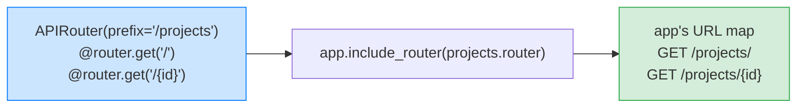
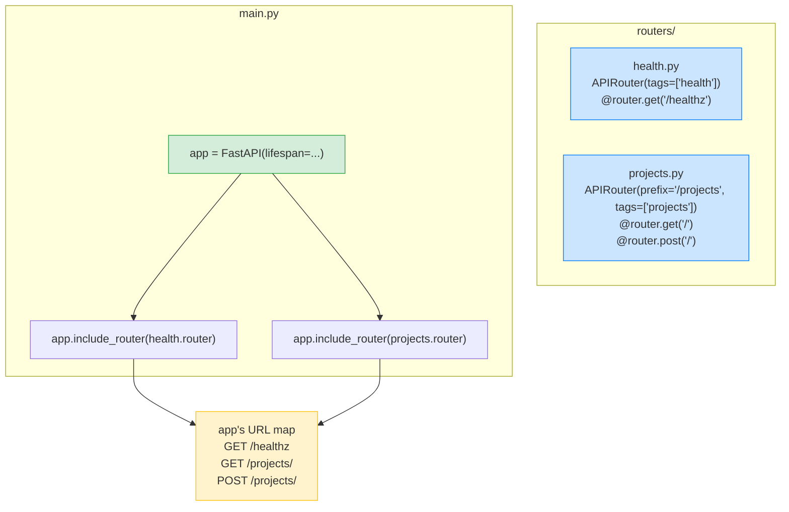
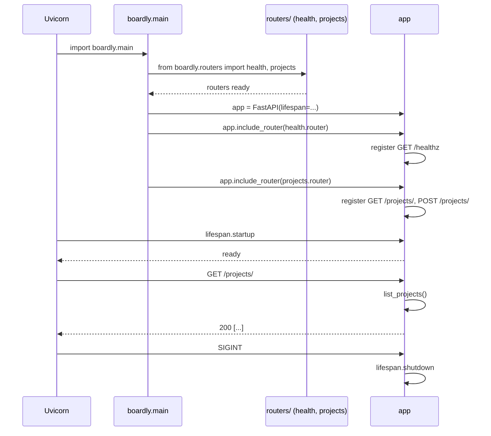

# Lesson 02: Routers and Modular Apps

*Splitting `Boardly` into `routers/health.py`, `routers/projects.py`, and a `main.py` that composes them. The FastAPI equivalent of Flask blueprints.*

**You're one lesson in. Nice work.**

In Lesson 1 you built a single-file `boardly/main.py` with a lifespan and one route. That file is about to grow — but it won't grow *up*, it'll grow *out*. By the end of this lesson you'll have a real project layout: a thin `main.py` that composes routers, and a folder of feature modules. This is the layout you'll keep for the rest of the section. 


#fastapi #routers #architecture

## Learning Objectives

By the end of this lesson you will be able to:

1. **Create an `APIRouter`** in its own module and attach routes to it.
2. **Mount a router into the app** with `app.include_router(..., prefix=..., tags=...)`.
3. **Explain what `prefix` and `tags` do** — and how they combine with per-route paths.
4. **Structure a FastAPI project** with a thin `main.py`, a `routers/` folder, and an `__init__.py` aggregator.
5. **Apply per-router dependencies** (we'll wire the *first* one up — `Depends` comes in Lesson 4).
6. **Decide when to split routers** per feature vs per HTTP method vs per resource.
7. **Read the OpenAPI output** at `/openapi.json` and see your tags show up.

## Prerequisites

- **[[Application-and-Lifespan]]** — you need a `FastAPI()` instance to attach routers to. We'll keep the same `boardly/main.py` skeleton and just *thin it out*.
- **[[01-Python-Foundations/Project-Layout-and-Imports]]** — module paths, `__init__.py` aggregator pattern, relative imports.
- **About an hour.** This lesson's code is more files but fewer lines than Lesson 1 — the work is understanding the wiring.

**The most common gap: how Python packages import.**

If `from boardly.routers import health` looks unfamiliar, you've not yet internalised Python's package model. Re-read [[01-Python-Foundations/Project-Layout-and-Imports]] section on `__init__.py`. The TL;DR: a folder with an `__init__.py` is a package; you import its modules by dotted path from the project root.


## The Problem

A `Boardly` project that lives in one `main.py` is fine for 30 lines. By the time you've added `/projects`, `/tasks`, `/comments`, `/orgs`, `/users`, `/auth/login`, `/auth/refresh`, `/webhooks/stripe`, `/admin/users`, `/admin/billing` — you have 800 lines, eight features, and changing one endpoint risks clobbering another. Code review becomes painful. Testing becomes painful. *Thinking* becomes painful.

The fix is `APIRouter`: a routing surface that lives in its own file, declares its own `prefix` and `tags`, and is *included* by the app at composition time. It is the FastAPI equivalent of Flask's blueprints; Flask itself is out of scope for this vault, but the mental model (declare routes on the sub-app, register the sub-app with the main app) carries over directly.

**Note — Historical context — `APIRouter` is older than `FastAPI`**

The `APIRouter` class was introduced in Starlette 0.20 (mid-2022) and adopted by FastAPI in 0.86. By 0.148 (October 2026), it's the universal pattern — every non-trivial FastAPI codebase uses `APIRouter` per feature. If you see a tutorial with one 400-line `main.py`, that tutorial is wrong about the layout, even if the code runs.


## The Code

This lesson adds **two new files** to `Boardly` and **trims** `main.py` so it only does composition. Here's the full project tree after Lesson 2:

```
boardly/
├── __init__.py # empty
├── main.py # composes the app — lifespan + include_router
└── routers/
 ├── __init__.py # exports health and projects
 ├── health.py # GET /healthz
 └── projects.py # stub routes for /projects
```

### `boardly/routers/health.py`

```python
# boardly/routers/health.py
"""Health-check routes for Boardly."""
from fastapi import APIRouter

router = APIRouter(tags=["health"])


@router.get("/healthz")
async def healthz() -> dict[str, str]:
 return {"status": "ok"}
```

### `boardly/routers/projects.py`

```python
# boardly/routers/projects.py
"""Project routes for Boardly.

Lesson 2: stubs only. Real CRUD comes in Lesson 3.
"""
from fastapi import APIRouter

router = APIRouter(prefix="/projects", tags=["projects"])


@router.get("/")
async def list_projects() -> list[dict[str, str]]:
 return [
 {"id": "p_001", "name": "Demo Project", "status": "active"},
 {"id": "p_002", "name": "Internal Tools", "status": "archived"},
 ]


@router.post("/")
async def create_project() -> dict[str, str]:
 return {"id": "p_003", "name": "New Project", "status": "active"}
```

### `boardly/routers/__init__.py`

```python
# boardly/routers/__init__.py
"""Aggregates Boardly's feature routers in one place."""
from . import health, projects

__all__ = ["health", "projects"]
```

### `boardly/main.py`

```python
# boardly/main.py
"""Boardly — a small project-management API.

Lesson 2: thin composer. Lifespan + routers.
"""
from collections.abc import AsyncIterator
from contextlib import asynccontextmanager

from fastapi import FastAPI

from boardly.routers import health, projects


@asynccontextmanager
async def lifespan(app: FastAPI) -> AsyncIterator[None]:
 print("Boardly starting up…")
 app.state.version = "0.1.0"

 yield

 print("Boardly shutting down…")


app = FastAPI(
 title="Boardly",
 version="0.1.0",
 lifespan=lifespan,
)

app.include_router(health.router)
app.include_router(projects.router)
```

That's the whole lesson. Two new files, one trimmed file, one aggregator. We'll explain every meaningful line next.

## Line-by-Line Deep Dive

### `routers/health.py` Lines 5–6: The `APIRouter(tags=[...])`

```python
router = APIRouter(tags=["health"])
```

**What it does:** Creates an `APIRouter` instance, named `router` (convention), with one tag.

**Why `tags`?** Tags in OpenAPI are how endpoints are grouped in the Swagger UI. With `tags=["health"]`, your `/healthz` endpoint will appear under a "health" heading at `/docs`. Without tags, every endpoint appears under "default" — usable but messy. Tags are *purely documentation* — they don't change routing.

**Tip — Tag names should match feature names.**

`"health"`, `"projects"`, `"tasks"`, `"comments"`, `"auth"`. Not `"Health"` (capitalisation), not `"health_check"` (it's a category, not a verb), not `["health", "ready"]` (one tag per endpoint group, please). Consistency makes the Swagger UI scannable.


**What `APIRouter()` actually is**

It's a small class that holds a list of routes, plus optional `prefix`, `tags`, `dependencies`, `responses`, and `middleware`. The router doesn't run by itself — it's a *declaration*. The app's `include_router` method walks the router's route list and registers each route with the app's URL map. `APIRouter` is, in the strictest sense, a *route table builder*.


### `routers/health.py` Lines 9–11: Registering the route on the router

```python
@router.get("/healthz")
async def healthz() -> dict[str, str]:
 return {"status": "ok"}
```

**What it does:** Same as `@app.get("/healthz")` from Lesson 1 — but it's registered on the *router*, not on the *app*. The router doesn't serve it yet; it just records "I have a GET /healthz route."

**Why return type `dict[str, str]`?** FastAPI reads the return-type annotation and uses it to generate the OpenAPI response schema. `dict[str, str]` tells consumers "this endpoint returns a JSON object mapping string → string." In Lesson 3 we'll use a `BaseModel` for the return type so we get validation and a `response_model` filter for free.

### `routers/projects.py` Lines 5–6: `prefix` and `tags` together

```python
router = APIRouter(prefix="/projects", tags=["projects"])
```

**What it does:** Creates an `APIRouter` with a `prefix` of `/projects` and a tag of `"projects"`.

**What `prefix` does:** Every route declared on this router will be mounted *under* `/projects`. So `@router.get("/")` becomes `GET /projects/`, and `@router.get("/{project_id}")` (Lesson 3) becomes `GET /projects/{project_id}`. The router doesn't know the prefix — it's applied at `include_router` time.



**Spot the trailing-slash decision — `GET /projects/` or `GET /projects`?**

`@router.get("/")` mounted at `prefix="/projects"` produces `GET /projects/` (with a trailing slash). By default, FastAPI also redirects `GET /projects` (no slash) to `GET /projects/` with a `307 Temporary Redirect`. This is Starlette's `redirect_slashes=True` default. It's *fine* for browsers, but a footgun for API clients that don't follow redirects. We'll keep `/projects/` for the list endpoint (REST convention) and `/projects/{id}` (no trailing slash) for the detail endpoint (also convention). Lesson 3 explores this more.


**Warning — When this breaks: the `307 Temporary Redirect` that doubles a mobile client's latency and silently drops the request body.**

**Symptom.** A mobile client built with iOS `URLSession` (default) or `OkHttp` on Android sends `POST /projects` (no trailing slash). The server returns `307 Temporary Redirect` with `Location: /projects/`. The client follows the redirect and re-POSTs — but the request body is missing, so the handler raises `422 Unprocessable Entity` (the `name` field is absent). The mobile team files a bug titled "the API rejects creates for no apparent reason"; the backend team reproduces with `curl -X POST .../projects/` (trailing slash, the convention they always use) and sees a `201`, and the defect is invisible to anyone who curls the trailing-slash form.
**Diagnosis.** `FastAPI(...)` (and Starlette's `Router` underneath) defaults to `redirect_slashes=True`. A route declared as `@router.get("/")` on a router with `prefix="/projects"` has the canonical path `/projects/` (with slash); a request to `/projects` (no slash) is responded to with a `307` redirect to the canonical form. Two failures compound. (1) Not every HTTP client library re-posts the body after a `307` — `OkHttp` and Python `requests` do, but iOS `URLSession` does so only when `HTTPShouldUsePipelineing` is set, and the default is off; the body is dropped on re-POST. (2) The redirect adds a round-trip on the critical path: mobile users on a 200 ms RTT see 400+ ms of additional latency for every write that hits the wrong form.
**Fix.** Three layers. (1) Pick one form (with or without trailing slash) and enforce it in code review: the Boardly convention is *trailing slash for collections*, *no trailing slash for detail* — `GET /projects/` and `GET /projects/{id}`. (2) Generate the SDK client from `/openapi.json` (via `openapi-typescript-codegen` or `datamodel-code-generator`); the generated paths are the *exact* paths the server declared, so clients never call the wrong form by accident. (3) For deployments where the trailing-slash redirect is the failure mode, set `app = FastAPI(redirect_slashes=False)` and declare both forms explicitly if you need them, or accept that the wrong form returns `404` and let the SDK be the source of truth. The grep: `rg "redirect_slashes" boardly/main.py` should return one line — the explicit choice. The deeper rule: trailing-slash redirection is a server-side courtesy, not a contract; mobile clients and SDK generators consume the OpenAPI `paths` verbatim, so the path *you declare* is the path *they call*, and the path *they call* must be the one that returns `200`. See [[02-Web-and-HTTP/REST-and-Pragmatic-API-Design]] for the convention and [[02b-Backend-Foundations/API-Versioning-Strategies]] for why a `307` between two URL forms of the same resource is a breaking change for clients that pin paths.


### `routers/projects.py` Lines 9–14: The stub list endpoint

```python
@router.get("/")
async def list_projects() -> list[dict[str, str]]:
 return [
 {"id": "p_001", "name": "Demo Project", "status": "active"},
 {"id": "p_002", "name": "Internal Tools", "status": "archived"},
 ]
```

**What it does:** Returns a hardcoded list of two projects. The return type annotation `list[dict[str, str]]` tells FastAPI the response is a JSON array of objects with string keys and string values.

**Why stubs in Lesson 2?** Because Lesson 3 adds real parameters (`path`, `query`, `body`, `response_model`) and Lesson 4 adds real dependencies (`get_db`, `get_current_user`). Building those on top of stub routes is much cleaner than building them on top of fake database calls. Pedagogy: one concept per lesson.

**Warning — Don't import the database into the router yet.**

A common rookie mistake at this stage is to start wiring SQLAlchemy into `routers/projects.py`. Don't. The router should know nothing about storage yet — it should just receive dependencies via `Depends` (Lesson 4) and call methods on them. This is the *thin router* principle: routers are transport, not business logic.


### `routers/__init__.py`: The aggregator

```python
from . import health, projects

__all__ = ["health", "projects"]
```

**What it does:** Imports both router modules at the package level, so `from boardly.routers import health, projects` in `main.py` works.

**Why the explicit `__all__`?** Without it, `from boardly.routers import *` would import everything reachable, including internal helpers. With `__all__`, only the listed names are exported. It's the Python convention for declaring the public API of a package.

**Student asks: Why put `prefix` and `tags` on `APIRouter(...)` instead of on `app.include_router(...)`?**

Both placements work, but they answer different questions. `APIRouter(prefix="/projects", tags=["projects"])` says "this router's identity is the projects resource" — every route on this router inherits the prefix and tag automatically, and you can mount the whole router under a different top-level prefix (`/v1/projects`, `/v2/projects`) without rewriting it. `app.include_router(projects.router, prefix="/projects")` says "this *mounting* of the router is at `/projects`" — the router itself is prefix-agnostic, which lets you reuse the same router at multiple prefixes (Exercise 2's `/v1/projects` + `/v2/projects` pattern). The rule: put `prefix` and `tags` on the router when the prefix is part of the resource's identity; put them on `include_router` when the prefix is part of the deployment's URL scheme. The 2026 default in the Boardly codebase is router-side, because every router's identity is one resource.


**Example — The aggregator pattern at scale**

A real `Boardly` might have 12 router modules. Without an `__init__.py` aggregator, `main.py` would have 12 import lines and 12 `include_router` calls. With the aggregator, `main.py` still has 12 `include_router` calls, but each one is a one-liner that just works because the aggregator already imported everything. This is the standard pattern; you'll see it in every production FastAPI codebase.


### `main.py` Line 11: Importing the routers

```python
from boardly.routers import health, projects
```

**What it does:** Imports the two router modules, so `health.router` and `projects.router` are available.

**Why dotted import?** Because `boardly/` is a package (it has an `__init__.py`), and `boardly/routers/` is a subpackage. Python resolves the dotted path against `sys.path`. As long as you run uvicorn from the project root (the folder *containing* `boardly/`), this works. We'll cover the `uv run` invocation in Verification below.

### `main.py` Lines 30–31: Mounting the routers

```python
app.include_router(health.router)
app.include_router(projects.router)
```

**What it does:** Walks the routes on each router and registers them with the app's URL map. `health.router` was created with no `prefix`, so `/healthz` stays at `/healthz`. `projects.router` was created with `prefix="/projects"`, so its `@router.get("/")` becomes `GET /projects/`.

**What `include_router` actually does**

Internally, `include_router` iterates over `router.routes` (a list of `APIRoute` / `Route` objects) and adds each to `app.routes`. It also:
- Applies the `prefix` (concatenating it to each route's path).
- Applies the `tags` (extending each route's tag list).
- Applies the optional `dependencies` argument (we'll use this in Lesson 4 to require auth on every route in a router).
- Applies the optional `responses` argument (used to add standard error responses like `404` to the OpenAPI doc).

You can pass `prefix` and `tags` to `include_router` itself, which *overrides* the router's own. `app.include_router(projects.router, prefix="/v2/projects")` is a common pattern for versioning.


**Tip — The argument convention: `prefix` on the router, `tags` on the router.**

Some teams put `prefix` in `include_router(...)` and `tags` on `APIRouter(...)`. Either works. The pattern we'll use throughout `Boardly`: **declare `prefix` and `tags` on `APIRouter` itself**, so each router module is self-documenting. You can read `routers/projects.py` and immediately know its URL space and Swagger group.




## Execution Trace

Run the app:

```bash
uv run uvicorn boardly.main:app --reload
```

What happens, in order:

1. **Uvicorn imports `boardly.main`.** Python imports `boardly.main`, which executes `from boardly.routers import health, projects`. That import runs `routers/__init__.py`, which imports `health` and `projects`. Each of those defines an `APIRouter` and decorates routes onto it.
2. **`main.py` constructs `app`.** The lifespan is registered.
3. **`app.include_router(health.router)`** runs. Starlette walks `health.router.routes`, finds `GET /healthz` (no prefix on this router), and adds it to `app.routes` with the path `/healthz`.
4. **`app.include_router(projects.router)`** runs. Starlette walks `projects.router.routes`, finds `GET /` and `POST /`. It prepends the router's `prefix="/projects"` to each, producing `GET /projects/` and `POST /projects/`.
5. **Uvicorn sends `lifespan.startup`.** The lifespan runs as in Lesson 1 — prints `Boardly starting up…`, yields, returns control.
6. **Traffic is accepted.** In another terminal:
 ```bash
 curl http://127.0.0.1:8000/healthz
 # {"status":"ok"}

 curl http://127.0.0.1:8000/projects/
 # [{"id":"p_001","name":"Demo Project","status":"active"},
 # {"id":"p_002","name":"Internal Tools","status":"archived"}]

 curl -X POST http://127.0.0.1:8000/projects/
 # {"id":"p_003","name":"New Project","status":"active"}

 curl http://127.0.0.1:8000/docs
 # the Swagger UI — two groups: "health" and "projects"
 ```
7. **`Ctrl+C`.** Uvicorn sends `lifespan.shutdown`. The lifespan resumes after `yield`, prints `Boardly shutting down…`.



## Common Mistakes

### Mistake 1: Router created but never included

```python
# routers/projects.py
router = APIRouter(prefix="/projects", tags=["projects"])

@router.get("/")
async def list_projects(): ...

# main.py — WRONG: forgot to include
from boardly.routers import projects

app = FastAPI(...)
# missing: app.include_router(projects.router)
```

**Symptom:** `GET /projects/` returns `404 Not Found`. Swagger UI doesn't show the route.

**Why:** The router is just a declaration. Without `include_router`, the app's URL map doesn't know about it.

**Fix:** Add `app.include_router(projects.router)` after constructing `app`.

**Warning — The "404 on a freshly written route" pattern.**

If you wrote a new `@router.get(...)` and curl returns 404, the most likely cause is one of: (a) you forgot `include_router`, (b) you misspelled the prefix, (c) you edited the file but Uvicorn's reload crashed silently (check the terminal for an `ImportError`), (d) you curled `GET /projects` instead of `GET /projects/` and Starlette's `redirect_slashes` is returning a 307 the curl doesn't follow. Use `curl -L` to follow redirects, or always use the trailing slash.


### Mistake 2: `prefix` doubled

```python
# routers/projects.py
router = APIRouter(prefix="/projects", tags=["projects"])

@router.get("/projects/") # ← already includes /projects
async def list_projects(): ...
```

**Symptom:** The route is mounted at `GET /projects/projects/` — not what you wanted.

**Why:** `include_router` *prepends* the prefix to every route path. If the route path already starts with the prefix, you get a doubled path.

**Fix:** Declare the route as `@router.get("/")` — the prefix is the router's job, the route path is the *relative* path inside the router.

### Mistake 3: Putting `prefix` on `include_router` *and* on `APIRouter`

```python
# routers/projects.py
router = APIRouter(prefix="/projects", tags=["projects"])

# main.py
app.include_router(projects.router, prefix="/projects") # ← doubled prefix
```

**Symptom:** Same as Mistake 2 — `GET /projects/projects/`.

**Why:** When you pass `prefix=` to `include_router`, Starlette *concatenates* it onto each route path *in addition to* the router's own prefix. Two `/projects` strings concatenated = `/projects/projects`.

**Fix:** Put `prefix` in exactly one place. We recommend on the `APIRouter` itself — self-documenting.

**Tip — When `include_router(prefix=...)` *is* the right call.**

Versioning. If you want the same router mounted at both `/projects` and `/v2/projects` (with the same code), you can omit `prefix` from the router and pass it to `include_router`:
```python
app.include_router(projects.router, prefix="/v1/projects")
app.include_router(projects.router, prefix="/v2/projects")
```
Now both URL spaces serve the same router. Useful when you're migrating clients from v1 to v2 and don't want to fork the code.


**Danger — How an attacker thinks: the silent version-escape via `app.include_router(projects.router)` with no `prefix=`.**

A senior engineer reviewing `main.py` for a v1-pinned deployment expects every `include_router` call to carry a `prefix=` argument that pins the router to a versioned URL space (`/v1/projects`). The attack surface is that `prefix=""` (or omitted entirely) is *silent*: a router declared `APIRouter(prefix="/projects")` mounted via `app.include_router(projects.router)` (no `prefix=` arg) serves at `/projects` — the unversioned form, forever. An attacker who fetches `/openapi.json` between deploys sees the unversioned path appear next to the versioned one and now has a stable URL that bypasses any future v1-deprecation sunset. Worse: the versioned and unversioned forms point at the *same code*, so a "v1-only migration" that adds `app.include_router(projects.router, prefix="/v1/projects")` *without* removing the unversioned `app.include_router(projects.router)` leaves both live — the deprecation sunset cannot be enforced because the unversioned path is still serving. The threat is not theoretical: an unversioned URL is a permanent contract, and once a single external client hard-codes it (a mobile build shipped to the App Store, a third-party integration scripted by a customer), you cannot retire it without a deprecation window — and the deprecation window is the attacker's lane (they wait you out).
The senior defence is structural. (a) Declare one `include_router` call per router per version; never two. (b) Add a CI grep that fails the build if any `include_router` call lacks `prefix=`: `rg "include_router\\(" boardly/main.py | rg -v "prefix="` should return nothing. (c) Add a startup self-check: `assert not any(r.path == "/projects/" for r in app.routes), "unversioned /projects/ must not be served in production"` — a one-line assertion that turns the accidental unversioned mount into a deploy-blocking `AssertionError` at boot, before traffic is accepted. (d) For deployments where unversioned access is intentional (the legacy form during a migration window), record the date the unversioned path was mounted and the date it must be removed in a `routes.yaml` inventory; the inventory is the deprecation contract. Lesson 02 of [[02b-Backend-Foundations/API-Versioning-Strategies]] covers the versioning decision; [[11-Authentication-and-Security/OWASP-API-Top-10]] (API6:2023 — Unrestricted Access to Sensitive Flows) covers the threat model where version-escape is the lane. The senior question for every `include_router` line is: *what URL space does this serve, and is that URL space one I am willing to support for the lifetime of the service?* If the answer is "I don't know," the `prefix=` argument is missing.


### Mistake 4: `tags` doubled

```python
# routers/projects.py
router = APIRouter(prefix="/projects", tags=["projects"])

# main.py
app.include_router(projects.router, tags=["projects"]) # ← doubled tags
```

**Symptom:** In Swagger UI, the projects endpoints appear under both "projects" and "projects" — they don't merge; they appear as two groups with the same name. Looks fine but is mildly embarrassing when a teammate notices.

**Why:** `include_router`'s `tags` argument *extends* the router's tag list.

**Fix:** Declare `tags` in exactly one place. Convention: on `APIRouter`.

### Mistake 5: Circular imports

```python
# routers/projects.py
from boardly.main import app # ← WRONG: importing app from main

@router.get("/")
async def list_projects(): ...
```

**Symptom:** `ImportError: cannot import name 'app' from partially initialized module 'boardly.main'` (most likely a circular-import error).

**Why:** `boardly/main.py` imports `boardly/routers/projects.py`. If `projects.py` imports `boardly/main.py` back, Python can't resolve the order — `app` doesn't exist yet when the import is attempted.

**Fix:** Routers must never import `app`. They import only `APIRouter`, Pydantic models, and dependency functions. Mounting the router into `app` is `main.py`'s job. If a router needs the app at request time (rare — only for reading `app.state`), use the `Request` parameter and read `request.app`.

**Warning — When this breaks: production 404 on a route that works locally, no traceback**

**Symptom.** A teammate adds `routers/webhooks.py`, wires `@router.post("/stripe")` into it, opens a PR, CI is green, the route is curled successfully from the deploy script's smoke test, and within an hour a customer reports `POST /webhooks/stripe` returning `404 Not Found` in production. No traceback in the logs. No exception. Uvicorn logs `Application startup complete.`. **Diagnosis.** The router file exists on disk, was deployed, and is importable — but `app.include_router(webhooks.router)` was never added to `main.py` (or, equivalently, `routers/__init__.py` was not updated to import `webhooks`, so `from boardly.routers import health, projects, webhooks` silently drops it if `__all__` does not list it and the import used `from boardly.routers import *`). The smoke test in the deploy script curled `/healthz` (which works), saw a 200, and called the deploy "healthy" — but `/healthz` does not exercise `webhooks.router`, so the missing `include_router` was never reached. **Fix.** Three structural defenses. (a) Add an `assert "/webhooks/stripe" in {r.path for r in app.routes}` in a startup self-check (or in `tests/test_routes_registered.py`); a one-line assertion per expected route turns the silent 404 into a deploy-blocking `AssertionError` before traffic is accepted. (b) Make the smoke test curl a route from *every* router, not just `/healthz` — a `pytest` fixture parameterised over `app.routes` can hit each `GET`-able route once (see [[12-Testing-and-Quality/Testing-FastAPI-Endpoints]] for the `TestClient` pattern). (c) Treat `app.routes` as production state: a `logger.info("registered %d routes", len(app.routes))` line at the end of `main.py` makes the route count visible in every deploy log; a deploy that registered 12 routes yesterday and 11 today is a regression, even if no test failed. The rule: an un-`include_router`-ed router file is invisible to every layer above it; only an explicit assertion on `app.routes` catches it before a customer does.


**Production reality: `app.routes` is the deployable contract — assert on it in `tests/test_routes_registered.py`.**

The `app.routes` list is built at import time, after every `include_router` call has executed. Treating it as a deployable contract — not just an internal Starlette list — gives you a free smoke test that catches three classes of regression that no functional test will surface. (1) *Missing router*: `assert "/webhooks/stripe" in {r.path for r in app.routes}` fails the build before deploy if a teammate forgot `app.include_router(webhooks.router)` (the failure that prompted the warning above). (2) *Doubled prefix*: `assert "/projects/projects/" not in {r.path for r in app.routes}` catches Mistake 2 / Mistake 3 before a customer sees `/projects/projects/` in production. (3) *Tag drift*: `assert {tag for r in app.routes for tag in getattr(r, 'tags', [])} == {"health", "projects", "tasks"}` (kept in lockstep with `EXPECTED_TAGS`) catches a new tag appearing or an old one disappearing — both are breaking changes for SDK clients that consume `/openapi.json`'s `tags` array as navigation. The pattern in a 2026 codebase is one `tests/test_routes_registered.py` file with one parameterised assertion per expected path, fed by an `EXPECTED_ROUTES` list kept in the same repo as the routers; the test runs in `uv run pytest tests/test_routes_registered.py` in CI on every push and again on every deploy as the deploy script's first action. The cost is one assertion per route (~50 lines for a 50-route app); the benefit is that the silent-404 incident described in the warning above becomes a deploy-blocking `AssertionError` instead of a customer-reported outage. The senior rule: a route that is not in `app.routes` does not exist; a route that is in `app.routes` but not in `EXPECTED_ROUTES` is an unreviewed surface area. Both are the test's job to catch. See [[12-Testing-and-Quality/Testing-FastAPI-Endpoints]] for the `TestClient` pattern that complements this static check and [[12-Testing-and-Quality/CI-Pipelines]] for the CI gate that runs both.


## Engineering Trade-Offs

### One router per feature vs per HTTP method vs per resource

Three ways to slice routers:

- **Per feature (recommended for `Boardly`):** `routers/projects.py`, `routers/tasks.py`, `routers/comments.py`, `routers/orgs.py`. Each holds all HTTP methods for that feature. Reads well, diffs well, scales well.
- **Per resource + method:** `routers/projects_list.py` (GET, POST), `routers/projects_detail.py` (GET, PATCH, DELETE). Overkill for `Boardly`. Useful when one resource has 20 endpoints and you want small files.
- **Per HTTP method:** `routers/get.py`, `routers/post.py`. Don't. This loses the "feature" mental model — read and write operations for the same resource live in different files. Anti-pattern.

**Example — The blueprint mental model**

If you've used Flask blueprints (out of scope for this vault, but the conceptual cousin of `APIRouter`), the model is identical: declare routes on the sub-app, register the sub-app with the main app. The only FastAPI-specific difference is that `url_prefix` is set in the `APIRouter(...)` constructor instead of at registration time. Lesson 02 of [[05-Project-Architecture/Layered-FastAPI-Apps]] shows how this composition scales to a six-folder project layout.


**Production reality: the aggregator at 50 routers**

The `routers/__init__.py` aggregator that looks elegant at two routers (`from . import health, projects`) is a different beast at fifty. Three costs appear in production. (1) *Startup time.* `from boardly.routers import *` (or the explicit `from . import ...`) runs every router module's top-level code at import time; each router imports its Pydantic models, its storage interface, and its dependency functions, so the import alone takes 200–800 ms in a mature codebase. With four Uvicorn workers, that is 4 × 200–800 ms of CPU before the first request is served — extending the rolling-deploy window and the `CrashLoopBackOff` recovery time. The fix is *lazy* mounting only when it pays: split rarely-used admin routers into a separate `admin_app = FastAPI()` mounted via `app.mount("/admin", admin_app)`, so the worker process only pays the import cost on the first `/admin/*` request (rare). (2) *OpenAPI doc size.* `openapi.json` grows linearly with routes; at 50 routers × 8 endpoints each = 400 operations, the JSON is 1–3 MB and the Swagger UI at `/docs` takes 3–8 seconds to render on a cold cache. Mobile and SDK clients that fetch `/openapi.json` at startup now pay that 1–3 MB on every cold start. The fix is `app.openapi_url = None` and `app.docs_url = None` in production, serving a trimmed spec (or a generated SDK) from a CDN — and a separate `/docs` available only on staging. (3) *Import-time side effects.* A router module that constructs an `APIRouter(prefix="/webhooks")` at module top level also runs that module's `import stripe; stripe.api_key = os.environ["STRIPE_KEY"]` at import time; if the env var is missing, the import raises and *every* router after it in the aggregator's import order fails to load, with the failure attributed to the wrong router. The senior defense is to put side-effecting code inside `lifespan` (Lesson 1) or inside dependency functions (Lesson 4) — never at module top level in a `routers/*.py` file. The senior question for the aggregator at scale is: *if I delete this one line from `routers/__init__.py`, does the app still start?* If the answer is "no, because module N has import-time side effects," the design is wrong. Lesson 02 of [[05-Project-Architecture/Layered-FastAPI-Apps]] shows the six-folder layout that survives this scale; [[16-Deployment-and-DevOps/Migration-Ordering-and-Rollback]] covers the deploy-order problem that the lazy-mounting fix creates.


### Per-router dependencies vs per-endpoint dependencies

You can attach dependencies at the router level so they apply to *every* route in the router:

```python
router = APIRouter(
 prefix="/projects",
 tags=["projects"],
 dependencies=[Depends(get_current_user)], # ← applies to every route
)
```

This is the clean way to require auth on a whole feature. We'll wire this up properly in Lesson 4. The trade-off: per-router dependencies are *invisible* at the route signature, which makes them harder to spot during code review. Document them in the router module's docstring.

**Danger — How an attacker thinks: per-router dependencies are invisible at the route signature**

A senior engineer reading `APIRouter(prefix="/projects", tags=["projects"], dependencies=[Depends(get_current_user)])` checks for the *invisibility* of the auth dependency. The attack surface is that the route signature `async def create_project(payload: Annotated[ProjectCreate, Body()]) -> ProjectRead` shows no `Depends(get_current_user)` — a junior engineer copying the signature to start a new router (`routers/webhooks.py`) sees no auth in the projects router's handlers and writes the new router without `dependencies=[...]` either; the new `/webhooks/stripe` endpoint is now public. The attacker's reconnaissance step is to fetch `/openapi.json` and look for operations whose `security` field is empty — the OpenAPI doc reflects the dependency's auth requirement at the route level, so a missing per-router dependency shows up as a missing `security` block on every operation in that tag. The second probe is to diff `/openapi.json` between deploys: if a previously-protected router loses its `security` block, the router was edited to drop the dependency (or a teammate re-created the router without it). The senior defense is structural: declare a single `protected = APIRouter(dependencies=[Depends(get_current_user)])` base class (or factory) so every new router starts with auth and the *removal* of auth is a visible diff, not an invisible omission. Lesson 4 ([[Dependency-Injection]]) wires up the `Depends(get_current_user)` form; [[11-Authentication-and-Security/RBAC-and-Object-Level-Auth]] and [[11-Authentication-and-Security/OWASP-API-Top-10]] cover the threat model where this matters most (API1:2023 — Broken Object Level Authorization). The senior question for every `include_router` line in `main.py` is: *if a teammate created this router yesterday, would they know it needs auth?* If the answer is "only by reading the docstring," the auth is in the wrong place.


### Mounting order

The order of `include_router` calls doesn't matter for routing — Starlette matches routes by URL pattern, not by registration order. It *does* matter for the order routes appear in the OpenAPI doc. If you care about the Swagger UI's group order, mount routers in the order you want them grouped.

**Danger — How an attacker thinks: `app.mount("/admin", admin_app)` silently escapes every middleware on the parent app.**

A senior engineer reviewing `app.mount("/admin", admin_app)` (where `admin_app` is a separate `FastAPI()` instance) checks for the *middleware inheritance* gap. The attack surface is that `app.mount(...)` composes two ASGI apps; the parent app's middleware stack — `RequestIDMiddleware`, `TimingMiddleware`, `SecurityHeadersMiddleware`, `CORSMiddleware`, the auth-enforcing `add_middleware(...)` — wraps the *parent* app, and the mounted `admin_app` is *inside* the parent's middleware stack, but the Starlette composition does not re-apply the parent's `add_middleware` calls to the mounted app's own routes. The visible result: `GET /admin/users` returns a 200 without the `X-Request-ID` header (the parent's `RequestIDMiddleware` did not stamp it), without the `Strict-Transport-Security` header (the parent's `SecurityHeadersMiddleware` did not set it), and without the auth dependency (the parent's per-router `Depends(get_current_user)` was declared on the parent's routers, not on `admin_app`'s routers). The attacker's reconnaissance step is to fetch `/openapi.json` and look for operations whose `security` field is empty in the admin namespace — the missing middleware is visible at the doc layer before any request is made.
The senior defence is structural. (a) Do not mount admin functionality as a separate `FastAPI()` instance unless you have a measured reason (the import-cost argument from the aggregator-at-50-routers callout above); declare admin routers as `APIRouter(prefix="/admin", dependencies=[Depends(require_scope("admin"))])` and `app.include_router(admin.router)` so they inherit the parent's middleware stack. (b) If you must mount a separate app, re-apply the parent's middleware stack to `admin_app` explicitly: `admin_app.add_middleware(RequestIDMiddleware)`, `admin_app.add_middleware(SecurityHeadersMiddleware)`, etc. — the wiring is duplicated, but the contract is intact. (c) Add a startup self-check that asserts every route — including those served by a mounted app — carries the expected security headers in its `responses` metadata; the OpenAPI doc is the contract. See [[03-FastAPI-Core/Middleware-and-Request-Order]] for the middleware ordering rule and [[11-Authentication-and-Security/RBAC-and-Object-Level-Auth]] for the scope-check pattern. The senior question for every `app.mount(...)` line is: *does the mounted app inherit every middleware and every dependency that the parent's routes do?* If the answer is "I have to think about it," the mount is the wrong composition — use `include_router` instead.


**Production reality: mounting the same router at `/v1` and `/v2` is a deployment contract, not a code reuse.**

`app.include_router(projects.router, prefix="/v1/projects")` followed by `app.include_router(projects.router, prefix="/v2/projects")` reads like "mount the same code twice," but the senior engineer treats the two lines as a *deployment contract* with two distinct obligations. (1) Both URLs serve the same code today, so a change to `routers/projects.py` affects both contracts simultaneously — a PR that breaks `/v1/projects/` also breaks `/v2/projects/`, and the rollback plan must name both. (2) The two paths are independently deprecatable: `v1` can be sunset on a date that `v2` cannot, so the `include_router` block in `main.py` is the deprecation clock — once a date is set in the migration runbook (see [[16-Deployment-and-DevOps/Migration-Ordering-and-Rollback]]), the line `app.include_router(projects.router, prefix="/v1/projects")` has an expiry, and the CI gate that fails the build after that date is the enforcement. (3) The OpenAPI `paths` object lists both URLs; SDK clients that consume `/openapi.json` see both as equally valid, so a migration that "adds v2 but does not yet remove v1" doubles the SDK surface — every generated client now has `v1ProjectsCreate` and `v2ProjectsCreate` methods, and the deprecation marker (`deprecated: true` on the v1 operation, set via `@router.post("/", deprecated=True)` or `include_router(..., deprecated=True)`) is the only signal the SDK consumer sees. The senior rule: every `include_router` line that mounts the same router at a new `prefix` is a new contract with an expiry; the expiry is recorded in the migration runbook, enforced by CI, and visible in `/openapi.json` as `deprecated: true` once the migration window opens. Lesson 02 of [[02b-Backend-Foundations/API-Versioning-Strategies]] covers the versioning lifecycle; [[05-Project-Architecture/Layered-FastAPI-Apps]] shows the layout where versioned mounting is centralised in a single `compose_app()` function.


**Warning — When this breaks: reordering `include_router` calls between deploys is a breaking change for SDK clients.**

**Symptom.** A teammate reorders `app.include_router(health.router)` and `app.include_router(projects.router)` in `main.py` ("to group health first in the Swagger UI"). The PR is green (no functional test depends on tag order). Within a week, the iOS team reports that their generated SDK client (built from `/openapi.json`) has shuffled its enum-like constants for the "tag" filter on the SDK's `listEndpoints()` method — code that read `tag = .projects` now reads `tag = .health`, breaking the analytics dashboard that consumed the enum as a stable identifier. No URL changed; only the `tags` array order in `/openapi.json` changed.
**Diagnosis.** `/openapi.json`'s top-level `tags` array is built in the order routes are added to `app.routes`, which is the order of `include_router` calls in `main.py`. Code generators like `openapi-typescript-codegen` and `openapi-generator` map the `tags` array to a TypeScript enum or a Java enum, preserving the array order as the enum declaration order. Reordering the array between deploys reorders the enum's underlying numeric values (for ordinal enums) or, in some generators, breaks source compatibility for callers that match on `.projects` vs `.health` as enum constant names — the failure surface is broad and silent.
**Fix.** Treat `/openapi.json`'s `tags` array as a versioned contract: add a `tests/test_openapi_tags_order.py` that asserts the `tags` array equals an `EXPECTED_TAGS` list, kept in lockstep with the routers; any reordering is a `AssertionError` in CI before the deploy ships. The grep: `rg "EXPECTED_TAGS" tests/` should return one fixture file. The deeper rule: the OpenAPI document is the SDK client's source of truth, and any change to its structure (path order, tag order, schema names) is a breaking change for clients that consume it programmatically, even when no URL or status code changed. See [[02-Web-and-HTTP/REST-and-Pragmatic-API-Design]] for the contract-first stance and [[12-Testing-and-Quality/Testing-FastAPI-Endpoints]] for the snapshot-test pattern that pins `/openapi.json` between deploys.


**When would you NOT reach for `APIRouter`?**

Three scenarios. (1) Tiny demos with one or two endpoints — `app.get(...)` directly is shorter than a router module. (2) A migration in progress where you have one monolithic `app.py` and haven't yet extracted routers — don't add a router *and* the old direct routes; commit to one shape. (3) A "catch-all" sub-application mounted via `app.mount("/admin", admin_app)` where `admin_app` is itself a full `FastAPI()` instance — `mount` is for sub-apps, `include_router` is for routes; mixing them confuses readers. In a 2026 production codebase with more than ~5 endpoints, you should be in routers. The cost of the abstraction is one import and one `include_router` call; the benefit is per-router file boundaries that map to per-resource git history.


**Tip — Think like a senior engineer: read `main.py` as a deployable surface area, not a URL list**

The senior engineer reading `boardly/main.py` does not see "two `include_router` calls"; they see the *deployable surface area* of the service — which features are live in this build, which are versioned (mounted twice at `/v1/...` and `/v2/...`), and which are absent. Three questions follow. (1) *What is the blast radius of a bad deploy?* A router included at `prefix="/v2/projects"` is a separate contract from `prefix="/projects"`; a breaking change to `routers/projects.py` affects both mountings, so the senior PR description names every `prefix` the router is mounted at, not just "projects router." (2) *What is the dependency surface?* Each `include_router` call may carry `dependencies=[Depends(...)]` (Lesson 4); the senior reads the `include_router` block as the *enforcement point* for auth, rate-limiting, and tracing — if a router is mounted without `dependencies`, it is public by default. (3) *What is the OpenAPI contract visible to clients?* The order of `include_router` calls is the order tags appear in `/docs` and in `openapi.json`'s `tags` array; mobile and SDK clients consume that array as a navigation contract, so reordering it between deploys is a breaking change for those clients even though no URL changed. When you can read `main.py` as a deployable surface area — features × prefixes × dependencies × tag order — you can review a router PR in 60 seconds and catch the missing-dependency mistake before the security team does. [[05-Project-Architecture/Layered-FastAPI-Apps]] shows the layout that survives this reading at twelve routers; the rest of Section 03 fills in the dependency dimension.


## Exercises

**Exercise 1 — Add a `tasks` router.** Create `boardly/routers/tasks.py` with `APIRouter(prefix="/tasks", tags=["tasks"])`, two stub routes (`GET /`, `POST /`), update `routers/__init__.py` to import it, and `main.py` to include it. Visit `/docs` and confirm the "tasks" group appears.

**Exercise 2 — Mount the same router twice.** Take `projects.router` (with no `prefix` on the router) and include it twice in `main.py` with different prefixes — once at `prefix="/v1/projects"` and once at `prefix="/v2/projects"`. Confirm both URLs serve the same routes.

**Exercise 3 — Per-router dependency.** Define a `def log_call(): print("called")` and pass it as `dependencies=[Depends(log_call)]` to `APIRouter(prefix="/projects", tags=["projects"], dependencies=[...])`. Restart and curl `/projects/` — you should see `called` printed in the server log on every request. (We'll cover `Depends` properly in Lesson 4 — for now, just confirm the wiring.)

**Exercise 4 — Read the OpenAPI output.** Visit `http://127.0.0.1:8000/openapi.json`. Find the `paths` key, the `tags` key. Confirm that `health` and `projects` both appear as tags, and that `/healthz`, `/projects/` are under `paths`.

**Exercise 5 — Spot the bug.** This `main.py` won't include the projects router. Why?

```python
from fastapi import FastAPI
from boardly.routers import projects

app = FastAPI(title="Boardly")
# missing?
```

(Answer: missing `app.include_router(projects.router)`.)

**Exercise 6 — Assert on `app.routes` at startup.** Add `tests/test_routes_registered.py` that asserts every expected path (`/healthz`, `/projects/`, `/projects/{project_id}`, `/projects/{project_id}/export`, `/projects/{project_id}/avatar`) is in `{r.path for r in app.routes}`. Add one negative assertion: `"/projects/projects/" not in {r.path for r in app.routes}`. Verify with `uv run pytest tests/test_routes_registered.py -v` — every assertion passes; then delete one `app.include_router(...)` line in `main.py`, re-run, and watch the corresponding assertion fail (the silent-404 incident, surfaced in CI before deploy).

**Exercise 7 — Pin OpenAPI tag order.** Add `tests/test_openapi_tags_order.py` that fetches `app.openapi()` and asserts the top-level `tags` array equals `[{'name': 'health'}, {'name': 'projects'}]`. Verify with `uv run pytest tests/test_openapi_tags_order.py -v` — passes. Then swap the order of `app.include_router(health.router)` and `app.include_router(projects.router)` in `main.py`, re-run, and watch the test fail with a clear diff — the silent tag-reorder is caught before the SDK client notices.

**Exercise 8 — Versioned mounting with a deprecation marker.** Mount `projects.router` twice: once at `prefix="/v1/projects"` with `include_router(projects.router, prefix="/v1/projects", deprecated=True)` (Starlette 0.36+ supports the `deprecated` kwarg on `include_router`), and once at `prefix="/v2/projects"` without it. Verify with `uv run uvicorn boardly.main:app --reload` in one terminal and `curl -s http://127.0.0.1:8000/openapi.json | python3 -c "import sys, json; d=json.load(sys.stdin); print(d['paths']['/v1/projects/']['get']['deprecated'])"` — should print `True`. The v1 path is now visibly deprecated in the OpenAPI doc, which generated SDKs surface as a deprecation warning.

**Exercise 9 — CI grep for unversioned mounts.** Write a `scripts/check_no_unversioned_mounts.sh` that runs `rg "include_router\\(" boardly/main.py | rg -v "prefix="` and exits non-zero if any line matches. Verify with `uv run bash scripts/check_no_unversioned_mounts.sh` — exits 0 (no matches). Then temporarily add `app.include_router(projects.router)` (no `prefix=`) to `main.py`, re-run, and watch the script exit `1` with the offending line printed. This is the structural enforcement against the silent version-escape attack from the Mistake 3 danger callout.

**Exercise 10 — Circular-import repro.** In `routers/projects.py`, add `from boardly.main import app` at the top. Run `uv run uvicorn boardly.main:app` — observe the `ImportError: cannot import name 'app' from partially initialized module 'boardly.main'` traceback. (This is the most common import-time failure in a freshly-extracted router.) Then remove the offending line. The exercise builds the muscle memory: routers never import `app`; they import `APIRouter`, Pydantic models, and dependency functions only. Verify the fix with `uv run uvicorn boardly.main:app --reload` and `curl http://127.0.0.1:8000/projects/` — returns `200`.

**Exercise 11 — `app.mount` middleware gap repro.** Create `boardly/admin_app.py` with `admin_app = FastAPI(); admin_app.add_api_route("/users", lambda: {"users": []}, methods=["GET"])`, and in `main.py` add `app.mount("/admin", admin_app)`. With the parent's `RequestIDMiddleware` already wired, `curl -i http://127.0.0.1:8000/admin/users` and confirm the `X-Request-ID` header is *missing* from the response — the mounted app did not inherit the parent's middleware. Verify with `uv run uvicorn boardly.main:app --reload` and `curl -sI http://127.0.0.1:8000/admin/users | rg -i 'x-request-id'` (should return nothing). Then re-apply the middleware to `admin_app` explicitly (`admin_app.add_middleware(RequestIDMiddleware)`) and re-run — the header appears. The exercise demonstrates the `app.mount` middleware-inheritance gap from the Engineering Trade-Offs danger callout.

## Verification

Run the app:

```bash
uv run uvicorn boardly.main:app --reload
```

Expected terminal output:

```
INFO: Started reloader process [1234] using StatReload
Boardly starting up…
INFO: Started server process [1235]
INFO: Waiting for application startup.
INFO: Application startup complete.
INFO: Uvicorn running on http://127.0.0.1:8000 (Press CTRL+C to quit)
```

In another terminal:

```bash
curl http://127.0.0.1:8000/healthz
# expected: {"status":"ok"}

curl http://127.0.0.1:8000/projects/
# expected: [{"id":"p_001","name":"Demo Project","status":"active"},
# {"id":"p_002","name":"Internal Tools","status":"archived"}]

curl -X POST http://127.0.0.1:8000/projects/
# expected: {"id":"p_003","name":"New Project","status":"active"}

# Confirm the Swagger UI groups routes by tag
curl -s http://127.0.0.1:8000/openapi.json | python3 -c "import sys, json; d=json.load(sys.stdin); print(d['tags'])"
# expected: [{'name': 'health'}, {'name': 'projects'}]
```

If all four pass, your routers are wired correctly. If `GET /projects/` returns 404, check Mistake 1 (include_router) and Mistake 2 (doubled prefix).

## Previously Learned Here

- **`Annotated`** — [[01-Python-Foundations/Type-Hints-and-Annotations]]. Not directly used in this lesson's code, but the return-type annotations (`dict[str, str]`, `list[dict[str, str]]`) are part of the same family of modern Python typing idioms.
- **Project layout** — [[01-Python-Foundations/Project-Layout-and-Imports]]. The `boardly/__init__.py` + `routers/__init__.py` aggregator pattern comes directly from this lesson.
- **Modular composition** — [[03-FastAPI-Core/00-FastAPI-MOC]] and the layered layout in [[05-Project-Architecture/Layered-FastAPI-Apps]]. Both push the `APIRouter`-composes-`FastAPI` pattern further.

## What's Next

In [[Path-Query-Header-Cookie-Body]] we add real parameters to `routers/projects.py`. You'll:

- Add `GET /projects/{project_id}` with a **path parameter**.
- Add `GET /projects?status=active&limit=20` with **query parameters** (using `Annotated[..., Query()]`).
- Add `POST /projects` with a **Pydantic request body** (`BaseModel`).
- Use `response_model=ProjectRead` to **filter** which fields are returned.
- Cover status codes (`201 Created`, `422 Unprocessable Entity`).

`Boardly` will graduate from two stub routes to a real, typed, validated CRUD surface.

## Sources

- **FastAPI — Bigger Applications** — <https://fastapi.tiangolo.com/tutorial/bigger-applications/> — accessed 2026-10-19 — canonical reference for `APIRouter`, `prefix`, `tags`, and `include_router`.
- **FastAPI — `APIRouter` class** — <https://fastapi.tiangolo.com/reference/apirouter/> — accessed 2026-10-19 — the constructor signature.
- **Starlette — Routers** — <https://www.starlette.io/routing/> — accessed 2026-10-19 — the underlying routing implementation FastAPI uses.
- **FastAPI — Release Notes** — <https://fastapi.tiangolo.com/release-notes/> — verified 0.148.0 released 2026-10-19.

## What We Learned

Let's recap. In this lesson you:

- **Built a real FastAPI project layout** — `boardly/__init__.py`, `boardly/main.py`, `boardly/routers/{__init__,health,projects}.py`.
- **Created two `APIRouter` instances** — one with `tags=["health"]` and no prefix, one with `prefix="/projects"` and `tags=["projects"]`.
- **Mounted both with `app.include_router(...)`** — saw how the prefix and tags propagate to the app's URL map and OpenAPI doc.
- **Saw the difference between `prefix` on the router vs on `include_router`** — and learned to declare it in exactly one place.
- **Built the `__init__.py` aggregator pattern** — so `main.py` only does composition, not feature work.
- **Hit and fixed the five common router mistakes** — forgotten `include_router`, doubled prefix, doubled tags, circular imports, and missing trailing slashes.
- **Read the OpenAPI output** and confirmed your tags appear.

Mental model to walk away with: *a FastAPI app is a router (`app` itself is one), and `APIRouter` is the same routing primitive but not the root. Routers are declarations of "here's a feature, here are its routes, here are its tags" — `include_router` plugs them in. Build features in their own files; compose them in `main.py`.*

---

> A note from your teacher
You just turned a one-file demo into a multi-file project. That's a bigger deal than it looks — every codebase you've ever admired started as one file and grew *out*, not *up*. The same skeleton you have now will absorb dependencies, middleware, exception handlers, and background tasks over the next five lessons without changing shape. We're going to add the parameters next — path, query, body, response_model — and turn those stub routes into real CRUD. See you in Lesson 03. 


---

**Tags:** #fastapi #routers #architecture #review
**Previous:** [[Application-and-Lifespan]]
**Next:** [[Path-Query-Header-Cookie-Body]] →
