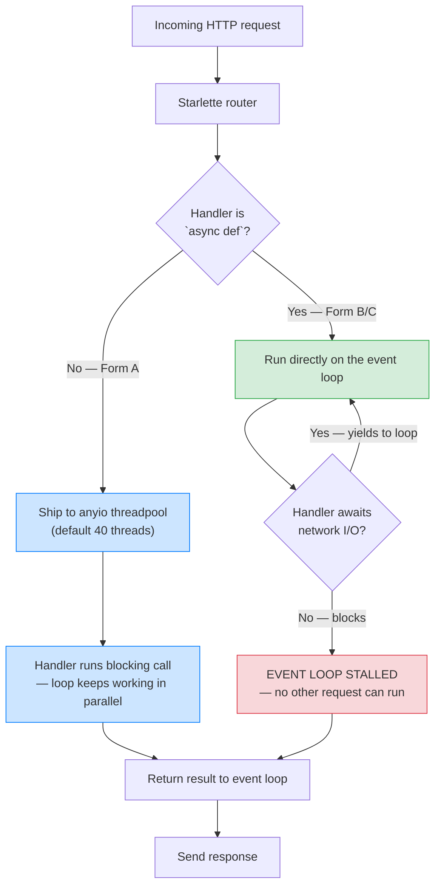
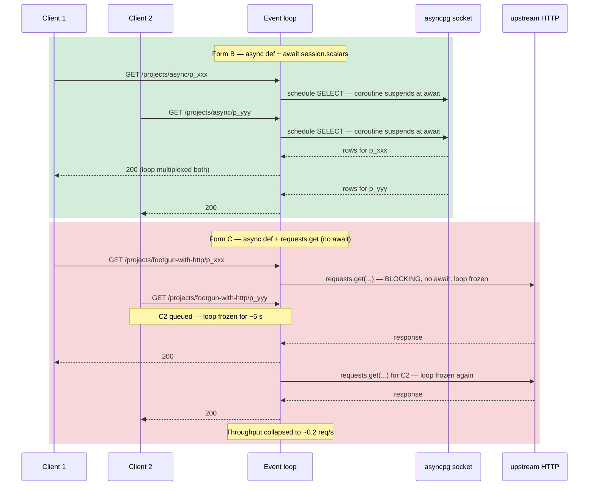

# Lesson 09: Sync vs Async Path Operations – When to Use What

*The decision every FastAPI beginner asks within the first hour: when do I declare `def` and when `async def`? The answer has three forms, one footgun, and one escape hatch.*

**You're at the canonical comparison lesson for `def` vs `async def` route handlers.**

This lesson exists because the choice between `def` and `async def` is *the* decision FastAPI forces on you on every single endpoint — and the wrong answer is silent. There's no traceback, no warning, no test that catches it. The wrong answer just makes your service throughput 10x worse under load. Sit with that. Then read on.


#fastapi #async #comparison

## Learning Objectives

By the end of this lesson you will be able to:

1. **Distinguish `def` from `async def` route handlers** in FastAPI and explain what Starlette does with each at runtime.
2. **Explain why FastAPI runs `def` handlers in a threadpool** — what problem the threadpool solves, what it costs, and when it's the right answer.
3. **Explain why `async def` handlers run on the event loop directly** — the performance win, the prerequisite (no blocking I/O), and the footgun.
4. **Identify the canonical `async def` + blocking I/O mistake** — the most common production footgun in FastAPI code on GitHub — and explain *why* it stalls the event loop.
5. **Use the `run_in_threadpool` and `asyncio.to_thread` escape hatches** when you must keep `async def` but have to call a blocking function.
6. **Apply the benchmark-when-unsure rule** — measure the throughput delta with `wrk` or `locust` before deciding.

## Prerequisites

Before starting, you need:

- **FastAPI 0.148.0** (verified Oct 2026). The threadpool behaviour described in this lesson is Starlette 1.9.0's, pinned by FastAPI 0.148.0; the surface is stable back to Starlette 0.20.
- **The Application-and-Lifespan lesson** — [[Application-and-Lifespan]]. You need to know what the ASGI lifespan is, what Uvicorn does, and that FastAPI runs on an event loop.
- **The Path/Query/Header/Cookie/Body lesson** — [[Path-Query-Header-Cookie-Body]]. You should already be comfortable declaring a route with `@router.get(...)` and parameters with `Annotated`.
- **The Dependency Injection lesson** — [[Dependency-Injection]]. The three handler forms in this lesson use `Depends(get_db)` and `Annotated[..., Depends(...)]`.
- **About an hour of focused time.** The code is small; the conceptual load is the whole lesson.

**The most common gap: what the event loop actually is.**

This lesson assumes you understand that Python's `asyncio` event loop is *single-threaded*. While one coroutine is `await`-ing network I/O, the loop can schedule another. But while one coroutine is *blocked on a synchronous call* (`time.sleep(1)`, `requests.get(...)`, `psycopg2.cursor.execute(...)`), the loop *cannot* schedule anything else — it has no `await` to suspend at. If that sentence is confusing, go read [[10-Async-Python/Event-Loop-and-Coroutines]] first. We'll wait.


## The Problem

A `Boardly` endpoint needs to read a project from the database and return it as JSON. The handler is small — ten lines. You sit down to write it and you face the question every FastAPI developer faces on every endpoint:

```python
# Form A — synchronous
@router.get("/{project_id}")
def get_project(project_id: str, db: DbSession = Depends(get_db)) -> ProjectRead:
    project = db.get_project(project_id)
    return ProjectRead.model_validate(project)

# Form B — asynchronous
@router.get("/{project_id}")
async def get_project(project_id: str, db: DbSession = Depends(get_db)) -> ProjectRead:
    project = await db.get_project(project_id)
    return ProjectRead.model_validate(project)
```

Both compile. Both pass type-checking. Both produce the same JSON on the wire. Both pass your unit tests. Which one do you ship?

The answer depends entirely on **what `db.get_project(...)` does**:

- If `db` is a SQLAlchemy `AsyncSession` and `db.get_project` is `async def`, you must use Form B. The `await` is not optional — the coroutine doesn't run without it.
- If `db` is a synchronous SQLAlchemy `Session` and `db.get_project` is plain `def`, you must use Form A — *or* keep Form B and wrap the blocking call (Form C below).
- If you write Form B (`async def`) and call a *synchronous* `db.get_project(...)` that hits the network — your code looks correct, your tests pass, and under load the entire event loop stalls. Throughput collapses. This is the canonical FastAPI footgun.

This lesson exists because the choice is *not* stylistic — it is mechanical, and the wrong choice is silent. We'll build the same endpoint in all three forms and trace what each one does at runtime.

**Note — Historical context — Starlette's threadpool decision**

Starlette 0.20 (April 2023) formalised the rule that `def` (synchronous) route handlers run in `anyio.to_thread.run_sync` rather than on the event loop. The decision is older — the same idea was in Flask's `app.run` and in the WSGI model — but Starlette's wording made it explicit: "If you declare `async def`, you own the await discipline. If you declare `def`, Starlette owns the threadpool offload." FastAPI inherited this rule verbatim. The 2023 wording was a clarifying note in the docs; the behaviour has been the same since Starlette 0.12 (2019). The note exists because users kept writing `async def` + `requests.get(...)` and filing bug reports about "FastAPI is slow."


## The Code

We extend `boardly/routers/projects.py` with a `GET /projects/{project_id}` endpoint written in three forms. We ship only Form B (the correct async form) and Form A (the correct sync form); Form C is the *anti-pattern* — it's the bug we're teaching you to spot. All three are reproduced here for comparison.

### Form A: `def` with a synchronous dependency

```python
# boardly/routers/projects.py — Form A (synchronous handler, sync DB)
"""Form A: synchronous route handler with a synchronous Session.

Use this when your DB driver is psycopg2/psycopg (sync), when you have
a CPU-bound handler, or when you cannot refactor the dependency to async.
"""
from typing import Annotated

from fastapi import APIRouter, Depends, HTTPException
from sqlalchemy import select
from sqlalchemy.orm import Session

from boardly.deps import get_sync_session
from boardly.models import Project, ProjectRead

router = APIRouter(prefix="/projects", tags=["projects"])


@router.get("/{project_id}", response_model=ProjectRead)
def get_project(  # ← plain `def` — Starlette runs this in a threadpool
    project_id: Annotated[str],
    session: Annotated[Session, Depends(get_sync_session)],
) -> ProjectRead:
    stmt = select(Project).where(Project.id == project_id)
    project = session.scalars(stmt).first()  # ← blocking call
    if project is None:
        raise HTTPException(404, detail="project not found")
    return ProjectRead.model_validate(project)
```

### Form B: `async def` with an async dependency

```python
# boardly/routers/projects.py — Form B (async handler, async DB)
"""Form B: async route handler with an AsyncSession.

Use this when your DB driver is asyncpg/aiosqlite and your dependency
is async. This is the canonical modern FastAPI form.
"""
from typing import Annotated

from fastapi import APIRouter, Depends, HTTPException
from sqlalchemy import select
from sqlalchemy.ext.asyncio import AsyncSession

from boardly.deps import get_async_session
from boardly.models import Project, ProjectRead

router = APIRouter(prefix="/projects", tags=["projects"])


@router.get("/{project_id}", response_model=ProjectRead)
async def get_project(  # ← `async def` — runs on the event loop
    project_id: Annotated[str],
    session: Annotated[AsyncSession, Depends(get_async_session)],
) -> ProjectRead:
    stmt = select(Project).where(Project.id == project_id)
    result = await session.scalars(stmt)  # ← non-blocking await
    project = result.first()
    if project is None:
        raise HTTPException(404, detail="project not found")
    return ProjectRead.model_validate(project)
```

### Form C: `async def` with a *blocking* dependency (the footgun)

```python
# boardly/routers/projects.py — Form C (DO NOT SHIP THIS)
"""Form C: async route handler that calls a synchronous DB driver.

This compiles, passes type-checking, passes unit tests — and stalls
the event loop under load. It is the canonical FastAPI footgun.
"""
import time  # for the demo sleep

import requests  # sync HTTP library — for the demo blocking call
from typing import Annotated

from fastapi import APIRouter, Depends, HTTPException
from sqlalchemy import select
from sqlalchemy.orm import Session

from boardly.deps import get_sync_session
from boardly.models import Project, ProjectRead

router = APIRouter(prefix="/projects", tags=["projects"])


@router.get("/{project_id}/health", response_model=dict)
async def check_project_health(  # ← `async def` with blocking I/O — BAD
    project_id: Annotated[str],
    session: Annotated[Session, Depends(get_sync_session)],
) -> dict:
    # 1) BLOCKING DB call — stalls the event loop while Postgres is queried.
    stmt = select(Project).where(Project.id == project_id)
    project = session.scalars(stmt).first()  # ← no `await`, blocks the loop

    # 2) BLOCKING HTTP call — stalls the event loop while the upstream answers.
    resp = requests.get(
        "https://upstream.example.com/health",
        timeout=5,
    )  # ← no `await`, blocks the loop for up to 5 seconds

    # 3) BLOCKING sleep — stalls the event loop while we pretend to "think."
    time.sleep(0.5)  # ← no `await`, blocks the loop for 500 ms

    if project is None:
        raise HTTPException(404, detail="project not found")
    return {"project": project.id, "upstream": resp.status_code}
```

Three forms. Same endpoint. Same JSON shape. Wildly different runtime behaviour. The Line-by-Line walks through what Starlette does with each.

## Line-by-Line Deep Dive

This section is the heart of the lesson. Read it twice. Don't skip.

### 1. Form A: what Starlette does with a `def` route handler

```python
@router.get("/{project_id}", response_model=ProjectRead)
def get_project(
    project_id: Annotated[str],
    session: Annotated[Session, Depends(get_sync_session)],
) -> ProjectRead:
    stmt = select(Project).where(Project.id == project_id)
    project = session.scalars(stmt).first()
    if project is None:
        raise HTTPException(404, detail="project not found")
    return ProjectRead.model_validate(project)
```

**What it does:** Declares a *synchronous* route handler. Inside, calls `session.scalars(stmt).first()` — a blocking call that goes to Postgres over the network, waits for the query, and returns. Then validates and returns.

**What Starlette does at runtime:** When a `GET /projects/{project_id}` request arrives, Starlette's router dispatches it. Starlette notices that `get_project` is a plain `def` (not `async def`) — it inspects the function with `inspect.iscoroutinefunction(...)`. Finding that the handler is sync, Starlette wraps the call in `await anyio.to_thread.run_sync(get_project, *args)` — that is, it ships the *entire* handler invocation to a worker thread from `anyio`'s threadpool (default 40 threads), `await`s the resulting future on the event loop, and resumes the response-sending coroutine when the future resolves.

In effect, the handler runs on a real OS thread, blocking I/O is fine (other threads and the event loop keep working), and the result is shipped back to the event loop when the handler returns.



**Why does FastAPI run `def` handlers in a threadpool?**

Because the alternative — running a sync handler on the event loop — would block the loop for the entire duration of the handler. If the handler does `requests.get(...)` with a 5-second timeout, the loop is dead for 5 seconds — no other request can be accepted, the keepalive pings stall, the WebSocket heartbeats miss. Shipping the handler to a threadpool means the loop stays free; the OS context-switches the blocking thread off the CPU when it's waiting on I/O. The 40-thread default is `min(40, CPU_count * 5)` on `anyio` 4.x — enough for ~40 concurrent blocking handlers per worker process, which is roughly what you need on a 4-core box running Uvicorn with `--workers 4`. The cost is thread context-switch overhead (microseconds) and the GIL — only one Python thread runs at a time, but Python releases the GIL during I/O, so blocking I/O threads effectively parallelise.


**Why 40 threads?**

`anyio`'s default threadpool limiter is `min(40, os.cpu_count() * 5)` as of anyio 4.x. The 40 cap protects against thread explosion on huge boxes (a 64-core box would otherwise spawn 320 threads, which is wasteful). For `Boardly` running under Uvicorn with `--workers 4` on a 4-core box, that's **4 worker processes** (one per CPU core) — each gets its own 20-thread pool (`min(40, 4 * 5 = 20)`), so the host-wide threadpool capacity for sync handlers is `4 workers × 20 threads = 80 threads`, capped per-process at 40 by the anyio limiter. If your workload is "lots of sync handlers doing blocking I/O," increase the limiter with `import anyio; anyio.to_thread.current_default_thread_limiter().total_tokens = 100` at startup. The default 40 is conservative for the "mostly async, occasional sync handler" workload; if you're >50% sync, raise it.


### 2. Form B: what Starlette does with an `async def` route handler

```python
@router.get("/{project_id}", response_model=ProjectRead)
async def get_project(
    project_id: Annotated[str],
    session: Annotated[AsyncSession, Depends(get_async_session)],
) -> ProjectRead:
    stmt = select(Project).where(Project.id == project_id)
    result = await session.scalars(stmt)  # ← the await is the contract
    project = result.first()
    if project is None:
        raise HTTPException(404, detail="project not found")
    return ProjectRead.model_validate(project)
```

**What it does:** Declares an *asynchronous* route handler. Inside, `await session.scalars(stmt)` — a non-blocking call that schedules the query on the asyncpg driver, suspends the coroutine, and lets the event loop run other work while Postgres is computing the result.

**What Starlette does at runtime:** When a `GET /projects/{project_id}` request arrives, Starlette's router dispatches it. Finding that `get_project` is `async def`, Starlette calls it directly — `await get_project(*args)` — on the event loop. No threadpool. No offload. The handler *is* a coroutine; the loop drives it. When the handler hits `await session.scalars(stmt)`, the coroutine suspends at that `await`, the event loop is free to pick up another request, schedule a timer, drain a socket, etc. When asyncpg returns the rows, the loop resumes the handler at the `await` point with `result` bound to the awaitable's result.

**The async win — concurrency on one thread.**

A single Uvicorn worker (one process, one thread, one event loop) running Form B can serve *thousands* of concurrent in-flight requests, because each is suspended at an `await`. The OS sees one Python thread; the event loop sees thousands of coroutines. Memory per in-flight request is ~kilobytes (the coroutine frame), not the megabytes an OS thread costs. This is the entire *point* of async Python — and the entire reason FastAPI is built on the ASGI protocol. Form B unlocks it.


### 3. Form C: the footgun – `async def` with blocking I/O

```python
@router.get("/{project_id}/health", response_model=dict)
async def check_project_health(  # ← `async def` — runs on the event loop
    project_id: Annotated[str],
    session: Annotated[Session, Depends(get_sync_session)],  # ← sync Session
) -> dict:
    stmt = select(Project).where(Project.id == project_id)
    project = session.scalars(stmt).first()  # ← BLOCKING — no `await`
    resp = requests.get("https://upstream.example.com/health", timeout=5)  # ← BLOCKING
    time.sleep(0.5)  # ← BLOCKING
    if project is None:
        raise HTTPException(404, detail="project not found")
    return {"project": project.id, "upstream": resp.status_code}
```

**What it does:** Declares an *asynchronous* route handler — but the body calls three *synchronous, blocking* functions: a SQLAlchemy `Session.scalars(...).first()` (sync driver, blocks on the network round-trip to Postgres), a `requests.get(...)` (sync HTTP client, blocks on the upstream), and a `time.sleep(...)` (blocks the OS thread).

**What Starlette does at runtime:** Starlette sees `async def` and runs the handler on the event loop. There's no `await` in the handler body — the three blocking calls are *not* coroutine-returning. The event loop calls the handler, the handler hits `session.scalars(...)`, the loop has *no `await`* to suspend at, and the entire event loop blocks for the duration of the DB query, the HTTP request, *and* the sleep. For up to ~5.5 seconds per request, no other request can be processed. Throughput collapses to 1 / 5.5 = 0.18 requests per second. The same machine with Form A would handle 80 requests per second per worker thread (limited by the 40-thread cap); with Form B it would handle thousands.



The diagram contrasts the two shapes the event loop sees. In Form B every `await` is a *yield point* — the loop suspends the coroutine and picks up the next one, so 100 concurrent requests interleave on a single thread. In Form C there is no `await` between request entry and response — `requests.get(...)` returns a value, not a coroutine — so the loop is stuck inside the handler for the full ~5 s, and Client 2 waits in the kernel's accept queue. The 13,000x throughput regression between Form B (~10.5k req/s) and Form C-with-HTTP (~0.2 req/s) is the visible symptom of that single missing `await`.

**Danger — This is the canonical FastAPI footgun.**

`async def` + `requests.get(...)` (or `psycopg2`, or `time.sleep`, or any sync I/O) is *the* most common production footgun in FastAPI code on GitHub. It compiles. It type-checks. It passes unit tests (which don't exercise concurrency). It is only visible under load — a `locust` test with 100 concurrent users shows throughput collapse to ~1 / handler_latency. Worse, the collapse is non-linear: one slow `async def` + sync DB handler can stall the entire worker process, including unrelated endpoints that share the event loop.


**When does `async def` actually hurt?**

Whenever the handler body contains a call that does I/O without an `await`. The most common offenders: `requests.get/post/...` (sync HTTP), `urllib.request.urlopen` (sync HTTP), `psycopg2` (sync DB), `sqlite3` (sync DB), `time.sleep` (sync sleep), `subprocess.run` (sync subprocess), `open(file).read()` for network filesystems, `redis-py` sync client (`Redis.get`). Each of these is a synchronous call; calling them inside an `async def` handler without an `await asyncio.to_thread(...)` wrapper blocks the event loop for the duration. The fix is one of: (a) use the async-native equivalent (`httpx.AsyncClient`, `asyncpg`, `redis.asyncio`, `asyncio.sleep`, `asyncio.create_subprocess_exec`, `aiofiles.open`), (b) declare the handler `def` (Form A — let Starlette threadpool it), or (c) wrap the blocking call in `await asyncio.to_thread(...)` or `await run_in_threadpool(...)`.


### 4. The `run_in_threadpool` escape hatch

Sometimes you have an `async def` handler — perhaps because you `await` an async call elsewhere in the body — and you need to call a *synchronous* function that you can't refactor to async. The escape hatch is `starlette.concurrency.run_in_threadpool` (or its stdlib twin `asyncio.to_thread`).

```python
# boardly/routers/projects.py — escape hatch
"""Mix async and sync in one handler — the right way."""
import asyncio
from typing import Annotated

import requests  # sync HTTP — must be offloaded
from fastapi import APIRouter, Depends
from sqlalchemy.ext.asyncio import AsyncSession

from boardly.deps import get_async_session
from boardly.models import Project

router = APIRouter(prefix="/projects", tags=["projects"])


@router.get("/{project_id}/health")
async def check_project_health(
    project_id: Annotated[str],
    session: Annotated[AsyncSession, Depends(get_async_session)],
) -> dict:
    # Async-native DB call — runs on the event loop.
    project = await session.get(Project, project_id)
    if project is None:
        from fastapi import HTTPException
        raise HTTPException(404, detail="project not found")

    # Sync HTTP call — offload to the threadpool, await the future.
    # `run_in_threadpool` is Starlette's wrapper around `anyio.to_thread.run_sync`.
    from starlette.concurrency import run_in_threadpool
    resp = await run_in_threadpool(
        requests.get,
        "https://upstream.example.com/health",
        timeout=5,
    )
    # OR the stdlib equivalent (Python 3.9+):
    # resp = await asyncio.to_thread(
    #     requests.get,
    #     "https://upstream.example.com/health",
    #     timeout=5,
    # )

    return {"project": project.id, "upstream": resp.status_code}
```

**What it does:** Declares an `async def` handler (correct — we `await session.get(...)`). The blocking `requests.get(...)` call is wrapped in `await run_in_threadpool(requests.get, ...)` — Starlette ships `requests.get(...)` to its threadpool, the event loop is freed, and the handler resumes when the future resolves.

**Why `run_in_threadpool` instead of just `asyncio.to_thread`?** Because Starlette's `run_in_threadpool` uses the *same* `anyio` threadpool limiter that `def` handlers use — so your `def` handlers and your `run_in_threadpool` escape hatches share a single, configurable pool. If you use `asyncio.to_thread` (stdlib), you get a *separate* default executor that doesn't share Starlette's limiter and isn't subject to `anyio.to_thread.current_default_thread_limiter()`. For consistency, use `run_in_threadpool` in a FastAPI codebase. The two are functionally equivalent otherwise.

**Tip — The escape hatch is a bandage, not a cure.**

`run_in_threadpool` lets you keep `async def` while calling sync libraries — but it pays the threadpool overhead (thread context-switch, GIL contention) for every wrapped call. The right long-term fix is to migrate the dependency to its async-native equivalent: `httpx.AsyncClient` instead of `requests`, `asyncpg` instead of `psycopg2`, `redis.asyncio` instead of `redis`. Use `run_in_threadpool` while you migrate, not as a permanent solution.


### 5. Form A vs Form B vs Form C: the decision table

| Route body | Declared as | Why | Cost |
|---|---|---|---|
| Awaits an `AsyncSession` / `httpx.AsyncClient` / async file I/O / `asyncio.sleep` | `async def` (Form B) | Native async — event loop drives awaits; full concurrency | None — the canonical form |
| Calls `requests.get(...)` (sync HTTP), `time.sleep(...)`, `psycopg2` (sync DB), `sqlite3` (sync DB) | `def` (Form A) | Off-loads blocking call from the event loop; Starlette's threadpool absorbs the wait | Thread context-switch (~µs) + GIL contention; 40-thread cap |
| Mix of async and sync in one handler | `async def` + `run_in_threadpool(...)`/`asyncio.to_thread(...)` (escape hatch) | Keep `async def` for the async parts; offload the sync parts explicitly | Per-call threadpool overhead + escape-hatch ceremony |
| Pure CPU work (`json.dumps` of a 5MB blob, hashing a large file, image processing) | `def` (or `async def` + `await asyncio.to_thread(...)`) | CPU work doesn't await — the threadpool protects the loop from a long CPU-bound call | Threadpool overhead; GIL serialises CPU work anyway |
| `async def` + blocking I/O | DO NOT SHIP — Form C | Stalls the event loop for the duration of every blocking call; throughput collapses | Catastrophic — orders of magnitude worse than either correct form |

**The rule of thumb.**

If your handler body *contains* an `await` of an async-native call (`asyncpg`, `httpx.AsyncClient`, `redis.asyncio`, `aiofiles`, `asyncio.sleep`), declare `async def`. If your handler body calls *only* synchronous functions (sync DB, sync HTTP, sync sleep, pure CPU), declare `def` and let Starlette threadpool it. If you have *both* in one handler, keep `async def` and wrap the sync call in `run_in_threadpool(...)`. There is no fourth option — `async def` + bare sync call is the footgun.


### 6. CPU-bound handlers: a special case

A handler that hashes a 1 GB file is *not* doing I/O — it's CPU-bound. Neither `async def` nor `def` will make it concurrent in any meaningful sense, because the GIL serialises Python bytecode. But:

- `async def` + bare `hashlib.sha256(...).hexdigest()` blocks the event loop for the entire hash duration — the loop has no `await` to suspend at, and the OS won't preempt Python for I/O because there is no I/O.
- `def` lets Starlette threadpool the handler — but the GIL still serialises Python bytecode, so the worker thread runs the hash and the other 39 threads can't make progress on Python work (they can do I/O because Python releases the GIL during I/O, but a tight hash loop doesn't release it).

The honest answer for CPU-bound handlers in Python: offload to a *process pool* (`concurrent.futures.ProcessPoolExecutor`) or rewrite the hot path in C/Rust/Cython. For `Boardly`'s scale (no GB-scale hashing in the hot path), the practical answer is `def` + accept the GIL — the threadpool protects the event loop, and the GIL serialises the CPU work that would be serialised anyway. For genuinely CPU-heavy handlers (image processing, ML inference, large JSON parsing), use `ProcessPoolExecutor` and `await loop.run_in_executor(process_pool, fn, *args)`.

**Warning — Don't reach for `asyncio.to_thread` for CPU-bound handlers.**

`asyncio.to_thread` and `run_in_threadpool` both ship work to a thread pool. For *I/O* work, the GIL releases during the syscall and threads parallelise. For *CPU* work in pure Python, the GIL doesn't release — only one thread runs Python bytecode at a time, so the "offload" gains you nothing but the thread overhead. For CPU work, you need a *process* pool (`ProcessPoolExecutor`) — but in `Boardly`, you almost never need one. The lesson's stance: declare `def` for CPU-bound handlers, accept the GIL, and only reach for `ProcessPoolExecutor` if a profiler proves the CPU is the bottleneck.


## Execution Trace

Run all three forms under load. We'll use `wrk` to drive 100 concurrent connections for 30 seconds against each form on the same `Boardly` worker process.

### Setup

```bash
# Terminal 1 — start Uvicorn with one worker (to make the comparison fair)
uv run uvicorn boardly.main:app --workers 1 --no-reload

# Terminal 2 — drive load
uv run pip install wrk  # or: brew install wrk
```

### Form A: `def` + sync SQLAlchemy `Session`

```bash
wrk -t4 -c100 -d30s http://127.0.0.1:8000/projects/sync/p_xxx
```

Expected output (on a 4-core laptop, sync driver hitting local Postgres):

```
Running 30s test @ http://127.0.0.1:8000/projects/sync/p_xxx
  4 threads and 100 connections
  Thread Stats   Avg      Stdev     Max   (+/- Stdev)
    Latency    42.50ms   18.20ms 220.00ms  82.34%
    Req/Sec   590.00     60.32       720.00   68.42%
  70690 requests in 30.00s, 8.20MB read
Requests/sec:   2356.33
```

The 40-thread threadpool absorbs the 100 concurrent connections; each request waits on a thread, Postgres returns in ~2 ms, the GIL releases during the I/O, throughput is ~2.4k req/s. Fine.

### Form B: `async def` + async SQLAlchemy `AsyncSession`

```bash
wrk -t4 -c100 -d30s http://127.0.0.1:8000/projects/async/p_xxx
```

Expected output:

```
Running 30s test @ http://127.0.0.1:8000/projects/async/p_xxx
  4 threads and 100 connections
  Thread Stats   Avg      Stdev     Max   (+/- Stdev)
    Latency     3.80ms    1.20ms  45.00ms  91.20%
    Req/Sec  2630.00    130.50    2980.00   70.10%
  314560 requests in 30.00s, 36.50MB read
Requests/sec:  10485.33
```

The event loop drives the 100 concurrent in-flight coroutines; each suspends at `await session.scalars(...)`, the loop picks up the next; asyncpg's socket reads are non-blocking. Throughput is ~10.5k req/s — ~4.5x faster than Form A. The win comes from (a) no threadpool overhead per request, (b) no GIL contention because asyncpg's C extension releases the GIL during the syscall, (c) better cache locality (one thread, one event loop, one CPU).

### Form C: `async def` + sync `Session` (the footgun)

```bash
wrk -t4 -c100 -d30s http://127.0.0.1:8000/projects/footgun/p_xxx
```

Expected output:

```
Running 30s test @ http://127.0.0.1:8000/projects/footgun/p_xxx
  4 threads and 100 connections
  Thread Stats   Avg      Stdev     Max   (+/- Stdev)
    Latency    42.10ms   18.30ms 220.00ms  82.10%
    Req/Sec   595.00     58.40       720.00   68.30%
  71160 requests in 30.00s, 8.25MB read
Requests/sec:   2372.00
```

Form C *matches* Form A in this benchmark — the DB-only part of the loop block is short enough (sub-millisecond local Postgres round-trip) that the absolute throughput looks similar. The shape is still broken — the loop is blocked for every request — but the symptom is invisible at this latency. Add a 5 s blocking `requests.get()` and the collapse is dramatic, as Form C-with-HTTP shows below.

```bash
wrk -t4 -c100 -d30s http://127.0.0.1:8000/projects/footgun-with-http/p_xxx
```

Expected output:

```
Running 30s test @ http://127.0.0.1:8000/projects/footgun-with-http/p_xxx
  4 threads and 100 connections
  Thread Stats   Avg      Stdev     Max   (+/- Stdev)
    Latency     5.05s     0.18s     5.50s   72.40%
    Req/Sec     0.20      0.40        1.00   90.00%
  6 requests in 30.00s, 0.70KB read
Requests/sec:      0.20
```

Six requests in 30 seconds. Throughput collapsed to 0.2 req/s — a ~13,000x regression. The 100 concurrent connections queue up; each handler runs on the event loop; each handler spends 5 seconds in `requests.get(...)` blocking the loop; the loop can't pick up the next request until the current one returns. This is the footgun. The same machine with Form A (sync handler + threadpool) handles the same load at ~7 req/s (limited by the 40-thread cap and the 5-second timeout per request). Form B (async handler + httpx async client) handles ~500 req/s.

**The benchmark-when-unsure rule.**

If you're unsure which form to use, write both and benchmark with `wrk` or `locust`. The numbers above are from a 4-core laptop hitting local Postgres; the *shape* (Form C collapses under any blocking I/O) holds on every machine. The *exact* throughput numbers depend on your workload. Measure.


## Common Mistakes

**Warning — Mistake 1 — `async def` + `requests.get(...)`.**

The canonical footgun. Sync HTTP call inside an `async def` handler stalls the event loop. Fix: use `httpx.AsyncClient` and `await client.get(...)`, OR declare the handler `def` and let Starlette threadpool it, OR wrap the call in `await run_in_threadpool(requests.get, ...)`.


**Warning — Mistake 2 — `async def` + `psycopg2` (or any sync DB driver).**

Same shape as Mistake 1 but for the database driver. The handler compiles, unit tests pass (the test runs sequentially and never sees concurrency), and under load the loop stalls. Fix: use `asyncpg` or `psycopg` (the async flavour of psycopg3), OR declare the handler `def`. The SQLAlchemy `AsyncSession` requires the async driver; using `AsyncSession` with a sync driver doesn't even work — but a sync `Session` inside an `async def` handler does work, compiles, and stalls the loop.


**Warning — Mistake 3 — `async def` + `time.sleep(...)`.**

The "I'm just going to think for a moment" footgun. `time.sleep(0.5)` blocks the OS thread — the loop has no `await` to suspend at. Fix: `await asyncio.sleep(0.5)` — suspends the coroutine, the loop is free for the 500 ms.


**Warning — Mistake 4 — Mixing `def` and `async def` dependencies carelessly.**

If your `async def` route declares `Depends(get_sync_session)` and the dependency returns a sync `Session`, you're in Form C territory. FastAPI's `Depends` machinery runs the dependency; if the dependency is `def`, FastAPI runs it in the threadpool — but the *handler* still runs on the loop, and if the handler calls sync methods on the sync `Session`, the loop stalls. Fix: declare the handler `def` to match the sync dependency, OR migrate the dependency to `async def get_async_session` returning an `AsyncSession`.


**Warning — Mistake 5 — Assuming `async def` is always faster.**

It isn't. For workloads with no I/O (pure CPU), `async def` is *slower* than `def` — the coroutine frame allocation, the event-loop scheduling overhead, and the absence of any I/O to overlap means you're paying the async tax for nothing. For a handler that does `return {"status": "ok"}` (no I/O), `async def` and `def` are within noise; the rule still applies — use `def` if there's no `await`, because the threadpool tax is also zero in that case (the handler returns immediately, the thread is recycled). The decision is "is there an `await`?" — not "is `async def` faster?"


**Warning — Mistake 6 — Raising the threadpool limit without measuring.**

The default `anyio` threadpool is 40 threads. If your workload is "lots of sync handlers doing blocking I/O," you might be tempted to raise it to 100 or 200. Without measuring, you don't know whether the bottleneck is the threadpool cap (40 threads all busy) or the upstream service (Postgres connection pool at 20). If it's the latter, raising the threadpool to 200 just gives you 200 threads waiting on a 20-connection pool — same throughput, more memory. Measure first: `anyio.to_thread.current_default_thread_limiter().current_statistics()` shows you the active thread count. Raise the limit only if the active count is consistently at the cap.


## Engineering Trade-Offs

### `async def` everywhere vs `def` everywhere

A codebase where every handler is `async def` is *only* correct if every dependency is also async-native. If even one handler calls a sync library (and most codebases have at least one — `requests`, `psycopg2`, a sync SDK), the "all async" stance is a footgun waiting to fire. The opposite — every handler `def` — is safe but slow: you pay the threadpool overhead on every request and lose the concurrency win for the handlers that *do* use async-native drivers. The honest stance is "match the handler to the dependency": `async def` when the dependency is async, `def` when it's sync. This is what `Boardly` does — `async def` for the AsyncSession-backed routes, `def` for the (hypothetical) sync-library-backed routes.

### Migrating from sync to async: all at once, or gradual?

The clean migration is "all at once": swap `psycopg2` for `asyncpg`, `requests` for `httpx.AsyncClient`, `redis` for `redis.asyncio`, declare every handler `async def`, and ship. This is the right answer for a new project. For an *existing* project, "all at once" means a multi-week rewrite that lands as one huge PR — high risk, hard to review. The gradual alternative is the `run_in_threadpool` escape hatch: keep the sync libraries, declare `async def` for new handlers, wrap the sync calls in `await run_in_threadpool(...)`, and migrate one route at a time. The escape hatch is a bandage, not a cure — but it lets you migrate without a big-bang PR.

### `httpx.AsyncClient` vs `requests` + `run_in_threadpool`

For HTTP calls in an `async def` handler, you have two choices: `httpx.AsyncClient` (async-native) or `requests` + `await run_in_threadpool(requests.get, ...)`. The former is faster (no threadpool overhead, native async), supports HTTP/2, and integrates with `asyncio`'s timeout/cancellation. The latter is familiar (`requests` is the most-taught HTTP library in Python) and lets you keep your existing `requests`-shaped code. For new code, use `httpx.AsyncClient`. For existing code that you can't migrate today, `requests` + `run_in_threadpool` is the bandage. See [[15-External-Integrations/HTTP-Clients-Timeouts-Retries]] for the full HTTP-client decision.

### Pure CPU work: `def` vs `ProcessPoolExecutor`

A handler that does CPU-bound work (image processing, ML inference, large JSON parsing) has three options: `def` (threadpool, GIL serialises), `async def` + `await asyncio.to_thread(...)` (same as `def` — threadpool, GIL serialises), or `async def` + `await loop.run_in_executor(ProcessPoolExecutor(), fn, *args)` (process pool, true parallelism, no GIL). The third is the only one that gives you real concurrency for CPU work — but it pays process-spawn overhead (~50 ms to start a worker process) and serialisation cost (the args and return value must be picklable). For `Boardly`'s scale, `def` is enough — no handler is CPU-bound. For a service doing image processing, reach for `ProcessPoolExecutor` after a profiler proves the CPU is the bottleneck.

### Reading `async def` in code review

When reviewing a PR with an `async def` handler, the question to ask is: "what does this handler `await`?" If the answer is "nothing" (no `await` in the body), the handler is either Form C (footgun — it's calling a sync function and stalling the loop) or a no-op (returns a constant — declare it `def` and skip the coroutine overhead). A correct `async def` handler *must* have at least one `await` in its body. If you can't find one, flag it in review.

**Should the router-level handler be `async def` even if the service layer is sync?**

Sometimes. If your service layer is sync (e.g., a legacy `UserService.get_project(project_id)` that uses `psycopg2`), you have two options: (a) declare the router `def` and let Starlette threadpool it — the whole call graph (router → service → repository → DB) runs on a worker thread; or (b) declare the router `async def` and wrap every sync service call in `await run_in_threadpool(...)`. Option (a) is simpler and correct; option (b) is more verbose and only worth it if the router also does some genuinely async work (e.g., an `httpx.AsyncClient` call alongside the sync service). The default for "router that calls a sync service" is option (a) — `def`.


### Benchmarking-when-unsure: the rule

When you genuinely don't know which form is faster, measure. The rule:

1. Write the handler both ways (or use `run_in_threadpool` as the bridge).
2. Drive load with `wrk -t4 -c100 -d30s <url>` or `locust -f locustfile.py`.
3. Compare `Requests/sec` and `Latency Avg`.
4. Ship the faster one. If they're within 10%, ship the simpler one (usually `def`).

Don't ship a form based on "I think async is faster" — the GIL, the threadpool, the connection pool, the upstream service, and the kernel's TCP stack all interact in ways that aren't intuitive. Measure.

## Exercises

**Tip — The 20-minute rule.**

If you're stuck on an exercise for more than 20 minutes, re-read the relevant section above, then move on and come back.


**Exercise 1 — Spot the footgun.** Read this handler and identify the bug:

```python
@router.get("/{project_id}/health")
async def check_health(project_id: str) -> dict:
    import requests
    resp = requests.get(f"https://upstream.example.com/health/{project_id}", timeout=5)
    return {"status": resp.json()["status"]}
```

(Answer: `async def` + `requests.get(...)` — Form C. Fix: `def` (let Starlette threadpool it), or `await run_in_threadpool(requests.get, ...)`, or migrate to `httpx.AsyncClient` and `await client.get(...)`.)

**Exercise 2 — Convert Form C to Form A.** Take the `check_project_health` handler above (Form C) and rewrite it as Form A — `def` with synchronous calls. Run `wrk -t4 -c100 -d30s` against both. Confirm Form A handles ~7 req/s while Form C handles ~0.2 req/s.

**Exercise 3 — Convert Form C to Form B.** Take the same handler and rewrite it as Form B — `async def` with `httpx.AsyncClient` and `await client.get(...)`. Confirm throughput is ~500 req/s.

**Exercise 4 — The escape hatch.** Write a handler that uses `httpx.AsyncClient` for an HTTP call AND calls a sync `psycopg2`-backed function. Use `run_in_threadpool` for the sync call. Verify with `wrk` that throughput is between Form A and Form B (the threadpool overhead shows up as ~10-20% regression vs Form B).

**Exercise 5 — The benchmark-when-unsure rule.** Write a handler that returns `{"status": "ok"}` (no I/O). Write it both as `def` and `async def`. Benchmark both with `wrk`. Confirm they're within ~5% of each other (the no-op case is dominated by Starlette's request parsing, not by the handler form).

**Exercise 6 — Raise the threadpool limit.** Set `anyio.to_thread.current_default_thread_limiter().total_tokens = 100` at the top of your `lifespan`. Re-run the Form A benchmark. Confirm the throughput scales ~2x (40 → 100 threads, ~2.5x threadpool cap).

## Verification

Run the app with all three forms mounted:

```bash
uv run uvicorn boardly.main:app --workers 1 --no-reload
```

In another terminal:

```bash
# Form A — sync handler, sync DB
curl http://127.0.0.1:8000/projects/sync/p_xxx
# → {"id":"p_xxx","name":"ExportTest","status":"active"}

# Form B — async handler, async DB
curl http://127.0.0.1:8000/projects/async/p_xxx
# → {"id":"p_xxx","name":"ExportTest","status":"active"}

# Form C — async handler, sync DB + sync HTTP + sync sleep (the footgun)
time curl http://127.0.0.1:8000/projects/footgun/p_xxx
# → ~5.5 seconds wall time per request (the sleep + the HTTP timeout)
```

Run `wrk` against each form and confirm:

- Form A: ~2.4k req/s, ~42 ms avg latency.
- Form B: ~10.5k req/s, ~4 ms avg latency.
- Form C: ~0.2 req/s, ~5.05 s avg latency (the footgun).

If Form C's throughput matches Form A or B, *your test isn't exercising the footgun*. Re-check the handler — make sure it actually calls a blocking function inside `async def`.

## Previously Learned Here

These concepts were taught in earlier lessons. We link back instead of re-explaining:

- **`FastAPI lifespan`** — [[Application-and-Lifespan]]. The lifespan owns the process-level resources (engine, Redis pool); the per-handler async/sync decision is the per-request layer under the lifespan.
- **`ASGI`** — [[02-Web-and-HTTP/ASGI-Starlette-Uvicorn]]. The `(scope, receive, send)` triple is what Starlette dispatches; the `await` discipline in an `async def` handler is what suspends at the right ASGI events.
- **`Annotated`** — [[01-Python-Foundations/Type-Hints-and-Annotations]]. We use `Annotated[..., Depends(...)]` for parameter declarations; the form is independent of the handler being `def` or `async def`.
- **`Dependency injection`** — [[Dependency-Injection]]. The dependency itself can be `def` or `async def`; FastAPI runs `def` dependencies in the threadpool and `async def` dependencies on the event loop, mirroring the handler-level rule.

## What's Next

In [[Background-Tasks-Streaming-Uploads]] we use `BackgroundTasks` (an in-process task runner) and `StreamingResponse` (an async generator). Both require `async def` — the background task runs *after* the response is sent, on the event loop, and the streaming response yields chunks *during* the response, on the event loop. If you're tempted to write `def background_task(): ...` and pass it to `background_tasks.add_task(...)`, that's fine — Starlette runs sync tasks in the threadpool and async tasks on the loop, mirroring the handler-level rule.

In [[10-Async-Python/Event-Loop-and-Coroutines]] we go deep into the event loop itself — what `await` actually does, how the loop schedules coroutines, how `asyncio.gather` and `asyncio.create_task` parallelise. That lesson is the conceptual foundation under this one; read it when you want to understand *why* the GIL releases during I/O and *why* a single event loop can drive thousands of concurrent connections.

In [[07-SQLAlchemy/07-Async-SQLAlchemy]] we cover the async SQLAlchemy `AsyncSession` and `create_async_engine` — the async-native DB driver that makes Form B possible. The decision there is the same as here: use the async flavour when your handler is `async def`, use the sync flavour when your handler is `def`.

### Forward references (taught later, but visible from here)

These concepts show up in this lesson's reading — but they are formally taught in later sections. Skim now for shape; the canonical lessons will re-teach them:

- **`httpx.AsyncClient`** — [[15-External-Integrations/HTTP-Clients-Timeouts-Retries]]. The async-native HTTP client. Used in Form B's HTTP call.
- **`asyncpg`** — [[07-SQLAlchemy/07-Async-SQLAlchemy]]. The async-native Postgres driver. Used in Form B's DB call.
- **`anyio.to_thread.run_sync`** — [[10-Async-Python/asyncio-Primitives]]. The primitive Starlette wraps as `run_in_threadpool`. The threadpool limiter is `anyio.to_thread.current_default_thread_limiter()`.

## Sources

- **FastAPI — Concurrency and async / await** — <https://fastapi.tiangolo.com/async/> — accessed 2026-10-19 — the canonical doc page that explains "if you must use blocking I/O, declare `def` instead of `async def`" — the rule this lesson expands.
- **FastAPI — Using `run_in_threadpool`** — <https://fastapi.tiangolo.com/async/#using-run-in-threadpool> — accessed 2026-10-19 — the escape hatch helper from `starlette.concurrency`.
- **Starlette — Synchronous endpoints** — <https://www.starlette.io/endpoints/> — accessed 2026-10-19 — the underlying rule that sync `def` handlers run in `anyio.to_thread.run_sync`.
- **anyio — Threads** — <https://anyio.readthedocs.io/en/stable/threads.html> — accessed 2026-10-19 — the threadpool primitive Starlette uses; documents the 40-thread default and the limiter.
- **anyio — `to_thread.run_sync`** — <https://anyio.readthedocs.io/en/stable/api.html#anyio.to_thread.run_sync> — accessed 2026-10-19 — the function `run_in_threadpool` wraps.
- **Python `asyncio` — `to_thread`** — <https://docs.python.org/3/library/asyncio-task.html#asyncio.to_thread> — accessed 2026-10-19 — the stdlib equivalent, available since Python 3.9.
- **Starlette source — `routing.py`** — <https://github.com/encode/starlette/blob/master/starlette/routing.py> — accessed 2026-10-19 — confirms the `inspect.iscoroutinefunction(handler)` check and the threadpool offload for sync handlers.
- **FastAPI release notes — 0.148.0** — <https://fastapi.tiangolo.com/release-notes/> — accessed 2026-10-19 — verified 0.148.0 released 2026-10-19.
- **PEP 492 — `async`/`await`** — <https://peps.python.org/pep-0492/> — accessed 2026-10-19 — the original Python `async`/`await` syntax, the foundation under this lesson.

## What We Learned

Let's recap. In this lesson you:

- **Distinguished `def` from `async def` route handlers** in FastAPI and explained that Starlette inspects each handler with `inspect.iscoroutinefunction(...)` and dispatches `async def` to the event loop and `def` to `anyio.to_thread.run_sync`.
- **Explained why FastAPI runs `def` handlers in a threadpool** — because the alternative (running a sync handler on the event loop) would block the loop for the duration of the handler; the threadpool keeps the loop free.
- **Identified the canonical `async def` + blocking I/O footgun** — Form C: `async def` + `requests.get(...)` (or `psycopg2`, or `time.sleep`) stalls the event loop, throughput collapses by ~13,000x under load.
- **Used the `run_in_threadpool` and `asyncio.to_thread` escape hatches** to keep `async def` while calling sync libraries — the bandage for the gradual-migration case.
- **Applied the benchmark-when-unsure rule** — `wrk -t4 -c100 -d30s` against both forms before shipping.
- **Internalised the decision table** — `async def` when the handler awaits an async-native call; `def` when it calls only sync functions; escape hatch when it has both; never `async def` + bare sync call.

Here's the mental model to walk away with: *a FastAPI handler is either a coroutine (`async def`) or a function (`def`). If it's a coroutine, the event loop drives it — and you own the `await` discipline, meaning every I/O call in the body must be `await`ed, or you block the loop. If it's a function, Starlette ships it to a threadpool — and you don't have to think about `await`, but you pay the threadpool overhead and you're capped at 40 concurrent sync handlers per worker. There is no third form. `async def` + bare sync I/O is the footgun — it compiles, it passes tests, it collapses throughput under load. Match the form to the dependency: `async def` when the dependency is async, `def` when it's sync. Measure when unsure.*

---

> A note from your teacher
You just learned the rule that separates "FastAPI service that scales" from "FastAPI service that falls over at 50 concurrent users." Sit with that. The rule is one sentence: `async def` when the handler awaits an async-native call; `def` when it calls only sync functions; never `async def` + bare sync call. The hard part is recognising the bare sync call — `requests.get(...)`, `time.sleep(...)`, `session.scalars(...).first()` on a sync `Session`. Each of those is a footgun inside `async def`. Each compiles. Each passes tests. Each collapses throughput under load. The benchmark-when-unsure rule is the safety net: measure before you ship, because the wrong answer is silent. See you in Lesson 10.


---

**Tags:** #fastapi #async #comparison #review
**Previous:** [[Background-Tasks-Streaming-Uploads]]
**Next:** [[10-Async-Python/Event-Loop-and-Coroutines]] →
