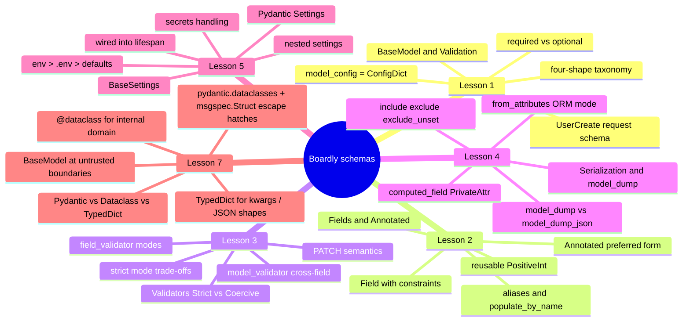
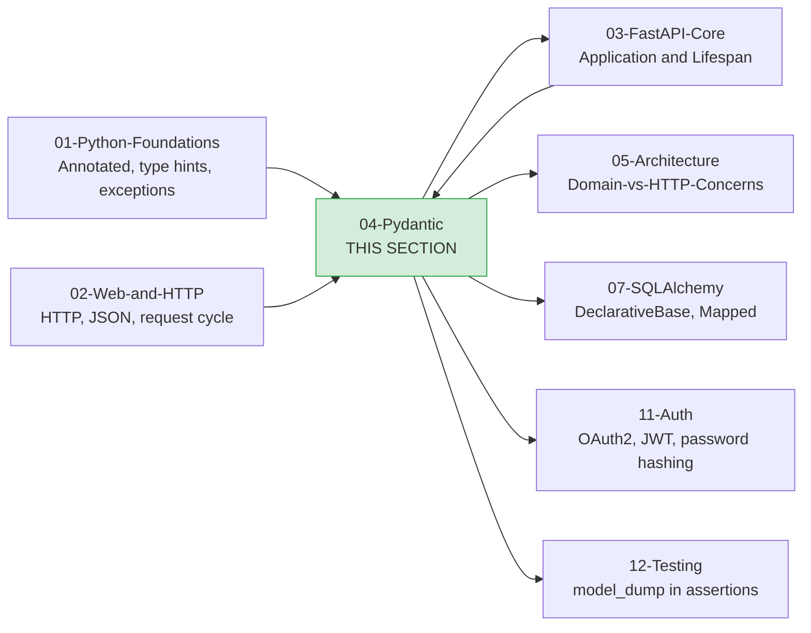

# Pydantic: Map of Content

**Bookmark this page.**

This is the **home base** for Section 04 — Pydantic. Every lesson in this folder, every concept, every reference back to the rest of the vault — all reachable from here. When you get lost, come back to the MOC.

Hello, friend. Pull up a chair.

You have made it past Python foundations (`Annotated`, async, exceptions) and past the Web-and-HTTP section (the HTTP request cycle, ASGI, Starlette, Uvicorn). You can read an ASGI app and you can read a type hint. Good. Now we build **the data layer** — the part where Python types *become* a contract.

In the next five lessons we are going to build the Pydantic schemas for **`Boardly`** — the small project-management API you started in [[03-FastAPI-Core/Application-and-Lifespan|Lesson 1 of Section 03]]. By the end of this section you will have a typed `UserCreate` request schema, a `ProjectCreate` body, a `ProjectRead` response shape, a four-shape taxonomy that explains why those are three different classes instead of one, a set of reusable annotated types (`PositiveInt`, `NonEmptyStr`, `LowerEmail`, `Slug`), custom validators, a serialization layer that knows how to dump models for HTTP and for the cache, and a `Settings` class wired into Boardly's lifespan. Every lesson explains every line.

**You're in the right place.**

If you have written `class User(BaseModel): name: str` and felt that Pydantic was doing magic you didn't understand, this section was written for you. We will go slow. We will explain every line. You will build schemas you actually understand.

---

## The Boardly Progression

Five lessons plus one comparison. One growing set of schemas. By Lesson 5 your `Boardly` project has:

- A typed `UserCreate` and `UserRead` for the registration endpoint.
- A typed `ProjectCreate`, `ProjectUpdate`, and `ProjectRead` for project CRUD.
- A `Settings` class that loads env, `.env`, and defaults in priority order.
- Reusable annotated types (`PositiveInt`, `NonEmptyStr`, `LowerEmail`, `Slug`) used everywhere.
- Custom validators (`@field_validator`, `@model_validator`) for the rules `Field(min_length=...)` cannot express.
- A serialization strategy that knows when to `model_dump()`, when to `model_dump_json()`, when to use `exclude_unset`, and when to use `from_attributes=True`.
- Lesson 7's decision table for `BaseModel` vs `@dataclass` vs `TypedDict` — the rule that picks the right form for each boundary.

And you'll know *why* every line is there.

---

## Lessons in Order

| # | Lesson | What you add to `Boardly` | Time |
|---|--------|---------------------------|------|
| 1 | [[BaseModel-and-Validation]] | `UserCreate` request schema for the registration endpoint; the four-shape taxonomy (request / response / ORM / internal-domain) that prevents the most common FastAPI architecture mistake | 60–90 min |
| 2 | [[Fields-Annotated-Reusable-Annotations]] | `ProjectCreate` with `Field(min_length=, gt=, description=)`, reusable annotated types (`PositiveInt`, `NonEmptyStr`, `LowerEmail`, `Slug`), `populate_by_name` for snake/camel interop | 60–90 min |
| 3 | [[Validators-Strict-vs-Coercive]] | `@field_validator` for password rules and slug normalization, `@model_validator` for cross-field rules, strict mode for the public API, the "validator returns None" bug, `model_fields_set` for PATCH | 75–100 min |
| 4 | [[Serialization-and-Model-Dump]] | `ProjectRead` with `from_attributes=True`, `model_dump(exclude_unset=True)` for PATCH responses, `@computed_field` for derived fields, `@field_serializer` for `datetime` formatting | 75–100 min |
| 5 | [[Pydantic-Settings]] | A complete `Settings` class — `database_url`, `redis_url`, `jwt_secret`, `debug`, `log_level` — loaded from env > `.env` > defaults, validated at startup, wired into Boardly's lifespan | 60–90 min |
| 6 | — (intentionally reserved for future expansion) | A slot kept open for a planned future lesson on Pydantic plugins and custom types (`Annotated[..., GetPydanticSchema]`, custom JSON serializers, mypy plugin hooks). Until that lesson ships, depend on [[04-Pydantic/Serialization-and-Model-Dump]] and the official Pydantic v2 migration guide. | — |
| 7 | [[Pydantic-vs-Dataclasses-vs-TypedDict]] | The decision table for `BaseModel` vs `@dataclass` vs `TypedDict` — what each does at runtime, the ~5-10x speed gap, the boundary-driven rule ("Pydantic when untrusted, dataclass when you, TypedDict when no runtime boundary"), and the `pydantic.dataclasses.dataclass` and `msgspec.Struct` escape hatches | 60–90 min |

**Lesson 06 is intentionally reserved for future expansion.**

The file-title sequence skips from Lesson 05 to Lesson 07 (the comparison capstone). Lesson 06 is not a mistake — it is a placeholder slot for a planned future lesson on advanced Pydantic extensibility (custom core schemas, the mypy plugin, plugin hooks for third-party libraries). We keep the slot rather than renumber Lesson 07 down to 06 so that already-published references to "Lesson 07 — Pydantic vs DC vs TypedDict" remain valid. The MOC table preserves the gap with a placeholder row, matching the convention used by `16-Deployment-MOC` and `03-FastAPI-Core/00-FastAPI-MOC` for their reserved slots.

**Tip — How to read this section**

Read the lessons **in order**. Each lesson's code is a strict superset of the previous one — the same schemas evolve across lessons, so by Lesson 5 you have one coherent set of types, not five disconnected snippets. If you skip ahead, you'll bring in concepts you haven't built yet and the code won't run. Lesson 7 is a *comparison* lesson — it audits the choice between `BaseModel`, `@dataclass`, and `TypedDict` against the schemas you wrote in Lessons 1–5, so it's read *after* the schema lessons, not in place of them.

Each lesson follows the same shape: **Learning Objectives → Prerequisites → The Problem → The Code → Line-by-Line Deep Dive → Execution Trace → Common Mistakes → Engineering Trade-Offs → Exercises → Verification → Previously Learned Here → What's Next → Sources → What We Learned**. Open the lesson in one pane and `boardly/schemas.py` in another, side by side. Type the code yourself. Don't copy-paste. Typing is what makes it stick.

---

## How This Section Fits in the Vault

Pydantic is the validation and serialization layer underneath every FastAPI endpoint. The lessons in this folder assume you have already read [[01-Python-Foundations/Type-Hints-and-Annotations|the type-hints lesson]] and are comfortable with the modern `Annotated[T, ...]` form. The FastAPI Core section (Section 03) introduced the lifespan; this section's last lesson wires a `Settings` instance into that lifespan, which means Lesson 5 is the moment `Boardly` becomes a real, configurable service.

---

## Concepts First Taught Here

Four recurring concepts are taught for the first time in this section. They each have a canonical lesson. If a later section touches one of these, it links back here instead of re-explaining.

- **`BaseModel (Pydantic v2)`** — first taught in [[BaseModel-and-Validation]]. The schema class at the heart of every FastAPI request, response, and dependency.
- **`Pydantic Field`** — first taught in [[Fields-Annotated-Reusable-Annotations]]. The constraint-and-metadata carrier; the `Annotated[T, Field(...)]` form is the v2-preferred way to declare rich fields.
- **`Validators (Pydantic v2)`** — first taught in [[Validators-Strict-vs-Coercive]]. `@field_validator` and `@model_validator`, with `mode` deciding before/after Pydantic's built-in coercion.
- **`Pydantic Settings`** and **`Settings / environment configuration`** — first taught in [[Pydantic-Settings]]. `BaseSettings`, layered config, secrets.

These entries also live in [[00-Start-Here/Concept-Registry]]; the registry is the source of truth.

## Concepts Reused Here (not re-explained)

These were taught in earlier sections. We link back instead of repeating:

- `Annotated` (PEP 593) — [[01-Python-Foundations/Type-Hints-and-Annotations]]. We reuse it heavily because `Annotated[T, Field(...)]` is the v2-idiomatic way to declare rich fields.
- `Type hints` — [[01-Python-Foundations/Type-Hints-and-Annotations]]. Pydantic is a runtime type checker; what you write as a hint is the validation contract.
- `FastAPI lifespan` — [[03-FastAPI-Core/Application-and-Lifespan]]. Lesson 5 hands a `Settings` instance into the lifespan.

## Concepts Taught Here, Reused Later

- `BaseModel` → every Pydantic lesson, [[03-FastAPI-Core/Path-Query-Header-Cookie-Body]], [[11-Authentication-and-Security/OAuth2-JWT-Access-Refresh]].
- `Pydantic Field` → [[04-Pydantic/Validators-Strict-vs-Coercive]], [[04-Pydantic/Pydantic-Settings]], [[03-FastAPI-Core/Path-Query-Header-Cookie-Body]].
- `Validators` → [[04-Pydantic/Serialization-and-Model-Dump]], [[11-Authentication-and-Security/Password-Hashing]].
- `Settings` → [[03-FastAPI-Core/Application-and-Lifespan]], [[16-Deployment-and-DevOps/Docker-Multi-Stage-Non-Root]].

---

## Pydantic v2 vs v1: quick orientation

If you learned Pydantic on v1, the v2 changes that matter most for this section are:

| Concern | v1 | v2 |
|---|---|---|
| Serialize a model | `model.dict()` | `model.model_dump()` |
| Serialize to JSON | `model.json()` | `model.model_dump_json()` |
| Parse a dict | `Model.parse_obj(d)` | `Model.model_validate(d)` |
| Parse a JSON string | `Model.parse_raw(s)` | `Model.model_validate_json(s)` |
| Config class | `class Config: ...` | `model_config = ConfigDict(...)` |
| Field validator | `@validator("x")` | `@field_validator("x")` |
| Whole-model validator | `@root_validator` | `@model_validator(mode="before"|"after")` |
| ORM mode | `class Config: orm_mode = True` | `model_config = ConfigDict(from_attributes=True)` |
| Construct without validation | `Model.construct(**kw)` | `Model.model_construct(**kw)` |

If you have never seen v1, ignore the right half of this table — the v2 names are the only ones you need.

**Warning — The v1 idioms are forbidden in this section.**

Calling `model.dict()` or `model.json()` on Pydantic v2 raises `AttributeError` or emits `DeprecationWarning`. Every snippet in this section uses the v2 names: `model_dump()`, `model_dump_json()`, `model_validate()`, `model_validate_json()`, `model_construct()`. If you copy code from an old tutorial and it uses `dict()`, that tutorial is for v1 — translate before you paste.

---

## Verified Versions (October 2026)

This section targets the following versions, all verified current as of 2026-10-19 (the FastAPI 0.148.0 release date, which we use as the section's access date; the Pydantic v2.14.1 release date itself was 2026-10-11 and is recorded in the row below):

| Package | Version | Notes |
|---------|---------|-------|
| Pydantic | v2.14.1 | Released 2026-10-11. Pydantic v2 only — no v1 idioms anywhere in this section. |
| pydantic-settings | latest | Separate package; install with `uv add pydantic-settings`. Verified compatible with Pydantic v2.14.1. |
| Python | 3.12 | The canonical learner version (3.13 also works). |
| FastAPI | 0.148.0 | Used in Lesson 5 to wire `Settings` into the lifespan; verified 2026-10-19. |
| `uv` | 0.13.1 | The modern Python package runner we use in install steps. |
| SQLAlchemy | 2.1.5 | Touched briefly in Lesson 4 for the `from_attributes=True` ORM-mode demo. |

**Warning — Version pinning matters.**

Pydantic v2 has evolved a lot since the early v2.0 betas. The `Annotated[T, Field(...)]` form, `ConfigDict`, `model_dump`, `populate_by_name`, the `mode` parameter on validators, and the `BeforeValidator` / `AfterValidator` / `PlainValidator` helpers all changed names or stabilized between v2.0 and v2.10. All code in this section uses the v2.14.1 surface; if you are on an older Pydantic v2, the code will mostly run but a few snippets will warn or fail.

---

## Forward link: FastAPI consumes these schemas

The last lesson, [[Pydantic-Settings]], hands a runnable `Settings` instance directly into the FastAPI lifespan covered in [[03-FastAPI-Core/Application-and-Lifespan]]. Read that lesson next, because lifespan is where you validate and assemble `Settings` once at process start. From Section 03 Lesson 3 ([[03-FastAPI-Core/Path-Query-Header-Cookie-Body]]) onwards, every endpoint you write will declare `body: UserCreate` or `response_model: ProjectRead` — and you will understand exactly what Pydantic does when FastAPI hands it a JSON body.

## Forward link: ORM-to-DTO mapping

[[Serialization-and-Model-Dump]] introduces `from_attributes=True` for loading a Pydantic model from a plain Python object — including a SQLAlchemy row. The actual SQLAlchemy `DeclarativeBase` is taught later in [[07-SQLAlchemy/03-Declarative-Base-and-Mapped]]; treat this as a forward reference and read it when you reach Phase 4.

## Related sections

- [[03-FastAPI-Core/00-FastAPI-MOC]] — FastAPI consumes Pydantic models for body, query, response, and dependency declarations.
- [[05-Project-Architecture/Domain-vs-HTTP-Concerns]] — the architectural argument for the four-shape taxonomy introduced in this section.
- [[11-Authentication-and-Security/OAuth2-JWT-Access-Refresh]] — JWT claim models and password-reset token models both lean on what you learn here.
- [[12-Testing-and-Quality/Testing-FastAPI-Endpoints]] — `model_dump()` and `model_validate()` are how you assert on API payloads in tests.

---

## Reference Links

- Pydantic v2 documentation — <https://docs.pydantic.dev/2.0/> — accessed 2026-10-19; canonical reference for `BaseModel`, `Field`, validators, and serialization.
- Pydantic v2 migration guide — <https://docs.pydantic.dev/2.0/migration/> — accessed 2026-10-19; the v1→v2 change list summarized in the table above.
- pydantic-settings documentation — <https://docs.pydantic.dev/2.0/concepts/pydantic_settings/> — accessed 2026-10-19.
- See [[21-Reference-Library/Source-Register]] for the full source list with dates accessed.

---

**Your map is ready.**

Five lessons, one growing set of `Boardly` schemas, all reachable from this page. Pick a starting point and go. We'll see you on the other side.

---

**Tags:** #moc #pydantic #validation #v2 #index #home
**Previous:** [[00-Start-Here/Curriculum-Index]]
**Start:** [[BaseModel-and-Validation]] →
