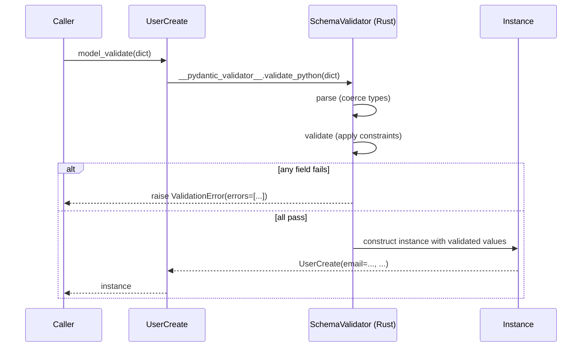
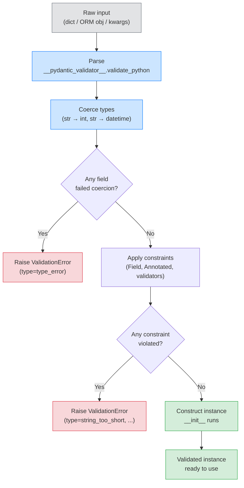

# Lesson 01: BaseModel and Validation

*Building the `UserCreate` schema for Boardly's registration endpoint — and the four-shape taxonomy that decides why it is not also the `UserRead` schema.*

**You're at the very beginning of Section 04.**

Every FastAPI request you'll ever admire — the registration form, the project-create body, the OAuth2 token exchange — was once exactly where you are now: staring at `class UserCreate(BaseModel): ...` and wondering what `BaseModel` actually does, what `model_config` is, and why senior engineers keep telling you not to use one schema for "everything about a user." Take your time. Type every line. Read the tracebacks. **This is how you learn.**


#pydantic #validation #v2 #canonical

## Learning Objectives

By the end of this lesson you will be able to:

1. **Define a `BaseModel` subclass** with required, optional, defaulted, and `default_factory` fields, and predict which fields raise `ValidationError` when missing.
2. **Instantiate a model** from a Python dict and from a JSON string, and read a `ValidationError` traceback to find which field failed and why.
3. **Configure a model** with `model_config = ConfigDict(...)` and name the four options you will use most often (`extra`, `frozen`, `validate_assignment`, `from_attributes`).
4. **Explain the four-phase pipeline** Pydantic runs on every `Model(**data)` call — `parse → validate → set → freeze` — and locate each phase in the traceback when something fails.
5. **Justify the four-shape taxonomy**: request, response, ORM-facing, and internal-domain models. Explain why mixing them is the most common FastAPI architecture mistake.
6. **Enable `validate_assignment=True`** when the cost is worth it, and disable it (the default) when raw throughput matters more than runtime safety.

## Prerequisites

Before starting, you need:

- **Pydantic v2.14.1** (verified 2026-10-11). If you've never installed it: `uv init boardly && cd boardly && uv add pydantic`.
- **Type hints and `Annotated`** — [[01-Python-Foundations/Type-Hints-and-Annotations]]. Pydantic reads your type hints at runtime and treats them as a validation contract. If `x: int` and `Annotated[int, ...]` are unfamiliar, go back and review.
- **Classes and protocols** — [[01-Python-Foundations/Classes-Protocols-Structural-Typing]]. `BaseModel` is a class; subclasses behave like data classes but with a generated `__init__` and a generated `__repr__`.
- **Python exceptions** — [[01-Python-Foundations/Exceptions-Done-Right]]. Pydantic raises `ValidationError` (a subclass of `Exception` with a custom `__str__`) on parse failures; you should know how to read a multi-cause traceback.
- **About an hour of focused time.** This lesson's code is short (the `UserCreate` class is about 20 lines); the explanation is long because every line carries weight.

**The most common gap: treating Pydantic as a fancy dataclass.**

If you have written `@dataclass` and thought "Pydantic is just that, but with validation," you are half right and half wrong. The half you're missing is this: a Pydantic model is a **schema with three independent responsibilities** — parse, validate, serialize. A dataclass is a struct. The differences show up the first time you try to round-trip a `datetime` through JSON, or the first time you accept a `camelCase` payload and need to emit `snake_case`. Take this lesson slowly; the rest of the section depends on it.


## The Problem

Boardly is a project-management API. Its first endpoint, in a few lessons, will be `POST /users` — a registration endpoint that accepts a JSON body like:

```json
{
 "email": "ada@lovelace.dev",
 "username": "ada",
 "password": "correct-horse-battery-staple",
 "display_name": "Ada Lovelace"
}
```

The endpoint has to do several things before the user lands in the database:

1. **Parse** the incoming JSON bytes into Python objects — turning `"42"` into `42` if the field is typed `int`, turning `"2026-10-19T08:00:00Z"` into a `datetime` if the field is typed `datetime`.
2. **Validate** the parsed values — refuse an empty `username`, refuse a `password` shorter than 8 characters, refuse an `email` without an `@`.
3. **Set** the validated values on a Python object your service layer can pass around — `user_create.password`, `user_create.email`.
4. **Serialize** the result back to JSON for the response — but only the fields the client should see (never `password`, never the password hash, never internal flags).

You could write all of that by hand. People did, for years, in Flask apps: a `register()` view that called `json.loads(request.body)`, then a dozen `if not email: return 400`, then a hand-rolled `to_dict()`. It worked. It also produced the most common bug in HTTP APIs — `password` accidentally leaking into a response because someone forgot to delete it from the dict they returned. The Pydantic answer is: declare the schema once, let Pydantic parse and validate, and let Pydantic serialize the response from a *different* schema that does not even *have* a `password` field. That single decision — two schemas instead of one — is the heart of this lesson.

## The Code

Here is the complete `boardly/schemas.py` you'll write in this lesson. Save it mentally — every Pydantic schema you ever write is a variation of this skeleton.

```python
# boardly/schemas.py
"""Boardly — request, response, and internal-domain schemas.

Lesson 1: the UserCreate request schema and the four-shape taxonomy.
"""
from pydantic import BaseModel, ConfigDict, Field


class UserCreate(BaseModel):
 """Body for POST /users — the registration endpoint."""

 model_config = ConfigDict(
 extra="forbid", # reject unknown fields
 populate_by_name=True, # accept both alias and field name
 str_strip_whitespace=True, # trim whitespace on every str field
 )

 email: str = Field(..., min_length=3, description="Primary email.")
 username: str = Field(..., min_length=3, max_length=32, description="Handle.")
 password: str = Field(..., min_length=8, description="Plaintext (hashed later).")
 display_name: str | None = Field(default=None, description="Optional.")
 is_admin: bool = False # always false on input; service sets it


# Quick smoke-test you can run from the project root:
# uv run python -c "from boardly.schemas import UserCreate; \
# print(UserCreate.model_validate({'email':'a@b.co','username':'ada', \
# 'password':'longpassword'}).model_dump())"
```

That is 20 lines. Read it. Type it. Run it. Change it. Break it. Fix it. That's the loop. We'll explain every line next — not just *what it does* but *what Pydantic does internally* when that line runs.

## Line-by-Line Deep Dive

This section is the heart of the lesson. Read it twice. Don't skip.

### Lines 1–4: The module docstring and imports

```python
"""Boardly — request, response, and internal-domain schemas.

Lesson 1: the UserCreate request schema and the four-shape taxonomy.
"""
from pydantic import BaseModel, ConfigDict, Field
```

**What it does:** Pulls in three names — `BaseModel`, `ConfigDict`, and `Field`. Each is the surface of one of Pydantic v2's three responsibilities.

**Why we need each:**

- `BaseModel` is the schema class. Every Pydantic model is a direct subclass of `BaseModel`. It is implemented in Rust (under the hood via `pydantic-core`) for performance, but you interact with it as a Python class. Capital `B`. The lowercase package name `pydantic` is the folder; `BaseModel` is the class inside it.
- `ConfigDict` is a typed alias for `dict[str, Any]` with extra hints to your type-checker. You use it to declare a model's configuration: `model_config = ConfigDict(extra="forbid", ...)`. You could write `model_config = {"extra": "forbid"}` — Pydantic accepts a plain dict — but `ConfigDict` is the idiomatic v2 form because it lets your editor autocomplete the recognized keys.
- `Field` is the constraint-and-metadata carrier. You'll meet it more deeply in [[Fields-Annotated-Reusable-Annotations|Lesson 2]]. For now, treat `Field(..., min_length=8)` as "this field is required and must be at least 8 characters."

**Tip — Why `ConfigDict` instead of `class Config:`?**

In Pydantic v1 you wrote a nested class:
```python
class UserCreate(BaseModel):
email: str

class Config:
extra = "forbid"
```
v2 replaced this with a class-level attribute: `model_config = ConfigDict(...)`. The reason is introspection: a class attribute is a value you can read at runtime (`UserCreate.model_config["extra"]`), which lets tooling (FastAPI's OpenAPI generator, your tests, your docs) inspect the config without instantiating the class. The nested `class Config:` form is still accepted with a deprecation warning, but new code uses `ConfigDict`.


**Example — What's actually in the `pydantic` package?**

Besides the three we imported, the package re-exports `ValidationError`, `field_validator`, `model_validator`, `computed_field`, `PrivateAttr`, `field_serializer`, `BeforeValidator`, `AfterValidator`, `PlainValidator`, `SecretStr`, `SecretBytes`, `InstanceOf`, `conlist`, `constr`, `conint`, plus the strict types (`StrictInt`, `StrictStr`, `StrictBool`). You'll meet all of these across the section. For Lesson 1, just `BaseModel`, `ConfigDict`, and `Field` are enough.


### Lines 7–8: The `class` declaration and docstring

```python
class UserCreate(BaseModel):
 """Body for POST /users — the registration endpoint."""
```

**What it does:** Declares a new class `UserCreate` that inherits from `BaseModel`. The docstring is a normal Python docstring; FastAPI will surface it in the OpenAPI schema as the model's description, so writing a one-line docstring is not just courtesy — it shows up at `/docs`.

**Why a class instead of a function?** Because the model is *data with behavior attached*. The class is the carrier for both the field declarations and the methods (`model_validate`, `model_dump`, etc.) that operate on those fields. A function would have to return an instance of *something*; that something has to be a class; the simplest version of that class is a `BaseModel` subclass.

**Why subclass `BaseModel` instead of `dict`?** A `dict` is untyped — you'd have to write `if "email" not in d: raise ...` for every field, on every endpoint, by hand. `BaseModel` reads your type hints at class-creation time and generates a Rust-backed validator that runs all those checks in one pass. The class is the schema; the schema is the validation contract.

**Student asks: why not just use `@dataclass` plus a separate validation library?**

Good instinct — `@dataclass` is in the standard library, and "separate validation library" sounds modular. The answer is integration: FastAPI's `Annotated[UserCreate, Body()]` machinery reads `model_dump` and `model_validate_json` directly off the class. If you used `@dataclass`, you'd need to write the JSON serialization yourself (datetime does not survive `json.dumps`), the validation yourself, and the OpenAPI schema generation yourself. Pydantic gives you all three for the cost of inheriting from one class. The cost is one extra dependency; the benefit is three subsystems replaced.


### Lines 10–13: `model_config = ConfigDict(...)`

```python
 model_config = ConfigDict(
 extra="forbid", # reject unknown fields
 populate_by_name=True, # accept both alias and field name
 str_strip_whitespace=True, # trim whitespace on every str field
 )
```

**What it does:** Configures the model. Three options are set; dozens more exist. Each line shapes how Pydantic parses, validates, or serializes the model.

**Why these three for a registration schema:**

- `extra="forbid"` is the security-sensitive default. Without it, a client could send `{"email": "a@b.co", "username": "ada", "password": "x" * 8, "is_admin": True}` and Pydantic would silently drop the `is_admin` field — but a future maintainer might add an `is_admin` field to the schema, at which point the client's payload *starts setting it*. Forbidding extras turns "the client sent an unknown field" into a 422 response, which is loud and honest. The other values for `extra` are `"ignore"` (the v1 default; silently drop) and `"allow"` (keep them in a `__pydantic_extra__` bag — useful for round-tripping unknown JSON, rarely what you want for a typed API).

**Spot the bug — what happens if you forget `extra="forbid"` and a maintainer later adds an `is_admin: bool = False` field?**

Nothing today, an incident in six months. Today, a client POSTs `{"is_admin": true}` and Pydantic silently drops the field (because `extra="ignore"` is the v2 default behavior — extra keys are discarded without an error). The endpoint reads `user.is_admin` — which is `False` because the client's value was dropped. Six months later, a maintainer adds `is_admin: bool = False` to the schema to wire up an admin-toggle feature. Now the same client payload sets `user.is_admin = True`, and the endpoint silently elevates the caller. The fix is `extra="forbid"`: any client that ever tried to send `is_admin` got a 422 the moment they tried, the maintainer's test suite noticed, and the security review caught it. The bug is "silent today, loud tomorrow"; `extra="forbid"` makes it loud today.

- `populate_by_name=True` is the option that lets you accept both an alias (`"displayName"`) and the field name (`"display_name"`) on input. We'll cover aliases in [[Fields-Annotated-Reusable-Annotations|Lesson 2]]; for now, set the option so you don't have to come back and add it later.
- `str_strip_whitespace=True` is the option that trims leading and trailing whitespace on every `str` field before validation. Without it, `"ada "` would pass `min_length=3` and you'd store a username with a trailing space, which would later fail exact-match lookups. This is one of those options you set on day one and forget — and then a colleague who didn't set it ships a bug, and you remember why you set it.

**What `model_config` actually is, internally**

It is a class attribute that holds a `dict` subclass. Pydantic reads it at class-creation time (in `__pydantic_init_subclass__`, the metaclass hook) and builds a Rust `SchemaValidator` object that it stashes on the class as `__pydantic_validator__`. From then on, every `UserCreate(**data)` call routes `data` through that validator. The validator is the same Rust object whether you instantiate one model or ten million; that is why v2 is dramatically faster than v1 — v1 built a Python validator per instantiation, v2 builds one Rust schema per class.

The other thing Pydantic builds at class-creation time is `__pydantic_core_schema__`, a tree of `core-schema` nodes describing the model. That tree is what `model_json_schema()` exports as JSON Schema and what FastAPI reads to generate the OpenAPI `components/schemas` section. You don't need to read the tree yourself; just know that it exists, and that it is the single source of truth that powers `/docs`.


**Tip — Think like a senior engineer: `model_config` is a security surface, not a config file**

A senior engineer reading `model_config = ConfigDict(...)` treats every key as either a *correctness* control or a *security* control — there are no neutral knobs. `extra="forbid"` is a security control: it converts a silent field-drop into a loud 422 and surfaces forgotten clients (an internal service that was still sending a deprecated field will start failing in staging, which is exactly what you want before the field becomes a real one). `str_strip_whitespace=True` is a correctness-and-security control: it prevents `"admin "` from being stored when `"admin"` was meant, and prevents a login-with-trailing-space attack where the attacker who guesses `"ada "` differs from the legitimate `"ada"` in the database but matches elsewhere. `populate_by_name=True` is a contract control: it decides which keys the API will accept, which is a security surface (a misconfigured alias can quietly widen the set of accepted fields). `validate_assignment=True` is a runtime-correctness control: it stops a service-layer mutation from putting an invalid value into a model the response layer will then serialize — pay the per-mutation cost only when you actually mutate after construction. The senior engineer's audit checklist for `model_config` on a request-facing schema: (1) is `extra` set to `"forbid"`? (2) is `str_strip_whitespace` on? (3) is `populate_by_name` documented, with the alias surface enumerated? (4) is `validate_assignment` off unless there is a written reason to turn it on (the per-mutation cost compounds at 1000 rps)? (5) is `frozen` set on value-object schemas to make them immutable? Every key on `model_config` is a decision; defaults are decisions too — silence is the most dangerous default Pydantic ships with, and `extra="ignore"` is the silence that bites.


### Line 15: The `email` field

```python
 email: str = Field(..., min_length=3, description="Primary email.")
```

**What it does:** Declares a required field `email` of type `str`, with a minimum length of 3 and a human description. The `...` (Ellipsis) is Pydantic's signal for "this field is required" — it is the *default* value, and `...` means "no default; the caller must supply a value."

**Why every piece:**

- The annotation `email: str` is the type contract. Pydantic will coerce compatible inputs (`"ada@lovelace.dev"` stays a str; `b"ada@lovelace.dev"` becomes `"ada@lovelace.dev"`; `42` raises `ValidationError`). If you wrote `email: bytes` instead, Pydantic would coerce str inputs to bytes — the annotation is the contract.
- `Field(...)` is the constraint carrier. The first positional argument is the default; `...` means "required." Without `Field`, the line `email: str` would mean "required str" — the bare annotation already implies required. The reason we use `Field(..., ...)` here is to add the constraints.
- `min_length=3` is a length constraint applied after coercion. It rejects `""`, `"a"`, `"ab"`. It does not check that the string is a valid email — for that, [[Validators-Strict-vs-Coercive|Lesson 3]] will introduce a custom `LowerEmail` type with an `@field_validator`. The 3-character floor is a sanity check, not an email check.
- `description="Primary email."` ends up in the OpenAPI schema's field description. Swagger UI shows it next to the field name. This is a documentation surface, not a validation rule — but it is also a security surface: if the field is `password`, the description is visible in `/docs` and indexed by search engines, so do not put internal hints there.

**Tip — The first positional argument of `Field` is the default, not the type.**

A common confusion: `Field("ada@b.co")` does *not* declare the field as `str`; the type comes from the annotation `email: str`. `Field("ada@b.co")` declares the field as `str` *with default* `"ada@b.co"`. The first positional of `Field` is always the default value (or `...` for "no default"). If you find yourself writing `Field(str, min_length=3)`, you have made this mistake — the default would be the type object `str`, which is rarely what you wanted.


### Line 16: The `username` field

```python
 username: str = Field(..., min_length=3, max_length=32, description="Handle.")
```

**What it does:** Declares a required `username` field with bounds `3 ≤ len(username) ≤ 32`.

**Why both bounds:** Usernames are visible in URLs (`/u/ada`) and stored in indexes that have an actual byte width. A 4 MB username would crash Postgres with a `value too long for type character varying(N)` if your column were `VARCHAR(32)`, or — worse — silently truncate if your column were `VARCHAR` (unbounded). Validating the length at the schema layer means the Postgres error never happens; you get a 422 with a clear `username` field error instead. `max_length` is also a security control: it caps the size of strings your service stores, which limits the size of memory allocations an attacker can trigger.

**`min_length` and `max_length` count code points, not bytes.**

Pydantic v2 uses `len(s)` (which counts Unicode code points) for `min_length` and `max_length`. A username made of three emoji (each a 4-byte UTF-8 sequence outside the BMP) has length 3 — three code points — even though it is 12 bytes when encoded as UTF-8. If your column is `VARCHAR(32)` in Postgres, Postgres checks the *byte* length (unless you set `VARCHAR(32 CHAR)`). The mismatch is a real source of "works in test, fails in prod." The fix is to either use `VARCHAR(N CHAR)` in Postgres or to add a custom `@field_validator` that checks `len(s.encode("utf-8")) <= 32`.


### Line 17: The `password` field

```python
 password: str = Field(..., min_length=8, description="Plaintext (hashed later).")
```

**What it does:** Declares a required `password` field, minimum 8 characters.

**Why plaintext:** The schema is the *request* schema. It carries the plaintext password from the client to your service layer. The service layer hashes it (`pwd_context.hash(user_create.password)`) and stores the hash; the plaintext is discarded before the function returns. The schema's responsibility ends at "deliver a str of at least 8 characters." The service layer's responsibility begins at "hash it." Mixing those responsibilities — say, by hashing in a `@field_validator` — couples the schema to `passlib` and makes it impossible to test the schema without the hashing library.

**Warning — Never declare `password` as `bytes`.**

It is tempting: "the wire is bytes, so the field should be bytes." It isn't. JSON has no bytes type; the request body is a UTF-8 string that Pydantic coerces to a Python `str`. Declaring `password: bytes` makes Pydantic try to coerce `str → bytes` via `bytes(s, "utf-8")`, which works — until someone sends a string with a non-UTF-8 byte and you get an opaque `UnicodeEncodeError` wrapped in a `ValidationError`. The rule for HTTP bodies: if it is text in JSON, it is `str` in Pydantic. If you need bytes, base64-encode them in JSON and decode in a `@field_validator`.


**Student asks: should the password validation rules (uppercase, digit, symbol) live on the schema or in the service layer?**

On the schema — but as a `@field_validator` in Lesson 3, not as a `Field` constraint here. Two reasons. (1) The rules are *contract*: a request that fails them is a 422, not a 500, and the schema is where 422s are decided. (2) The rules are *reusable*: a password-reset schema, a change-password schema, and a registration schema all want the same rule; a `@field_validator` on a `PasswordStr = Annotated[str, AfterValidator(_password_rule)]` type composes once and is reused. Putting the rule in the service layer scatters it across every callsite and lets one endpoint silently skip the check. The schema is the contract; the service layer is the consumer.


### Line 18: The `display_name` field

```python
 display_name: str | None = Field(default=None, description="Optional.")
```

**What it does:** Declares an *optional* field `display_name` of type `str | None`, with a default of `None`.

**Why `str | None` instead of `Optional[str]`:** They are identical — `Optional[str]` is sugar for `str | None`. The pipe form is the modern PEP 604 syntax, available since Python 3.10. Use whichever you prefer; the team convention in `Boardly` is the pipe form because it reads top-to-bottom as "str, or None."

**Why `default=None` instead of `...`:** A field is *required* if it has no default (or default `...`); it is *optional* if it has a default. `default=None` means "if the caller does not supply this field, set it to `None`." Note that the caller *can* explicitly send `"display_name": null` — that is also `None` — and that is indistinguishable from omitting the field, which is exactly what you want.

**Spot the difference: `display_name: str | None = None` vs `display_name: str | None = Field(...)`.**

The first declares an optional field that defaults to `None`. The second declares a *required* field whose type happens to include `None`. The difference is whether the caller *must* send the key. With `default=None`, the caller can omit the key entirely. With `Field(...)`, the caller *must* send `"display_name": null` (or `"display_name": "Ada"`); omitting it raises `ValidationError`. Which one you want depends on the API contract: "the field is optional, omit if you don't care" is `default=None`; "the field is required, you must explicitly say null" is `Field(...)`.


### Line 19: The `is_admin` field, and the "defaulted vs default_factory" distinction

```python
 is_admin: bool = False # always false on input; service sets it
```

**What it does:** Declares an *optional* field `is_admin` of type `bool`, with a default of `False`. The inline comment documents the *intent* — clients may not set this; the service layer sets it after authentication.

**Why default `False`:** The default is the value the field takes when the caller omits it. For `is_admin`, the safe default is `False`. Note: this does not *prevent* a client from sending `"is_admin": true`. With `extra="forbid"`, that input *would* be accepted (the field exists, so it's not "extra"), and the client could escalate themselves. The correct defenses are: (a) do not declare `is_admin` on `UserCreate` at all — declare it only on `UserUpdate` (an admin-only schema), or (b) declare it but `@field_validator` it to always return `False` (see [[Validators-Strict-vs-Coercive|Lesson 3]]). For Lesson 1 we leave it as a defaulted bool; we'll come back and tighten it.

**Danger — How an attacker thinks: `is_admin: bool = False` is a privilege-escalation waiting to happen**

An attacker who reads your `/docs` sees `UserCreate` has `is_admin` (default `False`). Their first probe is `POST /users` with `{..., "is_admin": true}`. The natural intuition says `extra="forbid"` saves you — but no: `is_admin` is a *declared* field, so `extra="forbid"` does not reject it. The field exists, the request sets it, and the model returns `user.is_admin == True`. The endpoint then writes the row, and you have an admin. The senior engineer's defense is structural, not validator-based: **`is_admin` must not exist on `UserCreate`.** It can exist on `UserRead` (so a response can show the flag to the user themselves), on `UserInDB` (so the row can carry it), and on `AdminUserUpdate` (so an admin-only endpoint can change it), but it must *not* exist on any schema a non-admin client can write to. The validator approach (`@field_validator("is_admin")` that always returns `False`) is a band-aid — it works until someone refactors the validator out and the field silently becomes writable again, and the test suite cannot tell the difference because the test sends `is_admin: false` either way. The type-system approach (the field does not exist on the request schema) is permanent: even if a maintainer wanted to make `is_admin` client-writable, the type checker refuses to let `UserCreate` carry the field, because `UserCreate` simply does not have it. The senior question for every boolean flag on a request schema is: *can a client ever legitimately set this?* If the answer is no, the field does not belong on the schema — full stop. Same rule for `created_at`, `id`, `tenant_id`, `password_hash`, `verification_token`, `password_reset_expires_at` — anything the client should not author does not exist on `UserCreate`.


**The "mutable default" trap and `default_factory`:** This is a Python language rule, not a Pydantic rule: you must never use a *mutable* default value (a list, dict, set) as a default argument, because the default is shared across all calls. Pydantic enforces this:

```python
# WRONG — RuntimeError at class-definition time
class ProjectCreate(BaseModel):
 tags: list[str] = [] # Pydantic refuses this

# RIGHT — default_factory produces a fresh list per instance
class ProjectCreate(BaseModel):
 tags: list[str] = Field(default_factory=list)
```

`default_factory` is a *zero-argument callable* Pydantic invokes once per instantiation to produce the default. The factory can be `list` (the type itself), `dict`, `set`, or any user-defined function. The rule: for immutable defaults (`None`, `False`, `0`, `"hello"`, `(1, 2, 3)`), use `default=...`. For mutable defaults (`[]`, `{}`, `set()`), use `default_factory=...`. Pydantic will refuse to define the class if you violate this rule, which is much friendlier than the silent bug you'd get with a vanilla `@dataclass`.

**Why does Pydantic refuse mutable defaults when Python's `@dataclass` silently allows them?** Because the same footgun bit every Python developer through the 2010s: `def f(items=[])` shares the same list across calls, so `f().append(1); f().append(1)` leaves `[1, 1]` on the *next* call with no arguments. `@dataclass` accepts `field(default_factory=list)` and refuses bare `[]` at class-definition time too, but the *vanilla `class` form* (which Pydantic v1 inherited) would have let you write `tags: list = []` and discover the bug in production. Pydantic v2 hard-fails at class-definition time because the failure mode is a *cross-instance* leak — model A mutates its tags list, models B and C see the mutation, and no test catches it because each test instantiates only one model. The hard fail forces you to declare intent (`default_factory=list` — "fresh list per instance"), which is the only safe reading of "default to empty."

**The order matters: required fields before defaulted fields is convention, not law.**

In Python function signatures, `def f(a, b=1)` is legal but `def f(a=1, b)` is a `SyntaxError`. Pydantic does not enforce this on model fields — you can write `is_admin: bool = False` *before* `email: str` — but every linter and every code reviewer will tell you not to. Convention is: required fields first, optional-with-default fields second, and a blank line between them if it helps readability.


### Lines 21–23: The smoke-test comment

```python
# Quick smoke-test you can run from the project root:
# uv run python -c "from boardly.schemas import UserCreate; \
# print(UserCreate.model_validate({'email':'a@b.co','username':'ada', \
# 'password':'longpassword'}).model_dump())"
```

**What it does:** Documents how to exercise the schema from the shell without spinning up FastAPI. This is the loop: write a schema, run the smoke test, see the dict, change the schema, re-run.

**Why this loop matters:** The biggest pedagogical mistake beginners make with Pydantic is to write the schema *inside* a FastAPI endpoint and only ever exercise it through `curl`. That adds three layers of indirection (HTTP, Starlette, FastAPI's body parser) between you and the schema, so when something fails you cannot tell which layer is at fault. Run the schema directly with `model_validate` for the first five minutes of every Pydantic change. Only when the schema behaves correctly should you wire it into FastAPI.

## Execution Trace

Time to run it. From the project root:

```bash
uv run python -c "
from boardly.schemas import UserCreate

# Happy path
u = UserCreate.model_validate({
 'email': 'ada@lovelace.dev',
 'username': 'ada',
 'password': 'correct-horse-battery-staple',
 'display_name': 'Ada Lovelace',
})
print('ok:', u.model_dump())

# Sad path — password too short
from pydantic import ValidationError
try:
 UserCreate.model_validate({
 'email': 'a@b.co', 'username': 'ada', 'password': 'short',
 })
except ValidationError as e:
 print('failed:')
 print(e)
"
```

What happens, in order, on the happy path:

1. **`model_validate(dict)` is called.** This is the v2 entry point for "parse a Python dict into a model instance." (In v1 this was `parse_obj`; the v2 name is `model_validate`.)
2. **Pydantic looks up `UserCreate.__pydantic_validator__`**, the Rust `SchemaValidator` object built at class-definition time.
3. **The validator runs the four-phase pipeline** on the input dict:
 - **Parse:** for each field, coerce the input to the declared type. `"ada@lovelace.dev"` stays `str`. `display_name`'s `"Ada Lovelace"` stays `str`. `None` would be accepted because `display_name: str | None`.
 - **Validate:** apply field constraints (`min_length`, `max_length`) and any `@field_validator` functions (none in Lesson 1). `password` is 31 chars, which passes `min_length=8`.
 - **Set:** write the validated values onto a fresh `UserCreate` instance via the generated `__init__`.
 - **Freeze:** if the model were `frozen=True`, mark the instance immutable. (We did not set `frozen`; the instance is mutable.)
4. **`model_dump()` is called on the result.** This returns a plain `dict` with the field names as keys and the validated values as values. `display_name` is included because it was set; `is_admin` is included because it has a default.
5. **`print(...)` outputs the dict.** You see:
 ```python
 {'email': 'ada@lovelace.dev', 'username': 'ada',
 'password': 'correct-horse-battery-staple',
 'display_name': 'Ada Lovelace', 'is_admin': False}
 ```

**What happens inside: `model_validate` runs in one Rust pass, not field-by-field**

When you call `UserCreate.model_validate({...})`, Pydantic does not loop over the fields in Python. The class's `__pydantic_validator__` is a compiled `pydantic-core` `SchemaValidator` object that walks the input dict in a single Rust pass, applying every coercion, every constraint, and every custom validator in the order the core schema declares them. The pass is *one* traversal of the input — that is why v2 is roughly 5–50× faster than v1, which built and ran a Python validator tree per call. The senior engineer's reading of a `ValidationError` traceback is therefore slightly different from a Python exception: the `loc` (`('password',)`) tells you which field the *Rust validator* was on when it bailed; the `type` (`string_too_short`) is a stable machine-readable code from `pydantic_core`; and the `input` is the post-coercion value the validator had in hand. The traceback does not show you a Python call stack because there isn't one — it shows you a *validation decision tree* flattened into an error list. The senior question on every slow `model_validate` is therefore: *am I calling Pydantic once on a 50-field payload (fast), or am I calling it 50 times on one-field payloads (slow, because of the per-call overhead, not the per-field work)?* The same question applies to `model_dump` — one call to dump a 50-field model is much faster than 50 calls to dump one-field models. The non-obvious corollary: a Pydantic model is cheaper to instantiate *once* than to instantiate *many times*, so caching the parsed instance across a request is a win; re-parsing the same dict in five places (route, logger, audit, response, error path) is a measurable tax at 1000 rps.


**Why use `model_validate(dict)` and not the constructor `UserCreate(**dict)`?** In v2 both paths route through the same Rust validator — `__init__` forwards its kwargs to `__pydantic_validator__.validate_python`, the same call `model_validate` makes. So the constructor does run validation, including the `min_length=8` check and any `@field_validator` rules. The real differences are *input flexibility* and *FastAPI's call path*. (1) Input flexibility: `model_validate` accepts a plain dict, an ORM object (when `from_attributes=True` is set on the model), a `NamedTuple`, or another Pydantic model — anything shaped like the schema. The constructor only accepts keyword arguments whose names are valid Python identifiers (the alias when one is set, or the Python field name when `populate_by_name=True`). You cannot write `UserCreate(user_obj)` where `user_obj` is a SQLAlchemy row — `__init__` only takes kwargs, and `from_attributes` does not apply to the top-level constructor argument. (2) FastAPI's call path: FastAPI's request-body parser uses `model_validate_json` on the raw bytes (and `model_validate` on the parsed dict when it needs a Python-level entry point), so testing through `model_validate` reproduces the exact code path your endpoint will run in production. The constructor is for when you, the Python author, are building an instance by hand from values you've already validated and the field names (or aliases) line up as kwargs.

On the sad path:

1. **`model_validate(dict)` is called** with `password="short"`.
2. **Parse phase succeeds** — `"short"` is a valid `str`.
3. **Validate phase fails** — `min_length=8` is violated (the string is 5 chars).
4. **Pydantic raises `ValidationError`** with a structured error list:
 ```
 failed:
 1 validation error for UserCreate
 password
 String should have at least 8 characters [type=string_too_short,
 input_value='short', input_type=str]
 ```
 The error message tells you: the model (`UserCreate`), the field (`password`), the rule (`string_too_short`), the input value (`'short'`), and the input type (`str`). The `[type=...]` token is the machine-readable error code — useful for translation layers that map Pydantic errors to user-facing messages.





**You've just round-tripped a Pydantic model.**

It's small — five fields, no custom validators, no ORM mapping. But the architecture is identical to a model with fifty fields, ten validators, three aliases, and a `from_attributes=True` config. The skeleton is permanent. Everything else is additions.


## Common Mistakes

**Warning — When this breaks: "Field required" on a field whose type includes `None`**

**Symptom.** A client sends `{"username": "ada", "password": "longpassword"}` (no `email` key), and FastAPI returns `422 Unprocessable Entity` with `{"detail":[{"type":"missing","loc":["body","email"],"msg":"Field required",...}]}`. The engineer who wrote `email: str | None = Field(...)` reads the type as "string or null is fine" and is surprised the omission fails. **Diagnosis.** In Pydantic v2, `str | None` (or `Optional[str]`) describes the *value space* (the value may be `None`); required-ness is decided by the *default*, not by the type. `Field(...)` (Ellipsis) means "no default; the caller must supply the key." So `email: str | None = Field(...)` is a *required* field whose allowed values include `None` — the caller must send `"email": null` explicitly; omitting the key fails. The two axes are independent, and conflating them is the #1 Pydantic v2 surprise. **Fix.** Depends on the contract: if the API should accept omission, write `email: str | None = None` (truly optional, defaults to `None`). If the API requires the key but allows `null`, keep `Field(...)` and document the contract in the `description` (`description="Required; send null to mean 'no email on file'."`). The senior engineer's reading: *the type and the required-ness are two independent axes; never confuse one for the other.* A code-review shortcut: if you see `Optional[T] = Field(...)` or `T | None = Field(...)`, ask whether the API really requires the key — most of the time, the author meant `= None` and the `Field(...)` is a typo that ships a stricter API than intended.


### Mistake 1: Calling `.dict()` instead of `.model_dump()`

```python
# WRONG
print(u.dict())
```

**Symptom:** A `PydanticDeprecationWarning` is emitted at runtime (`The `dict` method is deprecated; use `model_dump` instead. Deprecated in Pydantic V2.0 to be removed in V3.0.`), and the call still produces the correct dict. The `.dict()` method is scheduled for removal in Pydantic v3; in v2.14.1 it forwards to `model_dump` with the warning.

**Why:** `dict()` is the v1 name. In v2, `dict` was re-bound to a stub that emits a `PydanticDeprecationWarning` and forwards to `model_dump`. In Pydantic v2.14.1, the v1 idiom is still tolerated with a warning, but the team policy in this vault is "no v1 idioms, ever" — the deprecation warning will become a hard `AttributeError` in Pydantic v3.

**Fix:** Use `u.model_dump()`. Always. Configure your linter (ruff rule `PGH003` covers Pydantic deprecations) to flag any `.dict()` call.

### Mistake 2: Using a mutable default value

```python
# WRONG
class ProjectCreate(BaseModel):
 tags: list[str] = []
```

**Symptom:** At class-definition time, Pydantic raises `PydanticUserError: A non-annotated attribute may not be used in combination with a default value; ...` or, with a slightly different mistake, `Default value for field 'tags' is a mutable default ... use default_factory`.

**Why:** Python's "default arguments are evaluated once at function definition time" rule. If Pydantic accepted `tags: list[str] = []`, every `ProjectCreate` instance that did not supply `tags` would share the *same* list object. Mutations on one instance would leak into the next.

**Fix:** `tags: list[str] = Field(default_factory=list)`.

### Mistake 3: Treating `Optional[str]` as "the field is optional"

```python
# AMBIGUOUS — looks optional, is actually required
class UserCreate(BaseModel):
 display_name: Optional[str] = Field(...)
```

**Symptom:** A `ValidationError` for `display_name` ("Field required") when the client omits the field — even though the type annotation says `Optional[str]`.

**Why:** `Optional[str]` is `str | None`. The annotation describes the *type*, not the *required-ness*. Required-ness is controlled by whether the field has a default. `Field(...)` (with `...`) means "no default, required." So `display_name: str | None = Field(...)` is a *required* field whose allowed values are `str` or `None`.

**Fix:** Decide whether the field is truly optional (omit-and-default-to-None) or required-and-nullable (must be present, value may be null). For optional: `display_name: str | None = None`. For required-nullable: `display_name: str | None = Field(...)` and document the contract.

### Mistake 4: Forgetting `extra="forbid"` and silently dropping fields

```python
# DANGEROUS
class UserCreate(BaseModel):
 email: str
 username: str
 password: str
 # no model_config; extra defaults to "ignore"
```

**Symptom:** A client sends `{"email": ..., "username": ..., "password": ..., "is_admin": true}`. Pydantic silently drops `is_admin` because the field does not exist. The endpoint works. Months later, someone adds `is_admin: bool = False` to the schema. The *same client payload* now sets `is_admin` to `True`. Privilege escalation.

**Why:** v1 defaulted to `extra="ignore"` for backward compatibility. v2 retains the same default for the same reason. The safe default is `"forbid"`: a 422 response that says "I don't recognize `is_admin`," which is loud and honest.

**Fix:** Set `model_config = ConfigDict(extra="forbid")` on every request-facing schema. Reserve `extra="allow"` for schemas that explicitly need to round-trip unknown JSON (rare).

### Mistake 5: Declaring the password as `bytes`

```python
# WRONG
class UserCreate(BaseModel):
 password: bytes
```

**Symptom:** `ValidationError: Input should be a valid bytes` for a perfectly normal-looking request body containing `"password": "longpassword"`.

**Why:** JSON has no `bytes` type. The wire format is always a UTF-8-encoded string. Pydantic v2 will *try* to coerce `str → bytes` by encoding the string, but the error messages are confusing and any non-UTF-8 byte sequence raises an opaque `UnicodeEncodeError`.

**Fix:** `password: str`. Decode to bytes (if you must) in a `@field_validator` or in the service layer.

### Mistake 6: Forgetting that `min_length` counts code points, not bytes

```python
class UserCreate(BaseModel):
 username: str = Field(..., min_length=3, max_length=32)
```

**Symptom:** A client sends a username made of three 4-byte emoji (e.g., three code points outside the BMP). Pydantic accepts it (3 code points, passes `min_length=3`). Postgres may still reject it: a username made of 11 such emoji is 11 code points (passes `max_length=32`), but 44 UTF-8 bytes — it overflows `VARCHAR(32)` in Postgres byte-length mode.

**Why:** Pydantic uses `len(s)` (code points). Postgres `VARCHAR(N)` uses byte length unless you write `VARCHAR(N CHAR)`.

**Fix:** Either declare the Postgres column as `VARCHAR(32 CHAR)`, or add `@field_validator("username")` to check `len(s.encode("utf-8")) <= 32`.

## Engineering Trade-Offs

### One schema vs the four-shape taxonomy

This is the architectural decision this lesson exists to teach. A `BaseModel` can be used for any of four distinct purposes:

1. **Request schema** — what the client sends. Strict, `extra="forbid"`, plaintext passwords, no internal IDs the client shouldn't set. `UserCreate`.
2. **Response schema** — what the client gets back. Read-only fields, computed fields (`@computed_field`), never includes `password`. `UserRead`.
3. **ORM-facing schema** — what the persistence layer returns. Built from a SQLAlchemy row using `from_attributes=True`. Internal IDs, timestamps, hashes. `UserInDB`.
4. **Internal-domain schema** — what your service layer passes around. Carries validated, normalized values; carries the hash, not the plaintext; carries the database ID after insertion. `User` (domain entity).

The beginner move is to write one `User` class with every field on it and reuse it everywhere. That works for `tutorial/` and breaks in production. The reasons:

- **A `password` field on a response schema is a security incident waiting to happen.** If `UserRead` does not have a `password` attribute, then `user.model_dump()` cannot accidentally leak it. The type system prevents the bug.
- **A `created_at` field on a request schema is a contract violation.** The client should not set `created_at`. If `UserCreate` does not have `created_at`, the client cannot set it.
- **An `id` field on a request schema is a confusion.** The client should not set `id`; the database does. If `UserCreate` does not have `id`, the type checker refuses to pass a value through.

The four-shape taxonomy says: declare four classes. Yes, the field definitions overlap (every shape has `email`). The duplication is intentional. The cost is a few extra lines; the benefit is that the type system enforces the security and correctness invariants you would otherwise enforce by convention.

We will build all four shapes for `User` across the section: `UserCreate` here, `UserRead` and `UserInDB` in [[Serialization-and-Model-Dump|Lesson 4]], `User` (domain) in [[05-Project-Architecture/Domain-vs-HTTP-Concerns|Section 05]].

**Production reality: the cost of one-schema-for-everything shows up at the incident review**

In a typical production deployment, the four-shape taxonomy pays off at the post-incident review, not at feature time. The pattern that produces a P0 leak is subtle and easy to miss in code review: a `User` model with `password_hash`, `id`, `created_at`, `is_admin`, and the request fields all on one class; the registration endpoint returns `user.model_dump()`; an engineer adds `password_hash` to the model for the login flow; the next deploy ships the registration endpoint returning `password_hash` in the JSON response. The breach is not visible in the diff — `password_hash` was always on the model; the diff just made `model_dump()` include it (because the field appeared on the model). The type-system defense is the four-shape taxonomy: `UserCreate` does not have `password_hash`, so `UserCreate.model_dump()` cannot leak it, even after a refactor. The senior engineer's question at every model review is: *can this model's `model_dump()` leak a secret?* If yes, split the model. The rule of thumb is one line: if a field is a secret (password, token, hash, key, internal ID, internal flag), it does not live on any schema whose `model_dump()` is sent over the wire. That is not convention; that is the type system doing security work the way a unit test does correctness work — by failing loudly at the earliest possible stage instead of silently at runtime.


**The taxonomy is a guideline, not a law.**

Small APIs can collapse the four shapes into two (request and response). The rule of thumb: collapse when the only difference between two shapes is "the response has `id` and `created_at`." Do not collapse when the difference is "the request has `password` and the response doesn't." Security-sensitive differences are never worth collapsing.


### `validate_assignment=True`: when to turn it on

By default, attribute assignment on a model instance does *not* re-validate:

```python
u = UserCreate.model_validate({...})
u.email = "not-an-email" # NO ERROR — assignment skips validation
```

With `model_config = ConfigDict(validate_assignment=True)`, the assignment *does* re-validate, and `"not-an-email"` would raise. The trade-off:

- **On (validate_assignment=True):** every `u.x = y` runs the full Rust validator. Safer; slower. Use this for schemas you mutate after creation (e.g., a stateful session object).
- **Off (the default):** assignment is a plain `__setattr__`. Faster; unsafe. Use this for schemas you create once and pass around as immutable values — which is most of them.

The Boardly convention is: leave `validate_assignment` off by default. Turn it on for the rare schema that you mutate after creation (a `TaskFilter` that gets refined through a chain of dependencies, for example).

### `frozen=True` for value-object semantics

`model_config = ConfigDict(frozen=True)` makes the instance immutable — every `__setattr__` raises `ValidationError`. This is the v2 way to build value objects (in the DDD sense). The trade-off: immutability is friendlier for caching and for use as dict keys, but it forces you to write `model_copy(update={...})` instead of `u.x = y`, which is verbose.

The Boardly convention is: `frozen=True` on small, immutable value types (`EmailAddress`, `Slug`, `Money`); mutable on larger schemas that get assembled through a chain of dependencies.

**When would you NOT reach for `BaseModel` and use `@dataclass` or `TypedDict` instead?**

Three cases. (1) Internal-only data that never crosses a process boundary — pure in-process value carriers don't need Pydantic's parse/validate/serialize machinery, and `@dataclass` is faster (no Rust schema, no coercion) for the same shape. (2) Function-local return values where the caller is your own code and you've already validated the input — a `@dataclass` is honest about the cost. (3) Typed dict shapes that describe a JSON contract for a third-party library (e.g., an Elasticsearch query body) where you need static-typing help but no runtime validation. The full decision table is in [[04-Pydantic/Pydantic-vs-Dataclasses-vs-TypedDict|Lesson 6]] (the comparison capstone); the rule of thumb is: Pydantic at the untrusted boundary, `@dataclass` for trusted in-process data, `TypedDict` for static shape-checking without runtime cost.


## Exercises

**Tip — The 20-minute rule**

If you're stuck on an exercise for more than 20 minutes, re-read the relevant section above, then move on and come back. Learning isn't linear.


**Exercise 1 — Add a `bio` field.** Add `bio: str | None = Field(default=None, max_length=500)` to `UserCreate`. Re-run the smoke test with a 600-character `bio`; confirm the `ValidationError` mentions `string_too_long`.

**Exercise 2 — Turn on `validate_assignment`.** Add `validate_assignment=True` to `model_config`. Instantiate a valid `UserCreate`, then assign `u.email = "x"`. Confirm `ValidationError` is raised. Then turn the option off and confirm the assignment succeeds (silently, with the bad value).

**Exercise 3 — Trigger `extra="forbid".** Send a payload that includes `"favorite_color": "blue"`. Confirm the `ValidationError` mentions `extra_forbidden` or similar. Remove `extra="forbid"` from `model_config` and confirm the unknown field is silently dropped.

**Exercise 4 — Make `tags` a defaulted list.** Write a tiny `ProjectCreate(BaseModel)` with `tags: list[str] = Field(default_factory=list)`. Instantiate twice without supplying `tags`; mutate one instance's `tags` with `.append("x")`; confirm the other instance's `tags` is *not* affected. Now try `tags: list[str] = []` and read the error Pydantic emits at class-definition time.

**Exercise 5 — Spot the bug.** This schema will misbehave. Why?

```python
class UserCreate(BaseModel):
 email: str | None = Field(...)
 username: str
 password: str
```

(Answer: `email` is *required* even though its type includes `None`. The `Field(...)` means "no default; required." A caller who omits `email` gets a `ValidationError` even though the annotation says the value may be `None`. The fix is `email: str = Field(..., min_length=3)` — required str, no `None` allowed — or `email: str | None = None` if you actually want optional.)

**Exercise 6 — Write `UserRead` from scratch.** Without looking ahead, write a `UserRead(BaseModel)` schema with fields `id: int`, `email: str`, `username: str`, `display_name: str | None`, `created_at: datetime`, `is_admin: bool`. Do *not* include `password`. Confirm — by inspecting `UserRead.model_dump()` — that the password cannot leak because the field does not exist on the schema. This is the four-shape taxonomy in action: the response schema simply lacks the secret field.

## Verification

Run the smoke test:

```bash
uv run python -c "
from boardly.schemas import UserCreate
u = UserCreate.model_validate({
 'email': 'ada@lovelace.dev',
 'username': 'ada',
 'password': 'correct-horse-battery-staple',
 'display_name': 'Ada Lovelace',
})
print(u.model_dump())
"
```

Expected output (reformatted for readability):

```
{
 'email': 'ada@lovelace.dev',
 'username': 'ada',
 'password': 'correct-horse-battery-staple',
 'display_name': 'Ada Lovelace',
 'is_admin': False,
}
```

Then the sad path:

```bash
uv run python -c "
from boardly.schemas import UserCreate
from pydantic import ValidationError
try:
 UserCreate.model_validate({'email': 'a@b.co', 'username': 'ada', 'password': 'short'})
except ValidationError as e:
 print(repr(e))
"
```

Expected output (truncated):

```
ValidationError(model='UserCreate', errors=[{
 'type': 'string_too_short',
 'loc': ('password',),
 'input': 'short',
 'ctx': {'min_length': 8},
 ...
}])
```

If you see both the happy-path dict and the sad-path `ValidationError`, your `UserCreate` is correctly wired. If the happy path raises `AttributeError: ... has no attribute 'model_validate'`, you are on Pydantic v1 — upgrade with `uv add 'pydantic>=2.14'`.

## Previously Learned Here

These concepts were taught in earlier lessons. We link back instead of re-explaining:

- **`Annotated`** — [[01-Python-Foundations/Type-Hints-and-Annotations]]. We did not use `Annotated` directly in this lesson's code, but `Field` and `ConfigDict` are the Pydantic-side counterparts of the same "type plus metadata" idea. Lesson 2 will combine them into `Annotated[T, Field(...)]`.
- **Type hints** — [[01-Python-Foundations/Type-Hints-and-Annotations]]. The annotation `email: str` is the validation contract. Pydantic reads the hint at class-creation time and builds a Rust schema from it.
- **Python exceptions** — [[01-Python-Foundations/Exceptions-Done-Right]]. `ValidationError` is a multi-cause exception; each cause is one field-level failure. Reading the traceback top-to-bottom tells you which field, which rule, and which input.

## What's Next

In [[Fields-Annotated-Reusable-Annotations|Lesson 02]] we add constraints and metadata in earnest. You will:

- Replace `email: str = Field(..., min_length=3)` with the v2-preferred form `email: Annotated[str, Field(min_length=3)]`.
- Define reusable annotated types — `PositiveInt = Annotated[int, Field(gt=0)]`, `NonEmptyStr = Annotated[str, Field(min_length=1)]` — and apply them across models.
- Use `serialization_alias` and `validation_alias` to accept `camelCase` from clients while keeping `snake_case` field names internally.
- Set `populate_by_name=True` so a field with an alias can still be set by its Python name.

By the end of Lesson 02, `Boardly` will have `ProjectCreate` with all the constraints a real project-management API needs, plus a small library of reusable annotated types in `boardly/types.py`.

## Sources

- **Pydantic v2 — Models** — <https://docs.pydantic.dev/2.0/concepts/models/> — accessed 2026-10-19 — canonical reference for `BaseModel`, `model_config`, and the four-phase pipeline.
- **Pydantic v2 — Field defaults** — <https://docs.pydantic.dev/2.0/concepts/fields/#default-values> — accessed 2026-10-19 — the `default_factory` rule and the "mutable default" guard.
- **Pydantic v2 — `ConfigDict`** — <https://docs.pydantic.dev/2.0/api/config/> — accessed 2026-10-19 — the recognized keys and their default values.
- **Pydantic v2 — Migration guide** — <https://docs.pydantic.dev/2.0/migration/> — accessed 2026-10-19 — the v1→v2 change list, including `dict()` → `model_dump()`.
- **Pydantic v2 — `ValidationError`** — <https://docs.pydantic.dev/2.0/errors/errors/> — accessed 2026-10-19 — the machine-readable error `type` codes used in tracebacks.
- **Pydantic source — `_models.py`** — <https://github.com/pydantic/pydantic/blob/main/pydantic/_models.py> — accessed 2026-10-19 — confirms the generated `__init__`, `__repr__`, and the `__pydantic_validator__` class attribute.
- **PEP 604 — `X | Y` syntax for unions** — <https://peps.python.org/pep-0604/> — accessed 2026-10-19 — the modern `str | None` form.

## What We Learned

Let's recap. In this lesson you:

- **Built the `UserCreate` request schema** for Boardly's registration endpoint — 20 lines, five fields, three `model_config` options.
- **Learned the four-phase pipeline** — parse → validate → set → freeze — and where each phase shows up in a `ValidationError` traceback.
- **Distinguished required fields, optional fields, defaulted fields, and `default_factory` fields** — and the security implication of each.
- **Set `model_config = ConfigDict(extra="forbid", populate_by_name=True, str_strip_whitespace=True)`** — three options that pay for themselves on every request.
- **Met the four-shape taxonomy** — request, response, ORM-facing, internal-domain — and saw why the type system, not convention, is what prevents `password` leaking into a response.
- **Hit and fixed six common mistakes** — `.dict()` instead of `.model_dump()`, mutable defaults, `Optional[T]` confusion, missing `extra="forbid"`, `bytes` for JSON fields, and the code-point vs byte-length mismatch with Postgres.

Here's the mental model to walk away with: *a Pydantic model is a schema with three responsibilities — parse, validate, serialize. The schema is the contract. The type system enforces the contract. The four-shape taxonomy turns security-sensitive decisions ("should `password` be on this object?") into type-checker decisions ("does this class have a `password` attribute?"). When in doubt, declare two classes.*

---

> A note from your teacher
You just built the foundation of every Pydantic schema you'll ever write. Sit with that. Twenty lines, and your service has a typed, validated, security-aware contract for who can register. The client sends a dict; Pydantic parses; Pydantic validates; Pydantic sets; you serialize. That's it. That's the whole of the data layer, scaled up. We're going to add `Field` constraints next, then custom validators, then serialization, then `Settings` — but the `UserCreate` you wrote today stays the same shape. See you in Lesson 02.


---

**Tags:** #pydantic #validation #v2 #canonical #review
**Previous:** [[00-Pydantic-MOC]]
**Next:** [[Fields-Annotated-Reusable-Annotations]] →
