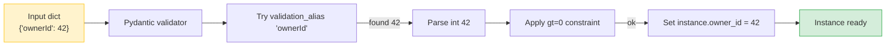

# Lesson 02: Fields, Annotated, and Reusable Annotations

*Building `ProjectCreate` for Boardly with the `Annotated[T, Field(...)]` form, plus a small library of reusable annotated types (`PositiveInt`, `NonEmptyStr`, `LowerEmail`, `Slug`).*

**You're on Lesson 2 of Section 04.**

A `BaseModel` with bare type annotations (`x: int`, `name: str`) gives you basic type coercion but nothing else: no bounds, no descriptions in the OpenAPI schema, no aliases for snake/camel mismatches, no reusable constraints. The Pydantic v2 tool for all of that is `Field`, and the v2-idiomatic place to put it is `Annotated[T, Field(...)]`. Once you internalize that, the same constraint (`gt=0`, `min_length=8`, `description="..."`) becomes a one-line reusable type you can ship across the codebase — the difference between `user_id: int = Field(gt=0)` repeated fifty times and `user_id: PositiveInt`. Take your time. Type every line. Read the tracebacks. **This is how you learn.**


#pydantic #field #annotated #v2 #canonical

## Learning Objectives

By the end of this lesson you will be able to:

1. **Use `Field` correctly** with `default=`, `min_length=`, `max_length=`, `gt=`, `ge=`, `lt=`, `le=`, `pattern=`, `description=`, `examples=`, and `frozen=`.
2. **Write `Annotated[int, Field(gt=0)]`** and explain why it is preferred over `x: int = Field(gt=0)` as a default kwarg.
3. **Define reusable annotated types** (`PositiveInt`, `NonEmptyStr`, `LowerEmail`, `Slug`) in a `boardly/types.py` module and apply them across multiple models without re-stating the constraint every time.
4. **Use `serialization_alias`, `validation_alias`, and `populate_by_name`** to accept `camelCase` from clients and emit `snake_case` internally, or to accept external `kebab-case` payloads without polluting your model attribute names.
5. **Distinguish `alias` from `serialization_alias` from `validation_alias`** and predict which one a given `model_dump(by_alias=True)` call will use.
6. **Justify the `Annotated` form** in terms of PEP 593 typing semantics, static-checker support, and the v2-preferred idiom.

## Prerequisites

Before starting, you need:

- **Pydantic v2.14.1** (verified 2026-10-11) and Lesson 1's `boardly/schemas.py` from [[BaseModel-and-Validation|the previous lesson]]. The smoke-test command from Lesson 1 should still work.
- **PEP 593 (`Annotated`)** — [[01-Python-Foundations/Type-Hints-and-Annotations]]. We are about to use `Annotated[T, Field(...)]` everywhere; if the form `Annotated[int, Field(gt=0)]` is unfamiliar, go back and read the relevant section of the type-hints lesson.
- **About an hour of focused time.** The code is two small files (`boardly/types.py` for the reusable annotations, `boardly/schemas.py` extended with `ProjectCreate`); the explanation is long because every `Field` argument carries weight.

**The most common gap: treating `Annotated` as syntactic sugar.**

If you learned `Annotated` as "a way to add a default value to a type hint," you have it backwards. `Annotated[T, x]` *attaches metadata `x` to type `T`*; whoever consumes the annotation decides what to do with the metadata. Pydantic v2 reads `Annotated[int, Field(gt=0)]` and treats the `Field(...)` as the field metadata. FastAPI reads `Annotated[int, Depends(get_int)]` and treats `Depends(...)` as a dependency. Other libraries can attach their own metadata. The form is general; Pydantic is one consumer.


## The Problem

Boardly needs a `POST /projects` endpoint. The body looks like:

```json
{
 "name": "Migration to v2",
 "slug": "migration-to-v2",
 "description": "Move the API from FastAPI 0.95 to 0.148.",
 "ownerId": 42,
 "tags": ["python", "fastapi"],
 "visibility": "private",
 "due_on": "2026-11-30"
}
```

The endpoint has to enforce:

- `name` is required, 1–200 characters.
- `slug` is required, 3–64 characters, lowercase, matches `^[a-z0-9-]+$`.
- `description` is optional, up to 2000 characters.
- `ownerId` (note the camelCase from the client) is required, an integer greater than 0.
- `tags` is optional, defaults to an empty list, each item 1–32 characters.
- `visibility` is required, one of `"private"`, `"public"`, `"unlisted"`.
- `due_on` is optional, a date in ISO 8601 format.

If you wrote this with bare type hints (`name: str`, `owner_id: int`), you would have:

- No bounds — a 4 MB `name` would pass through to the database before erroring.
- No description in `/docs` — the OpenAPI schema would show `name: string` and nothing else.
- No alias support — the client sends `ownerId` but your Python attribute is `owner_id`; you'd have to write a `@field_validator(mode="before")` to translate.
- No reusable constraints — every `int > 0` in your codebase is a separate `gt=0` statement, repeated forever.

The v2 answer is the `Annotated[T, Field(...)]` form. A field with bounds, a description, an alias, and a default is one readable line. A reusable constraint (`PositiveInt`) is one line in `types.py`, used everywhere. This lesson teaches both.

## The Code

Here are the two files you'll write. First, a small library of reusable annotated types in `boardly/types.py`:

```python
# boardly/types.py
"""Reusable annotated types for Boardly schemas.

Every constraint we repeat (gt=0, min_length=1, max_length=N) lives here
as a one-line type. Models import the type instead of restating the
constraint.
"""
from typing import Annotated

from pydantic import Field

# --- numerics ---
PositiveInt = Annotated[int, Field(gt=0, description="Must be > 0.")]
NonNegInt = Annotated[int, Field(ge=0, description="Must be >= 0.")]
Percent = Annotated[int, Field(ge=0, le=100, description="0-100.")]

# --- strings ---
NonEmptyStr = Annotated[str, Field(min_length=1, description="Non-empty.")]
Slug = Annotated[str, Field(min_length=3, max_length=64,
 pattern=r"^[a-z0-9-]+$",
 description="URL-safe slug.")]
LowerEmail = Annotated[str, Field(min_length=3, max_length=254,
 pattern=r"^[^@]+@[^@]+\.[^@]+$",
 description="Lowercase email.")]

# --- temporals (defaults via Field, used at call site) ---
# We do NOT bake a default into the alias; defaults belong on the field.
```

Then the `ProjectCreate` schema in `boardly/schemas.py`, appended after `UserCreate` from Lesson 1:

```python
# boardly/schemas.py (continuation)
from datetime import date
from enum import Enum
from typing import Annotated

from pydantic import BaseModel, ConfigDict, Field

from boardly.types import LowerEmail, NonEmptyStr, PositiveInt, Slug


class Visibility(str, Enum):
 private = "private"
 public = "public"
 unlisted = "unlisted"


class ProjectCreate(BaseModel):
 """Body for POST /projects — create a new project."""

 model_config = ConfigDict(
 extra="forbid",
 populate_by_name=True, # accept both alias and python name
 str_strip_whitespace=True,
 use_enum_values=True, # store the .value, not the enum member
 )

 name: NonEmptyStr = Field(..., max_length=200,
 description="Human-readable project name.")
 slug: Slug = Field(..., description="URL-safe identifier.")
 description: str | None = Field(default=None, max_length=2000,
 description="Optional long-form copy.")
 owner_id: PositiveInt = Field(
 ..., serialization_alias="ownerId", validation_alias="ownerId",
 description="Owning user id.",
 )
 tags: list[NonEmptyStr] = Field(default_factory=list, max_items=20)
 visibility: Visibility = Visibility.private
 due_on: date | None = Field(default=None, description="ISO date.")


# Smoke test:
# uv run python -c "from boardly.schemas import ProjectCreate; \
# print(ProjectCreate.model_validate({'name':'v2','slug':'v2', \
# 'ownerId':1}).model_dump(by_alias=True))"
```

Two files. Read them. Type them. Run them. Change them. Break them. Fix them. We'll explain every line next.

## Line-by-Line Deep Dive

This section is the heart of the lesson. Read it twice. Don't skip.

### `boardly/types.py` Lines 1–10: The module docstring and imports

```python
"""Reusable annotated types for Boardly schemas.

Every constraint we repeat (gt=0, min_length=1, max_length=N) lives here
as a one-line type. Models import the type instead of restating the
constraint.
"""
from typing import Annotated

from pydantic import Field
```

**What it does:** Pulls in two names — `Annotated` from the standard library's `typing` module, and `Field` from Pydantic. The docstring explains *why* this file exists: to centralize constraints.

**Why a separate file:** A reusable type is something you import in dozens of files. If it lives in `boardly/schemas.py`, you create a circular-import risk (every schema file imports from every other schema file). If it lives in `boardly/types.py`, the dependency graph points one way: schemas import types; types never import schemas. That is the same principle as putting `Enum` declarations in their own file.

**Tip — Why `from typing import Annotated` and not `from typing_extensions import Annotated`?**

In Python 3.9+, `Annotated` is in the standard library's `typing` module. You only need `typing_extensions` if you support Python 3.8. Boardly targets Python 3.12, so the standard-library import is correct. If your project supports older Pythons, swap the import — the rest of the code does not change.


**Warning — Debugging circular imports when `types.py` drifts.**

The one-way dependency graph (`schemas` imports `types`; `types` never imports `schemas`) is load-bearing. The day you add `from boardly.schemas import UserCreate` inside `types.py` — say, to build a `UserRef = Annotated[UserCreate, Field(...)]` alias — Python raises `ImportError: cannot import name 'UserCreate' from 'boardly.schemas'` (partial-initialization cycle) or `AttributeError: module 'boardly.schemas' has no attribute 'UserCreate'`. The traceback points at `types.py`, not at the file that introduced the cycle, which sends you down the wrong rabbit hole. The fix is structural: keep `types.py` a leaf module that imports only stdlib and `pydantic`; if you need a model-typed alias, put it in `schemas.py` next to the model, not in `types.py`. A CI lint (`rg -n "from boardly.schemas" boardly/types.py` returning zero hits) makes the rule enforceable, not just conventional.


### Lines 13–15: The `PositiveInt` definition

```python
PositiveInt = Annotated[int, Field(gt=0, description="Must be > 0.")]
```

**What it does:** Defines `PositiveInt` as a type alias — specifically, the type `int` annotated with the metadata `Field(gt=0, description="Must be > 0.")`. When this alias is used as a field annotation on a model, Pydantic reads the metadata and applies the `gt=0` constraint.

**Why this form (`Annotated[T, Field(...)]`) and not `def PositiveInt(...)` or a class:** Because aliases are values, not classes or functions. A type alias is the simplest thing in the typing world — `PositiveInt` *is* `Annotated[int, Field(...)]` after assignment. There is no class to instantiate, no function to call, no `__init__` to run. The alias is a typing-level construct that exists at *class-definition time*, when Pydantic walks the field annotations.

**Why `Field(gt=0)` and not `Field(default=..., gt=0)`:** Because `Field` here is metadata, not a default. The first positional of `Field` *can* be a default, but you should *not* put a default inside the alias. If you did — say, `PositiveInt = Annotated[int, Field(default=1, gt=0)]` — every model that uses `PositiveInt` as a field would inherit the default of `1`, which is rarely what you want. The alias carries the *constraint*; the model carries the *default*. Those are independent decisions.

**Why is the `Annotated[T, Field(...)]` form preferred over `T = Field(...)` by static type-checkers?** Because `T = Field(...)` makes the *runtime* value of `T` a `FieldInfo` instance, but the *type annotation* of `T` is still just `type` — mypy and pyright see "the value is `FieldInfo`, but the annotation is missing." `Annotated[T, Field(...)]` keeps the annotation as `T` with `Field(...)` carried as *metadata* in the typing system; the static checker sees the real type (`int`, `str`) and can reason about it normally, while Pydantic's runtime introspection reads the metadata. The `Annotated` form is the only one that survives `get_type_hints()` cleanly — and `get_type_hints()` is what FastAPI itself calls to parse `Annotated[int, Query(ge=0)]` query parameters, so using the same form in your Pydantic models keeps the mental model uniform between request-body parsing and query-parameter parsing.

**What Pydantic does with `Annotated[T, Field(...)]` internally**

At class-definition time, Pydantic walks the model's `__annotations__` and unwraps `Annotated`. For `owner_id: PositiveInt`, Pydantic:
1. Looks up `PositiveInt` in the module's namespace; finds it is `Annotated[int, Field(gt=0, description="...")]`.
2. Unwraps to `int` as the type and `[Field(gt=0, description="...")]` as the metadata.
3. Builds a `FieldInfo` from the `Field(...)` metadata.
4. Combines that with any *additional* `Field(...)` declared on the model's field line (e.g., `owner_id: PositiveInt = Field(serialization_alias="ownerId")` — the alias comes from the model line, the `gt=0` comes from the alias).
5. Generates a Rust core-schema node for the field.

The combination step is the key thing: an `Annotated` alias carries constraints that apply everywhere; the model's `Field(...)` line carries constraints that apply to that field only. You can mix them: `owner_id: PositiveInt = Field(default=1)` is "a positive int, default 1."


**Danger — `gt=0` on IDs is a security control, not a code-style preference.**

`PositiveInt` on an `owner_id` field rejects `0` and negatives — which matters because naive ORMs and route handlers will happily `WHERE id = -1` or `WHERE id = 0` if a client crafts the URL. A negative or zero ID almost always means an unsigned-integer column received a wrap-around value, or an attacker is probing for an IDOR / enumeration path that returns a different error shape than `404 not found` (the shape difference is the signal the attacker is reading). The schema layer is the cheapest place to refuse the value (microseconds, no DB round-trip, no query log); the database layer is the most expensive (it has already parsed, planned, and possibly logged the query before the row miss). Treat `PositiveInt` on every primary-key and foreign-key field as a defense-in-depth measure, not a stylistic flourish — and add a property test that feeds `-1`, `0`, `2**63`, and `2**63 + 1` to every ID field.


### Lines 14–15: `NonNegInt` and `Percent`

```python
NonNegInt = Annotated[int, Field(ge=0, description="Must be >= 0.")]
Percent = Annotated[int, Field(ge=0, le=100, description="0-100.")]
```

**What they do:** Two more aliases. `NonNegInt` is "zero or positive" (`ge=0`, greater-or-equal). `Percent` is bounded both below (0) and above (100).

**Why the bounds are `ge` and `le` and not `gt` and `lt`:** Because the boundary values are valid. Zero is a valid `NonNegInt`. 100 is a valid `Percent`. The four numeric constraints are `gt` (greater than), `ge` (greater-or-equal), `lt` (less than), `le` (less-or-equal). Pick the one that matches the semantics — not the one that "looks symmetric."

**Why `int` and not `float` for `Percent`?**

Because Boardly's `Percent` is a "0 to 100 integer" — a value you'd see on a progress bar. If you wanted a "0.0 to 1.0 ratio," you'd write `Ratio = Annotated[float, Field(ge=0.0, le=1.0, ...)]`. The lesson here is that the alias name should *match the type*. If you call something `Percent` and use `float`, you'll get values like `12.7` that are technically valid but break downstream code that expected an integer. Name your aliases precisely.


### Lines 18–22: The string aliases

```python
NonEmptyStr = Annotated[str, Field(min_length=1, description="Non-empty.")]
Slug = Annotated[str, Field(min_length=3, max_length=64,
 pattern=r"^[a-z0-9-]+$",
 description="URL-safe slug.")]
LowerEmail = Annotated[str, Field(min_length=3, max_length=254,
 pattern=r"^[^@]+@[^@]+\.[^@]+$",
 description="Lowercase email.")]
```

**What they do:** Three string aliases. `NonEmptyStr` is "at least one character." `Slug` is "3–64 characters matching `^[a-z0-9-]+$`." `LowerEmail` is "3–254 characters with at least one `@` and one `.`."

**Why `pattern` (a regex) for `Slug` and `LowerEmail`:** Because some constraints are most naturally expressed as regular expressions. `Slug` should be lowercase ASCII letters, digits, and hyphens only — that is `^[a-z0-9-]+$`. `LowerEmail` *should* be a proper RFC 5322 email, but the full RFC regex is several kilobytes long and unreadable; the simple `[^@]+@[^@]+\.[^@]+` catches 99% of bad input without inviting the regex-engine-from-hell. Use `pattern` for shape rules; use a custom `@field_validator` (Lesson 3) for semantic rules.

**Why does Pydantic use Python's `re` module for `pattern` and not a stricter engine like the third-party `regex` library?** Because the standard library's `re` is good enough for the shape rules you actually want to enforce in a schema — character classes, anchors, repetition, alternation. The `regex` library adds lookbehind of arbitrary width, atomic groups, and Unicode property classes (`\p{L}` for any letter), none of which you need for slugs or emails. Baking in a third-party engine would force every Pydantic install to ship the dependency, and the regex compilation would run in CPython's GIL either way. The trade-off is that you can't write catastrophic-backtracking-protected patterns using the `regex` library's `regex.sub(...)` atomic primitives — you have to write the pattern itself to be safe (no `(a+)+` shapes, no unbounded backreferences on user input).

**Student asks: why not use a real email-validation library like `email-validator`?**

You can — Pydantic ships an `EmailStr` type that wraps the `email-validator` package and does DNS MX-record checks. The trade-off is cost: `EmailStr` runs a DNS lookup at validation time, which adds ~50ms to every request and requires network access at the schema layer. For a registration endpoint where you'll send a verification email anyway, that's worth it — the lookup catches `ada@example.invalid` before you waste an email send. For an internal admin endpoint where the address is your own employee's address, the `LowerEmail` alias's shape check is enough; DNS lookup is overhead. Pick the level of validation that matches the trust boundary: shape check for typed clients, MX-lookup for public registration. The lesson's `LowerEmail` is the shape-check form; `EmailStr` is the DNS-check form.


**Warning — `pattern` uses Python's `re` module.**

Pydantic v2 compiles the `pattern` string with `re.compile(pattern)` and calls `match()` (anchored at the start). The `^` and `$` anchors in the patterns above are belt-and-braces — `match()` is already anchored at the start, but adding `^` makes the intent obvious to readers and protects against a future change to `fullmatch` semantics. Always include both anchors in your patterns; never assume the engine's anchoring behavior.


**Danger — `pattern` runs `re` on attacker-controlled input — write ReDoS-safe patterns or cap the length.**

Pydantic compiles your `pattern` with `re.compile()` and calls `.match()` against the raw input string at validation time. If your pattern has nested quantifiers (`(a+)+`, `([a-z]+)*`, `(\d+)+`), an attacker can submit a 30-character string that takes minutes to fail — a single hostile request pins a Uvicorn worker and starves every other connection on that process. The `Slug` pattern `^[a-z0-9-]+$` is safe (one quantifier over one character class, no nesting). Audit any pattern that combines `+` or `*` with grouping or alternation; prefer character classes over groups (`[a-z]` over `(a|b|c)`). For public endpoints, also set `max_length` on the field so the input is bounded before the regex ever runs — a 64-char cap means the worst-case backtracking is bounded by 64 characters, not by the request body size. ReDoS is a server-side DoS that bypasses your rate limiter because the damage happens before the request handler is invoked.


### `boardly/schemas.py` Lines 1–9: Imports for `ProjectCreate`

```python
from datetime import date
from enum import Enum
from typing import Annotated

from pydantic import BaseModel, ConfigDict, Field

from boardly.types import LowerEmail, NonEmptyStr, PositiveInt, Slug
```

**What it does:** Imports the standard-library types `date` (for the `due_on` field) and `Enum` (for the `Visibility` enum), the typing primitive `Annotated`, the Pydantic primitives, and four reusable aliases from the new `types.py` file.

**Why each:**

- `date` — Pydantic v2 has built-in support for parsing ISO 8601 date strings (`"2026-11-30"`) into `datetime.date` objects. The validation is done by Rust code, so it is fast and consistent.
- `Enum` — We'll define `Visibility(str, Enum)`. Pydantic v2 supports `Enum` fields natively; it coerces the string `"private"` to the enum member `Visibility.private` (or, with `use_enum_values=True`, to the string `"private"` itself).
- `Annotated` — We use the `Annotated[T, Field(...)]` form for any field that needs constraints beyond the alias.
- The four aliases — `LowerEmail` is imported but not used in `ProjectCreate` itself (it lives here for forward reference); `NonEmptyStr`, `PositiveInt`, `Slug` are used in the fields.

**The v2-preferred form is `Annotated[T, Field(...)]`, not `T = Field(...)`.**

You *can* write `name: str = Field(min_length=1, max_length=200)` — it works. But you *should* write `name: Annotated[str, Field(min_length=1, max_length=200)]`. The reasons:
- The `Annotated` form separates the *type* (`str`) from the *metadata* (`Field(...)`). A reader of your code can find the type at a glance, then the constraints.
- The `Annotated` form survives `get_type_hints()` cleanly. Static type-checkers (mypy, pyright) see `Annotated[str, Field(min_length=1)]` as `str` with metadata; they see `name: str = Field(...)` as `str` with a default of `FieldInfo`, which mypy cannot reason about.
- The `Annotated` form composes with aliases. `name: NonEmptyStr = Field(max_length=200)` reads as "NonEmptyStr, but capped at 200"; the alias contributes `min_length=1` and the line contributes `max_length=200`. With the `=` form, you would have to inline both constraints: `name: str = Field(min_length=1, max_length=200)`, and lose the reuse.
- The `Annotated` form is what FastAPI documents for query/path/body params (`Annotated[int, Query(ge=0)]`). Using the same form in your Pydantic models keeps the mental model uniform.

The team convention in `Boardly` is: `Annotated[T, Field(...)]` for any field with constraints; bare `T` for fields with no constraints; `T = default` for fields with a default but no constraints.


### Lines 11–15: The `Visibility` enum

```python
class Visibility(str, Enum):
 private = "private"
 public = "public"
 unlisted = "unlisted"
```

**What it does:** Declares a `str`-backed `Enum` with three members. A `str`-backed enum means each member *is* a string as well as an enum member — `Visibility.private == "private"` is `True`.

**Why `str, Enum` (mixed-in `str`) and not pure `Enum`:** That makes `model_dump()` produce `"private"` (the string) and not `<Visibility.private: 'private'>`. With a pure `Enum`, `model_dump()` produces the enum member, which then breaks `json.dumps`. With a `str, Enum`, the dump is JSON-friendly by default. Add `use_enum_values=True` to `model_config` and even the in-memory instance stores the string, not the member.

**Example — What Pydantic does with `Enum` fields internally**

When a field is declared `visibility: Visibility`, Pydantic builds a `typed` core-schema that accepts:
- A string matching one of the enum values: `"private"` → `Visibility.private`.
- An enum member directly: `Visibility.private` → itself.
Any other input raises `ValidationError` with `type=enum` and the allowed values listed.

With `use_enum_values=True`, after validation Pydantic replaces the member with the underlying value, so `instance.visibility == "private"` (string), not `Visibility.private` (member). That makes downstream code (logging, JSON serialization, equality checks with raw strings) simpler — at the cost of losing the enum-typed identity. The Boardly convention is to enable `use_enum_values=True` on response and request schemas; to leave it off on domain models where the enum identity matters.


**Enum string values are part of your API contract — pin them, do not renumber them.**

The string `"private"` is what clients send and what your database stores (because `use_enum_values=True` stores the member value). If you later refactor `Visibility` to `Visibility.PRIVATE = "PRIVATE"` (uppercase), three things break silently: (a) clients sending `"private"` now fail validation; (b) rows already in Postgres with `visibility='private'` no longer match the enum on read-back, surfacing as `ValidationError` on the next `SELECT`; (c) any `WHERE visibility = 'private'` SQL in a migration now mismatches the rewritten data. Treat enum string values as frozen once a deployment ships them: never renumber, never change case, never rename the string. If you must change a value, ship a migration that rewrites the column first, then a deploy that flips the enum, in that order — and accept a brief window where both values are valid. A schema-diff test in CI (the set of enum string values is unchanged between `main` and the PR) catches accidental renames before they ship.


### Lines 18–24: The `ProjectCreate` class declaration and `model_config`

```python
class ProjectCreate(BaseModel):
 """Body for POST /projects — create a new project."""

 model_config = ConfigDict(
 extra="forbid",
 populate_by_name=True, # accept both alias and python name
 str_strip_whitespace=True,
 use_enum_values=True, # store the .value, not the enum member
 )
```

**What it does:** Declares `ProjectCreate` and configures it with four options. Three we already met in Lesson 1; `use_enum_values=True` is new.

**Why each option here:**

- `extra="forbid"` — same security rationale as Lesson 1: reject unknown fields.
- `populate_by_name=True` — *required* by the `owner_id` field, which has both a `validation_alias="ownerId"` and the Python attribute name `owner_id`. Without `populate_by_name=True`, after declaring an alias, the Python name would no longer be accepted on input — the alias would be the only accepted key. With `populate_by_name=True`, both work.
- `str_strip_whitespace=True` — trim whitespace before validation; same rationale as Lesson 1.
- `use_enum_values=True` — store `instance.visibility == "private"` (string), not `Visibility.private` (enum member). Saves a step at serialization time.

**Tip — `populate_by_name` (v2) is `allow_population_by_field_name` (v1).**

The v1 option name is still accepted with a deprecation warning. Use the v2 name. The option only matters when at least one field has an alias; on a schema with no aliases, the option is a no-op. Set it anyway — aliases can be added later, and the option turns a future schema change from "stop working" to "still works."


**Warning — `populate_by_name=True` plus `extra="forbid"` can mask a missing-alias bug.**

With both options on, a field declared as `owner_id: PositiveInt = Field(..., validation_alias="ownerId")` accepts `"ownerId"` and `"owner_id"` on input. The trap: if you forget the `validation_alias` on a new field (say `team_id: PositiveInt = Field(...)`), clients sending `"teamId"` get `extra_forbidden` (unknown field) — but clients sending `"team_id"` succeed, so your Python integration tests pass while your camelCase-frontend integration tests fail in staging. The debugging move is to dump `ProjectCreate.model_fields["team_id"]` and grep the `FieldInfo`'s `alias`, `validation_alias`, `serialization_alias` triples; a field with `alias=None` on all three is a field whose wire contract is "snake_case only" and your frontend's camelCase is being silently rejected. A property test that feeds both the Python name and the expected wire name for every aliased field catches the drift at CI time, not in staging.


### Line 26: The `name` field with mixed alias and inline constraints

```python
 name: NonEmptyStr = Field(..., max_length=200,
 description="Human-readable project name.")
```

**What it does:** Declares `name` as a `NonEmptyStr` (so `min_length=1` from the alias), required (`...`), with `max_length=200` (added inline) and a description.

**Why this combination:** The alias `NonEmptyStr` carries `min_length=1`. The line `Field(..., max_length=200)` adds `max_length=200` and the description. Pydantic combines the two `FieldInfo` objects into one, with the line-level taking precedence on conflicts. The result: `name` is required, 1–200 characters.

**Why `description` lives on the line and not in the alias:** Because the description is per-field — every field using `NonEmptyStr` has a different description ("Human-readable project name" vs. "Tag text" vs. "Display name"). The `min_length=1` constraint is the same for every `NonEmptyStr` field, so it belongs in the alias. The description is different, so it belongs on the line.

**Combining `Annotated` aliases with `Field` defaults: precedence rules**

When the same option is set both in the alias's `Field(...)` and on the line's `Field(...)`, the line wins. This is deliberate: the line is the more specific declaration. For example:
```python
# alias says min_length=1, line says min_length=5 — line wins
name: NonEmptyStr = Field(..., min_length=5, max_length=200)
```
For options that are not in conflict, both contribute. The combination is *union, not intersection* — constraints accumulate, they don't override each other unless they directly conflict.


**`description=` is your OpenAPI surface — keep it honest or remove it.**

FastAPI pulls `Field(description=...)` into the generated `/docs` JSON Schema, so a stale description ("Must be > 0" on a field whose constraint you later loosened to `ge=0`) misleads every API consumer who reads the docs. Worse, code-generated client SDKs (openapi-generator, openapi-typescript) bake the description into client-side JSDoc and TypeScript comments — a wrong description propagates into your downstream repos and is read by frontend engineers who have no reason to doubt it. Treat `description=` like a changelog entry: update it in the same PR that changes the constraint, or omit it entirely (an empty description signals "look at the type" while a wrong description signals "the constraint is X" when it is not). A `model_json_schema()` snapshot test in CI catches description drift the moment it is introduced.


### Line 28: The `slug` field

```python
 slug: Slug = Field(..., description="URL-safe identifier.")
```

**What it does:** Declares `slug` as a `Slug` (so `min_length=3`, `max_length=64`, `pattern=r"^[a-z0-9-]+$"` from the alias), required (`...`), with a per-field description.

**Why this is a single line:** Because the alias carries *every* constraint the field needs. The line only adds the description. This is the goal of the `Annotated` form: when the alias is right, the line is one argument.

### Lines 29–30: The optional `description`

```python
 description: str | None = Field(default=None, max_length=2000,
 description="Optional long-form copy.")
```

**What it does:** Declares an optional `description` of type `str | None`, default `None`, capped at 2000 characters.

**Why no `NonEmptyStr` here:** Because `description` is allowed to be the empty string `""` (or `None`). `NonEmptyStr` would reject `""`, which is wrong for an optional free-form field. Use the alias when the constraint matches the semantics; use a bare type when the constraint would be wrong.

### Lines 31–35: The `owner_id` field with aliases

```python
 owner_id: PositiveInt = Field(
 ..., serialization_alias="ownerId", validation_alias="ownerId",
 description="Owning user id.",
 )
```

**What it does:** Declares `owner_id` as a `PositiveInt` (so `gt=0`), required, with both `serialization_alias="ownerId"` and `validation_alias="ownerId"` set.

**Why both aliases:** Because the client sends `"ownerId"` (camelCase) and the client expects to read `"ownerId"` back in the response. We set both aliases so both directions use the same wire name. The Python attribute is `owner_id` (snake_case); the wire name is `ownerId` (camelCase).

**What each alias does:**

- `validation_alias="ownerId"` — on *input*, accept `"ownerId"` in the dict (and, with `populate_by_name=True`, also accept `"owner_id"`).
- `serialization_alias="ownerId"` — on *output*, emit `"ownerId"` as the key when `model_dump(by_alias=True)` is called.
- `alias="ownerId"` — the third form; sets both at once. Equivalent to setting both `serialization_alias` and `validation_alias` to the same value.

**Why we wrote both instead of `alias="ownerId"`:** To make the contract explicit. The form `serialization_alias=..., validation_alias=...` says, in code, "we accept `ownerId` on input and we emit `ownerId` on output." The form `alias="ownerId"` says the same thing, but you have to know that `alias` is sugar for both. Explicit beats implicit for security-sensitive schemas.

**Student asks: what if I want to accept `"ownerId"` on input but emit `"owner_id"` on output?**

Use `validation_alias="ownerId"` (no `serialization_alias`). Then on output, `model_dump(by_alias=True)` uses the *field name* (`owner_id`) because there's no `serialization_alias`. This is rare — the contract is asymmetric — but it does happen when a legacy client uses camelCase on input and a new internal consumer expects snake_case on output. Most of the time you want symmetric aliases.


**Warning — Debugging alias precedence — use `model_fields`, not `model_dump()`.**

When a field accepts input you did not expect or rejects input you did expect, the right debugging move is `ProjectCreate.model_fields["owner_id"]` — it returns a `FieldInfo` whose `.alias`, `.validation_alias`, `.serialization_alias`, and `.metadata` tell you exactly which keys are accepted on input and which key is emitted on output. Calling `model_dump()` first is the wrong move: it shows you the output side only, and the bug is almost always on the input side. The mental model: `model_fields` is the schema (the contract); `model_dump()` is one execution of the schema. Debug the schema, not one execution. A useful one-liner for a failing field: `python -c "from boardly.schemas import ProjectCreate; import pprint; pprint.pp(ProjectCreate.model_fields['owner_id'])"` — the `FieldInfo` repr shows the resolved alias triples after the alias-plus-line merge, which is what Pydantic actually uses at runtime.


### Line 36: The `tags` field with `default_factory` and `max_items`

```python
 tags: list[NonEmptyStr] = Field(default_factory=list, max_items=20)
```

**What it does:** Declares a list of `NonEmptyStr` (so each item is 1+ chars), defaulting to an empty list per instance (via `default_factory=list`), capped at 20 items.

**Why `default_factory=list` instead of `default=[]`:** Lesson 1 covered this — mutable defaults must be factories. `default_factory=list` calls `list()` (the type itself as a zero-arg callable) once per instance, producing a fresh `[]` each time.

**Why `max_items=20`:** A bound on the number of items in the list. Without it, a client could send `"tags": ["x"] * 1_000_000` and the schema would accept a 1M-item list. With it, the schema rejects lists longer than 20. The number 20 is a product decision; pick a number that makes sense for your domain.

**Why each item is `NonEmptyStr`:** Because empty strings in `tags` would be silly. The alias applies to every item in the list because Pydantic walks the inner type of `list[...]` at class-definition time.

**Per-item constraints are applied via the inner type.**

When you write `tags: list[NonEmptyStr]`, Pydantic treats `NonEmptyStr` as the *item type* of the list. At validation time, for each item in the input list, Pydantic runs the same validator it would run for a `NonEmptyStr` field. The `min_length=1` constraint therefore applies to every item. The `max_items=20` constraint on the line applies to the *list itself*. The two are independent: a list of 5 items each with `min_length=1` passes; a list of 25 items each with `min_length=1` fails `max_items=20`.


**Danger — `max_items` on list fields is a request-size DoS control, not a domain rule.**

Without `max_items`, a client can submit `"tags": ["x"] * 1_000_000` and Pydantic will allocate and validate a million-element list before the request handler ever runs. The CPU cost is linear in the list length; the memory cost is the list plus one `FieldInfo`-validated string per element; the latency cost is the total validation time, which a hostile client can tune to be just under your reverse-proxy timeout so the request neither completes nor gets killed. A single 50 MB request body can pin every Uvicorn worker in turn until your health-check fails and the load balancer drains the instance. `max_items=20` caps the work at 20 elements; `max_length` on the inner type caps the per-element work. Set both on every `list[...]` field that accepts client input; the defaults (no cap) are unsafe for any public endpoint. The same rule applies to `dict[...]` fields (`max_items` again) and to nested models whose depth a client can grow (`max_items` on the outer list, plus a depth cap via a custom `@model_validator` if the nesting is recursive).


### Line 37: The `visibility` field with an enum default

```python
 visibility: Visibility = Visibility.private
```

**What it does:** Declares `visibility` as a `Visibility` enum, defaulting to `Visibility.private`. The client can omit the field; the default kicks in.

**Why a default of `private`:** Because security-sensitive defaults. If the client does not specify visibility, the project is private — not public. This is the "fail-closed" principle.

**Fail-closed defaults are a security pattern, not a code-style choice.**

The `visibility: Visibility = Visibility.private` default is one instance of a broader rule: when a field has security implications (`visibility`, `is_admin`, `allow_anonymous`, `cors_enabled`, `rate_limit_per_minute`, `require_2fa`), the default must be the most restrictive value, not the most convenient one. The temptation is to default `is_admin=False` "for now" and flip it later — but a forgotten default is a privilege-escalation bug waiting for the next operator who sets `BOARDLY_DEFAULT_IS_ADMIN=true` in a misconfigured env, or for the next schema refactor that swaps the default to `True` "for testing" and ships to prod. The pattern: enumerate every security-relevant field in a `SECURITY_SENSITIVE_FIELDS` list, write each one's restrictive default in a comment next to the declaration, and add a CI test that asserts each default is still restrictive. The test is the safety net for human fallibility; the comment is the audit trail.


**Why no `Field(...)`:** Because there are no extra constraints to add. The type is the constraint — the enum has three values, anything else fails. The default is `Visibility.private`. The line is as readable as it gets.

**Why does `visibility: Visibility = Visibility.private` not need `Field(default=Visibility.private)`?** Because Pydantic treats the right-hand side of the `=` as the default value when the annotation is a Pydantic-supported type (here, an `Enum`). The bare-assignment form `field: T = default` is the simplest possible declaration, and Pydantic only requires the more verbose `Field(default=...)` form when you also want to attach metadata (description, alias, examples). For a field whose only "extra" is a default value, the bare form is both idiomatic and faster to read at the call site. The same shortcut applies to plain scalar types: `count: int = 0` is fine; `count: int = Field(default=0)` is just noise.

### Line 38: The `due_on` field

```python
 due_on: date | None = Field(default=None, description="ISO date.")
```

**What it does:** Declares an optional `due_on` of type `date | None`, defaulting to `None`. Pydantic parses ISO 8601 strings like `"2026-11-30"` into `datetime.date` objects.

**Why the wire name is `due_on` (snake_case) and not `dueOn` (camelCase):** A product decision. Boardly's API uses snake_case throughout; Lesson 1's `UserCreate` had no aliases; this lesson introduces aliases on one field (`owner_id` → `ownerId`) to show the mechanism, but the rest of the schema is snake_case. If your API is uniformly camelCase, you'd add aliases to every field (or set a `alias_generator` on the model; see the Engineering Trade-Offs below).

### Lines 41–43: The smoke test

```python
# Smoke test:
# uv run python -c "from boardly.schemas import ProjectCreate; \
# print(ProjectCreate.model_validate({'name':'v2','slug':'v2', \
# 'ownerId':1}).model_dump(by_alias=True))"
```

**What it does:** Documents how to exercise the schema. Note the `by_alias=True` flag — without it, `model_dump()` would use the Python attribute names (`owner_id`), not the alias (`ownerId`).

## Execution Trace

Run the smoke test:

```bash
uv run python -c "
from boardly.schemas import ProjectCreate

# Happy path
p = ProjectCreate.model_validate({
 'name': 'Migration to v2',
 'slug': 'migration-to-v2',
 'ownerId': 42,
 'tags': ['python', 'fastapi'],
 'visibility': 'public',
 'due_on': '2026-11-30',
})
print('dump (by_alias):', p.model_dump(by_alias=True))
print('dump (no alias):', p.model_dump())
print('json:', p.model_dump_json(by_alias=True))
"
```

What happens, in order:

1. **`model_validate(dict)` is called.** Pydantic looks up `ProjectCreate.__pydantic_validator__` and feeds the dict into it.
2. **For `owner_id` (the aliased field):** the input dict has key `"ownerId"`. Pydantic tries the field's aliases first (because `validation_alias="ownerId"`), finds the value `42`, parses it as `int`, validates `gt=0` (42 > 0), and stores it on the instance as `owner_id=42`. The Python attribute name is `owner_id`, but the wire name is `ownerId`.
3. **For `visibility`:** the input is `"public"` (string). Pydantic looks up `Visibility` and finds the member `Visibility.public`. With `use_enum_values=True`, the instance stores `"public"` (string), not `Visibility.public` (member).
4. **For `due_on`:** the input is `"2026-11-30"` (string). Pydantic parses it as `datetime.date(2026, 11, 30)` via the Rust date parser.
5. **`model_dump(by_alias=True)`** serializes the instance to a Python dict, using the *aliases* as keys. `owner_id` becomes `ownerId`. `due_on` (no alias) stays `due_on`. `due_on`'s value stays as the `date` object — `model_dump()` (the default `mode="python"`) keeps Python-native types like `date`, `datetime`, `Decimal`, and `UUID` intact; only `model_dump_json()` (or `model_dump(mode="json")`) stringifies them. If you need a JSON-serializable dict with ISO strings, pass `mode="json"` (or just call `model_dump_json()` and parse the result).
6. **`model_dump()` (no `by_alias`)** uses the Python attribute names. `ownerId` becomes `owner_id`. This is what your service layer uses internally.
7. **`model_dump_json(by_alias=True)`** produces a JSON string with the aliases and the ISO date.

Expected output (truncated):

```python
dump (by_alias): {'name': 'Migration to v2', 'slug': 'migration-to-v2',
 'description': None, 'ownerId': 42,
 'tags': ['python', 'fastapi'], 'visibility': 'public',
 'due_on': date(2026, 11, 30)}
dump (no alias): {'name': 'Migration to v2', 'slug': 'migration-to-v2',
 'description': None, 'owner_id': 42,
 'tags': ['python', 'fastapi'], 'visibility': 'public',
 'due_on': date(2026, 11, 30)}
json: {"name":"Migration to v2","slug":"migration-to-v2","description":null,
 "ownerId":42,"tags":["python","fastapi"],"visibility":"public",
 "due_on":"2026-11-30"}
```

Note two things: (a) `model_dump()` (no JSON) returns a `date` object for `due_on`; `model_dump_json()` returns an ISO string. (b) `by_alias=True` only affects the *key*; the *value* is the same.



**You've just round-tripped an aliased schema.**

The client sent `ownerId`; your code reads `owner_id`; the response (with `by_alias=True`) emits `ownerId` again. The Python and the wire never have to agree on naming convention. The alias layer does the translation.


## Common Mistakes

### Mistake 1: Putting a `default` inside the alias

```python
# WRONG
PositiveInt = Annotated[int, Field(default=1, gt=0)]
```

**Symptom:** Every model that uses `PositiveInt` as a field gets `1` as a default, whether you wanted it or not. Worse: the default silently overrides any "required" intent.

**Why:** `Field(default=1)` puts a default inside the alias's metadata. Pydantic treats the alias's `FieldInfo` as a *base* that combines with the line's `FieldInfo`. The base has `default=1`, so the model's field has `default=1`.

**Fix:** Never put a `default` in an alias. The alias carries constraints; the model carries the default. `PositiveInt = Annotated[int, Field(gt=0)]`. If you want a default, declare it on the model: `count: PositiveInt = 1`.

**Warning — Debugging alias-default mistakes — bisect with `model_fields`, not by re-reading the alias.**

The symptom of Mistake 1 (default baked into the alias) is that `MyModel()` succeeds when it should require input. The wrong debugging move is to open `types.py`, read the alias definition, and look for `default=`. The right move is `MyModel.model_fields["count"].default` — Pydantic resolves the combined `FieldInfo` at class-definition time, so `model_fields` shows the effective default after the alias-plus-line merge, not the source-code default. If `model_fields["count"].default` is `1` but the model line says `Field(...)`, the alias is winning and you have a default-in-alias bug. The same `model_fields` introspection is the fix for Mistake 3 (alias precedence): `model_fields["owner_id"].alias`, `.validation_alias`, `.serialization_alias` are the effective triples after the merge, and reading them beats reasoning about the source code.


### Mistake 2: Forgetting `populate_by_name=True` after adding an alias

```python
# DANGEROUS
class ProjectCreate(BaseModel):
 model_config = ConfigDict(extra="forbid")
 # no populate_by_name
 owner_id: PositiveInt = Field(..., serialization_alias="ownerId",
 validation_alias="ownerId")
```

**Symptom:** `ProjectCreate.model_validate({"owner_id": 42})` raises `ValidationError: field required` — even though `populate_by_name` was *not* a concern before the alias was added.

**Why:** When you declare a `validation_alias`, that alias becomes the *only* accepted key on input, unless you also set `populate_by_name=True`. Without the option, the Python field name `owner_id` is rejected.

**Fix:** Set `populate_by_name=True` on any model with aliases. The option is a no-op on models without aliases, so it is safe to set unconditionally.

### Mistake 3: Confusing `alias` with `serialization_alias` with `validation_alias`

```python
# AMBIGUOUS — what does this do?
class ProjectCreate(BaseModel):
 owner_id: PositiveInt = Field(..., alias="ownerId",
 serialization_alias="owner_id")
```

**Symptom:** Inputs in `"ownerId"` are accepted (because `alias` sets `validation_alias`). But outputs with `by_alias=True` use `"owner_id"` (because `serialization_alias` overrides `alias` on output). The contract is asymmetric — accept camelCase in, emit snake_case out — which is rarely what you want.

**Why:** `alias` is sugar for "both aliases"; `serialization_alias` and `validation_alias` are the underlying knobs. When you set both, `serialization_alias` wins on output, and the *effective* validation alias is still `alias` (`"ownerId"`), so input accepts camelCase. The result is asymmetric.

**Fix:** Pick one form. For symmetric aliases (most common): `alias="ownerId"`. For asymmetric (rare): `validation_alias="ownerId", serialization_alias="owner_id"` — explicit, no `alias`. Do not mix the two.

### Mistake 4: Using `Optional[T]` and forgetting that `Field(...)` is still required

```python
# CONFUSING
class ProjectCreate(BaseModel):
 description: Optional[str] = Field(...)
```

**Symptom:** A required field that the type annotation says is optional. A client who omits `description` gets a `ValidationError`; a client who sends `null` succeeds.

**Why:** `Optional[str]` is `str | None`. The annotation describes the *type*. Required-ness is the default. `Field(...)` is "no default, required." The field is therefore required-and-nullable.

**Fix:** Decide. Optional: `description: str | None = None`. Required-nullable: `description: str | None = Field(...)` and document the contract. Most fields are the first kind.

### Mistake 5: Forgetting `max_length` on `description`

```python
# DANGEROUS
class ProjectCreate(BaseModel):
 description: str | None = None
```

**Symptom:** A client sends a 1 MB `description`. Pydantic accepts it; the service stores it; Postgres errors on insert with `value too long for type character varying(N)`. The error happens far from the source.

**Why:** `str | None` has no length bound. The Postgres column may have one, but Pydantic does not know about it.

**Fix:** Always set `max_length` on free-form string fields. The bound should match the Postgres column. `description: str | None = Field(default=None, max_length=2000)`.

**Danger — Schema `max_length` must match the Postgres `VARCHAR(N)` — or you get silent truncation or a loud `INSERT` failure.**

If the schema says `max_length=2000` and the Postgres column is `VARCHAR(500)`, a 1000-char description passes Pydantic, reaches the ORM, and fails at `INSERT` with `value too long for type character varying(500)`. That is the best case (loud failure at the database boundary, surfaced as an HTTP 5xx). The worse case is when the column is `TEXT` (unbounded): the 1 MB string is accepted everywhere, stored, and only discovered when a downstream service tries to render it, when a backup grows uncontrollably, or when a `SELECT` into a `varchar` temp table blows up. The discipline: write a one-off test that introspects the SQLAlchemy `Column` lengths and the Pydantic `model_fields[...].metadata` `max_length` values and asserts they agree for every string field. The test runs in CI, takes seconds, and catches the drift the day a migration adds a column without updating the schema — which is the day the bug is cheapest to fix.


### Mistake 6: Pattern that doesn't anchor

```python
# DANGEROUS
Slug = Annotated[str, Field(pattern=r"[a-z0-9-]+")]
```

**Symptom:** A slug `"!! migration !!"` passes validation because the regex *matches a substring*.

**Why:** `re.match()` anchors at the start but not the end. `[a-z0-9-]+` matches the first valid char and stops; the rest of the string is ignored.

**Fix:** Always anchor both ends: `pattern=r"^[a-z0-9-]+$"`. The `^` is redundant (because `match` anchors at the start) but makes the intent clear; the `$` is required.

**Warning — Test `pattern=` with adversarial inputs, not happy-path inputs.**

A pattern that passes `"migration-to-v2"` tells you nothing about whether it rejects `"!! migration !!"`. The discipline: for every `pattern=` field, write a property test that feeds (a) a valid input, (b) an input that matches only a substring (`"!! migration !!"` for `[a-z0-9-]+`), (c) an input with a trailing invalid char (`"migration-to-v2!"`), and (d) an empty string. Cases (b) and (c) are the anchoring tests — a pattern with no `$` passes (b) and fails the contract; a pattern with no `^` passes (c) in some engines. Case (d) is the `min_length` test. A pattern that survives all four is anchored correctly. Skip (b) and (c) and you ship Mistake 6 to production, where it is discovered by a user whose display name happens to contain a hyphen-adjacent emoji. The test takes minutes to write and saves an incident.


## Engineering Trade-Offs

### `Annotated[T, Field(...)]` vs `T = Field(...)`

You can write either. The first is preferred in `Boardly`. The trade-off:

- **`Annotated` form**: clearer separation of type and metadata; static checkers (mypy, pyright) read the type correctly; composes with aliases (`name: NonEmptyStr = Field(max_length=200)` is readable).
- **`=` form**: shorter; matches v1 idiom; can be slightly faster to type when there are no aliases and no reusable constraints.

The team convention is: use `Annotated` when you have any constraint beyond the bare type; use `=` only when there is a default and nothing else (`is_admin: bool = False`).

### Per-field `alias` vs `alias_generator`

If your API is uniformly camelCase and your Python is uniformly snake_case, you can either:

- Add `serialization_alias` and `validation_alias` to every field (verbose, explicit).
- Set `alias_generator` on the model to convert snake_case to camelCase automatically:
 ```python
 from pydantic.alias_generators import to_camel
 model_config = ConfigDict(
 alias_generator=to_camel,
 populate_by_name=True,
 )
 ```

The trade-off:

- **Per-field aliases**: explicit. Easy to read. Easy to spot. The cost is verbosity.
- **`alias_generator`**: terse. One config line covers the whole model. The cost is implicit — a reader of your code has to know that `to_camel` is running to understand why `owner_id` appears as `ownerId` on the wire. Also, per-field overrides are awkward (you have to remember to also set `serialization_alias`).

The Boardly convention is: per-field aliases for individual fields that need them (rare, like `owner_id` accepting a legacy camelCase input); `alias_generator=to_camel` for entire schemas whose contract is uniformly camelCase (e.g., a public API contract that must match a documented JSON:API spec).

### `use_enum_values=True` vs keeping enum identity

- **`use_enum_values=True`** (the Boardly default for request/response schemas): the instance stores the underlying value (a string). JSON serialization is direct; `model_dump()` returns the string; equality with raw strings works. Cost: you lose the type identity — `isinstance(instance.visibility, Visibility)` is `False`.
- **Off (default)**: the instance stores the enum member. `isinstance(...)` works. JSON serialization calls `member.value` internally. Cost: equality with raw strings requires `instance.visibility.value == "private"`.

The convention: turn `use_enum_values=True` on for HTTP-facing schemas (request, response). Leave it off on domain entities.

### Inline constraints vs aliases: when to extract

A constraint is worth extracting to an alias when:

- It appears in three or more fields. `gt=0` on integers is everywhere.
- It has a name. `PositiveInt` is a concept; "an int greater than zero" is a description. Names compose better than descriptions.
- It has a regular expression. `Slug`'s `^[a-z0-9-]+$` is too easy to typo; centralize it.

A constraint is *not* worth extracting when:

- It appears once. `max_length=200` on `name` is a one-off.
- The bound is per-field. `max_length=2000` on `description` is specific to the `description` field; extracting it would create an alias nobody else uses.

**When would you NOT reach for `Annotated[T, Field(...)]` aliases?**

Three cases. (1) A constraint that appears in exactly one schema field and is unlikely to recur — inline `Field(...)` is honest about the one-off nature and reading it inline is faster than chasing a definition. (2) A constraint whose parameters depend on the schema's role — `min_length=8` on a registration password and `min_length=12` on an admin password look the same but mean different things; an alias `Password` would have to take the bound as a parameter, which `Annotated` doesn't natively support without generic types. (3) Cross-field rules — `Annotated` cannot express "this field is required only when `kind="business"`"; that needs `@model_validator` (Lesson 3). The rule of thumb: aliases for shape rules that recur; inline `Field` for one-off bounds; validators for rules that cross field lines.


**Spot the bug — does this schema catch a bad default?**

```python
Slug = Annotated[str, Field(min_length=3, max_length=64, pattern=r"^[a-z0-9-]+$")]
class ProjectCreate(BaseModel):
    slug: Slug = Field(default="")
```
No. The `Field(default="")` provides an empty-string default, and the alias's `min_length=3` constraint *should* reject that empty string — but Pydantic does NOT validate defaults by default (`validate_default=False`). So `ProjectCreate()` (no args) silently sets `slug=""`; the `min_length=3` rule never runs against the default value. The empty string then propagates downstream: the database write succeeds if the column is `TEXT` or unbounded `VARCHAR`, the rendered URL is `/p/`, and nothing logs why. The schema author's intent — "slug is optional, defaults to empty, the alias's constraints catch the bad case" — is silently broken. The intent-revealing fix is one of: `slug: Slug | None = None` (optional with `None` default, so `min_length=3` runs only when a value is supplied), `slug: Slug = Field(...)` (required, no default), or `slug: Slug = Field(default="", validate_default=True)` (opt in to validating the default). Mixing alias-level constraints with field-level defaults that violate those constraints is the most common source of "why is my slug empty in the database?" bugs in this lesson.


## Exercises

**Tip — The 20-minute rule**

If you're stuck on an exercise for more than 20 minutes, re-read the relevant section above, then move on and come back. Learning isn't linear.


**Exercise 1 — Add `LowerEmail` to `UserCreate`.** Replace `email: str = Field(..., min_length=3)` in Lesson 1's `UserCreate` with `email: LowerEmail`. Confirm that `"ada@lovelace.dev"` still passes and that `"not-an-email"` is rejected by the alias's `pattern`.

**Exercise 2 — Add a `slug` to `UserCreate`.** Add `slug: Slug = Field(...)` to `UserCreate`. Confirm that `"Ada Lovelace"` (with a space) is rejected by the pattern, while `"ada-lovelace"` passes.

**Exercise 3 — Set up `alias_generator`.** Replace the per-field `serialization_alias`/`validation_alias` on `owner_id` with `alias_generator=to_camel` on the model. Confirm that `model_dump(by_alias=True)` still emits `"ownerId"`. Confirm that input in `"owner_id"` is still accepted because `populate_by_name=True` is set.

**Exercise 4 — Trigger the alias-default mistake.** Define `BadPositiveInt = Annotated[int, Field(default=1, gt=0)]`. Define `class M(BaseModel): count: BadPositiveInt`. Instantiate `M()` (no args). Confirm `count == 1`. Now try to declare `count: BadPositiveInt = Field(...)` to force required — confirm that this *fails* because the alias's `default=1` is still in effect.

**Exercise 5 — Asymmetric alias.** Declare a field that accepts `"owner_id"` on input but emits `"ownerId"` on output. Verify with `model_validate` and `model_dump(by_alias=True)`.

**Exercise 6 — Add a `priority: Percent` field.** Add `priority: Percent = Field(default=0)` to `ProjectCreate`. Confirm that `priority=150` is rejected (`le=100`) and that `priority=50` passes.

**Exercise 7 — Verify the `Annotated` form survives `get_type_hints()`.** Call `typing.get_type_hints(ProjectCreate)` and confirm `owner_id` resolves to `int` (the underlying type), not `FieldInfo`. Then build a v1-style model `class V1(BaseModel): x: int = Field(gt=0)` and confirm `get_type_hints(V1)["x"]` is `int` while `V1.model_fields["x"].default` is a `FieldInfo` instance — the difference mypy and pyright see at static-analysis time, and the reason the `Annotated` form is the v2-preferred idiom. Verify with `uv run python scripts/check_type_hints.py`.

**Exercise 8 — Trigger and fix a ReDoS pattern.** Define `BadSlug = Annotated[str, Field(pattern=r"^([a-z0-9]+)+$")]` on a throwaway `class M(BaseModel): s: BadSlug`. Time `M.model_validate({"s": "a"*24 + "!"})` with `time.perf_counter()` and confirm it takes seconds (catastrophic backtracking from the nested `+` quantifier). Replace the pattern with the `Slug` alias's `^[a-z0-9-]+$` (no nested quantifier) and confirm the same input fails in microseconds. Verify with `uv run python scripts/redos_demo.py` (expect a multi-second hang on the bad pattern, then a sub-millisecond fail on the fixed pattern).

**Exercise 9 — Audit `populate_by_name` with `model_fields`.** Remove `populate_by_name=True` from `ProjectCreate.model_config`, then confirm `ProjectCreate.model_validate({"name":"x","slug":"x","owner_id":1})` raises `ValidationError` (the alias `ownerId` is the only accepted key without the option). Add `populate_by_name=True` back and confirm both `"ownerId"` and `"owner_id"` work. Inspect `ProjectCreate.model_fields["owner_id"]` and confirm `.alias == "ownerId"`. Verify with `uv run pytest tests/test_populate_by_name.py -v`.

**Exercise 10 — Extract the JSON Schema and assert constraints appear.** Call `ProjectCreate.model_json_schema()` and assert `properties["name"]["minLength"] == 1`, `properties["name"]["maxLength"] == 200`, `properties["slug"]["pattern"] == "^[a-z0-9-]+$"`, and `properties["ownerId"]["exclusiveMinimum"] == 0` (the JSON Schema name for `gt=0`). This is the contract your `/docs` page and your generated client SDKs consume. Verify with `uv run python scripts/dump_json_schema.py`.

**Exercise 11 — Build an asymmetric alias and round-trip it.** Declare `class M(BaseModel): user_id: int = Field(..., validation_alias="userId", serialization_alias="user_id")` and confirm `M.model_validate({"userId": 1}).user_id == 1` while `M.model_validate({"userId":1}).model_dump(by_alias=True) == {"user_id": 1}` (the asymmetric contract: camelCase in, snake_case out — useful for legacy-client-to-internal-consumer migrations). Verify with `uv run pytest tests/test_asymmetric_alias.py -v`.

**Exercise 12 — Opt into `validate_default=True` to catch bad defaults.** Define `class M(BaseModel): slug: Slug = Field(default="", validate_default=True)` and confirm `M()` raises `ValidationError` (the empty default fails the alias's `min_length=3`). Remove `validate_default=True` and confirm `M()` silently succeeds with `slug=""` (the footgun from the Spot-the-bug callout above). Verify with `uv run pytest tests/test_validate_default.py -v`.

**Exercise 13 — Audit every `str` field for `max_length`.** Write a script in `scripts/audit_max_length.py` that walks every `BaseModel` subclass imported from `boardly/schemas.py`, inspects each `model_fields[name].metadata` for a `max_length` constraint, and prints a list of `str`-typed fields that have no `max_length` set. Run it; fix every offender by adding `max_length=N` matching the corresponding Postgres column. Verify with `uv run python scripts/audit_max_length.py`.

## Verification

Run the smoke test:

```bash
uv run python -c "
from boardly.schemas import ProjectCreate

p = ProjectCreate.model_validate({
 'name': 'v2',
 'slug': 'v2',
 'ownerId': 1,
 'tags': ['python'],
 'visibility': 'public',
})
print(p.model_dump(by_alias=True))
print(p.model_dump_json(by_alias=True))
"
```

Expected output (truncated):

```
{'name': 'v2', 'slug': 'v2', 'description': None, 'ownerId': 1,
 'tags': ['python'], 'visibility': 'public', 'due_on': None}
{"name":"v2","slug":"v2","description":null,"ownerId":1,
 "tags":["python"],"visibility":"public","due_on":null}
```

Then the sad paths:

```bash
uv run python -c "
from boardly.schemas import ProjectCreate
from pydantic import ValidationError

# owner_id = 0 fails gt=0
try:
 ProjectCreate.model_validate({'name':'x','slug':'x','ownerId':0})
except ValidationError as e: print('zero:', e.errors()[0]['type'])

# slug with uppercase fails pattern
try:
 ProjectCreate.model_validate({'name':'x','slug':'UPPER','ownerId':1})
except ValidationError as e: print('pattern:', e.errors()[0]['type'])

# camelCase input without populate_by_name would fail; with it, both work
print('snake input:', ProjectCreate.model_validate(
 {'name':'x','slug':'x','owner_id':1}).owner_id)
"
```

Expected (truncated):

```
zero: greater_than
pattern: pattern
snake input: 1
```

If you see all three of these, your `ProjectCreate` is correctly wired.

## Previously Learned Here

These concepts were taught in earlier lessons. We link back instead of re-explaining:

- **`BaseModel`** — [[BaseModel-and-Validation|Lesson 1]]. The schema class. We extend it here with `Annotated[T, Field(...)]` fields.
- **`Annotated` (PEP 593)** — [[01-Python-Foundations/Type-Hints-and-Annotations]]. The general typing primitive. Pydantic is one consumer; FastAPI's `Annotated[T, Depends(...)]` is another.
- **Type hints** — [[01-Python-Foundations/Type-Hints-and-Annotations]]. The annotation is the validation contract; `Field(...)` is the metadata.

## What's Next

In [[Validators-Strict-vs-Coercive|Lesson 03]] we move from *constraints* (which `Field` can express) to *rules* (which it cannot). You will:

- Write `@field_validator("password")` to enforce "must contain a digit and a symbol" — a rule no `Field` argument can express.
- Use `mode="before"` vs `mode="after"` to decide whether you see the raw input or the coerced value.
- Use `@model_validator(mode="after")` for cross-field rules like "if `kind == 'business'` then `vat_id` is required."
- Enable strict mode (`ConfigDict(strict=True)`) to refuse coercion entirely — `"42"` stays a string, period.
- Build a `LowerEmail` *type* by composing `Annotated[str, AfterValidator(...)]` with `Field(...)`, and use the resulting type across the codebase.

By the end of Lesson 03, `Boardly` will have password rules, slug normalization, cross-field validation, and a strict mode for the public API.

## Sources

- **Pydantic v2 — Fields** — <https://docs.pydantic.dev/2.0/concepts/fields/> — accessed 2026-10-19 — canonical reference for `Field`, the `Annotated` form, and aliases.
- **Pydantic v2 — `Annotated`** — <https://docs.pydantic.dev/2.0/concepts/fields/#using-annotated> — accessed 2026-10-19 — the v2-preferred form and the precedence rules.
- **Pydantic v2 — Aliases** — <https://docs.pydantic.dev/2.0/concepts/fields/#field-aliases> — accessed 2026-10-19 — `alias`, `serialization_alias`, `validation_alias`, `populate_by_name`, `alias_generator`.
- **Pydantic v2 — `Field` API** — <https://docs.pydantic.dev/2.0/api/fields/> — accessed 2026-10-19 — every `Field` argument and its semantics.
- **PEP 593 — `Annotated`** — <https://peps.python.org/pep-0593/> — accessed 2026-10-19 — the typing primitive whose metadata Pydantic consumes.
- **PEP 604 — `X | Y`** — <https://peps.python.org/pep-0604/> — accessed 2026-10-19 — the modern `str | None` form.
- **Pydantic source — `alias_generators.py`** — <https://github.com/pydantic/pydantic/blob/main/pydantic/alias_generators.py> — accessed 2026-10-19 — `to_camel`, `to_snake`, `to_pascal` implementations.

## What We Learned

Let's recap. In this lesson you:

- **Built `boardly/types.py`** — a small library of reusable annotated types (`PositiveInt`, `NonNegInt`, `Percent`, `NonEmptyStr`, `Slug`, `LowerEmail`) that encode the project's repeated constraints.
- **Built `ProjectCreate`** with `name`, `slug`, `description`, `owner_id`, `tags`, `visibility`, `due_on` — every field uses either an alias or an inline `Field(...)`, and the form is `Annotated[T, Field(...)]` whenever there are constraints.
- **Used `serialization_alias`, `validation_alias`, and `populate_by_name`** to accept `camelCase` from clients and emit `camelCase` back, while keeping `snake_case` Python attributes internally.
- **Set `use_enum_values=True`** on the model to make `model_dump()` produce strings, not enum members.
- **Combined `Annotated` aliases with line-level `Field(...)`** — `name: NonEmptyStr = Field(..., max_length=200)` — and understood the precedence rules.
- **Hit and fixed six common mistakes** — defaults inside aliases, missing `populate_by_name`, alias vs serialization_alias vs validation_alias confusion, `Optional[T] = Field(...)` confusion, missing `max_length` on free-form strings, and un-anchored patterns.

Here's the mental model to walk away with: *a Pydantic field is a type, plus metadata, plus a default. The `Annotated[T, metadata]` form separates the three concerns; the alias `PositiveInt = Annotated[int, Field(gt=0)]` makes the metadata reusable. Constraints that repeat go in `types.py`; constraints that don't go on the field line. Aliases translate between wire names and Python names; `populate_by_name=True` keeps both working.*

---

> A note from your teacher
You just built the second half of the data layer — a typed, reusable, alias-aware set of constraints that will follow you through every Boardly schema. Sit with that. Forty lines, and your API contract is documented in code, visible in `/docs`, and impossible to typo because the constraints live in one file. We're going to add custom validators next — the rules `Field` cannot express — and the schema you wrote today stays the same shape. See you in Lesson 03.


---

**Tags:** #pydantic #field #annotated #v2 #canonical #review
**Previous:** [[BaseModel-and-Validation]]
**Next:** [[Validators-Strict-vs-Coercive]] →
