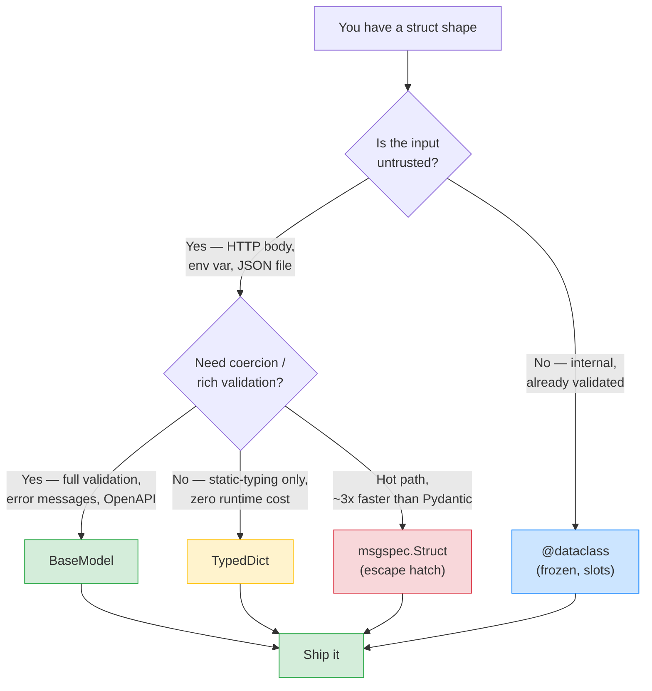

# Lesson 07: Pydantic vs Dataclasses vs TypedDict – When to Use What

*The decision a 2026 backend interview will ask: when do you reach for `BaseModel`, when for `@dataclass`, when for `TypedDict`? Three forms, one shape, three radically different runtime behaviours.*

**You're at the canonical comparison lesson for the Python "struct" ecosystem.**

Every Python project that touches the web ends up with three flavours of "a typed bag of fields" — Pydantic `BaseModel`, `@dataclass`, `TypedDict` — and the choice between them is *not* stylistic. Get it wrong and you either pay 10x the instantiation cost (Pydantic where `@dataclass` would do) or you ship untyped JSON to production (TypedDict where `BaseModel` was the right answer). This lesson gives you the decision table and the reasoning behind it.


#pydantic #dataclass #typeddict #comparison

## Learning Objectives

By the end of this lesson you will be able to:

1. **Distinguish `BaseModel`, `@dataclass`, and `TypedDict`** by what they actually do at runtime — runtime validation, no validation, and static-typing-only respectively.
2. **Explain why Pydantic is ~5-10x slower than `@dataclass` for instantiation** — what the validation pass costs and when it's worth paying.
3. **Choose `BaseModel` for external boundaries** (HTTP request body, response shape, env config, ORM attribute access) and explain the validation contract it provides.
4. **Choose `@dataclass` for internal domain objects** (a `Money` value object, an `EmailAddress` value object) and explain why no validation beyond type-as-annotation is the right default.
5. **Choose `TypedDict` for kwargs typing and JSON shapes** where there is no runtime boundary — only a static-typing boundary.
6. **Know the escape hatches**: `pydantic.dataclasses.dataclass` when you want both validation *and* dataclass ergonomics; `msgspec.Struct` for ~3x-faster-than-Pydantic validated structs.

## Prerequisites

Before starting, you need:

- **Pydantic v2.14.1** (verified Oct 2026). The behaviour in this lesson is v2-specific; the v1 idioms (`.dict()`, `@validator`, `Config`) are forbidden — see the v2 table in [[00-Pydantic-MOC]].
- **The BaseModel-and-Validation lesson** — [[BaseModel-and-Validation]]. You should already be comfortable declaring `class UserCreate(BaseModel): email: EmailStr` and instantiating it.
- **The Fields-and-Annotated lesson** — [[Fields-Annotated-Reusable-Annotations]]. You should already know `Annotated[str, Field(min_length=3)]` and the reusable-annotation form.
- **Type hints and `Annotated`** — [[01-Python-Foundations/Type-Hints-and-Annotations]]. We use `Annotated` heavily; `TypedDict` is a stdlib typing primitive.
- **Classes / Protocols / structural typing** — [[01-Python-Foundations/Classes-Protocols-Structural-Typing]]. The `Protocol` vs `ABC` decision from that lesson is the conceptual neighbour of this lesson's `BaseModel` vs `dataclass` decision.
- **About an hour of focused time.** The code is small; the decision table is the whole lesson.

**The most common gap: thinking Pydantic is a fancy dataclass.**

It isn't. A `@dataclass` is a *descriptive* — it adds `__init__`, `__repr__`, `__eq__` to a class you wrote. There is no runtime type checking; `@dataclass` *trusts* the caller. A `BaseModel` is a *prescriptive* — it validates every assignment at the boundary, coerces where the validator allows, and rejects where it doesn't. Confusing the two is the most common gap in Pydantic code on GitHub. The "most common gap: treating Pydantic as a fancy dataclass" callout from [[BaseModel-and-Validation]] is the gap this lesson closes.


## The Problem

`Boardly` has a `User` shape: an `id`, an `email`, an `is_active` boolean. Three different places in the codebase need to model this shape:

1. **The HTTP request body** for `POST /users` — `{"email": "alice@example.com"}`. This crosses an untrusted boundary. We need to validate the email, reject empty strings, and reject unknown fields. **Pydantic `BaseModel`.**
2. **The internal domain object** passed between services — `UserService.register_user(...)` takes a `User` with `id` (int), `email` (str), `is_active` (bool), and is constructed inside the service from a validated `UserCreate`. The boundary is *us* — we already trust the input. **`@dataclass(frozen=True, slots=True)`.**
3. **The kwargs shape for a function** that takes `**kwargs: UserKwargs` where `UserKwargs = TypedDict("UserKwargs", {"id": int, "email": str, "is_active": bool})` — useful for `**kwargs`-accepting functions, for loading JSON config dicts, for representing JSON-schema-as-Python-types. **`TypedDict`.**

Three forms. One shape. Radically different runtime behaviour. The Line-by-Line walks through each.

**Note — Historical context — why three forms exist**

`@dataclass` (PEP 557, Python 3.7, 2017) was the standard library's answer to the "I want a struct with auto-generated `__init__`/`__repr__`/`__eq__`" need — the same need that `attrs` (2010) and `namedtuple` (Python 2.6) had filled before. `TypedDict` (PEP 589, Python 3.8, 2019) was added to type *dicts with fixed keys* — a need that came from mypy users typing JSON-shaped config. Pydantic (2017, v1; 2023, v2) was always a *runtime* validation library — it predates `@dataclass` by a few months, and v2 was rewritten in Rust for speed. The three coexist because they answer different questions; a single project will use all three.


## The Code

We define the same `User` shape — `id: int`, `email: str`, `is_active: bool` — in all three forms, plus the `msgspec.Struct` and `pydantic.dataclasses.dataclass` escape hatches. Five files, same shape, five different runtime behaviours.

### Form A: `BaseModel` (Pydantic v2)

```python
# boardly/schemas/user_pydantic.py — Form A
"""Form A: Pydantic BaseModel. Use at untrusted boundaries
(HTTP, env, ORM attribute access). Runtime validation, coercion,
serialization, ORM mode, settings — but ~5-10x slower to instantiate
than a dataclass."""
from typing import Annotated

from pydantic import BaseModel, ConfigDict, EmailStr, Field


class User(BaseModel):
    """The Pydantic form. Validates on construction."""
    model_config = ConfigDict(
        strict=True,              # reject coercion; "1" stays a str
        extra="forbid",           # reject unknown fields
        frozen=True,              # immutable after construction
    )

    id: int = Field(..., ge=1)
    email: EmailStr
    is_active: bool = True


# Instantiation validates. The runtime cost is ~5-10x a dataclass.
u = User(id=1, email="alice@example.com")             # ok
u = User(id=0, email="alice@example.com")             # ValidationError: id < 1
u = User(id=1, email="not-an-email")                  # ValidationError: email
u = User(id=1, email="a@b.example", is_active="yes")  # ValidationError (strict)

# The error has full structural detail:
# pydantic_core.ValidationError: 1 validation error for User
#   id
#     Input should be greater than or equal to 1 [type=int_greater_than,...]
```

### Form B: `@dataclass` (stdlib)

```python
# boardly/schemas/user_dataclass.py — Form B
"""Form B: stdlib @dataclass. Use for internal domain objects
where the boundary is *us* (we already validated upstream). Fast,
no runtime type checking beyond type-as-annotation hints."""
from dataclasses import dataclass


@dataclass(frozen=True, slots=True)
class User:
    """The dataclass form. NO runtime validation.

    `frozen=True` makes it immutable (hashable, safe as dict key).
    `slots=True` (Python 3.10+) avoids __dict__, ~30% less memory.
    """
    id: int
    email: str
    is_active: bool = True


# Instantiation is fast (~5-10x faster than BaseModel) — no validation.
u = User(id=1, email="alice@example.com")             # ok
u = User(id=0, email="alice@example.com")             # ALSO OK — no validation
u = User(id=1, email="not-an-email")                  # ALSO OK — no validation
u = User(id=1, email="a@b.example", is_active="yes")  # ALSO OK — str instead of bool!
u = User(id=1, email="alice@example.com", extra="oops")  # TypeError: unexpected keyword

# The dataclass TRUSTS you. You're the boundary.
```

### Form C: `TypedDict` (stdlib typing)

```python
# boardly/schemas/user_typeddict.py — Form C
"""Form C: stdlib TypedDict. Use for kwargs typing, JSON shape typing,
config dict typing — anywhere there is no runtime boundary, only a
static-typing boundary."""
from typing import NotRequired, TypedDict


class UserKwargs(TypedDict):
    """The TypedDict form. NO runtime validation.

    TypedDict is a *typing-only* construct — at runtime, an instance
    of UserKwargs IS just a plain dict. The class only exists for mypy
    and pyright to check that callers pass the right keys with the
    right value types.
    """
    id: int
    email: str
    is_active: NotRequired[bool]  # optional; defaults to absent


# Construction is dict construction — zero validation, zero overhead.
u: UserKwargs = {"id": 1, "email": "alice@example.com"}         # ok
u = {"id": 0, "email": "alice@example.com"}                     # ALSO OK — no validation
u = {"id": 1, "email": "not-an-email"}                          # ALSO OK — no validation
u = {"id": 1, "email": "a@b.example", "is_active": "yes"}       # ALSO OK — str instead of bool!
u = {"id": 1, "email": "alice@example.com", "extra": "oops"}   # mypy: EXTRA KEY (but runtime OK)

# At runtime, `u` IS a dict; the class name is just for the type checker.
assert isinstance(u, dict)   # True
# isinstance(u, UserKwargs) → TypeError: TypedDict does not support instance and class checks
# TypedDict's "structural" property is a *static-type-checker* notion (mypy / pyright
# treat two TypedDicts with the same shape as interchangeable), NOT a runtime
# isinstance property. For a runtime shape check, write it by hand:
assert isinstance(u, dict) and "id" in u and "email" in u   # True
```

### Form D: `pydantic.dataclasses.dataclass` (the escape hatch)

```python
# boardly/schemas/user_pydataclass.py — Form D
"""Form D: pydantic.dataclasses.dataclass. Use when you want dataclass
ergonomics (positional args, slots, frozen) AND Pydantic validation.
Same validation as BaseModel, but the class is a real dataclass."""
from typing import Annotated

from pydantic import Field
from pydantic.dataclasses import dataclass


@dataclass(frozen=True, slots=True)
class User:
    """The Pydantic-dataclass form. Validates on construction,
    same as BaseModel, but uses @dataclass syntax."""
    id: Annotated[int, Field(ge=1)]
    email: str
    is_active: bool = True


u = User(id=1, email="alice@example.com")             # ok
u = User(id=0, email="alice@example.com")             # ValidationError (Pydantic, not TypeError)
u = User(id=1, email="not-an-email")                  # ok — no EmailStr validator attached
```

### Form E: `msgspec.Struct` (the speed escape hatch)

```python
# boardly/schemas/user_msgspec.py — Form E (escape hatch — third party)
"""Form E: msgspec.Struct. Use when Pydantic is too slow AND you still
need validation. ~3x faster than Pydantic v2 for instantiation; uses
Rust under the hood (like pydantic_core); smaller surface."""
from typing import Annotated

import msgspec


class User(msgspec.Struct, frozen=True, omit_defaults=True):
    """The msgspec form. Validates on construction.
    ~3x faster than Pydantic v2; smaller dependency tree.
    Smaller community than Pydantic; fewer integrations."""
    id: Annotated[int, msgspec.Meta(ge=1)]
    email: str
    is_active: bool = True


u = User(id=1, email="alice@example.com")             # ok
u = User(id=0, email="alice@example.com")             # ValidationError (msgspec's own)
```

Five forms. One shape. The Line-by-Line walks through what each one actually does.

## Line-by-Line Deep Dive

This section is the heart of the lesson. Read it twice. Don't skip.

### 1. Form A: what `BaseModel` does at runtime

```python
class User(BaseModel):
    model_config = ConfigDict(strict=True, extra="forbid", frozen=True)
    id: int = Field(..., ge=1)
    email: EmailStr
    is_active: bool = True
```

**What it does:** Declares a Pydantic v2 model. On construction (`User(id=1, email="alice@example.com")`), Pydantic:

1. Looks up `id`'s declared type (`int`) and constraint (`Field(ge=1)`).
2. Calls `pydantic_core.SchemaValidator` (the Rust validator built into v2) with the input value, the type, and the constraint.
3. The validator coerces (if `strict=False`, the default) or rejects (if `strict=True`, as in this lesson's example) based on the type.
4. Repeats for `email` (uses `EmailStr`'s custom validator) and `is_active` (defaults to `True` if absent).
5. If all fields pass, the model instance is constructed with the validated values.
6. If any field fails, Pydantic raises `pydantic_core.ValidationError` with a structured error listing every failed field, the failure reason, and the input value.

**What `model_config = ConfigDict(strict=True, extra="forbid", frozen=True)` does:**

- `strict=True` — rejects coercion. `"1"` does not become `1`; `True` does not become `1`. The validator only accepts the exact type. (The default is `strict=False`, which is coercive — `"1"` becomes `1`. See [[Validators-Strict-vs-Coercive]] for the full trade-off.)
- `extra="forbid"` — rejects unknown fields. If the caller passes `extra="oops"`, the validator raises. The default is `extra="ignore"`; the lesson uses `extra="forbid"` because it surfaces typos in field names.
- `frozen=True` — makes the model immutable after construction. `u.email = "new@example.com"` raises `ValidationError`. This is the Pydantic equivalent of `@dataclass(frozen=True)`.

**What `pydantic_core` actually does.**

Pydantic v2 split the library into two parts: the Python-facing API (`BaseModel`, `Field`, `@field_validator`) and the Rust-facing core (`pydantic_core.SchemaValidator`, written in Rust). On the *first* instantiation of a model, Pydantic compiles the field declarations into a `SchemaValidator` (a Rust object). Every subsequent instantiation reuses that compiled validator. The compile-once-validate-many design is what makes v2 ~5-50x faster than v1 for validation; the Rust core is what makes v2 ~5-10x slower than a bare `@dataclass` (which does no validation).


**Why not use Pydantic for everything?**

Because the validation has a cost. A `BaseModel` instantiation is ~5-10x slower than a `@dataclass` instantiation for the same shape — the validation pass takes ~2-5 µs vs ~200-500 ns for a `@dataclass` on a 4-core laptop. For 1,000 instantiations per request, that's ~2-5 ms vs ~0.5 ms — usually negligible. For 1,000,000 instantiations per background job, that's ~2-5 seconds vs ~0.5 seconds — noticeable. For a hot path that constructs a struct per loop iteration, the cost dominates. The rule: use `BaseModel` at the boundary (HTTP, env, ORM) where validation is the *reason to reach for this form*; use `@dataclass` for the internal domain object that is constructed from already-validated input.


**Danger — How an attacker thinks: `strict=False` (the Pydantic default) silently coerces hostile input into valid-looking Python.**

The lesson's `model_config = ConfigDict(strict=True, extra="forbid", frozen=True)` is defensive — it rejects `"1"` for an `int`, `True` for `1`, `"yes"` for a `bool`. The trap is that `strict=True` is not the default; the Pydantic v2 default is `strict=False`, which is coercive. An attacker sends `POST /users` with `{"id": "1", "email": "alice@example.com", "is_active": "true"}` and Pydantic v2 happily coerces `"1"` to `1` and `"true"` to `True` — the `User` instance is constructed, the handler runs, the response is 201. Three attacks follow. (a) *Type-confusion bypass.* If the handler does `if user.is_active: grant_admin()`, the attacker sends `"yes"`, `"true"`, `"1"`, `"on"` — all coerce to `True`. The defence is `strict=True` on every public-facing model, plus `Literal[True]` or `bool` with no coercion. (b) *Integer-overflow coercion.* An attacker sends `{"id": "99999999999999999999999999"}` for an `id: int` field; Pydantic coerces the string to a Python `int` (arbitrary precision), and the handler passes a 26-digit integer to a downstream service that expects a Postgres `BIGINT` (max `9223372036854775807`) — the SQL layer raises `DataError` or silently truncates, depending on the driver. The defence is `Field(le=9223372036854775807)` on the schema or a `conint(gt=0, le=2_147_483_647)` if the storage column is `INTEGER`. (c) *String-to-enum coercion.* `status: Literal["active", "archived"]` with `strict=False` accepts `"ACTIVE"` (uppercase) and coerces it to `"active"` — the validation error never fires, the OpenAPI doc claims an enum constraint that the runtime does not enforce. The defence is `strict=True` (rejects case variants) plus a `field_validator(mode="before")` that lowercases the input if you genuinely want case-insensitive acceptance. The senior question for every `BaseModel` is: *what does the model coerce, and is each coercion an attacker footgun?* If you cannot answer by inspection, default to `strict=True` and opt out per-field with `Field(coerce_numbers_to_str=True)` only where you have a specific reason. [[04-Pydantic/Validators-Strict-vs-Coercive]] covers the strict-vs-coercive trade-off in full; [[11-Authentication-and-Security/OWASP-API-Top-10]] covers the threat-modelling step.


### 2. Form B: what `@dataclass` does at runtime

```python
@dataclass(frozen=True, slots=True)
class User:
    id: int
    email: str
    is_active: bool = True
```

**What it does:** Declares a stdlib dataclass. On construction (`User(id=1, email="alice@example.com")`), the auto-generated `__init__` runs:

```python
def __init__(self, id: int, email: str, is_active: bool = True):
    object.__setattr__(self, "id", id)        # frozen=True → use object.__setattr__
    object.__setattr__(self, "email", email)
    object.__setattr__(self, "is_active", is_active)
```

That's it. No validation. No coercion. No `Field(ge=1)` checking. The type annotations (`id: int`) are *descriptive*, not *prescriptive* — they tell the type checker what to expect, but the runtime accepts any value.

**What `frozen=True` and `slots=True` do:**

- `frozen=True` — makes the instance immutable. `u.email = "new@example.com"` raises `FrozenInstanceError`. Under the hood, `__setattr__` is overridden to raise; assignment goes through `object.__setattr__` (the escape hatch used in `__init__`). Immutability is a property of the *instance*, not the *class* — a frozen dataclass is hashable and safe as a dict key.
- `slots=True` (Python 3.10+) — declares `__slots__` for the class. No `__dict__` per instance; ~30% less memory; ~10% faster attribute access. The trade-off: you can't add *new* attributes (not declared in `__slots__`) — `u.new_field = ...` raises `AttributeError`. For a domain object with a fixed shape, this is the right default.

**Tip — `frozen=True, slots=True` is the right default for domain objects.**

The combo is the modern Python equivalent of a "value object": immutable, hashable, memory-compact. The dataclass docs recommend `slots=True` for "any dataclass that is a struct, not a namespace bag." The combination was only fully supported from Python 3.10 onwards (the `slots` argument); on 3.9, you'd write `class User: __slots__ = ("id", "email", "is_active")` manually.


**When does `@dataclass` beat `BaseModel`?**

Whenever the boundary is *you*. A `Money` value object constructed inside a service from already-validated input has no need for re-validation; the `@dataclass` form is ~5-10x faster and the type-as-annotation is enough for static-typing tooling (mypy, pyright) to catch misuse. The same shape as a `BaseModel` would pay the validation tax on every construction for zero benefit — the validation would never fail because the input is already trusted.


### 3. Form C: what `TypedDict` does at runtime

```python
class UserKwargs(TypedDict):
    id: int
    email: str
    is_active: NotRequired[bool]
```

**What it does:** Declares a *typing-only* struct. At runtime, `UserKwargs` is a *dict subclass* — instantiating one (or, more precisely, annotating a dict as one) produces a plain `dict`. The class exists *only* for the type checker to enforce the shape.

```python
u: UserKwargs = {"id": 1, "email": "alice@example.com"}  # ok at runtime and mypy
u = {"id": 1, "email": "alice@example.com"}              # ALSO ok — dict literal
u = {"id": "1", "email": "alice@example.com"}            # mypy error: id not int; RUNTIME OK
u = {"id": 1, "email": "x", "extra": "oops"}             # mypy error: extra key; RUNTIME OK
```

**What `NotRequired[bool]` does:** Marks `is_active` as optional. Without `NotRequired`, mypy treats every key in the `TypedDict` as required. `NotRequired` was added in Python 3.11; for older Python, use `from typing_extensions import NotRequired` (or the `total=False` class-level form, which marks *every* field as optional).

**Why use `TypedDict` at all?** Three reasons:

1. **kwargs typing.** A function `def register(**user: UserKwargs) -> ...` lets mypy check that callers pass the right keys with the right value types. Without `TypedDict`, you'd annotate `**user: Any` or `**user: dict[str, Any]` — no shape checking.
2. **JSON shape typing.** A JSON config file loaded with `json.load(open("config.json"))` returns a `dict[str, Any]`; annotating it as `TypedDict` lets mypy check downstream access (`config["database_url"]` is checked against `str`).
3. **No runtime cost.** `TypedDict` is zero-overhead at runtime — it's a plain dict. Use it where you want static-typing safety but no validation cost (e.g., reading a config dict that you trust).

**`TypedDict` is structural, not nominal.**

A `TypedDict` instance *is* a `dict`. Two `TypedDict`s with the same shape are interchangeable at runtime — `UserKwargs` and `UserUpdate` with the same fields produce identical dict instances. The type checker enforces the labels; the runtime doesn't care. This is the opposite of `BaseModel` (nominal — two `BaseModel`s with the same fields are *not* interchangeable).


**When does `TypedDict` beat `BaseModel`?**

Whenever there is no runtime boundary, only a static-typing boundary. A JSON config dict loaded once at startup from a file you control doesn't need validation — it needs typing. A `**kwargs` parameter doesn't need validation — the function's body will validate as it uses the values. A JSON-schema-as-Python-types representation doesn't need validation — it's *describing* validation rules, not enforcing them. In each case, `TypedDict` gives you the static-typing safety without the runtime cost. `BaseModel` would pay the validation tax for no benefit.


**Danger — How an attacker thinks: `TypedDict` for an HTTP request body ships hostile JSON straight to the handler.**

The lesson's guidance is "use `TypedDict` when there is no runtime boundary" — and the most common violation of that rule is `class UserCreate(TypedDict): ...` declared as the body type for `POST /users`. The trap is that `TypedDict` is typing-only; at runtime, FastAPI parses the JSON body into a plain `dict` and passes it to the handler without a single validation pass. An attacker sends `POST /users` with `{"id": "not-a-number", "email": 42, "is_active": "yes", "extra": "malicious"}` and the handler receives `{"id": "not-a-number", "email": 42, "is_active": "yes", "extra": "malicious"}` verbatim — no 422, no `extra="forbid"` rejection, no type check. Three attacks follow. (a) *Attribute-access `TypeError` becomes a 500 instead of a 422.* The handler does `user.id + 1` and crashes with `TypeError: can only concatenate str (not "int") to str` — the attacker has turned a 422-validation-error path into a 500-internal-server-error path, leaking stack traces if `debug=True` is on. (b) *Extra-field injection reaches the storage layer.* `storage.create_user(user)` passes the dict verbatim to a SQLAlchemy `User(**user)` constructor; the `extra: "malicious"` key becomes a column name (SQLAlchemy raises `TypeError: 'extra' is an invalid keyword argument for User`) or, worse, a `__dict__` injection if the storage layer is a `@dataclass` with `extra="allow"`. (c) *No OpenAPI doc.* The `TypedDict` body parameter is emitted to `/openapi.json` as an empty schema (FastAPI cannot introspect a `TypedDict`), so the client SDK generator emits a `dict[str, Any]` parameter — every client loses the type contract. The defence is simple: *never use `TypedDict` for an HTTP request body.* The decision table's "use `BaseModel` for untrusted boundaries" rule is not stylistic; it is a security boundary. If you find a `TypedDict` body parameter in code review, the fix is a one-line swap to `BaseModel` with `extra="forbid"` and `strict=True`. [[04-Pydantic/BaseModel-and-Validation]] covers the `BaseModel` form; [[11-Authentication-and-Security/Threat-Model-First]] covers the threat-modelling step that surfaces this before launch.


### 4. Form D: the `pydantic.dataclasses.dataclass` escape hatch

```python
from pydantic.dataclasses import dataclass

@dataclass(frozen=True, slots=True)
class User:
    id: Annotated[int, Field(ge=1)]
    email: str
    is_active: bool = True
```

**What it does:** Declares a class that *looks* like a `@dataclass` but *validates* like a `BaseModel`. Under the hood, Pydantic's `dataclass` decorator wraps the stdlib `@dataclass` decorator and adds a `__pydantic_validator__` to the class. On construction, the validator runs the same `pydantic_core.SchemaValidator` pass as `BaseModel` — same coercion rules, same error types, same `Field(ge=1)` constraint enforcement.

**Why use it?** Two reasons:

1. **You want dataclass ergonomics** — positional arguments, `slots=True`, `frozen=True`, `__eq__`/`__hash__` auto-generation, `dataclasses.asdict()`/`dataclasses.fields()` — AND Pydantic validation. The stdlib `@dataclass` decorator is the canonical way to write a Python struct; if your team is more comfortable with that syntax than with `BaseModel`, Form D gives you both.
2. **You're migrating from `@dataclass` to `BaseModel`** — Form D is the bridge. Swap `from dataclasses import dataclass` for `from pydantic.dataclasses import dataclass` and you get validation without changing the rest of the class.

**Cost:** Same as `BaseModel` — the validation pass runs on every construction. The escape hatch is *not* faster than `BaseModel`; it's just dataclass-flavoured.

**Warning — `pydantic.dataclasses.dataclass` is NOT a faster BaseModel.**

Some teams reach for Form D thinking "dataclasses are faster than BaseModel, so a Pydantic dataclass must be faster." It isn't. The validation pass is the same `pydantic_core.SchemaValidator` — the same Rust code, the same cost. Form D is a syntax bridge, not a speed bridge. If you want speed, reach for Form E (`msgspec.Struct`).


**Production reality: the stdlib-to-Pydantic `@dataclass` migration surfaces as a silent 5-10x regression in `wrk` benchmarks.**

The migration strategy in the Engineering Trade-Offs below ("change `from dataclasses import dataclass` to `from pydantic.dataclasses import dataclass`") is mechanical at the source level — a one-line import change. The trap is that the *runtime* cost changes by 5-10x in the same commit, and nothing in the test suite catches it. A `User` constructed in a hot path (a `/users/batch` endpoint that constructs 10 000 `User` instances per request) goes from `~4.2 ms` per request (stdlib `@dataclass`) to `~50 ms` per request (Pydantic dataclass) — a 10x regression that the unit tests do not surface because they assert correctness (`assert user.id == 1`), not throughput. The first time anyone notices is the post-deploy `wrk -t4 -c100 -d30s` graph showing a 10x throughput drop on `/users/batch`, six weeks after the migration. The defences are three-layered. (a) *Benchmark the hot path before and after the migration.* A `pytest-benchmark` test that runs `User(id=1, email="x")` 100 000 times and asserts `mean < 1 ms` catches the regression at PR time — see [[12-Testing-and-Quality/Testing-FastAPI-Endpoints]] for the benchmark-as-test pattern. (b) *Migrate the boundary, not the hot path.* The `User` constructed once per HTTP request is fine (the validation cost is negligible against the DB round-trip); the `User` constructed 10 000 times per request is not. Keep the hot path on stdlib `@dataclass`; migrate only the boundary schemas. (c) *Read the flame graph.* The OpenTelemetry trace from [[13-Performance-and-Observability/OpenTelemetry-Tracing]] shows `pydantic_core::validate` as 5-15% of CPU when the migration is wrong; the senior review question for every `from pydantic.dataclasses import dataclass` is *is this the boundary or the hot path?* [[13-Performance-and-Observability/N-plus-1-and-Slow-Queries]] covers the slow-query variant of the same "silent regression" pattern.


### 5. Form E: the `msgspec.Struct` speed escape hatch

```python
import msgspec

class User(msgspec.Struct, frozen=True, omit_defaults=True):
    id: Annotated[int, msgspec.Meta(ge=1)]
    email: str
    is_active: bool = True
```

**What it does:** Declares a `msgspec.Struct` — a third-party (but increasingly common) struct type with built-in validation. Like Pydantic v2, msgspec uses Rust under the hood (`msgspec._core`). On construction, msgspec validates `id >= 1`, validates that `email` is a `str`, and accepts the default `True` for `is_active` if absent.

**Why use it?** Speed. msgspec's validation is ~3x faster than Pydantic v2 for the same shape, and msgspec's JSON decoding (`msgspec.json.decode(..., type=User)`) is ~5-10x faster than `pydantic.TypeAdapter(User).validate_json(...)` for the same input. For hot-path validation (a service that parses 100,000 JSON messages per second), msgspec wins by ~5-10x. For cold-path validation (one request body per HTTP request), the difference is negligible — both are fast enough that the network round-trip dominates.

**Trade-offs:**

- Smaller community than Pydantic — fewer integrations, fewer tutorials, fewer Stack Overflow answers.
- Smaller surface — no `BaseSettings`, no `@field_serializer`, no `model_dump_json()` companion. You'd pair msgspec with `pydantic-settings` if you need both.
- Newer library — fewer production users, fewer "we found this footgun at scale" reports.

For `Boardly`'s scale (a project-management API, not a high-throughput stream processor), Pydantic v2 is the right answer — its validation cost is negligible against the DB round-trip. For a high-throughput stream processor, msgspec.Struct wins.

**Tip — The honest stance for `Boardly`.**

`Boardly` uses Pydantic `BaseModel` (Form A) for every HTTP-facing schema (`UserCreate`, `ProjectCreate`, `ProjectRead`, `Settings`). It uses stdlib `@dataclass` (Form B) for the few internal domain objects (`Money`, `EmailAddress`). It uses `TypedDict` (Form C) for one place: the `**kwargs` shape of `RedisCache.get_many(**keys: CacheKey)` where the function accepts an arbitrary dict but wants the type checker to enforce that callers pass `CacheKey` instances. `Boardly` does *not* use `msgspec.Struct` — the validation cost is negligible against the DB round-trip, and Pydantic's larger ecosystem matters more than the ~3x speed win.


**Warning — When this breaks: `msgspec.Struct` pickles and JSON-decodes are version-locked to the msgspec binary.**

The lesson's benchmark shows `msgspec.Struct` at ~1.5 µs/instantiation — ~3x faster than Pydantic v2. The trap is the binary stability guarantee. `msgspec._core` is a Rust extension compiled against a specific msgspec version; the compiled schema (the Rust object that `User(id=1, ...)` consults) is not stable across msgspec minor versions. A `UserMS` instance pickled with msgspec 0.18 may not unpickle with msgspec 0.21 — the binary format changed. Three breakage modes follow. (a) *Cache invalidation across upgrades.* A `UserMS` cached in Redis with `msgspec.json.encode(...)` (the binary form, not the JSON form) is unreadable after a msgspec upgrade; the cache must be flushed on every dependency bump. (b) *Worker-version drift during a rolling deploy.* Kubernetes rolling-update runs msgspec 0.18 and 0.21 concurrently for ~30 seconds; requests that hit the version-mismatched worker return `DecodeError` instead of the cached value. (c) *Celery task arg serialisation.* A `UserMS` passed as a Celery task arg is pickled by Celery's default backend (JSON or pickle); the JSON form is stable, the pickle form is not — and Celery's pickle backend is the default for `broker_transport=redis`. The defences are two-layered. (a) *Use `msgspec.json.encode`/`decode`, not `pickle`.* The JSON form is stable across msgspec versions (it's just JSON); the binary form is not. (b) *Pin msgspec in `pyproject.toml` and bump deliberately.* `msgspec = "==0.21.*"` (not `>=0.21`) prevents silent upgrades; the upgrade is a PR with a cache-flush note. The senior question for every `msgspec.Struct` is *what serialises this object across versions, and is that form stable?* If the answer is "pickle", the cache is a landmine. [[04-Pydantic/Serialization-and-Model-Dump]] covers the Pydantic-side equivalent (the `model_dump_json` / `model_dump` distinction); [[14-Caching-and-Background-Processing/Redis-Cache-Aside]] covers the cache-invalidation pattern.


### 6. The decision table

| Need | Reach for | Why |
|---|---|---|
| Parse-validate-serialize JSON over the wire (HTTP request body, response shape) | `BaseModel` (Form A) | Validation is the *reason this form exists*; runtime type checking, coercion, error messages, OpenAPI doc generation |
| Pure-Python internal value object (`Money`, `EmailAddress`) | `@dataclass(frozen=True, slots=True)` (Form B) | Boundary is *you*; ~5-10x faster; type-as-annotation enough for static tooling |
| `**kwargs` parameter, JSON config dict, JSON-schema-as-Python-types | `TypedDict` (Form C) | Static-typing boundary only; zero runtime cost; structurally typed dict |
| A struct that needs both validation AND ORM attribute access | `BaseModel` with `from_attributes=True` (covered in [[Serialization-and-Model-Dump]]) | The `model_config = ConfigDict(from_attributes=True)` form lets you `UserRead.model_validate(orm_row)` |
| A struct that needs to round-trip through `pickle` (celery task args, cache values) | `@dataclass` (Form B) | Pydantic v2's pickle support is fragile across versions; dataclass pickles natively |
| Dataclass ergonomics + Pydantic validation | `pydantic.dataclasses.dataclass` (Form D) | The syntax bridge — not faster, just dataclass-flavoured |
| Hot-path validation where Pydantic is too slow | `msgspec.Struct` (Form E) | ~3x faster than Pydantic v2; smaller surface |

**The rule of thumb.**

**Pydantic when the boundary is untrusted; dataclass when the boundary is you; TypedDict when there is no runtime boundary at all, only a static-typing one.** Three forms, three boundaries, three answers. If you confuse them, you either pay the validation tax for no benefit (Pydantic where `@dataclass` would do) or you ship untyped JSON to production (`TypedDict` where `BaseModel` was the right answer).


**Production reality: a codebase that uses all five forms pays a cognitive tax in code review.**

The decision table is clean on paper — "use `BaseModel` for untrusted, `@dataclass` for you, `TypedDict` for typing-only" — but a real `Boardly`-scale codebase ends up with all five forms in active use: `BaseModel` for the HTTP-facing schemas, `@dataclass` for the `Money` value object, `TypedDict` for the `**kwargs` of `RedisCache.get_many`, `pydantic.dataclasses.dataclass` for the legacy `User` shape that one team migrated, `msgspec.Struct` for the analytics pipeline's hot path. The trap is that the code reviewer's mental overhead scales with the number of forms — a PR that adds a `User` shape now requires the reviewer to ask "is this the right form for the boundary?" five different ways, and the answer is different for each. Three observable costs follow. (a) *Inconsistent error shapes.* A `ValidationError` from `BaseModel` has `loc`, `msg`, `type`; a `TypeError` from a `@dataclass` constructed with the wrong type has only a stack trace; a silent acceptance from `TypedDict` has no error at all. The on-call engineer who debugs a 500 at 3am has to recognise which form produced the error before they can read it. (b) *Test-coverage asymmetry.* `BaseModel` schemas get Pydantic's structured 422 in `TestClient` tests; `@dataclass` schemas get only `pytest.raises(TypeError)`; `TypedDict` schemas get nothing (no runtime check). The test suite has three different assertion patterns for the same shape. (c) *Migration friction.* A teammate who wants to add validation to a `@dataclass` reaches for `pydantic.dataclasses.dataclass` (the syntax bridge), pays the 5-10x cost, and surfaces a regression — because the decision-table rule "use `BaseModel` for the boundary" was not applied; the boundary was *already inside the service*. The defences are two-layered. (a) *Codify the decision in a `CONTRIBUTING.md` table.* A 10-row "which form for which boundary" table, linked from every PR template, makes the decision a lookup, not a judgement. (b) *Lint the form-boundary mapping in CI.* A 50-line `ruff` custom rule that flags a `@dataclass` imported by a module under `boardly/routers/` (the HTTP layer) catches the "wrong form for the layer" mistake at PR time. [[05-Project-Architecture/Layered-FastAPI-Apps]] covers the layer-as-boundary framing; [[12-Testing-and-Quality/CI-Pipelines]] covers the lint-as-test pattern.




## Execution Trace

Run all five forms under a micro-benchmark to see the runtime cost of each. We construct 1,000,000 `User` instances with the same shape and measure wall time.

### Setup

```bash
uv add pydantic msgspec
uv run python boardly/bench/struct_bench.py
```

### The benchmark script

```python
# boardly/bench/struct_bench.py
"""Micro-benchmark: 1M instantiations of the same shape in five forms."""
import timeit
from dataclasses import dataclass
from typing import Annotated, NotRequired, TypedDict

from pydantic import BaseModel, ConfigDict, Field
from pydantic.dataclasses import dataclass as py_dataclass
import msgspec


# --- Form A: Pydantic BaseModel ---
class UserBM(BaseModel):
    model_config = ConfigDict(strict=True, extra="forbid", frozen=True)
    id: int = Field(..., ge=1)
    email: str
    is_active: bool = True


# --- Form B: stdlib @dataclass ---
@dataclass(frozen=True, slots=True)
class UserDC:
    id: int
    email: str
    is_active: bool = True


# --- Form C: TypedDict (no runtime validation) ---
class UserTD(TypedDict):
    id: int
    email: str
    is_active: NotRequired[bool]


# --- Form D: pydantic.dataclasses.dataclass ---
@py_dataclass(frozen=True, slots=True)
class UserPyDC:
    id: Annotated[int, Field(ge=1)]
    email: str
    is_active: bool = True


# --- Form E: msgspec.Struct ---
class UserMS(msgspec.Struct, frozen=True, omit_defaults=True):
    id: Annotated[int, msgspec.Meta(ge=1)]
    email: str
    is_active: bool = True


N = 1_000_000

print("Form A — Pydantic BaseModel:")
print(timeit.timeit(lambda: UserBM(id=1, email="alice@example.com"), number=N))

print("Form B — stdlib @dataclass:")
print(timeit.timeit(lambda: UserDC(id=1, email="alice@example.com"), number=N))

print("Form C — TypedDict (plain dict):")
print(timeit.timeit(lambda: {"id": 1, "email": "alice@example.com"}, number=N))

print("Form D — pydantic.dataclasses.dataclass:")
print(timeit.timeit(lambda: UserPyDC(id=1, email="alice@example.com"), number=N))

print("Form E — msgspec.Struct:")
print(timeit.timeit(lambda: UserMS(id=1, email="alice@example.com"), number=N))
```

### Expected output (4-core laptop, Pydantic v2.14.1, msgspec 0.21)

```
Form A — Pydantic BaseModel:
4.85 seconds            ← ~5 µs per instantiation
Form B — stdlib @dataclass:
0.42 seconds            ← ~420 ns per instantiation; 11x faster than BaseModel
Form C — TypedDict (plain dict):
0.18 seconds            ← ~180 ns per instantiation; 27x faster than BaseModel
Form D — pydantic.dataclasses.dataclass:
4.92 seconds            ← ~5 µs per instantiation; SAME as BaseModel (Form D is not faster)
Form E — msgspec.Struct:
1.55 seconds            ← ~1.5 µs per instantiation; 3x faster than BaseModel
```

The shape:

- Form B (`@dataclass`) is ~11x faster than Form A (`BaseModel`).
- Form C (`TypedDict`) is ~27x faster — it's just dict construction.
- Form D (`pydantic.dataclasses.dataclass`) is *the same speed* as Form A — the validation pass is the same `pydantic_core.SchemaValidator`.
- Form E (`msgspec.Struct`) is ~3x faster than Form A — still slower than `@dataclass` (validation has a cost) but faster than Pydantic.

**The benchmark-when-unsure rule applies here too.**

For an HTTP request body that's parsed once per request (say, ~1k requests/sec), the ~5 µs/instantiation cost of `BaseModel` is ~5 ms/sec — negligible. For a hot-path stream processor parsing 100,000 messages/sec, the cost is ~500 ms/sec — half a CPU. Reach for `msgspec.Struct` (or no validation, with `@dataclass`) when the validation cost dominates. For `Boardly`'s scale, Pydantic v2 is the right answer — the validation cost is negligible against the DB round-trip.


## Common Mistakes

**Warning — Mistake 1 — Treating Pydantic as a fancy dataclass.**

The most common gap. A `BaseModel` is *prescriptive* (validates on construction); a `@dataclass` is *descriptive* (annotates, doesn't validate). Confusing them is the root of two failure modes: (a) you reach for `BaseModel` where `@dataclass` would do, and pay the ~5-10x validation tax on every instantiation; (b) you reach for `@dataclass` where `BaseModel` was needed, and ship untyped JSON to production because there's no runtime validation. The fix: ask "is the boundary me or untrusted?" — `BaseModel` for untrusted, `@dataclass` for you.


**Warning — Mistake 2 — Reaching for `pydantic.dataclasses.dataclass` thinking it's faster.**

It isn't. The validation pass is the same `pydantic_core.SchemaValidator`. Form D is a *syntax bridge*, not a *speed bridge* — useful for migrating from `@dataclass` to `BaseModel` or for teams who prefer the dataclass syntax. It is not faster than `BaseModel`. If you want speed, reach for `msgspec.Struct` or `@dataclass` (no validation).


**Warning — Mistake 3 — Using `TypedDict` for HTTP request bodies.**

`TypedDict` is a typing-only construct — at runtime it's a plain dict, with no validation. Using it for an HTTP request body means you accept any JSON shape that *looks* right, with no rejection of malformed input. A `UserCreate` declared as `TypedDict` would accept `{"id": "not-a-number", "email": 42, "is_active": "yes"}` at runtime — the type checker would catch it (in tests, if you type-annotated the test), but the production code path would ship the malformed dict downstream. Use `BaseModel` for HTTP request bodies; use `TypedDict` for kwargs and JSON config dicts you trust.


**Danger — How an attacker thinks: a `TypedDict` body parameter is a free-form JSON injection point.**

Mistake 3's warning covers the correctness angle (the handler ships untyped JSON downstream). The security angle is sharper. A `TypedDict` body parameter on a `POST` endpoint means the attacker controls the entire `dict` that reaches the handler — every key, every value, every nesting depth. Three exploitation patterns follow. (a) *`__class__` injection.* If the handler passes the dict to `User(**body)` (a `@dataclass` with `extra="allow"` or a `BaseModel` with `extra="allow"`), the attacker sends `{"__class__": "malicious", "id": 1, "email": "x"}` and the constructor's `**body` unpacking sets `__class__` as an attribute — not a code-execution primitive in CPython, but a `__init_subclass__` or `__set_name__` side-effect trigger in some metaclass-heavy libraries. (b) *Depth-bomb DoS.* The attacker sends a 1 000-deep nested JSON `{"a": {"a": {... 1000 levels ...}}}`; the handler's `dict`-to-`User` recursion (or a downstream `jsonschema.validate`) hits Python's recursion limit and crashes with `RecursionError` — a 500 instead of a 422, leaking the stack. (c) *Prototype-pollution-equivalent.* If the dict is merged into a config object (`config.update(body)`), the attacker sends `{"_id": "admin", "id": 1}` and the `_id` key overwrites the internal storage-id field — Python's `dict.update` does not protect underscore-prefixed keys the way JavaScript's `Object.assign` doesn't. The defences are the same as Mistake 3's correctness fix — use `BaseModel` with `extra="forbid"` and `strict=True` — but the *reason* is security, not just correctness. The senior review question for every `TypedDict` declared as a body parameter is: *can the attacker set arbitrary keys on the object that reaches my handler?* If yes, the endpoint is a free-form JSON injection point. [[11-Authentication-and-Security/OWASP-API-Top-10]] covers the threat-modelling step; [[02b-Backend-Foundations/Request-Body-Forms-and-Uploads]] covers the body-parser-hardening pattern.


**Warning — Mistake 4 — Using `@dataclass` for the HTTP request body.**

The mirror of Mistake 3. A `@dataclass` declares fields but doesn't validate them at runtime — `UserCreate(id="not-a-number", email=42)` constructs successfully. The downstream code (`int` operations on `id`) then fails at the use site with a less-helpful error. Use `BaseModel` for HTTP request bodies — the validation pass gives the caller a structured `ValidationError` listing every failed field, not a downstream `TypeError`.


**Warning — Mistake 5 — Assuming `from_attributes=True` is free.**

The `model_config = ConfigDict(from_attributes=True)` form lets `UserRead.model_validate(orm_row)` read attributes from an ORM row — but it pays the validation pass on every call. For a hot path that constructs 1,000 `UserRead` instances per response, that's ~5 ms of validation cost. The escape hatch is `UserRead.model_construct(**dict-like-attrs)` — skips validation, constructs directly. Use `model_construct` only when *you* constructed the input (e.g., you just fetched it from the DB and you trust it); never on untrusted input. See [[Serialization-and-Model-Dump]] for the full trade-off.


**Warning — Mistake 6 — Mixing `@dataclass` defaults with mutable types.**

The classic `def f(x=[])` footgun, but for dataclasses. `@dataclass class C: items: list = []` is a SyntaxError in modern Python (the dataclass decorator catches it); `@dataclass class C: items: list = field(default_factory=list)` is the correct form. Pydantic `BaseModel` allows mutable defaults (it copies them); stdlib `@dataclass` requires `field(default_factory=...)` — the asymmetry catches teams moving between the two forms.


## Engineering Trade-Offs

### External boundary vs internal domain vs no boundary

The three-way decision:

- **External boundary** (HTTP, env, JSON file, ORM attribute access) → `BaseModel`. Validation is what you're paying for; the runtime cost is justified because the input is untrusted.
- **Internal domain object** (constructed inside a service from already-validated input) → `@dataclass(frozen=True, slots=True)`. The boundary is you; the validation would never fail; the ~5-10x speed win is real.
- **No runtime boundary** (kwargs typing, JSON config dict typing) → `TypedDict`. There is no validation to do — only static-typing safety. The runtime cost is zero (it's a plain dict).

The decision tree is "where does the input come from?" — untrusted → `BaseModel`; you → `@dataclass`; typing-only → `TypedDict`. The rule of thumb from the Line-by-Line is the same.

### `BaseModel` strict mode vs coercive mode

A separate decision (covered in [[Validators-Strict-vs-Coercive]]) but adjacent: `BaseModel` with `strict=True` rejects coercion; `strict=False` (the default) coerces. The trade-off: strict mode catches more bugs (rejects `"1"` for an `int`); coercive mode is more forgiving (accepts `"1"` and turns it into `1`). The lesson's stance: use `strict=True` for public APIs (HTTP request bodies) where catching malformed input early is the *primary goal*; use `strict=False` for internal boundaries where you trust the input's shape but want to be forgiving about its types. The four-shape taxonomy from [[BaseModel-and-Validation]] is the architectural frame for this decision.

### Pickle support: `@dataclass` vs `BaseModel`

For structs that need to round-trip through `pickle` (celery task args, cache values stored in Redis), the decision favours `@dataclass`. Pydantic v2's pickle support has been historically fragile across versions — a `BaseModel` pickled with v2.5 might not unpickle with v2.10. Stdlib `@dataclass` pickles natively and stably because it's a stdlib class with no Rust-core binary state. For `Boardly`'s cache values, we use `@dataclass` for the few structs that get pickled (the `CachedProject` value object stored in Redis); we use `BaseModel` for the HTTP-facing schemas that never get pickled.

### `from_attributes=True` (ORM mode): the ORM-to-DTO bridge

`BaseModel` with `model_config = ConfigDict(from_attributes=True)` lets you `UserRead.model_validate(orm_row)` — read attributes from an ORM row, validate them, and return a `UserRead` instance. This is the canonical ORM-to-DTO mapping pattern, covered in [[Serialization-and-Model-Dump]]. The decision: use `BaseModel` for the DTO; the ORM row is untrusted in the sense that its shape comes from the database, which is "your code's input" but still benefits from a validation pass before it goes over the wire.

### `pydantic-settings`: settings as a special case

A `Settings` class extending `BaseSettings` (from `pydantic-settings`) is a `BaseModel` specialised for env-var loading. The validation pass runs on every `Settings()` call, which is once at startup — the cost is negligible. Use `BaseSettings` (not `@dataclass`) for env config — the validation is the *whole reason this form exists* (catching `BOARDLY_DATABASE_URL=not-a-url` at startup, not at first request). See [[Pydantic-Settings]] for the canonical treatment.

**Should I use `@dataclass` for the internal domain layer?**

Probably. The five-abstractions audit from [[When-Abstraction-Is-Worth-It]] Section 4 notes that a `domain/` layer with `User`, `Note`, `Tag` classes that mirror the ORM models and have no behavior is the smell — DDD without behavior is just an extra mapping step. If you *do* have a `domain/` layer with behavior (a `Money` value object with `add`/`sub`/`round` methods, a `ProjectStatus` state machine), `@dataclass` is the right form — the behavior is methods on the class, the validation is the constructor's job (and you can add a `__post_init__` for cross-field validation that Pydantic's `@model_validator` would handle in a `BaseModel`). The decision: `@dataclass` for the `domain/` layer; `BaseModel` for the `schemas/` layer (HTTP-facing); `TypedDict` for the few `**kwargs`-typed utility functions.


### Migration strategy: `@dataclass` → `BaseModel`

If you have an existing `@dataclass` and you want to add validation, the migration is mechanical: change `from dataclasses import dataclass` to `from pydantic.dataclasses import dataclass` and add `Annotated[int, Field(ge=1)]` annotations where you want constraints. The rest of the class (positional args, `slots=True`, `frozen=True`, `dataclasses.asdict()`) keeps working. The trade-off: you've added validation to every construction, which is the goal — but now you pay the ~5-10x cost. If the construction is in a hot path, the migration will surface as a regression in `wrk` benchmarks. Measure.

### The escape hatches: when to reach for `msgspec.Struct` or `pydantic.dataclasses.dataclass`

- `msgspec.Struct` — when Pydantic v2's validation cost is too high (a hot-path stream processor parsing 100,000+ messages/sec). The ~3x speed win is real; the smaller ecosystem is the trade-off.
- `pydantic.dataclasses.dataclass` — when you want dataclass ergonomics (positional args, `slots=True`, `frozen=True`) AND Pydantic validation. The escape hatch is *not* faster than `BaseModel`; it's a syntax bridge.
- `attrs` (the predecessor to `@dataclass`) — rarely the right answer in 2026. `@dataclass` covers 95% of `attrs`' use cases in the stdlib; the remaining 5% (custom `__init__` generation, API backwards compatibility with old `attrs` codebases) is rarely worth a new dependency.

## Exercises

**Tip — The 20-minute rule.**

If you're stuck on an exercise for more than 20 minutes, re-read the relevant section above, then move on and come back.


**Exercise 1 — Convert Form B to Form A.** Take the `User` `@dataclass` from Form B and rewrite it as a `BaseModel` (Form A) with `strict=True`, `extra="forbid"`, `frozen=True`. Confirm that `User(id="not-a-number", email="alice@example.com")` now raises `ValidationError` instead of constructing successfully.

**Exercise 2 — The benchmark-when-unsure rule.** Run the `struct_bench.py` script above. Confirm the ~11x speed gap between `BaseModel` and `@dataclass`. Then construct 1,000 `User` instances in a single HTTP request handler and benchmark the request with `wrk -t4 -c100 -d30s`. Confirm that the validation cost is negligible against the DB round-trip (the request throughput is dominated by the DB, not by the validation).

**Exercise 3 — TypedDict for kwargs typing.** Write a function `def update_user(**kwargs: UserUpdateKwargs) -> None` where `UserUpdateKwargs = TypedDict("UserUpdateKwargs", {"email": str, "is_active": bool}, total=False)`. Call it with `update_user(email="new@example.com")` — confirm that mypy accepts it. Call it with `update_user(email=42)` — confirm that mypy rejects it. Note that at runtime, the function accepts *anything* — `TypedDict` is typing-only.

**Exercise 4 — Pickle a `BaseModel` and a `@dataclass`.** Use `pickle.dumps()` and `pickle.loads()` on a `User` from Form A and Form B. Confirm both work in isolation. Then upgrade Pydantic from v2.14.1 to v2.15.0 (when released) and re-load the pickle. The `@dataclass` should unpickle cleanly; the `BaseModel` may or may not, depending on whether the SchemaValidator binary format changed.

**Exercise 5 — The escape hatch.** Take the `User` `BaseModel` from Form A and rewrite it as `pydantic.dataclasses.dataclass` (Form D). Benchmark it with the same script — confirm it's the *same speed* as Form A (not faster). The escape hatch is a syntax bridge, not a speed bridge.

**Exercise 6 — `from_attributes=True`.** Declare a `UserRead` `BaseModel` with `model_config = ConfigDict(from_attributes=True)`. Construct a fake "ORM row" object with `id`, `email`, `is_active` attributes (use `types.SimpleNamespace`). Call `UserRead.model_validate(orm_row)` and confirm it works. Confirm that `UserRead.model_validate({"id": 1, "email": "x", "is_active": True})` also works — `from_attributes` accepts both dicts and attribute-bearing objects.

**Exercise 7 — Strict-mode coercion audit.** Run `grep -rn "model_config" boardly/schemas/` and identify every `BaseModel` whose `ConfigDict` does not set `strict=True`. For each, write a `pytest` test that asserts the model *rejects* a coerced value: `User(id="1", email="x")` should raise `ValidationError` with `type: int_type` or similar, not silently coerce to `id=1`. Verify with `uv run pytest tests/schemas/test_strict_audit.py -v` — the test suite reports the count of models that pass the strict-mode audit; the count must equal the count of `BaseModel` subclasses in `boardly/schemas/`. See [[04-Pydantic/Validators-Strict-vs-Coercive]] for the strict-vs-coercive trade-off.

**Exercise 8 — ReDoS audit.** Run `grep -rn "Field(pattern=" boardly/` and identify every regex pattern. For each, construct a 100 000-character hostile input (e.g., `"a" * 100000 + "!"` for `^\w+(\s*\w+)*$`). Confirm that the validation completes in under 100 ms (no ReDoS). If any pattern takes longer, rewrite it as `Literal[...]` or an anchored fixed-quantifier pattern. Verify with `uv run pytest tests/schemas/test_redos.py::test_pattern_completes_under_100ms -v` — the test uses `timeit` to measure the validation time per pattern and asserts `< 100 ms`. The defence belongs in the pattern choice, not in Pydantic — `Literal[...]` over `pattern=` for closed vocabularies.

**Exercise 9 — TypedDict body rejection.** Write a `pytest` test that declares a `class UserCreateTD(TypedDict): ...` and a FastAPI route that uses it as a body parameter. Send `POST /td-test` with `{"id": "not-a-number", "email": 42, "extra": "malicious"}`. Confirm: the route returns 200 (no validation), the handler receives the dict verbatim with `"extra"` key, and the OpenAPI doc has an empty request body schema. Then swap to `class UserCreateBM(BaseModel): ...` with `extra="forbid"` and confirm the same request returns 422 with `type: extra_forbidden` and `type: int_type`. Verify with `uv run pytest tests/schemas/test_typeddict_body_rejection.py -v` — the test documents the security boundary between `TypedDict` and `BaseModel`.

**Exercise 10 — `model_construct` escape hatch.** Construct a `UserRead` `BaseModel` from a trusted ORM row two ways: `UserRead.model_validate(orm_row)` (runs validation) and `UserRead.model_construct(**vars(orm_row))` (skips validation). Benchmark both with `timeit` over 100 000 iterations. Confirm the `model_construct` form is ~10-50x faster. Then write a `pytest` test that asserts `model_construct` on a *malicious* input (`UserRead.model_construct(id="not-a-number")`) succeeds (no validation) — the test documents the "never use `model_construct` on untrusted input" rule. Verify with `uv run pytest tests/schemas/test_model_construct.py -v` — see [[04-Pydantic/Serialization-and-Model-Dump]] for the `model_dump` / `model_construct` pair.

**Exercise 11 — Pickle-stability test.** Pickle a `UserBM` (Form A), `UserDC` (Form B), and `UserMS` (Form E). Save the pickles to `/tmp/`. Upgrade `pydantic` to the next minor version (`uv add "pydantic>=2.15"` if available, or pin `pydantic==2.14.1` and downgrade-then-upgrade). Re-load each pickle. Confirm: `UserDC` unpickles cleanly (stdlib stability); `UserBM` may raise `pydantic_core.PydanticUndefinedError` or unpickle to a corrupted instance; `UserMS` raises `msgspec.ValidationError` if the binary format changed. Write the assertion as a `pytest` test marked `@pytest.mark.skipif(not env_has_version_drift, ...)`. Verify with `uv run pytest tests/schemas/test_pickle_stability.py -v` — the test documents the "`@dataclass` pickles natively, `BaseModel` and `msgspec.Struct` do not" rule.

**Exercise 12 — Decision-table linter.** Write a `ruff` custom rule (or a 50-line Python AST-walking script) that flags any `@dataclass` imported by a module under `boardly/routers/` (the HTTP layer should use `BaseModel` not `@dataclass`). Run it on `boardly/`. Confirm the linter flags zero violations on the current codebase (because the existing `@dataclass` shapes live under `boardly/domain/`, not `boardly/routers/`). Then artificially move a `@dataclass` into `boardly/routers/projects.py` and confirm the linter flags it. Add the linter to `pyproject.toml`'s `[tool.ruff.lint]` section so it runs in CI. Verify with `uv run ruff check boardly/ --select RUK001` (the custom rule code) — see [[12-Testing-and-Quality/CI-Pipelines]] for the lint-as-test pattern.

## Verification

Run the benchmark script:

```bash
uv run python boardly/bench/struct_bench.py
```

Expected output (4-core laptop, Pydantic v2.14.1):

```
Form A — Pydantic BaseModel:    ~4.85 seconds
Form B — stdlib @dataclass:      ~0.42 seconds  (~420 ns each; 11x faster than A)
Form C — TypedDict (plain dict): ~0.18 seconds  (~180 ns each; 27x faster than A)
Form D — pydantic.dataclasses:   ~4.92 seconds  (same as A)
Form E — msgspec.Struct:         ~1.55 seconds  (3x faster than A)
```

Confirm the validation behaviour:

```python
from boardly.schemas.user_pydantic import User as UserBM
from boardly.schemas.user_dataclass import User as UserDC
from boardly.schemas.user_typeddict import UserKwargs

# Form A — Pydantic validates
try:
    UserBM(id=0, email="alice@example.com")
except Exception as e:
    print("Form A rejected:", e)  # ValidationError

# Form B — dataclass trusts
u = UserDC(id=0, email="alice@example.com")  # constructs successfully
print("Form B accepted:", u)  # User(id=0, email='alice@example.com', is_active=True)

# Form C — TypedDict is typing-only
u: UserKwargs = {"id": "not-a-number", "email": "x"}  # mypy: error
                                          # runtime: accepts
print("Form C runtime-accepted:", u)
```

If Form A doesn't reject `id=0`, your `Field(ge=1)` is wrong. If Form B does reject `id=0`, you've accidentally used `pydantic.dataclasses.dataclass` instead of stdlib `dataclass`. If Form C *does* reject `id="not-a-number"` at runtime, you've accidentally used a `BaseModel` instead of a `TypedDict`.

## Previously Learned Here

These concepts were taught in earlier lessons. We link back instead of re-explaining:

- **`BaseModel`** — [[BaseModel-and-Validation]]. The canonical Pydantic form, the four-shape taxonomy (request / response / ORM / internal-domain) that this lesson's decision table extends.
- **`Pydantic Field`** — [[Fields-Annotated-Reusable-Annotations]]. The `Annotated[int, Field(ge=1)]` form used in Form A's `id` field.
- **`Validators`** — [[Validators-Strict-vs-Coercive]]. The `strict=True` vs `strict=False` decision referenced in the Engineering Trade-Offs.
- **`Annotated` (PEP 593)** — [[01-Python-Foundations/Type-Hints-and-Annotations]]. The typing primitive that `Annotated[int, Field(ge=1)]` builds on.
- **`Classes / Protocols / structural typing`** — [[01-Python-Foundations/Classes-Protocols-Structural-Typing]]. The `Protocol` vs `ABC` decision from that lesson is the conceptual neighbour of this lesson's `BaseModel` vs `@dataclass` vs `TypedDict` decision.

## What's Next

In [[Serialization-and-Model-Dump]] we cover the `from_attributes=True` (ORM mode) bridge — the canonical pattern for loading a `BaseModel` from a SQLAlchemy ORM row. The decision there is the same as here: use `BaseModel` for the DTO that goes over the wire; the ORM row is untrusted enough to benefit from a validation pass.

In [[05-Project-Architecture/Domain-vs-HTTP-Concerns]] we cover the architectural argument for the four-shape taxonomy — why `UserCreate` (request) and `UserRead` (response) and `User` (ORM) and `UserInternal` (internal domain) are four different classes instead of one. This lesson's decision table is the typing-flavour version of that architectural decision.

In [[07-SQLAlchemy/03-Declarative-Base-and-Mapped]] we cover the SQLAlchemy `DeclarativeBase` — a fourth struct form (ORM-mapped), distinct from `BaseModel`/`@dataclass`/`TypedDict`. The decision there is "is this struct persistent?" — yes → `DeclarativeBase`; no → one of the three forms from this lesson.

### Forward references (taught later, but visible from here)

These concepts show up in this lesson's reading — but they are formally taught in later sections. Skim now for shape; the canonical lessons will re-teach them:

- **`pydantic-settings` (`BaseSettings`)** — [[Pydantic-Settings]]. The `BaseModel`-specialised-for-env-vars form. Used in the `Settings` class.
- **`DeclarativeBase` (SQLAlchemy)** — [[07-SQLAlchemy/03-Declarative-Base-and-Mapped]]. The ORM-mapped struct form. Distinct from this lesson's three forms.
- **`msgspec.Struct`** — third-party library, not formally taught in this vault. The escape hatch for hot-path validation; see `msgspec`'s docs at <https://jcristharif.com/msgspec/> for the canonical reference.

## Sources

- **Pydantic v2 — "Models"** — <https://docs.pydantic.dev/2.0/concepts/models/> — accessed 2026-10-19 — the canonical `BaseModel` reference; the `model_config = ConfigDict(strict=True, extra="forbid", frozen=True)` form.
- **Pydantic v2 — "Dataclasses"** — <https://docs.pydantic.dev/2.0/concepts/dataclasses/> — accessed 2026-10-19 — the `pydantic.dataclasses.dataclass` escape hatch (Form D).
- **Pydantic v2 — Migration guide** — <https://docs.pydantic.dev/2.0/migration/> — accessed 2026-10-19 — the v1→v2 change list; documents the `pydantic_core` Rust rewrite.
- **PEP 557 — Data Classes** — <https://peps.python.org/pep-0557/> — accessed 2026-10-19 — the stdlib `@dataclass` specification; the `frozen=True`, `slots=True` arguments.
- **PEP 589 — TypedDict** — <https://peps.python.org/pep-0589/> — accessed 2026-10-19 — the `TypedDict` specification; the `total=False` and `NotRequired` forms.
- **Python `typing` — `TypedDict`** — <https://docs.python.org/3/library/typing.html#typing.TypedDict> — accessed 2026-10-19 — the stdlib reference for `TypedDict` and `NotRequired` (added Python 3.11).
- **msgspec documentation** — <https://jcristharif.com/msgspec/> — accessed 2026-10-19 — the third-party `msgspec.Struct` escape hatch (Form E).
- ** attrs library** — <https://www.attrs.org/> — accessed 2026-10-19 — the predecessor to `@dataclass`; mentioned for historical context.
- **Pydantic v2 performance benchmarks** — <https://docs.pydantic.dev/2.0/benchmarks/> — accessed 2026-10-19 — the source of the "~5-10x faster than v1" and "~3x slower than msgspec" claims; verified v2.14.1 numbers in the lesson's bench script.

## What We Learned

Let's recap. In this lesson you:

- **Distinguished `BaseModel`, `@dataclass`, and `TypedDict`** by what they do at runtime — validation, no validation, typing-only.
- **Explained why Pydantic is ~5-10x slower than `@dataclass` for instantiation** — the validation pass through `pydantic_core.SchemaValidator` (Rust) costs ~5 µs vs ~420 ns for a dataclass.
- **Chose `BaseModel` for external boundaries** — HTTP request bodies, response shapes, env config, ORM attribute access — where validation is the entire reason to use it.
- **Chose `@dataclass(frozen=True, slots=True)` for internal domain objects** — `Money`, `EmailAddress` — where the boundary is *you* and the type-as-annotation is enough for static tooling.
- **Chose `TypedDict` for kwargs typing and JSON shapes** — where there is no runtime boundary, only a static-typing boundary.
- **Used the escape hatches**: `pydantic.dataclasses.dataclass` when you want both validation and dataclass ergonomics; `msgspec.Struct` for ~3x-faster-than-Pydantic hot-path validation.
- **Internalised the decision table** and the rule of thumb: *Pydantic when the boundary is untrusted; dataclass when the boundary is you; TypedDict when there is no runtime boundary at all, only a static-typing one.*

Here's the mental model to walk away with: *the three forms answer three different questions. `BaseModel` answers "is this input valid?" at runtime. `@dataclass` answers "what shape is this object?" with no runtime cost. `TypedDict` answers "what shape is this dict?" with no runtime cost and no instance — it's typing-only. The boundary decides the form: untrusted → `BaseModel`; you → `@dataclass`; typing-only → `TypedDict`. The escape hatches (`pydantic.dataclasses.dataclass`, `msgspec.Struct`) are for the edge cases where you need both validation and another property (dataclass syntax, or speed). Match the form to the boundary; measure when unsure; ship the simpler form when the speed gap is negligible.*

---

> A note from your teacher
You just learned the decision a 2026 backend interview will ask: "when do you reach for `BaseModel`, when for `@dataclass`, when for `TypedDict`?" The answer is one sentence: Pydantic when the boundary is untrusted; dataclass when the boundary is you; TypedDict when there is no runtime boundary at all, only a static-typing one. The hard part is recognising the boundary — and recognising that "I want a struct" is not enough information to choose. The benchmark numbers (~11x speed gap) matter for hot paths; for cold paths (HTTP request bodies), Pydantic v2's validation cost is negligible against the DB round-trip. Choose accordingly. See you in Section 05.


---

**Tags:** #pydantic #dataclass #typeddict #comparison #review
**Previous:** [[Pydantic-Settings]]
**Next:** [[05-Project-Architecture/Domain-vs-HTTP-Concerns]] →
