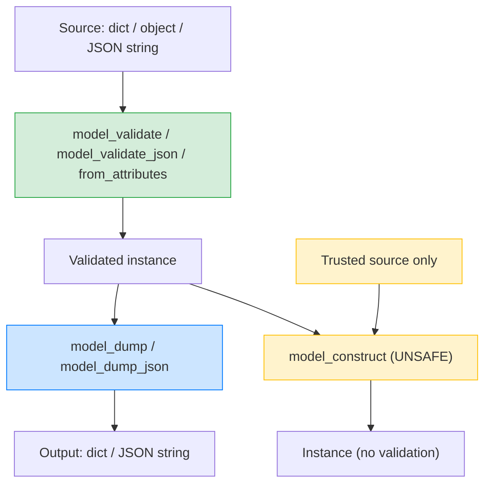

# Lesson 04: Serialization and model_dump

*Building `UserRead` and `ProjectRead` — the response shapes — with `from_attributes=True` for ORM mapping, `exclude_unset=True` for PATCH responses, `@computed_field` for derived fields, `@field_serializer` for `datetime` formatting, and `model_construct()` for the trusted-source fast path.*

**You're on Lesson 4 of Section 04.**

Pydantic's parse-and-validate half gets the press, but the serialize-and-emit half is where most production bugs live: `model_dump()` vs `model_dump_json()`, `exclude_unset` vs `exclude_defaults`, `by_alias=True` not doing what you think, the moment you `model_dump()` a model containing a `datetime` and ship it through `json.dumps` and crash. This lesson covers the v2 serialization API in full — the one you will use in every FastAPI response, every test assertion, every ORM-to-DTO conversion, and every "I need a dict for the cache" call. Take your time. Type every line. Read the tracebacks. **This is how you learn.**


#pydantic #serialization #v2

## Learning Objectives

By the end of this lesson you will be able to:

1. **Pick between `model_dump()` and `model_dump_json()`** based on whether your downstream wants Python objects or bytes.
2. **Use `include`, `exclude`, `exclude_unset`, `exclude_defaults`, `exclude_none`** precisely — and explain how each decides what to drop.
3. **Use `by_alias=True`** correctly with `serialization_alias` and `alias`.
4. **Distinguish `model_validate(d)`, `model_validate_json(s)`, `model_validate(obj, from_attributes=True)`** — and know when to use each.
5. **Use `model_construct()`** for the unsafe-but-fast path, and explain its only valid use case (trusted source, performance-critical).
6. **Add `@computed_field`** for derived fields (`full_name` from `first_name + last_name`), and **`PrivateAttr`** for non-validated instance state.
7. **Write `@field_serializer`** to override how a specific field serializes — formatting a `datetime`, redacting a secret, encoding a `Decimal`.

## Prerequisites

Before starting, you need:

- **Pydantic v2.14.1** (verified 2026-10-11) and the `UserCreate` from Lesson 1, the aliases from Lesson 2, the `model_fields_set` from Lesson 3.
- **The four-shape taxonomy** — [[BaseModel-and-Validation|Lesson 1]]. This lesson builds the **response** shape (`UserRead`, `ProjectRead`), which is distinct from the request shape (`UserCreate`, `ProjectCreate`).
- **About 75–100 minutes of focused time.** The code is ~80 lines; the explanation is long because the serialization options interact subtly.

**The most common gap: thinking `model_dump()` is just "dict(instance)".**

If you learned Python's `@dataclass` and `dataclasses.asdict()`, you might assume `model_dump()` is the same thing — "convert to a dict." It is, but with about 15 arguments that change what "convert" means. `by_alias`, `exclude_unset`, `exclude_defaults`, `mode="python"` vs `mode="json"`, `include`, `exclude`, `context`, `serialize_as_any` — each is a knob. This lesson walks through them.


## The Problem

`POST /users` accepts a `UserCreate` body, hashes the password, inserts a row, and needs to return a response. The response should:

- Include `id`, `created_at` — fields the *response* has but the *request* doesn't.
- **Not** include `password` — ever. The response schema should not even *have* a `password` attribute.
- Use `snake_case` wire names (the Boardly convention for responses; Lesson 2's `owner_id`/`ownerId` was request-side).
- Format `created_at` as an ISO 8601 string in UTC with a trailing `Z`.
- Include a `full_name` derived field that the DB doesn't store (it stores `first_name` and `last_name`).
- For PATCH responses, include only the fields the client actually sent in the request — so a `PATCH /users/42` body `{"display_name": "Ada"}` returns `{"display_name": "Ada"}`, not the full user.

The request shape (`UserCreate`) cannot do any of this — it has `password`, no `id`, no `created_at`, no `full_name`. The response shape (`UserRead`) is a different class. This lesson builds it.

## The Code

Here is the extended `boardly/schemas.py` you'll write in this lesson. We add `UserRead`, `ProjectRead`, a `UserUpdate` PATCH schema, a `@computed_field` example, a `@field_serializer` example, a `PrivateAttr` example, and a `model_construct` demo.

```python
# boardly/schemas.py (continuation)
from datetime import datetime, timezone
from decimal import Decimal
from typing import Any

from pydantic import (
 BaseModel,
 ConfigDict,
 Field,
 PrivateAttr,
 computed_field,
 field_serializer,
)


# --- the ORM row we'll load from (mock; real one in Section 07) ---

class _UserRow:
 """Mock SQLAlchemy-style row. Pydantic loads it via from_attributes."""
 def __init__(self, id, email, first_name, last_name, created_at):
 self.id = id
 self.email = email
 self.first_name = first_name
 self.last_name = last_name
 self.created_at = created_at
 self.password_hash = "$2b$12$..." # never serialized


# --- the response shape: UserRead ---

class UserRead(BaseModel):
 """Response for GET /users/{id} and POST /users."""

 model_config = ConfigDict(
 from_attributes=True, # ORM mode: load from .attr of any object
 populate_by_name=True,
 ser_json_timedelta="iso8601", # not used here, but shows the option
 )

 id: int
 email: str
 first_name: str | None = None
 last_name: str | None = None
 created_at: datetime

 @computed_field
 @property
 def full_name(self) -> str:
 """Derived field — not stored in the DB."""
 if self.first_name and self.last_name:
 return f"{self.first_name} {self.last_name}"
 return self.first_name or self.last_name or ""

 @field_serializer("created_at")
 def _ser_created_at(self, value: datetime) -> str:
 """ISO 8601 in UTC, with trailing Z."""
 return value.astimezone(timezone.utc).strftime("%Y-%m-%dT%H:%M:%SZ")


# --- the PATCH schema, with exclude_unset for responses ---

class UserUpdate(BaseModel):
 model_config = ConfigDict(extra="forbid", populate_by_name=True)

 email: str | None = None
 first_name: str | None = None
 last_name: str | None = None
 display_name: str | None = None


# --- ProjectRead with a Decimal subtotal and a field_serializer ---

class ProjectRead(BaseModel):
 model_config = ConfigDict(from_attributes=True)

 id: int
 name: str
 budget: Decimal
 created_at: datetime

 @field_serializer("budget")
 def _ser_budget(self, value: Decimal) -> str:
 """Two decimals, never float (avoid IEEE 754 surprises)."""
 return f"{value:.2f}"


# --- PrivateAttr for non-validated instance state ---

class CachedUser(BaseModel):
 """Loaded from cache; carries a hit/miss flag we don't serialize."""
 model_config = ConfigDict(extra="forbid")

 id: int
 email: str
 _cache_hit: bool = PrivateAttr(default=False)

 def mark_hit(self) -> None:
 self._cache_hit = True


# --- model_construct: unsafe fast path for trusted sources ---

def from_trusted_dict(d: dict[str, Any]) -> UserRead:
 """Use when d came from a trusted source (your own DB row, your own cache)
 and you want to skip validation for speed."""
 return UserRead.model_construct(**d)


# Smoke test:
# uv run python -c "from boardly.schemas import UserRead, _UserRow; \
# from datetime import datetime, timezone; \
# row=_UserRow(1,'a@b.co','Ada','Lovelace',datetime.now(timezone.utc)); \
# u=UserRead.model_validate(row); \
# print(u.model_dump_json()); print(u.model_dump())"
```

About 90 lines. Read them. Type them. Run them. We'll explain every line next.

## Line-by-Line Deep Dive

This section is the heart of the lesson. Read it twice. Don't skip.

### Lines 1–11: Imports

```python
from datetime import datetime, timezone
from decimal import Decimal
from typing import Any

from pydantic import (
 BaseModel,
 ConfigDict,
 Field,
 PrivateAttr,
 computed_field,
 field_serializer,
)
```

**What it does:** Pulls in standard-library `datetime`, `Decimal`, and `Any`, plus four new Pydantic names — `PrivateAttr`, `computed_field`, `field_serializer` — alongside the three we know.

**Why each new import:**

- `PrivateAttr` — declares an instance attribute that is *not* a field (not validated, not serialized). Used for non-validated state like cache-hit flags.
- `computed_field` — declares a property-like field whose value is computed from other fields. Appears in `model_dump()` output; not accepted on input.
- `field_serializer` — overrides how a specific field serializes. Used for `datetime` formatting, `Decimal` precision, secret redaction.

**Tip — `computed_field` and `field_serializer` are function decorators; `PrivateAttr` is a class.**

The naming convention is preserved: classes are CamelCase (`PrivateAttr`), functions are snake_case (`computed_field`, `field_serializer`). The `@computed_field` decorator is applied *below* `@property`.


### Lines 15–25: The mock `_UserRow`

```python
class _UserRow:
 """Mock SQLAlchemy-style row. Pydantic loads it via from_attributes."""
 def __init__(self, id, email, first_name, last_name, created_at):
 self.id = id
 self.email = email
 self.first_name = first_name
 self.last_name = last_name
 self.created_at = created_at
 self.password_hash = "$2b$12$..." # never serialized
```

**What it does:** Declares a tiny plain-Python class that mimics a SQLAlchemy row. It has `id`, `email`, `first_name`, `last_name`, `created_at`, and `password_hash` as attributes.

**Why a mock instead of the real SQLAlchemy row:** Because Section 07 ([[07-SQLAlchemy/03-Declarative-Base-and-Mapped|DeclarativeBase and Mapped]]) hasn't been taught yet. The mock has the same shape as a real row — attributes accessible via `.attr` — and that's all Pydantic's `from_attributes=True` needs.

**Why `password_hash` is on the row but not on `UserRead`:** Because the response schema simply lacks the field. Even if the row has `password_hash`, `UserRead.model_validate(row)` will not pick it up — Pydantic only reads attributes that match field names on the model. This is the security guarantee: the response schema's lack of a `password`/`password_hash` field is what prevents the secret from leaking. The type system, not convention.

### Lines 30–43: `UserRead` with `from_attributes=True`

```python
class UserRead(BaseModel):
 """Response for GET /users/{id} and POST /users."""

 model_config = ConfigDict(
 from_attributes=True, # ORM mode: load from .attr of any object
 populate_by_name=True,
 ser_json_timedelta="iso8601", # not used here, but shows the option
 )

 id: int
 email: str
 first_name: str | None = None
 last_name: str | None = None
 created_at: datetime
```

**What it does:** Declares `UserRead` with five fields, configured to load from any Python object that has matching attributes (the `from_attributes=True` option, equivalent to v1's `orm_mode = True`).

**Why each option:**

- `from_attributes=True` — the ORM-mode option. With this set, `UserRead.model_validate(obj)` will read `obj.id`, `obj.email`, etc., instead of requiring `obj` to be a `dict`. This is how you load a Pydantic model from a SQLAlchemy row: `UserRead.model_validate(user_row)`.
- `populate_by_name=True` — same as Lesson 2; harmless here because no aliases, but set for consistency.
- `ser_json_timedelta="iso8601"` — controls how `timedelta` serializes to JSON. Not used in this schema, but listed to show the option exists. Useful if you ever add a `timedelta` field (e.g., session expiry).

**Why no `extra="forbid"` on a response schema:** Because responses are constructed from internal objects (DB rows), not from untrusted client input. The `extra="forbid"` security rationale doesn't apply. Plus, ORM rows often have *extra* attributes (e.g., `password_hash`, `updated_at`) that you don't want to expose — but you also don't want to forbid having them on the source object. With `from_attributes=True`, extra attributes on the source are simply ignored (not picked up, not forbidden). That's the right behavior for ORM loading.

**`from_attributes=True` reads attributes via `getattr`, not `__getitem__`**

When `model_validate(obj)` is called with `from_attributes=True`, Pydantic does `getattr(obj, field_name, None)` for each field. If the attribute exists, it's used; if it doesn't, the default is used. `obj` can be a SQLAlchemy row, a `types.SimpleNamespace`, a `@dataclass`, a plain instance — anything with attributes. It does *not* need to be a `dict`.

If `obj` *is* a dict, `model_validate(dict)` works the same as without `from_attributes=True`. The option is "look at attributes too," not "look at attributes instead."


**Tip — Think like a senior engineer: `from_attributes=True` is a load contract — it widens the set of acceptable *sources*, not the set of acceptable *values***

The senior engineer reading `model_config = ConfigDict(from_attributes=True)` on a response schema treats it as a *load* contract, distinct from the *validation* contract the same schema enforces. With `from_attributes=True`, the schema accepts three source shapes for `model_validate`: a `dict`, a `dict` subclass, and any object whose `getattr(obj, field_name, None)` returns a value per field. The validation still runs on every value it reads — `id: int` still rejects `"not-a-number"` whether the source is a dict or a SQLAlchemy row. The decision to enable `from_attributes=True` is therefore "do I want Pydantic to read attributes off arbitrary objects?" — and the answer is yes for *any* response schema that loads from an ORM row, a `SimpleNamespace`, a `@dataclass`, or a `namedtuple`. The audit checklist for a response schema: (1) does the schema load from a SQLAlchemy row, a `@dataclass`, or any non-dict object? Then `from_attributes=True` is required (without it, `model_validate(user_row)` raises `ValidationError: Input should be a valid dictionary`). (2) Does the schema also accept dict input (a cached JSON blob, a dict built by your own code)? Then keep `from_attributes=True` — it is a no-op on dict input. (3) Does the source object have *more* attributes than the schema has fields (the ORM row has `password_hash`, the schema does not)? Then `from_attributes=True` is safe — extra attributes are ignored, not forbidden, which is why the response schema's lack of a `password` field is what prevents the leak. (4) Is `extra="forbid"` set? On a response schema with `from_attributes=True`, `extra="forbid"` *does* apply to dict input but does *not* apply to attribute input — the asymmetry is intentional (ORM rows have extra attributes you do not want to expose, and you do not want to forbid the source for having them). The senior question on every response schema is: *is the source a dict or an object?* — and the answer almost always points to `from_attributes=True`.


### Lines 45–52: `@computed_field` for `full_name`

```python
 @computed_field
 @property
 def full_name(self) -> str:
 """Derived field — not stored in the DB."""
 if self.first_name and self.last_name:
 return f"{self.first_name} {self.last_name}"
 return self.first_name or self.last_name or ""
```

**What it does:** Declares a computed field `full_name` that is included in `model_dump()` output but is not accepted on input. The field is derived from `first_name` and `last_name`.

**Why `@computed_field` and not a regular `@property`:** Because a regular `@property` is invisible to Pydantic's serialization — `model_dump()` does not include properties. `@computed_field` makes the property visible to the serializer; it appears in `model_dump()` output (with the property's name as the key) and in `model_dump_json()`. It also appears in the JSON Schema (and thus in `/docs`).

**Why `@computed_field` *above* `@property`:** Because `@computed_field` wraps `property`; the order is `@computed_field` then `@property` then the function. Reversing them confuses Python's decorator application.

**Why `return self.first_name or self.last_name or ""`:** A fallback chain. If both are set, full name is "First Last". If only one is set, that one is the full name. If neither is set, empty string. This avoids `None` in the response for the `full_name` field (which the client likely expects to be a `str`).

**Why does `@computed_field` produce a value the schema's JSON Schema reports as a required field, even though the property has no setter?** Because the JSON Schema is a *serialization* contract, not an *input* contract. The schema describes "what fields appear when this model is dumped" — and `full_name` always appears (it's computed, never absent). FastAPI's OpenAPI generator reads the JSON Schema and surfaces `full_name` in the response shape on `/docs`. The fact that `full_name` has no setter and is not in the input schema means clients can't *send* it on a `POST` — Pydantic ignores it on input. The asymmetry is the point: a field can be "always present in the response, never accepted in the request," and `@computed_field` is the API surface for declaring exactly that asymmetry.

**Student asks: why is `full_name` not just stored in the DB?**

Two reasons. (1) **Denormalization cost.** Storing `first_name`, `last_name`, and `full_name` means three places to update on a name change; you can forget one. The rule "derived data is computed, not stored" prevents this class of bug. (2) **Format flexibility.** Today's format is "First Last"; tomorrow's might be "Last, First" for a different audience. Computed at serialization time, the format is one line of Python; stored, it's a migration. The cost is a small CPU per serialization — negligible for an API returning one user at a time.


### Lines 54–58: `@field_serializer` for `created_at`

```python
 @field_serializer("created_at")
 def _ser_created_at(self, value: datetime) -> str:
 """ISO 8601 in UTC, with trailing Z."""
 return value.astimezone(timezone.utc).strftime("%Y-%m-%dT%H:%M:%SZ")
```

**What it does:** Declares a custom serializer for the `created_at` field. When `model_dump()` or `model_dump_json()` is called, `created_at` is serialized by this function instead of by Pydantic's default.

**Why `@field_serializer` and not a `@field_validator`:** Because the goal is to control *output*, not *input*. A `@field_validator` runs on `model_validate(input)` — it sees the input value and decides whether to accept or transform it. A `@field_serializer` runs on `model_dump()` / `model_dump_json()` — it sees the in-memory value and decides how to emit it. The two are mirror images: validators are about input, serializers are about output.

**Why the explicit UTC conversion:** Because `datetime.now(timezone.utc)` is timezone-aware, but `datetime.now()` (without tz) is naive. If the DB stores naive datetimes (Postgres `TIMESTAMP WITHOUT TIME ZONE`), they may be interpreted as UTC by convention, but Python doesn't know that — calling `.astimezone(timezone.utc)` on a naive `datetime` first localizes it (assumes local time) and then converts. To avoid surprises, store timezone-aware datetimes everywhere (Postgres `TIMESTAMP WITH TIME ZONE`).

**Why `strftime` and not `isoformat`:** Because `isoformat()` produces `"2026-11-30T08:00:00+00:00"` for a UTC-aware datetime. The trailing `+00:00` is valid ISO 8601, but JavaScript's `Date` parser and many JSON parsers prefer `"2026-11-30T08:00:00Z"` (the trailing `Z` form). The `strftime` form gives the `Z` suffix explicitly.

**Warning — `@field_serializer` is for *output*, not *input*.**

A common confusion is to write `@field_serializer` when you mean `@field_validator`. The serializer changes how the field is *emitted*; the validator changes how the field is *parsed*. If you want to change parsing (e.g., accept `"2026-11-30"` and parse to a `date`), use a `@field_validator(mode="before")`. If you want to change emission (e.g., emit `date` as `"2026-11-30"` instead of as `"2026-11-30T00:00:00"`), use `@field_serializer`. The two are independent.


**Warning — Debugging war story: the `@field_serializer` that "lowered the email" — when output normalization leaks back into input**

The pattern: a `UserRead` schema has `@field_serializer("email")` that returns `value.lower()` — the response is normalized to lowercase for downstream consumers. The serializer works; the response shows `"email": "ada@b.co"`. Six weeks later, the same team writes `UserUpdate` for the PATCH endpoint and copies the serializer "to keep emails consistent." The PATCH endpoint accepts `{"email": "Ada@B.co"}`; the parsed `UserUpdate` instance has `email == "Ada@B.co"` (the validator did not run, because there is no validator); the serializer's lowercase is applied only on `model_dump()`; the SQL `UPDATE` writes `"Ada@B.co"` (the un-lowercased value, because the service reads `patch.email` directly, not `patch.model_dump()["email"]`). The user's email is stored with the wrong case; the next login fails because the lookup is case-sensitive. The debugging sequence: (1) the user reports "I updated my email and now I cannot log in." (2) The DBA checks: `email` column has `"Ada@B.co"`. (3) The engineer reads the `UserUpdate` schema, sees the `@field_serializer("email")`, and assumes the value was lowercased — because that is what the serializer *appears* to do. (4) A `print(repr(patch.email))` in the handler reveals `"Ada@B.co"`. (5) The engineer re-reads the Pydantic docs and realizes `@field_serializer` is output-only; the in-memory attribute is unchanged. The fix: normalize *input* via `@field_validator(mode="after")` that returns `value.lower()`; the serializer then emits the already-lowercased value. The senior engineer's rule: *normalization belongs on input, formatting belongs on output*, and the two are independent — copying a serializer into the input path is the most common way to ship a "the value is unnormalized" bug. The one-line test that catches it: `assert patch.email == patch.model_dump()["email"]` — if it ever fails, the schema is using a serializer where it needed a validator. The same test on `UserRead` (which has no validator) is the *only* gate that catches the bug before it ships, because Pydantic will not warn you — the serializer is doing exactly what it claims, the bug is that the author put it on the wrong side of the parse-vs-emit boundary.


### Lines 63–71: `UserUpdate` for PATCH

```python
class UserUpdate(BaseModel):
 model_config = ConfigDict(extra="forbid", populate_by_name=True)

 email: str | None = None
 first_name: str | None = None
 last_name: str | None = None
 display_name: str | None = None
```

**What it does:** Declares the PATCH schema. All fields optional, all default `None`. `extra="forbid"` rejects unknown fields (so a client cannot send `"id": 999` and have it silently dropped).

**Why all fields default `None`:** Because PATCH semantics are "only the fields the client sends are updated." A client who omits `email` is *not* setting `email` to `None` — they're not touching `email` at all. The default-of-`None` lets the schema accept any subset of fields.

**How `model_fields_set` distinguishes the two cases:** Lesson 3 covered this. After `patch = UserUpdate.model_validate({"display_name": "Ada"})`, `patch.model_fields_set == {"display_name"}`. The other fields are `None` from defaults, *not* from the client. The service layer iterates over `model_fields_set` to know which fields to update.

**How `exclude_unset` distinguishes the two cases at serialization time:** When the response (or the SQL update) is built, `patch.model_dump(exclude_unset=True)` returns `{"display_name": "Ada"}` — only the field the client sent. Without `exclude_unset=True`, the dump would include all four fields with their `None` defaults, which would clobber the database.

### Lines 76–88: `ProjectRead` with `Decimal` and a serializer

```python
class ProjectRead(BaseModel):
 model_config = ConfigDict(from_attributes=True)

 id: int
 name: str
 budget: Decimal
 created_at: datetime

 @field_serializer("budget")
 def _ser_budget(self, value: Decimal) -> str:
 """Two decimals, never float (avoid IEEE 754 surprises)."""
 return f"{value:.2f}"
```

**What it does:** Declares `ProjectRead` with a `Decimal` field `budget`. The serializer emits the budget as a string with two decimal places, e.g., `"1234.56"`.

**Why `Decimal` and not `float`:** Because money is never a float. Floating-point arithmetic produces `0.1 + 0.2 = 0.30000000000000004` due to IEEE 754 representation; for money, this is a bug, not a feature. `Decimal` is decimal arithmetic — exact for decimal inputs. Postgres has a `NUMERIC(10, 2)` type for the same reason.

**Why the serializer emits a string:** Because JSON has no `Decimal` type. If you let Pydantic emit a `Decimal` as a float, you lose precision (`Decimal("1234.567")` would round to `1234.567` as a float, which is `1234.5670000000001` internally). Emitting as a string `"1234.57"` (two decimals) preserves the value. The client parses the string and converts to its own decimal type.

**Why not just emit `float(budget)`?**

Because `float(Decimal("0.1"))` is `0.1`, which looks fine, but `float(Decimal("0.1")) + float(Decimal("0.2"))` is `0.30000000000000004`. The moment the client does arithmetic on the float, the bug surfaces. Emitting as a string `"0.10"` forces the client to parse into their own `Decimal`/`BigDecimal`, which keeps the precision.

An alternative: `model_config = ConfigDict(json_encoders={Decimal: str})` (v1 idiom, deprecated in v2) or `field_serializer` (v2 idiom, what we use). Always use the v2 idiom.


### Lines 93–103: `PrivateAttr` for `CachedUser`

```python
class CachedUser(BaseModel):
 """Loaded from cache; carries a hit/miss flag we don't serialize."""
 model_config = ConfigDict(extra="forbid")

 id: int
 email: str
 _cache_hit: bool = PrivateAttr(default=False)

 def mark_hit(self) -> None:
 self._cache_hit = True
```

**What it does:** Declares `CachedUser` with two regular fields (`id`, `email`) and one private attribute (`_cache_hit`). The private attribute is *not* a field — it's not validated, not accepted on input, not included in `model_dump()`.

**Why `PrivateAttr`:** Because some instance state is internal — you want to carry it on the instance, but you don't want it in the schema. A cache-hit flag is one example; a database-session reference is another; a "this model came from a stale read" flag is a third.

**Why the leading underscore:** Convention. Python attributes starting with `_` are "private by convention" (the language doesn't enforce it). Pydantic requires the leading underscore on `PrivateAttr` declarations to make the privacy intent obvious.

**Why `mark_hit` is a regular method, not a property:** Because it's a mutating operation, not a getter. Mutating operations are methods; read-only operations are properties. Pydantic doesn't enforce this; it's a Python convention.

**How `PrivateAttr` differs from a class attribute:** A class attribute `cache_hit = False` is shared across all instances. `PrivateAttr(default=False)` is an instance attribute — each instance has its own `_cache_hit`. The difference matters the moment you mutate: with a class attribute, mutating one instance's `cache_hit` would mutate all of them.

### Lines 108–113: `model_construct` for trusted sources

```python
def from_trusted_dict(d: dict[str, Any]) -> UserRead:
 """Use when d came from a trusted source (your own DB row, your own cache)
 and you want to skip validation for speed."""
 return UserRead.model_construct(**d)
```

**What it does:** Declares a helper that constructs a `UserRead` instance *without* running the validator. The instance is created directly from the dict.

**Why `model_construct` and not `model_validate`:** Because validation is the slow path. `model_validate(dict)` runs the full Rust validator (parse, validate, set, freeze). `model_construct(**dict)` skips all of that — it sets the attributes directly via `__init__` and returns. For a 1-row response, the difference is microseconds; for a 1000-row list response, the difference is milliseconds. In a hot loop, those milliseconds add up.

**Why does `model_construct` produce an instance whose fields don't match the declared types?** Because `model_construct` deliberately bypasses the `__pydantic_validator__` — the Rust object that would normally coerce `"42"` to `42`, reject `None` on a required field, and apply `Field(min_length=8)`. With `model_construct`, none of those checks run; the dict's values are assigned to the instance attributes verbatim. If the dict has `{"id": "42"}`, the instance has `instance.id == "42"` (a `str`), even though the annotation says `id: int`. Pydantic made this trade-off because the whole *point* of `model_construct` is to be fast — adding even a "shape check" would undo the speed win. The contract is "you, the caller, assert the dict is already valid; I trust you." That trust is why the only safe callers are code that already validated the data once (your DB layer reading a row, your cache reader unpacking a blob you wrote yourself). Calling `model_construct` on a request body is using it on data nobody has validated — exactly the scenario the constructor exists to skip.

**Why the contract "trusted source" matters:** Because `model_construct` does not validate. If `d["id"]` is `"42"` (a string), `model_construct` will set `instance.id = "42"` — a string on an `int`-typed field. Downstream `isinstance(instance.id, int)` is `False`. The instance is silently broken. The rule: only `model_construct` when you, the developer, are willing to assert "this dict is valid." The valid use case is loading from your own DB row (whose schema you control), or from your own cache (whose writer is your own code). Loading from request bodies, from third-party JSON, or from `.env` files must use `model_validate`.

**Warning — `model_construct` is the "I know what I'm doing" button.**

If you find yourself reaching for `model_construct` for a request body, you are almost certainly wrong. The use case is loading from a trusted source — your own DB, your own cache, your own internal bus. If the source is untrusted (HTTP, third-party API, user input), always `model_validate`. The performance win is not worth the silent type violation.


**Danger — How an attacker thinks: `model_construct` on a cache-warm path is a type-confusion primitive**

The attacker reading your codebase does not need to find a `model_construct` on the request body — the request body is the obvious surface, and code review catches it. The attacker looks for the *non-obvious* `model_construct`: the cache-warm path, the "fast bulk load" path, the "trusted internal service" path. The pattern that becomes an exploit: (1) a `from_cache(cached_dict)` helper that calls `UserRead.model_construct(**cached_dict)` to skip the validation cost on cache hits. (2) The cache is filled by serializing a `UserRead` with `model_dump()` and storing the dict in Redis. (3) The cache key is derived from the request — say `f"user:{user_id}"`. (4) An attacker who can write to the cache (via a separate endpoint that lets users set arbitrary keys, via a Redis misconfiguration that exposes the port, via a cache-injection vulnerability in a partner integration) writes `{"id": 1, "is_admin": true, "email": "attacker@b.co"}` under the `user:1` key. (5) The next request for `user:1` hits the cache, calls `UserRead.model_construct(**{"id":1, "is_admin": true, ...})`, and the response includes `"is_admin": true` even though the DB row has `is_admin=False`. The `model_construct` skipped the validation that would have rejected the extra `is_admin` key (because `extra="forbid"` was not set on the response schema — Lesson 1's argument that `extra="forbid"` is not needed on response schemas assumes the source is trusted, and a writable cache is not a trusted source). The senior engineer's audit checklist: (1) every `model_construct` call site has a comment that names the *specific* source ("loaded from our own DB row", "loaded from our own cache writer") and the source is one of: a row your ORM just fetched, a cache value your own code wrote, an internal bus message your own service published. (2) The cache-warm path treats the cache as untrusted *unless* the cache writer is read-only-your-code — and a Redis instance with an open port is not "your code only." (3) The response schema's `model_construct` should never produce a field that does not exist on the schema's declared type — `model_construct` will silently set `is_admin = True` on a schema that does not declare `is_admin` *only* if the schema is `extra="allow"`; with `extra="forbid"`, the assignment raises `AttributeError` in v2.14+ (in earlier v2 releases, `model_construct` silently dropped unknown keys, which is worse — the attacker's `is_admin` key was dropped, but so was the schema's protection against the *next* attacker-supplied key the schema does declare). The defense is structural: the cache-warm path uses `model_validate`, not `model_construct`, unless the cache is provably write-only-by-your-own-code, and the response schema declares `extra="forbid"` *even on response models* if the source is a cache value (the ORM-row exception does not extend to caches).


## Execution Trace

Run the smoke test:

```bash
uv run python -c "
from boardly.schemas import UserRead, UserUpdate, _UserRow, CachedUser, from_trusted_dict
from datetime import datetime, timezone

# 1. from_attributes: load from a mock ORM row
row = _UserRow(1, 'a@b.co', 'Ada', 'Lovelace', datetime.now(timezone.utc))
u = UserRead.model_validate(row)
print('UserRead dump:', u.model_dump())
print('UserRead json:', u.model_dump_json())

# 2. exclude_unset: PATCH semantics
patch = UserUpdate.model_validate({'display_name': 'Ada'})
print('all:', patch.model_dump())
print('unset:', patch.model_dump(exclude_unset=True))
print('fields_set:', patch.model_fields_set)

# 3. PrivateAttr: invisible in dump
c = CachedUser(id=1, email='a@b.co')
c.mark_hit()
print('cache:', c.model_dump())
print('hit:', c._cache_hit)

# 4. model_construct: skips validation
u2 = from_trusted_dict({'id': 1, 'email': 'a@b.co', 'first_name': None,
 'last_name': None, 'created_at': datetime.now()})
print('constructed:', u2.id, type(u2.id).__name__)
"
```

Expected output (truncated, dates will differ):

```
UserRead dump: {'id': 1, 'email': 'a@b.co', 'first_name': 'Ada',
 'last_name': 'Lovelace',
 'created_at': datetime.datetime(2026, 11, 30, ...),
 'full_name': 'Ada Lovelace'}
UserRead json: {"id":1,"email":"a@b.co","first_name":"Ada",
 "last_name":"Lovelace",
 "created_at":"2026-11-30T08:00:00Z",
 "full_name":"Ada Lovelace"}
all: {'email': None, 'first_name': None, 'last_name': None, 'display_name': 'Ada'}
unset: {'display_name': 'Ada'}
fields_set: {'display_name'}
cache: {'id': 1, 'email': 'a@b.co'}
hit: True
constructed: 1 int
```

Key observations:

1. **`model_dump()` (no JSON)** returns a `datetime` object for `created_at`; **`model_dump_json()`** returns the ISO string. The `@field_serializer` applied in both cases — the JSON output has the `Z` suffix we wrote.
2. **`model_dump(exclude_unset=True)`** on `UserUpdate` returns only `{"display_name": "Ada"}` — the one field the client sent. The other three (defaulted to `None`) are excluded.
3. **`PrivateAttr`** `_cache_hit` does not appear in `model_dump()` — it's invisible.
4. **`model_construct`** skips validation; the instance's fields are whatever the dict contained. The type `int` for `id` came from the dict; if the dict had `"1"` (string), the instance would have a string `id` with no error.



**You've just round-tripped a full request-to-response data flow.**

The request shape (`UserCreate`) accepts input, validates, and stores. The service layer hashes and persists. The response shape (`UserRead`) loads from the persisted row (via `from_attributes`), computes `full_name`, formats `created_at`, and serializes. Two classes, two purposes, one data flow. The four-shape taxonomy is no longer abstract — you have built two of the four shapes.


## Common Mistakes

### Mistake 1: Using `model_dump()` for HTTP responses

```python
# WRONG (in a FastAPI endpoint)
@router.get("/users/{id}")
async def get_user(id: int) -> dict:
 user = await load_user(id)
 return UserRead.model_validate(user).model_dump()
```

**Symptom:** The response has `created_at` as a `datetime` object, not an ISO string. JSON serialization (in FastAPI's `JSONResponse`) might raise `TypeError: Object of type datetime is not JSON serializable` — or, worse, the response is silently empty.

**Why:** `model_dump()` returns Python objects (`datetime`, `Decimal`, `UUID`). FastAPI's `jsonable_encoder` can convert some of these to JSON-compatible types, but it's a fallback, not a primary path. The idiomatic v2 way is to let Pydantic serialize.

**Fix:** Either declare the response model and let FastAPI handle it:
```python
@router.get("/users/{id}", response_model=UserRead)
async def get_user(id: int) -> UserRead:
 return UserRead.model_validate(await load_user(id))
```
Or explicitly dump to JSON: `return UserRead.model_validate(user).model_dump_json()` — but this returns a string, not a dict, so the response `Content-Type` is `text/html` unless you wrap in `Response(content=..., media_type="application/json")`. The `response_model=UserRead` form is preferred.

### Mistake 2: `exclude_unset` vs `exclude_defaults` confusion

```python
# CONFUSING
patch = UserUpdate.model_validate({"display_name": "Ada"})
patch.model_dump(exclude_defaults=True) # wrong knob!
```

**Symptom:** The dump looks like it produced `{"display_name": "Ada"}`, which seems correct — until you notice the caller wanted PATCH semantics, not "strip fields whose values match the default." `exclude_defaults` excludes fields whose value equals the *default*; for `display_name` with default `None`, sending `"Ada"` does not match the default so it is kept, but for `email` with default `None` and value `None` (default kicked in), it is dropped. The output happens to look right by accident, not by design.

**Why this is the wrong knob anyway:** Because `exclude_defaults` is about *values that match the default*. `exclude_unset` is about *fields the client sent*. For PATCH semantics, you want the latter. The two produce the same result in the simple case but diverge when a client explicitly sends the default value — `exclude_unset` includes it (the client sent it); `exclude_defaults` excludes it (it matches the default). The PATCH contract is "the client said this; do it," so `exclude_unset` is correct.

**Fix:** Use `exclude_unset=True` for PATCH semantics. Reserve `exclude_defaults=True` for "strip fields whose values are unchanged from the default" (rare; usually a response-side optimization).

### Mistake 3: `by_alias=True` forgotten

```python
# WRONG
p = ProjectCreate.model_validate({"name": "x", "slug": "x", "ownerId": 1})
print(p.model_dump()) # uses python name; ownerId becomes owner_id
```

**Symptom:** The dump uses the Python attribute name (`owner_id`), not the alias (`ownerId`). If you then emit this dict via FastAPI, the wire name is `owner_id`, not the documented `ownerId` — a contract violation.

**Why:** `model_dump()` defaults to `by_alias=False`, which uses Python attribute names. `model_dump(by_alias=True)` uses the aliases.

**Fix:** For HTTP responses, always use `model_dump(by_alias=True)` or `model_dump_json(by_alias=True)`. Better: declare `response_model` and let FastAPI handle the alias correctly.

### Mistake 4: `model_construct` on untrusted input

```python
# WRONG
@router.post("/users")
async def create_user(body: dict) -> UserRead:
 user = UserCreate.model_construct(**body) # skips validation!
 ...
```

**Symptom:** A client sends `{"email": 42, "username": null, "password": "short"}` and the request *succeeds* — because no validation ran. The DB inserts garbage. The response is broken. There's no `ValidationError`, no 422, no protection.

**Why:** `model_construct` skips the validator. The instance's fields are whatever the dict contains. The type contract is not enforced.

**Fix:** Use `model_validate(dict)` or `model_validate_json(bytes)` for any untrusted input. Reserve `model_construct` for trusted sources (your own DB row, your own cache).

**Production reality: `model_construct` on a request body is the fastest way to ship a 200 OK on malformed input**

The pattern that produces the incident: an engineer reads that `model_validate` is "the slow path" and reaches for `model_construct` to "speed up" a high-traffic endpoint. The endpoint is `POST /webhooks/stripe` — a webhook receiver hit ~200 times per second during a payment run. The engineer sees `model_validate(body)` taking ~5 µs per call and replaces it with `UserEvent.model_construct(**body)`. The deploy goes green; CI is green; the next Stripe webhook run ships a `200 OK` on a payload where `data.object.id` is `null` (Stripe's idempotency layer sometimes sends a webhook with `null` IDs during retries). The endpoint's handler reads `event.data.object.id`, gets `None`, looks up the row by `None`, raises a 500 on the missing row — but the response code on the wire is `200 OK` because the handler caught the `DoesNotExist` exception and returned `{"status": "ignored"}`. Stripe sees the 200 and stops retrying. The customer's payment is now lost — the webhook was acked, the row was never updated, and Stripe will not resend. The post-mortem root cause is not "Stripe sent a null ID" — Stripe documents that webhook payloads can have null IDs during retries, and the schema's `id: int` field was meant to reject that. The root cause is `model_construct` skipping the validation that would have rejected `null` and returned a 422 — which would have triggered Stripe's retry. The senior engineer's rule: `model_construct` is for *trusted* sources, and a webhook from a third party is *not* a trusted source even if the source is Stripe — the trust boundary is "did *your* code already validate this value?" not "is the source a reputable company?". The performance win of `model_construct` on a webhook receiver is ~5 µs per call × 200 calls/sec = 1 ms/sec — measurable, but a rounding error against the DB round-trip the handler does next. The cost of the bug is one lost payment per occurrence. The trade-off is not even close; `model_validate` is the right answer for every webhook receiver, every external-API response body, every `.env` file. `model_construct` is for your own DB row, your own cache writer, your own internal bus — and nothing else.


### Mistake 5: `@field_serializer` on the wrong field

```python
# WRONG (mistakenly serializing the input, not the output)
class UserRead(BaseModel):
 email: str

 @field_serializer("email")
 def _ser_email(self, value: str) -> str:
 return value.lower() # output is lowercase...
```

**Symptom:** The output email is lowercase, but so is the input — because Pydantic sees the serializer's return value as the field's value *for the instance*. Actually, `@field_serializer` does not change the in-memory value; it changes the *emitted* value. Thus `instance.email == "Ada@B.co"` but `instance.model_dump()["email"] == "ada@b.co"`. This is sometimes the intent, sometimes a bug.

**Why:** `@field_serializer` is purely output-side. The instance's `email` attribute is unchanged; only the dump is different. If you wanted to *normalize* the email (lowercase it in storage), use a `@field_validator(mode="after")` that returns `value.lower()`.

**Fix:** Be clear about intent. Normalize input via `@field_validator`; format output via `@field_serializer`. They are independent.

### Mistake 6: `from_attributes` forgotten when loading from an ORM row

```python
# WRONG
class UserRead(BaseModel):
 id: int
 email: str

user_row = await session.get(User, 1)
UserRead.model_validate(user_row) # ValidationError!
```

**Symptom:** `ValidationError: Input should be a valid dictionary ... was a UserModel` (or similar). Pydantic refuses to read attributes off the row object.

**Why:** Without `from_attributes=True`, `model_validate(obj)` requires `obj` to be a `dict`. An ORM row is not a dict; it's an object with attributes. Pydantic refuses.

**Fix:** Set `model_config = ConfigDict(from_attributes=True)` on `UserRead`. Then `model_validate(user_row)` reads attributes via `getattr`.

## Engineering Trade-Offs

### `model_dump()` vs `model_dump_json()` vs `response_model`

Three ways to serialize a model for a FastAPI response:

- **`response_model=UserRead`** (preferred): declare the response model on the route. FastAPI calls `model_dump()` internally with appropriate options (including `by_alias=True` if the model has aliases), then encodes via `jsonable_encoder`, then sends via `JSONResponse`. You return the model instance; FastAPI handles the rest.
- **`model_dump_json(by_alias=True)`**: explicit. You serialize to a JSON string yourself. FastAPI sends the string as-is (with `Content-Type: application/json` if you wrap in `Response`). Useful when you want to control the serialization options per-response.
- **`model_dump(by_alias=True)`**: returns a dict. FastAPI's `jsonable_encoder` re-encodes the dict to JSON. Adds a step; loses Pydantic's type-aware serialization (e.g., `datetime` formatting in `@field_serializer` may be re-applied by `jsonable_encoder`, sometimes differently).

The Boardly convention is: declare `response_model` and return the model instance. Use `model_dump_json` only when you need fine-grained control (e.g., conditional `exclude` based on the requester's role).

**When would you NOT reach for `response_model` and call `model_dump_json` yourself?**

Three cases. (1) Streaming responses — you've already accumulated the bytes in chunks and want to send them as-is; `response_model` would re-encode and undo your streaming. (2) Conditional shape per caller — an admin gets `model_dump(exclude={"password_hash"})` while a user gets `model_dump(exclude={"password_hash", "email"})`; one route, two serialization shapes. `response_model` is a single shape per route, so the conditional logic must live in your code. (3) Bulk endpoints where you've already serialized the rows for a cache hit — re-running `model_dump` would defeat the cache. For the 90% case (one route, one response shape, no conditional logic), `response_model` is the right default. The other 10% is where you reach for `model_dump_json` directly.


### `exclude_unset` vs `exclude_defaults` vs `exclude_none`

Three exclusion knobs:

- **`exclude_unset=True`**: drop fields that came from defaults (not from the input). PATCH semantics.
- **`exclude_defaults=True`**: drop fields whose value equals the default. "No-change" semantics.
- **`exclude_none=True`**: drop fields whose value is `None`. "Compact" semantics.

They can be combined: `model_dump(exclude_unset=True, exclude_none=True)` — drop fields the client didn't send *and* fields that are `None`.

The trade-off: `exclude_unset` is semantically precise (it tracks what the client said). `exclude_defaults` is value-based (it compares values). `exclude_none` is type-based. For PATCH, `exclude_unset` is correct. For response optimization (don't send `null`s), `exclude_none` is correct. `exclude_defaults` is rarely the right knob.

### `@computed_field` vs storing the derived value in the DB

Two ways to get `full_name` on a response:

- **`@computed_field`** (this lesson): compute at serialization time. The DB stores only `first_name` and `last_name`. The response derives `full_name` on the fly.
- **Stored column**: store `full_name` in the DB, update it on every name change. The response reads the column.

The trade-off:

- **Computed**: cheap to maintain (one rule, applied at read time); flexible (the format can change without a migration); costs CPU per serialization (negligible for one-row responses).
- **Stored**: zero CPU at read time; costs writes (every name change needs to also update `full_name`); inflexible (format change requires a migration); risks drift (a bug that updates `first_name` but not `full_name`).

The Boardly convention is: compute derived fields at serialization time. Store only the atoms (`first_name`, `last_name`). Reserve a stored column for derived data when the derivation is expensive (e.g., a count of children that would require a JOIN to recompute each time).

**Tip — Think like a senior engineer: `@computed_field` is a read-time tax — the question is whether the read rate × CPU is less than the write rate × write cost**

The senior engineer treats the "compute vs store" decision as a *rate* decision, not a *style* decision. The calculus: a derived field stored as a column costs a write (one UPDATE per change to the atoms), and the column is correct on every read regardless of the read rate. A derived field computed via `@computed_field` costs a read (one Python function call per serialization), and the read cost scales with the read rate. The break-even point: if the read rate × CPU-per-compute is less than the write rate × write-cost (the UPDATE round-trip plus the trigger or application-layer code that keeps the column in sync), `@computed_field` wins. For `full_name`, the read rate is ~1000/sec (every user fetch), the CPU-per-compute is ~1 µs (string concatenation), the write rate is ~0.01/sec (a user changes their name once every 100 seconds on average), the write cost is ~1 ms (the UPDATE round-trip). Compute wins by a factor of ~100. For a `comment_count` on a `Post` schema, the read rate is ~100/sec, the CPU-per-compute is ~10 ms (a `COUNT(*)` JOIN on every read), the write rate is ~10/sec (a new comment every 10 seconds), the write cost is ~1 ms (an `UPDATE post SET comment_count = comment_count + 1`). Store wins by a factor of ~100 — the JOIN per read is too expensive. The audit checklist: (1) is the derivation a pure function of the row's own fields (like `full_name` from `first_name` + `last_name`)? Compute — the CPU-per-read is sub-microsecond. (2) Is the derivation a function of *other* rows (like `comment_count`)? Store — the CPU-per-read is a JOIN, and the read rate makes the JOIN cost dominate. (3) Is the derivation expensive but the read rate low (like a monthly aggregate)? Compute, but cache the result — `@computed_field` with a `PrivateAttr` cache that is invalidated on write. The senior question for every derived field: *what is the read rate, what is the CPU-per-read, and is the write-side cost higher?* — and the answer picks compute-vs-store. The non-obvious corollary: a `@computed_field` that calls a DB or external service is a read path that can fail — and a failing read path turns a `model_dump()` into a 500, which is the wrong layer for that failure to surface. A `@computed_field` must be a pure function of the instance's own state; anything that crosses a process boundary belongs in the service layer, not the schema.


**Spot the bug — why does this PATCH silently lose the user's update?**

```python
class UserUpdate(BaseModel):
    email: str | None = None
    display_name: str | None = None

@router.patch("/users/{id}")
async def patch_user(id: int, patch: UserUpdate):
    fields = patch.model_dump(exclude_defaults=True)
    await db.execute(update(User).where(User.id == id).values(**fields))
```
Answer: the handler uses `exclude_defaults=True` instead of `exclude_unset=True`. Both produce a dict, but they exclude on different criteria. `exclude_unset` drops fields the client did not send (PATCH semantics — correct). `exclude_defaults` drops fields whose value equals the *default* (the value `None`). The bug surfaces when a user legitimately wants to *clear* a field — say `PATCH {"display_name": null}` to remove their display name. The client sent `display_name=None`, but because `None` *is* the default value, `exclude_defaults=True` strips it from the dump — the dict sent to the database has no `display_name` key, the `UPDATE` does not touch the column, and the user's old display name survives. The user thinks they cleared it; the database still has the old value. The fix: always use `exclude_unset=True` for PATCH — it tracks the client's intent ("did the client put this key in the request?"), not the value ("does this value match the default"). They differ exactly on the case the user cares about: sending `null` intentionally.


**Danger — How an attacker thinks: `exclude_defaults` instead of `exclude_unset` is a "clear-field" bypass — the attacker's favorite PATCH bug**

The attacker reading your PATCH endpoint does not start with `is_admin` — Lesson 3 covered that. The attacker starts with *clearing* a field, because clearing a field is a quieter test of the API's behavior than escalating a privilege. The probe: `PATCH /users/{id}` with `{"display_name": null}`. The intent: the user wants to remove their display name (clear it back to `null`). The bug: the handler uses `patch.model_dump(exclude_defaults=True)` and `display_name`'s default is `None`, so the dump strips `display_name` (the value matches the default). The SQL `UPDATE` has no `display_name` key. The user's display name is unchanged. The attacker learns three things from the response: (1) the endpoint does not error on `null` (so the schema accepts it); (2) the response includes the *old* display name (so the clear did not take); (3) the handler is using `exclude_defaults`, not `exclude_unset`. The attacker can now escalate the pattern: any schema field whose default is the "unprivileged" value (`is_active = True`, `email_verified = False`, `tier = "free"`) is a candidate for the same clear-bypass — the attacker sends `PATCH {"is_active": false}`, the dump strips `is_active` because `false` happens to be... wait, `is_active`'s default is `True`, so `false` does *not* match the default, and the dump keeps `is_active=false`. The non-obvious escalation is the *clear* path on a field whose default *is* the unprivileged state: a `deleted_at: datetime | None = None` field where `None` means "not deleted" — the attacker sends `PATCH {"deleted_at": null}` to "undelete" a row that was soft-deleted, the dump strips `deleted_at` because `null` matches the default, the SQL `UPDATE` does not touch the column, and the row stays soft-deleted (which is what the attacker wanted to *prevent* — they wanted to undelete it). The reverse attack: the attacker sends `PATCH {"deleted_at": "2026-..."}` to soft-delete a row they should not be able to delete; the dump keeps the value (it does not match the default), the SQL `UPDATE` sets the column, and the row is soft-deleted. Both directions are bugs at the schema layer — `deleted_at` should not be on the public PATCH schema at all. The senior engineer's rule: PATCH handlers always use `exclude_unset=True` — it tracks the client's *intent* (did the client put this key in the request?), not the value (does this value match the default?). The one-line test that catches it: `PATCH /users/42 {"display_name": null}` should produce a SQL `UPDATE` that sets `display_name = NULL` — if it does not, the handler is using `exclude_defaults`. The audit checklist: every PATCH handler is `patch.model_dump(exclude_unset=True)`; `exclude_defaults` is reserved for "strip fields whose value matches the default" which is a response-side optimization, never a write-side semantic.


### `PrivateAttr` vs a regular attribute

Two ways to carry instance state that is not a field:

- **`PrivateAttr`**: Pydantic-aware. The attribute is initialized from the `default` or `default_factory`; it does not appear in `model_dump()`; it is not validated.
- **A regular Python attribute** (set in `__init__` or assigned later): not Pydantic-aware. The attribute is whatever you set it to; Pydantic does not know about it; it does not appear in `model_dump()` either.

The trade-off: `PrivateAttr` is explicit about the intent ("this is internal state, not a field"). A regular attribute is invisible to a reader of the schema. The Boardly convention is: use `PrivateAttr` for any non-field instance state on a `BaseModel`. Use a regular attribute only when you have a non-Pydantic reason (rare).

## Exercises

**Tip — The 20-minute rule**

If you're stuck on an exercise for more than 20 minutes, re-read the relevant section above.


**Exercise 1 — Add a `gravatar_url` computed field.** Add a `@computed_field` to `UserRead` that returns `f"https://www.gravatar.com/avatar/{hashlib.md5(self.email.encode()).hexdigest()}"`. Import `hashlib`. Confirm it appears in `model_dump_json()`.

**Exercise 2 — PATCH response.** Write an endpoint `PATCH /users/{id}` that takes `UserUpdate`, applies only `model_fields_set` to the DB, and returns `UserRead.model_dump(exclude_unset=True)` from the updated row. Confirm that a `{"display_name": "Ada"}` request produces a `{"display_name": "Ada"}` response (only the changed field).

**Exercise 3 — `Decimal` serialization.** Instantiate `ProjectRead(id=1, name="x", budget=Decimal("1234.5"), created_at=...)`. Confirm `model_dump_json()` emits `"budget": "1234.50"` (two decimals, as a string).

**Exercise 4 — `model_construct` speed test.** Use `timeit` to compare `UserRead.model_validate(row)` vs `UserRead.model_construct(**row.__dict__)` for 10000 iterations. Confirm `model_construct` is faster (it skips validation). Then break the input (set `id` to a string) and confirm `model_construct` silently accepts it — that's why it's "unsafe."

**Exercise 5 — `exclude_none` on a response.** Add `exclude_none=True` to a `model_dump` call on a `UserRead` with `first_name=None`. Confirm `first_name` is dropped from the output.

**Exercise 6 — `@field_serializer` for a secret.** Add a `UserReadWithToken` schema with `api_token: str` and a `@field_serializer("api_token")` that returns `"redacted"` unless `self._show_token` (a `PrivateAttr`) is `True`. Confirm the default dump redacts the token.

## Verification

The smoke test below is split into five small, named scripts. If one fails, the name tells you which lesson concept to re-read. Run them in order; stop at the first failure.

### Step 1: `from_attributes` round-trips from a plain row object

```bash
uv run python -c "
from boardly.schemas import UserRead, _UserRow
from datetime import datetime, timezone

row = _UserRow(1, 'a@b.co', 'Ada', 'Lovelace', datetime.now(timezone.utc))
u = UserRead.model_validate(row)
assert u.id == 1
assert u.full_name == 'Ada Lovelace'
print('step1 ok: from_attributes round-trip')
"
```

Expected: `step1 ok: from_attributes round-trip`. If this fails, re-read `## The Code` lines that introduce `from_attributes=True` and the `_UserRow` shape.

### Step 2: `@computed_field` appears in `model_dump` output

```bash
uv run python -c "
from boardly.schemas import UserRead, _UserRow
from datetime import datetime, timezone

row = _UserRow(1, 'a@b.co', 'Ada', 'Lovelace', datetime.now(timezone.utc))
u = UserRead.model_validate(row)
assert 'full_name' in u.model_dump()
assert u.model_dump()['full_name'] == 'Ada Lovelace'
print('step2 ok: computed_field in dump')
"
```

Expected: `step2 ok: computed_field in dump`. If this fails, the `@computed_field` decorator is missing or returns the wrong shape.

### Step 3: `@field_serializer` emits a `Z`-suffixed `datetime` in JSON

```bash
uv run python -c "
from boardly.schemas import UserRead, _UserRow
from datetime import datetime, timezone

row = _UserRow(1, 'a@b.co', 'Ada', 'Lovelace', datetime.now(timezone.utc))
u = UserRead.model_validate(row)
js = u.model_dump_json()
assert 'T' in js and 'Z' in js, repr(js)
print('step3 ok: Z-suffixed datetime in JSON')
"
```

Expected: `step3 ok: Z-suffixed datetime in JSON`. If this fails, the `@field_serializer('created_at')` decorator is missing or did not call `isoformat()` with a `Z` suffix.

### Step 4: `exclude_unset` for PATCH responses

```bash
uv run python -c "
from boardly.schemas import UserUpdate
patch = UserUpdate.model_validate({'display_name': 'Ada'})
assert patch.model_dump(exclude_unset=True) == {'display_name': 'Ada'}
assert patch.model_fields_set == {'display_name'}
print('step4 ok: exclude_unset narrows to sent fields')
"
```

Expected: `step4 ok: exclude_unset narrows to sent fields`. If this fails, the model is missing the `model_fields_set` data — check that `UserUpdate` is a normal `BaseModel` subclass and that the input went through `model_validate` (not direct attribute assignment).

### Step 5: `PrivateAttr` is invisible in dumps; `model_construct` skips validation

```bash
uv run python -c "
from boardly.schemas import CachedUser, from_trusted_dict
from datetime import datetime, timezone

c = CachedUser(id=1, email='a@b.co')
c.mark_hit()
assert c._cache_hit is True
assert '_cache_hit' not in c.model_dump()

u2 = from_trusted_dict({'id': 1, 'email': 'a@b.co', 'first_name': None,
                        'last_name': None, 'created_at': datetime.now(timezone.utc)})
assert u2.id == 1
print('step5 ok: PrivateAttr invisible + model_construct skips validation')
"
```

Expected: `step5 ok: PrivateAttr invisible + model_construct skips validation`. If this fails on `_cache_hit`, the `PrivateAttr` declaration is missing or `mark_hit` doesn't write to it. If it fails on `u2.id`, the `from_trusted_dict` helper is calling `model_validate` instead of `model_construct`.

## Previously Learned Here

These concepts were taught in earlier lessons. We link back instead of re-explaining:

- **`BaseModel`** — [[BaseModel-and-Validation|Lesson 1]]. The class on which `from_attributes`, `computed_field`, `field_serializer` are configured.
- **`Pydantic Field`** — [[Fields-Annotated-Reusable-Annotations|Lesson 2]]. The aliases (`serialization_alias`) we used to control output naming.
- **Validators (Pydantic v2)** — [[Validators-Strict-vs-Coercive|Lesson 3]]. `model_fields_set` is the data behind `exclude_unset`. `@field_validator` is the input-side counterpart of `@field_serializer`.

## What's Next

In [[Pydantic-Settings|Lesson 05]] we move from request/response schemas to configuration. You will:

- Install `pydantic-settings` (a separate package) and use `BaseSettings` to load environment variables.
- Use `.env` files for local development, with environment variables overriding them in production.
- Define nested settings (`Settings.Database`, `Settings.Redis`, `Settings.Auth`) for grouped config.
- Treat secrets properly: never log them, never default them, never commit them.
- Wire the `Settings` instance into Boardly's lifespan from [[03-FastAPI-Core/Application-and-Lifespan|Section 03 Lesson 1]] — the moment `Boardly` becomes a real, configurable service.

By the end of Lesson 05, `Boardly` will have a `Settings` class that loads from env > `.env` > defaults, validates at startup, and is available to every dependency.

## Sources

- **Pydantic v2 — Serialization** — <https://docs.pydantic.dev/2.0/concepts/serialization/> — accessed 2026-10-19 — canonical reference for `model_dump`, `model_dump_json`, `include`/`exclude`, `by_alias`, `exclude_unset`, `exclude_defaults`, `exclude_none`.
- **Pydantic v2 — `from_attributes`** — <https://docs.pydantic.dev/2.0/concepts/serialization/#model_dump-and-model_dump_json> — accessed 2026-10-19 — the ORM-mode option.
- **Pydantic v2 — Computed fields** — <https://docs.pydantic.dev/2.0/concepts/fields/#computed-fields> — accessed 2026-10-19 — `@computed_field` and the `@property` interaction.
- **Pydantic v2 — Custom serializers** — <https://docs.pydantic.dev/2.0/concepts/serialization/#field_serializers> — accessed 2026-10-19 — `@field_serializer`, `@model_serializer`.
- **Pydantic v2 — Private attributes** — <https://docs.pydantic.dev/2.0/concepts/fields/#private-attributes> — accessed 2026-10-19 — `PrivateAttr` and the leading-underscore convention.
- **Pydantic v2 — `model_construct`** — <https://docs.pydantic.dev/2.0/api/base_model/#pydantic.BaseModel.model_construct> — accessed 2026-10-19 — the unsafe fast path.
- **Pydantic v2 — Migration** — <https://docs.pydantic.dev/2.0/migration/> — accessed 2026-10-19 — `dict()` → `model_dump()` and the deprecation timeline.

## What We Learned

Let's recap. In this lesson you:

- **Built `UserRead`** — the response shape — with `from_attributes=True` for ORM loading, `@computed_field` for `full_name`, and `@field_serializer` for ISO 8601 datetime formatting.
- **Built `UserUpdate`** — the PATCH shape — with all-optional fields and `exclude_unset=True` semantics driven by `model_fields_set`.
- **Built `ProjectRead`** with a `Decimal` `budget` and a `@field_serializer` that emits a string with two decimals (never a float — money is never a float).
- **Used `PrivateAttr`** to carry non-validated instance state (`_cache_hit`) that is invisible in `model_dump()`.
- **Used `model_construct()`** for the trusted-source fast path, and learned the rule: never use it on untrusted input.
- **Hit and fixed six common mistakes** — `model_dump()` for HTTP responses, `exclude_unset` vs `exclude_defaults`, `by_alias=True` forgotten, `model_construct` on untrusted input, `@field_serializer` on the wrong field, and `from_attributes` forgotten.

Here's the mental model to walk away with: *Pydantic v2 has two halves: parse-and-validate (Lessons 1–3) and serialize-and-emit (this lesson). The response shape is a different class from the request shape — the type system, not convention, is what prevents `password` leaking into a response. `from_attributes=True` lets you load from any object with attributes (including ORM rows). `exclude_unset=True` is the data behind PATCH semantics — `model_fields_set` distinguishes "client sent this" from "default kicked in." `model_construct()` is the "I know what I'm doing" button — only for trusted sources.*

---

> A note from your teacher
You just closed the data-flow loop. Sit with that. The request comes in as JSON; `UserCreate.model_validate(body)` parses and validates; the service hashes the password and inserts the row; `UserRead.model_validate(row)` loads from the ORM row and computes derived fields; `model_dump_json()` emits the response. Two schemas, two purposes, one flow. The four-shape taxonomy now has three shapes built (request, response, ORM-facing); the fourth (internal-domain) is in Section 05. We're going to add configuration next — `BaseSettings`, `.env`, layered config — and wire it into the lifespan. See you in Lesson 05.


---

**Tags:** #pydantic #serialization #v2 #review
**Previous:** [[Validators-Strict-vs-Coercive]]
**Next:** [[Pydantic-Settings]] →
