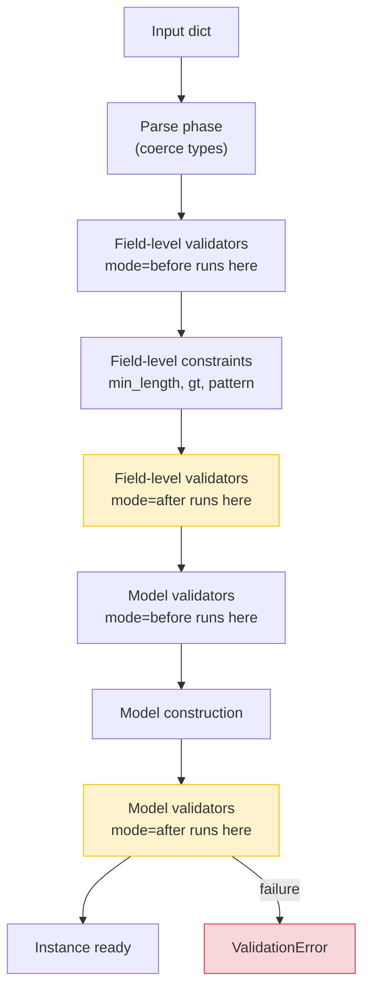

# Lesson 03: Validators – Strict vs Coercive

*Adding `@field_validator` for password rules and slug normalization, `@model_validator` for cross-field rules, strict mode for the public API, and the `Annotated[T, AfterValidator(...)]` form that turns a validator into a reusable type.*

**You're on Lesson 3 of Section 04.**

`Field(min_length=8)` covers 80% of validation. The other 20% — "the password must contain a digit and a symbol", "the email domain must be on an allowlist", "if `kind == 'business'` then `vat_id` is required" — needs custom logic. Pydantic v2 gives you two decorators for this, `@field_validator` and `@model_validator`, each with a `mode` parameter that decides whether it runs **before** or **after** Pydantic's built-in coercion. Picking the wrong mode is the difference between "I rewrite the type parser" and "I check the already-coerced value," and that difference is the source of half the validator bugs senior engineers see in code review. Take your time. Type every line. Read the tracebacks. **This is how you learn.**


#pydantic #validators #v2 #canonical

## Learning Objectives

By the end of this lesson you will be able to:

1. **Use `@field_validator`** with `mode="before"`, `mode="after"`, and `mode="wrap"`, and explain what each mode sees as input.
2. **Distinguish plain, wrap, and before/after validators** — when the validator returns the value, when it returns a `ValidationInfo`, and when it calls a `handler` to delegate to the next validator.
3. **Use `@model_validator(mode="before")`** for cross-field rules where one field depends on another's raw input, and `@model_validator(mode="after")` for rules that need the parsed model.
4. **Enable strict mode** per-field (`Strict`), per-model (`ConfigDict(strict=True)`), and per-type (`StrictInt`, `StrictStr`, `StrictBool`), and explain the coercive-vs-strict trade-off.
5. **Compose `Annotated` with `BeforeValidator`, `AfterValidator`, and `PlainValidator`** to build reusable custom types like `LowerEmail`, `Slug`, and `NonEmptyStrLower`.
6. **Recognize the "validator returns None" bug** and the `model_fields_set` attribute that powers PATCH semantics (`exclude_unset`) on response serialization.

## Prerequisites

Before starting, you need:

- **Pydantic v2.14.1** (verified 2026-10-11) and Lesson 2's `boardly/schemas.py` (`UserCreate`, `ProjectCreate`) and `boardly/types.py` (`PositiveInt`, `Slug`, etc.).
- **`BaseModel`, `Field`, `Annotated`, and the four-shape taxonomy** — [[BaseModel-and-Validation|Lesson 1]] and [[Fields-Annotated-Reusable-Annotations|Lesson 2]]. We extend the same `UserCreate` here.
- **Python exceptions** — [[01-Python-Foundations/Exceptions-Done-Right]]. Pydantic raises `ValidationError` (a `ValueError` subclass) on validation failure; raising `ValueError` inside a `@field_validator` is the idiomatic way to signal a field-level failure.
- **About 75–100 minutes of focused time.** This lesson's code is about 70 lines; the explanation is long because the `mode` parameter is the single most misunderstood feature in v2.

**The most common gap: forgetting the `mode` parameter.**

If you have written `@validator("password")` in v1 and assume v2's `@field_validator("password")` is a rename, you are half right and half wrong. The decorator renamed; the *default mode* changed; and v2 introduced `mode="wrap"`, which v1 did not have. The result is that v1 validators ported verbatim behave subtly differently in v2 — particularly around `mode="before"` and the loss of the implicit `cls` argument. Read this lesson's `mode` section carefully.


## The Problem

Boardly's `UserCreate` from Lesson 1 has `password: str = Field(..., min_length=8)`. That enforces length. But the security team has three more rules the field-level constraint cannot express:

1. **Composition.** The password must contain at least one digit and one symbol (`!@#$%^&*`).
2. **Normalization.** The `username` and `slug` must be lowercased and trimmed before validation — so `" Ada "` becomes `"ada"` and the unique constraint in Postgres doesn't fail on a trailing-space variant.
3. **Cross-field.** If `kind == "business"`, then `vat_id` is required and must match `^[A-Z]{2}[0-9]+$`. If `kind == "personal"`, `vat_id` must be absent.

`Field(min_length=, pattern=)` cannot express (1) (a single regex for "has a digit and a symbol" is awkward and unreadable; v2's `pattern` is per-field, not "must contain"). `Field` cannot express (2) (you can't *transform* the value, only *reject* it). `Field` cannot express (3) (it cannot look at *other* fields). For these, you need custom logic — and Pydantic v2 gives you `@field_validator` for (1) and (2), and `@model_validator` for (3).

Beyond the rules, you also have a *strictness* question: should `"42"` be accepted for an `int` field? Pydantic v2's default is "yes, coerce it to `42`" (the v1 behavior, kept for compatibility). The strict answer is "no, the type contract is `int`, the input must already be `int`." This lesson teaches both, and the trade-offs.

## The Code

Here is the extended `boardly/schemas.py` you'll write in this lesson. We extend `UserCreate` with three validators and add a new `OrgCreate` schema for the cross-field demo, plus a strict-mode schema for the public API.

```python
# boardly/schemas.py (continuation)
import re
from typing import Annotated, Any

from pydantic import (
 AfterValidator,
 BaseModel,
 ConfigDict,
 Field,
 field_validator,
 model_validator,
)

from boardly.types import NonEmptyStr, PositiveInt, Slug


# --- reusable custom types built from Annotated + AfterValidator ---

def _to_slug(value: str) -> str:
 """Lowercase, strip, and reject anything outside [a-z0-9-]."""
 s = value.strip().lower()
 if not re.fullmatch(r"[a-z0-9-]+", s):
 raise ValueError("slug must match [a-z0-9-]+")
 return s


SlugNormalized = Annotated[str, AfterValidator(_to_slug)]


# --- extend UserCreate with field validators ---

class UserCreate(BaseModel):
 model_config = ConfigDict(
 extra="forbid",
 populate_by_name=True,
 str_strip_whitespace=True,
 )

 email: str = Field(..., min_length=3, max_length=254)
 username: NonEmptyStr = Field(..., min_length=3, max_length=32)
 password: str = Field(..., min_length=8)
 display_name: str | None = Field(default=None, max_length=200)
 is_admin: bool = False

 @field_validator("password")
 @classmethod
 def _password_composition(cls, v: str) -> str:
 if not re.search(r"\d", v):
 raise ValueError("password must contain a digit")
 if not re.search(r"[!@#$%^&*]", v):
 raise ValueError("password must contain a symbol")
 return v

 @field_validator("is_admin")
 @classmethod
 def _is_admin_always_false(cls, v: bool) -> bool:
 # clients may not escalate themselves; the service sets it
 return False


# --- cross-field rules with @model_validator ---

class OrgCreate(BaseModel):
 model_config = ConfigDict(extra="forbid")

 kind: str # "personal" | "business"
 name: NonEmptyStr
 vat_id: str | None = None

 @model_validator(mode="after")
 def _vat_required_for_business(self) -> "OrgCreate":
 if self.kind == "business":
 if not self.vat_id:
 raise ValueError("vat_id is required for business orgs")
 if not re.fullmatch(r"[A-Z]{2}[0-9]+", self.vat_id):
 raise ValueError("vat_id must be like 'FR123456'")
 elif self.kind == "personal" and self.vat_id is not None:
 raise ValueError("personal orgs must not set vat_id")
 return self


# --- strict mode for the public API ---

class StrictQuery(BaseModel):
 """Public query schema. Refuses coercion: '42' is not int 42."""
 model_config = ConfigDict(strict=True, extra="forbid")

 project_id: int
 limit: int = 20
 tags: list[str] = Field(default_factory=list)


# --- the "returns None" bug demo ---

class Buggy(BaseModel):
 x: int

 @field_validator("x")
 @classmethod
 def _always_passes(cls, v: int) -> int: # missing `return v`!
 assert v > 0


# Smoke test:
# uv run python -c "from boardly.schemas import UserCreate; \
# UserCreate.model_validate({'email':'a@b.co','username':'ada', \
# 'password':'Abcdef1!'}).model_dump()"
```

About 80 lines. Read them. Type them. Run them. Change them. Break them. Fix them. We'll explain every line next.

## Line-by-Line Deep Dive

This section is the heart of the lesson. Read it twice. Don't skip.

### Lines 1–14: Imports

```python
import re
from typing import Annotated, Any

from pydantic import (
 AfterValidator,
 BaseModel,
 ConfigDict,
 Field,
 field_validator,
 model_validator,
)

from boardly.types import NonEmptyStr, PositiveInt, Slug
```

**What it does:** Pulls in the standard-library `re` (for regex matching in the password rule), the typing primitive `Annotated` (for `SlugNormalized`), and six Pydantic names — three classes (`BaseModel`, `ConfigDict`, `Field`) we already know, plus three new ones (`AfterValidator`, `field_validator`, `model_validator`).

**Why each new import:**

- `field_validator` — the v2 decorator for field-level rules. It is a function (lowercase). You decorate a `@classmethod` with it.
- `model_validator` — the v2 decorator for cross-field rules. Same shape; different semantics.
- `AfterValidator` — a helper that wraps a plain function into Pydantic's metadata form, so you can compose it with `Annotated[T, AfterValidator(fn)]` and build a *reusable type* from a plain function. It is part of the v2 `Annotated` metadata family alongside `BeforeValidator` and `PlainValidator`; all three have been stable since v2.0.

**Tip — `field_validator` is a function, `Field` is a class, `AfterValidator` is a class.**

The naming convention in Pydantic v2: classes are CamelCase (`Field`, `AfterValidator`, `BaseModel`); functions are snake_case (`field_validator`, `model_validator`). This matches PEP 8. The v1 `@validator` was a function in CamelCase, which violated PEP 8; v2 fixed it.


### Lines 18–25: The `_to_slug` function and the `SlugNormalized` type

```python
def _to_slug(value: str) -> str:
 """Lowercase, strip, and reject anything outside [a-z0-9-]."""
 s = value.strip().lower()
 if not re.fullmatch(r"[a-z0-9-]+", s):
 raise ValueError("slug must match [a-z0-9-]+")
 return s


SlugNormalized = Annotated[str, AfterValidator(_to_slug)]
```

**What it does:** Defines a plain Python function `_to_slug` that takes a string, normalizes it (strip + lowercase), validates the regex, and returns the normalized string. Then defines `SlugNormalized` as a reusable annotated type that applies `_to_slug` *after* Pydantic's built-in string coercion.

**Why a plain function instead of a method:** That lets it be unit-tested in isolation. `_to_slug("Ada Lovelace")` is `raise ValueError("slug must match [a-z0-9-]+")` — you can assert this directly without instantiating a `BaseModel`. The function is the *rule*; the validator is the *wiring*.

**Why `AfterValidator` and not `BeforeValidator`:** Because we want to run after Pydantic's built-in string coercion. If we ran `mode="before"`, we'd receive the *raw* input (which might be `bytes`, might be `None`, might be a `datetime`). After mode means: "the input is already a `str` by the time I see it; I can call `.strip()` and `.lower()` without worrying about non-string inputs."

**Why `re.fullmatch` and not `re.match`:** Because `fullmatch` anchors both ends; we don't need `^` and `$`. The function uses `fullmatch` consistently.

**Why the function raises `ValueError`:** Because Pydantic v2 catches `ValueError` (and `AssertionError`) inside validators and translates them to `ValidationError` with the function's message as the error string. Raising `ValueError("slug must match ...")` produces a `ValidationError` whose `msg` is `"Value error, slug must match [a-z0-9-]+"`. This is the idiomatic way to signal failure.

**Why does Pydantic catch `ValueError` and `AssertionError` specifically, and not just any `Exception`?** Because the standard library uses these two as the "I'm reporting a contract violation" signal — `ValueError` for "the value is the wrong shape" and `AssertionError` for "an `assert` failed." Catching the broad `Exception` base would also catch `TypeError` (a real bug — you passed a non-iterable to `len()`) and `KeyboardInterrupt` (which must always propagate); both must not be turned into a 422 response. Pydantic v2 catches only the two failure-signal exceptions by name, then runs any *other* exception through your exception handlers as a 500. The contract is: `ValueError` means "the *value* is bad, tell the client which field"; `TypeError` means "the *code* is bad, tell the operator to fix the validator." If you `raise RuntimeError("...")` inside a validator, it will not become a `ValidationError` — it will crash the request as an unhandled 500.

**What `AfterValidator` does, internally**

`AfterValidator(_to_slug)` produces a `ValidatorFunctionPlainMetadata` object — a piece of metadata. When `SlugNormalized` is used as a field annotation, Pydantic:
1. Unwraps `Annotated[str, AfterValidator(_to_slug)]` to `str` with metadata `[_to_slug]`.
2. Builds a Rust core-schema node for `str`, then chains `_to_slug` *after* the Rust validator.
3. At validation time: the Rust validator runs first (coercing to `str`, applying `min_length`, `max_length`, `pattern`); then `_to_slug` runs on the resulting string.
The "after" means: after Pydantic's coercion. If you want your function to see the *raw* input, use `BeforeValidator` instead.


### Lines 30–37: `UserCreate` extended with `password` and `is_admin` validators

```python
class UserCreate(BaseModel):
 model_config = ConfigDict(
 extra="forbid",
 populate_by_name=True,
 str_strip_whitespace=True,
 )

 email: str = Field(..., min_length=3, max_length=254)
 username: NonEmptyStr = Field(..., min_length=3, max_length=32)
 password: str = Field(..., min_length=8)
 display_name: str | None = Field(default=None, max_length=200)
 is_admin: bool = False
```

**What it does:** Re-states `UserCreate` with the same fields as Lesson 1, ready to receive the two `@field_validator` methods below.

**Why restate instead of extend:** Because Pydantic models are not designed to be subclassed for "add a validator." (You can subclass, but the subclass has its own `__pydantic_validator__`; mixing validators from base and subclass is brittle.) The convention is to redefine the model when you add a validator. We are rewriting the same model across lessons for pedagogical clarity; in a real codebase this would be one file edited once.

### Lines 39–47: The `password` composition validator

```python
 @field_validator("password")
 @classmethod
 def _password_composition(cls, v: str) -> str:
 if not re.search(r"\d", v):
 raise ValueError("password must contain a digit")
 if not re.search(r"[!@#$%^&*]", v):
 raise ValueError("password must contain a symbol")
 return v
```

**What it does:** Declares a field-level validator on `password`. The validator checks for a digit and a symbol, raising `ValueError` if either is missing. The default `mode` is `"after"`, so the input `v` is already a `str` (the `min_length=8` constraint has already run).

**Why each piece:**

- `@field_validator("password")` — the decorator. The string argument is the field name (or a tuple of field names, if the validator applies to multiple fields). v2 deprecated the v1 form `@validator("password", allow_reuse=True)`; v2 does not need `allow_reuse`.
- `@classmethod` — required. v2 made `@field_validator` *require* `@classmethod`; without it, you get a confusing error at decoration time. The reason: `cls` is the model class, used to look up class-level state if the validator needs it (rare, but supported).
- `def _password_composition(cls, v: str) -> str:` — the signature. `cls` is the class (because it's a classmethod); `v` is the value being validated. The return type is `str` (the same type as the field). **You must return the value** — see Mistake 5 below for the bug if you forget.
- `re.search(r"\d", v)` — Python's standard regex search. Returns a `Match` if found, `None` if not. `not re.search(...)` is `True` when no digit was found.
- `raise ValueError(...)` — the idiomatic failure signal. Pydantic catches it and wraps it into a `ValidationError`.
- `return v` — the success signal. Always return the (possibly transformed) value. If you forget, `None` becomes the field's value (see Mistake 5).

**Why does `@field_validator` require `@classmethod` in v2 when v1 didn't?** Because v1's `@validator` was itself a decorator that *converted* the function it wrapped — Pydantic v1 read the underlying function's first parameter and decided at decoration time whether to call it as a classmethod or instance-method-style. That magic was a source of subtle bugs: subclasses that inherited validators sometimes lost them silently because the magic detection picked the wrong call shape. v2 removes the magic: the decorator `@field_validator` *only* wraps; the author's job is to declare `@classmethod` explicitly so the wrapped function is genuinely a classmethod. The cost is one extra line (`@classmethod`); the benefit is that the validator's call shape is now what Python itself does, not what Pydantic's magic does, and `cls` is reliably the model class at call time.

**Spot the bug — does this validator do what its author intended?**

```python
@field_validator("password")
@classmethod
def _password_composition(cls, v: str) -> str:
    if not re.search(r"\d", v):
        raise ValueError("password must contain a digit")
    if not re.search(r"[!@#$%^&*]", v):
        raise ValueError("password must contain a symbol")
```
No. The validator never `return`s, so `None` becomes the field's value. Downstream code that reads `user.password` gets `None` (not the validated string) — the validation rules ran and the input had to pass them, but the field's stored value is `None` anyway. The validator author *thought* "raising is the failure case, falling through is the success case" — that intuition is wrong. The success case requires an explicit `return v`. The bug is silent at validation time (no error is raised) and surfaces only later when `pwd_context.hash(user.password)` raises `TypeError: bytes-like object is required, not 'NoneType'`. The fix: always end a `@field_validator(mode="after")` body with `return v` (or `return transformed_v`).


**What `mode="after"` means, exactly**

`@field_validator("password")` defaults to `mode="after"`. "After" means: after Pydantic's built-in coercion for the field's type. For `password: str`, "after" means the input has been coerced to `str` (e.g., `bytes` inputs would have been encoded), and the `Field(min_length=8)` constraint has been applied. Inside the validator, `v: str` is therefore guaranteed: a `str`, at least 8 chars. If `min_length=8` failed, the validator never runs — Pydantic raises before reaching it.

The other modes:
- `mode="before"` — the validator sees the *raw* input. It runs *before* Pydantic's coercion. Useful for transforming the input (e.g., parsing a `"2026-11-30"` string into a `date` yourself), or for rejecting inputs Pydantic would otherwise accept (e.g., rejecting `bytes` for an `str` field).
- `mode="wrap"` — the validator receives a `handler` callable. Calling `handler(value)` runs the default validation pipeline. You can transform before, call `handler`, transform after, and return. This is the most powerful and the rarest mode.


**Tip — Think like a senior engineer: the `mode` parameter is a *contract* decision, not a *convenience* decision**

The senior engineer picks `mode` from the rule's *intent*, not from "what input shape does my function want to see." The question is not "do I want the raw value or the coerced value?" — it is "is my rule a *transformation* (it changes the value's shape and must run before the type check), a *refinement* (it inspects the already-coerced value and either accepts or rejects), or a *govern* (it wants to wrap the default pipeline and decide whether to call it at all)?" Transformation rules go in `mode="before"`: a slug normalizer that strips whitespace and lowercases before the `str` schema ever sees the value, a `date` parser that accepts `"2026-11-30"` and returns a `date` so the field's `date` schema receives the right type. Refinement rules go in `mode="after"` (the default): a password composition check that runs after `min_length=8` has already passed, an email-domain allowlist that runs after the `str` is coerced. Govern rules go in `mode="wrap"`: an OAuth2 token validator that wants to short-circuit on a known-bad token without paying for the full validation pipeline. The audit checklist for every `@field_validator`: (1) does the rule *transform*? then `mode="before"`. (2) does the rule *inspect*? then `mode="after"` (the default). (3) does the rule *wrap* the default pipeline? then `mode="wrap"`. (4) does the rule need to read another field on the same model? then it is not a `@field_validator` at all — promote it to `@model_validator(mode="after")`. The mistake that ships a 422 instead of a 200 is almost always "the rule transforms but the author wrote `mode="after"` because they were copying a tutorial that said 'after is the default, you don't need to set mode'" — by the time the validator runs, the value the author wanted to transform has already been type-checked, and the transform either no-ops (the input was already the right type) or fails (the input was a type the author's transform cannot handle, and Pydantic rejected it before the validator ran).


### Lines 49–53: The `is_admin` "always false" validator

```python
 @field_validator("is_admin")
 @classmethod
 def _is_admin_always_false(cls, v: bool) -> bool:
 # clients may not escalate themselves; the service sets it
 return False
```

**What it does:** Declares a validator on `is_admin` that returns `False` no matter what the client sent. The input is ignored; the field is *always* `False` on a `UserCreate` instance.

**Why this pattern:** Lesson 1 noted that `is_admin: bool = False` does not prevent a client from sending `"is_admin": true`. The validator enforces "clients cannot set this." An alternative is to omit `is_admin` from `UserCreate` entirely and only declare it on `UserUpdate` (an admin-only schema) — but that loses the OpenAPI documentation of "this field exists, clients just can't set it here." The validator approach keeps the field visible in `/docs` while refusing client-set values.

**Why `return False` and not `raise ValueError`:** Because we *don't* want to reject the request — we want to silently ignore the client's value and force ours. Raising would produce a 422 with `is_admin` in the error list, which is also valid (it says "you may not set this field"), but loses the "accept-and-override" semantic. Pick the semantic your API contract specifies.

**Student asks: is silently overwriting `is_admin` a security risk?**

Yes, if the API contract says "the client may set this." Silently overwriting a documented field is a surprising behavior. The safer alternative is `raise ValueError("is_admin may not be set on UserCreate")` — a 422 that tells the client "stop sending this." Lesson 1's `extra="forbid"` does the equivalent for *unknown* fields; this validator does the equivalent for *known but restricted* fields. The Boardly convention is: prefer `raise`; use `return False` only when the API contract is "this field is for response-side use; on input it is ignored." For Lesson 3's demo we use `return False` to show the technique.


**Danger — How an attacker thinks: the `_is_admin_always_false` validator is a band-aid that fails open under refactoring**

The attacker reading your `/docs` sees `UserCreate` declares `is_admin`, default `False`. Their first probe is `POST /users` with `{"is_admin": true, ...}`. The request returns 200 OK — and `user.is_admin == False`. The attacker now knows two things: (1) there is a validator on `is_admin` that returns `False` no matter what, so the field exists and is being overridden; (2) the validator is the only thing preventing escalation. Both are vulnerabilities — the second is the worse one. A validator is mutable code: a maintainer who refactors `_is_admin_always_false` away (because "we don't use it, the field defaults to `False` anyway, the validator is dead code") ships the escalation path the same day. The test suite cannot catch the regression because the test sends `is_admin: false` either way — there is no test that asserts `is_admin: true` *fails* on the request, only tests that assert `user.is_admin == False` after parsing. The defense is structural, not validator-based, and Lesson 1's argument applies here too: `is_admin` must not exist on `UserCreate`. The senior engineer's audit checklist for every field with a "this is always X" validator: (1) can the field be removed from the request schema? If yes, remove it — the type system is the permanent defense. (2) If the field must exist on the request schema for OpenAPI documentation, can the validator be replaced with `raise ValueError("is_admin may not be set on UserCreate")` so the failure is loud (422) rather than silent (200 OK with the value overridden)? (3) Is there a test that asserts the request *fails* when the field is set to the privileged value — not just that the parsed instance has the unprivileged value? The "validator returns `False`" pattern fails all three checks; the "field does not exist" pattern passes all three; the "validator raises" pattern passes two of three and is acceptable when the OpenAPI contract requires the field to appear. The general rule for any "this field is read-only on input" pattern: prefer structural removal, accept a loud 422, never ship a silent override — a silent override is a privilege-escalation primitive waiting for the next refactor.


### Lines 58–78: `OrgCreate` with `@model_validator`

```python
class OrgCreate(BaseModel):
 model_config = ConfigDict(extra="forbid")

 kind: str # "personal" | "business"
 name: NonEmptyStr
 vat_id: str | None = None

 @model_validator(mode="after")
 def _vat_required_for_business(self) -> "OrgCreate":
 if self.kind == "business":
 if not self.vat_id:
 raise ValueError("vat_id is required for business orgs")
 if not re.fullmatch(r"[A-Z]{2}[0-9]+", self.vat_id):
 raise ValueError("vat_id must be like 'FR123456'")
 elif self.kind == "personal" and self.vat_id is not None:
 raise ValueError("personal orgs must not set vat_id")
 return self
```

**What it does:** Declares a model-level validator that runs *after* all field validators. It checks cross-field rules: business orgs need a `vat_id`, personal orgs must not have one.

**Why `@model_validator` and not `@field_validator`:** Because the rule depends on *two* fields (`kind` and `vat_id`). A `@field_validator` on `vat_id` only sees `vat_id`; it cannot see `kind`. The `@model_validator(mode="after")` sees the *whole model* — `self.kind`, `self.vat_id`, and every other field. It is the right tool for cross-field rules.

**Why `mode="after"` and not `mode="before"`:** Because `mode="after"` runs after all field-level coercion and validation. By the time `_vat_required_for_business` runs, `self.kind` is a `str`, `self.vat_id` is a `str | None`, and all field-level `Field` constraints have passed. The model validator only has to enforce cross-field rules. If we used `mode="before"`, we'd receive a raw `dict` (not an instance) and have to do everything by hand — much more error-prone.

**Why the validator returns `self`:** Because the contract for `mode="after"` model validators is "return the model (possibly mutated)." Returning `self` is the success case. Returning a different model (or a copy) is possible but rare. Returning `None` is the bug from Mistake 5.

**Why `def _vat_required_for_business(self)` is a regular method, not `@classmethod`:** Because `mode="after"` model validators run on an *instance* — they have `self`. The validator has access to all parsed field values via `self.kind`, `self.vat_id`, etc. (`mode="before"` model validators are classmethods — they receive `cls` and the raw data dict.)

**Why does the `mode="after"` model_validator signature differ from the `mode="before"` one?** Because the two modes run at different points in the validation pipeline, and the shapes they receive are genuinely different objects. `mode="before"` runs *before* field-level validation; the model does not exist yet as an instance, only the raw input dict does — so the signature is `(cls, data: dict) -> dict | BaseModel`. `mode="after"` runs *after* field-level validation; the model is now a fully-constructed instance with all fields parsed and coerced — so the signature is `(self) -> Self`. Forcing them to share a signature would mean either feeding an unparseable dict to an instance method (nonsense) or feeding a constructed instance to a "before" validator (defeating the "before" point). The two signatures are the API surface of Pydantic's pipeline having two distinct phases with two distinct data shapes.

**Why the regex uses `re.fullmatch`:** Same as `_to_slug` — anchor both ends. The regex `[A-Z]{2}[0-9]+` matches two uppercase letters followed by one or more digits, e.g., `FR123456`. `fullmatch` rejects `fr123456` (lowercase) and `FR1234567X` (trailing non-digit).

**`@model_validator` has two forms**

- `mode="before"` — classmethod; signature `(cls, data: dict) -> dict | BaseModel`. Runs *before* field-level validation. You can transform the raw dict, fill in derived fields, or short-circuit.
- `mode="after"` — instance method; signature `(self) -> Self`. Runs *after* field-level validation. You see the parsed instance and can enforce cross-field rules.

Most cross-field rules want `mode="after"`. `mode="before"` is rarer — useful when you need to translate the raw input (e.g., accept a flat `{"business_vat_id": "..."}` and restructure it into `{"kind": "business", "vat_id": "..."}`) before Pydantic tries to parse it.


### Lines 83–90: `StrictQuery` with strict mode

```python
class StrictQuery(BaseModel):
 """Public query schema. Refuses coercion: '42' is not int 42."""
 model_config = ConfigDict(strict=True, extra="forbid")

 project_id: int
 limit: int = 20
 tags: list[str] = Field(default_factory=list)
```

**What it does:** Declares a schema with `strict=True`. The schema refuses to coerce `"42"` (a string) to `42` (an int) — `project_id: int` requires the input to *already* be `int`.

**Why strict mode:** Because coercive mode (the default) is a security risk in some contexts. If your API gateway sends `"42"` (a string from a query parameter) and your `int` field coerces it, the type contract is silently violated. Strict mode turns `"42"` into a `ValidationError` — the client has to send `42` (a JSON number) or the request is rejected.

**Why the trade-off matters:** Coercive mode is convenient — the API accepts more inputs and "just works." Strict mode is safe — the API rejects inputs that don't match the declared type. The right answer depends on the API's audience: an internal API consumed by your own typed client can be strict; a public API consumed by curl-and-shell-scripts should usually be coercive.

**Warning — Strict mode is per-type, not just per-model.**

`ConfigDict(strict=True)` enables strict mode for *every* field. You can also enable it per-type:
- `x: StrictInt` (refuses coercion for this one int field).
- `x: StrictStr` (refuses `bytes`-to-`str` coercion).
- `x: StrictBool` (refuses `0`/`1`/`"true"`-to-`bool` coercion).
- `x: Annotated[int, Field(strict=True)]` (per-field strict).

The three (`StrictInt`, `StrictStr`, `StrictBool`) are the most useful; for other types (lists, dates), use `ConfigDict(strict=True)` on the model.


**Warning — Debugging war story: enabling strict mode mid-project is a silent contract change**

The pattern: a team ships a `GET /search` endpoint with `project_id: int` (coercive, the default). `curl`-and-shell clients send `?project_id=42` and the endpoint coerces `"42"` to `42` and returns results. Six months later, a security review recommends strict mode; the team adds `model_config = ConfigDict(strict=True)` to the query schema. The deploy goes green; CI is green. The first 422 rolls in twelve hours later — an internal shell script that pipes `jq` output through `curl` is sending `?project_id="42"` (quoted, because `jq` produces JSON strings). The shell script's author "knew" `project_id` was an `int` because the docs said so; the docs were generated from the schema, which had been coercive; the schema silently changed contract without a docs change. The debugging sequence that pinpoints it: (1) the 422's `loc` says `['query', 'project_id']`, and the `type` is `int_parsing` — Pydantic received a `str` and refused to coerce. (2) `e.errors()[0]['input']` is the string `"42"`. (3) The team greps for `strict=True` in the schema file and finds the recent change. The senior engineer's rule: enabling strict mode is a *deprecation*, not a flag flip — it changes the public API contract from "we accept string-encoded ints" to "we require JSON-number ints." Treat it as a v2 of the endpoint: announce the deprecation in the OpenAPI `description`, ship a `X-Pydantic-Strict-Mode: pending` header for one release cycle so callers can self-detect, then flip the flag. The same rule applies to enabling `StrictInt`/`StrictStr`/`StrictBool` per-field — each is a contract change to one query parameter, and each can break a caller you cannot see (an internal cron, a partner integration, a monitoring probe). The preventative CI rule: a grep that fails the build when `strict=True` is added to a schema that already has callers in the wild, unless the diff also bumps the endpoint's OpenAPI version or adds a deprecation note. The cost of the rule is one CI run per PR; the cost of the bug is one partner integration silently broken per miss.


### Lines 93–99: The `Buggy` "returns None" demo

```python
class Buggy(BaseModel):
 x: int

 @field_validator("x")
 @classmethod
 def _always_passes(cls, v: int) -> int: # missing `return v`!
 assert v > 0
```

**What it does:** Declares a validator that asserts `v > 0` but does *not* return `v`. The validator implicitly returns `None`, which becomes the field's value.

**Why this is a bug:** Because the field is typed `x: int`, but the validator's implicit return is `None`. The `mode="after"` validator's return value replaces the field's value — Pydantic does not re-validate the return value against the field's declared type. So `None` (the implicit return) becomes the field's value, and a `Buggy` instance with `x = None` is constructed. The field type was `int`; the value is `None`. Downstream code that does `b.x + 1` will raise `TypeError: unsupported operand type(s) for +: 'NoneType' and 'int'`. The bug is silent until the value is used.

**The fix:** Always `return v` at the end of every `@field_validator`. Pydantic does not warn you that you forgot — by design, because returning `None` is sometimes intentional (rare, but possible). The convention in `Boardly` is to add a `# pylint` or `ruff` rule that flags any function with a non-`None` return type annotation that has a path where the function does not explicitly return.

**How to debug the "returns None" bug**

If your model validates correctly but downstream code raises `TypeError: 'NoneType' is not ...`, search for `@field_validator` functions whose last line is not `return`. The function is implicitly returning `None`. Add `return v` (or `return self` for model validators). Linters can flag this; failing that, a careful code review.


**Production reality: the "returns None" bug ships to prod because the failure path is only exercised by a small slice of inputs**

The pattern that produces the incident: a `@field_validator(mode="after")` on `password` that asserts `re.search(r"\d", v)` and forgets to `return v`. The unit tests send `password="Abcdef1!"` (a value with a digit); the assertion passes; the implicit `None` return overwrites the field; the test reads `user.email` and `user.username` — never `user.password`. The integration tests do the same — they assert on the response shape, which is built from `UserRead` (a different schema) and never reads `password` off the `UserCreate`. The bug reaches the password-hashing call in the service layer: `pwd_context.hash(user.password)` raises `TypeError: '<' not supported between instances of 'str' and 'NoneType'` (or a passlib variant: `ValueError: password must be a string`). The 500 is reported as "passlib bug" in the first triage; the actual cause is two layers up, in a validator that returns `None`. The debugging procedure that locates it: (1) the traceback's bottom frame is in `passlib.hash` — that is the *consumer* of the bad value, not the *producer*. (2) Walk back to the line that called `pwd_context.hash(user.password)`. (3) Inspect `user.password` in a `pdb` breakpoint or a `print(repr(user.password))` — it is `None`. (4) Grep for `@field_validator("password")` in the schema file. (5) Check that the function's last statement is `return v`. The senior engineer's preventative rule: add a `ruff` rule (or a `mypy` strict-equality check) that flags any function whose return-type annotation is not `None` and whose body has a path that does not explicitly return. Pydantic will not warn you — by design, because returning `None` is occasionally intentional — so the linter is the only automated gate. The cost of the rule is one CI run per PR; the cost of the bug is one incident per miss, and the miss is silent until the password-hashing layer blows up on a customer's registration.


### `model_fields_set` and PATCH semantics

Pydantic v2 exposes `instance.model_fields_set` — a frozenset of the field names that were *explicitly supplied* on input (as opposed to set from defaults). This is the data behind `exclude_unset=True` in `model_dump()`, which we'll cover fully in [[Serialization-and-Model-Dump|Lesson 4]]. For now, the key insight is:

```python
u = UserCreate.model_validate({
 "email": "a@b.co", "username": "ada", "password": "Abcdef1!",
})
# u.model_fields_set == {"email", "username", "password"}
# Note: display_name and is_admin are NOT in the set — they came from defaults.
```

PATCH semantics use this: a `PATCH /users/42` request body `{"display_name": "Ada"}` produces a `UserUpdate` instance where `model_fields_set == {"display_name"}`. The service layer iterates over `model_fields_set` and applies only those fields to the database — so a client who sends `{"display_name": "Ada"}` does not clobber `is_admin=False` in the database. Without `model_fields_set`, you'd have to compare the input dict to the schema's defaults to figure out which fields the client actually sent, which is fragile.

```python
class UserUpdate(BaseModel):
 model_config = ConfigDict(extra="forbid")

 email: str | None = None
 username: str | None = None
 display_name: str | None = None


def apply_patch(user_id: int, patch: UserUpdate):
 # Only update fields the client actually sent.
 fields = {k: getattr(patch, k) for k in patch.model_fields_set}
 db.execute(update(User).where(User.id == user_id).values(**fields))
```

The `model_fields_set` is the v2 replacement for v1's `__fields_set__`. Lesson 4 will show how `model_dump(exclude_unset=True)` uses the same data for response serialization.

**Why is `model_fields_set` a `frozenset` and not a `list` or `set`?** Because the contract is "the set of fields the client explicitly supplied," and that contract is *immutable* once the model is parsed — there is no API that lets you add a name to `model_fields_set` after the fact. `frozenset` makes the immutability syntactic: any code that tries `instance.model_fields_set.add("is_admin")` raises `AttributeError` immediately rather than silently succeeding and corrupting the PATCH logic. The unordered `set` shape (vs. `list`) is right because the *order* in which the client sent fields doesn't matter for the "did they send this field?" question — only the membership. Storing as a `list` would invite bugs where a downstream consumer iterated in input order and accidentally built an ORDER BY clause out of the field order.

**Spot the security bug — does this PATCH handler allow an attacker to escalate privileges?**

```python
class UserUpdate(BaseModel):
    # extra="forbid" is set, so unknown keys raise.
    email: str | None = None
    display_name: str | None = None
    is_admin: bool | None = None

@router.patch("/users/{id}")
async def patch_user(id: int, patch: UserUpdate):
    fields = patch.model_dump(exclude_unset=True)
    await db.execute(update(User).where(User.id == id).values(**fields))
```
Answer: yes. `extra="forbid"` blocks unknown *keys*, but `is_admin` is a *known* field — it's in the schema, so the client is allowed to send it. The handler then writes `is_admin=True` to the database for any user who can hit `PATCH /users/{id}`. The `model_fields_set` mechanism is correct (it records that the client sent `is_admin`), but the *schema* declared `is_admin` as a public field, which is the actual hole. The fix is to split read/write DTOs: `UserUpdate` (the public, client-facing DTO) declares only `email` and `display_name`; `UserAdminUpdate` (an internal DTO used only by the admin router after a `Depends(require_scope("users:admin"))` check) declares `is_admin`. Two DTOs for the same table, scoped per role. The general rule: PATCH fields are an *exhaustive list* of what the client is allowed to change — `extra="forbid"` blocks *unknown* fields, but cannot protect against fields you *declared* that the client shouldn't be able to set. See [[05-Project-Architecture/Domain-vs-HTTP-Concerns]] for the full DTO-per-role pattern.


**Danger — How an attacker thinks: `extra="forbid"` is a perimeter, not a vault — declared fields are the vault, and a PATCH endpoint with `is_admin` on the schema is an open vault**

The attacker reading your PATCH endpoint does not try unknown keys first — `extra="forbid"` rejects them, and the attacker learns nothing from the 422. The attacker's first probe is the documented fields, with privileged values: `PATCH /users/{id}` with `{"is_admin": true}`. If the schema declares `is_admin: bool | None = None` and the handler does `patch.model_dump(exclude_unset=True)` straight into the SQL `UPDATE`, the attacker becomes an admin on the first request. The chain does not require any coding bug — it requires only (a) the field exists on the request schema, (b) the handler does not split the write DTO from the read DTO. The `model_fields_set` mechanism is doing exactly what it was designed to do (it records that the client sent `is_admin`); the hole is at the schema layer, where the field was declared on a route that clients can hit. The senior engineer's audit checklist for every PATCH endpoint: (1) enumerate every field on the PATCH schema; for each, ask "can a non-privileged client set this?" (2) Anything the answer is "no" (`password_hash`, `is_admin`, `tenant_id`, `created_at`, `email_verified_at`, `last_login_at`) must be on a *separate* schema (`UserAdminUpdate`) wired to a route behind a `Depends(require_scope(...))` guard. (3) Run a contract test that sends every privileged field on the public PATCH and asserts a 422 — this test is the regression net for the refactor where someone "adds `is_admin` to the public PATCH for the admin UI" and re-opens the hole. The general rule, the same as Lesson 1's `is_admin` rule: declared fields are the perimeter's vault; `extra="forbid"` is the perimeter; you cannot defend a vault whose door is the perimeter. The same audit applies to nested schemas — a `UserUpdate` with `preferences: UserPreferencesUpdate` where `UserPreferencesUpdate` declares `theme: str` *and* `can_see_other_tenants: bool` is the same hole at one nesting level deeper, and `extra="forbid"` on the parent does not protect the child.


## Execution Trace

Run the smoke tests:

```bash
uv run python -c "
from boardly.schemas import UserCreate, OrgCreate, StrictQuery, Buggy
from pydantic import ValidationError

# Happy: password has digit and symbol
u = UserCreate.model_validate({
 'email': 'a@b.co', 'username': 'ada', 'password': 'Abcdef1!',
})
print('user ok:', u.model_dump())

# Sad: password lacks digit
try:
 UserCreate.model_validate({
 'email': 'a@b.co', 'username': 'ada', 'password': 'Abcdefgh!',
 })
except ValidationError as e: print('digit:', e.errors()[0]['msg'])

# Sad: password lacks symbol
try:
 UserCreate.model_validate({
 'email': 'a@b.co', 'username': 'ada', 'password': 'Abcdef12',
 })
except ValidationError as e: print('symbol:', e.errors()[0]['msg'])

# is_admin always false even when sent
u = UserCreate.model_validate({
 'email': 'a@b.co', 'username': 'ada', 'password': 'Abcdef1!',
 'is_admin': True,
})
print('is_admin forced:', u.is_admin)

# OrgCreate cross-field: business needs vat_id
try:
 OrgCreate.model_validate({'kind': 'business', 'name': 'Acme'})
except ValidationError as e: print('vat:', e.errors()[0]['msg'])

# StrictQuery: '42' is rejected
try:
 StrictQuery.model_validate({'project_id': '42'})
except ValidationError as e: print('strict:', e.errors()[0]['type'])

# Buggy: 'returns None'
b = Buggy(x=5)
print('buggy x:', repr(b.x))
"
```

Expected output (truncated):

```
user ok: {'email': 'a@b.co', 'username': 'ada', 'password': 'Abcdef1!',
 'display_name': None, 'is_admin': False}
digit: Value error, password must contain a digit
symbol: Value error, password must contain a symbol
is_admin forced: False
vat: Value error, vat_id is required for business orgs
strict: int_parsing
buggy x: None
```

Note `buggy x: None` — the field type was `int`, the value is `None`. That is the bug.



The diagram shows where each validator mode runs. `field_validator mode=after` (the default) runs after Pydantic's coercion and constraints — your validator sees the cleaned-up value. `model_validator mode=after` runs after the instance is constructed — your validator sees `self`.

**You've just added custom logic to the schema.**

The password rule, the slug normalization, the cross-field `vat_id` rule, the strict-mode refusal to coerce — these are all the rules `Field` could not express. They are now part of the schema, applied automatically, with `ValidationError` for any input that fails them. The service layer doesn't need to know any of these rules exist; it just calls `UserCreate.model_validate(body)` and either gets an instance or a `ValidationError`.


## Common Mistakes

### Mistake 1: Forgetting `@classmethod` on `@field_validator`

```python
# WRONG
class UserCreate(BaseModel):
 password: str

 @field_validator("password")
 def _password_composition(v: str) -> str: # missing @classmethod!
 ...
 return v
```

**Symptom:** `PydanticUserError: field_validator on UserCreate.password should be applied to a classmethod or staticmethod.`

**Why:** v2 made `@classmethod` mandatory on `@field_validator`. The decorator inspects the function and refuses to apply it to a non-classmethod.

**Fix:** Add `@classmethod` *below* `@field_validator`. The order matters: `@field_validator` first, then `@classmethod`. (v2 will fail to apply if you reverse them, because the inner `classmethod` would be the decorator's input, which is a `classmethod` object, not a `function`.)

### Mistake 2: Wrong `mode` for the validator

```python
# WRONG
class M(BaseModel):
 date_str: str

 @field_validator("date_str", mode="before")
 @classmethod
 def _parse(cls, v: Any) -> date:
 return date.fromisoformat(v) # returns a date, but field is str!
```

**Symptom:** `ValidationError: Input should be a valid string [type=string_type, input_value=datetime.date(...)]` when you instantiate `M(date_str="2026-11-30")`. The validator's `date` return value is fed back into the field's `str` core schema, which (in v2.14) refuses non-`str` inputs. There is no silent coercion of `date` to `str` — the `str` core schema is strict about non-string inputs, so the parse fails before the instance is constructed.

**Why:** `mode="before"` runs *before* the field's type coercion, but the validator's return value is then handed to the field's core schema, which coerces (or rejects) it to the field's declared type. In older v2 releases this was a "works but muddied the type contract" trap (Pydantic would call `str(date_obj)` to produce `"2026-11-30"`); in v2.14 the `str` schema is strict about non-string inputs, so a returned `date` is now a `ValidationError` instead. Either way, the validator's intent (parse a date, store a date) is wasted when the field's declared type undoes the parse. Align the declared type with what the validator produces.

**Fix:** Declare the field as `date`, not `str`:
```python
class M(BaseModel):
 date_field: date # field is now date, not str

 @field_validator("date_field", mode="before")
 @classmethod
 def _parse(cls, v: Any) -> date:
 if isinstance(v, str): return date.fromisoformat(v)
 return v
```
Most of the time, the field's declared type *is* the type you want, and you should leave the validator in default `mode="after"` to see the coerced value.

### Mistake 3: The "returns None" bug

```python
# WRONG
class M(BaseModel):
 x: int

 @field_validator("x")
 @classmethod
 def _check(cls, v: int) -> int:
 assert v > 0 # missing return v!
```

**Symptom:** The validator passes for `x=5`, but `m.x` is `None`. Downstream `m.x + 1` raises `TypeError`.

**Why:** Python implicitly returns `None` from any function that doesn't explicitly return. In v2 a `mode="after"` validator's return value *becomes* the field's value — Pydantic does not re-validate that return value against the field's declared type (it has already run the type coercion before the after-validator). So `None` (the implicit return) replaces the validated `int`, the field's type contract is silently broken, and the bug only surfaces when downstream code consumes `m.x`. (`validate_assignment` is unrelated — that option controls whether attribute assignment *after* construction re-runs validation, not what the validator's return value does.)

**Fix:** Always `return v` at the end. Add a linter rule for any function with a non-`None` return annotation that has a path without explicit return.

### Mistake 4: `@model_validator(mode="after")` declared as `@classmethod`

```python
# WRONG
class M(BaseModel):
 a: int
 b: int

 @model_validator(mode="after")
 @classmethod # WRONG for mode=after!
 def _check(cls, self) -> "M":
 if self.a > self.b: raise ValueError("a > b")
 return self
```

**Symptom:** `TypeError: _check() missing 1 required positional argument: 'self'` at decoration time, or — depending on the order — `PydanticUserError`.

**Why:** `mode="before"` model validators are classmethods (`cls, data`). `mode="after"` model validators are instance methods (`self`). Mixing them up is one of the most common v2 mistakes.

**Fix:** For `mode="after"`, drop `@classmethod` and use `def _check(self) -> "M":`.

### Mistake 5: Strict mode that breaks your tests

```python
class M(BaseModel):
 model_config = ConfigDict(strict=True)
 x: int

M.model_validate({"x": "42"}) # ValidationError in strict mode
```

**Symptom:** A test that always worked — `M.model_validate({"x": "42"})` — suddenly raises `ValidationError` with `type=int_parsing`.

**Why:** Strict mode refuses coercion. `"42"` is a string; the field wants `int`. Coercive mode (the default) accepts this and produces `x=42`. Strict mode rejects it.

**Fix:** Decide. If the API contract says "the input must already be int" — keep strict mode and fix the test to send `42` instead of `"42"`. If the API contract says "accept and coerce" — turn off strict mode. Don't enable strict mode by accident.

### Mistake 6: Forgetting that `@field_validator(mode="after")` sees only the value

```python
# WRONG
class M(BaseModel):
 kind: str
 vat_id: str | None = None

 @field_validator("vat_id", mode="after")
 @classmethod
 def _check(cls, v: str | None) -> str | None:
 if cls.kind == "business": # WRONG: cls is the class, not the instance
 ...
 return v
```

**Symptom:** `AttributeError: type object 'M' has no attribute 'kind'`.

**Why:** `cls` is the *class*, not the *instance*. Class attributes are not field values. The cross-field rule cannot be expressed as a `@field_validator` because field validators don't see other fields' values.

**Fix:** Use `@model_validator(mode="after")` for cross-field rules. See `OrgCreate` above.

## Engineering Trade-Offs

### Coercive vs strict

The default is coercive. Strict mode is opt-in. The trade-off:

- **Coercive (default)**: `"42"` becomes `42`; `"true"` becomes `True`; `b"hello"` becomes `"hello"`. Convenient for APIs consumed by humans typing curl commands.
- **Strict (`ConfigDict(strict=True)`)**: `"42"` is rejected. The type contract is enforced exactly. Safe for APIs consumed by typed clients.

The Boardly convention is: coercive for request bodies that humans will type (registration, project creation); strict for query schemas that machines will generate (the public `GET /search` endpoint with a typed client).

### When to use which: `@field_validator` vs `Annotated[T, AfterValidator]`

Pydantic v2 lets you express the *same* validator two ways. The choice between them is the most frequently missed "when to use what" in this lesson, so we treat it as a decision rather than a style. Get it right and your rules compose across models and survive refactors; get it wrong and you end up copy-pasting the same validator into five schemas, or hiding a model-specific rule behind a "reusable" name that only one schema uses.

**The two forms, side by side** — the password-composition rule from `UserCreate` written both ways:

```python
# Form A — method on the model (`@field_validator`)
class UserCreate(BaseModel):
    password: str = Field(..., min_length=8)

    @field_validator("password")
    @classmethod
    def _password_composition(cls, v: str) -> str:
        if not re.search(r"\d", v):
            raise ValueError("password must contain a digit")
        if not re.search(r"[!@#$%^&*]", v):
            raise ValueError("password must contain a symbol")
        return v


# Form B — reusable type (`Annotated[T, AfterValidator(...)]`)
def _password_composition(v: str) -> str:
    if not re.search(r"\d", v):
        raise ValueError("password must contain a digit")
    if not re.search(r"[!@#$%^&*]", v):
        raise ValueError("password must contain a symbol")
    return v

PasswordComposed = Annotated[str, AfterValidator(_password_composition)]

class UserCreate(BaseModel):
    password: PasswordComposed = Field(..., min_length=8)
```

Both forms compile. Both forms produce the same `ValidationError` on bad input. Both forms run *after* Pydantic's built-in `str` coercion (because `@field_validator` defaults to `mode="after"` and `AfterValidator` is by definition after). The difference is **where the rule lives** and **what it can see**.

**The decision table:**

| Need | Reach for | Why |
|---|---|---|
| Rule is a pure function of the value (`v -> v'`) | `Annotated[T, AfterValidator(fn)]` | Plain function — unit-testable, no `cls`, no `info`, no model import |
| Rule is reused across ≥2 models (`SlugNormalized` on `ProjectCreate`, `OrgCreate`, `TaskCreate`) | `Annotated[T, AfterValidator(fn)]` | One definition, three uses; refactor touches one file |
| Rule needs to read *another field* on the same model (cross-field) | `@model_validator(mode="after")`, **neither** form | `@field_validator` cannot reliably see peer fields; `AfterValidator` cannot see them at all |
| Rule needs `cls` to read class-level state (a config flag, a registry) | `@field_validator` | The method form has `cls`; the plain function does not |
| Rule needs `info.data` (the partially-validated dict of fields validated before the current one — available in both `mode="before"` and `mode="after"`) | `@field_validator` (either mode) | `info` is only passed to method-form validators; the plain `AfterValidator(fn)` function gets only `v` |
| Rule is genuinely model-specific (`_is_admin_always_false` only makes sense on `UserCreate`) | `@field_validator` | Local to the schema; a reader sees the rule next to the field |

**The rule of thumb.**

**Use `Annotated[T, AfterValidator(fn)]` when the rule is a pure function of the value and you want it reusable. Use `@field_validator` when the rule is bound to one schema or needs `cls` / `info`. Use `@model_validator(mode="after")` when the rule is cross-field.** Three forms, three questions: "is it pure?", "is it model-specific?", "is it cross-field?" — and the answer picks the form.


**Why not use `@field_validator` for everything and skip the `Annotated` form?**

Because copy-paste is the failure mode. If `_password_composition` lives as a method on `UserCreate` and a year later `OrgCreate` also needs password composition (admins of business orgs, say), the temptation is to copy the method body. Now you have two definitions; a security fix to one is not applied to the other. The `Annotated[T, AfterValidator(...)]` form forces the rule into `boardly/types.py` from day one, where it's a one-line import on each consumer. The same pattern is what makes `PositiveInt`, `Slug`, `LowerEmail` reusable in Lesson 2 — those are validators first, types second.


**When does `@field_validator` actually win over the `Annotated` form?**

Three cases. (1) The rule needs `cls` — e.g., a validator that reads `cls._admin_allowlist` from class-level state to check whether the email is on it. The plain-function form has no `cls`, so you'd have to close over the allowlist from module scope, which is uglier and harder to override in tests. (2) The rule needs `info.data` — both `mode="before"` and `mode="after"` method-form validators receive a `ValidationInfo` whose `.data` attribute is the dict of fields already validated (in declaration order); a rule that says "if `kind` is `'business'`, accept `vat_id` as `None` and fill it later" needs that. The plain `AfterValidator(fn)` form gets only `v`. (3) The rule is genuinely model-specific — `_is_admin_always_false` is one such: it's a security override that only applies to `UserCreate`; pushing it into `types.py` would mislead a reader into thinking it's reusable when it isn't.


**Composability is the silent win.**

The `Annotated` form *composes*. `SlugNormalized = Annotated[str, AfterValidator(_to_slug)]` can be combined with `Field(..., min_length=3)` and `BeforeValidator(_strip_unknown_chars)` and `PlainValidator(_final_check)` — all four pieces of metadata chain through the Rust core-schema in declaration order. The `@field_validator` form does not compose with anything; it's one method, one rule, one field. When you see a field with three rules stacked (`Annotated[str, Field(min_length=3), AfterValidator(_normalize), AfterValidator(_check_domain)]`), you're seeing the composable form pay off. When you see three `@field_validator` methods on the same field, you're seeing a code smell — the rules probably belong in `types.py`.


**Warning — The `PlainValidator` trap.**

If you find yourself reaching for `Annotated[T, PlainValidator(fn)]` to "skip Pydantic's coercion entirely," double-check you're not reinventing `mode="before"`. `PlainValidator` runs *instead of* Pydantic's built-in pipeline — useful when the input is a custom type Pydantic doesn't understand (a `Decimal` subclass, a `pendulum.DateTime`), but a footgun when used to bypass `min_length` checks you actually wanted. Use `PlainValidator` only when you genuinely own the type's parsing; otherwise prefer `AfterValidator` (post-coercion) or `BeforeValidator` (pre-coercion).


**The Boardly convention, made greppable:**

- `boardly/types.py` — home of every `Annotated[T, AfterValidator(...)]` reusable type (`SlugNormalized`, `LowerEmail`, `PasswordComposed`, `NonEmptyStr`). If a rule's body fits in a pure function of the value, it lives here.
- `boardly/schemas.py` — home of every `@field_validator` method (`_is_admin_always_false` on `UserCreate`, `_default_currency` on `OrgCreate`). If a rule needs `cls`, `info`, or is model-specific, it lives here.
- Cross-field rules — `@model_validator(mode="after")` — also live in `schemas.py` next to the model they govern.

**Tip — The refactor signal.**

If you write the same `@field_validator` method on two models, the second copy is the signal to refactor. Lift the body into a plain function in `types.py`, wrap it as `Annotated[T, AfterValidator(fn)]`, and replace both methods with the type annotation. The diff is one new function and two deletions — and the rule is now reusable across the third model when it shows up.


**The benchmarking-when-unsure rule does not apply here.** Both forms compile to the same Rust `SchemaValidator` node; the validator function runs at the same point in the pipeline; the runtime cost is identical. Choose by *composition and locality*, not by speed.

**A worked example — the slug rule, both ways.** `Boardly` ships the slug rule as `SlugNormalized = Annotated[str, AfterValidator(_to_slug)]` because three schemas (`ProjectCreate`, `OrgCreate`, `TaskCreate`) all need it. If we'd shipped it as `@field_validator("slug")` on `ProjectCreate`, we'd have copy-pasted it onto `OrgCreate` and `TaskCreate` — and when the design team asked us to also accept `_` as a separator (so `"my_project"` becomes `"my-project"`), we'd have patched one of the three copies and shipped a 422 from the other two on inputs the design team had approved. The `Annotated` form made the rule reusable and the fix a one-line change in `types.py`. That's the silent win of the composable form.

**When you genuinely cannot decide** — for instance, the rule could go either way and you're unsure whether a second consumer will ever appear — pick `@field_validator` first. The refactor from method-on-model to `Annotated[T, AfterValidator(...)]` is mechanical (lift the body, drop `cls`/`@classmethod`, wrap with `AfterValidator`, swap the field annotation); the reverse refactor (from a `types.py` function to a model-specific method) is harder because you have to track down every consumer of the type. Default to the *local* form; promote to the *reusable* form on the second use.

**Tip — Think like a senior engineer: where validators *live* is a refactor-cost decision, not a style decision**

The senior engineer treats the `boardly/types.py` vs `boardly/schemas.py` split as a refactor-cost calculus, not a style preference. The rule of thumb: a rule lives in `types.py` (as `Annotated[T, AfterValidator(fn)]`) when its *body* is a pure function of the value, because the body can be lifted out of one schema and into a shared type without touching the schemas that consume it — the refactor cost is "delete the method, add an import." A rule lives in `schemas.py` (as `@field_validator` on the model) when it needs `cls`, `info.data`, or is genuinely model-specific, because moving it to `types.py` would require closing over the model from module scope, which is harder to test and harder to override in tests. The audit checklist when reviewing a PR that adds a validator: (1) does the rule read another field on the model? Then it should be `@model_validator(mode="after")` in `schemas.py`, not a `@field_validator`. (2) Does the rule read class-level state (`cls._allowlist`, `cls._feature_flag`)? Then it should be `@field_validator` in `schemas.py`. (3) Is the rule a pure function of the value, and does the PR author expect a second consumer? Then it should be in `types.py` from day one — the second consumer is a when, not an if, and the refactor from method-on-model to shared-type is mechanical the first time and a code-review argument the second time. (4) Is the rule a pure function of the value, and is the author unsure about a second consumer? Default to `@field_validator` in `schemas.py`; promote on the second use. The cost asymmetry is the senior engineer's whole case for "default to local; promote on second use": the refactor from method-on-model to `Annotated[T, AfterValidator(...)]` is a one-line diff per consumer (delete the method, add an import, change the annotation); the reverse refactor (from a shared type back to a model-specific method) requires tracking down every consumer of the type across the codebase, which is a multi-file diff that breaks consumers silently if you miss one. Optimize for the cheaper refactor direction.


**Note — Where this connects to the rest of the vault.**

The `Annotated[T, AfterValidator(...)]` form is the natural sequel to Lesson 2's `PositiveInt = Annotated[int, Field(gt=0)]` — Lesson 2 composed *constraints* via `Annotated`; this lesson composes *validators* the same way. Both forms are why Lesson 2's title is `Fields-Annotated-Reusable-Annotations` and not `Field-vs-Annotated`: the `Annotated` form is the modern default, and the validator story is part of why.


### `mode="wrap"` for full control

The rarest mode is `mode="wrap"`. A wrap validator receives `(value, handler, info)`:

```python
@field_validator("password", mode="wrap")
@classmethod
def _check(cls, v, handler, info):
 # Before: see the raw input
 if isinstance(v, str) and " " in v:
 v = v.replace(" ", "") # remove spaces before validation
 # Call the default pipeline
 result = handler(v)
 # After: see the validated result
 if len(result) < 12:
 raise ValueError("must be 12+ chars after normalization")
 return result
```

Wrap mode is the most powerful — you can transform before, call the default pipeline, and transform after. It is also the most complex to reason about. Use it when `mode="before"` and `mode="after"` are insufficient, which is rare.

### Validators that mutate vs validators that reject

Two styles of validator:

- **Rejecting**: `if not re.search(...): raise ValueError(...)`. The validator refuses bad input.
- **Mutating**: `return v.strip().lower()`. The validator transforms the input.

Both are valid. The Boardly convention is: prefer mutating validators for *normalization* (slugs, emails — the rule is "the input shape is valid, the value just needs cleaning"). Prefer rejecting validators for *composition rules* (password — the rule is "the input shape is wrong; refuse it").

## Exercises

**Tip — The 20-minute rule**

If you're stuck on an exercise for more than 20 minutes, re-read the relevant section above, then move on and come back.


**Exercise 1 — Slug-normalize the `slug` on `ProjectCreate`.** Import `SlugNormalized` and change Lesson 2's `ProjectCreate.slug: Slug` to `slug: SlugNormalized`. Confirm that `ProjectCreate.model_validate({"name": "x", "slug": " MIGRATION-to-v2 ", "owner_id": 1}).slug == "migration-to-v2"`.

**Exercise 2 — Add a `confirm_password` cross-field rule.** Add a `confirm_password: str` field to `UserCreate` and a `@model_validator(mode="after")` that raises `ValueError("passwords do not match")` if `password != confirm_password`. Confirm with a test.

**Exercise 3 — Enable strict mode on `ProjectCreate`.** Add `strict=True` to its `model_config`. Try `model_validate({"name": 42, "slug": "x", "owner_id": 1})` and confirm `name=42` is rejected (it's an `int`, but the field is `str` — strict mode refuses).

**Exercise 4 — Write a `LowerEmail` reusable type.** Define `LowerEmail = Annotated[str, AfterValidator(_lower)]` where `_lower` lowercases the input and checks for an `@`. Add it to `boardly/types.py` and use it on `UserCreate.email`.

**Exercise 5 — Trigger the "returns None" bug.** Instantiate `Buggy(x=5)`. Print `b.x` — confirm it's `None`. Then add `return v` to the validator and confirm `b.x == 5`.

**Exercise 6 — Use `model_fields_set` for a PATCH endpoint.** Write a `UserUpdate` schema with optional `email`, `username`, `display_name`. Write a function `apply_patch(user_id: int, patch: UserUpdate)` that builds `fields = {k: getattr(patch, k) for k in patch.model_fields_set}` and prints the SQL UPDATE it would issue. Confirm that sending `{"display_name": "Ada"}` produces `fields = {"display_name": "Ada"}` (not the entire schema).

## Verification

The smoke test below is split into five small, named scripts. Each isolates one validator concept; the name on the `print()` line tells you which section to re-read if it fails. Run them in order; stop at the first failure.

### Step 1: `@field_validator` applies the rule and the field reads back as written

```bash
uv run python -c "
from boardly.schemas import UserCreate
u = UserCreate.model_validate({
    'email': 'a@b.co', 'username': 'ada', 'password': 'Abcdef1!',
})
assert u.is_admin is False
assert u.password == 'Abcdef1!'
print('step1 ok: field_validator applied')
"
```

Expected: `step1 ok: field_validator applied`. If this fails, the `is_admin` validator returned something other than `False`, or the password validator mutated the value instead of returning it.

### Step 2: `@model_validator(mode="after")` enforces the cross-field rule

```bash
uv run python -c "
from boardly.schemas import OrgCreate
o = OrgCreate.model_validate({'kind': 'business', 'name': 'Acme', 'vat_id': 'FR123'})
assert o.vat_id == 'FR123'
print('step2 ok: model_validator accepted valid input')
"
```

Expected: `step2 ok: model_validator accepted valid input`. If this fails on `vat_id == 'FR123'`, the model validator either did not set the field, or stripped it.

### Step 3: Strict mode refuses coercion

```bash
uv run python -c "
from boardly.schemas import StrictQuery
from pydantic import ValidationError
try:
    StrictQuery.model_validate({'project_id': '42'})
    raise AssertionError('StrictQuery should have rejected the string')
except ValidationError as e:
    assert e.errors()[0]['type'] == 'int_parsing', e.errors()[0]
print('step3 ok: strict mode refused string->int coercion')
"
```

Expected: `step3 ok: strict mode refused string->int coercion`. If this fails, `StrictQuery` is missing `ConfigDict(strict=True)` (or the `StrictInt` annotation).

### Step 4: A validator that forgets `return v` overwrites the field with `None`

```bash
uv run python -c "
from boardly.schemas import Buggy
b = Buggy(x=5)
assert b.x is None  # the bug — the validator dropped the value
print('step4 ok: reproduced the returns-None bug')
"
```

Expected: `step4 ok: reproduced the returns-None bug`. If this assertion *fails* (i.e. `b.x == 5`), you have already added the `return v` line back to the validator — switch the assertion to `assert b.x == 5` and re-run to confirm.

### Step 5: `model_fields_set` records exactly the fields the client sent

```bash
uv run python -c "
from boardly.schemas import UserCreate
u = UserCreate.model_validate({
    'email': 'a@b.co', 'username': 'ada', 'password': 'Abcdef1!',
})
assert u.model_fields_set == {'email', 'username', 'password'}, u.model_fields_set
print('step5 ok: model_fields_set matches input keys exactly')
"
```

Expected: `step5 ok: model_fields_set matches input keys exactly`. If this fails, the input was supplied via direct attribute assignment (which bypasses `model_fields_set`) or the model has frozen-field defaults that the client didn't actually send.

## Previously Learned Here

These concepts were taught in earlier lessons. We link back instead of re-explaining:

- **`BaseModel`** — [[BaseModel-and-Validation|Lesson 1]]. The class on which validators are declared.
- **`Pydantic Field`** — [[Fields-Annotated-Reusable-Annotations|Lesson 2]]. The constraint carrier; we composed it with `AfterValidator` here to build `SlugNormalized`.
- **`Annotated` (PEP 593)** — [[01-Python-Foundations/Type-Hints-and-Annotations]]. The `Annotated[str, AfterValidator(...)]` form reuses the same primitive Pydantic uses for fields.
- **Python exceptions** — [[01-Python-Foundations/Exceptions-Done-Right]]. `ValueError` inside a validator becomes `ValidationError` outside it.

## What's Next

In [[Serialization-and-Model-Dump|Lesson 04]] we move from "parse and validate" to "serialize and emit." You will:

- Use `model_dump()` and `model_dump_json()` with `by_alias`, `exclude`, `exclude_unset`, `exclude_defaults`, `exclude_none`.
- Build `UserRead` with `from_attributes=True` to load from a SQLAlchemy row.
- Use `model_validate(obj, from_attributes=True)` to construct a Pydantic model from an arbitrary Python object.
- Add `@computed_field` for derived fields like `full_name` from `first_name + last_name`.
- Use `model_construct()` for the unsafe-but-fast path (testing, post-load-from-trusted-source).
- Add `@field_serializer` to control how `datetime` and `Decimal` serialize.

By the end of Lesson 04, `Boardly` will have a complete request→response data flow: `UserCreate` (parse) → service layer → `UserRead` (serialize) → JSON.

## Sources

- **Pydantic v2 — Validators** — <https://docs.pydantic.dev/2.0/concepts/validators/> — accessed 2026-10-19 — canonical reference for `@field_validator` and `@model_validator`, the `mode` parameter, and the `BeforeValidator`/`AfterValidator`/`PlainValidator` helpers.
- **Pydantic v2 — Validation decorators** — <https://docs.pydantic.dev/2.0/api/validations/> — accessed 2026-10-19 — the `@field_validator` and `@model_validator` API.
- **Pydantic v2 — Strict mode** — <https://docs.pydantic.dev/2.0/concepts/strict_mode/> — accessed 2026-10-19 — `ConfigDict(strict=True)`, `StrictInt`, `StrictStr`, `StrictBool`.
- **Pydantic v2 — `model_fields_set`** — <https://docs.pydantic.dev/2.0/api/base_model/#pydantic.BaseModel.model_fields_set> — accessed 2026-10-19 — the data behind `exclude_unset`.
- **Pydantic v2 — Custom types** — <https://docs.pydantic.dev/2.0/concepts/types/> — accessed 2026-10-19 — composing `Annotated` with `AfterValidator`.
- **Pydantic v2 — Migration** — <https://docs.pydantic.dev/2.0/migration/> — accessed 2026-10-19 — `@validator` → `@field_validator` and the `allow_reuse` removal.
- **PEP 593 — `Annotated`** — <https://peps.python.org/pep-0593/> — accessed 2026-10-19.

## What We Learned

Let's recap. In this lesson you:

- **Added `@field_validator`** for the password composition rule (digit + symbol) and the `is_admin` "always false" override.
- **Used `@model_validator(mode="after")`** for the cross-field `vat_id` rule on `OrgCreate`.
- **Built `SlugNormalized`** as a reusable type via `Annotated[str, AfterValidator(_to_slug)]` — turning a plain function into a Pydantic metadata carrier.
- **Enabled strict mode** (`ConfigDict(strict=True)`) on `StrictQuery` and saw the trade-off: strict mode refuses coercion, which is safer for typed clients and inconvenient for humans.
- **Met the "returns None" bug** — a validator that forgets `return v` silently overwrites the field with `None`. The fix is to always `return v` (or `return self`).
- **Used `model_fields_set`** for PATCH semantics — the frozenset of fields the client actually sent, powering `exclude_unset=True` on response serialization.
- **Hit and fixed six common mistakes** — missing `@classmethod`, wrong `mode`, the returns-None bug, `@classmethod` on `mode=after` model validators, strict-mode surprises, and the cross-field-in-`@field_validator` mistake.

Here's the mental model to walk away with: *Pydantic v2 runs a four-phase pipeline — parse, validate, set, freeze — and `@field_validator` lets you hook into the validate phase, either before or after Pydantic's built-in coercion. `@model_validator` lets you hook into the whole-model phase, either before or after the instance is constructed. `mode="after"` is the default and the most common; `mode="before"` is for transforming raw input; `mode="wrap"` is for full control. The same logic, expressed as a plain function composed into `Annotated[T, AfterValidator(fn)]`, becomes a reusable type. `model_fields_set` is the data that distinguishes "client sent this" from "default kicked in" — and it is what makes PATCH endpoints safe.*

---

> A note from your teacher
You just built the rules layer. Sit with that. The password has composition rules. The slug gets normalized. The business org gets a `vat_id` check. The strict-mode query endpoint refuses to coerce. None of these rules can be expressed with `Field`; all of them are now part of the schema, applied automatically, with `ValidationError` for any input that fails them. The service layer just calls `model_validate` and gets either an instance or an exception. We're going to add the response side next — `model_dump`, `from_attributes`, `computed_field`, `field_serializer` — and the schema you wrote today stays the same shape. See you in Lesson 04.


---

**Tags:** #pydantic #validators #v2 #canonical #review
**Previous:** [[Fields-Annotated-Reusable-Annotations]]
**Next:** [[Serialization-and-Model-Dump]] →
