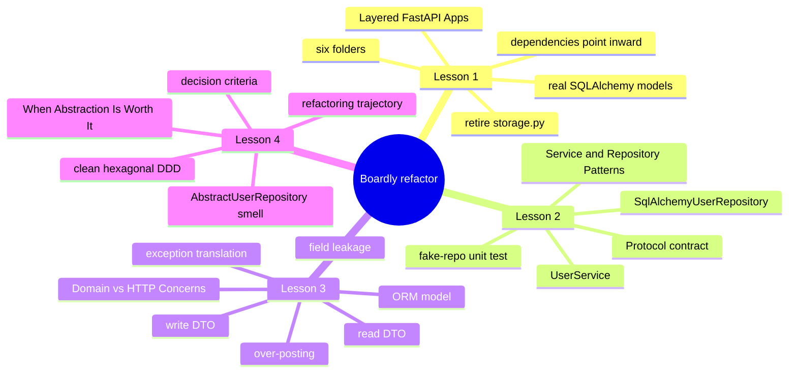
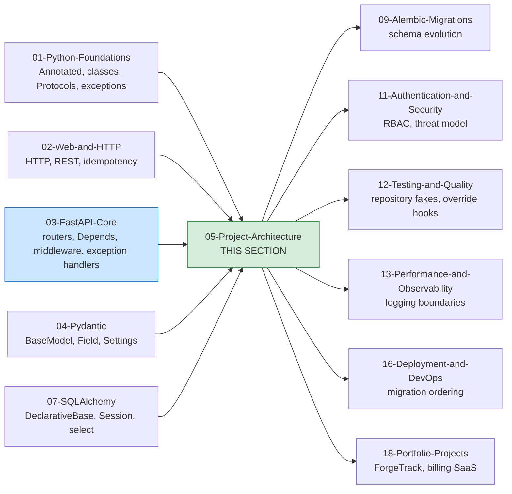

# Project Architecture: Map of Content

**Bookmark this page.**

This is the **home base** for Section 05 — Project Architecture. Every lesson in this folder, every concept, every cross-reference back to the rest of the vault is reachable from here. When you get lost, come back to the MOC.


Hello, friend. Pull up a chair.

You have built `Boardly` once already. In Section 03 you wrote a flat little service: `boardly/main.py` plus `routers/health.py`, `routers/projects.py`, `models.py`, `storage.py`, `deps.py`, `middleware.py`, `errors.py`. It runs. It has typed routes. It has dependencies. It has middleware. It even has an in-memory store that pretends to be a database. That app is about to outgrow its shape, and this section is what you do when that happens.

In the next four lessons we are going to **refactor `Boardly` from a flat package into a layered one**. We will introduce real SQLAlchemy models (because the in-memory `storage.py` from Section 03 was a teaching scaffold and it is time to retire it). We will introduce services that own transactions and raise domain errors. We will introduce repositories where they earn their keep — and *only* where they earn their keep, which is the most important sentence in this whole section. We will introduce a real `schemas/` folder that separates what clients send from what clients see, and we will teach you the security property that folder enforces. And we will end with the decision framework that says when any of these moves is worth doing at all.

**You are in the right place.**

If you have shipped a FastAPI app that started clean and got tangled — three developers each adding their files at the root, `main.py` at 600 lines, business rules leaking into routers, tests that only work over HTTP — this section is the cure. We will go slow. We will explain every line. You will refactor a real app.


---

## The Boardly Refactor #boardly



Four lessons. One growing application. By Lesson 4 your `Boardly` API has:

- A canonical layered layout — `core/`, `models/`, `schemas/`, `services/`, `repositories/`, `routers/` — with the rule that dependencies point inward enforced by imports alone.
- Real SQLAlchemy 2.x ORM models (`User`, `Project`) behind a real `engine` and a request-scoped `Session`.
- Pydantic v2 DTOs (`UserCreate`, `UserRead`, `UserUpdate`, `AdminUserUpdate`, `AdminUserRead`, `ProjectCreate`, `ProjectRead`, `ProjectUpdate`) that separate input shape from output shape from storage shape.
- A `UserService` that owns the transaction boundary, raises typed domain errors (`ConflictError`, `NotFoundError`, `QuotaError`), and never imports `fastapi`.
- A `SqlAlchemyUserRepository` that hides query details, plus a `typing.Protocol` `UserRepository` contract, plus a `FakeUserRepository` used in unit tests with no database.
- Global exception handlers that translate the domain errors into precise HTTP responses (`409`, `404`, `422`) and an `IntegrityError` catch-all that logs when a service missed a check.
- A documented answer, per slice, to the question "is this abstraction worth it here?" — and the self-discipline to skip an abstraction when the trigger has not fired.

And you will know *why* every line is there.

---

## Lessons in Order

| # | Lesson | What you do to `Boardly` | Time |
|---|--------|---------------------------|------|
| 1 | [[Layered-FastAPI-Apps]] | Refactor the flat package into `core/`, `models/`, `schemas/`, `services/`, `repositories/`, `routers/`. Replace the in-memory `storage.py` with real SQLAlchemy `User` and `Project` ORM models. Wire a request-scoped `Session` dependency and a `session_scope` helper. | 75–105 min |
| 2 | [[Service-and-Repository-Patterns]] | Add `UserService` and `SqlAlchemyUserRepository`. Introduce the `UserRepository` `Protocol` and a `FakeUserRepository` unit test that exercises the "no duplicate email" and "active-user quota" rules without a database. | 90–120 min |
| 3 | [[Domain-vs-HTTP-Concerns]] | Tighten the schemas folder: separate write DTOs from read DTOs, add admin-only DTOs, install global exception handlers, prove that over-posting `is_admin` and reading `hashed_password` both fail. | 75–105 min |
| 4 | [[When-Abstraction-Is-Worth-It]] | Step back. Audit the layout. Decide which slices keep the repository, which lose it, where to introduce a Unit-of-Work, and when (if ever) clean architecture / hexagonal / DDD pays off. | 60–90 min |

**Tip — How to read this section**

Read the lessons **in order**. Each lesson's code is a strict superset of the previous one — the same `Boardly` package evolves across lessons, so by Lesson 4 you have one coherent application, not four disconnected snippets. If you skip ahead, you will bring in abstractions whose justification has not yet been explained.

Each lesson follows the same shape: **Learning Objectives, Prerequisites, The Problem, The Code, Line-by-Line Deep Dive (numbered subsections), Execution Trace, Common Mistakes, Engineering Trade-Offs, Exercises, Verification, Previously Learned Here, What's Next, Sources, What We Learned.** Open the lesson in one pane and your `Boardly` checkout in another, side by side. Type the code yourself. Don't copy-paste. Typing is what makes it stick.


---

## How This Section Fits in the Vault



This section is the seam between the FastAPI/Pydantic/SQLAlchemy mechanics you have already learned and the production-grade topics (Auth, Testing, Observability, Deployment, Portfolio Projects) that depend on a coherent layout. Every later section assumes the layered layout from [[Layered-FastAPI-Apps]] is in place. Every later section assumes the `DomainError` hierarchy from [[Domain-vs-HTTP-Concerns]] is in place. Every later section assumes the opt-in stance from [[When-Abstraction-Is-Worth-It]] is in place.

---

## Concepts First Taught Here

One recurring concept is taught for the first time in this section. It has a canonical lesson:

- **Repository pattern** — first taught in [[Service-and-Repository-Patterns]]. The persistence boundary object that hides query details and exposes aggregate-level operations. The lesson gives the criteria for when the abstraction pays off and the smell of when it is cargo cult.

If a later section (Testing, Auth, Portfolio Projects) mentions a "repository", it links back here instead of re-explaining. That is the rule from [[00-Start-Here/Concept-Registry]].

## Concepts Reused Here (not re-explained)

These were taught in earlier sections. We link back instead of repeating:

- **`Annotated`** — [[01-Python-Foundations/Type-Hints-and-Annotations]]. Used everywhere in routers and dependencies.
- **Classes / Protocols / Structural typing** — [[01-Python-Foundations/Classes-Protocols-Structural-Typing]]. The `UserRepository` contract is a `Protocol`, not an `ABC`.
- **`BaseModel` (Pydantic v2)** — [[04-Pydantic/BaseModel-and-Validation]]. The DTOs in `schemas/` are `BaseModel` subclasses.
- **Pydantic v2 validators** — [[04-Pydantic/Validators-Strict-vs-Coercive]]. Used for format checks on write DTOs.
- **Pydantic Settings** — [[04-Pydantic/Pydantic-Settings]]. Used in `core/config.py`.
- **FastAPI lifespan** — [[03-FastAPI-Core/Application-and-Lifespan]]. The place where the engine is created and disposed.
- **Dependency injection (FastAPI `Depends`)** — [[03-FastAPI-Core/Dependency-Injection]]. Wires `get_session` -> `get_user_repository` -> `get_user_service`.
- **Middleware** — [[03-FastAPI-Core/Middleware-and-Request-Order]]. Moved into `core/middleware.py` in this section's refactor.
- **`DeclarativeBase` / `Mapped`** — [[07-SQLAlchemy/03-Declarative-Base-and-Mapped]]. The ORM models in `models/`.
- **Session / AsyncSession** — [[07-SQLAlchemy/05-Session-and-Transaction-Management]]. The request-scoped `Session` from `core/db.py:get_session` and the service-owned `session_scope` helper.
- **Engine / connection pool** — [[07-SQLAlchemy/02-Engines-Connections-Pools]]. The `engine` in `core/db.py` and the `pool_pre_ping` setting.
- **Exceptions (Python)** — [[01-Python-Foundations/Exceptions-Done-Right]]. The `DomainError` hierarchy.
- **HTTP / REST / status codes** — [[02-Web-and-HTTP/REST-and-Pragmatic-API-Design]]. The 404/409/422 mappings the global handlers install.

---

## The Layout You Will End With

This is the target of the refactor. Each lesson fills in part of it.

```
boardly/
├── pyproject.toml
├── alembic.ini
├── alembic/
│ ├── env.py
│ └── versions/
└── boardly/
 ├── __init__.py
 ├── main.py
 ├── core/
 │ ├── __init__.py
 │ ├── config.py
 │ ├── db.py
 │ ├── exceptions.py
 │ └── middleware.py
 ├── models/
 │ ├── __init__.py
 │ ├── base.py
 │ ├── user.py
 │ └── project.py
 ├── schemas/
 │ ├── __init__.py
 │ ├── user.py
 │ └── project.py
 ├── services/
 │ ├── __init__.py
 │ ├── protocols.py
 │ ├── dependencies.py
 │ ├── user_service.py
 │ └── project_service.py
 ├── repositories/
 │ ├── __init__.py
 │ ├── user_repository.py
 │ └── project_repository.py
 └── routers/
 ├── __init__.py
 ├── health.py
 ├── user_routes.py
 └── project_routes.py
```

**Note — Why six folders, not three?**

The three-folder layout (`main.py`, `models.py`, `routers/`) works up to about 500 lines of code. Past that point, the seams between "what the client sends", "what we store", and "what we run" become painful. Six folders is the smallest layout that lets each of those concerns live in its own file without ceremony. We will justify each folder in [[Layered-FastAPI-Apps]] and then question each one in [[When-Abstraction-Is-Worth-It]].


---

## Reading Paths

Not everyone has six hours in one block. Pick a path:

### The Refactor Path (4–6 hours)

You already have a working `Boardly` from Section 03. You want to refactor it the right way. Read Lesson 1, do the refactor locally, then read Lesson 2, do the repository extract, then Lesson 3, tighten the DTOs, then Lesson 4, audit the result. By the end your `Boardly` is the layout every later section assumes.

### The Decision Path (2 hours)

You are starting a new project and asking "do I need layers? do I need repositories? do I need DDD?" Read [[When-Abstraction-Is-Worth-It]] first — it gives you the trigger-based criteria. Then come back and read the lessons whose triggers fired. Skip the ones whose triggers have not.

### The Security Path (1 hour)

You have an existing API and a security review next week. Read [[Domain-vs-HTTP-Concerns]] only. It teaches the over-posting and field-leakage vulnerabilities, the audit checklist, and the global-exception-handler pattern that closes the gaps. Then go audit your endpoints.

**Example — Which path are you on?**

Open a daily note and write down: which path, when you'll study each lesson, and a target completion date. Committing to a schedule beats willpower every time.


---

## Verified Versions (October 2026)

This section targets the following versions, all verified current as of 2026-10-19:

| Package | Version | Notes |
|---------|---------|-------|
| FastAPI | 0.148.0 | Released 2026-10-19. `Annotated[T, Depends(...)]` form throughout. |
| Starlette | 1.9.0 | Pinned by FastAPI. |
| Pydantic | v2.14.1 | v2 only — `model_dump`, `ConfigDict`, `field_validator`, no v1 idioms. |
| SQLAlchemy | 2.1.5 | `DeclarativeBase`, `Mapped`, `mapped_column`, `select()`, sync `Session` in code examples. Async is in [[07-SQLAlchemy/07-Async-SQLAlchemy]]. |
| Alembic | 1.20.0 | Cited in [[09-Alembic-Migrations/00-Alembic-MOC]]; we do not run migrations in the lifespan. |
| `uv` | 0.13.1 | Used as the project runner: `uv run uvicorn boardly.main:app --reload`. |
| Python | 3.12 | Canonical learner version (3.13 also works). |

**Warning — Version pinning matters.**

The code in this section uses `Annotated[T, Depends(...)]` (FastAPI 0.95+), Pydantic v2 idioms (`model_dump`, `ConfigDict`, `field_validator`), SQLAlchemy 2.x typed ORM (`Mapped`, `mapped_column`), and the `lifespan=` async context manager. If you are on older versions, the code will still run (with deprecation warnings); we will point out the diff when it matters.


---

## Related Decisions

See [[21-Reference-Library/Engineering-Decision-Log]]:

- **D-003 — Do not call `Base.metadata.create_all()` in the lifespan.** Use Alembic for schema management. The lifespan in this section disposes the engine; it does not create tables.
- **D-005 — Repository pattern is opt-in, not default.** This section teaches the criteria; it does not impose the abstraction on every example app in the vault.
- **D-008 — Pydantic v2 idioms.** All DTO examples use v2 (`model_dump`, `field_validator`, `Annotated`, `ConfigDict`).

---

## Reference Links

- FastAPI documentation — <https://fastapi.tiangolo.com/>
- SQLAlchemy 2.x documentation — <https://docs.sqlalchemy.org/en/20/>
- Pydantic v2 documentation — <https://docs.pydantic.dev/latest/>
- Robert C. Martin — The Clean Architecture — <https://blog.cleancoder.com/uncle-bob/2012/08/13/the-clean-architecture.html>
- Martin Fowler — Repository — <https://martinfowler.com/eaaCatalog/repository.html>
- Alistair Cockburn — Hexagonal Architecture — <https://alistair.cockburn.us/hexagonal-architecture/>
- See [[21-Reference-Library/Source-Register]] for the full source list with dates accessed.

---

**Your map is ready.**

Four lessons, one growing `Boardly` refactor, all reachable from this page. Pick a starting point and go. We will see you on the other side.


---

**Tags:** #moc #architecture #index #home
**Previous:** [[03-FastAPI-Core/00-FastAPI-MOC]]
**Start:** [[Layered-FastAPI-Apps]] ->
