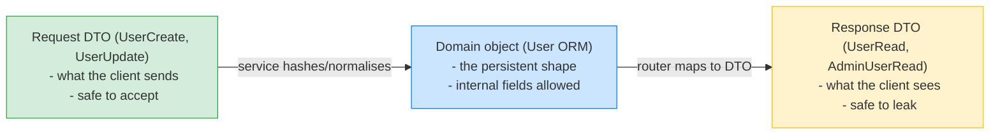
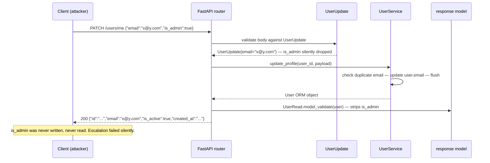

# Lesson 03: Domain vs HTTP Concerns

*Three shapes for one entity. Why writing one Pydantic model for every layer creates security bugs. Where validation lives. How a domain `UserNotFound` becomes a `404`.*

**Welcome to the security lesson.**

The single most common FastAPI security bug — over-posting on a `User` model whose `is_admin` column a client can set by adding `"is_admin": true` to a `PATCH /users/me` request — is caused by using one Pydantic model at every layer. The fix is mechanical: have separate DTOs for input, output, and the database. This lesson teaches the boundary that prevents the bug, the validation discipline that keeps it from regressing, and the exception-translation pattern that keeps the boundary clean. **This is how production APIs are written.**


#architecture #security #pydantic

## Learning Objectives

By the end of this lesson you will be able to:

1. **Distinguish three kinds of objects** — request DTO, response DTO, ORM model — and explain why fusing them is dangerous.
2. **Recognise the over-posting vulnerability and the field-leakage vulnerability** in a codebase, and explain the difference between them.
3. **Place validation in the right layer** — format validation in Pydantic, cross-field validation in services, data integrity in the database.
4. **Translate a domain exception into a precise HTTP response** with a single global handler, including a fallback for `IntegrityError` that logs the gap.
5. **Audit an endpoint for over-posting and field leakage in under five minutes.**
6. **Defend `extra="forbid"` vs. `extra="ignore"`** as a deliberate trade-off, not a default.

## Prerequisites

Before starting, you need:

- **The layered `Boardly` from Lesson 01** plus **the User aggregate from Lesson 02.** We tighten `schemas/user.py` and `routers/user_routes.py` here.
- **Pydantic v2** — [[04-Pydantic/BaseModel-and-Validation]] for `BaseModel`, [[04-Pydantic/Serialization-and-Model-Dump]] for `model_dump`, `model_validate`, `from_attributes`, [[04-Pydantic/Validators-Strict-vs-Coercive]] for `field_validator` and `model_validator`.
- **FastAPI exception handlers** — [[03-FastAPI-Core/Exception-Handlers]] for `@app.exception_handler(...)` and how handlers resolve in MRO order.
- **Python exceptions** — [[01-Python-Foundations/Exceptions-Done-Right]] for the hierarchy design.
- **About an hour and a half.** This lesson is shorter on code than Lesson 02 and longer on security reasoning. Read slowly.

**The most common gap: Pydantic v2's `model_config` vs. v1's `Config`.**

In Pydantic v1 you wrote `class Config: orm_mode = True; extra = "forbid"` as an inner class. In v2 (since June 2023), you write `model_config = ConfigDict(from_attributes=True, extra="forbid")` as a class attribute. We use the v2 form everywhere. The two are not interchangeable; if you see `class Config:` in a tutorial, it's v1.


## The Problem

A web request is data in three places — what the client sends, what we store, what the client reads back. These three shapes are *not the same*. The client sends `email` and `password`; the database stores `email` and `hashed_password`; the client reads back `id`, `email`, `is_active`, `created_at`. If you write one Pydantic model with all the fields and use it as both the request body and the response body, two things go wrong simultaneously:

1. **Over-posting.** The model has `is_admin` because the database has it. The model accepts `is_admin` in the request body. A user sends `{"email": "x@y.com", "is_admin": true}` to `PATCH /users/me`. The router, not realising, sets `user.is_admin = True`. Privilege escalation.
2. **Field leakage.** The model has `hashed_password` because the database has it. The router returns `user` as the response. FastAPI serialises every column. The client reads `hashed_password`. Account takeover if the hash is weak.

These are not hypotheticals. OWASP API3:2023 (Object Property Authorization) covers both as a single threat category. The lesson you are about to read is the mechanical fix: separate the three shapes, install the global exception handlers, and audit.

**Note — Historical context — this vulnerability predates FastAPI**

The over-posting vulnerability was first catalogued for Ruby on Rails in 2011 ("mass assignment" — a GitHub employee accidentally admin-promoted himself by sending `user[admin]=1` in a PUT to the profile endpoint). Rails's fix was Strong Parameters. Django's fix was ModelForm's `fields` whitelist. FastAPI's fix is the one this lesson teaches: separate DTOs per shape. The shape of the bug is the same in 2026 as it was in 2011; the language-specific fix differs.


## The Code

We extend `schemas/user.py` with admin-only DTOs, install a `@app.exception_handler(DomainError)` in `main.py`, and add an `IntegrityError` catch-all that logs escaped constraint violations. We also add two audit endpoints and prove that over-posting and field leakage both fail.

### `boardly/schemas/user.py` (extended)

```python
# boardly/schemas/user.py
"""Pydantic DTOs for the User resource. Six shapes for one entity.

The three self-service shapes (UserCreate, UserUpdate, UserRead) are the
client's surface. The admin shapes (AdminUserCreate, AdminUserUpdate,
AdminUserRead) are a separate set with different fields. The admin
endpoints use the admin DTOs; the self-service endpoints use the
self-service DTOs. The field set is a security property — made structural.
"""
from datetime import datetime
from uuid import UUID

from pydantic import BaseModel, ConfigDict, EmailStr, Field, field_validator

PASSWORD_MIN = 12


# --- Self-service DTOs ---------------------------------------------------

class UserCreate(BaseModel):
 """What a client may send when registering. Notice what is missing:
 no `id`, no `hashed_password`, no `is_active`, no `is_admin`,
 no timestamps. The server generates or denies each of those."""
 email: EmailStr
 password: str = Field(min_length=PASSWORD_MIN, max_length=128)

 @field_validator("password")
 @classmethod
 def _no_whitespace(cls, v: str) -> str:
 """Passwords must not have leading or trailing whitespace —
 a common cause of copy-paste bugs that lock users out."""
 if v.strip() != v:
 raise ValueError("password must not have leading/trailing whitespace")
 return v


class UserUpdate(BaseModel):
 """What a client may send when updating their own profile.
 No `is_active`, no `is_admin`. Each of those has its own endpoint
 with its own DTO."""
 email: EmailStr | None = None
 password: str | None = Field(default=None, min_length=PASSWORD_MIN, max_length=128)
 display_name: str | None = Field(default=None, max_length=120)


class UserRead(BaseModel):
 """What a client may see when reading their own profile.
 Notice what is missing: no `hashed_password`, no `is_admin`."""
 model_config = ConfigDict(from_attributes=True)

 id: UUID
 email: EmailStr
 display_name: str
 is_active: bool
 created_at: datetime


# --- Admin DTOs ----------------------------------------------------------

class AdminUserUpdate(BaseModel):
 """What an admin may send when updating another user. The field set
 is intentionally different from UserUpdate — `is_active` and
 `is_admin` are admin-only writes. Do NOT give UserUpdate an optional
 `is_admin` field that the router conditionally ignores — the type
 system should make the security property structural."""
 email: EmailStr | None = None
 is_active: bool | None = None
 is_admin: bool | None = None
 display_name: str | None = Field(default=None, max_length=120)


class AdminUserRead(UserRead):
 """What an admin may see — adds internal fields for admin tooling."""
 is_admin: bool
 tenant_id: UUID
 updated_at: datetime | None = None
```

**Warning — The `User` ORM model needs `is_admin` and `tenant_id` columns.**

The model in Lesson 01 had neither. Add them now:
```python
is_admin: Mapped[bool] = mapped_column(default=False, server_default="false")
tenant_id: Mapped[UUID] = mapped_column(...)
```
And run an Alembic migration. We assume the columns exist.


### `boardly/core/exceptions.py` (extended)

```python
# boardly/core/exceptions.py
"""Domain exception hierarchy. The router translates these to HTTP responses."""
from __future__ import annotations


class DomainError(Exception):
 """Base class for all domain-level errors."""


class NotFoundError(DomainError):
 """The referenced entity does not exist (or has been soft-deleted)."""


class ConflictError(DomainError):
 """The operation conflicts with the current state of the system."""


class QuotaError(DomainError):
 """The operation would exceed a configured limit (e.g. seats per tenant)."""


class ValidationError(DomainError):
 """A cross-field invariant failed. Not to be confused with
 Pydantic's `ValidationError`, which catches format errors on the
 request body."""


class ForbiddenError(DomainError):
 """The caller is not permitted to perform this operation. Use this
 when the resource exists but the caller lacks the role."""
```

### `boardly/main.py` (extended exception handlers)

```python
# boardly/main.py — exception handlers only (rest of file unchanged from Lesson 01)

import logging
from fastapi import FastAPI, Request, status as http_status
from fastapi.responses import JSONResponse

from sqlalchemy.exc import IntegrityError

from boardly.core.exceptions import (
 ConflictError,
 DomainError,
 ForbiddenError,
 NotFoundError,
 QuotaError,
 ValidationError,
)

logger = logging.getLogger(__name__)


# Install one handler per domain exception type. FastAPI resolves in MRO
# order, so the DomainError fallback catches anything you forgot to
# specialise.

@app.exception_handler(NotFoundError)
async def _not_found(request: Request, exc: NotFoundError) -> JSONResponse:
 return JSONResponse(
 status_code=http_status.HTTP_404_NOT_FOUND,
 content={"detail": str(exc)},
 )


@app.exception_handler(ConflictError)
async def _conflict(request: Request, exc: ConflictError) -> JSONResponse:
 return JSONResponse(
 status_code=http_status.HTTP_409_CONFLICT,
 content={"detail": str(exc)},
 )


@app.exception_handler(QuotaError)
async def _quota(request: Request, exc: QuotaError) -> JSONResponse:
 return JSONResponse(
 status_code=http_status.HTTP_422_UNPROCESSABLE_ENTITY,
 content={"detail": str(exc)},
 )


@app.exception_handler(ForbiddenError)
async def _forbidden(request: Request, exc: ForbiddenError) -> JSONResponse:
 return JSONResponse(
 status_code=http_status.HTTP_403_FORBIDDEN,
 content={"detail": str(exc)},
 )


@app.exception_handler(ValidationError)
async def _domain_validation(request: Request, exc: ValidationError) -> JSONResponse:
 return JSONResponse(
 status_code=http_status.HTTP_422_UNPROCESSABLE_ENTITY,
 content={"detail": str(exc)},
 )


@app.exception_handler(DomainError)
async def _domain_fallback(request: Request, exc: DomainError) -> JSONResponse:
 # Catches any DomainError subclass not handled above. If you add a new
 # subclass, install a specific handler for it; this is the safety net.
 return JSONResponse(
 status_code=http_status.HTTP_400_BAD_REQUEST,
 content={"detail": str(exc)},
 )


@app.exception_handler(IntegrityError)
async def _integrity(request: Request, exc: IntegrityError) -> JSONResponse:
 """The service missed a check. Log it so the gap is visible; return
 a generic 409 so the constraint name does not leak.

 This is the ONLY place SQLAlchemy should appear in the exception
 path. The service raises domain errors; any IntegrityError that
 escapes is treated as a "we forgot to translate this rule" gap.
 """
 logger.warning(
 "IntegrityError escaped service layer",
 extra={"path": request.url.path, "detail": str(exc)},
 )
 return JSONResponse(
 status_code=http_status.HTTP_409_CONFLICT,
 content={"detail": "conflict"},
 )
```

### `boardly/services/user_service.py` (extended)

```python
# boardly/services/user_service.py — new methods only

class UserService:
 # ... (existing methods from Lesson 02 unchanged) ...

 def admin_update_user(
 self,
 target_user_id: UUID,
 data: AdminUserUpdate,
 caller_is_admin: bool,
 ) -> User:
 """Admin-only update. The router checks `caller_is_admin` before
 calling this method; the service does not duplicate the auth
 check, but it does enforce the rules about what an admin can
 change."""
 if not caller_is_admin:
 # Defensive: the router should have rejected this already.
 # If we get here, the router has a bug.
 raise ForbiddenError("admin only")

 user = self._users.get(target_user_id)
 if user is None:
 raise NotFoundError(f"user {target_user_id} not found")

 if data.email is not None and data.email != user.email:
 conflict = self._users.get_active_by_email(data.email)
 if conflict is not None and conflict.id != user.id:
 raise ConflictError(f"{data.email} is taken")
 user.email = data.email

 if data.is_active is not None:
 user.is_active = data.is_active

 if data.is_admin is not None:
 user.is_admin = data.is_admin

 if data.display_name is not None:
 user.display_name = data.display_name

 self._session.flush()
 return user
```

### `boardly/routers/user_routes.py` (extended)

```python
# boardly/routers/user_routes.py — new admin endpoints only

from boardly.schemas.user import AdminUserRead, AdminUserUpdate

# ... (existing endpoints from Lesson 02 unchanged) ...


@router.patch("/{user_id}", response_model=AdminUserRead)
async def admin_update_user(
 user_id: UUID,
 payload: AdminUserUpdate,
 service: Annotated[UserService, Depends(get_user_service)] = ...,
) -> AdminUserRead:
 """Admin-only update on another user. Uses AdminUserUpdate (which
 has `is_active` and `is_admin`) and returns AdminUserRead (which
 has those plus internal fields).

 The `caller_is_admin` argument is stubbed to True for now. Real
 RBAC wiring lands in Section 11."""
 user = service.admin_update_user(user_id, payload, caller_is_admin=True)
 return AdminUserRead.model_validate(user)
```

That's the whole lesson. Two extended files, one new endpoint, two new DTOs. We'll explain every meaningful line next.

## Line-by-Line Deep Dive

This section is the heart of the lesson. Read it twice. Don't skip.

### 1. The three-shape rule

Three different objects model the same entity from three different angles:



The arrows are the **only** points where data crosses the HTTP boundary. The service never returns a DTO; the router never sees a raw request body. Each DTO has a deliberate, enumerated field list. The ORM model can have any number of internal fields — `hashed_password`, `is_admin`, `deleted_at`, `tenant_id`, `updated_at` — none of them leak because no DTO includes them all.

**The rule that prevents both classes of bug.**

The set of fields the client may *write* and the set of fields the client may *read* are both subsets of the ORM model's fields, and they are *not the same subset*.
- Over-posting is writing a field that is on the ORM model but not in the write DTO.
- Field leakage is reading a field that is on the ORM model but not in the read DTO.
Both bugs vanish when you have explicit, enumerated DTOs and never pass ORM objects directly to FastAPI's `response_model`.


**Production reality: the contract test for `from_attributes=True` is the only thing that prevents a silent-`None` regression from reaching prod.**

The three-shape rule relies on `UserRead.model_validate(user)` reading each declared attribute off the ORM object via `getattr`. If a teammate renames `email` to `email_address` on the `User` ORM model (a "harmless" refactor), `UserRead` silently serializes `email` to `None` — the API starts returning `{"email": null, ...}` for every user, and the regression is invisible until a downstream service breaks. The defence: a contract test (`tests/test_user_read_contract.py`) that instantiates a real `User` row with all fields populated, runs `UserRead.model_validate(row)`, and asserts every field on `UserRead` is non-`None` and matches the row. If the rename happens, the test fails loudly. Without this test, `from_attributes=True` is a production-incident waiting to happen. See [[12-Testing-and-Quality/Testing-FastAPI-Endpoints]].


### 2. The write DTOs: narrow, enumerated

```python
class UserCreate(BaseModel):
 email: EmailStr
 password: str = Field(min_length=PASSWORD_MIN, max_length=128)

class UserUpdate(BaseModel):
 email: EmailStr | None = None
 password: str | None = Field(default=None, min_length=PASSWORD_MIN, max_length=128)
 display_name: str | None = Field(default=None, max_length=120)
```

**What it does:** Declares what a client may send. `UserCreate` for registration; `UserUpdate` for self-service profile edit.

**Why `UserUpdate` has every field optional?** Because `PATCH` semantics mean "only the fields present in the body are changed". A `PATCH /users/me` with `{"display_name": "Alice"}` changes only the display name; the email and password stay. A `None` default is the marker for "this field was not provided".

**Why `UserUpdate` does not have `is_active`?** Because deactivations go through a separate endpoint with a separate authorisation check. A user cannot self-deactivate (or, in some apps, can — but then the endpoint is `DELETE /users/me`, not a field on `UserUpdate`). The decision is part of the API contract; encoding it in the DTO is honest.

**Why `UserUpdate` does not have `is_admin`?** Because no client ever sets `is_admin` on themselves. Only an admin can set `is_admin` on another user, and that uses `AdminUserUpdate`. The two DTOs look similar but the field set is different — *and that difference is the security property*.

**Tip — The pattern: a Pydantic model per "view" of an entity.**

Don't reuse the same model for input and output. The moment you do, you'll find yourself adding `Optional` to fields just because they're not yet known at input time, and then forgetting to filter them out at output time. Three models is the minimum; some teams add `UserUpdate`, `AdminUserUpdate`, `UserListItem`, `AdminUserListItem` — five or six DTOs for one entity. That sounds excessive until you find a privilege-escalation bug in a tutorial that has one DTO.


**Danger — How an attacker thinks: `extra="ignore"` on a write DTO is the only thing standing between a new ORM column and over-posting.**

The default `extra="ignore"` silently drops unknown fields. The defence is structural: a new `is_admin` column on `User` is NOT on `UserUpdate`, so `PATCH /users/me {"is_admin": true}` drops the field at the DTO layer. But the moment a teammate adds `is_admin: bool | None = None` to `UserUpdate` "for consistency with the ORM model" (a real PR comment from a real incident), the over-posting lane is open — the field is now on the write DTO. `extra="forbid"` on write DTOs (`UserCreate`, `UserUpdate`) is the second layer: even if the field is added to the DTO, an attacker sending an extra `is_superuser` field gets a 422, not a silent drop. Use `extra="forbid"` on write DTOs you control the client of; use the default on public APIs where clients send fields you do not care about. See [[04-Pydantic/Pydantic-Settings]] for the same trade-off on `Settings`.


### 3. The read DTOs: narrow, enumerated

```python
class UserRead(BaseModel):
 model_config = ConfigDict(from_attributes=True)
 id: UUID
 email: EmailStr
 display_name: str
 is_active: bool
 created_at: datetime

class AdminUserRead(UserRead):
 is_admin: bool
 tenant_id: UUID
 updated_at: datetime | None = None
```

**What it does:** Declares what a client may see. `UserRead` for self-service; `AdminUserRead` for admin tooling.

**Why does `UserRead` not have `is_admin`?** Because a regular user reading their own profile does not learn whether they are an admin (and certainly does not learn whether other users are). Surfacing `is_admin` to a regular user is a security exposure — the user learns the privilege structure of the system.

**Why does `AdminUserRead` extend `UserRead`?** Because admin tooling *also* needs the regular fields. Inheritance here is honest: an admin sees everything a regular user sees, plus admin-only fields. The inheritance is structural, not behavioural — `AdminUserRead` does not override any methods of `UserRead`.

**Why `model_config = ConfigDict(from_attributes=True)`?** Pydantic can thus construct a `UserRead` (or `AdminUserRead`) from a `User` ORM instance: `UserRead.model_validate(user)`. Pydantic reads each declared attribute from the ORM object via `getattr`. Without `from_attributes=True`, `model_validate` accepts only dicts. This is the v2 successor of v1's `Config.orm_mode = True`.

**Warning — When this breaks: `from_attributes=True` silently serializes a renamed ORM column to `None` in the API response, and the team's first debugging instinct is "the ORM query is wrong", not "the DTO attribute name drifted".**

The symptom in production: `/users/me` starts returning `{"email": null}` after a deploy that "only" renamed the `email` column to `email_address` on the `User` ORM model. The team spends an hour inspecting the SQLAlchemy query, the session, the pool — before someone realises `UserRead` still declares `email: EmailStr`, and `getattr(user, "email")` returns `None` for the renamed attribute (SQLAlchemy mapped objects return `None` for missing attribute names, not `AttributeError`). The fix is the contract test from §1's callout — but the debugging path is: grep the response JSON for `null` values, then grep the read DTO for the field name, then grep the ORM model for the same name; a mismatch is the bug. See [[04-Pydantic/Serialization-and-Model-Dump]].


### 4. The `field_validator` for password whitespace

```python
class UserCreate(BaseModel):
 email: EmailStr
 password: str = Field(min_length=PASSWORD_MIN, max_length=128)

 @field_validator("password")
 @classmethod
 def _no_whitespace(cls, v: str) -> str:
 if v.strip() != v:
 raise ValueError("password must not have leading/trailing whitespace")
 return v
```

**What it does:** A Pydantic v2 `field_validator` that rejects passwords with leading or trailing whitespace.

**Why this validator?** Because copy-paste from a chat application or a Word document often includes trailing whitespace. A user who pastes their password gets `password="secret "` (with two trailing spaces), the hash is computed with those spaces, and the user can never log in again because they don't know the spaces are there. Rejecting the input at the DTO level surfaces the problem at registration, not at login.

**Why `@classmethod`?** Because Pydantic v2 validators are classmethods — they're called on the class, not on an instance. The `cls` argument is the model class, useful for cross-field access. We don't use it here, but the decorator requires the decorator-stacking form `@field_validator("password")` above `@classmethod`.

**Format validation lives in the DTO; cross-field validation in the service.**

A "password must not have whitespace" is a *format* check — it can be decided from the value alone, with no database lookup. A "password must not match the user's previous password" is a *cross-field* check — it requires database state and belongs in the service. The DTO is the cheapest validation (no I/O); the database is the most authoritative (the constraint cannot be skipped). Use both.


**Danger — How an attacker thinks: a `@field_validator(mode="before")` that normalizes input can undermine the `Field(min_length=...)` constraint that runs after it.**

The lesson's whitespace validator runs in the default `mode="after"` — Pydantic runs the `Field(min_length=12)` constraint first, then the validator. A teammate who "improves" the validator by switching to `@field_validator("password", mode="before")` and stripping whitespace before the length check would let a password like `"ab             "` (2 chars + 13 trailing spaces = 15 chars) pass `min_length=12` — the stripped value is `"ab"` (2 chars), but the `mode="before"` validator runs BEFORE the length check, so Pydantic sees the original 15-char string and the constraint passes. The hash is then computed on the stripped `"ab"`. The security property: do not let a `mode="before"` validator rewrite input in a way that bypasses a length or pattern constraint. Default to `mode="after"`; use `mode="before"` only for type-coercion (e.g. `str` to `EmailStr`), never for normalization that affects constraints. See [[04-Pydantic/Validators-Strict-vs-Coercive]].


### 5. The global exception handlers: the domain hierarchy

```python
@app.exception_handler(NotFoundError)
async def _not_found(request: Request, exc: NotFoundError) -> JSONResponse:
 return JSONResponse(
 status_code=http_status.HTTP_404_NOT_FOUND,
 content={"detail": str(exc)},
 )
```

**What it does:** Installs a global handler that catches `NotFoundError` raised anywhere in the request lifecycle and returns a `404` with a JSON body.

**Why a global handler and not a `try/except` in each router?** Because the router should be parse-dispatch-translate, not parse-dispatch-try-except-translate. The `try/except` form is verbose and easy to forget — a new endpoint added by a teammate might miss the `try`. The global handler is a safety net that always fires.

**Why `Request` as the first argument?** The handler can thus read `request.url.path`, `request.state.request_id`, and other context for logging. We don't use it in the simple handler, but the signature must match what FastAPI expects. (The argument name is conventionally `request`.)

**Why `JSONResponse` and not `{"detail": str(exc)}`?** Because FastAPI's default response class is `JSONResponse`; returning a dict would also work, but `JSONResponse` lets you control the status code and headers explicitly. For consistent error shapes across the API, explicit is better.

**Production reality: exception handlers are registered at app startup, so adding a new `DomainError` subclass's handler requires a process restart — and in a hot-reload dev environment, the handlers re-register on every reload, which can mask a missing handler in prod.**

The dev workflow: add `RateLimitedError(DomainError)` to `core/exceptions.py`, raise it from a service, hit the endpoint, see a `400` from the fallback (the specific handler is missing), add the handler, see `429` after uvicorn reloads. In prod: the same deploy ships the new exception class AND the new handler together, so the missing-handler window is zero — but only if the deploy is atomic. If the deploy ships in two rolling-update waves and the new exception class lands on wave 1 while the new handler lands on wave 2, the wave-1 instances return `400` from the fallback for requests that should be `429`. The fix: deploy the handler and the exception class in the same release; never split them across rolling-update waves. See [[03-FastAPI-Core/Exception-Handlers]].


### 6. The MRO fallback

```python
@app.exception_handler(DomainError)
async def _domain_fallback(request: Request, exc: DomainError) -> JSONResponse:
 return JSONResponse(
 status_code=http_status.HTTP_400_BAD_REQUEST,
 content={"detail": str(exc)},
 )
```

**What it does:** Installs a fallback handler that catches any `DomainError` subclass not specifically handled above. Returns a `400`.

**Why a fallback?** Because if you add a new `DomainError` subclass (`PaymentRequiredError`, `RateLimitedError`) and forget to install a specific handler, the fallback catches it and returns `400` — a reasonable default. Without the fallback, the subclass would propagate to FastAPI's default `Exception` handler, which returns `500` and exposes internals. The fallback is the safety net for forgotten specialisations.

**Student asks: how does FastAPI resolve which handler fires?**

FastAPI uses the exception's MRO (method resolution order — the class's inheritance chain). For `NotFoundError`, the MRO is `[NotFoundError, DomainError, Exception, BaseException, object]`. FastAPI checks each in order: do I have a handler for `NotFoundError`? Yes — fire it. If not, do I have one for `DomainError`? Yes — fire that. And so on. The most specific handler wins; the fallback is the most general. Install handlers in order from most specific to most general; the fallback goes last.


**Warning — When this breaks: the `DomainError -> 400` fallback silently masks a forgotten subclass handler — the symptom is "we keep seeing 400s in prod for what should be a 403".**

A teammate adds `ForbiddenError(DomainError)` to `core/exceptions.py`, raises it from `UserService.admin_update_user`, ships — and forgets to install the `@app.exception_handler(ForbiddenError)` in `main.py`. The MRO fallback catches it: the client sees `400 Bad Request` (not `403 Forbidden`), the operator sees `400` in the dashboard, and the team does not realise the handler is missing until a customer reports "I can't deactivate users, I get a 400". The defence: the same `logger.warning("domain fallback", extra={"exc_type": type(exc).__name__})` from §5's callout makes the forgotten subclass visible in the dashboard — `ForbiddenError from PATCH /users/{id}` — and the team adds the handler in the next deploy. See [[01-Python-Foundations/Exceptions-Done-Right]] for the MRO design.


### 7. The `IntegrityError` catch-all: visibility for the gap

```python
@app.exception_handler(IntegrityError)
async def _integrity(request: Request, exc: IntegrityError) -> JSONResponse:
 logger.warning(
 "IntegrityError escaped service layer",
 extra={"path": request.url.path, "detail": str(exc)},
 )
 return JSONResponse(
 status_code=http_status.HTTP_409_CONFLICT,
 content={"detail": "conflict"},
 )
```

**What it does:** Installs a handler that catches SQLAlchemy's `IntegrityError` (raised when a `UNIQUE`, `FOREIGN KEY`, or `CHECK` constraint is violated at flush/commit time). Logs the violation with context, returns a generic `409`.

**Why log it?** Because the service is supposed to check the rule and raise a domain error *before* the constraint fires. If `IntegrityError` escapes, the service has a bug — it forgot a check. The log entry makes the gap visible: you see "IntegrityError escaped" in your monitoring, and you know which endpoint to fix.

**Why return a generic message?** Because SQLAlchemy's `IntegrityError` message includes the constraint name and often the values that conflicted. Returning that to the client leaks the database schema. The generic "conflict" message is honest without leaking.

**Warning — The pattern: never catch `IntegrityError` and silently return None.**

```python
try:
self._users.add(user)
self._session.flush()
except IntegrityError:
return None # silent failure
```
This is how you end up with an endpoint returning `200 OK` and an empty body for a request that should have been `409`. The service should *either* check the rule and raise a domain error *or* let the `IntegrityError` escape to be handled by the global handler. Silently returning `None` is the worst option.


**Danger — How an attacker thinks: the `IntegrityError` log line `extra={"detail": str(exc)}` includes the conflicting values, which means PII lands in the log aggregator.**

SQLAlchemy's `IntegrityError` message embeds the values that conflicted: `duplicate key value violates unique constraint "users_email_key"\nDETAIL: Key (email)=(user@example.com) already exists.` The lesson's handler logs `str(exc)` verbatim — so `user@example.com` lands in Stackdriver/Datadog, with whatever retention those services have (often 30-90 days). Under GDPR, that is a PII store outside the user-facing database, and the "right to be forgotten" does not cover it. The fix: do not log `str(exc)`; log only `type(exc).__name__` and `request.url.path`, OR run the email through a redactor before logging (`re.sub(r"[^@]+@[^@]+\\.[^@]+", "[redacted]", str(exc))`). The log retention policy is part of the security boundary — a 90-day log retention with PII is a GDPR exposure, not just an operational detail. See [[13-Performance-and-Observability/Structured-Logging-and-Request-IDs]] and [[11-Authentication-and-Security/OWASP-API-Top-10]].


### 8. The admin update: separate DTOs per role

```python
class AdminUserUpdate(BaseModel):
 email: EmailStr | None = None
 is_active: bool | None = None
 is_admin: bool | None = None
 display_name: str | None = Field(default=None, max_length=120)

@router.patch("/{user_id}", response_model=AdminUserRead)
async def admin_update_user(
 user_id: UUID,
 payload: AdminUserUpdate,
 service: Annotated[UserService, Depends(get_user_service)] = ...,
) -> AdminUserRead:
 user = service.admin_update_user(user_id, payload, caller_is_admin=True)
 return AdminUserRead.model_validate(user)
```

**What it does:** A `PATCH /users/{user_id}` endpoint for admins. Takes `AdminUserUpdate` (which has `is_active` and `is_admin`), returns `AdminUserRead` (which has those plus internal fields).

**Why separate DTOs for admin and self-service?** Because the field set is different. A self-service user can update `email`, `password`, `display_name`. An admin can update those *plus* `is_active` and `is_admin`. If you used one DTO with all fields optional, the self-service endpoint would have to *remember* to ignore `is_admin` — and one day someone would forget. The two-DTO split makes the security property structural: `UserUpdate` does not have `is_admin` (the field is not optional, it is *absent*), so the self-service endpoint cannot set it.

**Why `caller_is_admin=True` as a stub?** Because the real RBAC wiring (extracting the caller's role from the JWT) is in Section 11. For this lesson, we stub it to `True` so the endpoint works. The service checks `caller_is_admin` defensively — if the router has a bug that lets a non-admin call this endpoint, the service catches it.

**Tip — The pattern: the type system is the security boundary.**

Don't write a router that "ignores" `is_admin` because the field happens to be on the DTO. Write a router whose DTO does not have `is_admin` at all. The type system makes the security property structural; the router doesn't have to enforce it; the field cannot leak through.


**Production reality: the `caller_is_admin=True` stub in `admin_update_user` is a deployment-time risk — if the admin endpoint ships to prod before RBAC is wired (Section 11), anyone hitting `PATCH /users/{id}` with `{"is_admin": true}` gets admin.**

The stub is honest about its incompleteness ("Real RBAC wiring lands in Section 11"), but the honesty does not help if the endpoint is deployed to a staging environment that mirrors prod auth (i.e. none). A CI gate that fails on the literal `caller_is_admin=True` string in `routers/user_routes.py` is the deployment gate — the stub cannot ship to `main` until the gate is satisfied by real RBAC wiring. This is the same pattern as the `BOARDLY_DEMO_MODE` flag in [[Service-and-Repository-Patterns]] that disables persistence — a stub string that must not reach prod. See [[11-Authentication-and-Security/OAuth2-JWT-Access-Refresh]] for the real RBAC wiring that replaces the stub.


## Execution Trace

A user tries to escalate their privileges by sending `{"email": "x@y.com", "is_admin": true}` to `PATCH /users/me`:



The privilege escalation fails silently. The user got their email changed; they did not get admin.

### What if the user tries to write `hashed_password`?

Same path. `UserUpdate` has no `hashed_password` field. The body field is dropped. The user got nothing.

### What if an attacker tries to read `hashed_password`?

The endpoint's `response_model=UserRead`. FastAPI serialises only the fields on `UserRead`. `hashed_password` is not on it. The attacker cannot retrieve it through this endpoint, no matter what they send.

### What if the service raises `ConflictError`?

The router does not catch it. It propagates to FastAPI. The global `@app.exception_handler(ConflictError)` catches it. The handler returns `409` with `{"detail": "..."}`. The client sees a precise error.

### What if SQLAlchemy raises `IntegrityError`?

Same propagation. The global `@app.exception_handler(IntegrityError)` catches it. The handler logs the violation and returns `409` with `{"detail": "conflict"}`. The client sees a generic conflict; the operator sees the gap in logs.

## Common Mistakes

### Mistake 1: Returning the ORM model as `response_model`

```python
# WRONG
from boardly.models.user import User

@router.get("/{id}", response_model=User) # User is the ORM model
def get_user(...): ...
```

FastAPI serialises every column. `hashed_password` leaks. `is_admin` leaks. Always use a `*Read` DTO from `schemas/`. The `response_model` filter is a defence-in-depth; do not let the source of truth be "the framework happens to serialise only the columns I want".

### Mistake 2: Same DTO for create and update

```python
# WRONG
class UserPayload(BaseModel):
 email: str | None = None
 password: str | None = None
 is_admin: bool | None = None # over-posting on self-service

@router.patch("/me")
def update_self(body: UserPayload, ...): ...
```

Even if the router "ignores" `is_admin`, a regression where someone forgets to ignore it is silent. Use separate DTOs for distinct field sets.

### Mistake 3: Using `model_config = ConfigDict(extra="allow")` on a write DTO

```python
# WRONG
class UserUpdate(BaseModel):
 model_config = ConfigDict(extra="allow")
 email: str | None = None
```

Now any field is accepted and stored. This is the configuration that turns a missing-field bug into a full over-posting vulnerability. The default `extra="ignore"` is safer; `extra="forbid"` is safest but breaks clients that send unknown fields.

**Danger — How an attacker thinks: `extra="allow"` turns a missing-field bug into a stored-XSS if the extra fields are reflected via `model_dump()` into a templated response.**

The lesson's Mistake #3 warns `extra="allow"` accepts any field. The escalation: if a downstream service (a separate templated UI, an admin dashboard) takes the user object via `model_dump()` and renders it without escaping, an attacker who sends `{"display_name": "<script>alert(1)</script>"}` through `extra="allow"` (the field is stored on the model as an extra attribute) gets the script stored and rendered on the admin's view of the user list. Stored XSS -> admin session hijack -> privilege escalation. The defence: `extra="forbid"` on write DTOs (reject unknown fields at the boundary); never `model_dump()` an untrusted object into a template without escaping; never let `extra="allow"` reach prod. See [[11-Authentication-and-Security/OWASP-API-Top-10]].


### Mistake 4: Service raises `HTTPException`

```python
# WRONG
class UserService:
 def register(self, data):
 if self._users.get_by_email(data.email):
 raise HTTPException(409, "exists")
```

Now the service depends on FastAPI. It cannot be reused from a CLI or a background job. Raise `ConflictError` instead. The global handler translates.

### Mistake 5: Catching `IntegrityError` in the service and swallowing it

```python
# WRONG
try:
 self._users.add(user)
 self._session.flush()
except IntegrityError:
 return None # silent failure
```

The service should *either* check the rule and raise a domain error *or* let the `IntegrityError` escape to be handled by the global handler. Silently returning `None` is the worst option — the client gets `200 OK` with no body for a request that should have been `409`.

### Mistake 6: Validating uniqueness in the DTO

You cannot. A Pydantic validator does not have a database session. (It also does not have async-safety on a request, but that is a separate issue.) Uniqueness is a service-layer check plus a database constraint; the DTO validates format only.

### Mistake 7: Putting `deleted_at` in the read DTO

Soft-delete columns are internal. They appear in no read DTO. The router filters out soft-deleted rows at the service/repository level — the client never sees the column.

**Spot the bug — what field can an attacker set on this endpoint?**

```python
class UserUpdate(BaseModel):
email: EmailStr | None = None
display_name: str | None = None
is_active: bool | None = None # ← self-service?

@router.patch("/me")
def update_self(body: UserUpdate, ...): ...
```
Answer: `is_active`. A user can self-deactivate (set `is_active=False`). Whether that's a bug depends on the API contract — but the field should not be on the self-service DTO if the contract says users cannot self-deactivate. Move `is_active` to a separate `UserSelfDeactivateRequest` DTO, or to an admin-only `AdminUserUpdate`.


**Production reality: the soft-delete column (`deleted_at`) is a privacy boundary, not just a code-style nit.**

The lesson's Mistake #7 says soft-delete columns appear in no read DTO. The privacy angle: under GDPR's "right to be forgotten", a user who requests deletion has their row soft-deleted (`deleted_at` set), and the column's absence from every read DTO is what makes the deletion effective from the API surface — a subsequent `GET /users/me` returns `404`, and the user's data is "gone" from the API perspective (even if the row lingers in the database for the audit window). A regression that adds `deleted_at` to `UserRead` (e.g. "so the UI can show 'account deleted on'") re-surfaces the soft-deleted user's existence to the API — a privacy incident, not just a code-style nit. The defence: a contract test that asserts `deleted_at` is not on any `*Read` DTO. See [[11-Authentication-and-Security/Threat-Model-First]].


## Engineering Trade-Offs

### `from_attributes=True` (Pydantic v2 ORM mode) vs. explicit mapping

```python
# Option A — implicit
class UserRead(BaseModel):
 model_config = ConfigDict(from_attributes=True)
 id: UUID
 email: str

user = service.get(user_id)
return UserRead.model_validate(user)

# Option B — explicit
class UserRead(BaseModel):
 id: UUID
 email: str

user = service.get(user_id)
return UserRead(id=user.id, email=user.email)
```

Option A is shorter and survives added columns on `UserRead` automatically. Option B is more explicit and survives refactors of the ORM model better — if you rename `email` to `email_address` on the ORM model, Option B breaks the build loudly; Option A silently serialises `None`. Default to Option A; use Option B in admin endpoints where the field mapping is a security property.

**Student asks: if Option A silently serializes `None` on a renamed column, isn't that a production incident waiting to happen?**

Yes — and the answer is that `from_attributes=True` trades a *class* of bugs (forget to map a new column) for a different *class* of bugs (silent `None` on a renamed column). The first class is more common during early development (you add a column to the table, you forget to add it to the read DTO, your API returns stale data). The second class is rarer but more dangerous (you refactor the ORM column name and the read DTO returns `null` for that column in production until someone notices). Two mitigations make Option A safe in production: (a) **a contract test** — a `tests/test_schemas.py` test that instantiates a real `User` row with all fields populated, runs `UserRead.model_validate(row)`, and asserts every field on `UserRead` is non-`None` and matches the row; if a refactor renames the column, this test fails loudly. (b) **mypy with the pydantic plugin** — `pydantic.mypy` plugin in strict mode catches missing-attribute access at static-analysis time. With both in place, Option A's silent-`None` failure mode is structurally prevented. Without them, Option B is the safer default. The lesson's recommendation of Option A assumes you have at least the contract test.


### `extra="forbid"` vs. `extra="ignore"`

`extra="forbid"` rejects unknown fields. It is more secure (a typo on the client is a 422, not a silent drop) but breaks clients that send extra fields the server has not yet taught about. `extra="ignore"` is the default; it is forgiving. Use `"forbid"` on internal/admin APIs where you control the client; use the default on public APIs where clients send fields you do not care about.

### A separate `domain/` layer with pure-Python domain objects

If you have rich domain logic (an `Order` with state-machine transitions), the service can translate between the ORM model and a pure-Python `Order` domain object. The DTOs then map to the domain object, not the ORM model. This is the gateway to [[When-Abstraction-Is-Worth-It]]'s hexagonal architecture. It adds two mapping layers — DTO <-> domain <-> ORM — and pays off when the domain logic is heavy. For CRUD apps, skip it; the ORM model *is* the domain object.

### Returning domain objects vs. ORM objects from the service

The service in this lesson returns ORM `User` objects, and the router maps them to DTOs. The alternative is the service returns DTOs — but then the service has Pydantic in its dependency surface, which we said (in [[Service-and-Repository-Patterns]]) it should not. Keep services returning ORM or domain objects; the router maps.

**Warning — When this breaks: the `response_model` filter runs AFTER the service returns, so a service returning an ORM object with `hashed_password` relies on the filter — and the filter is bypassed if the route returns `JSONResponse(user.model_dump())` directly.**

The lesson's Mistake #1 warns against returning the ORM model as `response_model`. The subtler failure mode: a route that correctly declares `response_model=UserRead` AND correctly returns `UserRead.model_validate(user)` is safe — the filter strips undeclared fields. But a teammate who "optimises" the route to `return JSONResponse(user.model_dump())` (skipping the DTO validation) bypasses the filter entirely — `model_dump()` serializes every column on the `User` ORM model, including `hashed_password`, and the JSONResponse returns it verbatim. The defence: never `model_dump()` an ORM object directly into a `JSONResponse`; always go through the read DTO (`UserRead.model_validate(user).model_dump()` if you must). The filter is defence-in-depth, not the primary control — the DTO is the primary control. See [[04-Pydantic/Serialization-and-Model-Dump]].


## Exercises

**Tip — The 20-minute rule**

If you're stuck on an exercise for more than 20 minutes, re-read the relevant section above, then move on and come back. Learning isn't linear.


**Exercise 1 — Audit the example app.** List every endpoint, every write DTO, every read DTO. Confirm no `is_admin` appears in any self-service DTO and no `hashed_password` appears in any read DTO. (Answer key: there are two write DTOs (`UserCreate`, `UserUpdate`), two admin write DTOs (`AdminUserUpdate`), two read DTOs (`UserRead`, `AdminUserRead`). Neither self-service write DTO has `is_admin`. No read DTO has `hashed_password`.)

**Exercise 2 — Add a `DELETE /users/me` soft-delete endpoint.** The endpoint sets `deleted_at = now()`. Returns `204`. The user's `GET /users/me` returns `404` after deletion. Write a test that proves the soft-deleted user's `hashed_password` cannot be read. (Hint: the `User` model needs a `deleted_at: Mapped[datetime | None]` column. Add it; run a migration.)

**Exercise 3 — Add a `field_validator` for disposable email domains.** Reject a hardcoded list of 5 disposable email domains (`mailinator.com`, `guerrillamail.com`, etc.) on `UserCreate.email`. Decide: is this a format validation (DTO) or a business rule (service)? Defend your choice. (Hint: the rule does not need a database; it is a format check.)

**Exercise 4 — Add `UserListItem` and `AdminUserListItem`.** A list response should be lighter than a single-resource response — maybe no `created_at`. Add two new DTOs for list responses and use them in the list endpoints. Compare the field sets to the single-resource DTOs.

**Exercise 5 — Stress-test the over-posting attack.** Write a `pytest` test that does `client.patch("/users/me", json={"is_admin": True, "email": "x@y.com"})` and asserts the response has no `is_admin` field and a subsequent `GET /users/me` shows the user is still not an admin. Commit the test as a regression check.

**Exercise 6 — Audit `extra` settings across all write DTOs.** Write a script (or use `grep` + `ast`) that asserts every write DTO (classes named `*Create`, `*Update`) in `boardly/schemas/` either sets `extra="forbid"` in its `model_config` or has a `# reason: extra="ignore" because ...` comment on the line above. Run the audit, fix any write DTO that silently uses the `extra="ignore"` default. Verification: `uv run python scripts/audit_extra_config.py` (expect: `0 write DTOs with default extra=ignore`).

**Exercise 7 — Test the silent-`None` failure mode on `from_attributes=True`.** Write a contract test that constructs a real `User` row with all fields populated, calls `UserRead.model_validate(row)`, and asserts every field on `UserRead` is non-`None` and matches the row. Then temporarily rename `email` to `email_address` on the `User` ORM model (do not touch the DTO), rerun, and confirm the test fails loudly with `AssertionError: email is None`. Restore the rename. Verification: `uv run pytest tests/test_user_read_contract.py -k no_silent_none` (expect: 5 assertions pass on the clean tree; 1 fails after the rename).

**Exercise 8 — Fuzz the over-posting attack with `hypothesis`.** Write a `pytest`+`hypothesis` test that generates arbitrary JSON bodies for `PATCH /users/me` (including `is_admin`, `hashed_password`, `deleted_at`, `tenant_id`, and arbitrary string keys). Assert the response never contains those keys and a subsequent `GET /users/me` never shows the user as admin. Commit the test as a regression check. Verification: `uv run pytest tests/test_overposting_fuzz.py -k hypothesis_no_admin_escalation` (expect: `Hypothesis: 100 passing examples, 0 failing`).

**Exercise 9 — Audit the `IntegrityError` log line for PII.** Write a test that triggers a `UNIQUE` violation with a real email (`user@example.com`) in the body, captures the log line via `caplog`, and asserts the email does not appear in the log output (the handler must redact before logging). If the email appears, fix the handler to log `extra={"path": request.url.path}` only — not `str(exc)`. Verification: `uv run pytest tests/test_integrity_log_redaction.py -k no_pii_in_logs` (expect: the email is absent from `caplog.records`).

**Exercise 10 — Verify the MRO resolution order.** Write a test that raises `ForbiddenError` (a `DomainError` subclass) when no specific `ForbiddenError` handler is installed, and asserts the response is `400` from the `DomainError` fallback. Then install a specific `ForbiddenError -> 403` handler in `main.py`, rerun, and assert the response is now `403`. Restore the fallback-only state. Verification: `uv run pytest tests/test_exception_mro_resolution.py -k forbidden_then_fallback` (expect: `400` without the specific handler, `403` with it).

**Exercise 11 — Add a CI gate against the `caller_is_admin=True` stub.** Write a script (a `grep`-based check or an `ast` walker) that fails if the literal string `caller_is_admin=True` appears in `boardly/routers/user_routes.py` — the stub must not ship to prod. Run the check on the lesson's code (it should fail). Wire the real RBAC dependency (a `Depends(get_current_user)` that extracts the role from the JWT, returning `caller_is_admin=current.is_admin`) and rerun — the check should pass. Verification: `uv run python scripts/check_admin_stub.py` (expect: non-zero exit on the stub, `0` exit after the RBAC wiring; do not commit the stub to `main`).

## Verification

```bash
# Start the app:
uv run uvicorn boardly.main:app --reload

# Try the over-posting attack:
curl -i -X PATCH http://127.0.0.1:8000/users/me \
 -H 'content-type: application/json' \
 -d '{"is_admin": true, "email": "new@x.com"}'
# expected: 200 with body {"id":"...","email":"new@x.com","is_active":true,"created_at":"..."}
# is_admin was silently dropped — user is still not an admin.

# Verify the response keys:
curl -s http://127.0.0.1:8000/users/me | python -c "import sys, json; print(sorted(json.load(sys.stdin).keys()))"
# expected: ['created_at', 'display_name', 'email', 'id', 'is_active']
# (no is_admin, no hashed_password)

# Try to read hashed_password — should be absent even if the client requests fields=hashed_password
# (your API does not implement ?fields=, so this is moot, but the structural property holds.)

# Try an admin update:
curl -i -X PATCH http://127.0.0.1:8000/users/00000000-0000-0000-0000-000000000001 \
 -H 'content-type: application/json' \
 -d '{"is_admin": true, "is_active": false}'
# expected: 200 with AdminUserRead body — is_admin is now true, is_active is now false.
```

If the first call returns `500` with `IntegrityError` in the logs, your service is letting the constraint escape without translation — fix it with a domain error or rely on the global `IntegrityError` handler. If the response keys include `is_admin`, your `UserRead` DTO has the field — remove it.

## Previously Learned Here

These concepts were taught in earlier lessons. We link back instead of re-explaining:

- **BaseModel (Pydantic v2)** — [[04-Pydantic/BaseModel-and-Validation]]. Used here as the DTO base. New detail: `from_attributes=True` and `extra` configuration control the security boundary.
- **Validators (Pydantic v2)** — [[04-Pydantic/Validators-Strict-vs-Coercive]]. Used here as `field_validator`. New detail: validators live on DTOs, not ORM models; format checks only.
- **Exceptions (Python)** — [[01-Python-Foundations/Exceptions-Done-Right]]. Used here as a domain exception hierarchy. New detail: the hierarchy is the contract between service and router; the global handlers map MRO.
- **Middleware** — [[03-FastAPI-Core/Middleware-and-Request-Order]]. Not directly used, but the global exception handlers share the same "centralised at the app level" pattern.
- **Repository pattern** — [[Service-and-Repository-Patterns]]. The service in this lesson is the same one from Lesson 02; the new `admin_update_user` method follows the same rules (raises domain errors, owns flush, does not commit).

## What's Next

In [[When-Abstraction-Is-Worth-It]] we step back and audit the layout. We give explicit criteria for adopting each abstraction (service, repository, unit-of-work, interface, dependency inversion), name the smell of over-abstraction (`AbstractUserRepository(UserRepository)` with one impl), and sketch the trajectory an app takes from flat to layered as it grows. By the end of Lesson 04, you will have a defensible answer to "do we need DDD here?" for any project.

## Sources

- **OWASP API Security Top 10 — API3:2023 Object Property Authorization** — <https://owasp.org/API-Security/editions/2023/en/0xa3-api3-object-property-authorization/> — accessed 2026-10-19 — the threat-model framing of over-posting and field leakage as a single category.
- **FastAPI — Extra Models** — <https://fastapi.tiangolo.com/tutorial/extra-models/> — accessed 2026-10-19 — the FastAPI documentation explicitly recommends the multi-DTO pattern taught here.
- **Pydantic v2 — Models: Model Config** — <https://docs.pydantic.dev/latest/concepts/models/#model-config> — accessed 2026-10-19 — the `from_attributes` and `extra` configuration that controls the security boundary.
- **Pydantic v2 — Field Validators** — <https://docs.pydantic.dev/latest/concepts/validators/> — accessed 2026-10-19 — the `field_validator` API for format-level checks.
- **SQLAlchemy 2.x — ORM Declarative Models** — <https://docs.sqlalchemy.org/en/20/orm/declarative_tables.html> — accessed 2026-10-19 — the source of the ORM model field list that DTOs are subsets of.
- **FastAPI — Handling Errors** — <https://fastapi.tiangolo.com/tutorial/handling-errors/> — accessed 2026-10-19 — `@app.exception_handler` and the MRO resolution rule.

## What We Learned

Let's recap. In this lesson you:

- **Distinguished three shapes for one entity** — request DTO, response DTO, ORM model — and explained why fusing them creates security bugs.
- **Recognised the over-posting and field-leakage vulnerabilities** as a single threat category (OWASP API3:2023).
- **Placed validation in three layers** — Pydantic DTOs for format, services for cross-field invariants, the database for integrity constraints.
- **Installed a global exception handler per domain error type**, plus a `DomainError` fallback for forgotten specialisations, plus an `IntegrityError` catch-all that logs the gap and returns a generic `409`.
- **Proved that over-posting `is_admin` and reading `hashed_password` both fail** — structurally, not behaviourally.
- **Added admin-only DTOs (`AdminUserUpdate`, `AdminUserRead`)** so the field set is a security property, not a router convention.

Here's the mental model to walk away with: *the set of fields a client may write and the set of fields a client may read are both subsets of the ORM model's fields, and they are not the same subset. Make them structural — DTO per view, no field ever present "by accident". Let the service raise domain errors; let the router translate them; let the database catch what slips through. Audit.*

---

> A note from your teacher
You just closed the most common FastAPI security bug. The fix is mechanical — separate DTOs per shape, global exception handlers, an audit checklist. The discipline is in *maintaining* the boundary as the app grows: every new field on the ORM model goes on the *Read DTOs you want it visible in*, never on a write DTO you don't want a client to set. See you in Lesson 04, where we ask whether all this abstraction was worth it.


---

**Tags:** #architecture #security #pydantic #review
**Previous:** [[Service-and-Repository-Patterns]]
**Next:** [[When-Abstraction-Is-Worth-It]] →
